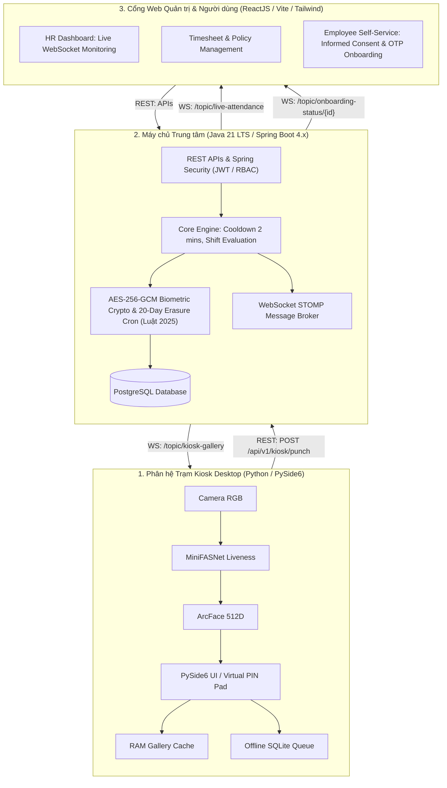
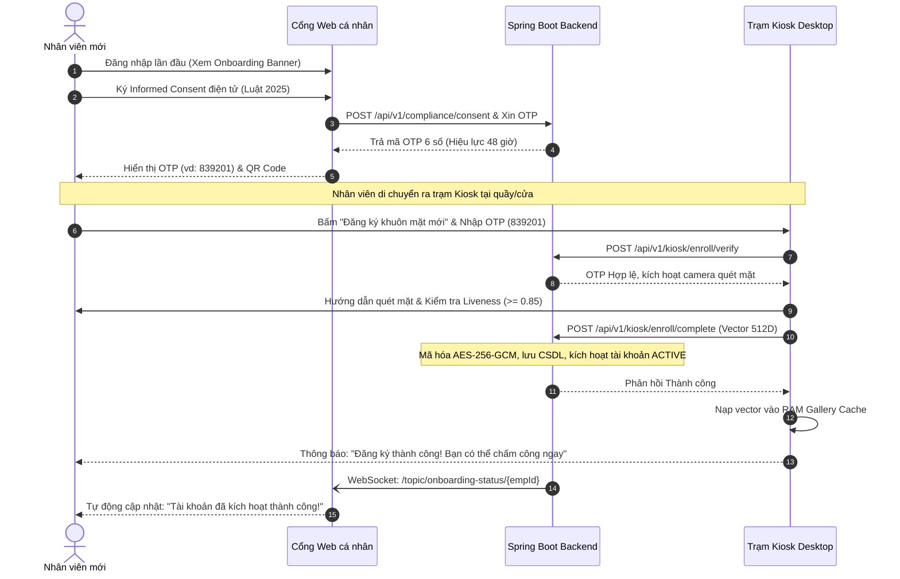

# Hệ thống Chấm công Sinh trắc học Đa tầng (Enterprise Face Attendance System)

[](#2-kiến-trúc-phân-tán-3-tầng-3-tier-distributed-architecture)
[](#1-trạm-kiosk-chấm-công-kiosk-app---python)
[](#2-máy-chủ-trung-tâm-backend-service---java-spring-boot)
[](#3-cổng-web-quản-trị--tự-phục-vụ-web-portal---reactjs)
[](#7-giấy-phép--bản-quyền)

---

## 1. Giới thiệu Dự án

**Enterprise Face Attendance System** là giải pháp chấm công sinh trắc học khuôn mặt phân tán 3 tầng theo tiêu chuẩn doanh nghiệp thực tế. Hệ thống giải quyết trọn vẹn bài toán chống gian lận, trải nghiệm người dùng không chạm (touchless), khả năng vận hành liên tục khi mất mạng (offline resiliency), và đặc biệt tuân thủ tuyệt đối **Luật Bảo vệ dữ liệu cá nhân 2025** & **Nghị định 356/2025/NĐ-CP**.

---

## 🚀 Hướng dẫn Khởi chạy Nhanh (Quickstart)

Khởi động nhanh toàn bộ cụm dịch vụ Full-stack qua Docker và PowerShell:

```powershell
# 1. Khởi động PostgreSQL, Backend Spring Boot, Web Portal
.\scripts\manage-services.ps1 start

# 2. Bơm dữ liệu mẫu kiểm thử
.\scripts\manage-services.ps1 seed

# 3. Khởi chạy Trạm Kiosk Desktop
python app/kiosk-app/main.py --dev
```

### 🧭 Bản Đồ Điều Hướng Không Gian Làm Việc (Workspace Manifests)
Mỗi không gian làm việc trong dự án sở hữu một tệp `README.md` độc lập đóng vai trò bản kê thông tin (metadata manifest):
* 📦 **Ứng dụng & Dịch vụ ([`app/README.md`](app/README.md))**: Danh mục các phân hệ thực thi Kiosk, Backend và Web Portal.
  * 🖥️ **Trạm Kiosk ([`app/kiosk-app/README.md`](app/kiosk-app/README.md))**: Bảng cờ lệnh CLI (`--dev`, `--prod`, `--no-camera`, `--no-liveness`), phím tắt F1-F12, kiểm thử Edge AI.
  * ⚙️ **Máy chủ Trung tâm ([`app/backend-service/README.md`](app/backend-service/README.md))**: Khởi chạy Spring Boot 3.4+, CSDL PostgreSQL, Flyway, cấu hình STOMP broker.
  * 🌐 **Cổng Web ([`app/web-portal/README.md`](app/web-portal/README.md))**: React 18, Vite, live dashboard STOMP, kiểm thử giao diện.
* 🧪 **Trung Tâm Kiểm Thử ([`tests/README.md`](tests/README.md))**: Kim tự tháp kiểm thử 5 tầng, FlaUI Windows Desktop E2E, visual regression và toàn bộ dữ liệu báo cáo đầu ra đóng gói tại [`tests/reports/`](tests/reports/README.md).
* 🛠️ **DevOps & Tự Động Hóa ([`scripts/README.md`](scripts/README.md))**: Cẩm nang `manage-services.ps1`, Docker Compose, nạp dữ liệu mẫu và chuẩn bị AI model.
* 📑 **Cổng Tài Liệu & Kiến Trúc ([`docs/README.md`](docs/README.md))**: Cổng tài liệu vòng đời kỹ nghệ SDLC (PRD, SRS, RTM, ADR-001..005, 8 Feature vertical slices, Runbooks).
  * 👤 **Cẩm Nang Người Dùng ([`docs/user-guide.md`](docs/user-guide.md))**: Hướng dẫn nhân viên ký đồng thuận, nhận OTP và điểm danh khuôn mặt.

---

## 2. Kiến trúc Phân tán 3 Tầng (3-Tier Distributed Architecture)



---

## 3. Ba Phân hệ Nòng cốt

### 1. Trạm Kiosk Chấm công (`kiosk-app` - Python)
* **Công nghệ**: Python 3.10+, PySide6, OpenCV, ONNX Runtime (CPU OpenVINO/DirectML).
* **Tính năng chính**:
  - Giao diện cảm ứng trạm độc lập, hiển thị video preview $\ge 15\text{ FPS}$ kèm khung dẫn hướng.
  - Xử lý Edge AI cục bộ: Phát hiện khuôn mặt, Liveness Passive (MiniFASNet $\ge 0.85$), Trích xuất vector ArcFace 512D và đối sánh Cosine Similarity với RAM Gallery Cache trong $\le 350\text{ ms}$.
  - **Bàn phím ảo PIN Pad (F2)**: Cơ chế dự phòng khi lỗi nhận diện, tự động khóa 15 phút sau 5 lần nhập sai.
  - **Hàng đợi Ngoại tuyến (SQLite)**: Chấm công bình thường khi mất kết nối mạng, tự động đồng bộ bù $100\%$ khi có Internet trở lại.
  - **Kiosk Self-Enrollment**: Nhập mã OTP 6 số từ Cổng Web để quét mặt lần đầu trực tiếp tại trạm, đảm bảo $100\%$ không dùng ảnh tải lên.

### 2. Máy chủ Trung tâm (`backend-service` - Java Spring Boot)
* **Công nghệ**: Java 21 LTS, Spring Boot 4.x, Spring Security, Spring WebSocket STOMP, Spring Data JPA, PostgreSQL.
* **Tính năng chính**:
  - Quản lý định danh, phân quyền RBAC (ADMIN, HR_MANAGER, EMPLOYEE, KIOSK_DEVICE).
  - Quy tắc chấm công chặt chẽ: Phân định Check-in/Check-out, Cooldown 2 phút chống trùng lặp, tính ca kíp đi muộn/về sớm.
  - Quy trình sinh mã OTP 6 số kích hoạt (hạn 48 giờ) sau khi nhân viên ký điện tử *Informed Consent*.
  - **Bảo mật sinh trắc học**: Mã hóa vector ArcFace bằng **AES-256-GCM** (chuẩn FIPS), Master Key quản trị độc lập.
  - **Tuân thủ Luật 2025**: Tiến trình `@Scheduled` chạy ngầm hàng ngày, tự động xóa vĩnh viễn vector của nhân viên nghỉ việc sau 20 ngày.
  - **Message Broker Real-time**: Bắn sự kiện tức thì qua WebSocket STOMP xuống Web Dashboard và trạm Kiosk.

### 3. Cổng Web Quản trị & Tự phục vụ (`web-portal` - ReactJS)
* **Công nghệ**: ReactJS 18+, TypeScript, Vite, Tailwind CSS, Lucide Icons, SockJS + STOMP client.
* **Tính năng chính**:
  - **Live Attendance Dashboard**: Bảng điều khiển thời gian thực cập nhật quân số và danh sách chấm công ngay tức khắc qua WebSocket mà không cần F5.
  - **Employee Self-Service**: Nhân viên mới đăng nhập lần đầu, đọc và ký cam kết bảo vệ dữ liệu cá nhân, nhận mã OTP/QR 6 số để ra trạm Kiosk kích hoạt tài khoản; theo dõi bảng công cá nhân.
  - **Quản lý Nhân sự & Báo cáo**: Quản lý hồ sơ, phân ca, lọc bảng công theo tiêu chí và xuất file Excel an toàn (chống tấn công Formula Injection).

---

## 4. Quy trình Kích hoạt Tài khoản & Quét mặt Đa tầng (Onboarding Flow)



---

## 5. Bộ Tài liệu Kỹ thuật Toàn diện (Documentation Suite)

Tài liệu dự án tuân thủ chuẩn mực kỹ nghệ phần mềm quốc tế (ISO/IEC/IEEE 29119, C4 Model, Architecture Decision Records) và được quản lý tập trung tại [`docs/README.md`](docs/README.md):

| Nhánh Tài Liệu | Đường Dẫn Canonical | Trách Nhiệm & Nội Dung Chính |
| :--- | :--- | :--- |
| **Cổng Tài Liệu Master** | [**`docs/README.md`**](docs/README.md) | Bản đồ điều hướng 3 pha SDLC (Foundation, Feature Loop, Release & Operations). |
| **Khám Phá Bài Toán (Discovery)** | [**`docs/discovery/fas/opportunity-brief.md`**](docs/discovery/fas/opportunity-brief.md) | Vấn nạn quẹt thẻ hộ, ùn tắc đầu ca do vân tay và 4 giả thuyết cốt lõi đã kiểm chứng. |
| **Yêu Cầu Sản Phẩm (PRD)** | [**`docs/prd.md`**](docs/prd.md) | PRD toàn diện: 4 nhóm tác nhân, 8 Epics lớn, SLA $\le 350\text{ ms}$, tuân thủ Luật Bảo vệ dữ liệu 2025. |
| **Đặc Tả Kỹ Thuật (SRS & RTM)** | [**`docs/specs/SRS.md`**](docs/specs/SRS.md) \| [**`RTM.md`**](docs/specs/RTM.md) | 22 yêu cầu chức năng, 10 tiêu chuẩn phi chức năng và ma trận truy vết hai chiều. |
| **Kiến Trúc & Hợp Đồng** | [**`docs/architecture.md`**](docs/architecture.md) \| [**`contracts/`**](contracts/README.md) | Kiến trúc C4, data contracts, OpenAPI REST, STOMP broker và triết lý Zero-Photo-Upload. |
| **Bản Ghi Quyết Định (ADR)** | [**`docs/adr/README.md`**](docs/adr/README.md) | 5 quyết định kiến trúc: Zero-Photo-Upload, SQLite WAL, AES-256-GCM, STOMP, PIN Fallback. |
| **Lát Cắt Tính Năng (8 Features)** | [**`docs/features/`**](docs/features/) | 8 vertical slices: `FEAT-ENROLL-001` đến `FEAT-COMPLY-001` (Spec, Tasks, Acceptance Report). |
| **Vận Hành & Khôi Phục Thảm Họa** | [**`docs/runbooks/`**](docs/runbooks/) | Runbooks Kiosk, Backend và Disaster Recovery sao lưu/khôi phục CSDL. |
| **Cẩm Nang Người Dùng** | [**`docs/user-guide.md`**](docs/user-guide.md) | Hướng dẫn trải nghiệm nhân viên: Ký đồng thuận, lấy mã OTP, đăng ký khuôn mặt tại Kiosk. |

---

## 6. Cấu trúc Mã nguồn Không gian Làm việc (Workspace Monorepo Layout)

```bash
face-attendance-system/
├── app/                             # [app/README.md] Applications Hub: 3 phân hệ thực thi
│   ├── kiosk-app/                   # [app/kiosk-app/README.md] Trạm Kiosk Desktop (PySide6 / Edge AI)
│   ├── backend-service/             # [app/backend-service/README.md] Máy chủ Trung tâm (Spring Boot 3.4+)
│   └── web-portal/                  # [app/web-portal/README.md] Cổng Web Quản trị & Tự phục vụ (React 18)
│
├── contracts/                       # [contracts/README.md] Hợp đồng giao tiếp máy đọc (OpenAPI, STOMP)
├── docs/                            # [docs/README.md] Cổng tài liệu SDLC (PRD, SRS, ADR, Features, Runbooks)
├── scripts/                         # [scripts/README.md] Bộ công cụ DevOps & điều phối (manage-services.ps1)
├── tests/                           # [tests/README.md] Testing Hub 5 tầng: E2E FlaUI, Visual Regression
│   └── reports/                     # [tests/reports/README.md] Toàn bộ artifacts, screenshots & audit JSON
│
├── docker-compose.yml               # Cấu hình cụm container dịch vụ (PostgreSQL, Backend, Web Portal)
├── AGENTS.md                        # Hiến chương dự án & Tool Isolation Boundary
└── README.md                        # Monorepo Landing Page
```

---

## 7. Giấy phép & Bản quyền
Dự án được xây dựng và phát hành theo giấy phép nội bộ của Doanh nghiệp. Tuân thủ nghiêm ngặt Luật Bảo vệ dữ liệu cá nhân Việt Nam 2025 và các tiêu chuẩn bảo mật sinh trắc học quốc tế.
