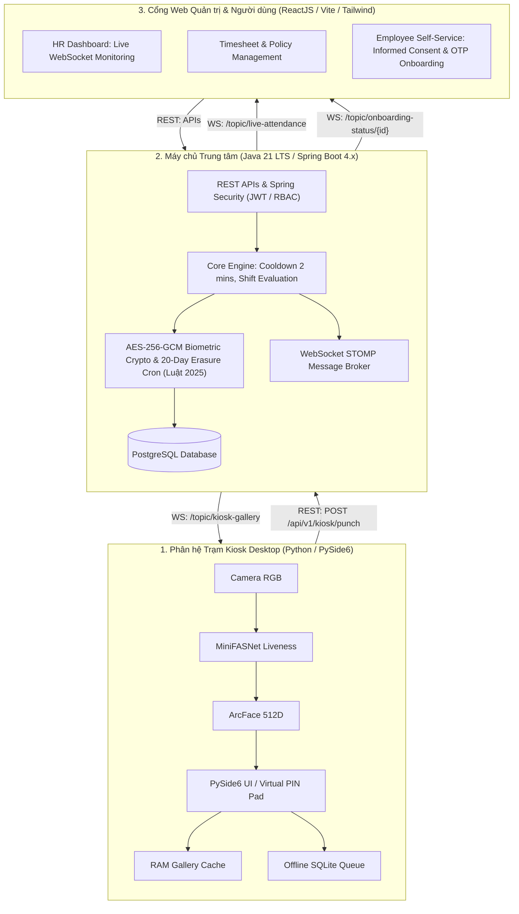
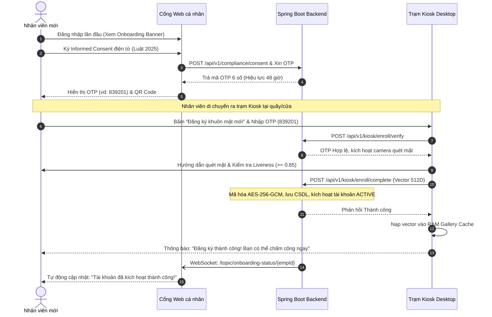

# Hệ thống Chấm công Sinh trắc học Đa tầng (Enterprise Face Attendance System)

[](#2-kiến-trúc-phân-tán-3-tầng-3-tier-distributed-architecture)
[](#1-trạm-kiosk-chấm-công-kiosk-app---python)
[](#2-máy-chủ-trung-tâm-backend-service---java-spring-boot)
[](#3-cổng-web-quản-trị--tự-phục-vụ-web-portal---reactjs)
[](#7-giấy-phép--bản-quyền)

---

## 1. Giới thiệu Dự án

**Enterprise Face Attendance System** là giải pháp chấm công sinh trắc học khuôn mặt phân tán 3 tầng theo tiêu chuẩn doanh nghiệp thực tế. Hệ thống giải quyết trọn vẹn bài toán chống gian lận, trải nghiệm người dùng không chạm (touchless), khả năng vận hành liên tục khi mất mạng (offline resiliency), và đặc biệt tuân thủ tuyệt đối **Luật Bảo vệ dữ liệu cá nhân 2025** & **Nghị định 356/2025/NĐ-CP**.

---

## 2. Kiến trúc Phân tán 3 Tầng (3-Tier Distributed Architecture)



---

## 3. Ba Phân hệ Nòng cốt

### 1. Trạm Kiosk Chấm công (`kiosk-app` - Python)
* **Công nghệ**: Python 3.10+, PySide6, OpenCV, ONNX Runtime (CPU OpenVINO/DirectML).
* **Tính năng chính**:
  - Giao diện cảm ứng trạm độc lập, hiển thị video preview $\ge 15\text{ FPS}$ kèm khung dẫn hướng.
  - Xử lý Edge AI cục bộ: Phát hiện khuôn mặt, Liveness Passive (MiniFASNet $\ge 0.85$), Trích xuất vector ArcFace 512D và đối sánh Cosine Similarity với RAM Gallery Cache trong $\le 350\text{ ms}$.
  - **Bàn phím ảo PIN Pad (F2)**: Cơ chế dự phòng khi lỗi nhận diện, tự động khóa 15 phút sau 5 lần nhập sai.
  - **Hàng đợi Ngoại tuyến (SQLite)**: Chấm công bình thường khi mất kết nối mạng, tự động đồng bộ bù $100\%$ khi có Internet trở lại.
  - **Kiosk Self-Enrollment**: Nhập mã OTP 6 số từ Cổng Web để quét mặt lần đầu trực tiếp tại trạm, đảm bảo $100\%$ không dùng ảnh tải lên.

### 2. Máy chủ Trung tâm (`backend-service` - Java Spring Boot)
* **Công nghệ**: Java 21 LTS, Spring Boot 4.x, Spring Security, Spring WebSocket STOMP, Spring Data JPA, PostgreSQL.
* **Tính năng chính**:
  - Quản lý định danh, phân quyền RBAC (ADMIN, HR_MANAGER, EMPLOYEE, KIOSK_DEVICE).
  - Quy tắc chấm công chặt chẽ: Phân định Check-in/Check-out, Cooldown 2 phút chống trùng lặp, tính ca kíp đi muộn/về sớm.
  - Quy trình sinh mã OTP 6 số kích hoạt (hạn 48 giờ) sau khi nhân viên ký điện tử *Informed Consent*.
  - **Bảo mật sinh trắc học**: Mã hóa vector ArcFace bằng **AES-256-GCM** (chuẩn FIPS), Master Key quản trị độc lập.
  - **Tuân thủ Luật 2025**: Tiến trình `@Scheduled` chạy ngầm hàng ngày, tự động xóa vĩnh viễn vector của nhân viên nghỉ việc sau 20 ngày.
  - **Message Broker Real-time**: Bắn sự kiện tức thì qua WebSocket STOMP xuống Web Dashboard và trạm Kiosk.

### 3. Cổng Web Quản trị & Tự phục vụ (`web-portal` - ReactJS)
* **Công nghệ**: ReactJS 18+, TypeScript, Vite, Tailwind CSS, Lucide Icons, SockJS + STOMP client.
* **Tính năng chính**:
  - **Live Attendance Dashboard**: Bảng điều khiển thời gian thực cập nhật quân số và danh sách chấm công ngay tức khắc qua WebSocket mà không cần F5.
  - **Employee Self-Service**: Nhân viên mới đăng nhập lần đầu, đọc và ký cam kết bảo vệ dữ liệu cá nhân, nhận mã OTP/QR 6 số để ra trạm Kiosk kích hoạt tài khoản; theo dõi bảng công cá nhân.
  - **Quản lý Nhân sự & Báo cáo**: Quản lý hồ sơ, phân ca, lọc bảng công theo tiêu chí và xuất file Excel an toàn (chống tấn công Formula Injection).

---

## 4. Quy trình Kích hoạt Tài khoản & Quét mặt Đa tầng (Onboarding Flow)



---

## 5. Bộ Tài liệu Kỹ thuật Toàn diện (Documentation Suite)

Bộ tài liệu được xây dựng chuẩn mực theo mô hình kỹ nghệ phần mềm quốc tế (ISO/IEC/IEEE 29119, IEEE 829, C4 Model, Architecture Decision Records):

| Tài liệu | Tên gọi chuẩn | Mô tả & Nội dung chính |
| :--- | :--- | :--- |
| **[`docs/README.md`](docs/README.md)** | Engineering Contract | Hướng dẫn cấu trúc tài liệu công nghệ phần mềm 6 pha chuẩn quốc tế. |
| **[`docs/initiation/PI.md`](docs/initiation/PI.md)** | Project Initiation (PID) | Bối cảnh kinh doanh, ROI, TCO, Phân tích 5 chiều khả thi, SOW, Sơ đồ tổ chức RACI. |
| **[`docs/initiation/tech-stack.md`](docs/initiation/tech-stack.md)** | Technology Strategy | Đặc tả danh mục công nghệ và công cụ chiến lược, luận cứ chọn PySide6/Spring/React. |
| **[`docs/planning/PP.md`](docs/planning/PP.md)** | Project Plan (PMP) | Kế hoạch 5 Phase, WBS 3 phân hệ, Biểu đồ Gantt, CPM Đường găng, Quản lý rủi ro 3 chiều. |
| **[`docs/requirements/SRS.md`](docs/requirements/SRS.md)** | Requirements Spec (Modular) | Master SRS Hub & 5 tài liệu phân rã chuyên sâu: `functional.md`, `use-cases.md`, `business-rules.md`, `non-functional.md`, `rtm.md`. |
| **[`docs/design/DDS.md`](docs/design/DDS.md)** | Detailed Design Spec (Modular) | Master DDS Hub & 7 tài liệu thiết kế chuyên sâu: `adrs.md`, `components.md`, `infrastructure.md`, `api-contracts.md`, `database.md`, `behavioral.md`, `ui-ux.md`. |
| **[`docs/testing/TP.md`](docs/testing/TP.md)** | Master Test Plan | Kim tự tháp kiểm thử, Bộ Test Cases chi tiết (TC-BIO, TC-FAS, TC-ENR, TC-NET, TC-WS), Ma trận TTM. |

---

## 6. Cấu trúc Mã nguồn Không gian Làm việc (Workspace Monorepo Layout)

```bash
face-attendance-system/
├── app/
│   ├── kiosk-app/                   # Phân hệ Trạm Kiosk Desktop (Python 3.10+ / PySide6)
│   │   ├── src/
│   │   │   ├── ai/                  # MiniFASNet (Liveness) & ArcFace ONNX inference
│   │   │   ├── gui/                 # PySide6 UI (Live preview, Virtual PIN Pad, OTP Dialog)
│   │   │   ├── db/                  # SQLite offline queue & local cache
│   │   │   └── network/             # REST client & WebSocket STOMP subscriber
│   │   ├── requirements.txt
│   │   └── main.py
│   │
│   ├── backend-service/             # Phân hệ Máy chủ Trung tâm (Java 21 LTS / Spring Boot 4.x)
│   │   ├── src/main/java/com/attendance/
│   │   │   ├── config/              # Security, WebSocket STOMP, Crypto config
│   │   │   ├── controller/          # RESTful Endpoints (Kiosk, Employee, Compliance)
│   │   │   ├── service/             # Attendance, Biometric AES-256, Onboarding OTP, Cron
│   │   │   ├── repository/          # Spring Data JPA Entities & Repositories
│   │   │   └── websocket/           # Event Push Handlers
│   │   ├── Dockerfile               # Multi-stage Docker build
│   │   └── pom.xml
│   │
│   └── web-portal/                  # Phân hệ Cổng Web Quản trị & Người dùng (ReactJS / Vite)
│       ├── src/
│       │   ├── components/          # Reusable UI widgets, Modals, Camera guides
│       │   ├── pages/               # Dashboard (Live WS), Timesheet, Onboarding, Reports
│       │   ├── hooks/               # useWebSocket, useAuth
│       │   └── services/            # Axios API clients
│       ├── Dockerfile               # Multi-stage Docker build (Nginx alpine)
│       ├── package.json
│       └── vite.config.ts
│
├── infrastructure/
│   └── docker/                      # docker-compose.yml, docker-compose.dev.yml
└── docs/                            # Toàn bộ Bộ tài liệu Kỹ thuật (PI, PP, SRS, DDS, TP)
```

---

## 7. Giấy phép & Bản quyền
Dự án được xây dựng và phát hành theo giấy phép nội bộ của Doanh nghiệp. Tuân thủ nghiêm ngặt Luật Bảo vệ dữ liệu cá nhân Việt Nam 2025 và các tiêu chuẩn bảo mật sinh trắc học quốc tế.
