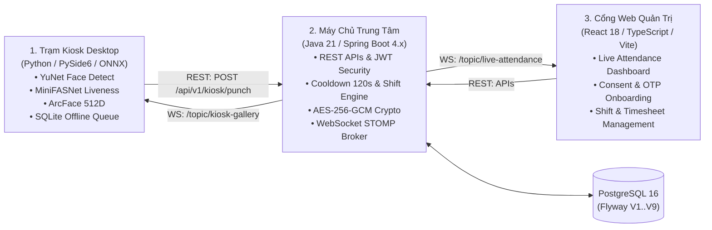

# Enterprise Face Attendance System (FAS)

Hệ thống chấm công sinh trắc học khuôn mặt phân tán 3 tầng theo tiêu chuẩn doanh nghiệp, tuân thủ Luật Bảo vệ dữ liệu cá nhân & Nghị định 356/2025/NĐ-CP (Zero-Photo-Upload, mã hóa AES-256-GCM, tự động xóa mẫu sau 20 ngày).

---

## Khởi Chạy Nhanh (Quickstart)

```bash
# 1. Khởi động toàn bộ cụm dịch vụ Full-stack
docker compose up -d --build

# 2. Nạp dữ liệu mẫu Staging (5 Kiosk, 6 Ca làm việc, 14 Nhân sự)
docker exec -i fas-postgres psql -U fas_admin -d fas_db < database/seeds/seed-staging-data.sql

# 3. Khởi chạy Trạm Kiosk Desktop (Chế độ Dev)
python apps/kiosk-app/main.py --dev
```

* **Web Portal:** [http://localhost:5173](http://localhost:5173) (Tài khoản: `staging-admin@fas.company.com` / `StagingAdmin@2026!`)
* **Backend API:** [http://localhost:8080/swagger-ui.html](http://localhost:8080/swagger-ui.html) | Health: [http://localhost:8080/actuator/health](http://localhost:8080/actuator/health)
* **PostgreSQL:** `localhost:5432` (`fas_db` / `fas_admin`)

---

## Danh Mục Điều Hướng 9 Không Gian Cấp 2 (Master Subspace Catalog)

Hệ thống tuân thủ mô hình **Metadata 2 Cấp (Flat Two-Tier)**. Mọi chi tiết kỹ thuật được định vị trực tiếp tại 9 không gian cấp 2 dưới đây:

| Không gian Cấp 2 | Phân loại | Công nghệ cốt lõi | Trách nhiệm & Chỉ mục nghiệp vụ |
| :--- | :--- | :--- | :--- |
| [**`apps/backend-service/`**](apps/backend-service/README.md) | Dịch vụ Trung tâm | Java 21, Spring Boot 4.x, PostgreSQL, JPA, STOMP | REST APIs (Auth, Kiosk, Admin), tính ca kíp, mã hóa AES-256-GCM, cron 20 ngày |
| [**`apps/kiosk-app/`**](apps/kiosk-app/README.md) | Trạm Kiosk Biên | Python 3.12, PySide6 QML, OpenCV, ONNX Runtime | Điểm danh thời gian thực, MiniFASNet Liveness, ArcFace 512D, hàng đợi SQLite |
| [**`apps/web-portal/`**](apps/web-portal/README.md) | Cổng Web SPA | React 18, TypeScript, Vite, Tailwind CSS, Zustand | Bảng giám sát quân số Live STOMP, Onboarding OTP, quản trị nhân sự & ca kíp |
| [**`database/`**](database/README.md) | Quản trị CSDL | PostgreSQL 16, Flyway V1-V9, SQLite | Sơ đồ quan hệ ERD, 9 tệp Flyway migration, bộ dữ liệu mẫu (Seeds), kịch bản dọn dẹp |
| [**`contracts/`**](contracts/README.md) | Hợp đồng Giao tiếp | OpenAPI 3.0.3, STOMP 1.2, JSON Schema | Hợp đồng REST `openapi.yaml`, WebSocket `stomp-websocket.yaml`, Domain models |
| [**`tests/`**](tests/README.md) | Trung tâm Kiểm thử | Pytest, Playwright, FlaUI, Vitest | Kim tự tháp kiểm thử 3 tầng: Desktop Kiosk, Web Portal E2E, System Integration |
| [**`docs/`**](docs/README.md) | Cổng Tài liệu SDLC | Markdown, Mermaid | Bản đồ vòng đời 3-Phase: PRD, SRS, RTM, Kiến trúc C4, 5 ADRs, 8 Vertical Features |
| [**`scripts/`**](scripts/README.md) | Tự động hóa & DevOps | Python, Docker Compose | Tải trọng số mô hình AI ONNX, lệnh điều phối hạ tầng container chuẩn |
| [**`.agents/`**](.agents/README.md) | Không gian Tác tử AI | Rules, Skills, AST Map, Reports | Rào chắn hành vi, 5 Siêu kỹ năng Big Tech, báo cáo review YAML, task tracking |

---

## Kiến Trúc Phân Tán 3 Tầng (3-Tier Distributed Architecture)


