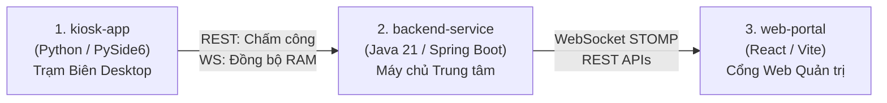

# Danh mục Các Phân hệ Ứng dụng (`app/`)

> **Mã phân vùng:** `WORKSPACE-APP`  
> **Cấp độ không gian:** Parent Workspace (Applications Hub)  
> **Đường dẫn:** `app/`  
> **Không gian cha:** [`README.md`](../README.md) (Thư mục Gốc)  
> **Trách nhiệm cốt lõi (Single Responsibility):** Quản lý mã nguồn (Source Code) và kiểm thử đơn vị nội bộ (In-process Unit Tests) của 3 phân hệ dịch vụ nòng cốt trong kiến trúc phân tán 3 tầng của Face Attendance System.

---

## 1. Tổng quan Kiến trúc 3 Phân hệ Nòng cốt

Hệ sinh thái FAS bao gồm 3 phân hệ độc lập về mặt công nghệ, giao tiếp chặt chẽ qua các hợp đồng chuẩn hóa trong [`contracts/`](../contracts/):

---

## 2. Bản đồ Danh mục Dịch vụ (Service Catalog)

| Phân hệ | Cấp độ | Công nghệ cốt lõi | Vai trò nghiệp vụ trong FAS | Tài liệu chi tiết |
|:---|:---|:---|:---|:---:|
| [**`backend-service`**](backend-service/) | Microservice | Java 21, Spring Boot 4.x, PostgreSQL, Flyway, STOMP | Xử lý chấm công, tính ca kíp, mã hóa AES-256-GCM, quản lý OTP, xóa vector sau 20 ngày | 👉 [`backend-service/README.md`](backend-service/README.md) |
| [**`kiosk-app`**](kiosk-app/) | Edge Client | Python 3.14+, PySide6 QML, OpenCV, ONNX Runtime | Điểm danh khuôn mặt không chạm thời gian thực, Liveness chống giả mạo, đệm SQLite ngoại tuyến | 👉 [`kiosk-app/README.md`](kiosk-app/README.md) |
| [**`web-portal`**](web-portal/) | Web App | React 18, TypeScript, Tailwind CSS, Vite, SockJS | Bảng điều khiển quân số trực tiếp (Live Attendance), Cổng tự phục vụ ký cam kết và quản lý ca | 👉 [`web-portal/README.md`](web-portal/README.md) |

---

## 3. Quy tắc Không gian & Chính sách Git

* **Ranh giới trách nhiệm**: Thư mục `app/` chỉ chứa mã nguồn ứng dụng và unit test của từng phân hệ. Tuyệt đối không chứa:
  - Hợp đồng máy đọc chung $\rightarrow$ nằm tại [`contracts/`](../contracts/).
  - Kiểm thử tích hợp đa dịch vụ, E2E và Visual regression $\rightarrow$ nằm tại [`tests/`](../tests/).
  - Báo cáo kết quả chạy test và kho ảnh chụp $\rightarrow$ nằm tại [`reports/`](../reports/).
  - Kịch bản hạ tầng và DevOps $\rightarrow$ nằm tại [`scripts/`](../scripts/).
* **Tài nguyên theo dõi (Tracked)**: Toàn bộ mã nguồn và tệp cấu hình của từng phân hệ.
* **Tài nguyên bỏ qua (Ignored 100%)**: `node_modules/`, `target/`, `.venv/`, `.pytest_cache/`, `dist/`, các tệp cơ sở dữ liệu `*.db`.
