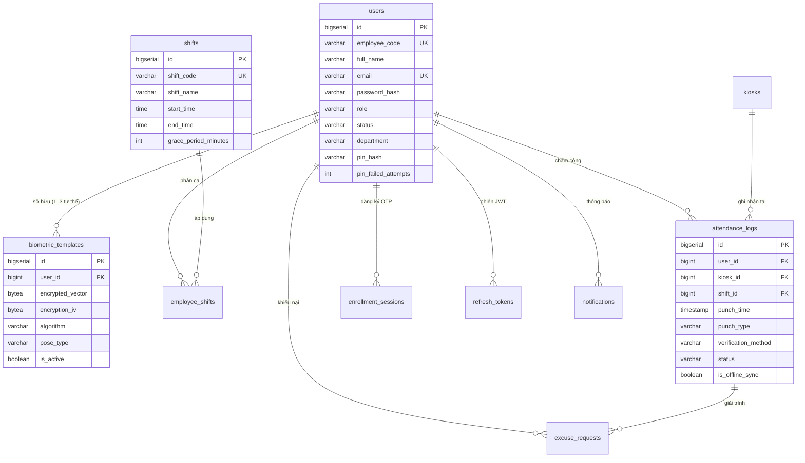

# Trung Tâm Quản Trị Cơ Sở Dữ Liệu (`database/`)

> **Cấp độ không gian:** Cấp 2 (Database Hub)  
> **Không gian cha:** [`README.md`](../README.md) (Thư mục Gốc)  
> **Công nghệ lưu trữ:** PostgreSQL 16 (Container `fas-postgres`), Flyway 10.x, SQLite (Edge Kiosk).

---

## 1. Sơ Đồ Thực Thể Liên Kết (ERD)



---

## 2. Danh Mục Các Phiên Bản Migration (Flyway V1..V9)

Toàn bộ script DDL gốc nằm tại [`apps/backend-service/src/main/resources/db/migration/`](../apps/backend-service/src/main/resources/db/migration/):

| Phiên Bản | Tệp Migration | Phạm Vi Thay Đổi Cốt Lõi |
| :---: | :--- | :--- |
| **`V1`** | `V1__initial_schema.sql` | Khởi tạo 8 bảng gốc: `users`, `shifts`, `kiosks`, `attendance_logs`, `biometric_templates`... |
| **`V2`** | `V2__add_credential_lifecycle.sql` | Bổ sung cờ bắt buộc đổi mật khẩu lần đầu |
| **`V3`** | `V3__add_excuse_requests_and_kiosk_lifecycle.sql` | Bổ sung bảng đơn giải trình `excuse_requests` và chỉ mục kiểm toán |
| **`V4`** | `V4__add_lifecycle_entities.sql` | Bổ sung kỳ công lương `payroll_periods`, `refresh_tokens`, `notifications` |
| **`V5`** | `V5__drop_must_change_password.sql` | Tối ưu hóa chu trình đăng nhập lần đầu |
| **`V6`** | `V6__add_pin_failed_attempts.sql` | Bổ sung bộ đếm số lần nhập sai mã PIN và khóa trạm tạm thời |
| **`V7`** | `V7__add_audit_logs_entity_type_created_idx.sql` | Bổ sung chỉ mục hiệu năng cho bảng nhật ký kiểm toán |
| **`V8`** | `V8__add_pose_type_to_biometric_templates.sql` | Thêm cột `pose_type` lưu 3 tư thế khuôn mặt (`FRONTAL`, `LEFT_TILT`, `RIGHT_TILT`) |
| **`V9`** | `V9__performance_and_foreign_key_indexes.sql` | Bổ sung chỉ mục khóa ngoại, Composite Index và Partial Index tăng tốc truy vấn |

---

## 3. Danh Mục Bộ Dữ Liệu Mẫu (Seeds & Scripts)

| Đường dẫn tệp | Loại tài nguyên | Mục đích sử dụng |
| :--- | :--- | :--- |
| [**`database/seeds/seed-staging-data.sql`**](seeds/seed-staging-data.sql) | Dữ liệu Staging/UAT | Nạp 5 Kiosk, 6 Ca kíp, 14 Nhân sự (đủ role), 24 logs điểm danh mẫu |
| [**`database/seeds/seed-e2e-data.sql`**](seeds/seed-e2e-data.sql) | Dữ liệu Test E2E | Phục vụ bộ chạy tự động FlaUI, Playwright và System Integration |
| [**`database/scripts/clean-db-data.sql`**](scripts/clean-db-data.sql) | Kịch bản dọn dẹp | `TRUNCATE CASCADE` toàn bộ dữ liệu nghiệp vụ, giữ nguyên bảng phân ca và admin gốc |

---

## 4. Lệnh Thao Tác CSDL Thường Dùng

```bash
# 1. Nạp dữ liệu mẫu Staging vào container đang chạy
docker exec -i fas-postgres psql -U fas_admin -d fas_db < database/seeds/seed-staging-data.sql

# 2. Làm sạch toàn bộ dữ liệu nghiệp vụ về trạng thái ban đầu
docker exec -i fas-postgres psql -U fas_admin -d fas_db < database/scripts/clean-db-data.sql

# 3. Đăng nhập trực tiếp vào dòng lệnh psql của CSDL
docker exec -it fas-postgres psql -U fas_admin -d fas_db
```
