# Trung Tâm Quản Trị Cơ Sở Dữ Liệu (`database/`)

> **Mã phân vùng:** `WORKSPACE-DATABASE`  
> **Cấp độ không gian:** Parent Database & Data Management Hub  
> **Đường dẫn:** `database/`  
> **Không gian cha:** [`README.md`](../README.md) (Thư mục Gốc)  
> **Công nghệ lưu trữ:** PostgreSQL 16 (Container `fas-postgres`), Flyway 10.x, SQLite (Edge Kiosk)  
> **Trách nhiệm cốt lõi (Single Responsibility):** Quản lý tập trung toàn bộ kiến trúc CSDL hệ thống, sơ đồ quan hệ thực thể (ERD), bộ dữ liệu mẫu (Seeds) cho môi trường Dev/Staging, các kịch bản làm sạch dữ liệu (Data Cleanup) và cẩm nang vòng đời lược đồ bảng (Migrations).

---

## 1. Sơ Đồ Quan Hệ Thực Thể Tổng Quan (ERD Diagram)

```mermaid
erDiagram
    users ||--o{ biometric_templates : "sở hữu (1..N tư thế)"
    users ||--o{ employee_shifts : "được phân công"
    users ||--o{ attendance_logs : "chấm công"
    users ||--o{ enrollment_sessions : "đăng ký OTP"
    users ||--o{ excuse_requests : "gửi giải trình"
    users ||--o{ refresh_tokens : "phiên đăng nhập"
    users ||--o{ notifications : "nhận thông báo"
    users ||--o{ consent_withdrawals : "rút đồng thuận"
    users ||--o{ data_subject_requests : "yêu cầu dữ liệu"
    users ||--o{ payroll_periods : "khóa/mở kỳ công"
    
    shifts ||--o{ employee_shifts : "áp dụng cho"
    kiosks ||--o{ attendance_logs : "ghi nhận tại"
    attendance_logs ||--o{ excuse_requests : "khiếu nại giải trình"

    users {
        bigserial id PK
        varchar employee_code UK
        varchar full_name
        varchar email UK
        varchar password_hash
        varchar role
        varchar status
        varchar department
        varchar pin_hash
        int pin_failed_attempts
    }

    biometric_templates {
        bigserial id PK
        bigint user_id FK
        bytea encrypted_vector
        bytea encryption_iv
        varchar algorithm
        varchar pose_type
        boolean is_active
    }

    shifts {
        bigserial id PK
        varchar shift_code UK
        varchar shift_name
        time start_time
        time end_time
        int grace_period_minutes
        boolean is_active
    }

    employee_shifts {
        bigserial id PK
        bigint user_id FK
        bigint shift_id FK
        date effective_from
        date effective_to
    }

    kiosks {
        varchar id PK
        varchar location_name
        varchar secret_token_hash
        boolean is_active
        timestamp last_ping_at
    }

    attendance_logs {
        bigserial id PK
        bigint user_id FK
        varchar kiosk_id FK
        timestamp punch_timestamp
        varchar punch_type
        varchar verification_method
        numeric confidence_score
        varchar status
        int late_minutes
        boolean is_offline_sync
    }

    excuse_requests {
        bigserial id PK
        bigint user_id FK
        bigint attendance_log_id FK
        varchar reason
        timestamp requested_punch_timestamp
        varchar status
        bigint decided_by FK
        timestamp decided_at
        varchar rejection_reason
    }

    enrollment_sessions {
        bigserial id PK
        bigint user_id FK
        varchar otp_hash
        varchar consent_version
        timestamp consent_signed_at
        varchar client_ip
        timestamp expires_at
        boolean is_used
    }

    payroll_periods {
        bigserial id PK
        int period_year
        int period_month
        varchar status
        bigint locked_by FK
        timestamp locked_at
        bigint unlocked_by FK
        timestamp unlocked_at
        varchar unlock_reason
    }

    refresh_tokens {
        bigserial id PK
        bigint user_id FK
        varchar token_hash UK
        timestamp expires_at
        timestamp revoked_at
        varchar client_ip
        varchar user_agent
    }

    notifications {
        bigserial id PK
        bigint user_id FK
        varchar event_type
        varchar title
        varchar body
        varchar reference_type
        varchar reference_id
        timestamp read_at
        timestamp created_at
    }

    consent_withdrawals {
        bigserial id PK
        bigint user_id FK
        timestamp withdrawn_at
        varchar client_ip
        timestamp biometric_disposal_due_at
        timestamp processed_at
    }

    data_subject_requests {
        bigserial id PK
        bigint user_id FK
        varchar request_type
        varchar detail
        varchar status
        bigint handled_by FK
        varchar response
        timestamp responded_at
    }

    audit_logs {
        bigserial id PK
        bigint actor_id FK
        varchar action
        varchar entity_type
        varchar entity_id
        jsonb before_state
        jsonb after_state
    }
```



---

## 2. Bản Đồ Cấu Trúc Không Gian Dữ Liệu (Internal Layout)

| Phân Vùng / Thư Mục | Loại Dữ Liệu | Mục Đích & Trách Nhiệm Chi Tiết |
| :--- | :--- | :--- |
| [**`seeds/`**](seeds/) | SQL Fixtures | Chứa các kịch bản nạp dữ liệu mẫu:<br/>• [**`seed-e2e-data.sql`**](seeds/seed-e2e-data.sql): Dữ liệu mẫu E2E cho môi trường phát triển cục bộ (Local Dev).<br/>• [**`seed-staging-data.sql`**](seeds/seed-staging-data.sql): Dữ liệu chuẩn doanh nghiệp cho môi trường tiền phát hành (Staging/UAT), đầy đủ 5 khối phòng ban, RBAC, và các case chấm công/giải trình thực tế. |
| [**`scripts/`**](scripts/) | SQL Utilities | Chứa các tiện ích quản trị dữ liệu (`clean-db-data.sql`): Dọn sạch dữ liệu thử nghiệm, xóa rác điểm danh, đưa hệ thống về trạng thái sạch (Clean State) mà không phá vỡ cấu trúc bảng. |
| [**`migrations/`**](migrations/) | Lược Đồ Bảng | Cẩm nang ghi chú và danh mục 8 phiên bản nâng cấp cấu trúc bảng tự động (Flyway `V1..V8`). Mã nguồn migration thực thi nằm tại [`app/backend-service/src/main/resources/db/migration/`](../app/backend-service/src/main/resources/db/migration/). |

---

## 3. Cẩm Nang Thao Tác CSDL Qua CLI (Cheat Sheet)

Toàn bộ thao tác nạp và dọn dẹp dữ liệu được thực thi trực tiếp qua lệnh Docker chuẩn (chạy được trên mọi hệ điều hành Windows, Linux, macOS):

### 1. Nạp dữ liệu mẫu toàn diện (E2E Demo Seed)
Nạp dữ liệu mẫu phát triển cục bộ (Local Dev):
```bash
docker exec -i fas-postgres psql -U fas_admin -d fas_db < database/seeds/seed-e2e-data.sql
```

### 2. Nạp dữ liệu chuẩn Doanh nghiệp cho Môi trường STAGING (Pre-production / UAT)
Nạp toàn bộ cơ cấu phòng ban, 4 trạm Kiosk địa bàn, mẫu 3 tư thế khuôn mặt, đơn giải trình và kỳ công cho môi trường Staging:
```bash
# Nạp trực tiếp vào container PostgreSQL Staging:
docker exec -i fas-postgres-staging psql -U fas_staging_admin -d fas_staging_db < database/seeds/seed-staging-data.sql
```

### 3. Dọn sạch dữ liệu thử nghiệm (Clean Mode)
Xóa toàn bộ dữ liệu chấm công và người dùng thử nghiệm, **chỉ giữ lại duy nhất tài khoản `admin@fas.company.com` gốc**:
```bash
# Đưa hệ thống về trạng thái sạch:
docker exec -i fas-postgres psql -U fas_admin -d fas_db < database/scripts/clean-db-data.sql
```

### 3. Sao lưu & Phục hồi CSDL (Backup & Restore)
```bash
# Xuất dump toàn bộ CSDL ra file:
docker exec -t fas-postgres pg_dump -U fas_admin fas_db > database/fas_db_backup.sql

# Phục hồi CSDL từ file dump:
docker exec -i fas-postgres psql -U fas_admin -d fas_db < database/fas_db_backup.sql
```

---

## 4. Bảng Phân Quyền Tài Khoản Mẫu

### A. Môi trường Staging ([`seeds/seed-staging-data.sql`](seeds/seed-staging-data.sql))
* Mật khẩu đăng nhập: **`Staging@FAS2026!`** (hoặc `StagingAdmin@2026!` đối với admin bootstrap)
* Mã PIN Kiosk: **`123456`**

| Mã Nhân Viên | Họ và Tên | Email Đăng Nhập | Vai Trò Hệ Thống (Role) | Phòng Ban |
| :--- | :--- | :--- | :--- | :--- |
| `STG-ADM-001` | Nguyễn Thành Nam | `staging-admin@fas.company.com` | `ADMIN` | Ban Quản Trị Hệ Thống |
| `STG-ADM-002` | Trần Quốc Bảo | `dpo.officer@fas.company.com` | `DPO` | Ban An Toàn & Pháp Chế |
| `STG-HR-001` | Lê Thị Thu Hương | `hr.manager@fas.company.com` | `HR_MANAGER` | Phòng Quản Trị Nhân Sự |
| `STG-HR-002` | Phạm Quỳnh Nga | `hr.specialist@fas.company.com` | `HR_MANAGER` | Phòng Quản Trị Nhân Sự |
| `STG-ENG-001` | Vũ Hoàng Đăng | `tech.lead@fas.company.com` | `EMPLOYEE` | Khối Kỹ Thuật Phần Mềm |
| `STG-ENG-002` | Đỗ Tuấn An | `dev.an@fas.company.com` | `EMPLOYEE` | Khối Kỹ Thuật Phần Mềm |
| `STG-ENG-003` | Hoàng Thúy Bình | `qa.binh@fas.company.com` | `EMPLOYEE` | Khối Kỹ Thuật Phần Mềm |
| `STG-ENG-004` | Bùi Quang Hùng | `intern.hung@fas.company.com` | `EMPLOYEE` *(PENDING_CONSENT)* | Khối Kỹ Thuật Phần Mềm |
| `STG-OPS-001` | Đinh Văn Mạnh | `ops.lead@fas.company.com` | `EMPLOYEE` | Khối Sản Xuất & Vận Hành |
| `STG-OPS-002` | Phan Đình Cường | `worker.cuong@fas.company.com` | `EMPLOYEE` | Khối Sản Xuất & Vận Hành |
| `STG-OPS-003` | Nguyễn Văn Dũng | `worker.dung@fas.company.com` | `EMPLOYEE` *(PIN Fallback)* | Khối Sản Xuất & Vận Hành |
| `STG-OPS-004` | Vũ Thị Phương Thảo | `worker.thao@fas.company.com` | `EMPLOYEE` *(CONSENT_WITHDRAWN)* | Khối Sản Xuất & Vận Hành |
| `STG-OPS-005` | Trần Đình Tuấn | `worker.tuan@fas.company.com` | `EMPLOYEE` *(TERMINATED)* | Khối Sản Xuất & Vận Hành |
