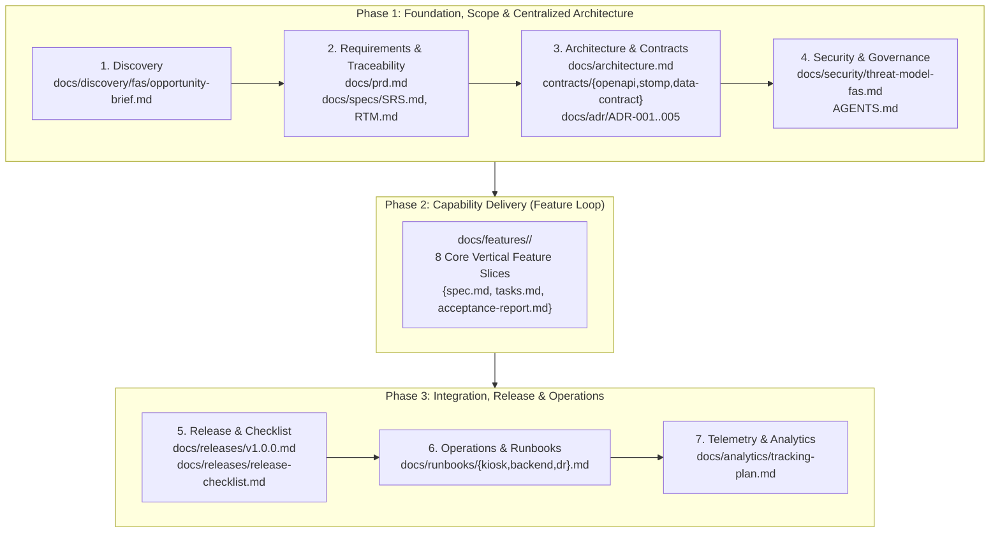

# Master Documentation Portal: Enterprise Touchless Face Attendance System (FAS)

> **Hệ thống**: Hệ thống Chấm công Doanh nghiệp Bằng Nhận Diện Khuôn Mặt (`face-attendance-system`)  
> **Quy chuẩn Quản trị & Vòng đời**: Chuẩn hóa 100% theo **Universal SDLC Skills Pack** (`workflows/full-sdlc.md` & `references/artifact-contracts.md`).  
> **Kiến trúc Hợp đồng**: Centralized Machine-Executable Contracts (`contracts/`).  
> **Tuân thủ Pháp lý**: Luật Bảo vệ Dữ liệu Cá nhân 2025 (Luật số 91/2025/QH15) & Nghị định 356/2025/NĐ-CP.

---

## 🏛️ Bản Đồ Điều Hướng Vòng Đời Toàn Hệ Thống (SDLC 3-Phase Lifecycle)



---

## 🌐 1. Phase 1: Nền Tảng, Phạm Vi Sản Phẩm & Kiến Trúc Tập Trung

| Nhánh Tài Liệu | Đường Dẫn Canonical | Tóm Tắt Nội Dung Kỹ Thuật & Nghiệp Vụ |
| :--- | :--- | :--- |
| **Khám Phá Bài Toán (Discovery)** | [**`docs/discovery/fas/opportunity-brief.md`**](discovery/fas/opportunity-brief.md) | Vấn nạn quẹt thẻ hộ, ùn tắc đầu ca do vân tay, rủi ro pháp lý của việc tải ảnh chân dung và 4 giả thuyết cốt lõi đã kiểm chứng. |
| **Yêu Cầu Sản Phẩm (PRD)** | [**`docs/prd.md`**](prd.md) | Tài liệu Yêu cầu Sản phẩm Toàn diện: 4 nhóm tác nhân, 8 Epics lớn, mục tiêu định lượng (SLA $\le 350\text{ ms}$, $\text{FNIR} \le 5\%$), tuân thủ Luật 2025. |
| **Đặc Tả Kỹ Thuật (SRS)** | [**`docs/specs/SRS.md`**](specs/SRS.md) | 22 yêu cầu chức năng (FR) và 10 tiêu chuẩn phi chức năng (NFR) lượng hóa có thể kiểm chứng. |
| **Ma Trận Truy Vết (RTM)** | [**`docs/specs/RTM.md`**](specs/RTM.md) | Ma trận liên kết hai chiều giữa SRS $\leftrightarrow$ 8 Features $\leftrightarrow$ Thiết kế Hợp đồng $\leftrightarrow$ Minh chứng Test. |
| **Tổng Quan Kiến Trúc** | [**`docs/architecture.md`**](architecture.md) | Kiến trúc tổng thể C4 Context & Container, component breakdown, data ownership, triết lý Zero-Photo-Upload và Guided Multi-Pose. |
| **Hợp Đồng Máy Đọc** | [**`contracts/README.md`**](../contracts/README.md) | Thư mục hợp đồng tập trung: [`openapi.yaml`](../contracts/openapi.yaml) (44 REST endpoints), [`stomp-websocket.yaml`](../contracts/stomp-websocket.yaml) (STOMP broker), [`data-contract.json`](../contracts/data-contract.json) (Domain models). |
| **Bản Ghi Quyết Định (ADR)** | [**`docs/adr/README.md`**](adr/README.md) | 5 quyết định kiến trúc then chốt: [ADR-001](adr/ADR-001-zero-photo-upload-multi-pose.md) (Zero-Photo-Upload), [ADR-002](adr/ADR-002-edge-sqlite-wal-offline-sync.md) (SQLite WAL), [ADR-003](adr/ADR-003-central-aes-256-gcm-crypto.md) (AES-256-GCM), [ADR-004](adr/ADR-004-stomp-websocket-realtime-feed.md) (STOMP), [ADR-005](adr/ADR-005-pin-fallback-and-lockout.md) (PIN Pad). |
| **Mô Hình Đe Dọa An Ninh** | [**`docs/security/threat-model-fas.md`**](security/threat-model-fas.md) | Phân tích rủi ro an ninh toàn diện theo phương pháp STRIDE-A: Chống giả mạo MiniFASNet, bảo vệ vector 512D, chống brute-force PIN. |
| **Hiến Chương Dự Án** | [**`AGENTS.md`**](../AGENTS.md) | Bản đồ công nghệ hệ thống (Python 3.14, Spring Boot 3.4, React 19) và danh bạ công cụ thực thi cho AI Agent. |

---

## 🚀 2. Phase 2: Thi Công & Nghiệm Thu 8 Tính Năng Cốt Lõi (`docs/features/`)

Mỗi tính năng là một lát cắt dọc độc lập gồm bộ 3 tài liệu: `spec.md` (Đặc tả Stories/BDD AC), `tasks.md` (Danh mục công việc DAG), `acceptance-report.md` (Báo cáo nghiệm thu thực nghiệm kèm log test):

| Mã Tính Năng | Tên Đặc Tả Tính Năng | Phân Hệ Liên Quan | Bộ Tài Liệu Canonical | Trách Nhiệm Kỹ Thuật Cốt Lõi |
| :--- | :--- | :--- | :--- | :--- |
| **`FEAT-ENROLL-001`** | **Đăng ký Khuôn mặt Đa Tư Thế** | Web $\leftrightarrow$ Kiosk $\leftrightarrow$ Backend | [Spec](features/FEAT-ENROLL-001/spec.md) \| [Tasks](features/FEAT-ENROLL-001/tasks.md) \| [Report](features/FEAT-ENROLL-001/acceptance-report.md) | Ký Informed Consent, OTP 48h, chụp 3 tư thế (Front, Left, Right), mã hóa 3 vector AES-256-GCM. |
| **`FEAT-ATTEND-001`** | **Điểm danh Không Chạm & So khớp Biên** | Kiosk $\leftrightarrow$ Backend $\leftrightarrow$ Web | [Spec](features/FEAT-ATTEND-001/spec.md) \| [Tasks](features/FEAT-ATTEND-001/tasks.md) \| [Report](features/FEAT-ATTEND-001/acceptance-report.md) | Quét mặt $\le 350\text{ ms}$ trên CPU, MiniFASNet $S \ge 0.85$, so khớp RAM BLAS 1:N, Cooldown 120s. |
| **`FEAT-FALLBACK-001`** | **Xác thực Dự phòng bằng Mã PIN** | Kiosk $\leftrightarrow$ Backend $\leftrightarrow$ Web | [Spec](features/FEAT-FALLBACK-001/spec.md) \| [Tasks](features/FEAT-FALLBACK-001/tasks.md) \| [Report](features/FEAT-FALLBACK-001/acceptance-report.md) | Bàn phím số ảo PIN Pad trên màn hình cảm ứng Kiosk, băm BCrypt tập trung, khóa 15 phút sau 5 lần sai. |
| **`FEAT-OFFLINE-001`** | **Lưu đệm & Đồng bộ Ngoại tuyến** | Kiosk $\leftrightarrow$ Backend | [Spec](features/FEAT-OFFLINE-001/spec.md) \| [Tasks](features/FEAT-OFFLINE-001/tasks.md) \| [Report](features/FEAT-OFFLINE-001/acceptance-report.md) | Đệm SQLite WAL (`kiosk_local.db`) khi mất mạng ($\text{RPO} = 0$), worker tự động gửi bù theo lô $\le 50$ records. |
| **`FEAT-SHIFT-001`** | **Quản lý Ca kíp & Đánh giá Công** | Web $\leftrightarrow$ Backend | [Spec](features/FEAT-SHIFT-001/spec.md) \| [Tasks](features/FEAT-SHIFT-001/tasks.md) \| [Report](features/FEAT-SHIFT-001/acceptance-report.md) | Cấu hình ca làm việc, thời gian ân hạn 15 phút, chống chồng lấn ca, phân loại `ON_TIME`, `LATE`, `EARLY_LEAVE`. |
| **`FEAT-LIVE-001`** | **Giám sát Sĩ số Trực tiếp STOMP** | Backend $\leftrightarrow$ Web | [Spec](features/FEAT-LIVE-001/spec.md) \| [Tasks](features/FEAT-LIVE-001/tasks.md) \| [Report](features/FEAT-LIVE-001/acceptance-report.md) | Kênh STOMP `/topic/live-attendance`, độ trễ $\le 200\text{ ms}$, hiệu ứng chớp sáng Green Flash 1.5s và 5 thẻ KPI. |
| **`FEAT-EXCUSE-001`** | **Giải trình Công & Khóa Kỳ Công** | Web $\leftrightarrow$ Backend | [Spec](features/FEAT-EXCUSE-001/spec.md) \| [Tasks](features/FEAT-EXCUSE-001/tasks.md) \| [Report](features/FEAT-EXCUSE-001/acceptance-report.md) | Nộp giải trình trong 30 ngày, HR xét duyệt trực tuyến, khóa cứng kỳ công `LOCKED`, xuất Excel an toàn chống CSV Injection. |
| **`FEAT-COMPLY-001`** | **Quản trị Quyền Dữ liệu & Tiêu hủy 20 Ngày** | Web $\leftrightarrow$ Backend | [Spec](features/FEAT-COMPLY-001/spec.md) \| [Tasks](features/FEAT-COMPLY-001/tasks.md) \| [Report](features/FEAT-COMPLY-001/acceptance-report.md) | Hard Delete 100% vector sau 20 ngày nhân viên thôi việc, thực thi quyền rút Consent trong 7 ngày, nhật ký DPO bất biến. |

---

## 🛠️ 3. Phase 3: Tích Hợp Hệ Thống, Vận Hành & Phát Hành

| Nhánh Tài Liệu | Đường Dẫn Canonical | Tóm Tắt Nội Dung Kỹ Thuật |
| :--- | :--- | :--- |
| **Ghi Chú Phát Hành** | [**`docs/releases/v1.0.0.md`**](releases/v1.0.0.md) | Điểm nổi bật phiên bản v1.0.0, danh mục tính năng hoàn tất, yêu cầu môi trường triển khai. |
| **Checklist Nghiệm Thu** | [**`docs/releases/release-checklist.md`**](releases/release-checklist.md) | 24 tiêu chí nghiệm thu an toàn trước golive (Quality gate, Security scan, DB migration, Rollback rehearsal). |
| **Vận Hành Trạm Kiosk** | [**`docs/runbooks/kiosk-app.md`**](runbooks/kiosk-app.md) | Hướng dẫn chẩn đoán lỗi camera, xử lý đệm ngoại tuyến SQLite WAL, khắc phục rò rỉ RAM. |
| **Vận Hành Máy Chủ** | [**`docs/runbooks/backend-service.md`**](runbooks/backend-service.md) | Quản lý kết nối PostgreSQL HikariCP, giám sát WebSocket STOMP, kích hoạt cron job thủ công. |
| **Khôi Phục Thảm Họa** | [**`docs/runbooks/disaster-recovery.md`**](runbooks/disaster-recovery.md) | Quy trình sao lưu và khôi phục CSDL PostgreSQL khi gặp sự cố, kịch bản tạo mới CSDL Kiosk. |
| **Cẩm Nang Người Dùng** | [**`docs/user-guide.md`**](user-guide.md) | Hướng dẫn trải nghiệm nhân viên: Ký đồng thuận dữ liệu, lấy mã OTP, đăng ký khuôn mặt tại Kiosk, điểm danh và nộp giải trình. |
| **Đo Lường & Đo Kiểm** | [**`docs/analytics/tracking-plan.md`**](analytics/tracking-plan.md) | Danh mục sự kiện telemetry đo lường tỷ lệ nhận diện thành công, thời gian quét trung bình và tỷ lệ dùng mã PIN. |

---

## ⚡ 4. Các Lệnh Điều Khiển & Kiểm Định Tự Động

- **Kiểm định hợp đồng máy đọc tập trung**:
  ```powershell
  python scripts/verify_contracts.py --dir contracts
  ```
- **Quản lý dịch vụ ứng dụng**:
  ```powershell
  .\scripts\manage-services.ps1 status
  .\scripts\manage-services.ps1 start
  .\scripts\manage-services.ps1 logs
  ```
- **Chạy toàn bộ kiểm thử đơn vị & tích hợp**:
  - Edge Kiosk: `pytest app/kiosk-app/tests/`
  - Central Backend: `./mvnw test`
  - Web Portal: `npm --prefix app/web-portal run test`
