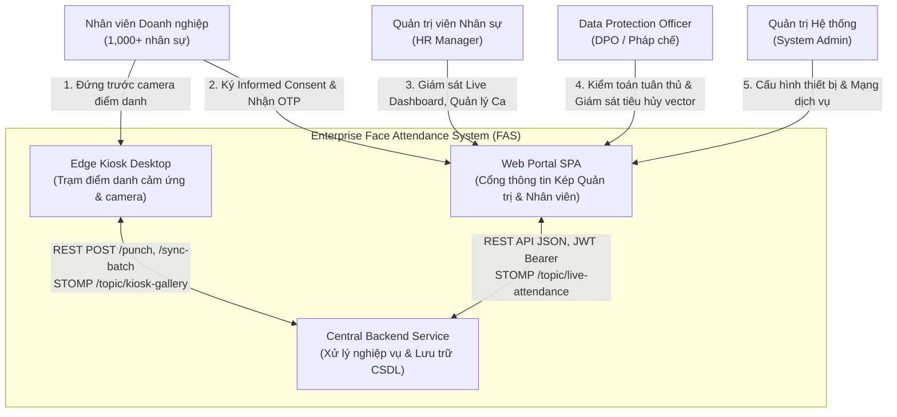
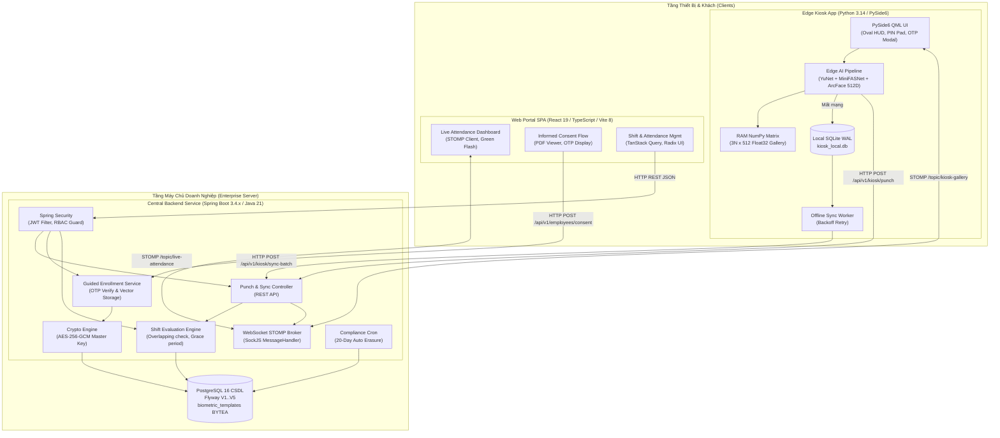

# System Architecture Overview: Enterprise Touchless Face Attendance System (FAS)

> **Document type:** Canonical Artifact Contract
> **Artifact:** System Architecture Overview
> **Primary Owner Skill:** `software-architecture`
> **Canonical Destination Path:** `docs/architecture.md`
> **Status:** Approved
> **Last updated:** 2026-11-08
> **Tuân thủ pháp lý:** Luật Bảo vệ dữ liệu cá nhân 2025 (Luật số 91/2025/QH15) & Nghị định 356/2025/NĐ-CP

---

## 1. Executive Summary & Quality Attributes (Required)

### High-Level Summary

Hệ thống Chấm công Doanh nghiệp Bằng Nhận Diện Khuôn Mặt (**Enterprise Face Attendance System — FAS**) là giải pháp điểm danh tự động, không chạm (**Touchless Biometric Attendance**), hoạt động trên mô hình 3 phân hệ liên kết chặt chẽ:

1. **Edge Kiosk Desktop (`app/kiosk-app`)**: Trạm điểm danh độc lập tại chỗ, suy luận Edge AI thuần CPU (YuNet + MiniFASNet + ArcFace 512D) kết hợp CSDL đệm ngoại tuyến SQLite WAL (`kiosk_local.db`).
2. **Central Backend Service (`app/backend-service`)**: Máy chủ trung tâm Spring Boot 3.4.x (Java 21 LTS), quản lý phiên JWT, mã hóa vector khuôn mặt AES-256-GCM, phát sóng thời gian thực WebSocket STOMP, và CSDL trung tâm PostgreSQL 16.
3. **Web Portal Client (`app/web-portal`)**: Ứng dụng SPA React 19 + TypeScript + Tailwind CSS 4 phục vụ Quản trị HR theo dõi chấm công thời gian thực (Live Dashboard) và Nhân viên ký cam kết điện tử Informed Consent nhận mã OTP kích hoạt khuôn mặt.

Hệ thống hoạt động theo triết lý kiến trúc **Zero Raw Photo Upload** (tuyệt đối không tải hay lưu ảnh chân dung thô lên máy chủ), suy luận AI thuần túy trên CPU máy trạm phổ thông ($0\text{ VNĐ}$ chi phí phần cứng GPU), và lưu trữ đa mẫu (**Guided Multi-Pose Capture**: Frontal, Left Tilt, Right Tilt).

### Primary Quality Attribute Goals

1. **Hiệu năng & Độ trễ (Performance / Latency):**
   - Thời gian điểm danh tại Kiosk: $T_{\text{punch}} \le 350\text{ ms}$ (từ khi phát hiện mặt đến khi hiển thị kết quả và phát âm thanh).
   - Độ trễ phát sóng thời gian thực: $T_{\text{stomp}} \le 200\text{ ms}$ từ Kiosk $\rightarrow$ Backend $\rightarrow$ Web Portal Live Dashboard.
   - Thời gian so khớp ma trận RAM BLAS: $T_{\text{match}} < 2\text{ ms}$ trên tập 1,000 nhân sự ($3,000$ vector đa tư thế).
2. **Độ tin cậy & Khả năng sẵn sàng (Reliability & Offline-First Resiliency):**
   - Điểm danh ngoại tuyến thông suốt ($\text{RPO} = 0$) khi mất kết nối mạng cục bộ.
   - Hàng đợi SQLite WAL tự động gửi bù theo lô tối đa 50 bản ghi/request khi có kết nối trở lại.
   - Tính sẵn sàng dịch vụ máy chủ: $\ge 99.9\%$.
3. **Độ chính xác sinh trắc học & Chống giả mạo (Biometric Accuracy & PAD):**
   - Chỉ số nhận diện 1:N: $\text{FNIR} \le 5.0\%$ tại $\text{FPIR} \le 0.1\%$ trên tập 1,000 nhân viên.
   - Chống giả mạo MiniFASNet: Điểm sống $S_{\text{liveness}} \ge 0.85$ (vận hành) và $\ge 0.90$ (nạp mẫu), tỷ lệ chặn ảnh in 2D và video replay $\ge 98\%$.
4. **An toàn dữ liệu & Quyền riêng tư (Security & Privacy Compliance):**
   - Mã hóa độc lập từng vector 512D bằng AES-256-GCM với IV 12 bytes ngẫu nhiên và Authentication Tag 16 bytes.
   - Khóa master mã hóa được quản lý qua biến môi trường bảo mật, không hardcode trong mã nguồn.
   - Tự động quét Hard Delete $100\%$ vector sinh trắc học sau 20 ngày kể từ khi nhân viên thôi việc hoặc rút Consent.

---

## 2. System Context & Boundaries (C4 Level 1 & 2) (Required)

### C4 Level 1: System Context Diagram

### C4 Level 2: Container Diagram

---

## 3. Component Breakdown & Data Ownership (Required)

| Phân hệ / Container                     | Trách nhiệm Kỹ thuật Cốt lõi                                                                                                                                                                                                                                                                                                                                                                                                                                                                                 | Dữ liệu Sở hữu (Single Source of Truth)                                                                                                                                                                                                                                                                                   | Ranh giới Giao tiếp Công khai (Public Seams)                                                                                                                                      |
| :-------------------------------------- | :----------------------------------------------------------------------------------------------------------------------------------------------------------------------------------------------------------------------------------------------------------------------------------------------------------------------------------------------------------------------------------------------------------------------------------------------------------------------------------------------------------- | :------------------------------------------------------------------------------------------------------------------------------------------------------------------------------------------------------------------------------------------------------------------------------------------------------------------------ | :-------------------------------------------------------------------------------------------------------------------------------------------------------------------------------- |
| **`kiosk-app`** (Edge Kiosk)            | - Thu nhận video stream camera $1080\times 1920\text{ px}$.- Phát hiện 5 landmarks (YuNet), ước lượng góc Euler Yaw/Pitch/Roll.- Kiểm tra thực thể sống thụ động (MiniFASNet $S \ge 0.85$).- Trích xuất vector ArcFace 512D chuẩn hóa $L_2 = 1.0$.- So khớp ma trận RAM NumPy BLAS 1:N $\le 2\text{ ms}$.- Đệm giao dịch ngoại tuyến khi mất mạng vào SQLite WAL.- Cung cấp bàn phím số ảo PIN Pad dự phòng khi gặp sự cố mặt.                                                                               | - Bộ đệm ma trận vector RAM Gallery $(3N \times 512)$.- Hàng đợi bản ghi quẹt ngoại tuyến `offline_punches` trong SQLite.- Trạng thái kết nối trạm và cấu hình phần cứng cục bộ.                                                                                                                                          | - HTTP REST Client gọi Backend (`/api/v1/kiosk/punch`, `/api/v1/kiosk/sync-batch`, `/api/v1/kiosk/enrollment`).- WebSocket STOMP Subscriber (`/topic/kiosk-gallery`).             |
| **`backend-service`** (Central Backend) | - Xác thực người dùng, cấp phát và thẩm định JWT Token.- Thẩm định OTP 6 số và tiếp nhận 3 vector khuôn mặt (`pose_type`).- Mã hóa AES-256-GCM vector sinh trắc học và lưu trữ vào PostgreSQL.- Đối soát ca kíp, tính toán trạng thái công (`ON_TIME`, `LATE`, `EARLY_LEAVE`, `ANOMALOUS`).- Ngăn chặn quẹt trùng lặp với bộ đệm Caffeine Cache Cooldown 120s.- Phát sóng sự kiện thời gian thực qua WebSocket STOMP.- Tự động kích hoạt cron job tiêu hủy vĩnh viễn vector sau 20 ngày nhân viên thôi việc. | - Tài khoản người dùng, vai trò RBAC (`users`, `roles`).- Mẫu sinh trắc học đã mã hóa (`biometric_templates`).- Lịch làm việc, ca kíp và phân ca (`shifts`, `schedules`).- Bản ghi chấm công chính thức (`attendance_logs`, `attendance_records`).- Cam kết điện tử Informed Consent và nhật ký kiểm toán (`audit_logs`). | - 44 Endpoints REST API theo chuẩn OpenAPI 3.1 (`contracts/openapi.yaml`).- STOMP WebSocket Broker (`/topic/live-attendance`, `/topic/enrollment/{otp}`, `/topic/kiosk-gallery`). |
| **`web-portal`** (Web Client)           | - Giao diện tự phục vụ nhân viên: xem quy định, ký cam kết điện tử Informed Consent, nhận mã kích hoạt OTP 48h.- Lắng nghe WebSocket STOMP `/topic/enrollment/{otp}` để đóng modal và chúc mừng khi Kiosk hoàn tất thu mẫu.- Bảng giám sát sĩ số trực tiếp Live Attendance Dashboard cho HR.- Quản lý nhân viên, cấu hình ca kíp, phê duyệt đơn giải trình công.- Khóa kỳ công tháng và xuất file báo cáo Excel/PDF an toàn chống Formula Injection (CWE-1236).                                              | - Bộ nhớ đệm Client Cache (TanStack Query).- Trạng thái phiên đăng nhập (JWT token trong SessionStorage).- Trạng thái bộ lọc và phân trang giao diện.                                                                                                                                                                     | - Axios REST Client với Request/Response Interceptors tự động gắn Bearer Token và xử lý làm mới phiên.- SockJS STOMP Client đăng ký nhận luồng sự kiện.                           |

---

## 4. Key Cross-Cutting Design Decisions (Required)

### 4.1. Kiến trúc Dữ liệu & Tính Nhất quán (Data Storage & Consistency)

- **Cơ sở dữ liệu Trung tâm (PostgreSQL 16)**: Lưu trữ dữ liệu quan hệ với toàn vẹn ACID cao. Sử dụng Flyway quản lý lược đồ di chuyển phiên bản (`V1__init_schema.sql` đến `V5__create_excuse_requests.sql`).
- **Mã hóa Sinh trắc học (AES-256-GCM)**: Dữ liệu vector khuôn mặt 512 chiều được mã hóa độc lập bằng thuật toán đối xứng AES-256-GCM với IV 12 bytes ngẫu nhiên và Authentication Tag 16 bytes, lưu trong trường `BYTEA`. Khóa mã hóa được nạp từ biến môi trường của hệ điều hành, không lưu trữ trong mã nguồn.
- **Hàng đợi Ngoại tuyến Biên (SQLite WAL)**: Trạm Kiosk sử dụng SQLite chế độ Write-Ahead Logging (`kiosk_local.db`). Cơ chế Write-Ahead Logging đảm bảo hiệu năng ghi song song cực nhanh và không bao giờ bị hỏng file CSDL khi mất điện đột ngột.

### 4.2. Chính sách Zero Raw Photo Upload & Guided Multi-Pose

- **Tuyệt đối cấm tải ảnh chân dung**: Hệ thống không cung cấp API tiếp nhận file ảnh từ máy khách. Mọi dữ liệu mẫu bắt buộc phải được thu nhận trực tiếp qua camera tại trạm Kiosk.
- **Thu nhận Đa tư thế có Định hướng (Guided Multi-Pose)**: Để khắc phục nhược điểm của mẫu đơn khi nhìn nghiêng, Kiosk hướng dẫn nhân viên chụp 3 tư thế chuẩn mực:
  - `FRONTAL`: Nhìn thẳng, $\|\text{Yaw}\| \le 5^\circ$.
  - `LEFT_TILT`: Nghiêng nhẹ sang trái, $10^\circ \le \text{Yaw} \le 25^\circ$.
  - `RIGHT_TILT`: Nghiêng nhẹ sang phải, $-25^\circ \le \text{Yaw} \le -10^\circ$.
- Góc Euler được tính toán thời gian thực từ 5 facial landmarks của YuNet kết hợp thuật toán khử xoay mặt (de-rotation) với độ trễ $< 0.05\text{ ms}$, không tốn tài nguyên GPU.

### 4.3. Ranh giới Bảo mật & Xác thực (Security & Trust Boundaries)

- **Xác thực API Máy khách**: Web Portal sử dụng JSON Web Token (JWT) thời hạn 60 phút, tự động làm mới bằng Refresh Token lưu trữ an toàn trong HTTP-only Cookie.
- **Xác thực Trạm Kiosk**: Kiosk giao tiếp với Backend thông qua Header định danh trạm `X-Kiosk-Id` kết hợp mã ký bí mật Kiosk Secret.
- **Xác thực Dự phòng (PIN Fallback)**: Trường hợp nhân viên bị chấn thương khuôn mặt hoặc đã thực hiện quyền rút Consent, Kiosk cung cấp bàn phím số ảo PIN Pad để điểm danh bằng mã PIN cá nhân (được băm bằng BCrypt $10$ rounds tại Backend). Hệ thống tự động khóa cứng 15 phút sau đúng 5 lần nhập sai liên tiếp nhằm chống tấn công brute-force.

---

## 5. Architectural Decision Records (ADRs) Index (Required)

Toàn bộ các quyết định kiến trúc then chốt đã được chuẩn hóa thành các bản ghi độc lập tại [`docs/adr/`](adr/README.md):

| Mã ADR        | Tiêu đề Quyết định Kiến trúc                                        | Trạng thái | Tệp Đặc tả Chi tiết                                                                            |
| :------------ | :------------------------------------------------------------------ | :--------: | :--------------------------------------------------------------------------------------------- |
| **`ADR-001`** | Chính sách Cấm Upload Ảnh & Thu nhận 3 Tư thế Trực tiếp tại Kiosk   |  Accepted  | [`adr/ADR-001-zero-photo-upload-multi-pose.md`](adr/ADR-001-zero-photo-upload-multi-pose.md)   |
| **`ADR-002`** | Cơ chế Đệm Ngoại tuyến SQLite WAL & Tự động Đồng bộ Bù theo Lô      |  Accepted  | [`adr/ADR-002-edge-sqlite-wal-offline-sync.md`](adr/ADR-002-edge-sqlite-wal-offline-sync.md)   |
| **`ADR-003`** | Mã hóa Vector Khuôn mặt ArcFace 512D bằng AES-256-GCM tại Máy chủ   |  Accepted  | [`adr/ADR-003-central-aes-256-gcm-crypto.md`](adr/ADR-003-central-aes-256-gcm-crypto.md)       |
| **`ADR-004`** | Truyền tải Sự kiện Điểm danh Trực tiếp qua WebSocket STOMP Protocol |  Accepted  | [`adr/ADR-004-stomp-websocket-realtime-feed.md`](adr/ADR-004-stomp-websocket-realtime-feed.md) |
| **`ADR-005`** | Điểm danh Dự phòng bằng Bàn phím Số Ảo PIN Pad & Khóa 15 Phút       |  Accepted  | [`adr/ADR-005-pin-fallback-and-lockout.md`](adr/ADR-005-pin-fallback-and-lockout.md)           |

---

## 6. Architectural Review & Conformance Gate (Required)

- [x] Ranh giới hệ thống, sơ đồ C4 Context & Container và các mối liên kết component được định nghĩa rõ ràng.
- [x] Các chỉ số chất lượng định lượng (SLA điểm danh $\le 350\text{ ms}$, STOMP $\le 200\text{ ms}$, $\text{FNIR} \le 5.0\%$) được đo kiểm thực tế trên CPU phổ thông.
- [x] Nguyên tắc dữ liệu một chủ sở hữu duy nhất (Single Source of Truth) được thiết lập; không có trạng thái chia sẻ mập mờ giữa các phân hệ.
- [x] Toàn bộ hợp đồng kỹ thuật được đặt tại thư mục tập trung [`contracts/`](../contracts/README.md) và vượt qua kiểm định `python scripts/verify_contracts.py`.
- [x] Các quyết định kiến trúc then chốt được ghi nhận đầy đủ theo chuẩn ADR độc lập tại [`docs/adr/`](adr/README.md).
- [x] Tuân thủ 100% Luật Bảo vệ dữ liệu cá nhân 2025 và Nghị định 356/2025/NĐ-CP.

- **Reviewed & Approved By:** Lead System Architect & Security Governance Lead (2026-11-08)
