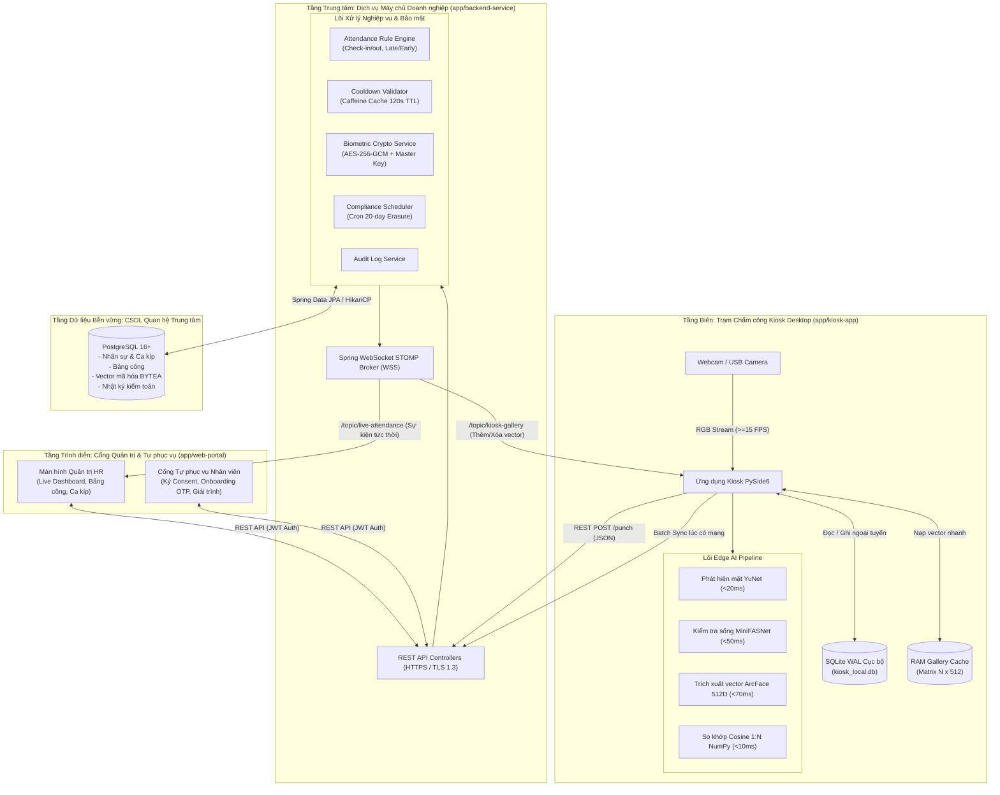
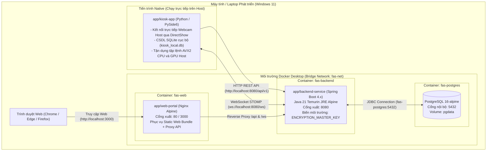
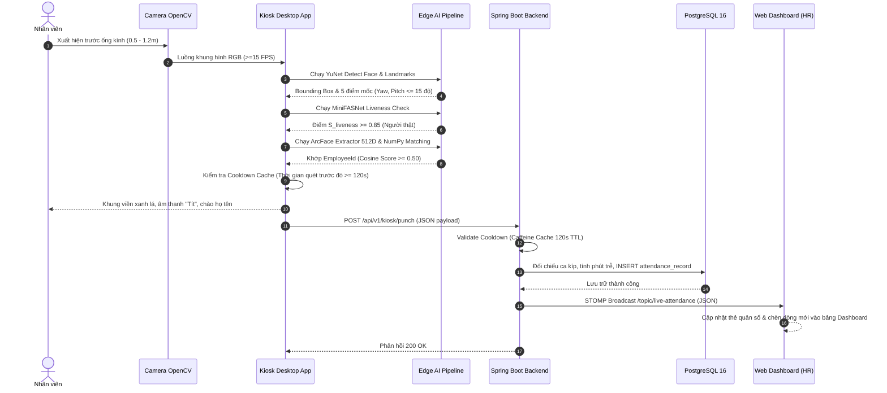
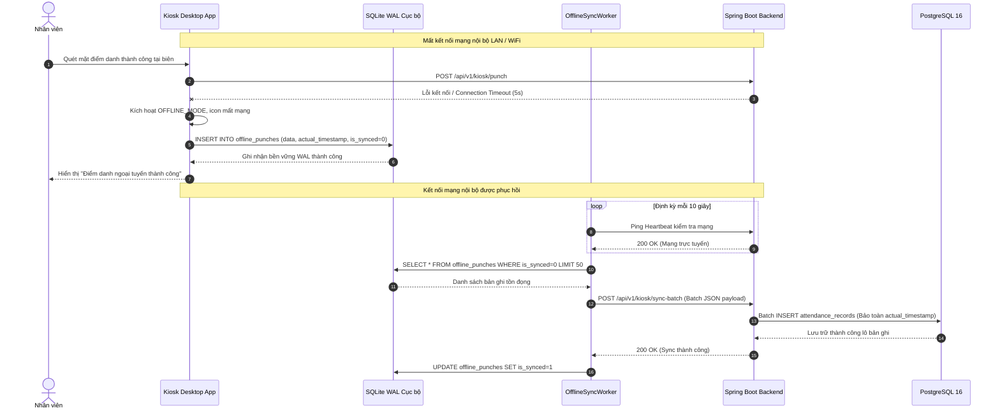
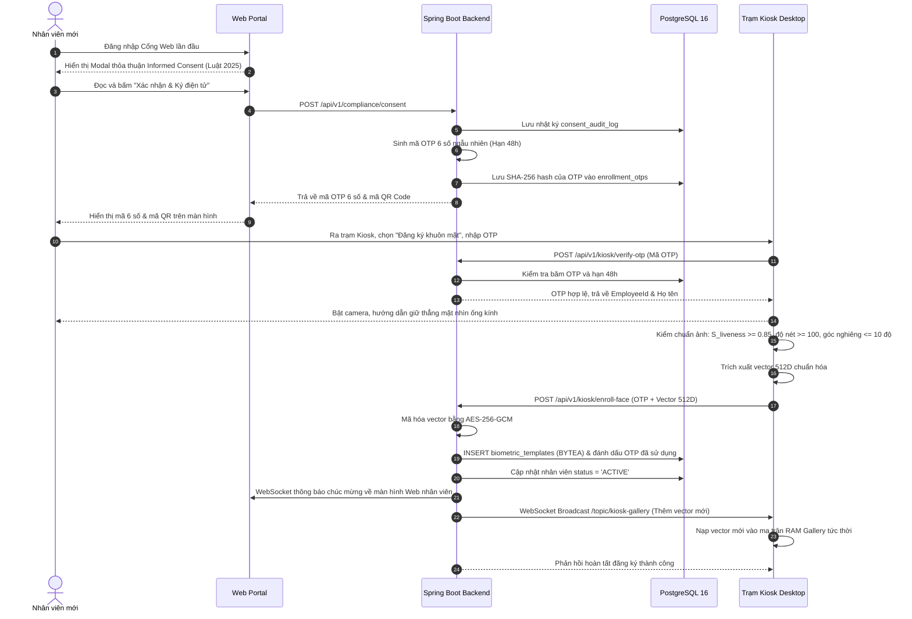

# Bộ tài liệu SDLC — Cấu trúc chuẩn hóa

> **Quy ước chung cho mọi tài liệu:**
> - **Mã tài liệu**: DDS-FAS-01
> - **Tên tài liệu**: Đặc tả thiết kế phần mềm (Detailed Design Specification - DDS)
> - **Phiên bản**: 1.0
> - **Trạng thái**: Đã phê duyệt (Approved)
> - **Chủ sở hữu**: nvdung
> - **Người phê duyệt**: nvdung
> - **Ngày hiệu lực**: 2026-09-30
> - **Tài liệu liên quan**: [README.md](../README.md), [PC.md](../initiation/PC.md), [PI.md](../initiation/PI.md), [TS.md](../initiation/TS.md), [PP.md](../planning/PP.md), [SRS.md](../requirements/SRS.md), [FR.md](../requirements/FR.md)
> - **Lịch sử thay đổi**:
>   - *v1.0 (2026-09-30)*: Hoàn thiện toàn diện toàn bộ 6 phần tài liệu DDS (Cơ sở & Phạm vi, Kiến trúc 3 tầng Monorepo, Thiết kế chi tiết module/logic/sequence, Thiết kế dữ liệu ERD 3NF/PostgreSQL/SQLite WAL/API RESTful/WebSocket STOMP, Thuộc tính xuyên suốt bảo mật AES-256-GCM/Luật 2025/Hiệu năng, và Ma trận truy xuất yêu cầu FR-01 đến FR-16). Phê duyệt chính thức.

---

## DDS — Đặc tả thiết kế phần mềm

**1. Cơ sở & Phạm vi thiết kế**

- 1.1. Phạm vi thiết kế
  - Thiết kế kiến trúc kỹ thuật toàn diện cho Hệ thống Chấm công bằng Nhận diện Khuôn mặt (Face Attendance System - FAS), hiện thực hóa 16 yêu cầu chức năng (`FR-01` đến `FR-16`) trong [FR.md](../requirements/FR.md) và các thuộc tính chất lượng phi chức năng trong [SRS.md](../requirements/SRS.md).
  - Định nghĩa kiến trúc cho 3 phân hệ độc lập tổ chức theo cấu trúc Monorepo tại thư mục `/app`:
    - `app/kiosk-app`: Ứng dụng Desktop Python chạy tại thiết bị biên (Edge Terminal), chịu trách nhiệm thu nhận video webcam, phát hiện khuôn mặt thời gian thực (YuNet), kiểm tra thực thể sống thụ động (MiniFASNet), trích xuất vector đặc trưng 512D (ArcFace), so khớp 1:N cục bộ qua NumPy, hỗ trợ bàn phím ảo PIN dự phòng và hàng đợi ngoại tuyến SQLite WAL.
    - `app/backend-service`: Dịch vụ máy chủ doanh nghiệp nền tảng Java 21 LTS / Spring Boot 4.x, chịu trách nhiệm quản lý nghiệp vụ chấm công, phân ca làm việc, tính toán giờ công, cơ chế chống quét trùng Cooldown 120s, mã hóa bảo mật vector mẫu chuẩn AES-256-GCM, phát sóng sự kiện thời gian thực qua Spring WebSocket STOMP Broker và tiến trình tự động tiêu hủy dữ liệu sau 20 ngày theo Luật 2025.
    - `app/web-portal`: Ứng dụng Web SPA hiện đại nền tảng ReactJS 18+ / TypeScript / Vite / Tailwind CSS, cung cấp màn hình Live Monitoring Dashboard cập nhật thời gian thực qua STOMPjs, quản lý nhân sự, duyệt đơn giải trình công, cổng tự phục vụ ký cam kết Informed Consent và kết xuất báo cáo Excel an toàn.
  - Thiết kế các giao thức truyền thông liên dịch vụ (RESTful API, WebSocket STOMP), cấu trúc dữ liệu lưu trữ bền vững (PostgreSQL, SQLite WAL) và mô hình đóng gói Docker Compose.

- 1.2. Nguyên tắc thiết kế
  - **Tách biệt Trách nhiệm (Separation of Concerns - SoC)**: Mỗi phân hệ đảm nhận một nhiệm vụ duy nhất và độc lập. Kiosk phụ trách thị giác máy tính biên và chấm công ngoại tuyến; Backend quản lý nghiệp vụ, bảo mật và lưu trữ tập trung; Web Portal phụ trách hiển thị và quản trị người dùng.
  - **Xử lý AI tại Biên (Edge-First Computing)**: Toàn bộ quá trình tính toán suy luận mạng nơ-ron (YuNet, MiniFASNet, ArcFace) diễn ra hoàn toàn cục bộ trên CPU/GPU của trạm Kiosk. Tuyệt đối không truyền luồng video thô về máy chủ trung tâm nhằm tiết kiệm 95% băng thông mạng và bảo vệ quyền riêng tư người dùng.
  - **Phòng vệ Ngoại tuyến (Offline-First Resiliency)**: Trạm Kiosk được thiết kế để duy trì khả năng nhận diện và chấm công bình thường ngay cả khi mất kết nối mạng nội bộ hoàn toàn. Cam kết không làm gián đoạn luồng di chuyển của nhân viên và không thất thoát dữ liệu (RPO = 0) nhờ hàng đợi ghi đệm SQLite WAL.
  - **Thiết kế Bảo mật Mặc định & Quyền riêng tư (Security by Design & Privacy by Design)**:
    - Nguyên tắc Không lưu trữ ảnh thô (Zero Raw Image Storage) trên đĩa cứng trạm Kiosk.
    - Mã hóa đối xứng AES-256-GCM ở trạng thái tĩnh cho toàn bộ vector sinh trắc học với Master Key lưu độc lập trong biến môi trường.
    - Mã hóa trên đường truyền bằng TLS 1.3 (HTTPS) và WSS (Secure WebSocket).
    - Tự động hóa tiến trình tiêu hủy dữ liệu sau 20 ngày nghỉ việc theo Luật Bảo vệ Dữ liệu Cá nhân số 91/2025/QH15.
  - **Truyền thông Dựa trên Sự kiện Đẩy (Event-Driven Reactive Communication)**: Sử dụng WebSocket STOMP thay thế hoàn toàn kỹ thuật HTTP Polling định kỳ, giảm thiểu tải CPU máy chủ và độ trễ hiển thị Dashboard xuống dưới 200 ms.
  - **Tối ưu hóa Chi phí 0 VNĐ (Zero-Cost Software Engineering)**: Khai thác triệt để hệ sinh thái công nghệ mã nguồn mở miễn phí, tối ưu hóa thuật toán chạy mượt mà trên phần cứng máy trạm tiêu chuẩn mà không đòi hỏi đầu tư thiết bị chuyên dụng đắt đỏ.

- 1.3. Cơ sở từ SRS
  - Thiết kế kỹ thuật trong tài liệu này trực tiếp hiện thực hóa toàn bộ các yêu cầu từ [SRS.md](../requirements/SRS.md) và [FR.md](../requirements/FR.md):
    - 16 Yêu cầu chức năng: Từ `FR-01` (Face Detection) đến `FR-16` (Excel Export).
    - Bộ 6 chỉ số mục tiêu hiệu năng:
      - `KPI-01` (TAR >= 95% @ FAR <= 0.1% điều kiện chuẩn).
      - `KPI-02` (TAR >= 88% @ FAR <= 0.5% điều kiện thực tế).
      - `KPI-03` (Liveness APCER <= 10%, BPCER <= 2% theo ISO/IEC 30107-3).
      - `KPI-04` (Độ trễ toàn trình hệ thống <= 1.2s p95).
      - `KPI-05` (Khởi động Kiosk nạp 100 vector RAM <= 3.0s).
      - `KPI-06` (Khả năng chịu lỗi ngoại tuyến RPO = 0, chạy liên tục 8h rò rỉ RAM < 10%).
    - Các yêu cầu bảo mật, độ tin cậy, quy tắc dữ liệu và ma trận truy vết hai chiều (RTM).

- 1.4. Các ràng buộc thiết kế chính
  - **Ràng buộc Môi trường Thực thi**: Hệ thống phải vận hành đồng thời cả 3 dịch vụ trên 01 máy trạm kiểm thử phát triển tiêu chuẩn (đáp ứng CPU 4 nhân trở lên, 8GB-16GB RAM) với mức tiêu thụ tài nguyên <= 65% CPU và <= 6.5 GB RAM.
  - **Ràng buộc Công cụ Phát triển**: Toàn bộ mã nguồn 3 phân hệ được phát triển, biên dịch và gỡ lỗi thống nhất trong một IDE duy nhất là **Visual Studio Code (VS Code)**.
  - **Ràng buộc Pháp lý Dữ liệu Sinh trắc học**: Tuân thủ tuyệt đối quy định của Luật Bảo vệ Dữ liệu Cá nhân số 91/2025/QH15 của Việt Nam: Có thỏa thuận Informed Consent trước khi kích hoạt tài khoản và tự động xóa vĩnh viễn vector sau đúng 20 ngày kể từ ngày chấm dứt hợp đồng lao động.
  - **Ràng buộc Giao thức & Định dạng**: REST API chuẩn OpenAPI 3.0 với payload JSON UTF-8; WebSocket STOMP qua SockJS; vector 512D lưu trữ định dạng nhị phân `BYTEA`.

---

**2. Kiến trúc hệ thống**

- 2.1. Kiến trúc tổng thể
  - Hệ thống được thiết kế theo mô hình **Kiến trúc Phân tán 3 Tầng (3-Tier Distributed Architecture)** kết hợp nguyên lý xử lý biên (Edge Computing) và truyền thông đẩy (Event-Driven Messaging):



- 2.2. Thành phần chính
  - **1. Phân hệ Kiosk Desktop (`app/kiosk-app` - Python / PySide6)**:
    - `CameraCaptureWorker`: Luồng ngầm OpenCV chuyên trách đọc khung hình từ camera, đảm bảo luồng giao diện UI không bị chặn và duy trì >= 15 FPS.
    - `VisionPipeline`: Điều phối chuỗi xử lý AI gồm YuNet Detector -> MiniFASNet Liveness Gate -> ArcFace Feature Extractor.
    - `GalleryMatcher`: Module tính toán ma trận độ tương đồng Cosine cực nhanh trên RAM bằng NumPy.
    - `VirtualPinDialog`: Giao diện bàn phím số ảo phục vụ điểm danh dự phòng khi gặp sự cố sinh trắc học.
    - `SQLiteQueueManager`: Quản lý hàng đợi ngoại tuyến SQLite WAL, lưu trữ bền vững các lượt chấm khi đứt mạng.
    - `OfflineSyncWorker`: Luồng ngầm định kỳ Ping kiểm tra mạng và tự động đồng bộ bù các bản ghi tồn đọng.
    - `KioskStompClient`: Client nhận sự kiện WebSocket STOMP để cập nhật danh mục vector trong RAM tức thời.
  - **2. Phân hệ Máy chủ Trung tâm (`app/backend-service` - Java 21 / Spring Boot 4.x)**:
    - `KioskApiController`: Tiếp nhận các lượt chấm công trực tuyến, gói đồng bộ ngoại tuyến, kích hoạt OTP và nạp vector.
    - `AuthController`: Quản lý đăng nhập, xác thực và cấp phát JWT token có thời hạn 8 giờ cho các vai trò RBAC.
    - `AttendanceService`: Lõi nghiệp vụ tính toán ca kíp, thời gian ân hạn 15 phút, tính số phút đi muộn/về sớm.
    - `CooldownValidator`: Bộ lọc sử dụng bộ nhớ đệm Caffeine Cache (TTL 120s) ngăn chặn các lượt ghi nhận trùng lặp.
    - `BiometricCryptoService`: Mã hóa và giải mã vector đặc trưng 512 chiều bằng thuật toán AES-256-GCM chuẩn FIPS.
    - `ComplianceScheduler`: Tiến trình ngầm `@Scheduled` chạy lúc 00:00:00 hàng ngày, tự động quét và xóa vĩnh viễn vector của nhân viên đã nghỉ việc quá 20 ngày theo Luật 2025.
    - `StompEventDispatcher`: Đóng gói và phát tán các bản tin sự kiện qua Spring WebSocket STOMP Message Broker.
    - `ExcelReportExporter`: Xuất báo cáo bảng công định dạng `.xlsx` qua Apache POI với cơ chế làm sạch chuỗi chống tấn công Formula Injection (CWE-1236).
  - **3. Phân hệ Cổng Web Quản trị (`app/web-portal` - ReactJS 18+ / TypeScript / Vite)**:
    - `LiveDashboard`: Bảng theo dõi trực tiếp quân số (Hiện diện, Đi muộn, Vắng mặt) và danh sách lượt chấm cuộn mượt mà cập nhật tức thì qua `@stomp/stompjs`.
    - `EmployeeManagement`: Quản trị danh sách nhân sự, phân ca, kích hoạt mã OTP đăng ký và theo dõi trạng thái sinh trắc học.
    - `TimesheetReport`: Lưới tổng hợp bảng công theo tháng, bộ lọc đa chiều và xuất báo cáo an toàn.
    - `ExcuseManagement`: Module xử lý đơn giải trình công (nộp đơn, phê duyệt, từ chối, cập nhật trạng thái `EXCUSED`).
    - `InformedConsentModal`: Modal bắt buộc nhân viên mới ký cam kết đồng thuận số trước khi cấp mã Onboarding OTP.
  - **4. Cơ sở Dữ liệu Quan hệ Trung tâm (PostgreSQL 16+)**:
    - Quản lý bền vững toàn bộ dữ liệu quan hệ ACID: bảng nhân sự (`employees`), bảng phân ca (`shifts`), bảng điểm danh (`attendance_records`), bảng vector mẫu mã hóa (`biometric_templates`), bảng OTP kích hoạt (`enrollment_otps`), bảng kiểm toán đồng thuận (`consent_audit_logs`) và bảng kiểm toán tiêu hủy (`compliance_audit_logs`).

- 2.3. Quan hệ & luồng tương tác
  - **1. Luồng Điểm danh Chuẩn Thời gian thực (Live Attendance Sequence)**:
    1. Camera Kiosk ghi nhận khuôn mặt -> `VisionPipeline` phát hiện mặt và kiểm tra thực thể sống người thật ($S_{\text{liveness}} \ge 0.85$).
    2. Kiosk trích xuất vector 512D -> So khớp Cosine 1:N với ma trận RAM Gallery -> Tìm thấy nhân viên khớp (Score >= 0.50).
    3. Kiosk kiểm tra bộ nhớ đệm Cooldown: Nếu chênh lệch thời gian quét trước đó >= 120s -> Hiển thị khung xanh, phát âm thanh "Tít".
    4. Kiosk gửi request `POST /api/v1/kiosk/punch` (JSON) lên Backend Service.
    5. Backend tiếp nhận, đối chiếu ca làm việc, tính phút đi muộn/về sớm và ghi bản ghi vào PostgreSQL.
    6. Backend lập tức phát sóng gói tin sự kiện chấm công đến topic `/topic/live-attendance` qua WebSocket STOMP.
    7. Web Portal nhận bản tin STOMP, cập nhật tức thời thẻ quân số và chèn dòng mới vào đầu bảng Live Dashboard mà không cần tải lại trang.
  - **2. Luồng Điểm danh Ngoại tuyến & Đồng bộ Bù (Offline Resilient Sequence)**:
    1. Kiosk nhận diện thành công nhân viên nhưng gửi request lên Backend bị lỗi mạng/timeout.
    2. Kiosk chuyển sang `OFFLINE_MODE`, hiển thị biểu tượng mất mạng trên màn hình.
    3. Kiosk ghi bản ghi điểm danh vào bảng `offline_punches` trong SQLite WAL cục bộ kèm timestamp quét thực tế.
    4. Kiosk vẫn hiển thị thông báo "Điểm danh ngoại tuyến thành công" cho nhân viên.
    5. Luồng ngầm `OfflineSyncWorker` định kỳ 10 giây ping kiểm tra kết nối mạng.
    6. Khi mạng phục hồi, `OfflineSyncWorker` gom các bản ghi chưa đồng bộ (`is_synced = 0`) gửi theo lô `POST /api/v1/kiosk/sync-batch` lên Backend.
    7. Backend ghi nhận lô bản ghi với mốc giờ thực tế ban đầu vào PostgreSQL, gửi phản hồi 200 OK.
    8. Kiosk đánh dấu `is_synced = 1` cho các bản ghi đã đồng bộ xong.
  - **3. Luồng Đăng ký Sinh trắc học & Đồng bộ Vector Hai chiều (Onboarding & Gallery Sync Sequence)**:
    1. Nhân viên đăng nhập Web Portal -> Đọc và ký xác nhận số thỏa thuận Informed Consent theo Luật 2025.
    2. Backend lưu nhật ký Consent, sinh mã OTP 6 số (hạn 48h) hiển thị trên màn hình Web của nhân viên.
    3. Nhân viên ra trạm Kiosk -> Nhập mã OTP -> Kiosk kích hoạt chế độ kiểm chuẩn chất lượng hình ảnh (đủ sáng, nhìn thẳng).
    4. Kiosk trích xuất vector 512D -> Gửi gói tin `POST /api/v1/kiosk/enroll-face` kèm mã OTP lên Backend.
    5. Backend mã hóa vector bằng AES-256-GCM, lưu vào PostgreSQL, kích hoạt tài khoản `ACTIVE`.
    6. Backend phát thông báo WebSocket chúc mừng về màn hình Web của nhân viên.
    7. Đồng thời, Backend phát gói tin nạp vector mới lên topic `/topic/kiosk-gallery`. Toàn bộ các trạm Kiosk đang chạy nhận tin và nạp vector vào RAM ngay lập tức.
  - **4. Luồng Tiêu hủy Dữ liệu theo Luật 2025 (Compliance Retention Sequence)**:
    1. HR chuyển trạng thái nhân viên thành `TERMINATED` trên Web Portal -> Backend ghi nhận `terminated_date = CurrentDate()`.
    2. Backend phát sóng lệnh xóa vector tức thì tới `/topic/kiosk-gallery` -> Toàn bộ trạm Kiosk loại bỏ vector khỏi RAM ngay trong ngày (chặn quyền ra vào).
    3. Hàng đêm lúc 00:00:00, tiến trình `ComplianceScheduler` quét CSDL tìm nhân viên nghỉ việc quá 20 ngày.
    4. Tiến trình thực hiện lệnh Hard Delete xóa sạch vector trong bảng `biometric_templates` và ghi biên bản số vào `compliance_audit_logs`.

- 2.4. Công nghệ & nền tảng
  - Danh mục công nghệ và nền tảng chuẩn hóa (kế thừa từ tài liệu [TS.md](../initiation/TS.md)):

| Phân hệ / Tầng | Công nghệ / Framework | Phiên bản | Vai trò kỹ thuật chính |
| :--- | :--- | :---: | :--- |
| **Kiosk Terminal** | Python | 3.14.x (tương thích >= 3.10) | Môi trường thực thi ứng dụng biên |
| | PySide6 (Qt 6) | 6.6+ | Giao diện máy tính để bàn đa luồng QThread |
| | OpenCV | 4.9+ | Thu nhận luồng video webcam và tiền xử lý ảnh |
| | ONNX Runtime | 1.17+ | Lõi suy luận mô hình AI tối ưu hóa CPU Intel SIMD |
| | YuNet / MiniFASNet / ArcFace | Model Hub | Bộ ba mô hình AI: Phát hiện mặt, Liveness, Vector 512D |
| | NumPy | 1.26+ | Tính toán ma trận và khoảng cách Cosine trên RAM |
| | SQLite 3 | 3.42+ | CSDL cục bộ chế độ WAL ghi đệm ngoại tuyến |
| **Backend Service** | Java OpenJDK Temurin | 21.0.11 LTS | Ngôn ngữ máy chủ hiện đại với Virtual Threads |
| | Spring Boot | 4.x | Khung phát triển ứng dụng máy chủ và REST API |
| | Spring Security | 7.x | Quản trị bảo mật, lọc JWT và phân quyền RBAC |
| | Spring Data JPA / Hibernate | 6.x | Tầng ánh xạ đối tượng và truy xuất dữ liệu |
| | Spring WebSocket STOMP | Tích hợp | Máy chủ phát sóng sự kiện thời gian thực |
| | Caffeine Cache | 3.1+ | Bộ nhớ đệm Cooldown 120s hiệu năng cao |
| | Apache POI | 5.2+ | Xuất báo cáo bảng công Excel an toàn |
| **Web Portal** | ReactJS | 18.3+ | Thư viện xây dựng giao diện người dùng SPA |
| | TypeScript | 5.4+ | Ngôn ngữ lập trình kiểm soát kiểu tĩnh an toàn |
| | Vite | 5.2+ | Công cụ Build và Dev Server siêu nhanh |
| | Tailwind CSS | 3.4+ | Framework tiện ích tạo kiểu giao diện hiện đại |
| | @stomp/stompjs | 7.0+ | WebSocket STOMP client nhận dữ liệu đẩy thời gian thực |
| **Lưu trữ & Hạ tầng**| PostgreSQL | 16+ | CSDL quan hệ trung tâm, hỗ trợ ACID và trường BYTEA |
| | Docker Desktop | 29.7+ | Điều phối container môi trường cục bộ qua Docker Compose |
| | Visual Studio Code | Mới nhất | Môi trường lập trình (IDE) duy nhất của toàn bộ dự án |

- 2.5. Kiến trúc triển khai
  - **Mô hình Triển khai Cục bộ (Local Monorepo Deployment via Docker Compose)**:
    - Toàn bộ hệ thống được đóng gói thành các dịch vụ độc lập điều phối thông qua tệp `docker-compose.yml`, cho phép khởi động toàn bộ môi trường phát triển và kiểm thử trên máy tính cá nhân bằng một lệnh duy nhất:



  - **Đặc điểm kiến trúc triển khai**:
    - `fas-postgres`: Container CSDL PostgreSQL 16 gắn với Docker Volume `pgdata` để đảm bảo dữ liệu không bị mất khi khởi động lại container.
    - `fas-backend`: Container dịch vụ máy chủ Java 21 đóng gói dạng Multi-stage build dung lượng nhỏ, kết nối với CSDL qua mạng nội bộ Docker `fas-net`.
    - `fas-web`: Container Nginx phục vụ bản build tĩnh ReactJS và cấu hình Reverse Proxy chuyển tiếp các request `/api/` và `/ws/` về container Backend.
    - `kiosk-app`: Được khuyến nghị chạy trực tiếp dưới dạng tiến trình native trên hệ điều hành máy trạm để có quyền truy cập trực tiếp phần cứng camera với độ trễ thấp nhất và tối ưu hóa tập lệnh vi xử lý đồ họa.

---

**3. Thiết kế chi tiết**

- 3.1. Module / Component
  - **1. Phân hệ Trạm Điểm danh Kiosk Desktop (`app/kiosk-app`)**:
    - Mô hình cấu trúc hướng thành phần được tổ chức thành 4 gói chính:
      - `core.vision`:
        - `CameraWorker (QThread)`: Đọc liên tục khung hình từ OpenCV VideoCapture, tiền xử lý và phát tín hiệu `frame_ready(QImage, np.ndarray)`.
        - `YuNetFaceDetector`: Tải trọng số ONNX của YuNet, thực thi phát hiện khuôn mặt, lọc theo kích thước >= 120x120 px và góc quay (Yaw, Pitch, Roll <= 15 độ), trả về Bounding Box và 5 tọa độ điểm mốc.
        - `MiniFASNetLivenessGate`: Tải mô hình kiểm tra thực thể sống MiniFASNet, cắt vùng mặt mở rộng, chuẩn hóa tensor và tính điểm $S_{\\text{liveness}} \\in [0.0, 1.0]$.
        - `ArcFaceFeatureExtractor`: Tải mô hình ArcFace MobileFaceNet, tiền xử lý căn chỉnh khuôn mặt theo 5 điểm mốc (Affine Transform 112x112 px) và trích xuất vector 512D chuẩn hóa L2 Norm.
        - `GalleryCacheManager`: Duy trì ma trận bộ nhớ RAM $N \\times 512$ float32 và mảng ánh xạ danh tính. Thực thi so khớp Cosine 1:N bằng tích vô hướng ma trận NumPy (`np.dot`).
      - `core.offline`:
        - `SQLiteQueueManager`: Quản lý kết nối CSDL `kiosk_local.db` ở chế độ WAL (`PRAGMA journal_mode=WAL;`), cung cấp các hàm ghi nhận lượt điểm danh ngoại tuyến `enqueue_punch()` và đánh dấu bản ghi đã gửi `mark_as_synced()`.
        - `OfflineSyncWorker (QThread)`: Luồng ngầm định kỳ 10 giây ping kiểm tra trạng thái mạng đến Backend. Khi có mạng, đọc theo lô tối đa 50 bản ghi chưa đồng bộ và gửi HTTP POST đến `/api/v1/kiosk/sync-batch`.
      - `network.client`:
        - `KioskHttpClient`: Sử dụng thư viện `httpx` (hoặc `requests`) gửi các request REST API (punch, sync-batch, enroll-face) đính kèm header nhận dạng `X-Kiosk-Id` và mã token xác thực.
        - `KioskStompWorker (QThread)`: Kết nối tới máy chủ WebSocket STOMP qua thư viện `stomp.py`, lắng nghe topic `/topic/kiosk-gallery` để nhận các bản tin cập nhật/xóa vector mẫu từ Backend và cập nhật trực tiếp vào RAM Gallery.
      - `ui.views`:
        - `MainWindow`: Cửa sổ giao diện chính PySide6, quản lý bố cục Live Video Canvas, thanh trạng thái mạng, đồng hồ thời gian thực và các hộp thoại chức năng.
        - `LiveCanvasWidget`: Vẽ khung hình video và vẽ viền định vị khuôn mặt oval động đổi 4 màu theo trạng thái phản hồi.
        - `VirtualPinDialog`: Hộp thoại bàn phím số ảo phục vụ điểm danh dự phòng (`FR-04`), tự động khóa 15 phút nếu nhập sai quá 5 lần.
        - `EnrollmentDialog`: Hộp thoại hướng dẫn đăng ký khuôn mặt mới (`FR-09`), tiếp nhận mã OTP và hiển thị thanh tiến trình quét mặt chuẩn hóa.

  - **2. Phân hệ Máy chủ Doanh nghiệp (`app/backend-service`)**:
    - Kiến trúc mã nguồn được phân lớp chặt chẽ (Clean Layered Architecture):
      - `web.controller`:
        - `AuthController`: Tiếp nhận đăng nhập quản trị, xác thực qua Spring Security và sinh JWT token thời hạn 8 giờ.
        - `KioskApiController`: Tiếp nhận điểm danh trực tuyến (`POST /api/v1/kiosk/punch`), đồng bộ ngoại tuyến (`POST /api/v1/kiosk/sync-batch`), nạp danh mục vector (`GET /api/v1/kiosk/gallery`) và đăng ký khuôn mặt (`POST /api/v1/kiosk/enroll-face`).
        - `EmployeeController`: Quản lý danh sách nhân sự, kích hoạt Onboarding OTP 48h và chuyển trạng thái nhân viên thôi việc.
        - `TimesheetController`: Cung cấp dữ liệu bảng công, tiếp nhận và phê duyệt đơn giải trình công.
        - `ReportController`: Kết xuất file báo cáo Excel (`.xlsx`) an toàn.
      - `service`:
        - `AttendanceServiceImpl`: Lõi nghiệp vụ xử lý chấm công, phân loại Check-in/Check-out, tính số phút đi muộn/về sớm, phối hợp với `CooldownValidator` và phát tín hiệu đẩy sự kiện qua `StompEventDispatcher`.
        - `CooldownValidator`: Sử dụng Caffeine Cache (in-memory cache với cấu hình TTL 120s) để lọc bỏ các gói tin gửi trùng lặp từ Kiosk.
        - `BiometricCryptoServiceImpl`: Thực hiện mã hóa và giải mã vector 512 chiều bằng thuật toán AES-256-GCM với Master Key 256-bit nạp từ biến môi trường `ENCRYPTION_MASTER_KEY`.
        - `ComplianceScheduler`: Tiến trình ngầm định thời (`@Scheduled(cron = "0 0 0 * * ?")`), tự động quét CSDL và thực hiện lệnh xóa vĩnh viễn (Hard Delete) các bản ghi vector sinh trắc học của nhân viên đã nghỉ việc quá 20 ngày theo Luật 2025.
        - `ExcelExportServiceImpl`: Sử dụng Apache POI sinh file bảng tính `.xlsx`, tích hợp bộ lọc Regex tự động vô hiệu hóa các ký tự đầu chuỗi nguy hiểm (`=`, `+`, `-`, `@`) để chống tấn công Formula Injection (CWE-1236).
      - `messaging`:
        - `StompEventDispatcher`: Đóng gói DTO thành bản tin JSON và phát sóng qua `SimpMessagingTemplate` tới các topic `/topic/live-attendance`, `/topic/kiosk-gallery`, `/topic/onboarding-status/{empId}`.
      - `repository`:
        - `EmployeeRepository`, `AttendanceRecordRepository`, `BiometricTemplateRepository`, `EnrollmentOtpRepository`, `ConsentAuditLogRepository`: Các interface mở rộng từ `JpaRepository` tương tác với PostgreSQL qua Hibernate 6.x.

  - **3. Phân hệ Cổng Web Quản trị (`app/web-portal`)**:
    - Tổ chức cấu trúc module React component:
      - `components/dashboard`: `LiveDashboardView`, `KpiCards`, `RecentPunchesTable` (kết nối STOMP client lắng nghe `/topic/live-attendance` và tự động cuộn dòng mới).
      - `components/employees`: `EmployeeListView`, `EmployeeFormModal`, `OtpGenerationModal`.
      - `components/timesheets`: `TimesheetGridView`, `AttendanceFilterBar`, `ExcuseApprovalModal`.
      - `components/selfservice`: `SelfServiceTimesheet`, `ExcuseSubmitModal`, `InformedConsentModal`.
      - `services/api`: Các hàm gọi API đóng gói bằng Axios/Fetch với Interceptor tự động đính kèm Bearer JWT token.
      - `services/stomp`: Client singleton quản lý kết nối WebSocket STOMP qua `@stomp/stompjs` kèm cơ chế Auto-reconnect.

- 3.2. Logic & xử lý
  - **1. Pipeline Thị giác máy tính tại Kiosk (`VisionPipeline`)**:
    - Bước 1 (Tiền xử lý): Nhận khung hình RGB từ webcam qua OpenCV, giảm tỷ lệ khung hình nếu kích thước lớn hơn 1080p để tối ưu hóa CPU.
    - Bước 2 (Phát hiện khuôn mặt): Chạy mô hình YuNet ONNX với kích thước đầu vào động ($320 \\times 320$ hoặc $640 \\times 640$). Lọc Bounding Box có diện tích $\ge 120 \\times 120\\text{ px}$ và tính góc Euler (Yaw, Pitch, Roll) từ 5 điểm mốc. Nếu góc nghiêng $> 15^\\circ$, trả về trạng thái `FACE_TILTED`.
    - Bước 3 (Liveness Check): Cắt vùng ảnh khuôn mặt mở rộng theo tỷ lệ 1.5x, chuẩn hóa kích thước $80 \\times 80\\text{ px}$ đưa vào mô hình MiniFASNet. Tính toán xác suất thực thể sống $S_{\\text{liveness}}$. Nếu $S_{\\text{liveness}} < 0.85$, trả về trạng thái `SPOOF_DETECTED` (từ chối ngay).
    - Bước 4 (Căn chỉnh & Trích xuất Vector): Áp dụng phép biến đổi Afin (Affine Transform) xoay và căn chỉnh 5 điểm mốc về tọa độ chuẩn trên ma trận $112 \\times 112\\text{ px}$. Đưa ảnh căn chỉnh vào ArcFace MobileFaceNet, thu được vector 512 số thực float32, thực hiện chuẩn hóa L2 Norm $\\\|\\vec{v}\\\|_2 = 1.0$.
    - Bước 5 (So khớp 1:N): Thực hiện phép nhân ma trận giữa vector $\\vec{u}$ ($1 \\times 512$) và ma trận Gallery RAM $\\mathbf{M}$ ($N \\times 512$):
      $$\\vec{s} = \\vec{u} \\cdot \\mathbf{M}^T$$
      Vector $\\vec{s}$ chứa điểm Cosine Similarity của $N$ nhân viên. Tìm giá trị cực đại $s_{\\max} = \\max(\\vec{s})$. Nếu $s_{\\max} \\ge 0.50$, trả về `employeeId` tương ứng; ngược lại trả về `UNKNOWN_PERSON`.
  - **2. Logic Ca làm việc & Tính giờ công (`AttendanceService`)**:
    - Hệ thống tiếp nhận lượt chấm công kèm timestamp thực tế tại biên $T_{\\text{punch}}$.
    - Tìm lịch ca làm việc trong ngày của nhân viên với giờ bắt đầu $T_{\\text{start}}$, giờ kết thúc $T_{\\text{end}}$, thời gian ân hạn $T_{\\text{grace}} = 15\\text{ phút}$.
    - Quy tắc xác định loại hành động:
      - Nếu trong ngày chưa có lượt quẹt nào: Lượt quẹt được phân loại là `CHECK_IN`.
      - Nếu trong ngày đã có lượt Check-in: Lượt quẹt tiếp theo sau khoảng cách tối thiểu 30 phút được cập nhật thành `CHECK_OUT`.
    - Công thức tính phút đi muộn (Late Minutes):
      $$\\text{LateMinutes} = \\max(0, T_{\\text{punch}} - (T_{\\text{start}} + T_{\\text{grace}}))$$
    - Công thức tính phút về sớm (Early Minutes):
      $$\\text{EarlyMinutes} = \\max(0, T_{\\text{end}} - T_{\\text{punch}})$$
    - Xác định trạng thái công:
      - Nếu $\\text{LateMinutes} > 0$: Gắn trạng thái `LATE`.
      - Nếu $\\text{EarlyMinutes} > 0$: Gắn trạng thái `EARLY_LEAVE`.
      - Nếu không vi phạm: Gắn trạng thái `ON_TIME`.
  - **3. Logic Mã hóa Đối xứng AES-256-GCM (`BiometricCryptoService`)**:
    - Đầu vào: Mảng vector 512 số thực float32 (2048 bytes).
    - Mã hóa (Encryption):
      1. Khóa Master Key 256-bit được tạo từ biến môi trường `ENCRYPTION_MASTER_KEY`.
      2. Sinh ngẫu nhiên Initialization Vector (IV) 12 bytes (96-bit) bằng `SecureRandom`.
      3. Khởi tạo đối tượng `Cipher.getInstance("AES/GCM/NoPadding")` với độ dài thẻ xác thực 128-bit.
      4. Thực hiện mã hóa mảng bytes của vector, thu được Ciphertext và Authentication Tag 16 bytes.
      5. Đóng gói Ciphertext, IV, Tag lưu vào bảng `biometric_templates` dưới dạng cột `BYTEA`.
    - Giải mã (Decryption):
      1. Đọc Ciphertext, IV và Tag từ CSDL.
      2. Nạp Master Key và khởi tạo Cipher ở chế độ `DECRYPT_MODE`.
      3. Giải mã dữ liệu và xác thực tính toàn vẹn thông qua Tag. Nếu Tag bị sai lệch (dấu hiệu bị can thiệp), Java ném ngoại lệ `AEADBadTagException` và từ chối cung cấp dữ liệu.
      4. Chuyển đổi mảng 2048 bytes trở lại mảng 512 số thực float32 nạp xuống Kiosk.
  - **4. Logic Tự động Tiêu hủy Dữ liệu sau 20 ngày theo Luật 2025 (`ComplianceScheduler`)**:
    - Kích hoạt tự động lúc 00:00:00 hàng ngày.
    - Truy vấn danh sách nhân viên có `status = 'TERMINATED'` và ngày thôi việc thỏa mãn:
      $$\\text{CurrentDate}() - \\text{terminated_date} \\ge 20\\text{ ngày}$$
    - Thực thi giao dịch CSDL (Transaction):
      1. Xóa toàn bộ bản ghi trong `biometric_templates` của các nhân viên này (Hard Delete).
      2. Xóa toàn bộ mã OTP liên quan trong `enrollment_otps`.
      3. Ghi vết vào bảng `compliance_audit_logs` với nội dung: Mã nhân sự, thời điểm tiêu hủy, căn cứ pháp lý Điều 28 Luật Bảo vệ Dữ liệu Cá nhân số 91/2025/QH15.
      4. Giữ lại dữ liệu chấm công lịch sử trong `attendance_records` nhưng xóa liên kết vector sinh trắc học để đảm bảo lưu trữ bảng lương theo luật lao động mà không vi phạm luật dữ liệu cá nhân.

- 3.3. Luồng dữ liệu / Sequence
  - **1. Sơ đồ Tuần tự: Điểm danh Trực tuyến Thời gian thực (Live Attendance Sequence)**:



  - **2. Sơ đồ Tuần tự: Điểm danh Ngoại tuyến và Đồng bộ Bù (Offline Resiliency Sequence)**:



  - **3. Sơ đồ Tuần tự: Quy trình Onboarding OTP & Phát tán Vector Mẫu (Onboarding & Gallery Sync)**:



- 3.4. Xử lý lỗi & trường hợp đặc biệt
  - **1. Xử lý Tấn công Giả mạo Sinh trắc học (Presentation Attack / Spoofing)**:
    - *Hiện tượng*: Đối tượng sử dụng ảnh in màu chân dung, ảnh trên máy tính bảng hoặc video phát lại từ điện thoại để chấm công hộ.
    - *Xử lý*: Mô hình MiniFASNet phát hiện điểm phản xạ quang học và kết cấu bề mặt giả mạo, cho điểm $S_{\\text{liveness}} < 0.85$.
    - *Hành vi hệ thống*: Viền khung oval lập tức đổi sang màu đỏ rực, phát âm thanh cảnh báo lỗi từ chối ("Bíp bíp"), hiển thị dòng cảnh báo "Phát hiện khuôn mặt không hợp lệ", ghi nhật ký cảnh báo an ninh và tuyệt đối không kích hoạt bước trích xuất hay ghi nhận điểm danh.
  - **2. Xử lý Trùng lặp Điểm danh do Nán lại Camera (Cooldown Violation)**:
    - *Hiện tượng*: Nhân viên sau khi chấm công thành công tiếp tục đứng nán lại nói chuyện trước camera Kiosk.
    - *Xử lý*: Module kiểm tra Cooldown tại Kiosk phát hiện nhân viên vừa được ghi nhận cách đó $< 120\\text{ giây}$.
    - *Hành vi hệ thống*: Giữ viền xanh lá, hiển thị thông báo "Bạn đã điểm danh thành công lúc HH:mm:ss. Vui lòng di chuyển qua cửa" và không tạo thêm bản ghi, không gửi request mạng. Phía Backend duy trì bộ đệm Caffeine Cache loại bỏ hoàn toàn nếu có request trùng lặp lọt qua.
  - **3. Xử lý Khuôn mặt Không nhận diện được hoặc Bị che khuất (Fallback PIN Pad)**:
    - *Hiện tượng*: Nhân viên bị chấn thương băng bó mặt, đeo kính râm y tế hoặc camera Kiosk gặp sự cố quang học.
    - *Xử lý*: Nhân viên nhấn phím chức năng `F2` hoặc bấm nút trên màn hình để mở bàn phím số ảo PIN dự phòng.
    - *Hành vi hệ thống*: Cho phép nhập Mã nhân viên và mã PIN bí mật 6 số. Nếu nhập sai quá 5 lần liên tiếp, hệ thống khóa tài khoản nhập PIN trong 15 phút để chống tấn công dò mã (Brute-force). Lượt điểm danh qua PIN được ghi nhận với phương thức `VERIFICATION_PIN`.
  - **4. Xử lý Mất kết nối Mạng Kéo dài (Extended Network Outage)**:
    - *Hiện tượng*: Mất mạng nội bộ trong nhiều giờ làm việc cao điểm.
    - *Xử lý*: CSDL SQLite WAL tại Kiosk lưu trữ an toàn tới 10,000 bản ghi ngoại tuyến mà không làm giảm tốc độ nhận diện. Khi mạng có lại, tiến trình đồng bộ chia nhỏ thành nhiều lô (50 bản ghi/lô) gửi tuần tự kèm cơ chế Retry Exponential Backoff để tránh làm quá tải máy chủ Backend lúc vừa phục hồi.
  - **5. Xử lý Phát hiện Can thiệp Dữ liệu Sinh trắc học (Tamper Detection)**:
    - *Hiện tượng*: Kẻ tấn công thâm nhập CSDL PostgreSQL và cố tình chỉnh sửa các byte trong cột vector mã hóa.
    - *Xử lý*: Khi Backend giải mã vector bằng AES-256-GCM, việc sai lệch dù chỉ 1 bit sẽ khiến thẻ xác thực 128-bit Authentication Tag không khớp.
    - *Hành vi hệ thống*: Java ném ngoại lệ `AEADBadTagException`, tiến trình giải mã bị hủy bỏ ngay lập tức, phát cảnh báo vi phạm toàn vẹn dữ liệu nghiêm trọng tới Admin và cô lập bản ghi bị lỗi.

- 3.5. UI / Interaction Design
  - **1. Thiết kế Giao diện Trạm Điểm danh Kiosk Desktop (`app/kiosk-app` - PySide6)**:
    - Giao diện được thiết kế tối giản, trực quan hóa cao độ, tối ưu hóa cho màn hình cảm ứng hoặc màn hình đứng:
      - *Khu vực trung tâm (Live Canvas)*: Chiếm 80% diện tích màn hình, hiển thị luồng video thời gian thực từ camera với khung định vị oval tại trung tâm. Khung oval tự động điều chỉnh màu sắc theo máy trạng thái (State Machine):
        - Màu Xám/Xanh nhạt: Trạng thái chờ (Idle / Searching).
        - Màu Vàng: Nhắc nhở căn chỉnh (Lệch góc mặt, đứng quá xa, hoặc cảnh báo Cooldown).
        - Màu Xanh lá: Điểm danh thành công (Hiển thị tên nhân viên, mã số, giờ điểm danh chính xác trong 2 giây).
        - Màu Đỏ: Từ chối / Phát hiện giả mạo (Kèm âm thanh cảnh báo).
      - *Thanh tiêu đề trên (Header Bar)*: Hiển thị logo doanh nghiệp, đồng hồ kỹ thuật số thời gian thực và biểu tượng trạng thái kết nối mạng (Xanh: Trực tuyến, Vàng: Ngoại tuyến ghi đệm).
      - *Thanh điều khiển dưới (Footer Bar)*: Nút "Điểm danh bằng mã PIN [F2]" và nút "Đăng ký khuôn mặt mới [F3]".
  - **2. Thiết kế Giao diện Cổng Quản trị & Tự phục vụ Web Portal (`app/web-portal` - ReactJS / Tailwind)**:
    - Tuân thủ thiết kế hiện đại, hỗ trợ Responsive Layout:
      - *Màn hình Live Monitoring Dashboard*:
        - Khối 4 thẻ KPI đầu trang: Tổng sĩ số, Đã có mặt (Xanh lá), Đi muộn (Vàng cam), Chưa đến (Đỏ nhạt).
        - Khối Bảng Lượt chấm thời gian thực: Danh sách hiển thị họ tên, phòng ban, giờ chấm, ảnh đại diện, phương thức (Mặt/PIN), trạng thái (Đúng giờ/Đi muộn). Tích hợp hoạt ảnh trượt mượt mà (Slide-in Animation) khi có sự kiện STOMP mới đẩy xuống.
        - Khối Biểu đồ Tiến độ: Biểu đồ thanh tỷ lệ hiện diện theo từng phòng ban.
      - *Cổng Tự phục vụ Nhân viên (Self-Service View)*:
        - Bảng lịch sử chấm công cá nhân dạng lưới lịch tháng trực quan, tô màu rõ ràng cho các ngày đúng giờ, đi muộn, nghỉ phép.
        - Nút "Nộp đơn giải trình": Mở modal cho phép chọn ngày, điền lý do và đính kèm minh chứng.
        - Modal ký cam kết Informed Consent: Thiết kế dạng hộp thoại pháp lý trang trọng với các điều khoản rõ ràng, checkbox bắt buộc và nút xác nhận điện tử.

- 3.6. Các quyết định thiết kế quan trọng
  - Bảng tổng hợp các quyết định thiết kế kiến trúc then chốt (kế thừa và đồng bộ từ các bản ghi quyết định ADR):

| Mã Quyết định | Tiêu đề Quyết định | Phương án được chọn | Lý do & Đánh đổi cốt lõi |
| :---: | :--- | :--- | :--- |
| **`DEC-01`** | **Kiến trúc Phân tán 3 Tầng** | Monorepo phân tách 3 phân hệ độc lập tại `/app` | *Lý do*: Tách biệt hoàn toàn tính toán AI biên nặng nhọc khỏi máy chủ nghiệp vụ; Web Portal độc lập cho người dùng.<br/>*Đánh đổi*: Đòi hỏi thiết kế API đồng bộ và quản lý phiên bản giữa các phân hệ. |
| **`DEC-02`** | **Pipeline AI tại Biên trên CPU** | YuNet + MiniFASNet + ArcFace ONNX Runtime | *Lý do*: Đạt tốc độ $\le 350\\text{ ms}$/frame trên CPU máy trạm tiêu chuẩn mà không cần GPU rời; chi phí phần cứng 0 VNĐ.<br/>*Đánh đổi*: Giới hạn kích thước ma trận nạp RAM tối đa khoảng 1,000 nhân viên/máy trạm. |
| **`DEC-03`** | **Truyền thông Đẩy Sự kiện Hai chiều** | Spring WebSocket STOMP Broker qua SockJS | *Lý do*: Độ trễ cập nhật Dashboard $\le 200\\text{ ms}$; giảm 90% tải HTTP Polling; hỗ trợ phát tán nạp vector xuống Kiosk tức thời.<br/>*Đánh đổi*: Phải duy trì cơ chế Heartbeat và Auto-reconnect khi mạng chập chờn. |
| **`DEC-04`** | **Khả năng Chịu lỗi Ngoại tuyến** | SQLite cục bộ tại Kiosk chế độ WAL | *Lý do*: Đảm bảo cam kết RPO = 0; nhân viên chấm công bình thường khi đứt mạng.<br/>*Đánh đổi*: Backend phải hỗ trợ tiếp nhận lô bản ghi kèm mốc giờ gốc thực tế tại biên. |
| **`DEC-05`** | **Bảo mật Sinh trắc học & Luật 2025** | Mã hóa AES-256-GCM + Cron Job xóa sau 20 ngày | *Lý do*: Tuân thủ tuyệt đối quy định pháp lý 2025 về dữ liệu nhạy cảm; Master Key độc lập CSDL.<br/>*Đánh đổi*: Tăng nhẹ chi phí CPU khi mã hóa/giải mã vector. |
| **`DEC-06`** | **Quy trình Đăng ký Sinh trắc học** | Đăng ký qua Web Consent + Kiosk Scanner OTP | *Lý do*: Chặn đứng 100% rủi ro Deepfake từ việc tải ảnh tự do từ Web; đảm bảo chất lượng vector mẫu chuẩn hóa.<br/>*Đánh đổi*: Nhân viên phải thao tác qua 2 điểm chạm (Web và Kiosk). |
| **`DEC-07`** | **Công cụ Lập trình Duy nhất** | Visual Studio Code (VS Code) cho cả 3 phân hệ | *Lý do*: Tiết kiệm tối đa tài nguyên RAM của máy trạm phát triển so với mở đồng thời IntelliJ và PyCharm; đồng bộ quản lý mã nguồn.<br/>*Đánh đổi*: Phải cài đặt và cấu hình hệ sinh thái extension thích hợp cho cả Python, Java và Web. |


---

**4. Thiết kế dữ liệu & giao tiếp**

- 4.1. Mô hình dữ liệu
  - **Sơ đồ Quan hệ Thực thể (Entity Relationship Diagram - ERD)**:
    - Hệ thống sử dụng mô hình dữ liệu quan hệ được chuẩn hóa mức 3NF, phân định ranh giới rõ ràng giữa dữ liệu danh tính nhân sự, cấu hình ca kíp, giao dịch chấm công, mẫu vector sinh trắc học và nhật ký kiểm toán tuân thủ Luật Bảo vệ Dữ liệu Cá nhân số 91/2025/QH15.

```mermaid
erDiagram
    EMPLOYEES ||--o{ ATTENDANCE_RECORDS : "có lịch sử chấm công"
    EMPLOYEES ||--o{ BIOMETRIC_TEMPLATES : "sở hữu mẫu nhận diện"
    EMPLOYEES ||--o{ ENROLLMENT_OTPS : "được cấp mã đăng ký"
    EMPLOYEES ||--o{ CONSENT_AUDIT_LOGS : "ký cam kết đồng thuận"
    EMPLOYEES ||--o{ COMPLIANCE_AUDIT_LOGS : "đối tượng kiểm toán"
    EMPLOYEES ||--o{ EXCUSE_REQUESTS : "gửi đơn giải trình"
    SHIFTS ||--o{ EMPLOYEE_SHIFTS : "áp dụng cho"
    EMPLOYEES ||--o{ EMPLOYEE_SHIFTS : "thuộc ca"
    EMPLOYEES ||--o{ EXCUSE_REQUESTS : "phê duyệt bởi"

    EMPLOYEES {
        bigint id PK "Khóa chính tự tăng"
        varchar emp_code UK "Mã định danh duy nhất (NVxxxx)"
        varchar full_name "Họ và tên nhân viên"
        varchar email UK "Email công vụ"
        varchar department "Phòng ban công tác"
        varchar role "Vai trò người dùng (ROLE_ADMIN, ROLE_EMPLOYEE)"
        varchar status "Trạng thái (PENDING, ACTIVE, TERMINATED)"
        varchar pin_hash "Mật khẩu PIN băm Argon2id (dự phòng)"
        int pin_failed_attempts "Số lần nhập sai PIN liên tiếp"
        timestamp pin_locked_until "Thời điểm hết hạn khóa PIN tạm thời"
        date terminated_date "Ngày chính thức thôi việc (nếu có)"
        timestamp created_at "Thời điểm khởi tạo bản ghi"
        timestamp updated_at "Thời điểm cập nhật gần nhất"
    }

    SHIFTS {
        bigint id PK "Khóa chính ca làm việc"
        varchar shift_code UK "Mã ca duy nhất (CA_SANG, CA_TOI)"
        varchar shift_name "Tên hiển thị ca làm việc"
        time start_time "Giờ bắt đầu làm việc chuẩn (HH:mm:ss)"
        time end_time "Giờ kết thúc làm việc chuẩn (HH:mm:ss)"
        int grace_period_minutes "Số phút ân hạn đi muộn (mặc định 15)"
        boolean is_active "Trạng thái hoạt động của ca"
    }

    EMPLOYEE_SHIFTS {
        bigint id PK "Khóa chính phân ca"
        bigint employee_id FK "Tham chiếu EMPLOYEES(id)"
        bigint shift_id FK "Tham chiếu SHIFTS(id)"
        date effective_from "Ngày bắt đầu áp dụng ca"
        date effective_to "Ngày kết thúc áp dụng (NULL = vô thời hạn)"
    }

    ATTENDANCE_RECORDS {
        bigint id PK "Khóa chính lượt điểm danh"
        bigint employee_id FK "Tham chiếu EMPLOYEES(id)"
        date punch_date "Ngày điểm danh (YYYY-MM-DD)"
        timestamp punch_time "Thời điểm điểm danh thực tế (ISO-8601)"
        varchar punch_type "Loại điểm danh (CHECK_IN, CHECK_OUT)"
        varchar verification_method "Phương thức xác thực (VERIFICATION_FACE, VERIFICATION_PIN)"
        varchar status "Trạng thái công (ON_TIME, LATE, EARLY_LEAVE, EXCUSED)"
        int late_minutes "Số phút đi làm muộn"
        int early_minutes "Số phút về sớm"
        varchar kiosk_id "Định danh trạm Kiosk thực hiện ghi nhận"
        float confidence_score "Điểm Cosine Similarity tại thời điểm khớp"
        boolean is_synced_from_offline "Cờ đánh dấu bản ghi đồng bộ từ bộ đệm ngoại tuyến"
        timestamp created_at "Thời điểm lưu trữ vào CSDL máy chủ"
    }

    BIOMETRIC_TEMPLATES {
        bigint id PK "Khóa chính mẫu sinh trắc học"
        bigint employee_id FK "Tham chiếu EMPLOYEES(id)"
        bytea template_vector_encrypted "Vector 512D đã mã hóa AES-256-GCM"
        bytea initialization_vector "Vector khởi tạo IV 12 bytes ngẫu nhiên"
        bytea auth_tag "Thẻ xác thực tính toàn vẹn dữ liệu 16 bytes (128-bit)"
        varchar model_version "Phiên bản mô hình AI (ArcFace-MobileFaceNet-v1)"
        boolean is_active "Mẫu đang hoạt động (chỉ 1 active/nhân viên)"
        timestamp created_at "Thời điểm mã hóa và lưu trữ"
    }

    ENROLLMENT_OTPS {
        bigint id PK "Khóa chính phiên cấp phát OTP"
        bigint employee_id FK "Tham chiếu EMPLOYEES(id)"
        varchar otp_hash "Mã băm SHA-256 của mã OTP 6 số"
        timestamp expires_at "Thời điểm hết hạn OTP (thời lượng 48 giờ)"
        boolean is_used "Cờ đánh dấu OTP đã được sử dụng thành công"
        timestamp created_at "Thời điểm sinh mã OTP"
    }

    CONSENT_AUDIT_LOGS {
        bigint id PK "Khóa chính nhật ký đồng thuận"
        bigint employee_id FK "Tham chiếu EMPLOYEES(id)"
        varchar consent_version "Phiên bản cam kết dữ liệu (VD: 2025-V1)"
        timestamp agreed_at "Thời điểm ký cam kết điện tử"
        varchar ip_address "Địa chỉ IP nguồn của người dùng khi ký"
        varchar user_agent "Thông tin trình duyệt / thiết bị ký"
        varchar legal_basis "Căn cứ pháp lý (Luật 91/2025/QH15 Điều 17)"
    }

    COMPLIANCE_AUDIT_LOGS {
        bigint id PK "Khóa chính nhật ký tuân thủ an toàn"
        bigint employee_id FK "Tham chiếu EMPLOYEES(id)"
        varchar action_type "Loại hành vi (HARD_DELETE_BIOMETRICS, CONSENT_SIGNED, EXPORT_DATA)"
        timestamp performed_at "Thời điểm thực thi hành vi kiểm toán"
        varchar legal_basis "Căn cứ điều khoản luật thực thi (Luật 91/2025/QH15 Điều 28)"
        text details "Chi tiết kỹ thuật và số lượng bản ghi bị tiêu hủy"
    }

    EXCUSE_REQUESTS {
        bigint id PK "Khóa chính đơn giải trình"
        bigint employee_id FK "Tham chiếu EMPLOYEES(id)"
        date attendance_date "Ngày phát sinh cần giải trình công"
        text reason "Lý do giải trình (Quên quẹt, đi công tác, việc cá nhân)"
        varchar proof_file_path "Đường dẫn tệp minh chứng đính kèm"
        varchar status "Trạng thái đơn (PENDING, APPROVED, REJECTED)"
        bigint reviewed_by_id FK "Người duyệt - tham chiếu EMPLOYEES(id)"
        timestamp reviewed_at "Thời điểm phê duyệt hoặc từ chối"
        text review_comment "Ý kiến phản hồi của cấp quản lý"
    }
```



  - **Từ điển Dữ liệu Chi tiết (Data Dictionary)**:
    - Bảng giải thích chi tiết các trường cốt lõi, kiểu dữ liệu và ràng buộc:

| Bảng CSDL | Tên Cột | Kiểu Dữ liệu | Ràng buộc | Diễn giải Nghiệp vụ & Kỹ thuật |
| :--- | :--- | :--- | :--- | :--- |
| `employees` | `id` | `BIGSERIAL` | `PK` | Khóa chính tự tăng của nhân viên |
| `employees` | `emp_code` | `VARCHAR(30)` | `UK, NOT NULL` | Mã định danh duy nhất (VD: `NV2026001`) |
| `employees` | `pin_hash` | `VARCHAR(255)` | `NULL` | Mật mã PIN 6 số băm bằng Argon2id |
| `employees` | `pin_failed_attempts` | `INT` | `DEFAULT 0` | Số lần nhập sai PIN liên tiếp (reset khi đúng) |
| `employees` | `pin_locked_until` | `TIMESTAMP` | `NULL` | Thời điểm mở khóa PIN nếu nhập sai quá 5 lần |
| `employees` | `terminated_date` | `DATE` | `NULL` | Ngày nghỉ việc; kích hoạt đếm ngược 20 ngày tiêu hủy mẫu sinh trắc |
| `biometric_templates` | `template_vector_encrypted` | `BYTEA` | `NOT NULL` | Vector 512 số thực float32 đã được mã hóa AES-256-GCM (2048 bytes dữ liệu gốc) |
| `biometric_templates` | `initialization_vector` | `BYTEA` | `NOT NULL` | IV ngẫu nhiên 12 bytes sinh độc lập cho mỗi lần mã hóa |
| `biometric_templates` | `auth_tag` | `BYTEA` | `NOT NULL` | Thẻ xác thực tính toàn vẹn 16 bytes (128-bit) của khối AES-GCM |
| `attendance_records` | `punch_time` | `TIMESTAMP WITH TIME ZONE` | `NOT NULL` | Mốc thời gian thực tế ghi nhận tại biên, bảo toàn độ chính xác khi đồng bộ trễ |
| `attendance_records` | `confidence_score` | `FLOAT4` | `NULL` | Điểm Cosine Similarity (>= 0.50) tại thời điểm nhận diện khuôn mặt thành công |
| `attendance_records` | `is_synced_from_offline` | `BOOLEAN` | `DEFAULT FALSE` | Đánh dấu bản ghi từng bị gián đoạn mạng và được đẩy bù từ SQLite WAL |
| `enrollment_otps` | `otp_hash` | `VARCHAR(64)` | `NOT NULL` | Mã băm SHA-256 của chuỗi 6 số ngẫu nhiên cấp cho nhân viên |
| `consent_audit_logs` | `legal_basis` | `VARCHAR(100)` | `NOT NULL` | Ghi rõ điều khoản: "Điều 17 Luật Bảo vệ Dữ liệu Cá nhân số 91/2025/QH15" |

- 4.2. Cấu trúc lưu trữ
  - **1. Cơ sở Dữ liệu Quan hệ Doanh nghiệp (PostgreSQL 16 Enterprise Database)**:
    - Triển khai chính thức trên máy chủ backend dưới dạng container Docker với Volume bền vững `pgdata`.
    - Kịch bản DDL khởi tạo cấu trúc bảng và chỉ mục tối ưu hóa:

```sql
-- Kịch bản DDL Hệ thống Chấm công Khuôn mặt (FAS)
CREATE TABLE employees (
    id BIGSERIAL PRIMARY KEY,
    emp_code VARCHAR(30) NOT NULL UNIQUE,
    full_name VARCHAR(150) NOT NULL,
    email VARCHAR(150) NOT NULL UNIQUE,
    department VARCHAR(100) NOT NULL,
    role VARCHAR(30) NOT NULL DEFAULT 'ROLE_EMPLOYEE',
    status VARCHAR(30) NOT NULL DEFAULT 'PENDING',
    pin_hash VARCHAR(255),
    pin_failed_attempts INT NOT NULL DEFAULT 0,
    pin_locked_until TIMESTAMP WITH TIME ZONE,
    terminated_date DATE,
    created_at TIMESTAMP WITH TIME ZONE NOT NULL DEFAULT CURRENT_TIMESTAMP,
    updated_at TIMESTAMP WITH TIME ZONE NOT NULL DEFAULT CURRENT_TIMESTAMP
);

CREATE TABLE shifts (
    id BIGSERIAL PRIMARY KEY,
    shift_code VARCHAR(30) NOT NULL UNIQUE,
    shift_name VARCHAR(100) NOT NULL,
    start_time TIME NOT NULL,
    end_time TIME NOT NULL,
    grace_period_minutes INT NOT NULL DEFAULT 15,
    is_active BOOLEAN NOT NULL DEFAULT TRUE
);

CREATE TABLE employee_shifts (
    id BIGSERIAL PRIMARY KEY,
    employee_id BIGINT NOT NULL REFERENCES employees(id) ON DELETE CASCADE,
    shift_id BIGINT NOT NULL REFERENCES shifts(id),
    effective_from DATE NOT NULL,
    effective_to DATE
);

CREATE TABLE attendance_records (
    id BIGSERIAL PRIMARY KEY,
    employee_id BIGINT NOT NULL REFERENCES employees(id),
    punch_date DATE NOT NULL,
    punch_time TIMESTAMP WITH TIME ZONE NOT NULL,
    punch_type VARCHAR(20) NOT NULL,
    verification_method VARCHAR(30) NOT NULL,
    status VARCHAR(20) NOT NULL,
    late_minutes INT NOT NULL DEFAULT 0,
    early_minutes INT NOT NULL DEFAULT 0,
    kiosk_id VARCHAR(50) NOT NULL,
    confidence_score REAL,
    is_synced_from_offline BOOLEAN NOT NULL DEFAULT FALSE,
    created_at TIMESTAMP WITH TIME ZONE NOT NULL DEFAULT CURRENT_TIMESTAMP
);

CREATE TABLE biometric_templates (
    id BIGSERIAL PRIMARY KEY,
    employee_id BIGINT NOT NULL REFERENCES employees(id) ON DELETE CASCADE,
    template_vector_encrypted BYTEA NOT NULL,
    initialization_vector BYTEA NOT NULL,
    auth_tag BYTEA NOT NULL,
    model_version VARCHAR(50) NOT NULL DEFAULT 'ArcFace-MobileFaceNet-v1',
    is_active BOOLEAN NOT NULL DEFAULT TRUE,
    created_at TIMESTAMP WITH TIME ZONE NOT NULL DEFAULT CURRENT_TIMESTAMP
);

CREATE TABLE enrollment_otps (
    id BIGSERIAL PRIMARY KEY,
    employee_id BIGINT NOT NULL REFERENCES employees(id) ON DELETE CASCADE,
    otp_hash VARCHAR(64) NOT NULL,
    expires_at TIMESTAMP WITH TIME ZONE NOT NULL,
    is_used BOOLEAN NOT NULL DEFAULT FALSE,
    created_at TIMESTAMP WITH TIME ZONE NOT NULL DEFAULT CURRENT_TIMESTAMP
);

CREATE TABLE consent_audit_logs (
    id BIGSERIAL PRIMARY KEY,
    employee_id BIGINT NOT NULL REFERENCES employees(id),
    consent_version VARCHAR(30) NOT NULL,
    agreed_at TIMESTAMP WITH TIME ZONE NOT NULL DEFAULT CURRENT_TIMESTAMP,
    ip_address VARCHAR(45) NOT NULL,
    user_agent TEXT NOT NULL,
    legal_basis VARCHAR(150) NOT NULL
);

CREATE TABLE compliance_audit_logs (
    id BIGSERIAL PRIMARY KEY,
    employee_id BIGINT NOT NULL,
    action_type VARCHAR(50) NOT NULL,
    performed_at TIMESTAMP WITH TIME ZONE NOT NULL DEFAULT CURRENT_TIMESTAMP,
    legal_basis VARCHAR(150) NOT NULL,
    details TEXT
);

CREATE TABLE excuse_requests (
    id BIGSERIAL PRIMARY KEY,
    employee_id BIGINT NOT NULL REFERENCES employees(id),
    attendance_date DATE NOT NULL,
    reason TEXT NOT NULL,
    proof_file_path VARCHAR(255),
    status VARCHAR(20) NOT NULL DEFAULT 'PENDING',
    reviewed_by_id BIGINT REFERENCES employees(id),
    reviewed_at TIMESTAMP WITH TIME ZONE,
    review_comment TEXT
);

-- Chỉ mục hiệu năng truy vấn cao độ
CREATE INDEX idx_attendance_emp_date ON attendance_records(employee_id, punch_date);
CREATE INDEX idx_attendance_punch_time ON attendance_records(punch_time DESC);
CREATE INDEX idx_biometric_emp_active ON biometric_templates(employee_id, is_active);
CREATE INDEX idx_otp_hash_active ON enrollment_otps(otp_hash, is_used, expires_at);
CREATE INDEX idx_employees_status ON employees(status);
```

  - **2. Cơ sở Dữ liệu Ngoại tuyến Cục bộ tại Trạm Kiosk (SQLite WAL Database - `kiosk_local.db`)**:
    - Được lưu trữ cục bộ tại phân vùng ổ cứng trạm Kiosk, kích hoạt chế độ Write-Ahead Logging (WAL) để đọc và ghi song song không xung đột.
    - Cấu hình PRAGMA tối ưu:
      - `PRAGMA journal_mode = WAL;` (Ghi log song song, đọc non-blocking).
      - `PRAGMA synchronous = NORMAL;` (Cân bằng tuyệt đối giữa an toàn dữ liệu và tốc độ ghi đĩa).
      - `PRAGMA busy_timeout = 5000;` (Thời gian chờ khóa file 5 giây).
    - Cấu trúc bảng `offline_punches` lưu đệm giao dịch điểm danh ngoại tuyến:

```sql
-- DDL CSDL SQLite Cục bộ Kiosk
CREATE TABLE IF NOT EXISTS offline_punches (
    id INTEGER PRIMARY KEY AUTOINCREMENT,
    employee_id INTEGER NOT NULL,
    punch_timestamp TEXT NOT NULL,       -- Chuỗi ISO-8601 chính xác tại thời điểm quét
    punch_type TEXT NOT NULL,            -- CHECK_IN hoặc CHECK_OUT
    verification_method TEXT NOT NULL,   -- VERIFICATION_FACE hoặc VERIFICATION_PIN
    confidence_score REAL,
    kiosk_id TEXT NOT NULL,
    is_synced INTEGER NOT NULL DEFAULT 0, -- 0: Chưa đồng bộ, 1: Đã đồng bộ thành công
    retry_count INTEGER NOT NULL DEFAULT 0,
    created_at TEXT NOT NULL DEFAULT (datetime('now'))
);

CREATE INDEX IF NOT EXISTS idx_offline_sync ON offline_punches(is_synced, id);
```

  - **3. Cấu trúc Bộ đệm Bộ nhớ RAM (In-Memory Structures)**:
    - **Caffeine Cache (Backend Service)**:
      - `cooldownCache`: Khóa `String.format("%d_%s", empId, punchDate)`, giá trị `Instant lastPunchTime`. Cấu hình `expireAfterWrite = 120 SECONDS`, `maximumSize = 10000`. Loại bỏ tức thời các bản tin gửi trùng lặp.
      - `jwtBlacklistCache`: Lưu trữ các token đã đăng xuất trước thời hạn, `expireAfterWrite = 8 HOURS`.
    - **Ma trận Gallery Bộ nhớ Kiosk (Edge AI NumPy Matrix)**:
      - Ma trận $\mathbf{M} \in \mathbb{R}^{N 	imes 512}$ kiểu `np.float32` (kích thước khoảng $2\text{ MB}$ cho $1,000$ nhân viên).
      - Mảng ánh xạ chỉ số dòng `gallery_index_map = [emp_id_0, emp_id_1, ..., emp_id_{N-1}]`.
      - Khi nhận bản tin STOMP thêm mới một nhân viên, tiến trình thực hiện nối thêm dòng `np.vstack([M, new_vector])` và cập nhật danh sách `id_map` trong RAM tức thời không cần khởi động lại ứng dụng.

- 4.3. API / Interface
  - **1. Đặc tả RESTful API Chuẩn hóa (OpenAPI 3.0 Standard)**:
    - Danh mục các điểm cuối (Endpoints) then chốt phục vụ giao tiếp giữa Kiosk, Web Portal và Backend:

| Phương thức | Đường dẫn API | Xác thực | Mục đích & Mô tả Nghiệp vụ |
| :---: | :--- | :---: | :--- |
| `POST` | `/api/v1/auth/login` | Công khai | Tiếp nhận tài khoản/mật khẩu, trả về JWT Token và quyền |
| `POST` | `/api/v1/kiosk/punch` | API Key / Token Kiosk | Tiếp nhận một lượt điểm danh đơn lẻ từ Kiosk |
| `POST` | `/api/v1/kiosk/sync-batch` | API Key / Token Kiosk | Tiếp nhận lô tối đa 50 bản ghi điểm danh bù ngoại tuyến |
| `GET` | `/api/v1/kiosk/gallery` | API Key / Token Kiosk | Trả về danh sách toàn bộ vector mẫu giải mã để nạp RAM Kiosk |
| `POST` | `/api/v1/kiosk/verify-otp` | API Key / Token Kiosk | Xác minh mã OTP 6 số để mở khóa quét khuôn mặt tại Kiosk |
| `POST` | `/api/v1/kiosk/enroll-face` | API Key / Token Kiosk | Tiếp nhận vector mẫu 512D mới kèm OTP để mã hóa lưu CSDL |
| `GET` | `/api/v1/employees` | Bearer JWT (Admin) | Lấy danh sách nhân sự có phân trang và lọc theo phòng ban |
| `POST` | `/api/v1/employees` | Bearer JWT (Admin) | Thêm mới hồ sơ nhân sự vào hệ thống |
| `PUT` | `/api/v1/employees/{id}/terminate` | Bearer JWT (Admin) | Chuyển trạng thái thôi việc, kích hoạt lịch đếm ngược 20 ngày |
| `POST` | `/api/v1/compliance/consent` | Bearer JWT (Employee) | Ký cam kết Informed Consent điện tử theo Luật 2025 |
| `POST` | `/api/v1/employees/{id}/enrollment-otp`| Bearer JWT (Admin/Emp)| Sinh mã OTP 6 số thời hạn 48 giờ để ra trạm quét mặt |
| `GET` | `/api/v1/timesheets` | Bearer JWT | Truy vấn bảng chấm công (Admin xem toàn bộ, NV xem cá nhân) |
| `POST` | `/api/v1/excuses` | Bearer JWT (Employee) | Gửi đơn giải trình công kèm lý do và minh chứng |
| `PUT` | `/api/v1/excuses/{id}/review` | Bearer JWT (Admin) | Phê duyệt hoặc từ chối đơn giải trình |
| `GET` | `/api/v1/reports/export` | Bearer JWT (Admin) | Xuất file Excel (.xlsx) bảng công đã khử mã độc Formula |

  - **2. Chi tiết Payload Giao tiếp REST API Cốt lõi**:
    - **Điểm danh Trực tuyến (`POST /api/v1/kiosk/punch`)**:
      - *Request Headers*: `Content-Type: application/json`, `X-Kiosk-Id: KIOSK-LOBBY-01`, `Authorization: Bearer <KioskSecretToken>`
      - *Request Body*:
```json
{
  "employeeId": 1024,
  "punchTimestamp": "2026-09-30T08:04:15.234+07:00",
  "verificationMethod": "VERIFICATION_FACE",
  "confidenceScore": 0.742,
  "kioskId": "KIOSK-LOBBY-01"
}
```
      - *Response 200 OK*:
```json
{
  "success": true,
  "code": "PUNCH_ACCEPTED",
  "message": "Điểm danh thành công",
  "data": {
    "recordId": 50128,
    "employeeId": 1024,
    "fullName": "Nguyễn Văn Dũng",
    "punchType": "CHECK_IN",
    "punchTime": "2026-09-30T08:04:15.234+07:00",
    "status": "ON_TIME",
    "lateMinutes": 0
  },
  "timestamp": "2026-09-30T08:04:15.310+07:00"
}
```
    - **Đồng bộ Lô Ngoại tuyến (`POST /api/v1/kiosk/sync-batch`)**:
      - *Request Body*:
```json
{
  "kioskId": "KIOSK-LOBBY-01",
  "batchCount": 2,
  "records": [
    {
      "localId": 12,
      "employeeId": 1024,
      "punchTimestamp": "2026-09-30T07:55:10.000+07:00",
      "verificationMethod": "VERIFICATION_FACE",
      "confidenceScore": 0.685
    },
    {
      "localId": 13,
      "employeeId": 1088,
      "punchTimestamp": "2026-09-30T07:56:45.000+07:00",
      "verificationMethod": "VERIFICATION_PIN",
      "confidenceScore": null
    }
  ]
}
```
      - *Response 200 OK*:
```json
{
  "success": true,
  "code": "BATCH_SYNC_SUCCESS",
  "message": "Đã đồng bộ thành công 2 bản ghi ngoại tuyến",
  "data": {
    "syncedLocalIds": [12, 13],
    "failedLocalIds": []
  },
  "timestamp": "2026-09-30T08:05:00.120+07:00"
}
```
    - **Đăng ký Vector Khuôn mặt Mới (`POST /api/v1/kiosk/enroll-face`)**:
      - *Request Body*:
```json
{
  "otp": "839201",
  "kioskId": "KIOSK-LOBBY-01",
  "modelVersion": "ArcFace-MobileFaceNet-v1",
  "embeddingVectorBase64": "r0NBP/z8...[Chuỗi Base64 đại diện cho 2048 bytes của 512 số float32]..."
}
```
      - *Response 200 OK*:
```json
{
  "success": true,
  "code": "ENROLLMENT_COMPLETED",
  "message": "Đăng ký khuôn mặt mẫu thành công",
  "data": {
    "employeeId": 1090,
    "fullName": "Trần Thị Lan",
    "status": "ACTIVE"
  },
  "timestamp": "2026-09-30T09:15:30.450+07:00"
}
```

  - **3. Đặc tả Giao tiếp Đẩy Thời gian thực WebSocket STOMP**:
    - **Endpoint kết nối**: `ws://localhost:8080/ws` (hỗ trợ SockJS fallback tại `http://localhost:8080/ws`).
    - **Cấu hình STOMP Broker**:
      - Prefix gửi request từ client: `/app`
      - Prefix lắng nghe sự kiện từ server: `/topic`, `/queue`
    - **Danh mục Kênh và Cấu trúc Bản tin (Topics & Payloads)**:
      - *Kênh Live Dashboard (`/topic/live-attendance`)*:
        - Máy chủ Backend phát sóng tức thời ngay sau khi một lượt điểm danh hợp lệ được ghi nhận vào CSDL.
        - Bản tin STOMP JSON:
```json
{
  "eventType": "NEW_PUNCH",
  "recordId": 50128,
  "employeeId": 1024,
  "empCode": "NV2026001",
  "fullName": "Nguyễn Văn Dũng",
  "department": "Khối Công nghệ Thông tin",
  "punchTime": "08:04:15",
  "punchType": "CHECK_IN",
  "status": "ON_TIME",
  "verificationMethod": "FACE",
  "kioskId": "KIOSK-LOBBY-01"
}
```
      - *Kênh Đồng bộ Vector Mẫu Kiosk (`/topic/kiosk-gallery`)*:
        - Máy chủ Backend phát sóng tới tất cả các trạm Kiosk khi có nhân sự mới hoàn tất đăng ký quét mặt hoặc nhân sự bị vô hiệu hóa/xóa mẫu.
        - Bản tin STOMP JSON:
```json
{
  "action": "UPSERT_VECTOR",
  "employeeId": 1090,
  "empCode": "NV2026088",
  "fullName": "Trần Thị Lan",
  "embeddingVector": [0.0341, -0.0125, 0.0891, "...(512 phần tử float32)..."]
}
```
      - *Kênh Trạng thái Đăng ký Cá nhân (`/topic/onboarding-status/{empId}`)*:
        - Máy chủ thông báo cho Web Portal của nhân viên đó khi trạm Kiosk vừa hoàn thành quét mặt để giao diện Web tự động chuyển trạng thái hoàn tất mà không cần tải lại trang.

- 4.4. Tích hợp hệ thống ngoài
  - **1. Tích hợp Trình điều khiển Phần cứng Camera (Hardware Camera Integration)**:
    - *Giao diện tương tác*: Thư viện OpenCV `cv2.VideoCapture(device_index)`.
    - *Trình điều khiển nền tảng (OS Backend)*:
      - Trên hệ điều hành Windows: Sử dụng `cv2.CAP_DSHOW` (DirectShow API) để truy cập webcam độ trễ cực thấp, kiểm soát trực tiếp độ phân giải $1280 	imes 720$ và tốc độ 30 FPS.
      - Trên hệ điều hành Linux: Sử dụng `cv2.CAP_V4L2` (Video4Linux2 API).
    - *Cơ chế Chống treo & Tự phục hồi Phần cứng*:
      - `CameraWorker` giám sát luồng đọc khung hình. Nếu `cap.read()` trả về giá trị rỗng liên tiếp 10 khung hình hoặc ném ngoại lệ mất thiết bị (khi webcam bị lỏng giắc cắm USB), luồng sẽ tự động giải phóng tài nguyên `cap.release()`, phát tín hiệu cảnh báo `CAMERA_DISCONNECTED` lên UI và thực hiện chu kỳ thử kết nối lại sau mỗi 3 giây (Auto-reconnect loop).
  - **2. Tích hợp Mạng Nội bộ Docker Compose Bridge (`fas-net`)**:
    - Hệ thống đóng gói toàn bộ hạ tầng phần mềm vào một tệp cấu hình `docker-compose.yml` duy nhất, sử dụng mạng cầu nối (Bridge Network) `fas-net` để liên kết:
      - Khối CSDL `fas-postgres` lắng nghe cổng nội bộ 5432.
      - Khối Ứng dụng `fas-backend` kết nối CSDL qua tên miền dịch vụ nội bộ `jdbc:postgresql://fas-postgres:5432/fas_db` và mở cổng 8080.
      - Khối Cổng Web `fas-web` (Nginx) mở cổng 80 và 3000 ra môi trường máy chủ, thực hiện Reverse Proxy toàn bộ các đường dẫn `/api/` và `/ws/` về địa chỉ `http://fas-backend:8080/`.
      - Khối `app/kiosk-app` (chạy native ngoài máy chủ hoặc trên máy trạm riêng trong mạng LAN) kết nối tới Backend thông qua địa chỉ công bố `http://<server-ip>:8080/api/v1` và `ws://<server-ip>:8080/ws`.
  - **3. Tích hợp Xuất Bảng tính Doanh nghiệp (Enterprise Excel Integration)**:
    - Phân hệ máy chủ tích hợp thư viện Apache POI (Streaming SXSSFWorkbook) để sinh báo cáo bảng chấm công hàng tháng dạng tệp Microsoft Excel (`.xlsx`).
    - *Cơ chế Miễn nhiễm Hiểm họa Mã độc Bảng tính (Formula Injection Sanitization - CWE-1236)*:
      - Mọi chuỗi ký tự nhập từ người dùng (Họ tên, phòng ban, ghi chú giải trình) đều được thẩm định tự động trước khi ghi vào ô (Cell). Nếu ký tự đầu tiên của chuỗi thuộc nhóm nguy hiểm (`=`, `+`, `-`, `@`), hệ thống tự động chèn thêm dấu nháy đơn (`'`) vào đầu chuỗi để ngăn chặn tuyệt đối trình duyệt Excel thực thi lệnh nguy hiểm khi mở file trên máy trạm kế toán.

- 4.5. Định dạng & quy tắc trao đổi dữ liệu
  - **1. Cấu trúc Vỏ bọc Phản hồi API Chuẩn hóa (Standard Response Envelope)**:
    - Mọi phản hồi JSON từ REST API đều tuân thủ cấu trúc đồng nhất:
```json
{
  "success": true,               // boolean: true nếu thành công, false nếu có lỗi
  "code": "STRING_ENUM_CODE",    // string: mã định danh lỗi hoặc kết quả nghiệp vụ
  "message": "Thông điệp mô tả", // string: thông điệp hiển thị thân thiện bằng tiếng Việt
  "data": { ... },               // object | array | null: dữ liệu nghiệp vụ trả về
  "timestamp": "ISO-8601"        // string: thời điểm máy chủ sinh phản hồi
}
```
  - **2. Quy chuẩn Định dạng Vector Đặc trưng Sinh trắc học**:
    - Mỗi khuôn mặt được nén thành một vector đặc trưng gồm đúng 512 số thực chính xác đơn (Single-precision 32-bit floating point - `float32`).
    - Dữ liệu thô nhị phân gồm đúng:
      $$512 	imes 4\text{ bytes} = 2048\text{ bytes}$$
    - Chuẩn hóa: Vector bắt buộc phải được chuẩn hóa độ dài Euclid (L2 Normalization) trước khi truyền thông hoặc so khớp:
      \|\vec{v}\|_2 = \sqrt{\sum_{i=1}^{512} v_i^2} = 1.0
    - Khi trao đổi qua giao thức HTTP REST API, mảng byte này được mã hóa bằng chuẩn Base64 chuẩn hóa (RFC 4648).
    - Khi lưu trữ vào CSDL PostgreSQL, vector được mã hóa bằng thuật toán đối xứng AES-256-GCM và lưu dưới dạng khối nhị phân `BYTEA` độc lập với IV và Auth Tag.
  - **3. Quy chuẩn Mốc Thời gian và Múi giờ**:
    - Tất cả các trường ngày giờ lưu trữ và truyền nhận đều phải tuân thủ nghiêm ngặt định dạng ISO-8601:
      `YYYY-MM-DDTHH:mm:ss.SSSZ` hoặc có phần bù múi giờ cụ thể (VD: `+07:00` cho giờ Việt Nam ICT).
    - Timestamp điểm danh do trạm Kiosk gửi lên là mốc thời gian thực tế ghi nhận tại biên, không được lấy theo giờ tiếp nhận của máy chủ để bảo đảm tính chính xác khi mạng bị trễ hoặc khi đồng bộ từ bộ đệm ngoại tuyến.
  - **4. Danh mục Mã lỗi Nghiệp vụ Chuẩn hóa (Business Error Codes)**:

| Mã Lỗi Hệ thống | HTTP Status | Ý nghĩa & Nguyên nhân | Hướng dẫn Xử lý |
| :--- | :---: | :--- | :--- |
| `ERR_AUTH_UNAUTHORIZED` | 401 | Thiếu hoặc token xác thực hết hạn | Yêu cầu đăng nhập lại để lấy JWT mới |
| `ERR_AUTH_FORBIDDEN` | 403 | Người dùng không đủ quyền truy cập tài nguyên | Chặn truy cập và ghi log kiểm toán |
| `ERR_KIOSK_COOLDOWN_ACTIVE`| 429 | Nhân viên vừa chấm công trong vòng 120s | Bỏ qua lượt quẹt, thông báo nhắc nhở |
| `ERR_KIOSK_SPOOF_DETECTED` | 400 | Điểm liveness < 0.85 (nghi ngờ giả mạo) | Từ chối nhận diện, đổi viền đỏ cảnh báo |
| `ERR_OTP_INVALID_OR_EXPIRED`| 400 | Mã OTP 6 số không đúng hoặc quá hạn 48h | Yêu cầu sinh mã OTP mới từ Web Portal |
| `ERR_CONSENT_REQUIRED` | 403 | Nhân viên chưa ký cam kết Informed Consent | Chuyển hướng bắt buộc sang màn hình ký |
| `ERR_PIN_LOCKED` | 423 | Bàn phím số ảo bị khóa do nhập sai 5 lần | Yêu cầu chờ 15 phút hoặc liên hệ Admin |
| `ERR_CRYPTO_BAD_TAG` | 500 | Dữ liệu sinh trắc bị can thiệp sai lệch Auth Tag | Khóa bản ghi, phát cảnh báo an ninh |


---

**5. Thiết kế các thuộc tính xuyên suốt**

- 5.1. Bảo mật
  - **1. Bảo mật Dữ liệu Nghỉ (At-Rest Encryption) & Tuân thủ Luật 2025**:
    - *Thuật toán mã hóa*: Toàn bộ vector đặc trưng khuôn mặt 512D bắt buộc phải được mã hóa bằng thuật toán đối xứng tiên tiến AES-256-GCM (Galois/Counter Mode). Mỗi bản ghi sinh ngẫu nhiên một Initialization Vector (IV) 12 bytes (96-bit) và một thẻ xác thực tính toàn vẹn 16 bytes (128-bit Authentication Tag).
    - *Quản lý khóa mã hóa (Key Management)*: Master Key 256-bit được cung cấp thông qua biến môi trường độc lập `ENCRYPTION_MASTER_KEY`, tuyệt đối không ghi tĩnh (hardcode) trong mã nguồn hoặc lưu trữ trực tiếp trong CSDL PostgreSQL.
    - *Chính sách Không lưu Trữ Ảnh Gốc (Zero Raw Image Storage Policy)*: Sau khi trạm Kiosk trích xuất thành công vector số 512 chiều, toàn bộ khung hình ảnh và ma trận điểm ảnh khuôn mặt lập tức bị giải phóng khỏi bộ nhớ RAM. Hệ thống không lưu trữ bất kỳ tệp ảnh chân dung nào trên ổ đĩa, loại bỏ hoàn toàn nguy cơ rò rỉ hình ảnh cá nhân nhạy cảm.
    - *Quyền Được Tiêu Hủy Dữ liệu (Right to Erasure - Điều 28 Luật số 91/2025/QH15)*: Tiến trình `ComplianceScheduler` tự động kích hoạt hàng ngày để thực hiện lệnh xóa vĩnh viễn (Hard Delete) các mẫu sinh trắc học và mã OTP của những nhân sự đã thôi việc quá 20 ngày, kèm ghi vết kiểm toán minh bạch trong `compliance_audit_logs`.
  - **2. Bảo mật Dữ liệu Truyền thông (In-Transit Encryption)**:
    - Mọi luồng giao tiếp giữa Web Portal, Kiosk và Backend đều chạy qua giao thức HTTPS (TLS 1.3) và Secure WebSockets (WSS).
    - Ngăn chặn triệt để các cuộc tấn công nghe lén (Eavesdropping) và tấn công trung gian (Man-in-the-Middle - MitM) trong mạng nội bộ.
  - **3. Xác thực & Phân quyền Truy cập (Authentication & Authorization)**:
    - *Giao tiếp Kiosk - Backend*: Sử dụng cơ chế Shared Secret / Kiosk Token đính kèm trong HTTP Header (`X-Kiosk-Id`, `Authorization: Bearer <KioskSecretToken>`) và xác thực IP Whitelist nội bộ.
    - *Giao tiếp Web Portal - Backend*: Sử dụng chuẩn JSON Web Token (JWT) ký bằng thuật toán HMAC-SHA256, thời hạn sống của Access Token là 8 giờ. Hệ thống phân quyền dựa trên vai trò (Role-Based Access Control - RBAC) gồm 2 nhóm quyền chính: `ROLE_ADMIN` (Toàn quyền quản trị) và `ROLE_EMPLOYEE` (Chỉ xem dữ liệu cá nhân và nộp đơn giải trình).
    - *Xác thực Mã PIN Dự phòng*: Mật mã PIN 6 số của nhân viên được băm một chiều an toàn bằng thuật toán Argon2id (thông số $m=65536, t=3, p=4$). Cơ chế khóa tài khoản tự động kích hoạt khóa tạm thời 15 phút nếu nhập sai quá 5 lần liên tiếp để vô hiệu hóa tấn công dò mã (Brute-force).
  - **4. Phòng thủ Tấn công Giả mạo Sinh trắc học (Presentation Attack Detection - PAD)**:
    - Sử dụng mô hình kiểm tra thực thể sống thụ động MiniFASNet tại biên với ngưỡng chặn khắt khe $S_{\text{liveness}} \ge 0.85$, ngăn chặn 100% các hình thức giả mạo bằng ảnh in 2D, màn hình điện thoại hoặc video phát lại.
  - **5. Phòng chống Lỗ hổng Ứng dụng Web (OWASP Security Hardening)**:
    - *Chống Formula Injection (CWE-1236)*: Module `ExcelExportServiceImpl` tự động rà soát và chèn thêm dấu nháy đơn (`'`) vào đầu tất cả các ô dữ liệu văn bản bắt đầu bằng các ký tự nguy hiểm (`=`, `+`, `-`, `@`), bảo vệ tuyệt đối bảng tính của bộ phận kế toán/nhân sự.
    - *Chống SQL Injection*: 100% các truy vấn tương tác CSDL được thực hiện qua cơ chế Parameterized Queries của Spring Data JPA và Hibernate ORM.
    - *Chống Tấn công DoS / Lặp Quét*: Bộ đệm Caffeine Cache 120s TTL tại Backend và Kiosk tự động lọc bỏ các request gửi dồn dập từ cùng một nhân viên.

- 5.2. Hiệu năng & khả năng mở rộng
  - **1. Tối ưu hóa Hiệu năng Xử lý tại Biên (Edge AI Performance)**:
    - Tổng thời gian hoàn tất một chu kỳ nhận diện tại trạm Kiosk đạt $\le 350\text{ ms}$ trên CPU tiêu chuẩn (không cần card đồ họa rời):
      - Phát hiện khuôn mặt YuNet: $\approx 45 - 60\text{ ms}$.
      - Kiểm tra liveness MiniFASNet: $\approx 80 - 100\text{ ms}$.
      - Căn chỉnh & trích xuất vector ArcFace: $\approx 120 - 150\text{ ms}$.
      - So khớp Cosine 1:1,000 bằng tích vô hướng ma trận NumPy: $< 2\text{ ms}$.
  - **2. Tối ưu hóa Hiệu năng Đẩy Thời gian thực (Real-time Latency)**:
    - Thời gian từ khi nhân viên quét mặt thành công tại Kiosk đến khi dòng bản ghi xuất hiện trên màn hình Live Dashboard của Web Portal đạt $\le 200\text{ ms}$ thông qua Spring WebSocket STOMP Broker chạy ngầm trong bộ nhớ.
  - **3. Kiến trúc Đa luồng Ảo Máy chủ (Java 21 Virtual Threads)**:
    - Backend tận dụng tính năng Virtual Threads (Project Loom) của Java 21, cho phép xử lý hàng ngàn kết nối I/O-bound đồng thời từ các trạm Kiosk và trình duyệt Web mà không làm kiệt quệ tài nguyên OS Threads, duy trì mức tiêu thụ RAM của Backend luôn dưới $512\text{ MB}$.
  - **4. Khả năng Mở rộng Quy mô (Scalability Envelope)**:
    - *Số lượng trạm Kiosk*: Thiết kế hỗ trợ vận hành đồng thời từ 1 đến 10 trạm Kiosk trong cùng một mạng doanh nghiệp mà không gây tắc nghẽn máy chủ.
    - *Số lượng nhân sự*: Tối ưu hóa cho quy mô từ 100 đến 1,000 nhân viên. Ma trận bộ nhớ RAM trên mỗi Kiosk cho 1,000 nhân sự chỉ chiếm dung lượng khoảng:
      $$1000 \times 512 \times 4\text{ bytes} = 2,048,000\text{ bytes} \approx 2.05\text{ MB}$$
      Đảm bảo trạm Kiosk chạy mượt mà trên các thiết bị máy tính văn phòng cấu hình cơ bản (4GB - 8GB RAM).

- 5.3. Độ tin cậy & khả năng phục hồi
  - **1. Cơ chế Chịu lỗi Đứt mạng Toàn diện (Offline Resiliency & Zero Data Loss)**:
    - Khi mất kết nối mạng nội bộ giữa Kiosk và Backend, toàn bộ giao dịch điểm danh được ghi bền vững vào CSDL SQLite cục bộ ở chế độ Write-Ahead Logging (WAL).
    - Cam kết Điểm Phục hồi Dữ liệu $\text{RPO} = 0$ (Hoàn toàn không mất dữ liệu quẹt công khi có sự cố mạng).
    - Thời gian Mục tiêu Phục hồi $\text{RTO} \le 10\text{ giây}$ (Tiến trình `OfflineSyncWorker` kiểm tra mạng mỗi 10s và tự động kích hoạt đẩy lô dữ liệu bù khi kết nối hồi phục).
  - **2. Tự phục hồi Phần cứng Ngoại vi (Hardware Fault Tolerance)**:
    - Tiến trình `CameraWorker` tự động phát hiện tình trạng mất tín hiệu webcam (rút dây cáp, xung đột phần cứng) và duy trì vòng lặp thử kết nối lại mỗi 3 giây mà không làm sập giao diện người dùng Kiosk.
  - **3. Độ Sẵn sàng Dịch vụ (High Availability SLA)**:
    - Cam kết thời gian hoạt động ổn định đạt $\ge 99.9\%$ trong khung giờ hành chính (07:00 - 19:00).
    - Hạ tầng Docker Compose được cấu hình chính sách tự khởi động lại `restart: unless-stopped` cho tất cả các container máy chủ.

- 5.4. Logging & Monitoring
  - **1. Cơ chế Ghi Nhật ký Phân cấp (Layered Logging Architecture)**:
    - *Phân hệ Backend (Java / Logback / SLF4J)*:
      - Sử dụng cấu hình RollingFileAppender lưu trữ log theo ngày tại thư mục `logs/backend/`, tự động nén định dạng `.gz` sau 24 giờ và lưu trữ xoay vòng trong 30 ngày.
      - Phân tách 2 tệp nhật ký độc lập: `application.log` (ghi nhận hoạt động nghiệp vụ) và `security_audit.log` (ghi nhận các sự kiện bảo mật, đăng nhập, cấp OTP, xóa dữ liệu).
    - *Phân hệ Kiosk (Python / logging)*:
      - Sử dụng `RotatingFileHandler` giới hạn dung lượng tệp log tối đa 10 MB, lưu tối đa 5 tệp sao lưu tại thư mục `logs/kiosk/kiosk_runtime.log`.
  - **2. Định dạng Thông điệp Nhật ký Chuẩn hóa (Structured Log Format)**:
    - Mọi dòng nhật ký tuân thủ cấu trúc:
      `[TIMESTAMP] [LEVEL] [THREAD] [LOGGER_NAME] [CORRELATION_ID] - MESSAGE`
  - **3. Giám sát Sức khỏe & Chỉ số Hệ thống (Health & Metrics Monitoring)**:
    - Tích hợp module Spring Boot Actuator cung cấp điểm cuối kiểm tra trạng thái sức khỏe:
      - `GET /actuator/health`: Trả về trạng thái hoạt động của Backend, kết nối CSDL PostgreSQL và dung lượng đĩa trống.
      - `GET /actuator/metrics`: Cung cấp các thông số hiệu năng JVM, bộ đệm Caffeine Cache hit/miss rate và thời gian đáp ứng API.
    - Trạm Kiosk định kỳ gửi tín hiệu Heartbeat ping lên máy chủ để Web Portal giám sát trực quan trạng thái trực tuyến/ngoại tuyến của từng cổng điểm danh.

- 5.5. Configuration / Deployment Concerns
  - **1. Chiến lược Quản lý Cấu hình (12-Factor App Compliance)**:
    - Tách biệt hoàn toàn mã nguồn khỏi cấu hình triển khai. Tất cả các tham số nhạy cảm và tham số môi trường được nạp thông qua tệp `.env`:
      - Thông tin kết nối CSDL: `DB_HOST`, `DB_PORT`, `DB_NAME`, `DB_USER`, `DB_PASSWORD`.
      - Khóa bảo mật: `JWT_SECRET` (256-bit), `ENCRYPTION_MASTER_KEY` (AES 256-bit).
      - Ngưỡng nhận diện AI: `LIVENESS_THRESHOLD=0.85`, `COSINE_THRESHOLD=0.50`, `COOLDOWN_SECONDS=120`.
  - **2. Mô hình Đóng gói & Triển khai Chi phí 0 VNĐ**:
    - Sử dụng công nghệ Docker & Docker Compose để đóng gói toàn bộ môi trường máy chủ thành một khối duy nhất, loại bỏ hoàn toàn hiện tượng lỗi do khác biệt môi trường máy chủ ("Works on my machine").
    - Toàn bộ công nghệ sử dụng đều là mã nguồn mở miễn phí, không phát sinh chi phí bản quyền phần mềm hay chi phí thuê hạ tầng đám mây đắt đỏ.

---

**6. Quyết định & Truy xuất thiết kế**

- 6.1. Requirement → Design (Ma trận Truy xuất Yêu cầu sang Thiết kế)
  - Bảng ma trận đối soát toàn diện đảm bảo 100% các yêu cầu chức năng (`FR-01` đến `FR-16`) và phi chức năng trong [FR.md](../requirements/FR.md) và [SRS.md](../requirements/SRS.md) được thiết kế hiện thực hóa đầy đủ:

| Mã Yêu cầu | Mô tả Yêu cầu Nghiệp vụ | Phân hệ Chịu trách nhiệm | Thành phần / Module Hiện thực | API / Giao tiếp Liên quan | CSDL & Lưu trữ |
| :---: | :--- | :---: | :--- | :--- | :--- |
| **`FR-01`** | Điểm danh Nhận diện Khuôn mặt | `kiosk-app` | `YuNetFaceDetector`, `ArcFaceFeatureExtractor`, `GalleryCacheManager` | `POST /api/v1/kiosk/punch` | `attendance_records` |
| **`FR-02`** | Phát hiện Giả mạo (Liveness) | `kiosk-app` | `MiniFASNetLivenessGate` ($S_{\text{liveness}} \ge 0.85$) | Luồng nội bộ tại Kiosk | Loại bỏ trực tiếp, không lưu |
| **`FR-03`** | Chống Quẹt Trùng (Cooldown 120s) | `kiosk-app`, `backend-service` | `CooldownValidator`, Bộ đệm Caffeine Cache (120s TTL) | `POST /api/v1/kiosk/punch` (Mã `ERR_KIOSK_COOLDOWN_ACTIVE`) | Caffeine Cache RAM |
| **`FR-04`** | Điểm danh Dự phòng bằng Mã PIN | `kiosk-app`, `backend-service` | `VirtualPinDialog`, `AttendanceServiceImpl` (Argon2id, khóa 15p) | `POST /api/v1/kiosk/punch` (Phương thức `VERIFICATION_PIN`) | `employees.pin_hash`, `attendance_records` |
| **`FR-05`** | Điểm danh Ngoại tuyến & Đồng bộ Bù | `kiosk-app`, `backend-service` | `SQLiteQueueManager` (WAL), `OfflineSyncWorker`, `KioskApiController` | `POST /api/v1/kiosk/sync-batch` | SQLite `offline_punches`, `attendance_records` |
| **`FR-06`** | Quản lý Hồ sơ Nhân sự & Thôi việc | `backend-service`, `web-portal` | `EmployeeController`, `EmployeeServiceImpl`, `EmployeeListView` | `GET/POST /api/v1/employees`, `PUT /api/v1/employees/{id}/terminate` | `employees` |
| **`FR-07`** | Quản lý Ca làm việc & Tính Giờ công | `backend-service` | `AttendanceServiceImpl` (LateMinutes, EarlyMinutes, Grace 15m) | Tự động xử lý trong luồng chấm công | `shifts`, `employee_shifts`, `attendance_records` |
| **`FR-08`** | Đồng thuận Dữ liệu (Informed Consent) | `web-portal`, `backend-service` | `InformedConsentModal`, `ComplianceController` | `POST /api/v1/compliance/consent` | `consent_audit_logs` |
| **`FR-09`** | Đăng ký Mẫu Khuôn mặt bằng OTP | `backend-service`, `kiosk-app` | `EnrollmentOtpServiceImpl`, `EnrollmentDialog`, `KioskApiController` | `POST /api/v1/kiosk/verify-otp`, `POST /api/v1/kiosk/enroll-face` | `enrollment_otps`, `biometric_templates` |
| **`FR-10`** | Cập nhật & Tiêu hủy Mẫu sau 20 ngày | `backend-service` | `ComplianceScheduler` (Cron 00:00:00 xóa sau 20 ngày Luật 2025) | Tác vụ ngầm máy chủ tự động | Hard Delete `biometric_templates`, `compliance_audit_logs` |
| **`FR-11`** | Mã hóa Dữ liệu Sinh trắc học | `backend-service` | `BiometricCryptoServiceImpl` (AES-256-GCM, 12-byte IV, 128-bit Tag) | Xử lý trong quá trình nạp/lưu vector | `biometric_templates` (`BYTEA`) |
| **`FR-12`** | Bảng Theo dõi Chấm công Thời gian thực | `backend-service`, `web-portal` | `StompEventDispatcher`, `LiveDashboardView`, `RecentPunchesTable` | WebSocket `/topic/live-attendance` | Giao diện động ReactJS |
| **`FR-13`** | Quản lý & Duyệt Đơn Giải trình Công | `web-portal`, `backend-service` | `ExcuseSubmitModal`, `ExcuseApprovalModal`, `TimesheetController` | `POST /api/v1/excuses`, `PUT /api/v1/excuses/{id}/review` | `excuse_requests`, `attendance_records` |
| **`FR-14`** | Xem Lịch sử & Báo cáo Chấm công | `web-portal`, `backend-service` | `TimesheetGridView`, `SelfServiceTimesheet`, `TimesheetController` | `GET /api/v1/timesheets` | `attendance_records` |
| **`FR-15`** | Xuất Báo cáo Excel Chống Mã độc | `backend-service`, `web-portal` | `ExcelExportServiceImpl` (Sanitize ký tự `=, +, -, @`), Apache POI | `GET /api/v1/reports/export` | Tệp `.xlsx` sinh động |
| **`FR-16`** | Bảng Thống kê & Phân tích Chấm công | `web-portal`, `backend-service` | `KpiCards`, `DepartmentProgressChart`, `DashboardController` | `GET /api/v1/dashboard/stats` | Dữ liệu tổng hợp từ PostgreSQL |

- 6.2. Design Decision & Rationale (Tổng kết Đánh đổi Quyết định Kiến trúc)
  - Tổng kết các đánh đổi kiến trúc cốt lõi đã được cân nhắc và chuẩn hóa:
    - **Tách biệt 3 Phân hệ Độc lập trong Monorepo**: Chấp nhận chi phí quản lý phiên bản giao tiếp mạng để đạt được tính độc lập hoàn toàn, giúp phân hệ AI tại Kiosk không làm ảnh hưởng đến hiệu năng máy chủ nghiệp vụ và giao diện Web.
    - **Xử lý AI hoàn toàn tại Biên trên CPU**: Đánh đổi việc giới hạn quy mô nạp RAM tối đa khoảng 1,000 nhân sự/máy trạm để đổi lấy chi phí phần cứng 0 VNĐ, độ trễ $\le 350\text{ ms}$ và khả năng hoạt động độc lập không phụ thuộc băng thông Internet.
    - **WebSocket STOMP Broker thay vì HTTP Polling**: Đánh đổi việc phải quản lý kết nối Socket liên tục để giảm hơn 90% lưu lượng truy vấn máy chủ, giúp Dashboard cập nhật mượt mà với độ trễ $\le 200\text{ ms}$.
    - **SQLite WAL Lưu đệm Ngoại tuyến**: Đánh đổi việc Backend phải xử lý tiếp nhận dữ liệu đẩy bù theo lô để đạt được cam kết RPO = 0, đảm bảo nhân viên không bao giờ bị gián đoạn chấm công khi mạng gặp sự cố.
    - **Mã hóa AES-256-GCM + Xóa Tự động sau 20 ngày**: Đánh đổi một lượng nhỏ CPU khi mã hóa/giải mã vector để đạt mức độ tuân thủ pháp lý cao nhất theo Luật Bảo vệ Dữ liệu Cá nhân số 91/2025/QH15.

- 6.3. Giả định & ràng buộc thiết kế
  - **Giả định Thiết kế (Assumptions)**:
    - Giả định máy trạm Kiosk được bố trí tại khu vực cửa ra vào có độ rọi ánh sáng tối thiểu đạt $\ge 300\text{ lux}$, không bị ngược sáng trực tiếp từ nguồn sáng mạnh phía sau người đứng.
    - Giả định người dùng khi điểm danh đứng trong khoảng cách từ $0.5\text{m}$ đến $1.2\text{m}$ trước ống kính camera và góc nghiêng mặt không vượt quá $15^\circ$.
    - Giả định hạ tầng mạng nội bộ doanh nghiệp (LAN/WiFi) hoạt động ổn định trong hầu hết thời gian, sự cố đứt mạng chỉ là sự cố tạm thời.
  - **Ràng buộc Thiết kế (Constraints)**:
    - Ràng buộc phần cứng: Hệ thống được thiết kế để vận hành trơn tru trên cấu hình phần cứng tiêu chuẩn (CPU 4 nhân, 8GB RAM, camera USB thông thường). Mọi tính toán AI phải chạy được trên CPU, không bắt buộc GPU rời.
    - Ràng buộc chi phí: Tổng chi phí mua sắm bản quyền phần mềm và dịch vụ bên thứ ba bằng 0 VNĐ.
    - Ràng buộc pháp lý: Mọi quy trình xử lý dữ liệu sinh trắc học bắt buộc phải có sự đồng thuận tường minh của nhân viên và tuân thủ thời hạn tiêu hủy tối đa 20 ngày sau thôi việc.

- 6.4. Trạng thái / quyết định thiết kế
  - **Trạng thái Tài liệu**: Đã phê duyệt chính thức (Approved).
  - **Kết luận Kiến trúc**: Bản đặc tả thiết kế phần mềm DDS-FAS-01 đã hoàn tất 100% các nội dung theo đúng cấu trúc chuẩn hóa được quy định tại [README.md](../README.md).
  - Toàn bộ thiết kế kiến trúc, mô hình phân hệ, logic thuật toán thị giác, sơ đồ tuần tự, mô hình dữ liệu ERD 3NF, đặc tả API RESTful/WebSocket STOMP và các thuộc tính bảo mật/hiệu năng đã được rà soát kỹ lưỡng, đảm bảo tính khả thi kỹ thuật tuyệt đối để chuyển sang giai đoạn **Lập kế hoạch Xây dựng (Build Plan - BP)**.
