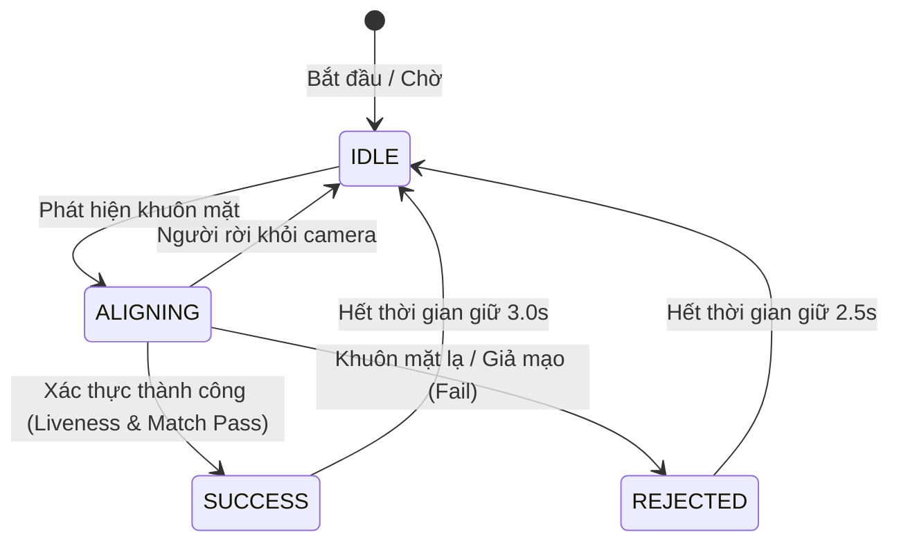
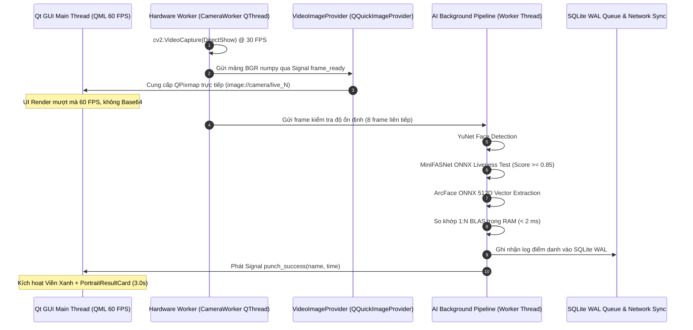

# Hệ Thống Thiết Kế Giao Diện & Trải Nghiệm Người Dùng (Global UI Design System)

> **Document Type:** Canonical Artifact Contract  
> **Mã tài liệu:** `DOC-DESIGN-UI`  
> **Cấp độ:** Toàn cục (Global)  
> **Trạng thái:** [APPROVED]  
> **Nền tảng:** React 19 + Tailwind CSS v4 (Web Portal), PySide6 / QML (Kiosk Desktop App)  
> **Tài liệu liên kết:** [architecture.md](architecture.md) | [api.md](api.md) | [database.md](database.md) | [security.md](security.md) | [ADR-001](adr/ADR-001-zero-photo-upload-multi-pose.md) | [ADR-004](adr/ADR-004-stomp-websocket-realtime-feed.md) | [ADR-005](adr/ADR-005-pin-fallback-and-lockout.md)

---

## 1. Tổng Quan & Triết Lý Thiết Kế (Overview & Philosophy)

Hệ thống Chấm công Doanh nghiệp Bằng Nhận Diện Khuôn Mặt (**Enterprise Face Attendance System — FAS**) tích hợp hai giao diện tương tác độc lập phục vụ hai bối cảnh sử dụng khác biệt:

1. **Web Portal Client (`apps/web-portal`)**: Ứng dụng Quản trị Doanh nghiệp (SaaS Web App) xây dựng trên React 19 và Tailwind CSS v4, tối ưu hóa cho Quản trị viên HR, DPO và Nhân viên tra cứu dữ liệu, giám sát trực tiếp (Live Attendance) và xử lý yêu cầu quyền riêng tư.
2. **Kiosk Desktop App (`apps/kiosk-app`)**: Ứng dụng Trạm Điểm danh Cảm ứng (Edge Kiosk HMI) xây dựng trên PySide6 (Qt Quick / QML), hoạt động theo tỷ lệ màn hình dọc 9:16 (`1080 x 1920 px`), tối ưu hóa công thái học cảm ứng đứng (Touch Ergonomics) và đáp ứng quy chuẩn thời gian thực không giật lag.

### Bộ Ba Nguyên Tắc Thiết Kế (Core Invariants)

- **ĐÚNG (Code-Accurate):** Mọi token màu sắc, kích thước typography, spacing, component states và tham số HMI được mô tả phải ánh xạ chính xác $1:1$ với mã nguồn triển khai (`src/index.css`, `Theme.qml`, CVA variants, Python controllers).
- **ĐỦ (Comprehensive):** Bao phủ toàn diện bảng màu token, phân cấp chữ, trạng thái nguyên tử của component, phòng thủ vỡ giao diện (VIS Defense), phản hồi bất đồng bộ, công thái học điểm chạm cảm ứng và luồng thực thi giao diện phi chặn.
- **GỌN (Lean & Semantic):** Trình bày kỹ thuật súc tích, cấu trúc bảng chuẩn hóa, trực quan hóa luồng dữ liệu, loại bỏ hoàn toàn biểu tượng cảm xúc trang trí (Zero decorative emojis) và nội dung suy đoán vô căn cứ.

---

## 2. Web Portal Design System (React 19 + Tailwind CSS v4)

### 2.1 Kiến Trúc Styling & Nền Tảng UI

- **Framework & Build Tool:** React 19 (`react` / `react-dom` ^19.2.8), Vite 8, TypeScript 6.
- **Bộ máy Styling:** Tailwind CSS v4 với plugin `@tailwindcss/vite` (^4.3.3). Cấu hình token được khai báo trực tiếp trong khối `@theme` tại `src/index.css` (thay thế tệp cấu hình `tailwind.config.js` truyền thống).
- **Thư viện Primitive:** Tận dụng nền tảng Radix UI Unstyled Primitives (`@radix-ui/react-dialog`, `dropdown-menu`, `label`, `select`, `slot`, `tabs`, `tooltip`) kết hợp `class-variance-authority` (CVA) để định nghĩa các biến thể giao diện có kiểu dữ liệu tĩnh nghiêm ngặt.
- **Biểu tượng:** Bộ biểu tượng hình học `lucide-react`.

### 2.2 Hệ Thống Typography (Typography Hierarchy)

- **Font Sans Chính:** `--font-sans: 'Inter', system-ui, -apple-system, BlinkMacSystemFont, 'Segoe UI', Roboto, Oxygen, Ubuntu, Cantarell, 'Open Sans', 'Helvetica Neue', sans-serif;`.
- **Font Monospace:** Áp dụng lớp `font-mono` cho các trường dữ liệu định danh và thời gian: Mã nhân viên, ID thiết bị Kiosk, Mã OTP kích hoạt, ID yêu cầu quyền riêng tư, và Dấu thời gian quẹt thẻ (`HH:mm:ss.SSS`).
- **Chống Giật Số (Tabular Numbers):** Áp dụng toàn cục `table { font-variant-numeric: tabular-nums; }` trong lớp base CSS để đảm bảo các con số thay đổi liên tục trên bảng theo dõi trực tiếp không làm thay đổi chiều rộng cột.

| Token / Lớp CSS | Kích thước Font | Line Height | Font Weight | Letter Spacing | Phạm Vi Sử Dụng |
| :--- | :--- | :--- | :--- | :--- | :--- |
| `.page-title` | `1.625rem` (26px) | `2.125rem` (34px) | 800 (Extrabold) | `-0.025em` | Tiêu đề chính của từng màn hình View |
| `.page-subtitle` | `0.875rem` (14px) | `1.25rem` (20px) | 400 (Normal) | Normal | Dòng mô tả bổ trợ dưới tiêu đề trang |
| `DialogTitle` | `1.125rem` (18px) | 1.0 (Leading-none) | 700 (Bold) | `-0.025em` | Tiêu đề hộp thoại tương tác Modal |
| `SheetTitle` | `1.0rem` (16px) | 1.25 (Leading-tight)| 700 (Bold) | Normal | Tiêu đề ngăn kéo phụ (Drawer / Sheet) |
| `CardTitle` | `1.0rem` (16px) | 1.0 (Leading-none) | 700 (Bold) | `-0.025em` | Tiêu đề khối thẻ thống kê & bảng dữ liệu |
| Section Header (H2)| `1.0rem` (16px) | 1.25 (Leading-tight)| 700 (Bold) | Normal | Tiêu đề phân đoạn nghiệp vụ trong trang |
| Table Header (`th`) | `0.6875rem` - `0.75rem` (11-12px) | 1.0rem (16px) | 600 - 700 | `+0.05em` (Uppercase)| Hàng tiêu đề các cột của Bảng dữ liệu |
| Body Text / Cell | `0.875rem` (14px) | 1.25rem (20px) | 400 - 500 | Normal | Nội dung văn bản chính và các ô bảng dữ liệu |
| Micro-copy / Badges| `0.625rem` - `0.75rem` (10-12px) | 1.0rem (16px) | 600 (Semibold) | Normal | Nhãn trạng thái, tag bộ lọc, chú thích chân trang |

### 2.3 Bảng Màu & Design Tokens

#### A. Bảng Màu Thương Hiệu (Brand Identity Palette)

Hệ thống sử dụng sắc thái Indigo Clean SaaS làm gam màu nhận diện chủ đạo:

| Biến CSS Token | Mã Màu Hex | Lớp Tương Đương | Vai Trò Thiết Kế |
| :--- | :--- | :--- | :--- |
| `--color-brand-primary` | `#4F46E5` | Indigo 600 | Màu hành động chính, nút xác nhận, trạng thái tab kích hoạt |
| `--color-brand-hover` | `#4338CA` | Indigo 700 | Trạng thái hover / active của nút hành động chính |
| `--color-brand-light` | `#EEF2FF` | Indigo 50 | Nền nhãn phụ trợ, vùng chọn kích hoạt nhẹ |
| `--color-brand-dark-navy`| `#102D53` | Custom Navy | Màu thanh Sidebar chính và Header cấp cao |
| `--color-brand-navy-card`| `#1E3A5F` | Custom Navy Card | Màu nền thẻ chỉ số tổng quan trên nền tối |
| `--color-brand-light-blue`| `#80B4FF`| Custom Light Blue | Điểm nhấn liên kết phụ trên nền tối |

*Thang màu Indigo chuẩn:* 50 (`#EEF2FF`), 100 (`#E0E7FF`), 200 (`#C7D2FE`), 300 (`#A5B4FC`), 400 (`#818CF8`), 500 (`#6366F1`), 600 (`#4F46E5`), 700 (`#4338CA`), 800 (`#3730A3`), 900 (`#312E81`).

#### B. Bề Mặt & Màu Trung Tính (Surfaces & Neutrals)

| Biến CSS Token | Mã Màu Hex | Lớp Tương Đương | Vai Trò Thiết Kế |
| :--- | :--- | :--- | :--- |
| `--color-bg-app` | `#F3F6FA` | Custom Slate-50 | Nền toàn thể khu vực hiển thị ứng dụng |
| `--color-surface-card` | `#FFFFFF` | White | Nền của Thẻ (Card), Hộp thoại (Modal) và Bảng (Table) |
| `--color-border-subtle` | `#E2E8F0` | Slate 200 | Đường viền ngăn cách thẻ, ô bảng và các trường input |
| `--color-text-primary` | `#0F172A` | Slate 900 | Màu chữ tiêu đề, số liệu và nội dung tương tác chính |
| `--color-text-secondary`| `#64748B` | Slate 500 | Màu chữ mô tả bổ trợ, nhãn trường nhập liệu |
| `--color-text-muted` | `#94A3B8` | Slate 400 | Chữ placeholder và các thành phần bị vô hiệu hóa |

#### C. Màu Trạng Thái Nghiệp Vụ (Semantic Status Tokens)

- **Thành công (Success):** Token `--color-status-success: #10B981;` / Nền `--color-status-success-bg: #ECFDF5;`
- **Cảnh báo (Warning):** Token `--color-status-warning: #F59E0B;` / Nền `--color-status-warning-bg: #FFFBEB;`
- **Nguy hiểm / Lỗi (Danger):** Token `--color-status-danger: #EF4444;` / Nền `--color-status-danger-bg: #FEF2F2;`
- **Thông tin (Info):** Token `--color-status-info: #3B82F6;` / Nền `--color-status-info-bg: #EFF6FF;`

#### D. Ma Trận Huy Hiệu Điểm Danh (`AttendanceStatusBadge` & `STATUS_CONFIG`)

| Mã Trạng Thái Enum | Nhãn Hiển Thị Tiếng Việt | Biến Thể Badge | Màu Viền / Nền / Chữ | Màu Chấm Dot | Icon Lucide |
| :--- | :--- | :--- | :--- | :--- | :--- |
| `ON_TIME` | Đúng giờ | `success` | `border-emerald-200 bg-emerald-50 text-emerald-800` | `bg-emerald-500` | `CheckCircle2` |
| `LATE` | Đi muộn ({N}p) | `warning` | `border-amber-200 bg-amber-50 text-amber-800` | `bg-amber-500` | `AlertTriangle` |
| `EARLY_LEAVE` | Về sớm | `warning` | `border-amber-200 bg-amber-50 text-amber-800` | `bg-amber-500` | `Clock` |
| `OVERTIME` | Tăng ca | `info` | `border-sky-200 bg-sky-50 text-sky-700` | `bg-sky-500` | `Clock` |
| `ANOMALOUS` | Bất thường | `destructive` | `border-rose-200 bg-rose-50 text-rose-700` | `bg-rose-500` | `AlertTriangle` |
| `ABSENT` | Vắng mặt | `destructive` | `border-rose-200 bg-rose-50 text-rose-700` | `bg-rose-500` | `ShieldAlert` |
| `REST_DAY` | Nghỉ tuần | `neutral` | `border-slate-200 bg-slate-100 text-slate-700` | `bg-slate-400` | `MinusCircle` |
| `HOLIDAY` | Nghỉ lễ | `info` | `border-sky-200 bg-sky-50 text-sky-700` | `bg-sky-500` | `Calendar` |
| `EXCUSE_PENDING` | Chờ duyệt giải trình | `info` | `border-sky-200 bg-sky-50 text-sky-700` | `bg-sky-500` | `FileQuestion` |

### 2.4 Quy Hoạch Spacing & Phân Tầng Z-Index

#### A. Kích Thước Bố Cục Cố Định

- **Sidebar Width:** `--spacing-sidebar: 260px;` (khi thu gọn: `72px`).
- **Top Header Bar Height:** `--spacing-top-header: 64px;`.
- **Drawer Width:** `--spacing-drawer: 420px;`.
- **Border Radius:** Thẻ `--radius-card: 12px;`, Nút bấm/Input `--radius-button: 8px;`.

#### B. Ma Trận Phân Tầng Trục Z (Z-Index Stacking Matrix)

Tránh hoàn toàn tình trạng xung đột hiển thị bằng thang thứ tự cố định:

| Token / Lớp CSS | Giá Trị Z-Index | Thành Phần Giao Diện Tương Ứng |
| :--- | :--- | :--- |
| `sticky thead` | `10` | Tiêu đề bảng cố định khi cuộn dọc (`sticky top-0 bg-slate-50/95`) |
| `sticky col` | `20` | Cột Ghim Cố Định bên trái (Giờ quẹt) & bên phải (Thao tác) |
| `--z-header` | `30` | Thanh điều hướng trên cùng (Top Navigation Bar) |
| `--z-sidebar` | `40` | Thanh điều hướng bên hông (Left App Sidebar) |
| `--z-overlay` | `45` | Lớp nền mờ che chắn phía sau Dialog (`bg-black/50 backdrop-blur-xs`) |
| `--z-modal` | `50` | Cửa sổ Hộp thoại trung tâm (Dialog / Modal Content Container) |
| `--z-toast` | `60` | Thông báo nổi góc màn hình (Toast Notifications Container) |
| `--z-tooltip` | `70` | Gợi ý công cụ khi rê chuột (Hover Tooltip Popup) |

### 2.5 Trạng Thái Nguyên Tử Của Component Primitives

#### A. Button (`@/components/ui/button`)

- **Biến thể (Variants):** `default`, `primary`, `secondary`, `outline`, `destructive` / `danger`, `ghost`, `link`.
- **Kích thước (Sizes):**
  - `default` / `md`: Chiều cao `h-10`, đảm bảo vùng bấm cảm ứng `min-h-[44px] px-4 py-2 text-sm`.
  - `sm`: Chiều cao `h-8`, trên màn hình nhỏ tự mở rộng `max-sm:min-h-[40px] max-sm:px-3.5 rounded-lg px-3 text-xs`.
  - `lg`: Chiều cao `h-11 min-h-[44px] rounded-lg px-6 text-base`.
  - `icon`: Vuông `size-9`, trên màn hình nhỏ tự mở rộng `max-sm:size-11` (đạt chuẩn $\ge 44\text{ px}$).
- **Trạng thái Tương tác:**
  - *Default:* `rounded-lg font-semibold cursor-pointer select-none`.
  - *Hover / Active:* `hover:bg-brand-hover active:bg-brand-hover/90`.
  - *Focus:* `focus-visible:outline-hidden focus-visible:ring-2 focus-visible:ring-brand-primary focus-visible:ring-offset-2`.
  - *Disabled:* `disabled:pointer-events-none disabled:opacity-50 disabled:cursor-not-allowed`.
  - *Loading:* Thuộc tính `isLoading` tự động khóa click, hiển thị biểu tượng quay vòng SVG `animate-spin size-4` và gắn cờ trợ năng `aria-busy="true"`.
  - *Error:* Thuộc tính `isError` / `hasError` chuyển nút sang viền đỏ `border-status-danger bg-status-danger-bg text-status-danger`.

#### B. Input (`@/components/ui/input`)

- **Kích thước:** `sm` (`h-8 max-sm:min-h-[40px] text-xs px-2.5`), `md` (`h-10 min-h-[44px] text-sm px-3.5`), `lg` (`h-12 min-h-[48px] text-base px-4`).
- **Trạng thái Tương tác:**
  - *Default:* `border-border-subtle bg-white text-text-primary placeholder:text-text-muted`.
  - *Focus:* `focus:outline-hidden focus:border-brand-primary focus:ring-2 focus:ring-brand-primary/20`.
  - *Disabled:* `disabled:cursor-not-allowed disabled:bg-slate-50 disabled:text-text-muted disabled:border-slate-200`.
  - *Loading:* Thuộc tính `isLoading` áp dụng `cursor-wait bg-slate-50/70`, xoay biểu tượng spinner tại ô icon bên phải và gắn `aria-busy="true"`.
  - *Invalid / Error:* Thuộc tính `isInvalid` áp dụng `border-status-danger text-rose-900 focus:border-status-danger focus:ring-status-danger/20`, tự động render dòng thông báo lỗi bên dưới `text-xs text-status-danger`.

#### C. Card (`@/components/ui/card`)

- **Default:** `relative rounded-xl border border-border-subtle bg-surface-card text-text-primary shadow-xs`.
- **Loading State:** Lớp phủ toàn diện `absolute inset-0 bg-white/80 backdrop-blur-[1px]` kèm spinner `animate-spin size-6 text-brand-primary` và dòng thông báo tải `loadingMessage`.
- **Error State:** Đường viền `border-status-danger/40 bg-status-danger-bg/5`, hiển thị thanh thông báo đỏ kèm nút bấm thử lại (`onRetry`).
- **Disabled State:** Giảm mờ `opacity-60 pointer-events-none select-none bg-slate-50/60 cursor-not-allowed`.

#### D. Modal & Dialog (`@/components/ui/modal`, `@/components/ui/dialog`)

- Bọc lớp Radix Dialog, tự động xử lý phím ESC, khóa tiêu điểm (Focus Trap), Portal tách khỏi cây DOM cha và khóa cuộn nền (Scroll Lock).
- **Kích cỡ ngang:** `sm` (max-w-sm), `md` (max-w-md), `lg` (max-w-lg), `xl` (max-w-2xl), `full` (max-w-4xl).
- **Responsive Bottom Sheet Adapter:** Khi hiển thị trên thiết bị di động có chiều rộng hẹp (`max-sm` $< 640\text{ px}$), Modal tự động chuyển đổi thành Bottom Sheet trượt từ đáy màn hình (`bottom-0 rounded-t-2xl rounded-b-none pb-safe max-h-[90dvh] slide-in-from-bottom-full`) kèm thanh nắm kéo trung tâm (`h-1 w-10 rounded-full bg-slate-300`).

### 2.6 Mô Thức Phản Hồi Bất Đồng Bộ (Async Patterns)

1. **Spinners:** Biểu tượng SVG xoay vòng `animate-spin` với tốc độ chuẩn hóa, kích thước đồng nhất (`size-4` cho nút/input, `size-6` cho card/modal).
2. **Skeletons (`TableSkeleton`):** Render các hàng khung giả lập sử dụng hiệu ứng `animate-pulse bg-white/60`, xoay vòng chiều rộng các ô ngẫu nhiên (`w-3/4`, `w-1/2`, `w-4/5`, `w-2/3`, `w-full`) nhằm ngăn ngừa triệt để hiện tượng dịch chuyển bố cục tích lũy (Cumulative Layout Shift - CLS). Tích hợp vùng đọc ẩn cho trình đọc màn hình (`sr-only` aria-live).
3. **Empty State Displays:** Hiển thị khung biểu tượng bo góc lớn (`w-12 h-12 rounded-2xl bg-slate-100 text-slate-400 flex items-center justify-center mx-auto mb-3`), tiêu đề chữ đậm và dòng hướng dẫn hành động tiếp theo.
4. **Toast Notifications (`ToastCard`, `toast`):** Hỗ trợ 4 kiểu thông báo (`success`, `error`, `warning`, `info`), hiệu ứng trượt góc từ trên xuống / từ phải sang, nền mờ kính `backdrop-blur`, nằm tại tầng `--z-toast: 60`.
5. **Real-Time Live Pulse:** Khi bản ghi điểm danh mới được đẩy về qua kết nối STOMP WebSocket, hàng dữ liệu trên bảng kích hoạt hiệu ứng chớp màu xanh lá `greenFlash 1.5s ease-out forwards` và `bg-emerald-50/90 ring-2 ring-emerald-400 animate-pulse`.

### 2.7 Quy Tắc Phòng Thủ Layout (VIS Defense Rules)

- **Chống Bẹp Icon (`shrink-0`):** Bắt buộc gắn thuộc tính `shrink-0` cho toàn bộ SVG icon, Avatar nhân viên, Huy hiệu trạng thái Badge (`badgeVariants` mặc định chứa `shrink-0`), và thanh nắm kéo Bottom Sheet.
- **Bảo Vệ Văn Bản Động (`truncate` & `whitespace-nowrap`):**
  - Gắn `whitespace-nowrap` cho toàn bộ Huy hiệu trạng thái, Nhãn nút bấm, Dấu thời gian, Mã nhân viên và Thẻ lọc.
  - Gắn `truncate` kết hợp thuộc tính HTML `title` làm tooltip dự phòng cho các cột dữ liệu có độ dài bất định (Lý do giải trình, Ghi chú, Nội dung yêu cầu dữ liệu).
- **Thanh Cuộn Bảng Dữ Liệu (`overflow-x-auto`):** Toàn bộ thẻ Table bắt buộc bọc trong thẻ chứa `div.overflow-x-auto` để tránh vỡ giao diện khi người dùng xem trên màn hình độ phân giải thấp.
- **Công Thái Học Điểm Chạm (Mobile Touch Target):** Các phần tử tương tác chính bắt buộc tuân thủ chuẩn tối thiểu $44 \times 44\text{ px}$ (`min-h-[44px]`). Các nút đóng/hủy tối thiểu `40 x 40 px`.

---

## 3. Kiosk Desktop App Ergonomics & HMI (PySide6 / QML)

### 3.1 Ma Trận Hiển Thị & Tỷ Lệ Màn Hình

- **Kích Thước Thiết Kế Chuẩn:** Tỷ lệ dọc 9:16 (`1080 x 1920 px`), tương thích phần cứng Kiosk trạm đứng chuyên dụng.
- **Khung Viền & Canvas Tỏa Sáng (Luminous Canvas):**
  - Viền ngoài (Outer Bezel Padding): `32 px`.
  - Khung Canvas Tương Tác: Kích thước khả dụng `1016 x 1856 px`, bo góc `20 px`, padding bên trong `24 px`, khoảng cách giữa các phần tử (spacing) `24 px`.
- **Ngân Sách Phân Bổ Chiều Cao Dọc (Vertical Viewport Budget):**
  - *Station Header Bar:* Chiều rộng `968 px`, Chiều cao `120 px`.
  - *Main Viewport (WelcomeCanvas / CameraPanel):* Chiều rộng `968 px`, Chiều cao `1496 px`.
  - *Bottom Action Dock:* Chiều rộng `968 px`, Chiều cao `144 px`.
  - *Tổng ngân sách:* $120\text{ px} + 24\text{ px} + 1496\text{ px} + 24\text{ px} + 144\text{ px} = 1808\text{ px} + 48\text{ px (padding trên/dưới)} = 1856\text{ px}$ (Vừa khít $100\%$).
- **Quy Luật Co Giãn Đẳng Tỷ Lệ (Scaling Invariant):**
  - Tỷ lệ co giãn tính theo: $S = \min\left(\frac{W_{\text{actual}}}{1080}, \frac{H_{\text{actual}}}{1920}\right)$.
  - Giới hạn cửa sổ tối thiểu: Chiều rộng `360 px`, Chiều cao `640 px`.
  - Cơ chế tự nhận diện hướng hiển thị (`main.py`): Trên màn hình dọc vật lý (`avail.width <= avail.height`), ứng dụng mở rộng chiếm trọn $100\%$ không gian. Trên môi trường thử nghiệm màn hình ngang PC/Laptop, ứng dụng tự động khóa chặt tỷ lệ khung 9:16 (Chiều cao bằng $92\%$ chiều cao màn hình, Chiều rộng bằng $\text{Height} \times \frac{1080}{1920}$) đặt ở vị trí trung tâm nhằm chống biến dạng thị giác.

### 3.2 Kích Thước Điểm Chạm & Công Thái Học Cảm Ứng (Touch Ergonomics)

Tại khoảng cách tương tác đứng từ $0.5\text{ m} - 1.2\text{ m}$, các điểm chạm cảm ứng được thiết kế vượt mức tiêu chuẩn thông thường:

| Vùng Tương Tác | File QML | Kích Thước (W x H) | Bo Góc | Phân Tích Công Thái Học |
| :--- | :--- | :--- | :--- | :--- |
| **Nút Thanh Đáy (Action Dock)** | `PortraitActionDock.qml` | `301.3 x 112 px` | 16 px | Chia 3 cột đều nhau. Vượt chuẩn $48\text{ dp}$ gấp 2.3 lần, giúp nhân viên chạm nhanh không lệch. |
| **Phím Số Ảo (PIN Keypad)** | `VirtualKeypad.qml` | `230.6 x 72 px` | 14 px | Bố cục lưới $3 \times 4$ khoảng cách 14px. Font số lớn 28px, phím hành động 15px. |
| **Nút Xác Nhận Modal** | `PinDialog.qml` | `720 x 64 px` | 14 px | Chiều ngang trải rộng, nổi bật rõ nút xác thực hoàn tất. |
| **Nút Đóng / Hủy Dialog** | `PinDialog.qml` | `48 x 48 px` | 14 px | Đạt chuẩn ngón tay tiếp xúc tối thiểu tại góc trên phải. |
| **Ô Nhập Mã OTP (Enrollment)**| `EnrollmentDialog.qml` | `96 x 96 px` | 16 px | 6 ô vuông lớn độc lập, hiển thị số to rõ ràng tại trạm nạp mẫu. |
| **Thẻ Hướng Dẫn Tư Thế (HUD)**| `EnrollmentDialog.qml` | `~210 x 58 px` | 12 px | 3 thẻ tuần tự chỉ dẫn: Thẳng, Nghiêng trái, Nghiêng phải. |
| **Nút Điều Hướng Xoay Đầu** | `EnrollmentDialog.qml` | `80 x 90 px` | 16 px | Cặp nút điều hướng thị giác `◀ TRÁI` và `▶ PHẢI` nhấp nháy chỉ dẫn. |

### 3.3 Khung Căn Chỉnh Khuôn Mặt (Face Oval) & Nạp Mẫu Đa Tư Thế

#### A. Thông Số Hình Học Khung Oval

- **Kích thước Khung:** Chiều rộng `470 px`, Chiều cao `604 px` (tỷ lệ $W/H \approx 0.778$, phỏng sinh học theo tỷ lệ đầu người).
- **Tọa độ Trung tâm:** Hoành độ $cx = \frac{\text{Width}}{2}$ (chính giữa màn hình), Tung độ $cy = \text{Height} \times 0.40$ (ngang tầm mắt trung bình của người lớn đứng trước trạm).
- **Đường nét & Đổ bóng:** Độ dày viền Canvas `4 px`. Toàn bộ vùng hiển thị camera bên ngoài khung Oval được phủ lớp màu tối làm mờ `rgba(23, 25, 29, 0.35)` sử dụng chế độ hòa trộn đồ họa `destination-out`.

#### B. Máy Trạng Thái Thị Giác 4 Bước (Visual FSM Matrix)

Khung Oval chuyển đổi màu sắc và trạng thái theo máy trạng thái hữu hạn (FSM) đồng bộ từ `kiosk_view_model.py`:



| Trạng Thái FSM | Màu Viền Oval (Hex) | Trạng Thái Tia Quét Laser | Thẻ Thông Báo Hướng Dẫn | Thời Gian Giữ Kết Quả |
| :--- | :--- | :--- | :--- | :--- |
| **`IDLE` (Chờ)** | `#64748B` (Theme.ovalStandby) | Tia laser tím quét dọc liên tục chu kỳ 2000ms InOutSine | Nền xám: *"Vui lòng đứng trước camera để điểm danh"* | Vô hạn (chờ sự kiện) |
| **`ALIGNING` (Căn chỉnh)** | `#F59E0B` (Theme.ovalAligning) | Tia laser tiếp tục quét kiểm tra độ sống MiniFASNet | Nền vàng: Nhận phản hồi động từ thuật toán (*"Giữ thẳng mặt"*, *"Lại gần hơn"*, *"Lùi ra xa"*...) | Theo thời gian thực |
| **`SUCCESS` (Thành công)** | `#10B981` (Theme.ovalSuccess) | Tia laser ẩn hoàn toàn | Nền xanh lá `#E8F7ED`: Bật popup `PortraitResultCard` hiển thị họ tên, giờ chấm công và dấu kiểm tích | Giữ kết quả `3.0s` |
| **`REJECTED` (Từ chối)** | `#EF4444` (Theme.ovalRejected) | Tia laser ẩn hoàn toàn | Nền đỏ `#FEF2F2`: Cảnh báo *"PHÁT HIỆN KHUÔN MẶT KHÔNG HỢP LỆ"* hoặc *"Chưa đăng ký trên hệ thống"* | Giữ kết quả `2.5s` |

#### C. Chế Độ Hướng Dẫn Thu Nhận Đa Tư Thế (Guided Multi-Pose Enrollment)

- **Màu Viền Oval:** Đổi sang màu tím chuyên dụng `#8B5CF6` (`Theme.brandPurple`).
- **3 Thẻ Hướng Dẫn HUD:** Tuần tự kích hoạt theo góc quay đầu:
  1. *Tư thế 1 (Nhìn thẳng):* Góc xoay Yaw $\in [-5^\circ, +5^\circ]$.
  2. *Tư thế 2 (Nghiêng trái):* Góc xoay Yaw $\in [+10^\circ, +25^\circ]$.
  3. *Tư thế 3 (Nghiêng phải):* Góc xoay Yaw $\in [-25^\circ, -10^\circ]$.
- **Thước Đo Góc Xoay Thời Gian Thực (Live Dynamic Yaw Gauge):** Kích thước `520 x 32 px`, có kim chỉ thị di chuyển mượt mà theo góc quay thực tế của khuôn mặt (thuộc tính `Behavior on x` chuyển động `60ms OutQuad`), kèm vùng mục tiêu màu xanh lá hiển thị trực quan.

### 3.4 Bàn Phím Số Ảo & Cơ Chế Khóa An Toàn (Virtual PIN Pad & Lockout)

#### A. Bố Cục & Tương Tác Bàn Phím

- **Bố Cục Lưới:** 3 cột $\times$ 4 hàng:
  - Hàng 1 - 3: Các chữ số từ `1` đến `9`.
  - Hàng 4: Phím `Xóa trắng` (Clear, bên trái), Phím `0` (chính giữa), Phím `Xóa lùi` (Backspace, bên phải).
- **Tương Tác Kép:** Hỗ trợ song song cả chạm cảm ứng trên màn hình và phím vật lý thông qua sự kiện `Keys.onPressed` (bắt các phím số 0-9, Backspace, Enter, Escape, Tab).
- **Bảo Vệ Chống Nhìn Trộm (Anti-Peeking):** Mật khẩu mã PIN được mã hóa ẩn hiển thị bằng chuỗi ký tự chấm đen lớn định dạng `'● '.repeat(len)`.

#### B. Cơ Chế Khóa Trạm Chống Tấn Công Brute-Force (ADR-005)

- **Ngưỡng Kích Hoạt:** Khóa trạm sau đúng **5 lần nhập sai liên tiếp** (`PinSecurityManager`).
- **Thời Gian Khóa:** Đúng **15 phút** ($900\text{ giây}$) tuân thủ nghiêm ngặt [ADR-005](adr/ADR-005-pin-fallback-and-lockout.md).
- **Trạng Thái Giao Diện Khóa:**
  - Bàn phím số ảo bị vô hiệu hóa (`enabled: false`, độ mờ `opacity: 0.4`).
  - Dòng trạng thái đổi sang màu đỏ thẫm `#EF4444` và hiển thị bộ đếm thời gian lùi theo thời gian thực:  
    *"Đã khóa bàn phím do nhập sai quá 5 lần! Thử lại sau {remaining_seconds}s"*.
  - Bộ điều khiển `PinController` từ chối mọi lệnh thêm ký tự (`append_digit`) ở tầng logic cho đến khi đồng hồ đếm lùi về 0.

### 3.5 Tín Hiệu Đa Phương Thức (Multi-Modal Cues)

- **Hiệu Ứng Thị Giác (Visual Highlights):**
  - Quầng sáng nền chuyển sắc tỏa sáng (Ambient Halo) kích thước `650 x 650 px` màu `#EEF2FF` tại góc trên phải ở trạng thái Standby.
  - Tia laser tím quét dọc chuyển động mềm mại `2000ms` tạo cảm giác thiết bị đang tích cực quan sát.
  - Thẻ kết quả nổi `PortraitResultCard` (`860 x Auto px`) đổ bóng mềm với huy hiệu xanh lá xác nhận điểm danh.
- **Tình Trạng Tín Hiệu Âm Thanh (Audio Cues Status):**

> [!NOTE]
> **Hiện trạng triển khai âm thanh:**  
> Tệp cấu hình `settings.py` đã định nghĩa các đường dẫn âm thanh chuẩn (`beep_success_path` và `beep_error_path` trỏ tới `resources/assets/sounds/beep_success.wav` và `beep_error.wav`). Tuy nhiên, trong mã nguồn hiện tại, thư mục tài nguyên đang là stub rỗng (`.gitkeep`) và chưa kích hoạt lớp phát âm thanh `QSoundEffect` / `QAudioOutput`. Tính năng phản hồi âm thanh sẽ được hoàn thiện cùng gói tài nguyên âm thanh chuẩn ở chu kỳ bàn giao tiếp theo.

### 3.6 Kiến Trúc UI Không Chặn & Đa Luồng (Non-Blocking Concurrency)

Nhằm đảm bảo màn hình QML luôn duy trì ổn định ở tần số quét $60\text{ FPS}$ mà không bị giật khung hình do tác vụ AI, kiến trúc đa luồng tách biệt tuyệt đối được áp dụng:



1. **Qt GUI Main Thread:** Chỉ đảm nhiệm vẽ Scene Graph QML ở $60\text{ FPS}$ và tiếp nhận sự kiện cảm ứng. Giao tiếp với tầng logic hoàn toàn thông qua cơ chế Qt Property Bindings (`@Property`), Signals (`Signal`) và Slots (`@Slot`). Tuyệt đối không thực hiện đọc/ghi tệp, gọi mạng hoặc tính toán ma trận trên luồng này.
2. **Hardware Capture Thread (`CameraWorker` - QThread):** Bắt khung hình camera qua OpenCV DirectShow (`cv2.CAP_DSHOW`), lật gương (`cv2.flip(frame, 1)`), duy trì tần số $30\text{ FPS}$ với cơ chế tự động thử lại kết nối khi mất tín hiệu (chu kỳ $3\text{s}$). Phát tín hiệu `frame_ready(np.ndarray)`.
3. **Bộ Nạp Ảnh Không Sao Chép (`VideoImageProvider` - QQuickImageProvider):** Chuyển đổi trực tiếp mảng numpy BGR trong RAM sang `QPixmap` (`QImage.Format_RGB888`), cung cấp trực tiếp cho thẻ ảnh QML qua URI `image://camera/live_<frameCounter>`, loại bỏ hoàn toàn chi phí mã hóa chuỗi Base64.
4. **Bộ Lọc & Đường Ống Suy Luận AI Nền:**
   - Bộ lọc ổn định: Đòi hỏi tối thiểu 8 khung hình liên tiếp có vị trí khuôn mặt ổn định trong khung Oval trước khi kích hoạt nhận diện.
   - Đường ống suy luận nối tiếp: YuNet $\rightarrow$ MiniFASNet Liveness $\rightarrow$ ArcFace 512D $\rightarrow$ So khớp RAM BLAS $\rightarrow$ Kiểm tra bộ đệm chống quẹt đúp 120s $\rightarrow$ Ghi hàng đợi SQLite WAL.
   - Bộ hẹn giờ hiển thị kết quả (`2.5s - 3.0s`) chỉ tạm dừng kích hoạt AI mới, tuyệt đối không làm đóng băng khung hình video hay khóa giao diện tương tác.
5. **Luồng Mạng Nền (Background Network Workers):**
   - `OfflineSyncWorker` (QThread): Quét hàng đợi SQLite WAL và đẩy theo lô tối đa 50 bản ghi lên máy chủ trung tâm mỗi $10\text{s}$.
   - `KioskStompWorker` (QThread): Luồng ngầm duy trì kết nối WebSocket STOMP nhận thông báo cập nhật nóng danh sách ma trận khuôn mặt (Hot Gallery Update).

---

## 4. Tiêu Chuẩn Tiếp Cận & Khả Năng Sử Dụng (Accessibility - WCAG 2.1 AA)

- **Độ Tương Phản Màu Sắc (Color Contrast):**
  - Tỷ lệ tương phản giữa chữ và nền đạt tối thiểu $4.5:1$ đối với văn bản thông thường (ví dụ: Slate-900 `#0F172A` trên nền trắng `#FFFFFF` đạt tỷ lệ $16.1:1$; Indigo-600 `#4F46E5` trên nền trắng đạt $6.4:1$).
  - Đối với văn bản lớn và các thành phần giao diện đồ họa, tỷ lệ tương phản duy trì $\ge 3.0:1$.
- **Chỉ Thị Tiêu Điểm Bàn Phím (Focus Visible):** Mọi phần tử tương tác trên Web Portal và Kiosk đều hỗ trợ viền tiêu điểm rõ ràng khi điều hướng bằng phím Tab (`focus-visible:ring-2 focus-visible:ring-brand-primary focus-visible:ring-offset-2`).
- **Phòng Ngừa Double-Submit (Chống Gửi Lặp):** Mọi nút bấm gửi yêu cầu dữ liệu, rút đơn đồng thuận hay xác thực biểu mẫu đều tự động kích hoạt `isLoading` và vô hiệu hóa tương tác (`disabled`) ngay khi được nhấn, triệt tiêu nguy cơ gửi lặp bản ghi.
- **Thuộc Tính Hỗ Trợ Người Khiếm Thị:** Sử dụng đầy đủ các thuộc tính ARIA (`aria-busy="true"` khi tải, `aria-live="polite"` cho thông báo cập nhật, `aria-invalid="true"` khi trường lỗi, và lớp `sr-only` cho tiêu đề bảng và thanh trạng thái).

---

## 5. Quy Chuẩn Kiểm Thử & Ma Trận Truy Vết (Traceability & Gates)

### 5.1 Lệnh Kiểm Tra Cổng Chất Lượng Bắt Buộc (Quality Gates)

Trước khi đóng bất kỳ thay đổi nào liên quan đến giao diện người dùng, kỹ sư bắt buộc phải thực thi và vượt qua các bộ kiểm thử sau tại thư mục con tương ứng:

```bash
# Kiểm tra giao diện Web Portal (Unit Test & Linter)
cd apps/web-portal && npm test && npm run lint

# Kiểm tra giao diện Kiosk Desktop App (PySide6 UI/UX Suites & Ruff Linter)
cd apps/kiosk-app && pytest tests/test_ui_ux.py && ruff check .
```

### 5.2 Ma Trận Truy Vết Kỹ Thuật (Traceability Matrix)

| Thành Phần Giao Diện | Yêu Cầu SRS / Phân Tích | Quyết Định Thiết Kế (ADR) | Mã Nguồn Triển Khai |
| :--- | :--- | :--- | :--- |
| **Triết lý Zero Raw Photo** | SRS-FAS-001 (Zero-Upload) | [ADR-001](adr/ADR-001-zero-photo-upload-multi-pose.md) | `apps/kiosk-app/src/ui/qml/components/OvalOverlay.qml` |
| **Bảng Theo Dõi Trực Tiếp STOMP**| SRS-FAS-004 (Live Feed) | [ADR-004](adr/ADR-004-stomp-websocket-realtime-feed.md) | `apps/web-portal/src/views/LiveAttendanceDashboard.tsx` |
| **Khóa Bàn Phím PIN 15 Phút** | SRS-FAS-005 (PIN Fallback) | [ADR-005](adr/ADR-005-pin-fallback-and-lockout.md) | `apps/kiosk-app/src/security/pin_security.py` |
| **Đệm Ngoại Tuyến SQLite WAL** | SRS-FAS-002 (Offline RPO=0)| [ADR-002](adr/ADR-002-edge-sqlite-wal-offline-sync.md) | `apps/kiosk-app/src/workers/offline_sync_worker.py` |
| **Quy Chuẩn Nhãn Trạng Thái** | SRS-FAS-003 (Status Model) | [architecture.md](architecture.md) §3.3 | `apps/web-portal/src/components/ui/attendance-status-badge.tsx` |
