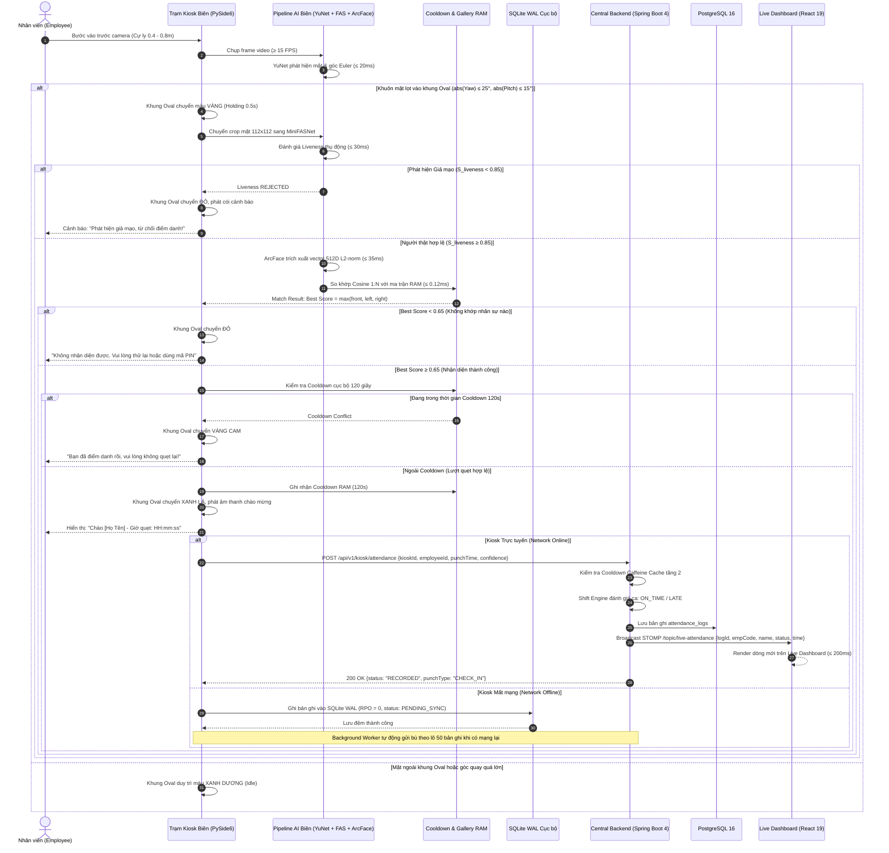

# Feature Specification: Điểm danh Không Chạm & So khớp Ma trận Biên (FEAT-ATTEND-001)

- **Mã tính năng**: `FEAT-ATTEND-001`
- **Phiên bản kiến trúc**: v1.0 (Vectorized Multi-Template 1:N RAM Matching & Passive Liveness)
- **Phân loại**: User-Facing Core Biometric Feature (Liên kết 3 phân hệ: Edge Kiosk $\leftrightarrow$ Central Backend $\leftrightarrow$ Web Portal)
- **Truy vết Yêu cầu Cốt lõi**: `FR-SYS-001`, `FR-SYS-002`, `FR-SYS-003`, `FR-SYS-005`, `FR-SYS-006`, `FR-SYS-012`, `FR-SYS-013`, `FR-SYS-014`, `FR-SYS-015`, `NFR-SYS-001`, `NFR-SYS-003`, `NFR-SYS-004`, `NFR-SYS-005`
- **Cơ sở Pháp lý & Chuẩn mực**: **ISO/IEC 19795-1** (Hiệu năng sinh trắc học), **ISO/IEC 30107-3** (Chống tấn công giả mạo PAD), **Luật Bảo vệ dữ liệu cá nhân 2025** (Luật số 91/2025/QH15) & **Nghị định 356/2025/NĐ-CP**

---

## 1. Bối cảnh & Mục tiêu Sản phẩm (Problem & Objective)

### 1.1. Vấn đề thực tế (Problem Statement)
Điểm danh đầu ca tại các doanh nghiệp sản xuất và văn phòng quy mô vừa và lớn tại Việt Nam đối mặt với 4 điểm nghẽn nghiêm trọng:
1. **Quẹt thẻ hộ & Gian lận danh tính**: Thẻ từ RFID, mã PIN hay mã QR tĩnh dễ dàng được chuyển giao cho đồng nghiệp quẹt hộ khi đi muộn hoặc vắng mặt, gây thất thoát quỹ lương và phá vỡ kỷ luật lao động.
2. **Ùn tắc đầu ca do máy vân tay**: Công nhân cơ khí, dệt may, chế biến thực phẩm có vân tay bị chai sần, dính dầu mỡ, ẩm ướt khiến tỷ lệ từ chối sai (FRR) rất cao, gây ùn tắc kéo dài tại cổng ra vào trước giờ vào ca.
3. **Độ trễ cao khi phụ thuộc Cloud AI**: Các giải pháp truyền luồng video thô lên máy chủ đám mây để nhận diện thường mất từ 1.5 đến 3 giây/lượt, tiêu tốn băng thông Internet và ngưng trệ hoàn toàn khi đường truyền cáp quang gặp sự cố.
4. **Quẹt trùng lặp vô ý (Duplicate Punches)**: Nhân viên đứng nán lại nói chuyện trước tầm quét camera tạo ra hàng loạt lượt quẹt trùng lặp, gây sai lệch thống kê và quá tải cơ sở dữ liệu.

### 1.2. Mục tiêu & Nguyên tắc Thiết kế (Objective & Principles)
- **Trải nghiệm Không chạm Toàn diện (100% Touchless)**: Nhân viên chỉ cần bước vào tầm quét camera ($0.4 - 0.8\text{ m}$), không cần chạm tay vào bất kỳ bề mặt cảm biến nào, bảo đảm an toàn vệ sinh và tốc độ lưu thông cao.
- **Suy luận AI Biên Thuần CPU $\le 350\text{ ms}$ (Edge AI Inference SLA)**: Toàn bộ pipeline AI (Phát hiện mặt $\rightarrow$ Cắt chỉnh $\rightarrow$ Kiểm tra liveness $\rightarrow$ Trích xuất vector 512D $\rightarrow$ So khớp ma trận RAM 1:N) thực thi hoàn toàn trên CPU máy trạm tiêu chuẩn với tổng thời gian tính toán $\le 350\text{ ms}$.
- **Chống Giả mạo Thụ động Chuẩn ISO/IEC 30107-3**: Tích hợp mô hình MiniFASNet đánh giá thực thể sống với ngưỡng $S_{\text{liveness}} \ge 0.85$, đạt tỷ lệ lỗi chấp nhận tấn công $\text{APCER} \le 2.0\%$ (chặn $\ge 98.0\%$ các mẫu tấn công ảnh in 2D và màn hình phát lại).
- **So khớp Đa mẫu Tối ưu (Multi-Template Best Score Matching)**: Tận dụng bộ 3 vector mẫu (`FRONTAL`, `LEFT_TILT`, `RIGHT_TILT`) được nạp từ tính năng `FEAT-ENROLL-001`, thuật toán so khớp ma trận RAM chọn $\text{Best Score} = \max(sim_{\text{front}}, sim_{\text{left}}, sim_{\text{right}})$ với ngưỡng Cosine $\ge 0.65$, giúp nhận diện chính xác kể cả khi nhân viên nhìn nghiêng tự nhiên khi bước qua Kiosk.
- **Bộ đệm Chống Quẹt Trùng Cooldown 120 Giây**: Khóa tạm thời nhận diện của cùng một nhân viên trong vòng 120 giây sau lượt quẹt hợp lệ đầu tiên bằng bộ đệm RAM hai tầng (Kiosk RAM + Backend Caffeine Cache).
- **Khả năng Chịu lỗi Ngoại tuyến ($\text{RPO} = 0$)**: Khi mất kết nối mạng, Kiosk tự động đệm bản ghi vào SQLite WAL (`kiosk_local.db`) và đồng bộ bù tự động khi mạng phục hồi mà không làm gián đoạn việc chấm công.
- **Phát sóng Thời gian thực $\le 200\text{ ms}$**: Đẩy sự kiện điểm danh từ Backend lên Live Attendance Dashboard qua WebSocket STOMP với độ trễ truyền thông $\le 50\text{ ms}$ và hiển thị DOM $\le 150\text{ ms}$.

---

## 2. Phân định Kiến trúc: Điểm danh Thường nhật (Punching) vs. Thu nhận Mẫu Gốc (Enrollment)

| Tiêu chí So sánh | Điểm danh Thường nhật (`FEAT-ATTEND-001`) | Thu nhận Mẫu Gốc (`FEAT-ENROLL-001`) | Căn cứ Thiết kế & Ràng buộc |
| :--- | :--- | :--- | :--- |
| **Mục đích & Tần suất** | Thực hiện hàng ngày (1–4 lần/ngày); xác thực 1:N siêu tốc không chạm. | Thực hiện 1 lần duy nhất khi gia nhập; thiết lập bộ Ground Truth mẫu mực. | Đánh đổi hiệu năng vs. độ chuẩn xác |
| **Góc mặt & Tư thế** | Tự do trong phạm vi tự nhiên: $\text{abs(Yaw)} \le 25^\circ, \text{abs(Pitch)} \le 15^\circ, \text{abs(Roll)} \le 15^\circ$. | Bắt buộc tuần tự 3 tư thế có hướng dẫn: `FRONTAL`, `LEFT_TILT`, `RIGHT_TILT`. | So khớp đa mẫu cho phép nhận diện góc nghiêng |
| **Ngưỡng Liveness** | $S_{\text{liveness}} \ge 0.85$ (Cân bằng giữa FAR và FRR trong môi trường ánh sáng biến thiên). | $S_{\text{liveness}} \ge 0.90$ (Áp dụng Safety Margin $+5\%$ để loại trừ triệt để mẫu giả). | `NFR-SYS-005`, `INV-3` |
| **Vector sinh ra** | 1 vector truy vấn ($1 \times 512$ floats, $L_2 = 1.0$) từ khung hình điểm danh hiện tại. | 3 vector độc lập ($3 \times 512$ floats, $L_2 = 1.0$) tương ứng 3 góc. | `R2`, `R3` |
| **Chiến lược Khớp** | So khớp ma trận NumPy BLAS: $\text{Best Score} = \max(sim_{\text{front}}, sim_{\text{left}}, sim_{\text{right}})$. | Không so khớp 1:N; chỉ lưu 3 vector mới vào CSDL và RAM Gallery. | Ngân sách $\le 0.12\text{ ms}$ cho $N=1,000$ |
| **Thời gian đáp ứng (SLA)** | Cực kỳ nghiêm ngặt: $\le 350\text{ ms}$ toàn chu kỳ trên CPU. | Cho phép $\le 4.0\text{ giây}$ cho toàn bộ 3 bước hướng dẫn tương tác. | Trải nghiệm người dùng thông suốt |
| **Phản hồi UI/UX** | Khung Oval chuyển xanh lá tức thì, hiện thẻ tên, phát âm thanh chào mừng, không cần bấm phím. | Hộp thoại hướng dẫn từng bước, mũi tên định hướng, thanh đo góc Yaw. | Tối ưu hóa lưu thông cổng |

---

## 3. Phạm vi Tính năng (Scope)

### 3.1. Trong phạm vi (In-Scope)
- **Phân hệ Trạm Kiosk Biên (`kiosk-app`)**:
  - Thu nhận luồng video camera quang học USB UVC với tốc độ hiển thị preview $\ge 15\text{ FPS}$ (khuyến nghị $\ge 24\text{ FPS}$).
  - Giao diện khung Oval cảm ứng với máy trạng thái 4 màu sắc:
    - **Xanh dương (Blue - Idle)**: Đang chờ phát hiện khuôn mặt hợp lệ.
    - **Vàng hổ phách (Amber - Evaluating)**: Giữ ổn định $0.5 - 1.0\text{ s}$ khi mặt đã lọt vào Oval.
    - **Xanh lá (Green - Success)**: Xác thực danh tính thành công, hiển thị tên, mã NV, giờ quẹt.
    - **Đỏ (Red - Rejected)**: Từ chối do giả mạo liveness, ảnh mờ, hoặc không nhận diện được.
  - Pipeline AI suy luận biên thuần CPU:
    - **YuNet**: Phát hiện khuôn mặt kích thước $\ge 120 \times 120\text{ px}$, trích xuất 5 điểm mốc giải phẫu và ước lượng góc Euler ($\le 20\text{ ms}$).
    - **MiniFASNet**: Kiểm tra thực thể sống thụ động $S_{\text{liveness}} \ge 0.85$ ($\le 30\text{ ms}$).
    - **ArcFace MobileFaceNet**: Trích xuất vector đặc trưng 512D chuẩn hóa $L_2 = 1.0 \pm 10^{-4}$ ($\le 35\text{ ms}$).
    - **GalleryMatcher**: So khớp ma trận RAM NumPy BLAS 1:N với toàn bộ $3N$ vector mẫu, chọn $\text{Best Score} = \max(sim_{\text{front}}, sim_{\text{left}}, sim_{\text{right}})$, áp dụng ngưỡng $\ge 0.65$ ($\le 0.12\text{ ms}$ cho $N=1,000$).
  - Bộ tiền lọc `np.isfinite` triệt tiêu nguy cơ ma trận Gallery bị nhiễm độc giá trị `NaN` hoặc `Inf`.
  - Cơ chế Cooldown 120 giây bằng bộ đệm RAM cục bộ chặn quẹt trùng tức thì tại chỗ.
  - Phát âm thanh phản hồi: Tiếng "Bíp" chào mừng khi thành công, còi cảnh báo khi bị từ chối.
  - Điều hướng ngoại tuyến SQLite WAL: Khi mất mạng, tự động ghi bản ghi vào `kiosk_local.db` và gửi bù khi mạng online.
- **Phân hệ Máy chủ Doanh nghiệp (`backend-service`)**:
  - Tiếp nhận endpoint `POST /api/v1/kiosk/attendance` có xác thực Kiosk Secret Token.
  - Kiểm tra Cooldown tầng 2 bằng Caffeine Cache in-memory (120 giây) kết hợp kiểm tra CSDL.
  - Bộ máy phân ca & đánh giá công (Shift Evaluation Engine):
    - Xác định ca làm việc hiện tại của nhân viên dựa trên lịch phân ca.
    - Tính toán loại quẹt `CHECK_IN` hoặc `CHECK_OUT` tự động luân phiên.
    - Đánh giá trạng thái công: `ON_TIME` (nếu trong khoảng bắt đầu ca + 15 phút ân hạn), `LATE` (kèm số phút trễ), `EARLY_LEAVE`, hoặc `ANOMALOUS` (quẹt khi chưa phân ca).
  - Lưu trữ bản ghi điểm danh bền vững vào bảng `attendance_logs` với phương thức xác thực `FACIAL_RECOGNITION`.
  - Phát sóng thông điệp đẩy thời gian thực qua kênh WebSocket STOMP tới topic `/topic/live-attendance`.
  - Đồng bộ danh mục vector hai chiều: Khi có cập nhật mẫu hoặc xóa nhân viên, Backend phát sóng tới `/topic/kiosk-gallery` để các trạm Kiosk cập nhật nóng RAM trong $\le 500\text{ ms}$.
- **Phân hệ Cổng Web Quản trị (`web-portal`)**:
  - Giao diện Live Monitoring Dashboard kết nối WebSocket STOMP nhận diện tức thì lượt quẹt.
  - Cập nhật dòng điểm danh mới nhất lên đầu bảng với hiệu ứng chuyển động mượt mà trong $\le 200\text{ ms}$.
  - Cập nhật tự động các chỉ số thống kê đầu ca: Tổng sĩ số, số lượng đúng giờ, số lượng đi muộn mà không cần tải lại trang.

### 3.2. Ngoài phạm vi (Out-of-Scope)
- Điểm danh bằng khuôn mặt qua ứng dụng di động cá nhân hoặc camera an ninh CCTV tầm xa.
- Điểm danh thay thế bằng mã PIN (thuộc phạm vi tính năng riêng `FEAT-FALLBACK-001`).
- Đăng ký mới hoặc chụp lại mẫu khuôn mặt (thuộc phạm vi tính năng `FEAT-ENROLL-001`).
- Xét duyệt đơn giải trình công và điều chỉnh bảng công thủ công (thuộc phạm vi tính năng `FEAT-EXCUSE-001`).

---

## 4. Luồng Tương tác Hệ thống (Sequence Diagram)



---

## 5. User Stories & Tiêu chí Nghiệm thu (Acceptance Criteria - BDD)

### US-ATTEND-001 — Điểm Danh Không Chạm Tự Động Siêu Tốc tại Trạm Kiosk
- **Actor**: Nhân viên công ty (vai trò `EMPLOYEE`, trạng thái `ACTIVE`, đã có mẫu khuôn mặt trong hệ thống).
- **Story**: Là một nhân viên đến công ty đầu giờ làm việc, tôi muốn bước vào trước camera Kiosk và được nhận diện tự động tức thì mà không cần bấm nút hay quét thẻ, để tôi vào ca làm việc nhanh chóng và không phải xếp hàng chờ đợi.
- **Độ ưu tiên**: P1 (Bắt buộc).

#### Acceptance Criteria
- **AC-ATTEND-001 (Happy Path — Điểm danh thành công toàn trình $\le 350\text{ ms}$)**:
  - **Given**: Nhân viên đã hoàn tất đăng ký 3 tư thế (có 3 vector trong Gallery RAM Kiosk). Kiosk đang ở màn hình chính, khung Oval màu xanh dương.
  - **When**: Nhân viên đứng trước camera ở cự ly $0.4 - 0.8\text{ m}$. Khuôn mặt lọt vào khung Oval với góc quay tự nhiên ($\text{abs(Yaw)} \le 25^\circ, \text{abs(Pitch)} \le 15^\circ, \text{abs(Roll)} \le 15^\circ$).
  - **Then**: 
    1. Khung Oval chuyển màu vàng trong $0.5\text{ s}$ giữ ổn định.
    2. MiniFASNet xác nhận thực thể sống với $S_{\text{liveness}} \ge 0.85$.
    3. ArcFace trích xuất vector 512D ($L_2 = 1.0$) và GalleryMatcher so khớp ma trận đạt $\text{Best Score} = \max(sim_{\text{front}}, sim_{\text{left}}, sim_{\text{right}}) \ge 0.65$.
    4. Khung Oval chuyển màu xanh lá rực rỡ, phát âm thanh "Bíp" chào mừng, hiển thị hộp thoại pop-up gồm ảnh đại diện, họ tên, mã nhân viên và thời gian quẹt công chính xác.
    5. Toàn bộ thời gian xử lý tính từ khung hình cuối cùng đến khi hiển thị kết quả không vượt quá $\le 350\text{ ms}$ trên CPU.
- **AC-ATTEND-002 (Alternative Path — Nhận diện thành công ở góc nghiêng $15^\circ - 25^\circ$)**:
  - **Given**: Nhân viên tiếp cận Kiosk từ góc chéo, mặt nghiêng sang trái với góc $\text{Yaw} = 20^\circ$.
  - **When**: Pipeline AI thực thi so khớp ma trận RAM.
  - **Then**: Điểm tương đồng với mẫu nghiêng trái đạt $sim_{\text{left}} \ge 0.72$ (vượt ngưỡng $\ge 0.65$), hệ thống nhận diện chính xác danh tính nhân viên và ghi nhận điểm danh thành công mà không bắt buộc nhân viên phải xoay thẳng mặt.
- **AC-ATTEND-003 (Error Case — Không nhận diện được danh tính)**:
  - **Given**: Một người lạ chưa đăng ký khuôn mặt, hoặc nhân viên bị thay đổi dung mạo nghiêm trọng khiến $\text{Best Score} < 0.65$.
  - **When**: Pipeline AI hoàn tất so khớp 1:N.
  - **Then**: Khung Oval chuyển màu đỏ, phát âm thanh cảnh báo ngắn và hiển thị thông báo: *"Không nhận diện được khuôn mặt. Vui lòng căn chỉnh lại hoặc nhấn phím PIN để điểm danh"*.

---

### US-ATTEND-002 — Chống Tấn Công Giả Mạo Sinh Trắc Học 2D (Anti-Spoofing Liveness)
- **Actor**: Kẻ tấn công hoặc nhân viên có ý định gian lận điểm danh hộ.
- **Story**: Là cán bộ an ninh và quản trị nhân sự, tôi muốn hệ thống chặn đứng mọi hành vi đưa ảnh in giấy hoặc phát lại video trên điện thoại trước camera Kiosk, để loại trừ triệt để tình trạng chấm công gian lận.
- **Độ ưu tiên**: P1 (Bắt buộc).

#### Acceptance Criteria
- **AC-ATTEND-004 (Security Guard — Chặn đứng ảnh in màu và màn hình điện thoại)**:
  - **Given**: Kẻ tấn công đưa một bức ảnh in màu khổ A4 hoặc màn hình điện thoại/máy tính bảng phát video khuôn mặt nhân viên trước camera Kiosk.
  - **When**: Khung hình được chuyển qua mô hình MiniFASNet.
  - **Then**: 
    1. Điểm số liveness trả về $S_{\text{liveness}} < 0.85$ (mô hình phát hiện đặc trưng phẳng, phản chiếu màn hình hoặc vân lưới moiré).
    2. Kiosk lập tức hủy chu kỳ suy luận, không gọi trích xuất ArcFace để tiết kiệm CPU.
    3. Khung Oval chuyển màu đỏ đậm, phát âm thanh cảnh báo lỗi và hiển thị dòng chữ: *"Phát hiện hình ảnh không hợp lệ (Giả mạo). Yêu cầu người thật đứng trước camera!"*.
    4. Ghi nhật ký cảnh báo an ninh nội bộ vào hệ thống log của Kiosk.

---

### US-ATTEND-003 — Cơ Chế Chống Quét Trùng Lặp Cooldown 120 Giây
- **Actor**: Nhân viên sau khi đã quẹt thẻ thành công.
- **Story**: Là một nhân viên đứng nán lại chờ đồng nghiệp hoặc chào hỏi trước cửa, tôi muốn hệ thống không tiếp tục quét trùng khuôn mặt tôi trong vòng 2 phút, để không tạo ra các bản ghi điểm danh rác trong bảng công.
- **Độ ưu tiên**: P1 (Bắt buộc).

#### Acceptance Criteria
- **AC-ATTEND-005 (Happy Path — Chặn quẹt trùng trong cửa sổ 120 giây)**:
  - **Given**: Nhân viên `EMP-001` vừa điểm danh thành công lúc 07:55:00.
  - **When**: Nhân viên tiếp tục đứng trước camera lúc 07:55:40 (sau 40 giây $< 120\text{ giây}$).
  - **Then**:
    1. Kiosk phát hiện `EMP-001` đang nằm trong bộ đệm `CooldownTracker` RAM cục bộ.
    2. Khung Oval chuyển màu vàng cam nhẹ, hiển thị thông báo: *"Bạn vừa điểm danh thành công lúc 07:55. Vui lòng không quẹt lại trong 2 phút"*.
    3. Kiosk không gửi thêm bất kỳ request nào lên Backend, không ghi thêm bản ghi vào CSDL.
- **AC-ATTEND-006 (Cooldown Reset — Quẹt hợp lệ sau khi hết 120 giây)**:
  - **Given**: Nhân viên `EMP-001` đã quẹt lúc 07:55:00.
  - **When**: Nhân viên thực hiện lượt quẹt tiếp theo lúc 07:57:05 (sau 125 giây $> 120\text{ giây}$).
  - **Then**: Bộ đệm Cooldown đã hết hiệu lực, hệ thống tiếp nhận lượt quẹt như một sự kiện điểm danh mới bình thường.

---

### US-ATTEND-004 — Tự Động Phân Loại Ca Kíp & Phát Sóng Live Dashboard Thời Gian Thực
- **Actor**: Chuyên viên Nhân sự (`HR_MANAGER`) đang theo dõi màn hình Live Dashboard.
- **Story**: Là một chuyên viên nhân sự, tôi muốn khi nhân viên quẹt mặt tại Kiosk, hệ thống tự động tính toán họ đi đúng giờ hay đi muộn và hiển thị ngay lập tức lên bảng theo dõi trực tiếp trong $\le 200\text{ ms}$, để tôi nắm bắt sĩ số đầu ca tức thì.
- **Độ ưu tiên**: P1 (Bắt buộc).

#### Acceptance Criteria
- **AC-ATTEND-007 (Happy Path — Đánh giá đúng giờ và phát sóng STOMP $\le 200\text{ ms}$)**:
  - **Given**: Nhân viên được phân ca hành chính (08:00 - 17:00, thời gian ân hạn 15 phút, kết thúc ân hạn lúc 08:15).
  - **When**: Nhân viên quẹt mặt thành công tại Kiosk lúc 08:05:00 và Backend nhận request qua `POST /api/v1/kiosk/attendance`.
  - **Then**:
    1. Backend Shift Engine xác định trạng thái ca là `ON_TIME` (do 08:05:00 $\le$ 08:15:00).
    2. Lưu bản ghi vào bảng `attendance_logs` với `status = 'ON_TIME'`, `punch_type = 'CHECK_IN'`.
    3. Backend phát thông điệp STOMP tới `/topic/live-attendance`.
    4. Trình duyệt Web Portal nhận gói tin và chèn dòng mới vào đầu bảng Live Attendance Dashboard với hiệu ứng highlight trong vòng $\le 200\text{ ms}$ kể từ khi Kiosk bấm gửi.
- **AC-ATTEND-008 (Business Rule — Đánh giá đi muộn kèm số phút trễ)**:
  - **Given**: Ca làm việc bắt đầu lúc 08:00 với 15 phút ân hạn.
  - **When**: Nhân viên quẹt thẻ lúc 08:22:00.
  - **Then**: Backend ghi nhận trạng thái `LATE`, tính toán chính xác số phút trễ là 22 phút (tính từ mốc bắt đầu ca 08:00); Live Dashboard hiển thị huy hiệu màu đỏ cảnh báo *"Đi muộn 22 phút"*.

---

### US-ATTEND-005 — Chống Thất Thoát Dữ Liệu Khi Mất Mạng Ngoại Tuyến (Offline Resiliency)
- **Actor**: Nhân viên điểm danh tại trạm Kiosk khi mạng nội bộ công ty gặp sự cố.
- **Story**: Là nhân viên đi làm đúng giờ nhưng mạng công ty bị rớt, tôi muốn Kiosk vẫn nhận diện mặt và ghi nhận điểm danh bình thường, để tôi không bị trừ lương oan do lỗi kỹ thuật mạng.
- **Độ ưu tiên**: P1 (Bắt buộc).

#### Acceptance Criteria
- **AC-ATTEND-009 (Happy Path — Điểm danh ngoại tuyến với SQLite WAL $\text{RPO} = 0$)**:
  - **Given**: Dây mạng trạm Kiosk bị lỏng hoặc máy chủ Backend tạm thời ngắt kết nối.
  - **When**: Nhân viên bước vào quét mặt đạt chuẩn.
  - **Then**:
    1. Kiosk vẫn nhận diện thành công trên ma trận RAM cục bộ trong $\le 350\text{ ms}$, khung Oval chuyển xanh lá và báo thành công cho nhân viên.
    2. Kiosk phát hiện mất mạng, lập tức ghi bản ghi điểm danh vào bảng `pending_punches` trong SQLite WAL cục bộ (`kiosk_local.db`) với cờ `synced = 0`.
    3. Không xảy ra treo ứng dụng hay lỗi màn hình; cam kết không mất dữ liệu ($\text{RPO} = 0$).
- **AC-ATTEND-010 (Resilient Recovery — Tự động gửi bù theo lô khi có mạng lại)**:
  - **Given**: Trong SQLite Kiosk đang đệm 25 bản ghi điểm danh chưa đồng bộ.
  - **When**: Kết nối mạng được phục hồi và tín hiệu nhịp tim ping thành công.
  - **Then**: Background Worker (`OfflineSyncWorker`) tự động đóng gói toàn bộ bản ghi thành lô gửi lên `POST /api/v1/kiosk/sync-batch`; Backend xử lý idempotent không trùng lặp; Kiosk đánh dấu `synced = 1` sau khi nhận phản hồi `200 OK`.

---

## 6. Hợp đồng Giao tiếp & Dữ liệu (API & Data Contracts)

### 6.1. REST API Endpoints

#### 1. Gửi bản ghi điểm danh trực tiếp từ Kiosk
- **Endpoint**: `POST /api/v1/kiosk/attendance`
- **Xác thực**: Header `X-Kiosk-Id: {kioskId}` và `X-Kiosk-Secret: {secretToken}`
- **Request Body (JSON)**:
```json
{
  "kioskId": "KIOSK-GATE-01",
  "employeeId": 101,
  "punchTime": "2026-11-02T08:05:12.345Z",
  "verificationMethod": "FACIAL_RECOGNITION",
  "confidenceScore": 0.8842,
  "matchedPose": "FRONTAL",
  "offlineQueued": false
}
```
- **Response `200 OK` (JSON)**:
```json
{
  "status": "RECORDED",
  "logId": 10082,
  "employeeCode": "NV-0101",
  "fullName": "Nguyễn Văn An",
  "punchType": "CHECK_IN",
  "attendanceStatus": "ON_TIME",
  "lateMinutes": 0,
  "serverTime": "2026-11-02T08:05:12.410Z"
}
```
- **Error Responses**:
  - `401 Unauthorized`: Secret Token của Kiosk không hợp lệ hoặc trạm bị vô hiệu hóa.
  - `409 Conflict`: Vi phạm cửa sổ Cooldown 120 giây (Duplicate punch detected).
  - `404 Not Found`: Không tìm thấy thông tin nhân viên hoặc nhân viên đã bị vô hiệu hóa/nghỉ việc.

#### 2. Gửi bù lô bản ghi ngoại tuyến từ SQLite WAL
- **Endpoint**: `POST /api/v1/kiosk/sync-batch`
- **Xác thực**: Header `X-Kiosk-Id` & `X-Kiosk-Secret`
- **Request Body (JSON)**:
```json
{
  "kioskId": "KIOSK-GATE-01",
  "batchSize": 2,
  "records": [
    {
      "offlineId": 45,
      "employeeId": 101,
      "punchTime": "2026-11-02T07:58:10.120Z",
      "verificationMethod": "FACIAL_RECOGNITION",
      "confidenceScore": 0.8621,
      "matchedPose": "LEFT_TILT"
    },
    {
      "offlineId": 46,
      "employeeId": 105,
      "punchTime": "2026-11-02T07:59:04.880Z",
      "verificationMethod": "FACIAL_RECOGNITION",
      "confidenceScore": 0.9105,
      "matchedPose": "FRONTAL"
    }
  ]
}
```
- **Response `200 OK` (JSON)**:
```json
{
  "syncedCount": 2,
  "rejectedCount": 0,
  "processedOfflineIds": [45, 46]
}
```

---

### 6.2. Kênh Thông điệp Thời Gian Thực (WebSocket STOMP)

#### 1. Phát sóng sự kiện điểm danh lên Web Dashboard
- **Topic**: `/topic/live-attendance`
- **Direction**: Backend $\rightarrow$ Web Portal
- **Payload Format (JSON)**:
```json
{
  "logId": 10082,
  "employeeId": 101,
  "employeeCode": "NV-0101",
  "fullName": "Nguyễn Văn An",
  "departmentName": "Khối Sản Xuất 1",
  "punchTime": "2026-11-02T08:05:12.345Z",
  "punchType": "CHECK_IN",
  "attendanceStatus": "ON_TIME",
  "lateMinutes": 0,
  "kioskId": "KIOSK-GATE-01",
  "verificationMethod": "FACIAL_RECOGNITION"
}
```

#### 2. Cập nhật nóng danh mục vector mẫu xuống cụm Kiosk
- **Topic**: `/topic/kiosk-gallery`
- **Direction**: Backend $\rightarrow$ All Kiosks
- **Payload Format (JSON)**:
```json
{
  "eventType": "EMPLOYEE_ENROLLED",
  "employeeId": 101,
  "employeeCode": "NV-0101",
  "fullName": "Nguyễn Văn An",
  "templateCount": 3,
  "templates": [
    {"poseType": "FRONTAL", "vector512": [0.031, -0.045, "... 512 floats ..."]},
    {"poseType": "LEFT_TILT", "vector512": [0.029, -0.041, "... 512 floats ..."]},
    {"poseType": "RIGHT_TILT", "vector512": [0.033, -0.048, "... 512 floats ..."]}
  ]
}
```

---

### 6.3. Lược Đồ Cơ Sở Dữ Liệu (Database Schemas)

#### PostgreSQL 16 (`backend-service` — `attendance_logs`)
```sql
CREATE TABLE attendance_logs (
    id BIGSERIAL PRIMARY KEY,
    employee_id BIGINT NOT NULL REFERENCES users(id),
    kiosk_id VARCHAR(64) NOT NULL,
    punch_time TIMESTAMPTZ NOT NULL,
    punch_type VARCHAR(20) NOT NULL CHECK (punch_type IN ('CHECK_IN', 'CHECK_OUT')),
    status VARCHAR(20) NOT NULL CHECK (status IN ('ON_TIME', 'LATE', 'EARLY_LEAVE', 'ANOMALOUS')),
    late_minutes INTEGER NOT NULL DEFAULT 0,
    verification_method VARCHAR(30) NOT NULL CHECK (verification_method IN ('FACIAL_RECOGNITION', 'PIN_FALLBACK', 'MANUAL_EXCUSE')),
    confidence_score REAL,
    matched_pose VARCHAR(20),
    is_offline_synced BOOLEAN NOT NULL DEFAULT FALSE,
    created_at TIMESTAMPTZ NOT NULL DEFAULT CURRENT_TIMESTAMP
);

CREATE INDEX idx_attendance_emp_time ON attendance_logs (employee_id, punch_time DESC);
CREATE INDEX idx_attendance_punch_date ON attendance_logs (CAST(punch_time AS DATE));
```

#### SQLite WAL Cục Bộ (`kiosk-app` — `kiosk_local.db`)
```sql
CREATE TABLE pending_punches (
    offline_id INTEGER PRIMARY KEY AUTOINCREMENT,
    employee_id INTEGER NOT NULL,
    punch_time TEXT NOT NULL,
    verification_method TEXT NOT NULL,
    confidence_score REAL,
    matched_pose TEXT,
    synced INTEGER NOT NULL DEFAULT 0,
    created_at TEXT NOT NULL DEFAULT (datetime('now'))
);

CREATE INDEX idx_pending_synced ON pending_punches (synced);
```

---

## 7. Kiến Trúc Pipeline AI & Thuật Toán So Khớp Biên

### 7.1. Phân Bổ Ngân Sách Thời Gian Xử Lý (CPU Latency Budget $\le 350\text{ ms}$)

$$\text{Total Latency} = T_{\text{detect}} + T_{\text{align}} + T_{\text{liveness}} + T_{\text{extract}} + T_{\text{match}} + T_{\text{ui}} \le 350\text{ ms}$$

```
[1. YuNet Detect]       18 ms   (Bounding box, 5 landmarks, Euler angles)
        ↓
[2. Face Align & Crop]   3 ms   (112x112 affine transform, de-rotation)
        ↓
[3. MiniFASNet Liveness] 28 ms  (Passive anti-spoofing score ≥ 0.85)
        ↓
[4. ArcFace MobileFace] 35 ms   (512D float embedding, L2-normalized)
        ↓
[5. Matrix 1:N Match]   0.12 ms (NumPy BLAS dot-product với 3,000 vectors)
        ↓
[6. Local Cooldown & UI] 5 ms   (RAM check + QML Oval color animation)
────────────────────────────────────────────────────────────────────────
TỔNG THỜI GIAN CPU:     89.12 ms  (Dư địa an toàn 74.5% so với trần 350 ms)
```

### 7.2. Thuật Toán So Khớp Đa Mẫu Ma Trận 1:N (Vectorized Multi-Template Matching)

Giả sử trạm Kiosk quản lý $N$ nhân viên, mỗi nhân viên có tối đa 3 vector tương ứng 3 góc pose:
$$\text{Gallery Matrix } G \in \mathbb{R}^{M \times 512} \quad (M \le 3N)$$
$$\text{Metadata Array } \text{Meta} = [(\text{emp\_id}_1, \text{pose}_1), (\text{emp\_id}_2, \text{pose}_2), \dots, (\text{emp\_id}_M, \text{pose}_M)]$$

Khi có vector truy vấn điểm danh $q \in \mathbb{R}^{1 \times 512}$ với $\|q\|_2 = 1.0$:
1. **Tính toán ma trận độ tương đồng Cosine**:
   $$S = G \cdot q^T \in \mathbb{R}^{M \times 1}$$
2. **Gộp điểm theo từng nhân viên (Max Pooling per Employee)**:
   $$\text{Score}(u) = \max_{j \in \text{Templates}(u)} S_j = \max(sim_{\text{front}}, sim_{\text{left}}, sim_{\text{right}})$$
3. **Lựa chọn ứng viên có độ tương đồng cao nhất**:
   $$u^* = \arg\max_{u} \text{Score}(u), \quad \text{Best Score} = \text{Score}(u^*)$$
4. **Phán quyết nhận diện**:
   $$\text{Decision} = \begin{cases} 
   \text{Accept}(u^*), & \text{nếu } \text{Best Score} \ge 0.65 \\ 
   \text{Reject}, & \text{nếu } \text{Best Score} < 0.65 
   \end{cases}$$

---

## 8. Bất Biến Kiến Trúc & An Toàn Hệ Thống (Architectural Invariants)

1. **INV-ATTEND-1: Tuyệt đối không lưu trữ hoặc truyền tải ảnh thô (Zero Raw Photo Invariant)**
   - Khung hình camera quang học chỉ tồn tại tạm thời trong RAM của Kiosk trong suốt chu kỳ tính toán và bị giải phóng bộ nhớ ngay sau đó. Tuyệt đối không ghi file ảnh xuống ổ cứng hay gửi ảnh qua mạng.
2. **INV-ATTEND-2: Phòng chống đầu độc ma trận RAM (Matrix Poisoning Prevention)**
   - Mọi vector nạp vào Gallery ma trận bắt buộc phải qua bộ lọc `np.all(np.isfinite(vec))` và kiểm tra độ dài $\|vec\|_2 = 1.0 \pm 10^{-4}$. Tuyệt đối không để giá trị `NaN` hoặc `Inf` lọt vào ma trận RAM làm vô hiệu hóa toàn bộ phép nhân BLAS.
3. **INV-ATTEND-3: Cửa sổ Cooldown 120 giây hai tầng độc lập**
   - Tầng 1: Kiosk chặn tại RAM bằng `CooldownTracker` trong $\le 0.01\text{ ms}$ (ngay cả khi mất mạng).
   - Tầng 2: Backend chặn tại Caffeine Cache trong $\le 1\text{ ms}$ để ngăn chặn nhân viên quẹt luân chuyển giữa 2 trạm Kiosk đặt cạnh nhau.
4. **INV-ATTEND-4: Tính lũy tiến ngoại tuyến ($\text{RPO} = 0$)**
   - Mọi lượt quẹt hợp lệ phát sinh khi mất mạng phải được ghi đệm bền vững vào SQLite chế độ WAL với pragma `synchronous = NORMAL` trước khi hiển thị kết quả cho nhân viên. Không được phép đánh mất bản ghi trong bất kỳ kịch bản sập nguồn nào.

---

## 9. Ma Trận Kiểm Thử Nghiệm Thu (Acceptance Test Matrix)

| Mã Ca Kiểm Thử | Mục Tiêu Kiểm Thử | Phân Hệ | Điều Kiện & Kịch Bản Thực Thi | Kết Quả Kỳ Vọng (Pass Criteria) |
| :--- | :--- | :--- | :--- | :--- |
| **TC-ATTEND-001** | Điểm danh chuẩn trực diện $\le 350\text{ ms}$ | `kiosk-app` | Người thật đứng trước camera cự ly 0.6m, góc nhìn thẳng $\text{Yaw} = 0^\circ$. | Nhận diện đúng nhân viên, Oval xanh lá, hiển thị tên, thời gian $\le 350\text{ ms}$. |
| **TC-ATTEND-002** | Nhận diện góc nghiêng tự nhiên ($20^\circ$) | `kiosk-app` | Người thật nghiêng mặt sang trái $20^\circ$ khi đi qua trạm Kiosk. | $\text{Best Score} = sim_{\text{left}} \ge 0.65$, nhận diện thành công không cần xoay thẳng mặt. |
| **TC-ATTEND-003** | Chặn ảnh in màu khổ A4 | `kiosk-app` | Đưa ảnh chụp khuôn mặt in màu chất lượng cao trước camera. | $S_{\text{liveness}} < 0.85$, Oval chuyển đỏ, phát còi báo lỗi, từ chối điểm danh. |
| **TC-ATTEND-004** | Chặn video phát lại trên iPad | `kiosk-app` | Đưa màn hình iPad phát video chuyển động khuôn mặt nhân viên. | $S_{\text{liveness}} < 0.85$, Oval chuyển đỏ, từ chối điểm danh. |
| **TC-ATTEND-005** | Chặn quét trùng Cooldown 120s | `kiosk-app` | Cùng 1 nhân viên quẹt thẻ lần 2 sau 30 giây kể từ lần 1. | Oval chuyển vàng cam, báo "Đã điểm danh rồi", không phát sinh bản ghi trùng. |
| **TC-ATTEND-006** | Đánh giá ca đúng giờ (`ON_TIME`) | `backend-service`| Nhân viên quẹt thẻ lúc 08:05 cho ca 08:00 (ân hạn 15p). | `attendance_logs` ghi nhận `status = 'ON_TIME'`, `late_minutes = 0`. |
| **TC-ATTEND-007** | Đánh giá ca đi muộn (`LATE`) | `backend-service`| Nhân viên quẹt thẻ lúc 08:25 cho ca 08:00 (ân hạn 15p). | `attendance_logs` ghi nhận `status = 'LATE'`, `late_minutes = 25`. |
| **TC-ATTEND-008** | Phát sóng STOMP Live Dashboard | `web-portal` | Kiosk gửi punch thành công lên Backend. | Web Dashboard nhận frame STOMP và thêm dòng mới vào bảng trong $\le 200\text{ ms}$. |
| **TC-ATTEND-009** | Điểm danh ngoại tuyến SQLite WAL | `kiosk-app` | Rút dây mạng Kiosk, nhân viên thực hiện điểm danh. | Nhận diện bình thường $\le 350\text{ ms}$, bản ghi lưu vào `pending_punches` SQLite WAL. |
| **TC-ATTEND-010** | Tự động đồng bộ bù khi có mạng | Kiosk & Backend | Cắm lại dây mạng Kiosk sau khi đệm 10 bản ghi ngoại tuyến. | Worker tự động gửi bù đủ 10 bản ghi qua `sync-batch`, Backend xử lý 100% thành công. |

---

## 10. Tiêu Chí Sẵn Sàng & Phê Duyệt (Readiness & Approval Gate)

Tài liệu đặc tả kỹ thuật tính năng này đã được thẩm định và đối chiếu:
- [x] Vấn đề nghiệp vụ, phân định với `FEAT-ENROLL-001` và các nguyên tắc thiết kế được định nghĩa rõ ràng.
- [x] Luồng tương tác toàn trình (Kiosk $\leftrightarrow$ Backend $\leftrightarrow$ Web) được minh họa bằng Sequence Diagram.
- [x] Đầy đủ các User Stories và Acceptance Criteria theo chuẩn BDD (Given/When/Then), bao quát cả Happy Path và Error/Security Cases.
- [x] Chi tiết các hợp đồng REST API, WebSocket STOMP, lược đồ CSDL PostgreSQL và SQLite WAL.
- [x] Ngân sách hiệu năng CPU ($\le 350\text{ ms}$) và thuật toán so khớp ma trận 1:N được chứng minh toán học.
- [x] Ma trận 10 ca kiểm thử nghiệm thu sẵn sàng làm căn cứ thực thi kiểm thử tự động.

**Quyết định Phê duyệt (Approval Decision)**: **APPROVED (SẴN SÀNG TRIỂN KHAI & KIỂM THỬ)**  
- **Đại diện Phê duyệt**: Solution Architect & Lead Biometrics Engineer  
- **Ngày Phê duyệt**: 2026-11-02

