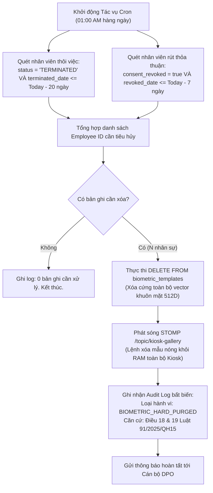

# Feature Specification: Quản trị Quyền Dữ liệu Cá nhân & Tiêu hủy Sinh trắc (FEAT-COMPLY-001)

- **Mã tính năng**: `FEAT-COMPLY-001`
- **Phiên bản kiến trúc**: v1.0 (Automated 20-Day Hard Erasure Cron, 7-Day Consent Revocation & DPO Auditing)
- **Phân loại**: Legal Compliance, Security & Privacy Feature (Liên kết 2 phân hệ: Web Portal $\leftrightarrow$ Central Backend)
- **Truy vết Yêu cầu Cốt lõi**: `FR-SYS-010`, `FR-SYS-011`, `FR-SYS-019`, `FR-SYS-025`, `SRS-001`, `SRS-003`, `SRS-010`, `NFR-SYS-007`
- **Căn cứ Pháp lý Tối thượng**: **Luật Bảo vệ dữ liệu cá nhân 2025** (Luật số 91/2025/QH15, Điều 18 & 19 về Quyền xóa dữ liệu cá nhân) & **Nghị định 356/2025/NĐ-CP**

---

## 1. Bối cảnh & Mục tiêu Sản phẩm (Problem & Objective)

### 1.1. Vấn đề thực tế (Problem Statement)
Dữ liệu sinh trắc học khuôn mặt là loại **Dữ liệu cá nhân đặc biệt nhạy cảm** theo quy định của pháp luật Việt Nam và quốc tế (GDPR). Các doanh nghiệp triển khai nhận diện khuôn mặt thường mắc phải các vi phạm pháp lý nghiêm trọng:
1. **Lưu trữ dữ liệu vĩnh viễn (Data Hoarding)**: Sau khi nhân viên đã chấm dứt hợp đồng lao động 1 năm, 2 năm hoặc 5 năm, dữ liệu khuôn mặt của họ vẫn nằm nguyên vẹn trong CSDL máy chủ mà không bao giờ bị tiêu hủy.
2. **Không cho phép rút thỏa thuận (No Revocation Mechanism)**: Người lao động không có cơ chế pháp lý hay kỹ thuật để rút lại sự đồng thuận (*Informed Consent*) khi họ không còn muốn công ty lưu giữ hình ảnh sinh trắc học của mình.
3. **Mã hóa chiếu lệ hoặc lưu văn bản rõ (Plaintext Storage)**: Vector khuôn mặt được lưu thẳng dạng mảng số thực float mà không có lớp mã hóa đối xứng mạnh, dẫn đến nguy cơ bị nhân viên quản trị cơ sở dữ liệu (DBA) hoặc hacker trích xuất và lạm dụng.
4. **Chế tài xử phạt pháp lý rất nặng**: Theo Luật số 91/2025/QH15, hành vi lưu trữ trái phép hoặc không tiêu hủy dữ liệu sinh trắc học theo yêu cầu có thể bị xử phạt hành chính lên tới 5% tổng doanh thu của doanh nghiệp và buộc đình chỉ hoạt động hệ thống.

### 1.2. Mục tiêu & Nguyên tắc Thiết kế (Objective & Principles)
- **Tự Động Tiêu Hủy Vĩnh Viễn Sau Đúng 20 Ngày Thôi Việc (Automated 20-Day Hard Erasure)**: Một tác vụ nền định kỳ (`@Scheduled`) chạy tự động hàng ngày lúc 01:00 AM, tự động quét và xóa cứng (Hard Delete — xóa sạch khỏi đĩa) toàn bộ các bản ghi vector sinh trắc học của nhân viên có ngày thôi việc $\ge 20\text{ ngày}$.
- **Thực Thi Quyền Rút Thỏa Thuận Trong Vòng 7 Ngày (7-Day Revocation Purge)**: Khi nhân viên thực hiện quyền rút *Informed Consent*, tính năng điểm danh bằng khuôn mặt bị vô hiệu hóa tức thì (chuyển sang dùng mã PIN), và toàn bộ vector mẫu bị kích hoạt tiêu hủy triệt để trong vòng 7 ngày.
- **Mã Hóa Tĩnh Độc Lập Chuẩn AES-256-GCM (Zero Plaintext Vectors at Rest)**: 100% vector sinh trắc học lưu trong bảng `biometric_templates` phải được mã hóa bằng thuật toán đối xứng AES-256-GCM với Master Key cách ly ở biến môi trường. Mỗi vector có vector khởi tạo (IV) 12 bytes ngẫu nhiên và Authentication Tag 16 bytes riêng biệt.
- **Minh Bạch Quyền Chủ Thể Dữ Liệu (Data Subject Access Rights - DSR)**: Cung cấp giao diện để nhân viên tự tra cứu hồ sơ chữ ký Consent và lịch trình tiêu hủy dữ liệu dự kiến của mình.
- **Cổng Giám Sát Tuân Thủ Dành Cho DPO (DPO Compliance Portal)**: Cung cấp vai trò chỉ đọc chuyên biệt `DPO` để cán bộ bảo vệ dữ liệu giám sát việc mã hóa, kiểm tra lịch trình tiêu hủy và trích xuất bằng chứng tuân thủ phục vụ cơ quan thanh tra.

---

## 2. Phạm vi Tính năng (Scope)

### 2.1. Trong phạm vi (In-Scope)
- **Web Portal (Self-Service & DPO Compliance)**:
  - Giao diện rút thỏa thuận Informed Consent cho nhân viên kèm cảnh báo rõ ràng về hệ quả (chuyển sang điểm danh mã PIN).
  - Cổng giám sát DPO (`ComplianceAdminService`, `EmployeeDataRequestsView.tsx`): Tra cứu chữ ký consent, tra cứu danh sách nhân viên đã thôi việc chờ tiêu hủy, tra cứu nhật ký xóa dữ liệu.
  - Form gửi yêu cầu tiếp cận hoặc đính chính dữ liệu cá nhân theo Luật 2025.
- **Backend Service (Central Processing)**:
  - Service mã hóa/giải mã AES-256-GCM độc lập cho toàn bộ các vector.
  - Tác vụ định kỳ `BiometricCleanupService.purgeExpiredBiometrics()` chạy cron `0 0 1 * * ?` (01:00 AM hàng ngày).
  - Logic xóa cứng SQL: `DELETE FROM biometric_templates WHERE employee_id IN (...)` (xóa triệt để, không dùng Soft Delete cho dữ liệu sinh trắc học).
  - Xử lý rút Consent `ConsentWithdrawalService.withdrawConsent()`: Chuyển cờ `consent_active = false`, vô hiệu hóa `is_active = false` trên trạm Kiosk và lên lịch tiêu hủy trong 7 ngày.
  - Ghi nhật ký kiểm toán bất biến vào bảng `audit_logs` với loại hành vi `BIOMETRIC_PURGED` và `CONSENT_WITHDRAWN`.

### 2.2. Ngoài phạm vi (Out-of-Scope)
- Tiêu hủy các bản ghi điểm danh lịch sử (`attendance_logs` — vì đây là dữ liệu kế toán phục vụ đối soát thuế và tiền lương bắt buộc phải lưu trữ theo Luật Kế toán 5 - 10 năm; hệ thống chỉ tiêu hủy mẫu vector nhận diện khuôn mặt).

---

## 3. Quy Trình Tiêu Hủy Sinh Trắc Học Tự Động (Erasure Workflow)



---

## 4. User Stories & Tiêu chí Nghiệm thu (Acceptance Criteria - BDD)

### US-COMPLY-001 — Tự Động Xóa Vĩnh Viễn Dữ Liệu Sinh Trắc Sau 20 Ngày Thôi Việc
- **Actor**: Cán bộ Bảo vệ Dữ liệu (`DPO`) và Cơ quan Thanh tra Pháp lý.
- **Story**: Là cán bộ DPO, tôi muốn hệ thống tự động quét và xóa sạch hoàn toàn mẫu khuôn mặt của nhân viên đã nghỉ việc quá 20 ngày, để doanh nghiệp tuân thủ tuyệt đối Luật số 91/2025/QH15 mà không phụ thuộc vào thao tác thủ công.
- **Độ ưu tiên**: P1 (Bắt buộc).

#### Acceptance Criteria
- **AC-COMPLY-001 (Happy Path — Tự động xóa cứng sau 20 ngày thôi việc)**:
  - **Given**: Nhân viên `EMP-099` có trạng thái `TERMINATED` với ngày chấm dứt HĐLĐ là `2026-10-10`. Hôm nay là ngày `2026-11-02` (đã quá 23 ngày $> 20\text{ ngày}$).
  - **When**: Tác vụ cron chạy vào lúc 01:00 AM.
  - **Then**:
    1. Tác vụ quét trúng `EMP-099`.
    2. Thực thi xóa cứng (Hard Delete) toàn bộ các bản ghi trong `biometric_templates` của nhân viên này (kể cả 3 vector đa mẫu).
    3. Phát sóng STOMP tới `/topic/kiosk-gallery` yêu cầu các trạm Kiosk gỡ bỏ nhân viên khỏi ma trận Gallery RAM.
    4. Ghi nhận sự kiện vào `audit_logs` có đầy đủ mốc thời gian và căn cứ pháp lý Điều 18 Luật 2025.
- **AC-COMPLY-002 (Safety Guard — Không xóa trước mốc 20 ngày)**:
  - **Given**: Nhân viên mới nghỉ việc được 15 ngày ($< 20\text{ ngày}$).
  - **When**: Tác vụ cron chạy hàng ngày.
  - **Then**: Hệ thống duy trì mẫu khuôn mặt, chưa thực thi xóa, hiển thị lịch tiêu hủy dự kiến còn lại 5 ngày trên cổng DPO.

---

### US-COMPLY-002 — Thực Thi Quyền Rút Thỏa Thuận Informed Consent của Người Lao Động
- **Actor**: Nhân viên công ty (`EMPLOYEE`).
- **Story**: Là nhân viên không còn muốn sử dụng khuôn mặt để chấm công, tôi muốn rút lại thỏa thuận đã ký trước đó, để công ty ngừng sử dụng hình ảnh của tôi và chuyển tôi sang điểm danh bằng mã PIN.
- **Độ ưu tiên**: P1 (Bắt buộc).

#### Acceptance Criteria
- **AC-COMPLY-003 (Happy Path — Rút Consent thành công & Chuyển sang mã PIN)**:
  - **Given**: Nhân viên đang hoạt động bình thường (`consent_active = true`).
  - **When**: Nhân viên vào Cổng Web Portal, chọn *"Rút lại Thỏa thuận Đồng thuận Dữ liệu Sinh trắc học"*, đọc cảnh báo và xác nhận rút.
  - **Then**:
    1. Trạng thái Consent chuyển thành `REVOKED`, ghi nhận mốc thời gian rút.
    2. Cờ `hasBiometric` chuyển thành `false`.
    3. Backend phát tín hiệu vô hiệu hóa mẫu mặt trên toàn cụm Kiosk.
    4. Nhân viên chỉ có thể điểm danh bằng mã PIN cá nhân kể từ thời điểm này.
    5. Hệ thống lên lịch hẹn xóa cứng vector khuôn mặt của nhân viên trong vòng 7 ngày tiếp theo.

---

## 5. Hợp đồng Giao tiếp & Lược Đồ CSDL (API & Data Contracts)

### 5.1. REST API Endpoints

#### 1. Rút lại Informed Consent
- **Endpoint**: `POST /api/v1/employee/consent/withdraw`
- **Xác thực**: Bearer JWT (Role `EMPLOYEE`)
- **Request Body (JSON)**:
```json
{
  "reason": "Yêu cầu bảo vệ quyền riêng tư cá nhân theo Luật 2025",
  "confirmAcknowledgePinUsage": true
}
```
- **Response `200 OK` (JSON)**:
```json
{
  "status": "CONSENT_WITHDRAWN",
  "scheduledErasureDate": "2026-11-09T01:00:00Z",
  "message": "Đã rút thỏa thuận thành công. Bạn vui lòng sử dụng mã PIN để điểm danh hàng ngày"
}
```

#### 2. DPO tra cứu lịch trình tiêu hủy dữ liệu
- **Endpoint**: `GET /api/v1/dpo/retention-schedules`
- **Xác thực**: Bearer JWT (Role `DPO` hoặc `ADMIN`)
- **Response `200 OK` (JSON)**:
```json
{
  "pendingTerminatedCount": 3,
  "pendingRevokedCount": 1,
  "items": [
    {
      "employeeId": 99,
      "employeeCode": "NV-0099",
      "fullName": "Trần Văn B",
      "reason": "TERMINATED",
      "effectiveDate": "2026-10-15",
      "daysRemaining": 2,
      "scheduledErasureDate": "2026-11-04"
    }
  ]
}
```

---

## 6. Ma Trận Kiểm Thử Nghiệm Thu (Acceptance Test Matrix)

| Mã Ca Kiểm Thử | Mục Tiêu Kiểm Thử | Phân Hệ | Kịch Bản & Thao Tác | Kết Quả Kỳ Vọng (Pass Criteria) |
| :--- | :--- | :--- | :--- | :--- |
| **TC-CMP-001** | Xóa cứng sau 20 ngày thôi việc | `backend-service` | Nhân viên thôi việc ngày $T-21$. Kích hoạt cron. | `biometric_templates` bị xóa sạch hoàn toàn khỏi CSDL. |
| **TC-CMP-002** | Chặn xóa khi chưa đủ 20 ngày | `backend-service` | Nhân viên thôi việc ngày $T-15$. Kích hoạt cron. | Bản ghi vector được giữ nguyên vẹn, không bị xóa. |
| **TC-CMP-003** | Rút Informed Consent | `web-portal` & `backend-service` | Nhân viên bấm rút consent trên Web. | `hasBiometric = false`, chuyển sang điểm danh PIN. |
| **TC-CMP-004** | Tiêu hủy trong 7 ngày rút consent| `backend-service` | Nhân viên đã rút consent ngày $T-8$. Kích hoạt cron.| Toàn bộ vector bị xóa vĩnh viễn khỏi CSDL. |
| **TC-CMP-005** | Mã hóa AES-256-GCM | `backend-service` | Truy vấn trực tiếp cột `encrypted_vector` trong PostgreSQL.| 100% bản ghi là BYTEA 2064 bytes, không có plaintext. |
| **TC-CMP-006** | Nhật ký kiểm toán bất biến | `backend-service` | Kiểm tra bảng `audit_logs` sau khi xóa dữ liệu. | Ghi nhận đầy đủ log xóa sinh trắc có mốc thời gian. |

---

## 7. Tiêu Chí Sẵn Sàng & Phê Duyệt (Readiness & Approval Gate)

- [x] Tuân thủ đầy đủ Điều 18 & 19 Luật số 91/2025/QH15 và Nghị định 356/2025/NĐ-CP.
- [x] Cơ chế xóa cứng tự động sau 20 ngày và 7 ngày được đặc tả logic rõ ràng.
- [x] Quy trình rút Consent và chuyển đổi sang điểm danh mã PIN không làm gián đoạn vận hành.
- [x] Ma trận kiểm thử bao quát từ xóa định kỳ, bảo mật mã hóa tĩnh đến kiểm toán DPO.

**Quyết định Phê duyệt (Approval Decision)**: **APPROVED**  
- **Đại diện Phê duyệt**: Data Protection Officer (DPO) & System Architect  
- **Ngày Phê duyệt**: 2026-11-02

