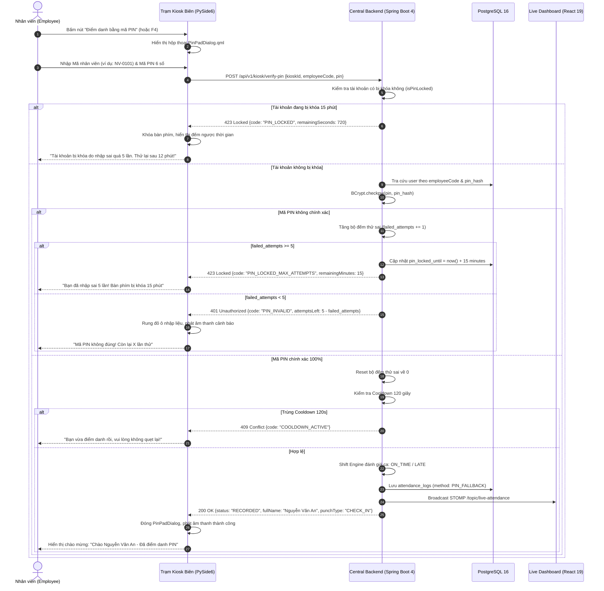

# Feature Specification: Xác thực Điểm danh Dự phòng bằng Mã PIN (FEAT-FALLBACK-001)

- **Mã tính năng**: `FEAT-FALLBACK-001`
- **Phiên bản kiến trúc**: v1.0 (Centralized BCrypt PIN Verification & Dual-Layer 15-Minute Lockout)
- **Phân loại**: User-Facing Fallback & Security Feature (Liên kết 3 phân hệ: Web Portal $\leftrightarrow$ Central Backend $\leftrightarrow$ Edge Kiosk)
- **Truy vết Yêu cầu Cốt lõi**: `FR-SYS-004`, `FR-SYS-005`, `FR-SYS-017`, `FR-SYS-022`, `SRS-005`, `NFR-SYS-007`
- **Cơ sở An ninh**: Chuẩn mật mã băm an toàn **BCrypt** (Cost Factor $\ge 10$) & Cơ chế chống tấn công vét cạn **Brute-Force Lockout** (Khóa 15 phút sau đúng 5 lần thử sai liên tiếp)

---

## 1. Bối cảnh & Mục tiêu Sản phẩm (Problem & Objective)

### 1.1. Vấn đề thực tế (Problem Statement)
Dù hệ thống nhận diện khuôn mặt đạt độ chính xác cao ($\text{TPIR} \ge 95.0\%$), trong môi trường vận hành thực tế tại doanh nghiệp luôn phát sinh các tình huống bất khả kháng:
1. **Chấn thương hoặc can thiệp y tế**: Nhân viên bị băng bó vùng mặt, phẫu thuật thẩm mỹ, sưng phù, hoặc viêm mắt khiến đặc trưng hình học khuôn mặt thay đổi đột ngột.
2. **Điều kiện môi trường cực đoan**: Khu vực đặt trạm Kiosk gặp sự cố chập chờn ánh sáng, đèn chiếu bị hỏng hoặc lóa sáng mặt trời khiến camera quang học không thể trích xuất vector đạt ngưỡng tin cậy ($\ge 0.65$).
3. **Quyền riêng tư của chủ thể dữ liệu (Luật 2025)**: Một số nhân viên có thể sử dụng quyền rút lại *Informed Consent* sinh trắc học theo Điều 18 & 19 Luật số 91/2025/QH15. Hệ thống không thể sa thải họ hay tước bỏ quyền chấm công hàng ngày.
4. **Nguy cơ tấn công vét cạn (Brute-Force Attack)**: Mã PIN số thông thường gồm 6 chữ số ($10^6 = 1,000,000$ tổ hợp) rất dễ bị kẻ xấu hoặc đồng nghiệp tò mò bấm thử liên tục nếu không có cơ chế khóa trạm và khóa tài khoản nghiêm ngặt.

### 1.2. Mục tiêu & Nguyên tắc Thiết kế (Objective & Principles)
- **Kênh Xác thực Dự phòng Đáng tin cậy (Guaranteed Fallback)**: Cung cấp bàn phím số ảo PIN Pad trực tiếp trên màn hình cảm ứng Kiosk, đảm bảo nhân viên luôn có phương thức điểm danh hợp lệ thay thế trong mọi tình huống sự cố sinh trắc học.
- **Thẩm định Tập trung tại Máy chủ (Centralized Backend Verification)**: Tuyệt đối không lưu trữ hash mã PIN hay bảng đối soát mật khẩu trên ổ đĩa của trạm Kiosk biên để chống nguy cơ trích xuất dữ liệu vật lý (Cold-boot attack). Toàn bộ thẩm định PIN thực hiện tập trung tại Backend qua kênh HTTPS an toàn.
- **Băm Một Chiều Chuẩn BCrypt**: 100% mã PIN được băm bằng thuật toán BCrypt với muối ngẫu nhiên (salt) độc lập và Cost Factor $\ge 10$. Không lưu trữ mã PIN ở dạng văn bản rõ (plaintext) trong bất kỳ tầng nào.
- **Cơ chế Khóa 15 Phút Hai Tầng (Dual-Layer 15-Minute Lockout)**:
  - *Tầng máy trạm (Per-Device Lockout)*: Bàn phím PIN tại Kiosk tự động khóa giao diện 15 phút sau 5 lần nhập sai liên tiếp trên trạm đó để chặn kẻ xấu đứng thử mã tại chỗ.
  - *Tầng tài khoản (Per-Account Lockout)*: Backend tự động khóa tài khoản nhân viên 15 phút sau 5 lần nhập sai trên bất kỳ trạm nào để ngăn chặn tấn công phân tán (Distributed Brute-Force).
- **Tự Phục vụ Thiết lập & Đặt lại (Self-Service PIN Management)**: Nhân viên tự thiết lập mã PIN ban đầu hoặc đổi mã PIN dự phòng trực tiếp trên Cổng Web Portal sau khi xác thực mật khẩu tài khoản chính.

---

## 2. Phạm vi Tính năng (Scope)

### 2.1. Trong phạm vi (In-Scope)
- **Web Portal (Self-Service)**:
  - Giao diện thiết lập mã PIN 6 số lần đầu trong hồ sơ cá nhân.
  - Giao diện đổi mã PIN dự phòng (yêu cầu nhập mật khẩu tài khoản hiện tại).
  - Giao diện đặt lại mã PIN khi quên (yêu cầu xác thực mật khẩu qua email/quản trị viên).
- **Backend Service (Central Processing)**:
  - API thẩm định mã PIN tập trung `POST /api/v1/kiosk/verify-pin`.
  - Bộ đếm số lần thử sai per-account bằng cache in-memory kết hợp khóa `pin_locked_until`.
  - API thiết lập và đổi mã PIN cá nhân có kiểm tra độ phức tạp (chặn mã PIN yếu như `123456`, `000000`, hoặc trùng ngày sinh).
  - Tự động ghi nhận lượt điểm danh với phương thức xác thực `PIN_FALLBACK`.
  - Thực thi kiểm tra Cooldown 120 giây tương tự phương thức khuôn mặt.
- **Edge Kiosk App (Desktop Hardware)**:
  - Nút bấm cảm ứng *"Điểm danh bằng mã PIN"* trên màn hình chính và phím tắt `F4`.
  - Hộp thoại bàn phím số ảo PIN Pad (`PinPadDialog.qml`) với hiệu ứng chạm và che ký tự dạng chấm tròn (`••••••`).
  - Đồng hồ đếm ngược thời gian khóa (Countdown Timer 15 phút) khi trạm bị kích hoạt cơ chế khóa bảo mật.

### 2.2. Ngoài phạm vi (Out-of-Scope)
- Điểm danh bằng mã PIN khi Kiosk mất mạng hoàn toàn (do hash PIN không lưu cục bộ để bảo vệ an ninh; nhân viên sử dụng quy trình nộp đơn giải trình công trực tuyến `FEAT-EXCUSE-001` sau khi kết nối phục hồi).
- Sử dụng mã PIN để đăng nhập vào trang quản trị Web Portal (Web Portal bắt buộc dùng tên đăng nhập và mật khẩu phức tạp kèm JWT).

---

## 3. Luồng Tương tác Hệ thống (Sequence Diagram)



---

## 4. User Stories & Tiêu chí Nghiệm thu (Acceptance Criteria - BDD)

### US-FALLBACK-001 — Điểm Danh Thành Công Bằng Mã PIN tại Kiosk
- **Actor**: Nhân viên gặp sự cố nhận diện khuôn mặt (bị thương, ánh sáng xấu) hoặc đã rút Consent.
- **Story**: Là một nhân viên không thể quét mặt, tôi muốn nhập mã PIN 6 số cá nhân trên bàn phím cảm ứng Kiosk, để ghi nhận điểm danh vào ca làm việc đúng giờ.
- **Độ ưu tiên**: P1 (Bắt buộc).

#### Acceptance Criteria
- **AC-FALLBACK-001 (Happy Path — Điểm danh bằng mã PIN thành công)**:
  - **Given**: Nhân viên `EMP-001` đã thiết lập mã PIN 6 số trên Web Portal.
  - **When**: Nhân viên bấm nút *"Điểm danh bằng mã PIN"*, nhập mã nhân viên `NV-001` và mã PIN `839201` chính xác, rồi nhấn *"Xác nhận"*.
  - **Then**:
    1. Kiosk gửi `POST /api/v1/kiosk/verify-pin` lên Backend.
    2. Backend thẩm định BCrypt hợp lệ, reset bộ đếm lỗi về 0.
    3. Ghi nhận bản ghi vào `attendance_logs` với `verification_method = 'PIN_FALLBACK'`.
    4. Kiosk hiển thị hộp thoại màu xanh lá chúc mừng kèm họ tên nhân viên và giờ điểm danh.
    5. Web Portal Live Dashboard nhận frame STOMP và hiển thị dòng quẹt thẻ với biểu tượng bàn phím `[PIN]`.
- **AC-FALLBACK-002 (Error Case — Nhập sai mã PIN và hiển thị số lần còn lại)**:
  - **Given**: Nhân viên nhập sai mã PIN lần thứ 1.
  - **When**: Nhấn *"Xác nhận"*.
  - **Then**: Ô nhập liệu rung đỏ, Kiosk phát âm thanh báo lỗi và hiển thị: *"Mã PIN không chính xác. Bạn còn 4 lần thử trước khi bị khóa 15 phút"*.

---

### US-FALLBACK-002 — Khóa Tạm Thời 15 Phút Chống Tấn Công Vét Cạn (Brute-Force Lockout)
- **Actor**: Kẻ tấn công cố tình bấm thử các mã số ngẫu nhiên trên Kiosk.
- **Story**: Là quản trị viên an ninh hệ thống, tôi muốn hệ thống tự động khóa tài khoản và bàn phím trong 15 phút sau đúng 5 lần nhập sai liên tiếp, để ngăn chặn triệt để nguy cơ dò mã số.
- **Độ ưu tiên**: P1 (Bắt buộc).

#### Acceptance Criteria
- **AC-FALLBACK-003 (Security Guard — Khóa 15 phút tại lần nhập sai thứ 5)**:
  - **Given**: Tài khoản `EMP-002` đã bị nhập sai 4 lần trước đó.
  - **When**: Kẻ tấn công nhập sai lần thứ 5.
  - **Then**:
    1. Backend cập nhật `pin_locked_until = CurrentTimestamp + 15 minutes` trong CSDL và cache.
    2. Backend trả về mã lỗi HTTP `423 Locked`.
    3. Kiosk khóa toàn bộ bàn phím PIN Pad, hiển thị đồng hồ đếm ngược: *"Trạm bị tạm khóa do nhập sai quá số lần quy định. Vui lòng thử lại sau 15:00"*.
    4. Ghi sự kiện vi phạm an ninh nghiêm trọng vào bảng `audit_logs`.
- **AC-FALLBACK-004 (Lockout Enforcement — Chặn ngay lập tức ở lần gọi thứ 6)**:
  - **Given**: Tài khoản đang trong thời gian bị khóa (còn 10 phút).
  - **When**: Có request gửi lên Backend với mã tài khoản này (kể cả từ một trạm Kiosk khác).
  - **Then**: Backend từ chối ngay lập tức HTTP `423 Locked` mà không thực hiện kiểm tra BCrypt, trả về số giây còn lại cần chờ.

---

### US-FALLBACK-003 — Tự Phục Vụ Thiết Lập & Đổi Mã PIN Trên Web Portal
- **Actor**: Nhân viên công ty (vai trò `EMPLOYEE`).
- **Story**: Là nhân viên, tôi muốn tự thiết lập mã PIN ban đầu và chủ động đổi mã PIN trên Cổng Web cá nhân, để bảo vệ an toàn thông tin định danh của mình.
- **Độ ưu tiên**: P1 (Bắt buộc).

#### Acceptance Criteria
- **AC-FALLBACK-005 (Happy Path — Thiết lập mã PIN lần đầu)**:
  - **Given**: Nhân viên đã đăng nhập Web Portal và chưa từng cài đặt mã PIN (`hasPin = false`).
  - **When**: Nhân viên vào mục Cài đặt cá nhân, nhập mã PIN 6 số (ví dụ `582914`), xác nhận lại mã PIN và nhấn *"Lưu mã PIN"*.
  - **Then**: Hệ thống kiểm tra mã PIN không nằm trong danh sách mã yếu (`123456`, `111111`,...), thực hiện băm BCrypt, cập nhật vào bảng `users` và thông báo *"Thiết lập mã PIN điểm danh thành công"*.
- **AC-FALLBACK-006 (Security Guard — Đổi mã PIN bắt buộc nhập mật khẩu hiện tại)**:
  - **Given**: Nhân viên muốn đổi sang mã PIN mới.
  - **When**: Nhân viên nhập mã PIN mới nhưng nhập sai mật khẩu tài khoản Web Portal.
  - **Then**: Hệ thống từ chối cập nhật với thông báo: *"Mật khẩu tài khoản không chính xác. Không thể đổi mã PIN"*.

---

## 5. Hợp đồng Giao tiếp & Dữ liệu (API & Data Contracts)

### 5.1. REST API Endpoints

#### 1. Thẩm định mã PIN tại trạm Kiosk
- **Endpoint**: `POST /api/v1/kiosk/verify-pin`
- **Xác thực**: Header `X-Kiosk-Id` & `X-Kiosk-Secret`
- **Request Body (JSON)**:
```json
{
  "kioskId": "KIOSK-GATE-01",
  "employeeCode": "NV-0101",
  "pin": "839201"
}
```
- **Response `200 OK` (JSON)**:
```json
{
  "status": "RECORDED",
  "logId": 10095,
  "employeeId": 101,
  "employeeCode": "NV-0101",
  "fullName": "Nguyễn Văn An",
  "punchType": "CHECK_IN",
  "attendanceStatus": "ON_TIME",
  "lateMinutes": 0,
  "verificationMethod": "PIN_FALLBACK"
}
```
- **Response `401 Unauthorized` (Sai mã PIN)**:
```json
{
  "code": "PIN_INVALID",
  "message": "Mã PIN không chính xác",
  "attemptsLeft": 3
}
```
- **Response `423 Locked` (Tài khoản bị khóa)**:
```json
{
  "code": "PIN_LOCKED",
  "message": "Tài khoản bị khóa tạm thời 15 phút do nhập sai 5 lần liên tiếp",
  "remainingSeconds": 845
}
```

#### 2. Thiết lập / Đổi mã PIN trên Web Portal
- **Endpoint**: `POST /api/v1/employee/pin` (Thiết lập) | `PUT /api/v1/employee/pin` (Đổi)
- **Xác thực**: Bearer JWT (Role `EMPLOYEE`)
- **Request Body (JSON)**:
```json
{
  "currentPassword": "MyStrongPassword@2026",
  "newPin": "582914",
  "confirmPin": "582914"
}
```
- **Response `200 OK` (JSON)**:
```json
{
  "status": "SUCCESS",
  "message": "Cập nhật mã PIN dự phòng thành công"
}
```

---

## 6. Ma Trận Kiểm Thử Nghiệm Thu (Acceptance Test Matrix)

| Mã Ca Kiểm Thử | Mục Tiêu Kiểm Thử | Phân Hệ | Điều Kiện & Kịch Bản Thực Thi | Kết Quả Kỳ Vọng (Pass Criteria) |
| :--- | :--- | :--- | :--- | :--- |
| **TC-PIN-001** | Điểm danh PIN đúng | `kiosk-app` & `backend-service` | Nhập mã NV và PIN đúng 6 chữ số. | HTTP 200, Kiosk báo thành công, ghi nhận `PIN_FALLBACK`. |
| **TC-PIN-002** | Nhập sai PIN 1 lần | `kiosk-app` & `backend-service` | Nhập sai mã PIN lần 1. | HTTP 401, rung đỏ ô nhập, báo còn 4 lần thử. |
| **TC-PIN-003** | Khóa trạm ở lần sai thứ 5 | `backend-service` | Nhập sai liên tiếp 5 lần cùng 1 tài khoản. | HTTP 423 `PIN_LOCKED`, khóa 15 phút, đồng hồ đếm ngược. |
| **TC-PIN-004** | Chặn brute-force phân tán | `backend-service` | Thử sai 5 lần tại Kiosk A, chuyển sang Kiosk B thử tiếp. | Kiosk B nhận ngay HTTP 423 `PIN_LOCKED`, không cho bấm tiếp. |
| **TC-PIN-005** | Thiết lập PIN yếu bị từ chối | `web-portal` & `backend-service` | Đặt PIN `123456` hoặc `000000`. | Hệ thống từ chối HTTP 400 `WEAK_PIN_PATTERN`. |
| **TC-PIN-006** | Đổi PIN sai mật khẩu | `web-portal` | Nhập mật khẩu tài khoản không đúng. | HTTP 400 `INVALID_CURRENT_PASSWORD`, giữ nguyên PIN cũ. |

---

## 7. Tiêu Chí Sẵn Sàng & Phê Duyệt (Readiness & Approval Gate)

- [x] Ranh giới kênh xác thực dự phòng và an ninh băm mật mã được xác định đầy đủ.
- [x] Cơ chế chống tấn công brute-force hai tầng (Kiosk + Backend) được đặc tả chặt chẽ.
- [x] Quy trình tự phục vụ trên Web Portal và hợp đồng API REST được chuẩn hóa.
- [x] Ma trận kiểm thử bao phủ toàn diện các kịch bản thành công, lỗi và khóa an ninh.

**Quyết định Phê duyệt (Approval Decision)**: **APPROVED**  
- **Đại diện Phê duyệt**: Solution Architect & Security Lead  
- **Ngày Phê duyệt**: 2026-11-02

