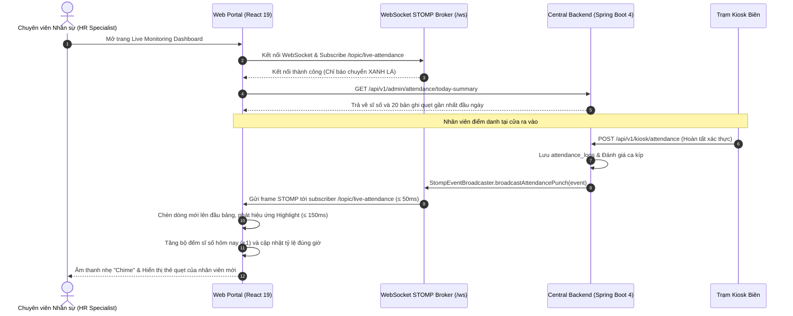

# Feature Specification: Giám sát Sĩ số Trực tiếp Thời gian thực (FEAT-LIVE-001)

- **Mã tính năng**: `FEAT-LIVE-001`
- **Phiên bản kiến trúc**: v1.0 (WebSocket STOMP Broker & Reactive Dynamic Table Rendering)
- **Phân loại**: User-Facing Monitoring & Operational Feature (Liên kết 2 phân hệ: Web Portal $\leftrightarrow$ Central Backend)
- **Truy vết Yêu cầu Cốt lõi**: `FR-SYS-013`, `FR-SYS-015`, `NFR-SYS-003`, `UI-WEB-001`, `API-BE-005`
- **Chỉ số Độ trễ**: Độ trễ phát sóng toàn trình **$\le 200\text{ ms}$** (Mạng STOMP $\le 50\text{ ms}$ + DOM React Render $\le 150\text{ ms}$) mà không cần tải lại trang (Zero Reload)

---

## 1. Bối cảnh & Mục tiêu Sản phẩm (Problem & Objective)

### 1.1. Vấn đề thực tế (Problem Statement)
Trong công tác quản lý vận hành nhân sự và điều phối sản xuất:
1. **Thiếu thông tin sĩ số tức thời đầu ca**: Trưởng ca và quản lý nhà xưởng không biết được chính xác có bao nhiêu công nhân đã đến nơi làm việc trước giờ bấm chuông vào ca để kịp thời phân bổ bù vào các dây chuyền sản xuất thiếu người.
2. **Quá tải máy chủ do cơ chế Polling**: Các hệ thống web cũ thường sử dụng cơ chế kéo dữ liệu định kỳ (Polling HTTP GET mỗi 5 - 10 giây). Điều này gây lãng phí băng thông mạng, tạo tải ảo liên tục lên CSDL và độ trễ nhận thông tin vẫn bị chậm từ 5 đến 10 giây.
3. **Trải nghiệm rời rạc và gián đoạn**: Chuyên viên HR phải bấm nút `F5` hoặc Refresh trình duyệt liên tục để xem ai vừa quẹt thẻ, làm mất trạng thái cuộn và gây ức chế khi làm việc.

### 1.2. Mục tiêu & Nguyên tắc Thiết kế (Objective & Principles)
- **Cơ Chế Đẩy Hướng Sự Kiện (Event-Driven Push via STOMP)**: Sử dụng kênh truyền thông hai chiều thời gian thực WebSocket STOMP (`/topic/live-attendance`). Ngay khi Backend ghi nhận lượt điểm danh từ Kiosk, thông điệp JSON được phát sóng tức thì tới toàn bộ trình duyệt đang kết nối.
- **Cam Kết Độ Trễ Dưới 200 Milligiây**: Toàn bộ chu trình từ thời điểm Backend xử lý xong bản ghi đến khi giao diện Web Dashboard hiển thị dòng nhân viên mới không vượt quá $\le 200\text{ ms}$.
- **Hiệu Ứng Trực Quan Sinh Động & Thông Báo Nhẹ Nhàng**: Dòng quẹt thẻ mới xuất hiện ở đầu bảng với hiệu ứng chuyển động mượt mà (Slide-in & Highlight) kèm âm thanh "Chime" tinh tế để người quản lý nhận biết có lượt quẹt mới mà không cần nhìn chăm chú vào màn hình.
- **Thẻ Chỉ Số Thống Kê Động (Dynamic Summary KPIs)**: Tự động cập nhật tức thời các thẻ chỉ số đầu trang: Tổng sĩ số có mặt hôm nay, Số lượng đúng giờ, Số lượng đi muộn, và Tỷ lệ tuân thủ giờ giấc mà không cần reload trang.
- **Tự Phục Hồi Kết Nối (Auto-Reconnection Resiliency)**: Khi mạng máy tính HR bị chập chờn, STOMP Client tự động thử kết nối lại với độ trễ tăng dần (Exponential Backoff) và tự động kéo lại trạng thái mới nhất ngay khi kết nối phục hồi.

---

## 2. Phạm vi Tính năng (Scope)

### 2.1. Trong phạm vi (In-Scope)
- **Web Portal (Frontend Dashboard)**:
  - Màn hình Live Monitoring Dashboard (`AdminDashboardView.tsx`, `LiveAttendanceTable.tsx`).
  - Kết nối WebSocket qua thư viện `@stomp/stompjs` và SockJS fallback.
  - Lắng nghe topic `/topic/live-attendance`.
  - Bảng nhật ký quẹt thẻ thời gian thực: Hiển thị ảnh avatar, Mã nhân viên, Họ tên, Phòng ban, Giờ quẹt, Trạng thái (`ON_TIME` - xanh, `LATE` - đỏ), Tên trạm Kiosk và Phương thức (`Khuôn mặt` / `Mã PIN`).
  - Thanh chỉ báo trạng thái kết nối thời gian thực: Xanh lá (Đã kết nối), Vàng (Đang kết nối lại), Đỏ (Mất kết nối).
- **Backend Service (Central Processing)**:
  - Cấu hình WebSocket Message Broker (STOMP) với endpoint `/ws`.
  - Thành phần phát sóng `StompEventBroadcaster.broadcastAttendancePunch(AttendancePunchEvent event)`.
  - Đóng gói dữ liệu sự kiện nhỏ gọn (Lightweight JSON Payload $< 500\text{ bytes}$) để tối ưu hóa tốc độ mạng.

### 2.2. Ngoài phạm vi (Out-of-Scope)
- Xem trực tiếp luồng video camera (Live Video Stream RTSP) của Kiosk trên Web Dashboard (để bảo vệ quyền riêng tư và tiết kiệm băng thông mạng LAN).
- Điều khiển đóng/mở trạm Kiosk từ xa trực tiếp trên Dashboard (tính năng quản trị trạm thuộc về màn hình Kiosk Fleet Management riêng).

---

## 3. Luồng Tương tác Hệ thống (Sequence Diagram)



---

## 4. User Stories & Tiêu chí Nghiệm thu (Acceptance Criteria - BDD)

### US-LIVE-001 — Cập Nhật Sự Kiện Điểm Danh Tức Thời Lên Màn Hình Dashboard
- **Actor**: Chuyên viên Nhân sự (`HR_MANAGER`).
- **Story**: Là chuyên viên nhân sự đang trực dashboard, tôi muốn mỗi khi có nhân viên quẹt thẻ thành công tại bất kỳ trạm Kiosk nào, thông tin điểm danh của họ xuất hiện ngay lập tức trên bảng theo dõi trong vòng $\le 200\text{ ms}$, để tôi nắm bắt dữ liệu tức thì mà không cần bấm F5.
- **Độ ưu tiên**: P1 (Bắt buộc).

#### Acceptance Criteria
- **AC-LIVE-001 (Happy Path — Cập nhật dòng điểm danh mới $\le 200\text{ ms}$)**:
  - **Given**: HR đang mở màn hình Live Monitoring Dashboard, trạng thái kết nối STOMP xanh lá.
  - **When**: Nhân viên `NV-0101` quẹt thẻ thành công tại trạm `KIOSK-GATE-01` lúc 08:02:15.
  - **Then**:
    1. Backend phát thông điệp tới `/topic/live-attendance`.
    2. Bảng Live Attendance Table tự động chèn dòng mới lên vị trí đầu tiên.
    3. Dòng mới hiển thị đầy đủ: Ảnh đại diện, Mã `NV-0101`, Tên `Nguyễn Văn An`, Giờ quẹt `08:02:15`, Huy hiệu xanh `Đúng giờ`, Trạm `KIOSK-GATE-01`, Phương thức `Khuôn mặt`.
    4. Hiển thị hiệu ứng chuyển động trượt nhẹ và đổi màu nền vàng nhạt trong 1.5 giây rồi mờ dần.
    5. Tổng thời gian từ khi Backend phát tin đến khi render xong giao diện không vượt quá $\le 200\text{ ms}$.
- **AC-LIVE-002 (Realtime Metric Update — Tự động cập nhật thẻ chỉ số tổng)**:
  - **Given**: Thẻ chỉ số hiển thị: *Tổng có mặt: 150, Đi muộn: 5*.
  - **When**: Nhân viên tiếp theo quẹt thẻ bị tính `LATE` (đi muộn 18 phút).
  - **Then**: Thẻ chỉ số lập tức nhảy số tự động thành: *Tổng có mặt: 151, Đi muộn: 6*, tỷ lệ phần trăm được tính toán lại ngay lập tức.

---

### US-LIVE-002 — Tự Động Phục Hồi Kết Nối Khi Mạng Bị Gián Đoạn (Auto-Reconnect)
- **Actor**: Chuyên viên Nhân sự đang mở Web Dashboard trên máy tính xách tay.
- **Story**: Là người dùng, tôi muốn khi máy tính của tôi bị chập chờn wifi, trang web tự động kết nối lại và lấy dữ liệu mới nhất mà tôi không phải tự tay tải lại trang.
- **Độ ưu tiên**: P1 (Bắt buộc).

#### Acceptance Criteria
- **AC-LIVE-003 (Resilience — Chỉ báo trạng thái và tự động kết nối lại)**:
  - **Given**: Trình duyệt đang kết nối WebSocket STOMP bình thường.
  - **When**: Mạng Wifi của máy tính bị ngắt kết nối trong 15 giây rồi có lại.
  - **Then**:
    1. Ngay khi mất kết nối, thanh chỉ báo ở góc màn hình chuyển sang màu vàng: *"Đang mất kết nối, tự động thử lại..."*.
    2. Khi mạng có lại, STOMP Client tự động bắt tay lại với máy chủ.
    3. Sau khi kết nối thành công, hệ thống tự động gọi một truy vấn nhẹ để kéo về các lượt quẹt bị bỏ lỡ trong 15 giây vừa qua.
    4. Thanh chỉ báo chuyển về màu xanh lá: *"Đã kết nối thời gian thực"*.

---

## 5. Hợp đồng Giao tiếp & Cấu Trúc Thông Điệp (STOMP Contract)

### 5.1. STOMP Subscription
- **Topic URL**: `/topic/live-attendance`
- **Giao thức**: STOMP over WebSocket (Endpoint `/ws`)
- **Tần suất**: Hướng sự kiện (Event-driven, tức thời theo từng lượt quẹt thẻ)

### 5.2. Cấu Trúc Thông Điệp (Message Payload JSON)
```json
{
  "logId": 10082,
  "employeeId": 101,
  "employeeCode": "NV-0101",
  "fullName": "Nguyễn Văn An",
  "departmentName": "Khối Sản Xuất 1",
  "punchTime": "2026-11-02T08:02:15.320Z",
  "punchType": "CHECK_IN",
  "attendanceStatus": "ON_TIME",
  "lateMinutes": 0,
  "kioskId": "KIOSK-GATE-01",
  "verificationMethod": "FACIAL_RECOGNITION",
  "isOfflineSynced": false
}
```

---

## 6. Ma Trận Kiểm Thử Nghiệm Thu (Acceptance Test Matrix)

| Mã Ca Kiểm Thử | Mục Tiêu Kiểm Thử | Phân Hệ | Kịch Bản & Thao Tác | Kết Quả Kỳ Vọng (Pass Criteria) |
| :--- | :--- | :--- | :--- | :--- |
| **TC-LIVE-001** | Kết nối WebSocket STOMP | `web-portal` | Mở trang Dashboard. | Kết nối `/ws` thành công, chỉ báo chuyển màu xanh lá. |
| **TC-LIVE-002** | Nhận và chèn dòng mới $\le 200\text{ ms}$ | `backend-service` & `web-portal` | Kiosk gửi quẹt thành công lên Backend. | Dashboard chèn dòng mới trên cùng $\le 200\text{ ms}$, có highlight. |
| **TC-LIVE-003** | Cập nhật số liệu thẻ KPI | `web-portal` | Nhận frame STOMP mới có trạng thái `LATE`. | Số lượng có mặt tăng +1, số lượng đi muộn tăng +1 tức thì. |
| **TC-LIVE-004** | Tự động phục hồi kết nối | `web-portal` | Ngắt mạng 10 giây rồi bật lại. | Tự động kết nối lại, đồng bộ bù các bản ghi bị lỡ. |
| **TC-LIVE-005** | Tải cao điểm đầu ca | `web-portal` | Nhận liên tục 20 sự kiện/giây trong giờ vào ca. | Bảng cuộn mượt mà, không giật lag DOM, không rò rỉ bộ nhớ RAM. |

---

## 7. Tiêu Chí Sẵn Sàng & Phê Duyệt (Readiness & Approval Gate)

- [x] Ranh giới độ trễ toàn trình $\le 200\text{ ms}$ được cam kết rõ ràng.
- [x] Cấu trúc thông điệp STOMP nhỏ gọn, tương thích ngược tốt.
- [x] Cơ chế phục hồi kết nối mạng tự động được đặc tả chi tiết.
- [x] Ma trận kiểm thử bao quát từ kết nối, hiển thị, hiệu năng tải cao điểm đến khả năng chịu lỗi.

**Quyết định Phê duyệt (Approval Decision)**: **APPROVED**  
- **Đại diện Phê duyệt**: Solution Architect & Frontend Engineering Lead  
- **Ngày Phê duyệt**: 2026-11-02

