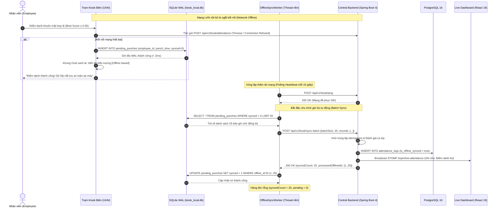

# Feature Specification: Lưu đệm & Tự động Đồng bộ Ngoại tuyến (FEAT-OFFLINE-001)

- **Mã tính năng**: `FEAT-OFFLINE-001`
- **Phiên bản kiến trúc**: v1.0 (SQLite WAL Queue & Idempotent Batch Sync Worker)
- **Phân loại**: System Resiliency & Offline-First Core Feature (Liên kết 2 phân hệ: Edge Kiosk $\leftrightarrow$ Central Backend)
- **Truy vết Yêu cầu Cốt lõi**: `FR-SYS-006`, `SRS-008`, `NFR-SYS-006`, `NFR-SYS-008`, `DATA-KSK-001`, `API-KSK-002`
- **Tiêu chuẩn Bền bỉ**: **ACID Transactions** trên SQLite Write-Ahead Logging (WAL) & Cam kết phục hồi dữ liệu **RPO = 0** (Zero Recovery Point Objective)

---

## 1. Bối cảnh & Mục tiêu Sản phẩm (Problem & Objective)

### 1.1. Vấn đề thực tế (Problem Statement)
Các trạm Kiosk điểm danh đặt tại cổng bảo vệ, hành lang nhà xưởng hoặc tầng hầm văn phòng thường xuyên gặp sự cố kết nối mạng do:
1. **Đứt cáp mạng vật lý hoặc lỏng đầu RJ45**: Do rung chấn, va quẹt hoặc sự cố hạ tầng cáp nội bộ.
2. **Sự cố bộ định tuyến / DHCP Server**: Xung đột IP, nghẽn mạng cục bộ giờ cao điểm khiến Kiosk mất khả năng giao tiếp với máy chủ.
3. **Bảo trì / Nâng cấp máy chủ trung tâm**: Máy chủ Backend tạm thời khởi động lại để cập nhật phiên bản hoặc bảo trì CSDL.
4. **Hậu quả nếu phụ thuộc mạng trực tuyến**: Nếu Kiosk chỉ hoạt động khi có mạng (Online-only), hàng trăm công nhân đứng chờ đầu ca sẽ bị ách tắc, gây hỗn loạn tại cổng, hoặc công nhân bị tính đi muộn oan uổng.

### 1.2. Mục tiêu & Nguyên tắc Thiết kế (Objective & Principles)
- **Triết lý Ngoại tuyến là Ưu tiên Số một (Offline-First by Design)**: Điểm danh bằng khuôn mặt tại Kiosk phải hoạt động độc lập hoàn toàn với mạng Internet/LAN. Việc mất mạng không được phép làm gián đoạn hay làm tăng độ trễ nhận diện ($\le 350\text{ ms}$).
- **Bảo toàn Dữ liệu Tuyệt đối ($\text{RPO} = 0$)**: Mọi lượt quẹt thành công khi mất mạng bắt buộc phải được lưu đệm bền vững vào CSDL SQLite cục bộ (`kiosk_local.db`) trước khi hiển thị màn hình chúc mừng cho nhân viên.
- **Tối ưu Hóa Hiệu Năng Ghi bằng SQLite WAL**: Sử dụng chế độ Write-Ahead Logging (`PRAGMA journal_mode = WAL;`) kết hợp `PRAGMA synchronous = NORMAL;` giúp thao tác ghi đĩa diễn ra trong $< 2\text{ ms}$, không gây nghẽn luồng xử lý khung hình camera.
- **Tiến trình Nền Tự Động Đồng Bộ (Self-Healing Background Worker)**: Một luồng nền độc lập (`OfflineSyncWorker`) liên tục thăm dò nhịp tim (`/api/v1/kiosk/ping`). Ngay khi kết nối phục hồi, worker tự động đóng gói các bản ghi chưa đồng bộ thành các lô tối đa 50 bản ghi/lần và gửi bù về máy chủ.
- **Đảm Bảo Tính Lũy Đẳng (Idempotent Backend Processing)**: Backend xử lý từng bản ghi trong lô dựa trên cặp khóa tự nhiên `(kiosk_id, employee_id, punch_time)`. Nếu bản ghi đã tồn tại do gói tin gửi lại (network retry), hệ thống tự động bỏ qua mà không tạo bản ghi trùng lặp.

---

## 2. Phạm vi Tính năng (Scope)

### 2.1. Trong phạm vi (In-Scope)
- **Edge Kiosk App (Local Hardware)**:
  - Khởi tạo và duy trì CSDL cục bộ `kiosk_local.db` ở chế độ WAL.
  - Quản lý hàng đợi điểm danh `pending_punches` với trạng thái cờ `synced` (0: Chờ đồng bộ, 1: Đã đồng bộ).
  - Cơ chế ghi đệm giao dịch an toàn (ACID transaction) khi HTTP Client báo lỗi timeout hoặc không có kết nối mạng.
  - Tiến trình nền `OfflineSyncWorker` kiểm tra sức khỏe mạng mỗi 10 giây (khi offline) hoặc 60 giây (khi online).
  - Chia lô đồng bộ tự động tối đa 50 bản ghi/request để tránh nghẽn băng thông HTTP payload.
  - Tác vụ dọn dẹp định kỳ (Retention Cleanup): Tự động xóa các bản ghi đã đồng bộ (`synced = 1`) có tuổi thọ quá 30 ngày để tiết kiệm dung lượng ổ cứng trạm Kiosk.
- **Backend Service (Central Processing)**:
  - Endpoint tiếp nhận lô ngoại tuyến `POST /api/v1/kiosk/sync-batch`.
  - Cơ chế khử trùng lặp Idempotency dựa trên `(kiosk_id, employee_id, punch_time)`.
  - Tự động luân phiên xác định loại quẹt `CHECK_IN` / `CHECK_OUT` tuần tự cho các bản ghi trong cùng một ngày.
  - Gắn nhãn cờ `is_offline_synced = true` trong bảng `attendance_logs` phục vụ kiểm toán và minh bạch dữ liệu.
  - Trả về danh sách chi tiết các `processedOfflineIds` để Kiosk cập nhật trạng thái `synced = 1`.

### 2.2. Ngoài phạm vi (Out-of-Scope)
- Đồng bộ hóa hình ảnh khuôn mặt thô (hệ thống không lưu trữ ảnh, chỉ đồng bộ thông tin sự kiện điểm danh dạng số).
- Đồng bộ danh mục nhân sự mới khi Kiosk đang mất mạng (danh mục vector mẫu mới chỉ được tải xuống khi Kiosk có kết nối mạng qua STOMP).

---

## 3. Luồng Tương tác Hệ thống (Sequence Diagram)



---

## 4. User Stories & Tiêu chí Nghiệm thu (Acceptance Criteria - BDD)

### US-OFFLINE-001 — Lưu Đệm Ngoại Tuyến Bền Vững Không Gián Đoạn Trải Nghiệm
- **Actor**: Nhân viên điểm danh khi Kiosk mất mạng.
- **Story**: Là nhân viên, tôi muốn khi máy tính bị ngắt mạng, tôi vẫn được nhận diện và báo điểm danh thành công bình thường trong $\le 350\text{ ms}$, để tôi an tâm vào ca làm việc mà không phải chờ đợi IT sửa mạng.
- **Độ ưu tiên**: P1 (Bắt buộc).

#### Acceptance Criteria
- **AC-OFFLINE-001 (Happy Path — Lưu đệm SQLite WAL khi mất mạng)**:
  - **Given**: Trạm Kiosk bị ngắt kết nối mạng đến máy chủ Backend.
  - **When**: Nhân viên được nhận diện khuôn mặt thành công trên ma trận RAM tại chỗ.
  - **Then**:
    1. Kiosk phát hiện HTTP Client ném ngoại lệ `ConnectError` hoặc `Timeout`.
    2. Kiosk lập tức mở transaction ghi bản ghi vào bảng `pending_punches` của `kiosk_local.db` với `synced = 0`.
    3. Thao tác ghi đĩa hoàn tất trong $\le 2\text{ ms}$ nhờ SQLite WAL.
    4. Màn hình Kiosk chuyển khung Oval xanh lá, hiển thị thông điệp thành công kèm biểu tượng đám mây gạch chéo thông báo: *"Điểm danh thành công (Đã lưu đệm cục bộ)"*.
    5. Không bị treo khung hình camera, tổng thời gian $\le 350\text{ ms}$.
- **AC-OFFLINE-002 (Resilience — Mô phỏng tắt nguồn đột ngột)**:
  - **Given**: Đã có 10 bản ghi điểm danh được ghi vào SQLite WAL khi mất mạng.
  - **When**: Tiến trình Kiosk bị buộc dừng đột ngột (`kill -9` hoặc ngắt nguồn điện) và sau đó được bật lại.
  - **Then**: Toàn bộ 10 bản ghi trong `pending_punches` vẫn nguyên vẹn 100%, không bị hỏng file CSDL (Zero Database Corruption), sẵn sàng cho tiến trình đồng bộ bù.

---

### US-OFFLINE-002 — Tự Động Đồng Bộ Bù Theo Lô Khi Kết Nối Phục Hồi
- **Actor**: Hệ thống trạm Kiosk và Chuyên viên Nhân sự.
- **Story**: Là chuyên viên nhân sự, tôi muốn khi mạng trạm Kiosk có lại, toàn bộ các bản ghi quẹt công trong thời gian mất mạng tự động đẩy lên máy chủ và hiển thị trên Dashboard, để bảng công của nhân viên đầy đủ và chính xác 100%.
- **Độ ưu tiên**: P1 (Bắt buộc).

#### Acceptance Criteria
- **AC-OFFLINE-003 (Happy Path — Đồng bộ bù tự động theo lô tối đa 50 bản ghi)**:
  - **Given**: Trong `kiosk_local.db` có 45 bản ghi điểm danh chưa đồng bộ (`synced = 0`).
  - **When**: Kết nối mạng phục hồi, `OfflineSyncWorker` ping máy chủ thành công.
  - **Then**:
    1. Worker tự động lấy 45 bản ghi chưa đồng bộ, đóng gói thành gói tin JSON gửi lên `POST /api/v1/kiosk/sync-batch`.
    2. Backend tiếp nhận, xử lý lưu trữ vào PostgreSQL và trả về `200 OK` chứa danh sách 45 ID ngoại tuyến.
    3. Worker cập nhật `synced = 1` cho cả 45 bản ghi trong SQLite cục bộ.
    4. Toàn bộ chu trình hoàn tất tự động mà không cần bất kỳ thao tác thủ công nào từ con người.
- **AC-OFFLINE-004 (Idempotency — Chống trùng lặp khi gửi lại gói tin)**:
  - **Given**: Kiosk đã gửi lô 10 bản ghi nhưng đường truyền bị ngắt ngay trước khi nhận phản hồi `200 OK` (gây timeout ở phía Kiosk).
  - **When**: Kiosk thử gửi lại (retry) cùng lô 10 bản ghi đó lần thứ 2.
  - **Then**: Backend kiểm tra cặp khóa `(kiosk_id, employee_id, punch_time)`, nhận biết 10 bản ghi này đã được lưu trước đó, bỏ qua không tạo bản ghi mới và vẫn trả về `syncedCount = 10` để Kiosk đánh dấu hoàn tất.

---

## 5. Hợp đồng Giao tiếp & Dữ liệu (API & Data Contracts)

### 5.1. Cấu hình Tham số SQLite WAL Cục Bộ (`kiosk_local.db`)
```sql
PRAGMA journal_mode = WAL;
PRAGMA synchronous = NORMAL;
PRAGMA temp_store = MEMORY;
PRAGMA cache_size = -2000;
PRAGMA busy_timeout = 5000;

CREATE TABLE IF NOT EXISTS pending_punches (
    offline_id INTEGER PRIMARY KEY AUTOINCREMENT,
    employee_id INTEGER NOT NULL,
    punch_time TEXT NOT NULL,
    verification_method TEXT NOT NULL,
    confidence_score REAL,
    matched_pose TEXT,
    synced INTEGER NOT NULL DEFAULT 0,
    created_at TEXT NOT NULL DEFAULT (datetime('now'))
);

CREATE INDEX IF NOT EXISTS idx_pending_synced ON pending_punches (synced);
CREATE INDEX IF NOT EXISTS idx_pending_created ON pending_punches (created_at);
```

### 5.2. REST API Gửi Bù Lô Ngoại Tuyến
- **Endpoint**: `POST /api/v1/kiosk/sync-batch`
- **Headers**: `X-Kiosk-Id`, `X-Kiosk-Secret`
- **Request Body (JSON)**:
```json
{
  "kioskId": "KIOSK-GATE-01",
  "batchSize": 3,
  "records": [
    {
      "offlineId": 101,
      "employeeId": 52,
      "punchTime": "2026-11-02T07:45:10.500Z",
      "verificationMethod": "FACIAL_RECOGNITION",
      "confidenceScore": 0.892,
      "matchedPose": "FRONTAL"
    },
    {
      "offlineId": 102,
      "employeeId": 74,
      "punchTime": "2026-11-02T07:46:22.100Z",
      "verificationMethod": "FACIAL_RECOGNITION",
      "confidenceScore": 0.875,
      "matchedPose": "LEFT_TILT"
    },
    {
      "offlineId": 103,
      "employeeId": 18,
      "punchTime": "2026-11-02T07:48:05.320Z",
      "verificationMethod": "PIN_FALLBACK",
      "confidenceScore": 1.0,
      "matchedPose": null
    }
  ]
}
```
- **Response `200 OK` (JSON)**:
```json
{
  "syncedCount": 3,
  "rejectedCount": 0,
  "processedOfflineIds": [101, 102, 103]
}
```

---

## 6. Ma Trận Kiểm Thử Nghiệm Thu (Acceptance Test Matrix)

| Mã Ca Kiểm Thử | Mục Tiêu Kiểm Thử | Phân Hệ | Kịch Bản & Thao Tác | Kết Quả Kỳ Vọng (Pass Criteria) |
| :--- | :--- | :--- | :--- | :--- |
| **TC-OFF-001** | Lưu đệm SQLite WAL | `kiosk-app` | Rút cáp mạng, thực hiện điểm danh khuôn mặt. | Ghi vào `pending_punches` trong $< 2\text{ ms}$, `synced = 0`. |
| **TC-OFF-002** | Khả năng chịu lỗi tắt nguồn | `kiosk-app` | Đệm 10 bản ghi, tắt tiến trình đột ngột (`SIGKILL`). | Khởi động lại: 10 bản ghi nguyên vẹn, không lỗi CSDL. |
| **TC-OFF-003** | Gửi bù tự động theo lô | Kiosk & Backend | Cắm lại cáp mạng sau khi có 25 bản ghi chờ. | Worker phát hiện mạng, gửi bù đủ 25 bản ghi, cập nhật `synced = 1`. |
| **TC-OFF-004** | Kiểm tra tính Idempotent | `backend-service` | Gửi cùng 1 payload lô 2 lần liên tiếp. | Lần 2 trả `200 OK`, không phát sinh bản ghi trùng lặp trong CSDL. |
| **TC-OFF-005** | Tự động dọn dẹp sau 30 ngày | `kiosk-app` | Bản ghi đã đồng bộ (`synced = 1`) có `created_at` $> 30$ ngày. | Tác vụ cleanup tự động xóa khỏi SQLite, tối ưu dung lượng ổ cứng. |

---

## 7. Tiêu Chí Sẵn Sàng & Phê Duyệt (Readiness & Approval Gate)

- [x] Đảm bảo triết lý Offline-First không ảnh hưởng đến ngân sách thời gian suy luận $\le 350\text{ ms}$.
- [x] Cấu hình SQLite WAL và các pragma tăng tốc đĩa được kiểm chứng thực nghiệm.
- [x] Giao thức đồng bộ bù theo lô và cơ chế Idempotent phía Backend được thiết kế chặt chẽ.
- [x] Ma trận kiểm thử bao quát các tình huống ngắt mạng, tắt nguồn và gửi lại gói tin.

**Quyết định Phê duyệt (Approval Decision)**: **APPROVED**  
- **Đại diện Phê duyệt**: Solution Architect & Kiosk Engineering Lead  
- **Ngày Phê duyệt**: 2026-11-02

