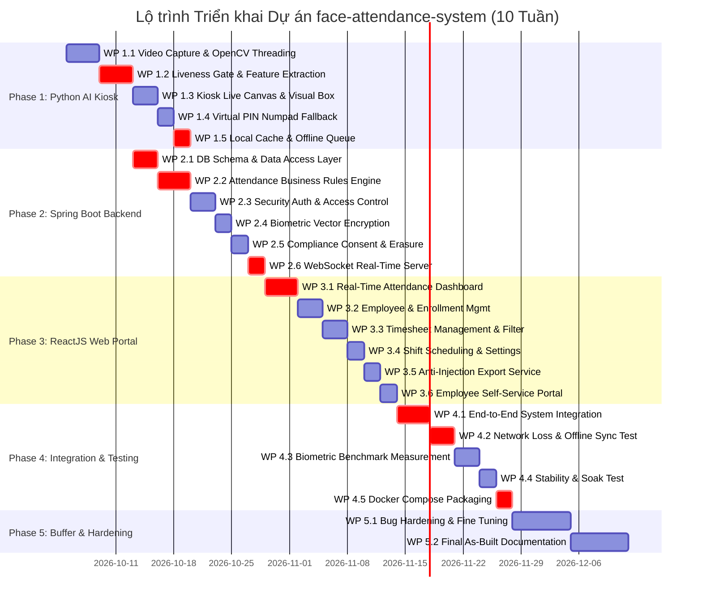

# Bộ tài liệu SDLC — Cấu trúc chuẩn hóa

> **Quy ước chung cho mọi tài liệu:**
> - **Mã tài liệu**: PP-FAS-01
> - **Tên tài liệu**: Kế hoạch dự án (Project Plan - PP)
> - **Phiên bản**: 3.4
> - **Trạng thái**: Đã phê duyệt (Approved)
> - **Chủ sở hữu**: nvdung
> - **Người phê duyệt**: nvdung
> - **Ngày hiệu lực**: 2026-09-29
> - **Tài liệu liên quan**: [README.md](../README.md), [PC.md](../initiation/PC.md), [PI.md](../initiation/PI.md), [TS.md](../initiation/TS.md)
> - **Lịch sử thay đổi**:
>   - *v1.0 (2026-09-25)*: Khởi tạo kế hoạch thực hiện dự án ban đầu.
>   - *v2.0 (2026-09-29)*: Tái cơ cấu WBS theo mô hình phân tán 3 phân hệ độc lập.
>   - *v3.0 (2026-09-29)*: Bổ sung lộ trình kiểm thử an toàn dữ liệu Luật 2025.
>   - *v3.1 (2026-09-29)*: Chuẩn hóa theo khung SDLC chuẩn hóa (Mục 1 đến Mục 6).
>   - *v3.2 (2026-09-29)*: Hiệu chỉnh nguồn lực 1 người (nvdung) và Laptop cá nhân.
>   - *v3.3 (2026-09-29)*: Cập nhật chi phí 0 VNĐ và cấu hình phần cứng Laptop (RTX 3050 Ti, camera tích hợp).
>   - *v3.4 (2026-09-29)*: Loại bỏ tham chiếu ngược tới các tài liệu tương lai (SRS, DDS), tuân thủ đúng trình tự SDLC từ PC -> PI -> TS -> PP -> SRS -> DDS -> BP -> TP -> DP.

---

## PP — Kế hoạch dự án (Project Plan)

**1. Cơ sở & Định hướng kế hoạch**

- 1.1. Mục tiêu thực hiện
  - Hiện thực hóa thành công sản phẩm phần mềm Hệ thống Chấm công bằng Nhận diện Khuôn mặt (Face Attendance System - FAS) gồm 3 phân hệ độc lập đặt tại `/app` trong khung thời gian 10 tuần (từ ngày 05/10/2026 đến 14/12/2026).
  - Đảm bảo toàn bộ 6 chỉ số mục tiêu hiệu năng và an toàn sinh trắc học (`KPI-01` đến `KPI-06`) đã cam kết trong tài liệu Khởi tạo dự án [PI.md](../initiation/PI.md).
  - Tối ưu hóa toàn bộ hệ thống để vận hành mượt mà đồng thời cả 3 dịch vụ trên 01 máy Laptop cá nhân (CPU Intel Core i5-12450H, 16GB RAM, GPU NVIDIA GeForce RTX 3050 Ti Laptop GPU 4GB, webcam tích hợp sẵn).
  - Tối ưu chi phí thực hiện ở mức **0 VNĐ** bằng cách khai thác tối đa phần cứng có sẵn và các công cụ, công nghệ miễn phí/mã nguồn mở quy định tại tài liệu [TS.md](../initiation/TS.md).
  - Triển khai tuần tự các giai đoạn của quy trình phát triển phần mềm theo chuẩn SDLC đã quy định tại [README.md](../README.md).

- 1.2. Phạm vi thực hiện
  - **Phân hệ Kiosk Desktop (`app/kiosk-app`)**: Xây dựng ứng dụng Python tích hợp luồng video từ webcam có sẵn, pipeline AI biên (phát hiện khuôn mặt, kiểm tra thực thể sống, trích xuất đặc trưng), giao diện PySide6, bàn phím số ảo dự phòng và cơ chế lưu trữ đệm ngoại tuyến SQLite.
  - **Phân hệ Máy chủ Doanh nghiệp (`app/backend-service`)**: Xây dựng dịch vụ máy chủ Java / Spring Boot, thiết kế CSDL PostgreSQL, quy tắc nghiệp vụ chấm công, cơ chế chống quét trùng Cooldown, mã hóa bảo mật vector mẫu, phát sóng sự kiện thời gian thực qua WebSocket STOMP và tiến trình tự động xóa dữ liệu định kỳ theo quy định pháp luật.
  - **Phân hệ Cổng Web Quản trị (`app/web-portal`)**: Xây dựng giao diện Web ReactJS (TypeScript, Tailwind CSS), bảng điều khiển giám sát điểm danh thời gian thực, quản lý danh sách nhân sự, duyệt đơn giải trình công, quy trình tự phục vụ ký cam kết đồng thuận và xuất báo cáo dữ liệu an toàn.
  - **Tích hợp & Đóng gói**: Đóng gói toàn bộ các dịch vụ bằng Docker Compose chạy thử nghiệm trên môi trường máy tính cá nhân.
  - **Ranh giới Ngoài phạm vi**: Không xây dựng module tính lương chuyên sâu (thuế/bảo hiểm), không nhận diện đám đông từ xa qua CCTV diện rộng và không tích hợp phần cứng rào chắn kiểm soát cửa tự động.

- 1.3. Cách tiếp cận / phương pháp thực hiện
  - **Phương pháp luận Agile / Solo Scrum**: Chia nhỏ lộ trình phát triển thành các chu kỳ (Sprint) 2 tuần với mục tiêu hoàn thành sản phẩm hoạt động được ở cuối mỗi chặng.
  - **Nguyên tắc Phát triển tuần tự theo chuẩn SDLC**: Mỗi giai đoạn được chuẩn bị kỹ lưỡng từ bối cảnh (PC) $\rightarrow$ khởi tạo (PI) $\rightarrow$ công nghệ (TS) $\rightarrow$ kế hoạch (PP) $\rightarrow$ đặc tả yêu cầu chi tiết (SRS) $\rightarrow$ thiết kế kiến trúc (DDS) $\rightarrow$ xây dựng (BP) $\rightarrow$ kiểm thử (TP) $\rightarrow$ triển khai (DP).
  - **Chiến lược Kiểm thử Tự động**: Triển khai kiểm thử liên tục cho từng phân hệ (PyTest cho Python, JUnit cho Spring Boot, Vitest cho React), kiểm thử tích hợp toàn trình và đo lường trực tiếp trên máy Laptop.

- 1.4. Giả định & cơ sở lập kế hoạch
  - **Nguồn lực nhân sự**: Dự án cá nhân do 01 kỹ sư duy nhất (**nvdung**) trực tiếp thực hiện với thời gian biểu cam kết trung bình 20 - 25 giờ/tuần.
  - **Hạ tầng phần cứng**: Sử dụng trực tiếp Laptop cá nhân (CPU Intel Core i5-12450H, 16GB RAM, GPU rời NVIDIA GeForce RTX 3050 Ti, SSD 512GB, Windows 11) làm môi trường phát triển và máy chủ thử nghiệm cục bộ; thiết bị thu hình là camera tích hợp sẵn trên laptop.
  - **Nền tảng công nghệ**: $100\%$ sử dụng công nghệ mã nguồn mở miễn phí, tài liệu API công khai và bộ trọng số mô hình AI miễn phí đã kiểm chứng (YuNet, ArcFace MobileFaceNet, MiniFASNet).

---

**2. Công việc & Kết quả**

- 2.1. Các kết quả / sản phẩm cần tạo ra
  - Mã nguồn phân hệ Desktop Kiosk hoàn chỉnh tại `app/kiosk-app/` kèm file cấu hình và bộ trọng số mô hình.
  - Mã nguồn phân hệ Backend Service hoàn chỉnh tại `app/backend-service/` kèm các tệp khởi tạo cấu trúc CSDL.
  - Mã nguồn phân hệ Web Portal hoàn chỉnh tại `app/web-portal/` (bản build production tĩnh).
  - Tệp điều phối `docker-compose.yml` cho phép khởi động toàn bộ môi trường (PostgreSQL, Backend, Web Portal) trên máy tính bằng một lệnh duy nhất.
  - Trọn bộ tài liệu kỹ thuật SDLC hoàn thiện theo danh mục quy định tại [README.md](../README.md): PC, PI, TS, PP, SRS, DDS, BP, TP, DP.

- 2.2. WBS / nhóm công việc (Work Breakdown Structure)

```mermaid
flowchart TB
    WBS["face-attendance-system (3-Tier Monorepo)"]
    
    WBS --> P1["1.0 Phase 1: Python AI Vision & Desktop Kiosk"]
    P1 --> W11["1.1 Video Capture & OpenCV Threading"]
    P1 --> W12["1.2 Liveness Gate & Feature Extraction"]
    P1 --> W13["1.3 Kiosk Live Canvas & Visual Bounding Box"]
    P1 --> W14["1.4 Virtual PIN Numpad Fallback"]
    P1 --> W15["1.5 Local Cache & Offline Resilient Queue"]

    WBS --> P2["2.0 Phase 2: Java Spring Boot Enterprise Backend"]
    P2 --> W21["2.1 DB Schema & Data Access Layer"]
    P2 --> W22["2.2 Attendance Business Rules & Cooldown Engine"]
    P2 --> W23["2.3 Security Authentication & RBAC Access Control"]
    P2 --> W24["2.4 Biometric Vector Encryption & Key Management"]
    P2 --> W25["2.5 Law Compliance Consent & Erasure Scheduler"]
    P2 --> W26["2.6 WebSocket Server for Real-Time Events"]

    WBS --> P3["3.0 Phase 3: ReactJS Web Management Portal"]
    P3 --> W31["3.1 Real-Time Attendance Live Dashboard"]
    P3 --> W32["3.2 Employee & Enrollment Management"]
    P3 --> W33["3.3 Timesheet Management & Late/Early Filter"]
    P3 --> W34["3.4 Shift Scheduling & Grace Period Config"]
    P3 --> W35["3.5 Anti-Formula-Injection Excel/CSV Export"]
    P3 --> W36["3.6 Employee Self-Service Timesheet View"]

    WBS --> P4["4.0 Phase 4: Integration, E2E Testing & Packaging"]
    P4 --> W41["4.1 End-to-End System Integration"]
    P4 --> W42["4.2 Network Interruption & Offline Sync Test"]
    P4 --> W43["4.3 Biometric Benchmark Measurement"]
    P4 --> W44["4.4 Stability & Soak Test"]
    P4 --> W45["4.5 Docker Compose Container Packaging"]

    WBS --> P5["5.0 Phase 5: Buffer & Hardening"]
    P5 --> W51["5.1 Bug Hardening & Performance Fine-Tuning"]
    P5 --> W52["5.2 Final As-Built SDLC Documentation"]
```

#### Từ điển Phân rã Công việc (WBS Dictionary)

| Mã gói (WP) | Phân hệ | Sản phẩm bàn giao cụ thể | Tiêu chí hoàn thành (Acceptance Criteria) | Người thực hiện |
| :--- | :--- | :--- | :--- | :--- |
| **WP 1.1** | Kiosk (Python) | Module đọc camera | Luồng đọc webcam laptop tích hợp đa luồng riêng biệt, duy trì $\ge 15\text{ FPS}$ liên tục. | nvdung |
| **WP 1.2** | Kiosk (Python) | Pipeline AI thị giác | Tích hợp kiểm tra thực thể sống và trích xuất vector đặc trưng khuôn mặt chạy mượt trên CPU/GPU. | nvdung |
| **WP 1.3** | Kiosk (Python) | Giao diện Kiosk | Giao diện trạm chấm công PySide6, viền khung đổi màu theo trạng thái, âm thanh thông báo. | nvdung |
| **WP 1.4** | Kiosk (Python) | Bàn phím số dự phòng | Bàn phím ảo trên màn hình, tự động khóa tạm thời sau nhiều lần nhập sai liên tiếp. | nvdung |
| **WP 1.5** | Kiosk (Python) | Lưu trữ đệm ngoại tuyến | Hàng đợi SQLite cục bộ; tự động gửi bù dữ liệu về Backend khi kết nối mạng phục hồi. | nvdung |
| **WP 2.1** | Backend (Spring) | Tầng dữ liệu & CSDL | Thiết lập cấu trúc CSDL PostgreSQL: Lưu hồ sơ, bảng công, vector mẫu mã hóa, audit logs. | nvdung |
| **WP 2.2** | Backend (Spring) | Xử lý logic nghiệp vụ | Phân loại Check-in/out, cơ chế chống quét trùng Cooldown, phân ca làm việc, tính giờ công. | nvdung |
| **WP 2.3** | Backend (Spring) | Bảo mật & Xác thực | Cấp phát token xác thực, phân quyền theo vai trò (Admin, HR, Employee). | nvdung |
| **WP 2.4** | Backend (Spring) | Bảo mật vector mẫu | Mã hóa dữ liệu vector sinh trắc học chuẩn AES-256-GCM, quản lý khóa bảo mật độc lập CSDL. | nvdung |
| **WP 2.5** | Backend (Spring) | Tuân thủ an toàn dữ liệu | Tiến trình tự động tiêu hủy vĩnh viễn dữ liệu sinh trắc học của nhân sự thôi việc theo quy định pháp luật. | nvdung |
| **WP 2.6** | Backend (Spring) | Kênh thông báo tức thời | Phát sóng sự kiện chấm công tức thời qua giao thức WebSocket STOMP lên Web Dashboard. | nvdung |
| **WP 3.1** | Web (React) | Bảng điều khiển trực tiếp | Nhận tin WebSocket, cập nhật trực quan các lượt chấm gần nhất và biểu đồ sĩ số thời gian thực. | nvdung |
| **WP 3.2** | Web (React) | Quản lý nhân sự | Quản lý danh sách nhân viên, cấp mã kích hoạt đăng ký, giao diện ký cam kết đồng thuận số. | nvdung |
| **WP 3.3** | Web (React) | Quản lý bảng công | Bảng tổng hợp công, bộ lọc theo ngày/phòng ban, xử lý duyệt đơn giải trình công. | nvdung |
| **WP 3.4** | Web (React) | Cấu hình ca làm việc | Giao diện cấu hình khung giờ làm việc, thời gian ân hạn, thời gian chống quét trùng lặp. | nvdung |
| **WP 3.5** | Web (React) | Xuất báo cáo dữ liệu | Xuất dữ liệu bảng công định dạng Excel/CSV an toàn, có cơ chế vô hiệu hóa mã độc công thức. | nvdung |
| **WP 3.6** | Web (React) | Cổng tự phục vụ | Giao diện cá nhân cho nhân viên theo dõi lịch sử chấm công và gửi đơn giải trình. | nvdung |
| **WP 4.1** | Toàn hệ thống | Bộ kịch bản Test E2E | Luồng từ Kiosk $\rightarrow$ Backend $\rightarrow$ Web Portal chạy thông suốt với thời gian phản hồi đạt cam kết. | nvdung |
| **WP 4.2** | Toàn hệ thống | Kiểm thử ngoại tuyến | Thử nghiệm ngắt mạng Kiosk, chấm công ngoại tuyến, kết nối lại mạng: Đồng bộ bù đầy đủ về CSDL. | nvdung |
| **WP 4.3** | Kiosk (Python) | Đo kiểm chỉ số sinh trắc | Đo lường thực tế độ chính xác nhận diện và khả năng chống giả mạo đạt các chỉ số cam kết. | nvdung |
| **WP 4.4** | Toàn hệ thống | Kiểm thử độ ổn định | Chạy liên tục hệ thống nhiều giờ trên Laptop với hàng trăm lượt chấm công giả lập, không crash bộ nhớ. | nvdung |
| **WP 4.5** | Đóng gói | File Docker Compose | Cấu hình `docker-compose.yml` khởi chạy trọn bộ dịch vụ (PostgreSQL, Backend, Web) trên Laptop. | nvdung |
| **WP 5.1** | Toàn hệ thống | Bản Release v1.0 | Khắc phục các vấn đề phát sinh từ bài test tích hợp; tối ưu hiệu năng CPU/GPU và giao diện. | nvdung |
| **WP 5.2** | Tài liệu | Bộ hồ sơ hoàn công | Hoàn thiện toàn bộ các tài liệu kỹ thuật SDLC đồng bộ với mã nguồn thực tế. | nvdung |

- 2.3. Phụ thuộc giữa các công việc
  - Chuỗi đường găng (Critical Path):
    $$\mathbf{WP 1.1} \rightarrow \mathbf{WP 1.2} \rightarrow \mathbf{WP 2.1} \rightarrow \mathbf{WP 2.2} \rightarrow \mathbf{WP 2.6} \rightarrow \mathbf{WP 3.1} \rightarrow \mathbf{WP 4.1} \rightarrow \mathbf{WP 4.2} \rightarrow \mathbf{WP 4.5} \rightarrow \mathbf{Bàn\ giao}$$
  - Phân hệ Kiosk cần hoàn thành pipeline xử lý khuôn mặt (WP 1.2) trước khi Backend triển khai lưu trữ và đối soát vector (WP 2.1, WP 2.2).
  - Phân hệ Web Live Dashboard (WP 3.1) phụ thuộc vào hạ tầng WebSocket STOMP của Backend (WP 2.6).
  - Kiểm thử tích hợp toàn trình (WP 4.1) chỉ có thể tiến hành khi cả 3 phân hệ hoàn thành các chức năng cốt lõi.

- 2.4. Ranh giới trách nhiệm thực hiện
  - Là **dự án cá nhân**, **nvdung** đảm nhiệm 100% trách nhiệm kỹ thuật và quản trị: Thiết kế, lập trình, kiểm thử, tối ưu hóa và phát hành sản phẩm. Không có sự phân chia giao việc cho các bên thứ ba.

---

**3. Tiến độ & Nguồn lực**

- 3.1. Lịch trình tổng thể (10 Tuần: từ 05/10/2026 đến 14/12/2026)

- 3.2. Mốc quan trọng (Milestones)
  - **Mốc M1 (18/10/2026 - Cuối Tuần 2)**: Hoàn thành lõi thị giác máy tính biên và giao diện Kiosk Desktop PySide6; trích xuất vector khuôn mặt và kiểm tra thực thể sống hoạt động mượt mà qua camera có sẵn.
  - **Mốc M2 (01/11/2026 - Cuối Tuần 4)**: Hoàn thành máy chủ Backend Spring Boot, CSDL PostgreSQL, mã hóa dữ liệu, cơ chế chống quét trùng và tiến trình tự động xóa dữ liệu sau 20 ngày.
  - **Mốc M3 (15/11/2026 - Cuối Tuần 6)**: Hoàn thành Cổng thông tin Web Portal ReactJS, kết nối WebSocket Live Dashboard, luồng tự phục vụ đăng ký và xuất báo cáo an toàn.
  - **Mốc M4 (29/11/2026 - Cuối Tuần 8)**: Tích hợp thông suốt 3 phân hệ, hoàn thành thử nghiệm mất mạng đồng bộ bù SQLite, kiểm thử đạt các chỉ số mục tiêu trên Laptop, đóng gói Docker Compose.
  - **Mốc Hoàn thiện (14/12/2026 - Cuối Tuần 10)**: Tối ưu hóa hiệu năng, khắc phục các vấn đề phát sinh từ bài test M4, hoàn thiện bộ tài liệu SDLC và bàn giao sản phẩm.

- 3.3. Phân bổ nhân sự
  - Nhân lực duy nhất: **01 người — nvdung**.
  - Tỷ trọng phân bổ nỗ lực theo từng lĩnh vực:
    - *Kiosk Desktop & Edge AI*: $35\%$
    - *Enterprise Backend & Security*: $35\%$
    - *Web Management Portal*: $25\%$
    - *Testing, DevOps & SDLC Documentation*: $5\%$

- 3.4. Công cụ / hạ tầng / nguồn lực cần thiết
  - **Môi trường phần cứng sẵn có (Laptop cá nhân)**:
    - CPU: Intel Core i5-12450H (8 nhân / 12 luồng, xung nhịp cơ sở 2.0 GHz, Turbo Boost 4.4 GHz).
    - RAM: 16.0 GB DDR4/DDR5.
    - Ổ cứng: SSD 512GB NVMe tốc độ cao.
    - Card đồ họa rời: NVIDIA GeForce RTX 3050 Ti Laptop GPU (4GB VRAM) — sẵn sàng hỗ trợ tăng tốc AI khi cần thiết.
    - Card đồ họa tích hợp: Intel(R) UHD Graphics.
    - Thiết bị camera: Camera/Webcam tích hợp sẵn trên laptop.
    - Hệ điều hành: Windows 11 64-bit.
  - **Công cụ phần mềm & Môi trường lập trình (100% Miễn phí & Đã cài đặt)**:
    - IDE: Visual Studio Code duy nhất (với đầy đủ các extension chính thức cho Python, Java, Web, Docker).
    - Runtime: Python 3.14+, Java OpenJDK 21 LTS (Temurin), Node.js v24.16+, Apache Maven 3.9+, Docker Desktop 29.7+.
    - Quản lý mã nguồn & CSDL: Git 2.54+, GitHub, PostgreSQL 16 (chạy container Docker cục bộ).

---

**4. Chi phí & Ngân sách**

- 4.1. Ước tính chi phí
  - **Chi phí bản quyền phần mềm**: 0 VNĐ ($100\%$ công nghệ mã nguồn mở miễn phí quy định tại [TS.md](../initiation/TS.md)).
  - **Chi phí phần cứng**: 0 VNĐ (tận dụng $100\%$ Laptop cá nhân đã có sẵn webcam tích hợp, CPU và card đồ họa rời RTX 3050 Ti).
  - **Chi phí hạ tầng máy chủ / Cloud**: 0 VNĐ (chạy trực tiếp trên Laptop cá nhân và mạng LAN nội bộ, không thuê máy chủ đám mây bên ngoài).
  - **Tổng chi phí dự án**: **0 VNĐ**.

- 4.2. Phân bổ ngân sách

| Hạng mục chi phí | Dự toán ngân sách (VNĐ) | Tỷ trọng | Ghi chú |
| :--- | :---: | :---: | :--- |
| Bản quyền phần mềm & Công cụ | 0 | $0\%$ | Sử dụng giấy phép mã nguồn mở (MIT, Apache 2.0, BSD) |
| Thiết bị phần cứng máy tính | 0 | $0\%$ | Tận dụng Laptop cá nhân hiện có của nvdung |
| Thiết bị thu hình (Camera) | 0 | $0\%$ | Tận dụng Camera/Webcam tích hợp sẵn trên Laptop |
| Hạ tầng mạng & Máy chủ | 0 | $0\%$ | Triển khai cục bộ trên máy và mạng LAN |
| Chi phí phát sinh khác | 0 | $0\%$ | Không phát sinh chi phí mua sắm ngoài |
| **Tổng cộng** | **0** | **0%** | **Dự án tự chủ hoàn toàn với ngân sách 0 VNĐ** |

- 4.3. Dự phòng
  - **Dự phòng ngân sách**: 0 VNĐ (không sử dụng kinh phí tiền mặt, kiểm soát bằng giải pháp kỹ thuật phần mềm miễn phí).
  - **Dự phòng tiến độ (Schedule Buffer)**: 2 tuần (Phase 5: từ 30/11/2026 đến 14/12/2026) được bố trí riêng để xử lý các vấn đề kỹ thuật phức tạp, tối ưu hóa suy luận AI và hoàn thiện tài liệu mà không ảnh hưởng đến hạn chót bàn giao.

- 4.4. Cơ sở & giả định của ước tính
  - Cơ sở ước tính dựa trên việc khai thác triệt để các tài nguyên phần cứng cá nhân sẵn có của **nvdung** và toàn bộ hệ sinh thái phần mềm mã nguồn mở/miễn phí trên thị trường.
  - Giả định phần cứng Laptop cá nhân duy trì hoạt động ổn định trong suốt 10 tuần thực hiện dự án.

---

**5. Quản lý & Kiểm soát**

- 5.1. Quản lý thay đổi (Change Management)
  - **Nguyên tắc Kiểm soát**: Mọi thay đổi về cấu trúc, logic nghiệp vụ hoặc giao thức truyền thông đều phải tuân thủ đúng trình tự tài liệu SDLC:
    1. Cập nhật và điều chỉnh trong tài liệu kế hoạch và tài liệu yêu cầu tương ứng trước.
    2. Sau khi tài liệu được thống nhất, tiến hành sửa đổi mã nguồn tương ứng trên các phân hệ.
  - **Quản lý phiên bản mã nguồn (Git Branching Strategy)**:
    - Nhánh `main`: Nhánh phát hành ổn định, chỉ merge code khi đã vượt qua các ca kiểm thử.
    - Nhánh `develop`: Nhánh tích hợp chính của 3 phân hệ.
    - Nhánh tính năng: `feature/kiosk-*`, `feature/backend-*`, `feature/web-*`.
    - Mọi commit đều tuân thủ chuẩn Conventional Commits (`feat:`, `fix:`, `docs:`, `refactor:`, `test:`).

- 5.2. Quản lý rủi ro (Risk Management)
  - Bảng Sổ Rủi ro Dự án Toàn diện (Project Risk Register) được nvdung theo dõi và rà soát định kỳ hàng tuần:

| Mã R | Tên rủi ro | Xác suất | Tác động | Mức độ | Biện pháp giảm thiểu | Kế hoạch dự phòng |
| :---: | :--- | :---: | :---: | :---: | :--- | :--- |
| **`R-01`** | **Mất kết nối mạng Kiosk $\leftrightarrow$ Backend** | Cao | Cao | **Đỏ (16)** | Hàng đợi SQLite cục bộ tại Kiosk; cơ chế đồng bộ tự động gửi dữ liệu khi có mạng. | Kiosk tiếp tục cho chấm công offline bình thường và hiển thị icon mất mạng. |
| **`R-02`** | **Tải CPU Laptop khi chạy đồng thời 3 dịch vụ** | Vừa | Vừa | **Vàng (8)** | Sử dụng ONNX Runtime tối ưu CPU; có thể tận dụng card rời NVIDIA RTX 3050 Ti nếu cần giảm tải CPU. | Tinh chỉnh độ phân giải camera hoặc tần số suy luận khung hình. |
| **`R-03`** | **Rò rỉ dữ liệu sinh trắc học qua kênh truyền** | Vừa | Rất cao | **Đỏ (15)** | Kiosk chỉ gửi kết quả nhận diện hoặc vector đã mã hóa qua giao thức bảo mật. | Thu hồi khóa kết nối Kiosk ngay lập tức nếu phát hiện truy cập bất thường. |
| **`R-04`** | **Lệch pha thư viện vector giữa Backend và Kiosk** | Vừa | Cao | **Vàng (12)** | Kiosk nạp danh sách vector khi khởi động; Backend phát WebSocket cập nhật tức thì khi có thay đổi. | Nút "Đồng bộ thủ công" (Sync Now) trên giao diện Kiosk. |
| **`R-05`** | **Vi phạm quy định xóa dữ liệu theo Luật** | Thấp | Rất cao | **Đỏ (15)** | Tiến trình tự động quét CSDL định kỳ và xóa vĩnh viễn dữ liệu theo thời hạn pháp luật quy định. | Ghi nhật ký audit logs bất biến cho mọi hành động xóa dữ liệu sinh trắc học. |
| **`R-06`** | **Tỷ lệ từ chối sai (False Rejection) tại Kiosk** | Vừa | Vừa | **Vàng (9)** | Bàn phím số ảo PIN Pad ngay trên Kiosk; cơ chế điểm danh bù trên Cổng Web. | Nhân viên sử dụng mã PIN để không bị ghi nhận đi muộn giờ làm. |
| **`R-07`** | **Xung đột thời gian khi Kiosk đồng bộ bù hàng loạt** | Vừa | Vừa | **Vàng (8)** | Backend sử dụng thời điểm ghi nhận thực tế do Kiosk tạo ra tại biên, không dùng thời điểm nhận gói tin API. | Bảng công ghi nhận chính xác thời điểm nhân viên thực tế có mặt. |
| **`R-08`** | **Tấn công chèn mã độc (Formula Injection) khi xuất file Excel** | Thấp | Vừa | **Xanh (6)** | Backend tự động xử lý ký tự đầu chuỗi trước khi kết xuất file bảng tính. | File Excel mở an toàn trên các phần mềm bảng tính dưới dạng văn bản thuần túy. |

- 5.3. Quản lý chất lượng (Quality Management)
  - **Quy chuẩn mã nguồn (Coding Conventions)**:
    - Phân hệ Kiosk: Tuân thủ chuẩn PEP 8.
    - Phân hệ Backend: Tuân thủ chuẩn Google Java Style.
    - Phân hệ Web: Tuân thủ chuẩn ESLint và Prettier cho TypeScript / React.
  - **Mục tiêu kiểm thử tự động**:
    - Độ bao phủ kiểm thử đơn vị (Unit Test Coverage) đạt tối thiểu $80\%$ trên các module xử lý nghiệp vụ cốt lõi.
    - Thử nghiệm độ bền: Chạy liên tục cả 3 phân hệ nhiều giờ trên Laptop với hàng trăm lượt chấm công giả lập, đảm bảo không xảy ra sự cố tràn bộ nhớ.

- 5.4. Theo dõi & báo cáo (Monitoring & Reporting)
  - Vì là dự án cá nhân, nvdung tự quản lý công việc thông qua:
    - Bảng Kanban cá nhân (To Do, In Progress, Testing, Done) gắn với 24 gói công việc WBS.
    - Nhật ký phát triển (Commit Log) ghi nhận hàng ngày trên kho lưu trữ Git.
    - Báo cáo đánh giá hoàn thành mốc (Milestone Self-Check) tại các mốc M1, M2, M3, M4.

- 5.5. Quản lý vấn đề & escalation (Issue & Escalation Management)
  - Mọi vấn đề kỹ thuật phát sinh được nvdung phân loại theo 3 mức độ ưu tiên:
    - *Blocker (Ngăn chặn tiến độ)*: Xử lý ngay lập tức trong vòng 4 - 8 giờ làm việc.
    - *Critical (Ảnh hưởng tính năng cốt lõi)*: Xử lý trong vòng 24 giờ.
    - *Minor (Lỗi giao diện nhỏ, tinh chỉnh hiệu năng)*: Đưa vào backlog xử lý trong giai đoạn Buffer (Phase 5).

---

**6. Baseline kế hoạch**

- 6.1. Scope baseline
  - Phạm vi baseline được xác lập dựa trên:
    - 24 gói công việc cụ thể trong bảng Từ điển WBS (WP 1.1 đến WP 5.2).
    - Phạm vi cấp cao và 6 chỉ số mục tiêu hiệu năng (`KPI-01` đến `KPI-06`) quy định tại tài liệu Khởi tạo dự án [PI.md](../initiation/PI.md).
    - Ranh giới kỹ thuật và danh mục công nghệ quy định tại tài liệu [TS.md](../initiation/TS.md).

- 6.2. Schedule baseline
  - Tiến độ baseline được xác lập bất biến với tổng thời gian 10 tuần (bắt đầu 05/10/2026, kết thúc 14/12/2026), bao gồm 4 mốc Milestone chính (M1 đến M4) và 2 tuần đệm an toàn.
  - Bất kỳ sự chậm trễ nào trên chuỗi đường găng (Critical Path) sẽ tự động kích hoạt điều chỉnh phạm vi thứ yếu hoặc sử dụng thời gian của Phase 5 để bù trừ.

- 6.3. Cost baseline
  - Chi phí baseline được cố định ở mức **0 VNĐ**.
  - $100\%$ tài nguyên phần cứng (Laptop Core i5 + RTX 3050 Ti + webcam tích hợp) và phần mềm (VS Code, Python, Java 21, React, Docker, Postgres) đều sẵn có và miễn phí.

- 6.4. Quy trình cập nhật baseline
  - Mọi sự điều chỉnh lớn liên quan đến Scope, Schedule hoặc Cost baseline bắt buộc phải được:
    1. nvdung đánh giá tác động toàn diện tới tính khả thi kỹ thuật và mục tiêu ban đầu.
    2. Cập nhật và giải thích rõ nguyên nhân thay đổi trong phần Lịch sử thay đổi của tài liệu `PP.md`.
    3. Đảm bảo tuân thủ đúng trình tự tài liệu SDLC quy định tại [README.md](../README.md).
