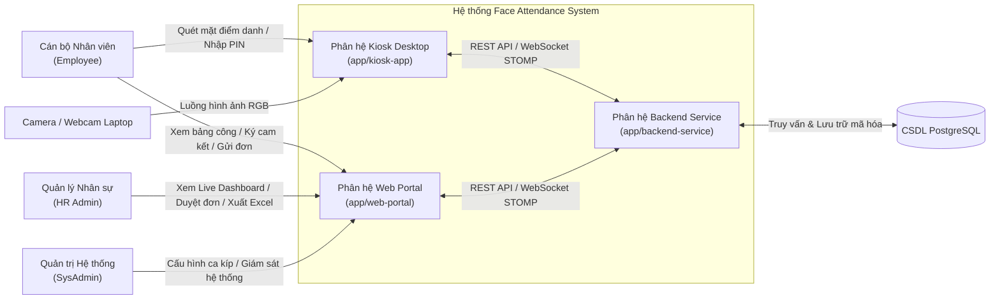

# Bộ tài liệu SDLC — Cấu trúc chuẩn hóa

> **Quy ước chung cho mọi tài liệu:**
> - **Mã tài liệu**: SRS-FAS-01
> - **Tên tài liệu**: Đặc tả yêu cầu phần mềm (Software Requirements Specification - SRS)
> - **Phiên bản**: 1.0
> - **Trạng thái**: Đã phê duyệt (Approved)
> - **Chủ sở hữu**: nvdung
> - **Người phê duyệt**: nvdung
> - **Ngày hiệu lực**: 2026-09-29
> - **Tài liệu liên quan**: [README.md](../README.md), [PC.md](../initiation/PC.md), [PI.md](../initiation/PI.md), [TS.md](../initiation/TS.md), [PP.md](../planning/PP.md)
> - **Lịch sử thay đổi**:
>   - *v1.0 (2026-09-29)*: Hoàn thiện toàn diện 8 phần đặc tả yêu cầu phần mềm theo đúng khung chuẩn mực SDLC (Mục 1 đến Mục 8), đồng bộ với functional-requirements.md.

---

## SRS — Đặc tả yêu cầu phần mềm

**1. Tổng quan & Phạm vi**

- 1.1. Mục đích hệ thống
  - Xây dựng một Hệ thống Chấm công bằng Nhận diện Khuôn mặt (Face Attendance System - FAS) tự động, không chạm (touchless), nhằm thay thế hoàn toàn các phương thức điểm danh truyền thống (thẻ từ RFID, dấu vân tay cơ học, sổ ký tay).
  - Tối ưu hóa pipeline thị giác máy tính và học sâu để vận hành trực tiếp tại biên (Edge AI) trên phần cứng máy trạm Kiosk cá nhân, phản hồi kết quả điểm danh tức thì trong thời gian thực.
  - Loại bỏ hoàn toàn tình trạng chấm công hộ (buddy punching) và các cuộc tấn công giả mạo 2D bằng hình ảnh hoặc video thông qua cơ chế kiểm tra thực thể sống thụ động (Passive Liveness Detection).
  - Tự động hóa toàn bộ quy trình tổng hợp công, đối soát đi muộn/về sớm, quản lý ca kíp và phê duyệt giải trình công trên giao diện web trực quan, giảm thiểu thời gian xử lý thủ công của bộ phận nhân sự.
  - Thiết lập cơ chế bảo mật và tuân thủ chặt chẽ Luật Bảo vệ Dữ liệu Cá nhân số 91/2025/QH15 của Việt Nam đối với dữ liệu sinh trắc học nhạy cảm.

- 1.2. Phạm vi sản phẩm
  - Hệ thống được tổ chức thành 3 phân hệ mã nguồn độc lập nằm trong cấu trúc Monorepo tại thư mục `/app`:
    - **Phân hệ Kiosk Desktop (`app/kiosk-app`)**: Ứng dụng client máy tính để bàn chạy tại trạm điểm danh (phát triển bằng Python, PySide6, OpenCV, ONNX Runtime). Thực hiện thu nhận luồng video từ webcam, phát hiện khuôn mặt, kiểm tra thực thể sống, trích xuất vector đặc trưng, so khớp 1:N với bộ nhớ cục bộ, cung cấp bàn phím số ảo PIN dự phòng và hàng đợi ngoại tuyến SQLite khi mất kết nối mạng.
    - **Phân hệ Máy chủ Doanh nghiệp (`app/backend-service`)**: Dịch vụ máy chủ trung tâm (phát triển bằng Java 21 LTS, Spring Boot 4.x, PostgreSQL 16+). Quản lý toàn bộ dữ liệu người dùng, ca kíp, quy tắc nghiệp vụ chấm công, chống quét trùng Cooldown, mã hóa bảo mật vector mẫu bằng AES-256-GCM, phát sóng sự kiện thời gian thực qua WebSocket STOMP và tự động tiêu hủy dữ liệu sinh trắc học sau 20 ngày kể từ khi nhân sự thôi việc.
    - **Phân hệ Cổng Web Quản trị (`app/web-portal`)**: Ứng dụng Web dành cho quản trị viên, nhân sự và nhân viên (phát triển bằng ReactJS 18+, TypeScript, Vite, Tailwind CSS). Cung cấp màn hình giám sát thời gian thực Live Dashboard, quản lý danh sách nhân sự, phân ca làm việc, xử lý đơn giải trình công, cổng tự phục vụ ký cam kết đồng thuận và xuất báo cáo bảng công an toàn.
  - Môi trường triển khai mục tiêu: Được thiết kế để có thể vận hành linh hoạt trên nhiều môi trường phần cứng phổ thông (tối thiểu CPU 4 nhân, 8GB RAM cho Kiosk; hoặc máy chủ/máy trạm tiêu chuẩn). Trong giai đoạn phát triển và kiểm thử ban đầu, toàn bộ 3 phân hệ được kiểm chứng tính khả thi và đo đạc thực nghiệm trên phần cứng máy trạm phát triển sẵn có của **nvdung** với chi phí 0 VNĐ.

- 1.3. Đối tượng sử dụng
  - **Nhân viên (Employee)**: Toàn bộ cán bộ nhân viên trong tổ chức tham gia điểm danh hàng ngày tại trạm Kiosk; truy cập Cổng Web tự phục vụ để xem lịch sử công của bản thân, ký cam kết điện tử Informed Consent và gửi đơn giải trình công khi có sự cố.
  - **Bộ phận Nhân sự (HR Specialist / Manager)**: Chuyên viên và quản lý nhân sự chịu trách nhiệm quản lý danh sách nhân viên, cấu hình lịch làm việc/ca kíp, theo dõi quân số trực tiếp đầu giờ trên Dashboard, duyệt đơn giải trình công và kết xuất báo cáo bảng công định kỳ.
  - **Quản trị viên Hệ thống (System Administrator / nvdung)**: Kỹ sư phụ trách cài đặt, cấu hình tham số hệ thống, kết nối mạng giữa Kiosk và Backend, quản lý tài khoản người dùng, giám sát nhật ký audit log và sao lưu/phục hồi dữ liệu CSDL.
  - **Bộ phận Tuân thủ & Pháp lý (DPO / Compliance Reference)**: Vai trò tham chiếu nhằm đối soát việc thực thi chính sách bảo vệ dữ liệu cá nhân, quy trình ký cam kết đồng thuận và quy trình tiêu hủy dữ liệu sinh trắc học đúng hạn luật định.

- 1.4. Thuật ngữ / định nghĩa

| Thuật ngữ / Viết tắt | Tên tiếng Anh đầy đủ | Định nghĩa & Ý nghĩa trong hệ thống |
| :--- | :--- | :--- |
| **FAS** | Face Attendance System | Hệ thống phần mềm Chấm công bằng Nhận diện Khuôn mặt. |
| **Kiosk** | Kiosk Attendance Terminal | Trạm máy tính chuyên dụng đặt tại cửa ra vào để thực hiện điểm danh. |
| **Edge AI** | Edge Artificial Intelligence | Xử lý suy luận mạng nơ-ron AI trực tiếp trên thiết bị đầu cuối mà không gửi hình ảnh thô lên máy chủ. |
| **Liveness Detection (PAD)** | Presentation Attack Detection | Kỹ thuật kiểm tra thực thể sống thụ động nhằm phân biệt khuôn mặt người thật với ảnh in, video phát lại hoặc mặt nạ giả mạo. |
| **Embedding / Vector 512D** | Face Feature Vector | Mảng số thực 512 chiều được mô hình học sâu trích xuất đại diện cho các đặc trưng hình học duy nhất của một khuôn mặt. |
| **Buddy Punching** | Buddy Punching | Hành vi gian lận nhờ đồng nghiệp chấm công hộ (bằng cách quẹt thẻ hộ, bấm vân tay giả hoặc chia sẻ mã số). |
| **Cooldown** | Cooldown Window | Khoảng thời gian quy định (mặc định 120 giây) hệ thống tự động bỏ qua các lượt quét liên tiếp của cùng một nhân viên nhằm tránh trùng lặp dữ liệu. |
| **Informed Consent** | Informed Consent | Thỏa thuận đồng thuận tự nguyện có hiểu biết của nhân viên về việc cho phép thu thập và xử lý dữ liệu sinh trắc học theo Luật 2025. |
| **Onboarding OTP** | Enrollment One-Time Password | Mã kích hoạt số 6 chữ số có hiệu lực giới hạn (48 giờ) do Cổng Web sinh ra để nhân viên mang ra trạm Kiosk quét khuôn mặt mẫu lần đầu. |
| **WAL** | Write-Ahead Logging | Chế độ ghi nhật ký trước của CSDL SQLite giúp tăng tốc độ đọc/ghi đồng thời và chống hỏng dữ liệu khi mất nguồn đột ngột. |
| **Formula Injection** | CSV/Formula Injection (CWE-1236) | Lỗ hổng bảo mật khi dữ liệu văn bản chứa các ký tự đặc biệt (`=`, `+`, `-`, `@`) bị phần mềm bảng tính (Excel) tự động thực thi như công thức. |
| **RPO** | Recovery Point Objective | Mục tiêu điểm phục hồi dữ liệu tối đa chấp nhận bị mất mát (hệ thống cam kết $\text{RPO} = 0$). |
| **TAR / FAR** | True Accept Rate / False Accept Rate | Tỷ lệ nhận diện đúng người dùng hợp lệ / Tỷ lệ nhận diện nhầm người lạ thành nhân viên hợp lệ. |

---

**2. Bối cảnh nghiệp vụ & Sử dụng**

- 2.1. Bối cảnh sử dụng
  - **Điểm danh đầu giờ và cuối giờ (Check-in / Check-out)**:
    - Diễn ra tại các trạm Kiosk đặt tại cửa ra vào doanh nghiệp.
    - Khung giờ cao điểm: Sáng từ 07:45 đến 08:15 và Chiều từ 17:00 đến 17:45 với lưu lượng quét liên tục.
    - Điều kiện môi trường: Ánh sáng thay đổi từ tự nhiên đến ánh sáng đèn huỳnh quang trong phòng ($300 - 500\text{ lux}$), khoảng cách đứng của nhân viên từ $0.5 - 1.2\text{ m}$ trước camera laptop.
  - **Theo dõi và quản trị nhân sự trên Cổng Web**:
    - Chuyên viên nhân sự truy cập Cổng Web trên máy tính cá nhân qua trình duyệt hiện đại (Chrome, Edge, Firefox).
    - Theo dõi trực tiếp bảng quân số hiện diện, tỷ lệ đi làm đầu giờ qua kết nối đẩy thời gian thực WebSocket.
    - Xử lý các nghiệp vụ quản trị định kỳ: phân ca kíp, thêm mới/khóa nhân sự, duyệt đơn giải trình công và xuất báo cáo chấm công cuối tháng.
  - **Tự phục vụ nhân viên (Self-Service)**:
    - Nhân viên sử dụng máy tính cá nhân hoặc điện thoại truy cập Cổng Web qua mạng nội bộ/VPN để xem lại lịch sử chấm công, ký xác nhận thỏa thuận đồng thuận số và nộp đơn giải trình khi quên chấm công hoặc gặp sự cố.

- 2.2. Quy trình / nghiệp vụ liên quan
  - **Quy trình 1: Đăng ký mẫu khuôn mặt mới (Employee Onboarding Flow)**:
    - *Bước 1*: Quản trị viên HR tạo hồ sơ nhân viên mới trên Cổng Web.
    - *Bước 2*: Nhân viên đăng nhập vào Cổng Web cá nhân $\rightarrow$ Đọc và ký xác nhận thỏa thuận đồng thuận số *Informed Consent* theo Luật 2025.
    - *Bước 3*: Hệ thống sinh mã kích hoạt Onboarding OTP gồm 6 chữ số (kèm mã QR) có hiệu lực trong vòng 48 giờ gửi tới màn hình nhân viên.
    - *Bước 4*: Nhân viên di chuyển tới trạm Kiosk $\rightarrow$ Chọn chức năng "Đăng ký khuôn mặt mới" $\rightarrow$ Nhập mã 6 số OTP (hoặc đưa mã QR trước camera).
    - *Bước 5*: Kiosk xác thực mã OTP với Backend. Sau khi hợp lệ, Kiosk hướng dẫn nhân viên giữ thẳng mặt nhìn vào camera $\rightarrow$ Thực hiện kiểm chuẩn chất lượng hình ảnh (đủ sáng, không nghiêng quá $15^\circ$, độ sắc nét cao) và kiểm tra thực thể sống.
    - *Bước 6*: Kiosk trích xuất vector đặc trưng 512D và gửi gói tin đăng ký lên Backend.
    - *Bước 7*: Backend mã hóa vector bằng AES-256-GCM, lưu trữ vào PostgreSQL, kích hoạt trạng thái tài khoản `ACTIVE`, phát tín hiệu WebSocket chúc mừng về màn hình Web của nhân viên và phát tán vector mới về bộ nhớ RAM của các trạm Kiosk.

  - **Quy trình 2: Điểm danh thường nhật tại Kiosk (Standard Attendance Flow)**:
    - *Bước 1*: Nhân viên bước vào vùng nhìn thấy của camera trạm Kiosk ($0.5 - 1.2\text{ m}$).
    - *Bước 2*: Kiosk tự động phát hiện khuôn mặt và kiểm tra thực thể sống (Liveness Check). Nếu phát hiện dấu hiệu giả mạo (ảnh in, màn hình điện thoại), lập tức từ chối và báo viền đỏ cảnh báo.
    - *Bước 3*: Với khuôn mặt người thật hợp lệ, Kiosk trích xuất vector đặc trưng 512D và so khớp độ tương đồng Cosine với danh mục vector nhân viên đã nạp sẵn trong RAM Gallery.
    - *Bước 4*: Nếu độ tương đồng $\ge$ ngưỡng cho phép ($0.50$):
      - Kiosk phát âm thanh báo thành công ("Tít"), hiển thị viền xanh lá, kèm họ tên và mã số nhân viên trên màn hình trong 2 giây.
      - Kiosk kiểm tra thời gian Cooldown: Nếu cùng nhân viên này vừa quét cách đó chưa quá 120 giây, hệ thống hiển thị thông báo đã ghi nhận và không gửi bản ghi trùng lặp.
      - Kiosk đóng gói dữ liệu lượt chấm công gửi về Backend Service qua REST API.
      - Backend tiếp nhận, đối chiếu ca làm việc thực tế, tính toán số phút đi muộn/về sớm và lưu vào PostgreSQL.
      - Backend phát sóng sự kiện điểm danh qua kênh WebSocket STOMP `/topic/live-attendance` để Cổng Web cập nhật tức thì lên Live Dashboard.

  - **Quy trình 3: Điểm danh dự phòng khi gặp sự cố (Fallback PIN Punch Flow)**:
    - Áp dụng khi khuôn mặt bị thương tật, thay đổi đột ngột hoặc camera Kiosk tạm thời gặp trục trặc quang học.
    - Nhân viên bấm phím chức năng trên màn hình Kiosk để mở "Bàn phím số ảo PIN dự phòng".
    - Nhân viên nhập Mã nhân viên và Mã PIN bí mật 6 số cá nhân $\rightarrow$ Kiosk gửi yêu cầu xác thực về Backend $\rightarrow$ Hệ thống ghi nhận lượt chấm công với phương thức `VERIFICATION_PIN`.
    - Để ngăn chặn dò mã bừa bãi: Nếu nhập sai mã PIN quá 5 lần liên tiếp, bàn phím số của tài khoản đó sẽ tự động khóa tạm thời trong 15 phút.

  - **Quy trình 4: Điểm danh ngoại tuyến và đồng bộ phục hồi (Offline Resilient Sync Flow)**:
    - Khi kết nối mạng nội bộ giữa Kiosk và Backend bị ngắt:
      - Kiosk nhận biết trạng thái mất mạng qua cơ chế Heartbeat định kỳ, tự động chuyển sang chế độ `OFFLINE_MODE` và hiển thị biểu tượng cảnh báo mất mạng trên màn hình.
      - Kiosk vẫn duy trì nhận diện khuôn mặt bình thường nhờ bộ nhớ RAM Gallery đã lưu sẵn.
      - Mỗi lượt chấm công thành công được Kiosk ghi lập tức vào CSDL SQLite cục bộ (chế độ ghi nhật ký trước WAL) kèm timestamp chính xác tại thời điểm quét.
    - Khi kết nối mạng được phục hồi:
      - Luồng xử lý ngầm (Sync Worker) của Kiosk tự động phát hiện mạng trực tuyến.
      - Trích xuất toàn bộ các bản ghi tồn đọng trong SQLite và gửi theo lô (Batch Sync Request) lên Backend Service.
      - Backend tiếp nhận lô bản ghi, bảo toàn đúng mốc thời gian gốc của từng lượt chấm để tính toán giờ công chính xác, sau đó gửi phản hồi xác nhận để Kiosk đánh dấu bản ghi đã đồng bộ xong.

  - **Quy trình 5: Giải trình công và điều chỉnh bảng công (Timesheet Adjustment Flow)**:
    - Nhân viên quên điểm danh hoặc có sự cố ngoại cảnh đăng nhập Cổng Web, tạo đơn giải trình (lý do công tác, quên chấm, lỗi thiết bị) kèm bằng chứng xác thực.
    - Cán bộ quản lý hoặc HR tiếp nhận đơn trên Cổng Web $\rightarrow$ Bấm phê duyệt (`APPROVED`) hoặc từ chối (`REJECTED`).
    - Nếu được phê duyệt, trạng thái bảng công của ngày đó được cập nhật thành `EXCUSED`, kèm theo mã nhân sự của người duyệt và thời gian phê duyệt trong audit log.

  - **Quy trình 6: Vòng đời dữ liệu sinh trắc học và tiêu hủy theo Luật 2025 (Compliance Retention Flow)**:
    - Khi một nhân viên chấm dứt hợp đồng lao động, nhân sự chuyển trạng thái nhân viên thành `TERMINATED` trên Cổng Web.
    - Backend lập tức gửi lệnh thu hồi vector qua WebSocket để Kiosk loại bỏ vector của nhân viên đó khỏi bộ nhớ RAM ngay tức thì (ngăn chặn việc ra vào doanh nghiệp).
    - Hệ thống lưu vết mốc ngày thôi việc. Tiến trình tự động (Compliance Scheduler) chạy định kỳ quét CSDL hàng ngày.
    - Khi mốc thời gian thôi việc chạm đúng ngưỡng 20 ngày theo quy định pháp luật: Hệ thống tự động thực hiện tiêu hủy vĩnh viễn (Hard Delete) bản ghi vector sinh trắc học và ảnh mẫu liên quan khỏi CSDL PostgreSQL, đồng thời ghi nhận nhật ký tiêu hủy phục vụ thanh tra.

- 2.3. Phạm vi chức năng
  - **Nhóm chức năng Kiosk Điểm danh (`app/kiosk-app`)**:
    - Nhận diện khuôn mặt thời gian thực từ camera có sẵn.
    - Kiểm tra thực thể sống thụ động (chống ảnh in và màn hình điện thoại).
    - So khớp định danh khuôn mặt 1:N cục bộ tốc độ cao.
    - Điểm danh dự phòng bằng bàn phím số ảo PIN.
    - Chống ghi nhận trùng lặp trong chu kỳ Cooldown 120 giây.
    - Hàng đợi lưu trữ ngoại tuyến SQLite WAL và tự động gửi bù khi có mạng.
    - Giao diện đăng ký khuôn mặt mới bằng mã OTP/QR.
  - **Nhóm chức năng Máy chủ Nghiệp vụ & Bảo mật (`app/backend-service`)**:
    - Xác thực bảo mật, phân quyền người dùng theo vai trò (RBAC).
    - Phân ca kíp làm việc, tính toán đi muộn, về sớm và thời gian làm thêm.
    - Tiếp nhận dữ liệu điểm danh trực tuyến và tiếp nhận lô đồng bộ ngoại tuyến.
    - Mã hóa an toàn vector khuôn mặt bằng thuật toán AES-256-GCM.
    - Quản lý vòng đời dữ liệu và tự động tiêu hủy vector sau 20 ngày theo Luật 2025.
    - Phát sóng sự kiện thời gian thực qua giao thức WebSocket STOMP.
  - **Nhóm chức năng Cổng Quản trị Web (`app/web-portal`)**:
    - Bảng điều khiển giám sát sĩ số và sự kiện chấm công thời gian thực (Live Dashboard).
    - Quản lý hồ sơ nhân viên, trạng thái tài khoản và cấp mã Onboarding OTP.
    - Cổng tự phục vụ nhân viên: xem lịch sử công cá nhân, tạo đơn giải trình.
    - Thỏa thuận số ký cam kết đồng thuận xử lý dữ liệu sinh trắc học.
    - Cấu hình ca làm việc, thời gian ân hạn và tham số điểm danh.
    - Kết xuất báo cáo bảng công định dạng Excel/CSV an toàn, chống mã độc công thức.

- 2.4. Ngoài phạm vi (Out-of-Scope)
  - Không bao gồm module tính toán chi tiết bảng lương chuyên sâu (thuế thu nhập cá nhân, bảo hiểm xã hội, các khoản giảm trừ gia cảnh hoặc tạm ứng lương).
  - Không triển khai bài toán nhận diện đám đông từ xa qua hệ thống camera an ninh CCTV góc rộng ngoài trời.
  - Không tích hợp điều khiển đóng/mở phần cứng rào chắn tự động (Flap barrier / Turnstile / Khóa từ cửa kính) trong phiên bản hiện tại.
  - Không phát triển ứng dụng di động riêng biệt (Native App cho iOS / Android) mà sử dụng giao diện web phản hồi linh hoạt (Responsive Web).

- 2.5. Người dùng / tác nhân / hệ thống tương tác
  - **Sơ đồ bối cảnh tương tác giữa các tác nhân và hệ thống**:

  - **Mô tả vai trò chi tiết của các tác nhân tương tác**:
    - **Nhân viên (Employee)**: Tác nhân tương tác trực tiếp với giao diện Kiosk để ghi nhận thời gian có mặt/ra về; tương tác với Cổng Web để tự quản lý ngày công và thực thi quyền riêng tư cá nhân.
    - **Quản trị viên Nhân sự (HR Admin)**: Tác nhân quản trị nghiệp vụ trên Cổng Web, chịu trách nhiệm vận hành dữ liệu chấm công hàng ngày và hàng tháng.
    - **Quản trị viên Kỹ thuật (SysAdmin / nvdung)**: Tác nhân vận hành kỹ thuật, thiết lập kết nối giữa các phân hệ, quản trị CSDL và sao lưu bảo mật.
    - **Thiết bị Camera / Webcam**: Thiết bị ngoại vi cung cấp luồng tín hiệu video liên tục cho module thị giác máy tính của Kiosk.
    - **Cơ sở dữ liệu PostgreSQL**: Hệ thống lưu trữ bền vững trung tâm cho toàn bộ dữ liệu nghiệp vụ, bảng công và dữ liệu sinh trắc học đã mã hóa.

---

**3. Yêu cầu chức năng**

- Toàn bộ 16 yêu cầu chức năng (FR-01 đến FR-16) của hệ thống đã được phân tích, bóc tách và đặc tả chi tiết tại tài liệu riêng: [functional-requirements.md](functional-requirements.md).
- Chi tiết các mục theo khung chuẩn hóa SDLC:
  - 3.1. Nhóm chức năng: Xem tại [functional-requirements.md#31-nhóm-chức-năng](functional-requirements.md) (4 nhóm nghiệp vụ: Edge AI & Kiosk, Enrollment & Identity Lifecycle, Enterprise Backend & Real-time, Web Management Portal & Self-service).
  - 3.2. Đặc tả yêu cầu: Xem tại [functional-requirements.md](functional-requirements.md) (Đặc tả chi tiết từng FR từ FR-01 đến FR-16).
  - 3.3. Quy tắc nghiệp vụ: Xem tại [functional-requirements.md](functional-requirements.md) (Các quy tắc nghiệp vụ BR-01.1 đến BR-16.3).
  - 3.4. Luồng chính: Xem tại [functional-requirements.md](functional-requirements.md) (Trình tự tương tác người-máy và luồng dữ liệu chuẩn).
  - 3.5. Luồng thay thế / ngoại lệ: Xem tại [functional-requirements.md](functional-requirements.md) (Xử lý các tình huống lỗi, ngoại lệ, mất mạng, tấn công giả mạo).
  - 3.6. Điều kiện đầu vào / đầu ra: Xem tại [functional-requirements.md](functional-requirements.md) (Dữ liệu đầu vào và kết quả đầu ra của từng chức năng).
  - 3.7. Tiêu chí chấp nhận: Xem tại [functional-requirements.md](functional-requirements.md) (Tiêu chuẩn nghiệm thu chức năng và chỉ số đo lường).

---

**4. Yêu cầu phi chức năng**

- 4.1. Hiệu năng
  - **Tốc độ suy luận AI tại biên (Edge AI Latency)**: Tổng thời gian từ khi nhận khung hình đến khi hoàn tất định danh (YuNet phát hiện + MiniFASNet kiểm tra thực thể sống + ArcFace trích xuất vector 512D + Cosine Matching 1:N với 100 nhân sự) phải đạt <= 350 ms trên CPU máy trạm tiêu chuẩn (hỗ trợ tập lệnh AVX2/SIMD) và <= 150 ms khi có card tăng tốc đồ họa (GPU).
  - **Tỷ lệ khung hình hiển thị (Display Frame Rate)**: Giao diện trạm Kiosk PySide6 phải duy trì luồng hiển thị video từ webcam đạt >= 15 FPS liên tục trong mọi điều kiện ánh sáng, không giật lag màn hình (Stuttering).
  - **Độ trễ toàn trình hệ thống (End-to-End Latency - KPI-04)**: Tổng thời gian từ khi khuôn mặt xuất hiện trước camera đến khi sự kiện chấm công hiển thị trên Web Dashboard phải đạt <= 1.2 giây (đo tại phân vị p95).
  - **Độ trễ phát sóng thời gian thực (Broadcast Latency)**: Tín hiệu WebSocket STOMP từ Backend đẩy xuống Cổng Web Portal phải hoàn tất trong vòng <= 200 ms.
  - **Tốc độ khởi động & Nạp RAM Kiosk (KPI-05)**: Đồng bộ và nạp toàn bộ danh mục 100 vector mẫu từ Backend về bộ nhớ RAM Gallery của Kiosk khi khởi động phải hoàn tất trong <= 3.0 giây.
  - **Độ tiêu thụ tài nguyên máy trạm (Resource Utilization)**: Khi triển khai đồng thời cả 3 dịch vụ trên cùng một máy trạm phát triển tiêu chuẩn (môi trường kiểm thử cục bộ):
    - Tổng mức sử dụng CPU trung bình <= 65% trong giờ cao điểm điểm danh.
    - Tổng dung lượng RAM chiếm dụng của toàn bộ stack <= 6.5 GB.

- 4.2. Bảo mật
  - **Mã hóa dữ liệu ở trạng thái tĩnh (Encryption At-Rest)**: 100% dữ liệu vector đặc trưng sinh trắc học 512 chiều trong PostgreSQL bắt buộc phải được mã hóa bằng thuật toán AES-256-GCM chuẩn FIPS với Initialization Vector (IV) ngẫu nhiên 96-bit duy nhất cho từng bản ghi và thẻ xác thực toàn vẹn 128-bit Authentication Tag.
  - **Quản lý khóa bảo mật độc lập (Key Management)**: Khóa giải mã Master Key 256-bit tuyệt đối không lưu trong CSDL hay mã nguồn Git, mà phải được nạp thông qua biến môi trường hệ điều hành (`ENCRYPTION_MASTER_KEY`).
  - **Mã hóa dữ liệu trên đường truyền (Encryption In-Transit)**: Toàn bộ kết nối giữa Kiosk, Backend và Web Portal bắt buộc sử dụng giao thức HTTPS (TLS 1.3) và WSS (Secure WebSocket).
  - **Nguyên tắc không lưu trữ ảnh thô (Zero Raw Image Retention)**: Trạm Kiosk tuyệt đối không lưu ảnh chụp khuôn mặt thô xuống ổ cứng. Ảnh chỉ tồn tại tạm thời trong bộ nhớ RAM trong vài giây để phục vụ trích xuất vector, sau đó lập tức bị giải phóng khỏi bộ nhớ.
  - **Bảo vệ mật khẩu và mã PIN**: Mật khẩu quản trị và mã PIN dự phòng phải được băm bằng các thuật toán một chiều an toàn chống GPU Brute-force (Argon2id hoặc BCrypt với Work Factor thích hợp), tuyệt đối không lưu dạng Plaintext.
  - **Kiểm soát truy cập và Phân quyền (RBAC)**: Hệ thống phải thực thi phân quyền truy cập nghiêm ngặt dựa trên vai trò thông qua JWT token (hạn 8 giờ):
    - `ADMIN`: Toàn quyền cấu hình hệ thống, trạm Kiosk, tài khoản và xem audit log.
    - `HR`: Quản lý hồ sơ nhân sự, phân ca làm việc, duyệt đơn giải trình và xuất báo cáo.
    - `EMPLOYEE`: Chỉ được xem bảng công cá nhân, ký cam kết đồng thuận và nộp đơn giải trình của chính mình.
  - **Chống tấn công bảng tính (Anti-Formula Injection - CWE-1236)**: Khi xuất file Excel/CSV, hệ thống phải tự động kiểm tra và chèn dấu nháy đơn (`'`) phía trước mọi chuỗi bắt đầu bằng các ký tự nguy hiểm (`=`, `+`, `-`, `@`) để vô hiệu hóa mã độc macro.

- 4.3. Độ tin cậy / sẵn sàng
  - **Khả năng hoạt động ngoại tuyến (Offline Resiliency - KPI-06)**: Khi đứt kết nối mạng LAN hoặc mất Internet, trạm Kiosk vẫn tiếp tục nhận diện khuôn mặt và cho phép điểm danh bình thường thông qua bộ đệm RAM và hàng đợi ngoại tuyến SQLite WAL.
  - **Cam kết không thất thoát dữ liệu (Zero Data Loss - RPO = 0)**: Khi mạng phục hồi, hệ thống phải tự động đồng bộ bù đủ 100% số bản ghi phát sinh trong lúc mất mạng về máy chủ trung tâm mà không bị mất mát hay sai lệch mốc giờ thực tế.
  - **Khả năng phục hồi sự cố mất nguồn đột ngột**: CSDL SQLite tại Kiosk sử dụng chế độ Write-Ahead Logging (`PRAGMA journal_mode=WAL;`), đảm bảo không bị hỏng tệp (database corruption) nếu thiết bị đầu cuối bị mất nguồn đột ngột hoặc tắt máy đột ngột.
  - **Độ sẵn sàng dịch vụ (High Availability SLA)**: Hệ thống máy chủ Backend duy trì độ sẵn sàng tối thiểu 99.9% trong giờ hành chính, tự động kích hoạt tiến trình kiểm tra sức khỏe qua endpoint Spring Actuator (`/actuator/health`).

- 4.4. Khả năng mở rộng
  - **Khả năng mở rộng mạng lưới Kiosk (Terminal Scalability)**: Kiến trúc Backend hỗ trợ kết nối đồng thời từ 1 đến 10 trạm Kiosk điểm danh đặt tại các cổng ra vào khác nhau mà không làm suy giảm hiệu năng nhờ mô hình Non-blocking I/O và Java 21 Virtual Threads.
  - **Khả năng mở rộng dung lượng nhân sự**: Hệ thống đáp ứng quy mô cơ sở dữ liệu từ 100 đến 1,000 nhân viên với thời gian tìm kiếm so khớp Cosine 1:N trên Kiosk tăng tuyến tính không quá 150 ms.
  - **Tách biệt kiến trúc phân tầng (Decoupled Scalability)**: Cả 3 phân hệ (Kiosk, Backend, Web Portal) hoạt động hoàn toàn độc lập qua giao thức mạng chuẩn, sẵn sàng tách ra triển khai trên các máy chủ vật lý riêng biệt hoặc môi trường đám mây (Cloud) khi doanh nghiệp mở rộng quy mô.

- 4.5. Khả năng sử dụng
  - **Trải nghiệm điểm danh tự nhiên (Touchless User Experience)**: Nhân viên không cần chạm tay vào thiết bị hay căn chỉnh góc mặt phức tạp; giao diện Kiosk phản hồi trực quan bằng khung viền đổi màu (Xanh lá: Thành công, Vàng: Cảnh báo, Đỏ: Giả mạo) kèm âm thanh ngắn gọn, súc tích.
  - **Bàn phím số dự phòng thân thiện**: Giao diện bàn phím số ảo PIN dự phòng có các phím bấm kích thước lớn (tối thiểu 60x60 px), hỗ trợ màn hình cảm ứng hoặc thao tác bằng chuột/bàn phím vật lý.
  - **Giao diện Web trực quan, hiện đại**: Cổng thông tin Web Portal thiết kế theo chuẩn Responsive Design, hỗ trợ hiển thị tối ưu trên màn hình máy tính bàn, laptop và thiết bị di động với chế độ Dark/Light mode hiện đại.
  - **Thời gian làm quen hệ thống**: Người dùng thông thường không cần đào tạo cũng có thể tự thực hiện điểm danh trong vòng <= 3 giây; chuyên viên nhân sự làm quen toàn bộ tính năng quản trị trong vòng <= 30 phút.

- 4.6. Khả năng bảo trì
  - **Cấu trúc mã nguồn Monorepo chuẩn hóa**: Tổ chức mã nguồn phân tách rõ ràng tại `/app/kiosk-app`, `/app/backend-service`, `/app/web-portal`, dễ dàng điều hướng và bảo trì trực tiếp trong một cửa sổ Visual Studio Code duy nhất.
  - **Quản lý phiên bản CSDL tự động**: Sử dụng công cụ Flyway Migration để kiểm soát phiên bản cấu trúc CSDL PostgreSQL, đảm bảo khả năng nâng cấp hoặc hạ cấp schema mượt mà, không lỗi dữ liệu.
  - **Quy chuẩn ghi nhật ký tập trung (Structured Logging)**:
    - Backend: Ghi log có cấu trúc qua SLF4J/Logback, tự động xoay vòng file (Rolling Policy 10MB/file, lưu trữ 30 ngày).
    - Kiosk: Ghi log ngoại lệ và lỗi mạng vào thư mục `logs/` cục bộ để phục vụ phân tích lỗi.
  - **Mức độ bao phủ kiểm thử (Testability)**: Đảm bảo độ bao phủ Unit Test >= 80% trên các module xử lý nghiệp vụ trọng yếu (mã hóa, tính giờ công, quy tắc cooldown).

- 4.7. Tuân thủ & yêu cầu đặc thù
  - **Tuân thủ Luật Bảo vệ Dữ liệu Cá nhân số 91/2025/QH15 (Việt Nam)**:
    - Phân loại dữ liệu khuôn mặt và vector đặc trưng là Dữ liệu cá nhân nhạy cảm (Sensitive Personal Data).
    - Bắt buộc thu thập văn bản đồng thuận có hiểu biết (Informed Consent) của nhân viên trước khi xử lý.
    - Thực thi quyền được lãng quên (Right to be Forgotten): Tự động xóa vĩnh viễn (Hard Delete) toàn bộ dữ liệu sinh trắc học sau đúng 20 ngày kể từ ngày chấm dứt hợp đồng lao động.
  - **Tuân thủ chuẩn mực sinh trắc học quốc tế**:
    - Kiểm tra thực thể sống chống giả mạo đạt chuẩn ISO/IEC 30107-3 (Presentation Attack Detection).
    - Thuật toán trích xuất đặc trưng ArcFace đạt chuẩn độ chính xác nhận diện trên các tập dữ liệu chuẩn mực (LFW >= 99.5%).

---

**5. Yêu cầu giao tiếp & tích hợp**

- 5.1. Giao diện người dùng
  - **Giao diện Trạm Chấm công Kiosk Desktop (`app/kiosk-app`)**:
    - Phát triển trên nền tảng PySide6 (Qt for Python).
    - Chế độ toàn màn hình (Kiosk Mode) hoặc cửa sổ cố định độ phân giải Full HD (1920x1080) / HD (1280x720).
    - Vùng hiển thị video camera thời gian thực (Live Preview Canvas) với viền định vị khuôn mặt hình oval đổi màu động:
      - *Màu xám/xanh dương nhạt*: Trạng thái chờ, phát hiện khuôn mặt.
      - *Màu xanh lá cây (Green)*: Điểm danh thành công, kèm âm thanh "Tít" và tên nhân viên.
      - *Màu vàng (Yellow)*: Cảnh báo nhắc nhở (Đứng quá xa, mặt bị nghiêng, hoặc đã điểm danh trong Cooldown).
      - *Màu đỏ (Red)*: Cảnh báo từ chối (Phát hiện giả mạo Liveness hoặc không hợp lệ).
    - Thanh trạng thái hệ thống góc trên màn hình: Hiển thị đồng hồ thời gian thực, icon trạng thái kết nối mạng (Online/Offline) và nút chuyển sang chế độ "Nhập mã PIN" (`F2`).
  - **Giao diện Cổng Quản trị & Tự phục vụ Web Portal (`app/web-portal`)**:
    - Phát triển trên nền tảng ReactJS 18+ kết hợp Tailwind CSS.
    - *Màn hình Live Monitoring Dashboard*: Hiển thị 4 thẻ KPI sĩ số đầu giờ (Tổng số, Hiện diện, Đi muộn, Chưa đến), biểu đồ tỷ lệ theo phòng ban và danh sách cuộn các lượt chấm công tức thời được cập nhật tự động qua WebSocket.
    - *Màn hình Quản lý Nhân sự*: Danh sách nhân viên, chức năng thêm mới, phân quyền, cấp mã Onboarding OTP 48h và xem lịch sử trạng thái sinh trắc học.
    - *Màn hình Quản lý Ca kíp & Bảng công*: Xem bảng công tổng hợp theo lưới ngày trong tháng, bộ lọc tìm kiếm theo phòng ban/trạng thái và nút xuất báo cáo Excel.
    - *Cổng Tự phục vụ Nhân viên (Self-Service View)*: Bảng lịch sử chấm công cá nhân, form nộp đơn giải trình công và modal ký cam kết Informed Consent.

- 5.2. API / hệ thống bên ngoài
  - Hệ thống cung cấp bộ giao diện lập trình ứng dụng RESTful API chuẩn OpenAPI 3.0 (Swagger UI tại `/swagger-ui.html`) phục vụ giao tiếp giữa Kiosk và Web Portal:
    - Nhóm API Xác thực (`/api/v1/auth`): Đăng nhập quản trị, làm mới token (`/refresh`), đăng xuất.
    - Nhóm API Kiosk Biên (`/api/v1/kiosk`):
      - `POST /api/v1/kiosk/punch`: Gửi lượt chấm công trực tuyến từ Kiosk.
      - `POST /api/v1/kiosk/sync-batch`: Gửi lô bản ghi chấm công ngoại tuyến tích lũy trong SQLite.
      - `GET /api/v1/kiosk/gallery`: Tải toàn bộ danh mục vector sinh trắc học khi khởi động Kiosk.
      - `POST /api/v1/kiosk/enroll-face`: Gửi vector đăng ký mẫu khuôn mặt mới kèm mã OTP.
    - Nhóm API Nhân sự (`/api/v1/employees`): CRUD hồ sơ nhân viên, sinh mã OTP 48h (`/otp/generate`), chuyển trạng thái nghỉ việc `TERMINATED`.
    - Nhóm API Bảng công & Giải trình (`/api/v1/timesheets`): Truy vấn bảng công theo khoảng ngày, nộp đơn giải trình (`/excuse/submit`), duyệt/từ chối giải trình (`/excuse/approve`).
    - Nhóm API Báo cáo (`/api/v1/reports`): Kết xuất file Excel/CSV (`/export/excel`).
    - Nhóm API Tuân thủ Pháp lý (`/api/v1/compliance`): Lưu vết chữ ký Informed Consent, truy vấn nhật ký kiểm toán tiêu hủy dữ liệu sinh trắc học.

- 5.3. Trao đổi dữ liệu
  - **Mô hình truyền thông hai chiều giữa Biên (Edge) và Trung tâm (Cloud/Server)**:
    - *Luồng dữ liệu đẩy từ Biên lên Trung tâm*: Kiosk gửi lượt chấm công trực tuyến qua HTTP POST JSON; khi mất mạng ghi đệm SQLite WAL và tự động đẩy gói lô (Array of Punch Objects) khi có mạng.
    - *Luồng dữ liệu phát tán từ Trung tâm xuống Biên*: Backend gửi danh mục vector qua REST API khi khởi động; phát tán cập nhật/xóa vector mẫu tức thời qua kênh WebSocket `/topic/kiosk-gallery`.
    - *Luồng dữ liệu phát tán từ Trung tâm lên Web Dashboard*: Backend phát sóng bản tin chấm công mới qua kênh WebSocket `/topic/live-attendance` để trình duyệt cập nhật giao diện trong thời gian thực.
  - **Tính toàn vẹn của dữ liệu trao đổi**:
    - Mọi gói tin gửi từ Kiosk đều đính kèm khóa xác thực thiết bị `X-Kiosk-Token` và chữ ký kiểm tra tính toàn vẹn Payload.
    - Mọi gói tin REST API trả về đều có mã phản hồi chuẩn HTTP Status Codes (200, 201, 400, 401, 403, 404, 500) kèm cấu trúc lỗi chuẩn hóa JSON.

- 5.4. Giao thức / định dạng
  - **Giao thức mạng**:
    - HTTP/1.1 và HTTP/2 qua kết nối bảo mật TLS 1.3 (HTTPS) trên cổng TCP 8443 / 443.
    - WebSocket qua giao thức mã hóa WSS (WebSocket Secure) trên nền tảng STOMP (Simple Text Oriented Messaging Protocol) kết hợp SockJS fallback.
  - **Định dạng dữ liệu trao đổi**:
    - Dữ liệu API nghiệp vụ: JavaScript Object Notation (JSON) chuẩn UTF-8.
    - Dữ liệu vector đặc trưng: Mảng số thực 512 phần tử float32 (2048 bytes) được tuần tự hóa dạng mảng số hoặc nhị phân Base64.
    - Dữ liệu vector lưu trữ tĩnh trong CSDL: Định dạng nhị phân thuần túy (`BYTEA`) gồm Ciphertext + IV + Tag.
    - Định dạng xuất báo cáo: Microsoft Excel OpenXML Spreadsheet (`.xlsx`) và Comma-Separated Values (`.csv`).

- 5.5. Yêu cầu tích hợp
  - **Tích hợp phần cứng thu hình**: Giao tiếp trực tiếp với camera/webcam tích hợp trên Laptop hoặc camera ngoài cắm qua cổng USB 2.0/3.0 qua giao thức driver tiêu chuẩn của hệ điều hành Windows (DirectShow / Media Foundation) và Linux (Video4Linux2 - V4L2) thông qua thư viện OpenCV.
  - **Tích hợp Cơ sở dữ liệu**: Kết nối an toàn giữa Spring Boot Backend và máy chủ CSDL PostgreSQL 16+ qua giao thức JDBC kết hợp cơ chế kiểm soát kết nối HikariCP tối ưu hóa hiệu năng truy vấn.
  - **Tích hợp môi trường đóng gói Docker**: Cung cấp tệp điều phối `docker-compose.yml` tích hợp sẵn mạng ảo nội bộ (Bridge Network) kết nối độc lập giữa PostgreSQL container, Backend container và Nginx Web container trên máy Laptop cá nhân.

---

**6. Yêu cầu dữ liệu**

- 6.1. Các loại dữ liệu
  - Hệ thống quản lý 6 nhóm thực thể dữ liệu chính:
    1. **Dữ liệu Hồ sơ Nhân sự (Employee Master Data)**: Mã nhân viên (`employeeId`), họ và tên, email doanh nghiệp, phòng ban, chức vụ, số điện thoại, trạng thái tài khoản (`PENDING`, `ACTIVE`, `SUSPENDED`, `TERMINATED`), ngày bắt đầu làm việc, ngày kết thúc làm việc.
    2. **Dữ liệu Sinh trắc học & Bảo mật (Biometric & Security Data)**: Vector đặc trưng khuôn mặt 512 chiều đã mã hóa AES-256-GCM (Ciphertext, IV 96-bit, Auth Tag 128-bit), điểm chất lượng ảnh mẫu, mã băm PIN (Argon2id/BCrypt), mã băm OTP 6 số (SHA-256 kèm Salt).
    3. **Dữ liệu Điểm danh & Bảng công (Attendance & Timesheet Data)**: Mã lượt chấm công (`recordId`), mã trạm Kiosk (`kioskId`), thời điểm quét thực tế tại biên (Timestamp ISO-8601), loại hành động (`CHECK_IN`, `CHECK_OUT`), trạng thái đối soát (`ON_TIME`, `LATE`, `EARLY_LEAVE`, `EXCUSED`), số phút đi muộn, số phút về sớm, phương thức xác thực (`VERIFICATION_FACE`, `VERIFICATION_PIN`), điểm tin cậy nhận diện.
    4. **Dữ liệu Cấu hình Ca làm việc (Shift Schedule Data)**: Tên ca, giờ bắt đầu ca ($T_{\text{start}}$), giờ kết thúc ca ($T_{\text{end}}$), thời gian ân hạn ($T_{\text{grace}}$, mặc định 15 phút), thời gian Cooldown (mặc định 120 giây).
    5. **Dữ liệu Đơn giải trình công (Timesheet Excuse Data)**: Mã đơn, ngày cần giải trình, lý do (quên chấm, đi công tác, lỗi kỹ thuật), tài liệu/bằng chứng đính kèm, trạng thái phê duyệt (`PENDING`, `APPROVED`, `REJECTED`), người phê duyệt, ghi chú phản hồi.
    6. **Dữ liệu Kiểm toán & Tuân thủ Pháp lý (Audit & Compliance Data)**: Nhật ký chữ ký thỏa thuận Informed Consent (IP, User-Agent, phiên bản thỏa thuận, thời điểm ký), nhật ký tiêu hủy dữ liệu sinh trắc học sau 20 ngày theo Luật 2025 (Mã nhân sự, thời điểm xóa, người thi hành/tiến trình tự động), nhật ký truy cập hệ thống.

- 6.2. Dữ liệu đầu vào / đầu ra
  - **Dữ liệu đầu vào (Inputs)**:
    - Luồng khung hình video RGB liên tục từ camera độ phân giải HD/Full HD.
    - Dữ liệu tương tác người dùng: Mã nhân viên, mã PIN 6 số, mã Onboarding OTP 6 số, thao tác click ký cam kết Informed Consent.
    - Dữ liệu quản trị: Thông tin nhân sự mới, cấu hình ca kíp, quyết định phê duyệt đơn giải trình.
    - Dữ liệu đồng bộ ngoại tuyến: Gói lô mảng JSON chứa các bản ghi chấm công tích lũy từ SQLite tại Kiosk.
  - **Dữ liệu đầu ra (Outputs)**:
    - Tín hiệu giao diện trực quan tại Kiosk: Khung oval đổi màu, thông báo chào mừng họ tên nhân viên, thông báo lỗi/giả mạo.
    - Bản tin sự kiện đẩy thời gian thực qua WebSocket STOMP tới Live Dashboard.
    - Bản ghi bảng công được lưu trữ bền vững trong CSDL PostgreSQL.
    - Báo cáo bảng công xuất khẩu định dạng file Excel (`.xlsx`) và CSV đã lọc mã độc công thức.

- 6.3. Quy tắc dữ liệu (Data Rules & Constraints)
  - `DR-01 (Tính duy nhất)`: `employeeId` và `email` phải là duy nhất trên toàn hệ thống.
  - `DR-02 (Ràng buộc toàn vẹn vector)`: Mỗi nhân viên chỉ có tối đa 01 bộ mẫu vector sinh trắc học hợp lệ đang hoạt động tại một thời điểm.
  - `DR-03 (Tính bất biến của lịch sử điểm danh)`: Bản ghi điểm danh thô sau khi được tạo ra không bao giờ bị ghi đè hay xóa trực tiếp. Mọi điều chỉnh công đều phải thông qua quy trình phê duyệt giải trình và lưu trạng thái `EXCUSED`.
  - `DR-04 (Tính toàn vẹn mốc thời gian biên)`: Bản ghi điểm danh từ Kiosk gửi về phải bảo toàn nguyên vẹn timestamp lúc nhận diện tại biên, không được lấy timestamp lúc máy chủ nhận gói tin mạng.
  - `DR-05 (Chống trùng lặp Cooldown)`: Trong cùng một ngày, hai lượt quẹt thẻ liên tiếp của cùng một nhân viên cách nhau dưới 120 giây sẽ chỉ ghi nhận lượt quẹt đầu tiên.

- 6.4. Kiểm tra & validation
  - **Validation dữ liệu đầu vào API**:
    - Sử dụng Jakarta Bean Validation (Hibernate Validator) kiểm tra toàn bộ DTO request: `@NotBlank`, `@Email`, `@Pattern(regexp = "^[0-9]{6}$")` cho mã OTP/PIN, `@Size(min = 512, max = 512)` cho vector float.
    - Kiểm tra giới hạn kích thước gói tin (Max Payload Size): Giới hạn request REST API tối đa 2MB; từ chối mọi tệp tải lên vượt quá ngưỡng.
  - **Validation dữ liệu sinh trắc học**:
    - Kiểm tra tính hợp lệ của vector ArcFace: Đúng 512 phần tử số thực, không chứa giá trị `NaN` hoặc vô cực `Infinity`.
    - Kiểm tra chuẩn hóa vector L2 Norm: $\|ec{v}\|_2 pprox 1.0$ trước khi đưa vào tính khoảng cách Cosine.
  - **Validation phân quyền và phiên làm việc**:
    - Kiểm tra tính hợp lệ của JWT token (chữ ký HMAC-SHA256, thời gian hết hạn `exp`, trạng thái tài khoản không bị `SUSPENDED` hoặc `TERMINATED`).

- 6.5. Lưu trữ / truy xuất / vòng đời (Storage, Retrieval & Lifecycle)
  - **Lưu trữ CSDL Trung tâm (PostgreSQL 16+)**:
    - Cơ chế Transaction ACID đảm bảo an toàn giao dịch tuyệt đối cho các lượt chấm công và bảng công.
    - Đánh chỉ mục (Indexing) tối ưu: Chỉ mục B-Tree trên các cột tìm kiếm thường xuyên (`employee_id`, `punch_timestamp`, `status`, `department`).
    - Lưu trữ trường nhị phân mã hóa: Cột `BYTEA` lưu trữ vector mã hóa kèm IV và Tag.
  - **Lưu trữ Cục bộ tại Kiosk (SQLite 3 WAL)**:
    - Lưu trữ tệp CSDL nhẹ `kiosk_local.db` tại thư mục dữ liệu của Kiosk.
    - Cấu hình `PRAGMA synchronous = NORMAL;` và `PRAGMA journal_mode = WAL;` tăng tốc độ ghi đệm và bảo vệ an toàn khi mất nguồn đột ngột.
  - **Vòng đời dữ liệu (Data Lifecycle)**:
    - *Giai đoạn Tạo mới (Create)*: Nhân viên được thêm -> Ký Consent -> Cấp OTP -> Quét mặt nạp mẫu -> Mã hóa vector lưu CSDL.
    - *Giai đoạn Sử dụng (Use)*: Chấm công hàng ngày, đối soát giờ làm, hiển thị Live Dashboard, xuất báo cáo tháng.
    - *Giai đoạn Lưu trữ lịch sử (Archive)*: Bảng công được lưu trữ tối thiểu 3 - 5 năm phục vụ thanh tra thuế và chế độ lao động.
    - *Giai đoạn Tiêu hủy vĩnh viễn (Purge / Hard Delete)*: Khi nhân sự thôi việc (`TERMINATED`), sau đúng 20 ngày, tiến trình Compliance Scheduler tự động xóa sạch vector khuôn mặt khỏi CSDL và phát lệnh xóa khỏi bộ nhớ RAM Kiosk theo đúng Luật Bảo vệ Dữ liệu Cá nhân 2025.

---

**7. Ràng buộc, Giả định & Phụ thuộc**

- 7.1. Ràng buộc (Constraints)
  - **Ràng buộc Chi phí & Ngân sách**: Dự án triển khai với tổng ngân sách phát sinh **0 VNĐ**, chỉ khai thác các công cụ, phần mềm mã nguồn mở miễn phí trên thị trường và phần cứng máy trạm sẵn có.
  - **Ràng buộc Môi trường Phát triển**: Toàn bộ mã nguồn 3 phân hệ (`kiosk-app`, `backend-service`, `web-portal`) được phát triển và cấu hình đồng bộ trong một IDE duy nhất là **Visual Studio Code (VS Code)**.
  - **Ràng buộc Pháp lý**: Bắt buộc tuân thủ 100% các chế tài của Luật Bảo vệ Dữ liệu Cá nhân số 91/2025/QH15 của Việt Nam: Có Informed Consent trước khi thu thập và xóa vĩnh viễn vector sinh trắc học sau 20 ngày thôi việc.
  - **Ràng buộc Băng thông & Mạng**: Trạm Kiosk không được gửi luồng video thô về máy chủ; chỉ xử lý AI tại biên và gửi dữ liệu dạng gói tin JSON siêu nhẹ.
  - **Ràng buộc Kiến trúc**: Cấu trúc Monorepo phân tách thành 3 phân hệ độc lập hoàn toàn về mặt công nghệ tại thư mục `/app`.

- 7.2. Giả định (Assumptions)
  - Giả định phần cứng máy trạm Kiosk được trang bị camera quang học có độ phân giải tối thiểu HD 720p và hoạt động ổn định qua driver hệ điều hành.
  - Giả định khu vực đặt trạm điểm danh có điều kiện ánh sáng văn phòng tiêu chuẩn ($300300 - 500 lux), không bị ánh nắng mặt trời trực tiếp chiếu thẳng vào ống kính (ngược sáng gắt).
  - Giả định người tham gia điểm danh phối hợp tự nhiên: Đứng cách camera từ $00.5 - 1.2 m, nhìn thẳng trong khoảng 1 - 2 giây, không đội mũ bảo hiểm trùm kín hoặc đeo khẩu trang y tế che kín mặt lúc quét.
  - Giả định máy tính cá nhân phát triển duy trì hoạt động ổn định trong suốt vòng đời dự án.

- 7.3. Phụ thuộc (Dependencies)
  - **Phụ thuộc Thư viện & Trọng số AI Mã nguồn mở**: Phụ thuộc vào tính sẵn sàng của các mô hình ONNX nén đã kiểm chứng: YuNet (Face Detection), MiniFASNet (Liveness PAD), ArcFace MobileFaceNet (Feature Extraction).
  - **Phụ thuộc Phần mềm Hệ thống**: Phụ thuộc vào môi trường runtime đã cài đặt sẵn (Python 3.10+, Java OpenJDK 21 LTS, Node.js 20+, Docker Desktop).
  - **Phụ thuộc Giao thức Mạng nội bộ**: Hoạt động đồng bộ thời gian thực phụ thuộc vào tính thông suốt của mạng LAN nội bộ giữa các máy trạm Kiosk và máy chủ Backend.

- 7.4. Điều kiện ảnh hưởng đến yêu cầu
  - **Sự cố mất điện hoặc sụt giảm mạng cục bộ**: Khi mất kết nối mạng, các yêu cầu hiển thị trực tiếp lên Web Dashboard (`FR-13`, `FR-15`) sẽ bị hoãn lại cho đến khi chế độ ngoại tuyến (`FR-06`) đồng bộ bù hoàn tất.
  - **Thay đổi ngoại hình đáng kể của nhân viên**: Chấn thương vùng mặt, phẫu thuật thẩm mỹ hoặc đeo kính râm y tế có thể làm giảm điểm tương đồng Cosine, đòi hỏi nhân viên sử dụng phương thức điểm danh dự phòng bằng PIN (`FR-04`) hoặc đăng ký lại mẫu mặt (`FR-08`, `FR-09`).

---

**8. Quản lý & Truy xuất yêu cầu (Requirements Management & Traceability)**

- 8.1. Requirement ID (Quy ước định danh yêu cầu)
  - Hệ thống áp dụng quy chuẩn đặt mã định danh duy nhất cho toàn bộ các yêu cầu:
    - Yêu cầu chức năng: `FR-xx` (Functional Requirement, từ `FR-01` đến `FR-16`).
    - Quy tắc nghiệp vụ: `BR-xx.y` (Business Rule gắn với `FR-xx`).
    - Quy tắc dữ liệu: `DR-xx` (Data Rule).
    - Chỉ số hiệu năng mục tiêu: `KPI-xx` (Key Performance Indicator, từ `KPI-01` đến `KPI-06`).
    - Rủi ro kỹ thuật: `R-xx` (Project Risk).

- 8.2. Nguồn yêu cầu (Requirement Sources)
  - Toàn bộ các yêu cầu trong tài liệu SRS này được kế thừa và bóc tách trực tiếp từ:
    - Bối cảnh & nhu cầu thực tế doanh nghiệp tại tài liệu [PC.md](../initiation/PC.md).
    - Phạm vi cấp cao, mục tiêu dự án và bộ 6 chỉ số KPI tại tài liệu [PI.md](../initiation/PI.md).
    - Danh mục công nghệ, ngôn ngữ và công cụ đã phê duyệt tại tài liệu [TS.md](../initiation/TS.md).
    - Kế hoạch WBS và đường găng tiến độ tại tài liệu [PP.md](../planning/PP.md).
    - Quy định pháp lý bắt buộc của Luật Bảo vệ Dữ liệu Cá nhân số 91/2025/QH15.

- 8.3. Quan hệ giữa các yêu cầu (Requirement Relationships)
  - **Mối quan hệ phụ thuộc tuần tự (Prerequisite / Dependency)**:
    - `FR-02` (Liveness) phụ thuộc vào đầu ra khuôn mặt của `FR-01` (Face Detection).
    - `FR-03` (So khớp 1:N) phụ thuộc vào kết quả xác thực người thật của `FR-02`.
    - `FR-05` (Cooldown) phụ thuộc vào kết quả định danh thành công của `FR-03`.
    - `FR-08` (Cấp OTP) phụ thuộc vào việc hoàn tất ký thỏa thuận `FR-07` (Informed Consent).
    - `FR-09` (Nạp mẫu mặt Kiosk) phụ thuộc vào mã OTP hợp lệ từ `FR-08`.
    - `FR-10` (Mã hóa AES-256-GCM) phụ thuộc vào vector nạp từ `FR-09`.
    - `FR-13` (WebSocket Broadcast) phụ thuộc vào việc hoàn tất ghi nhận công tại `FR-12`.
    - `FR-15` (Live Dashboard) phụ thuộc vào kênh truyền STOMP của `FR-13`.

- 8.4. Traceability sang thiết kế / kiểm thử (Ma trận truy vết hai chiều - RTM)
  - Mọi yêu cầu chức năng (FR) và phi chức năng (NFR) đều được ánh xạ trực tiếp sang các thành phần thiết kế chi tiết trong [DDS.md](../design/DDS.md) và các ca kiểm thử trong [TP.md](../testing/TP.md):

| Mã Yêu cầu | Tên yêu cầu chức năng | Thành phần Thiết kế DDS liên quan | Ca kiểm thử TP liên quan |
| :---: | :--- | :--- | :--- |
| **FR-01** | Đọc video & Phát hiện khuôn mặt | `CameraCaptureService`, `YuNetDetector` | `TC-KIOSK-01`, `TC-KIOSK-02` |
| **FR-02** | Kiểm tra thực thể sống Liveness | `MiniFASNetPipeline`, `LivenessGate` | `TC-AI-01`, `TC-AI-02` |
| **FR-03** | So khớp định danh khuôn mặt 1:N | `ArcFaceExtractor`, `NumPyGalleryMatcher` | `TC-AI-03`, `TC-AI-04` |
| **FR-04** | Điểm danh dự phòng bằng PIN | `VirtualPinPadDialog`, `AuthService` | `TC-KIOSK-03` |
| **FR-05** | Chống quét trùng Cooldown | `KioskCooldownFilter`, `CaffeineCacheManager` | `TC-RULE-01` |
| **FR-06** | Lưu trữ ngoại tuyến SQLite WAL | `SQLiteQueueRepository`, `OfflineSyncWorker` | `TC-RESIL-01`, `TC-RESIL-02` |
| **FR-07** | Ký cam kết Informed Consent | `ConsentController`, `ConsentAuditRepository` | `TC-COMPL-01` |
| **FR-08** | Cấp phát & Xác thực mã OTP | `EnrollmentOtpService`, `SecureRandomGenerator` | `TC-AUTH-01` |
| **FR-09** | Quét nạp mẫu mặt tại Kiosk | `KioskEnrollmentWizard`, `QualityGateValidator` | `TC-KIOSK-04` |
| **FR-10** | Mã hóa vector AES-256-GCM | `BiometricCryptoService`, `AesGcmCipher` | `TC-SEC-01`, `TC-SEC-02` |
| **FR-11** | Tiêu hủy dữ liệu sau 20 ngày | `ComplianceRetentionScheduler`, `FlywayClean` | `TC-COMPL-02` |
| **FR-12** | Quản lý ca kíp & Tính giờ công | `AttendanceRuleEngine`, `TimesheetService` | `TC-RULE-02`, `TC-RULE-03` |
| **FR-13** | Phát sóng WebSocket STOMP | `StompBroadcastHandler`, `SimpMessagingTemplate`| `TC-INT-01` |
| **FR-14** | Đồng bộ Gallery hai chiều | `KioskGalleryManager`, `SyncEventConsumer` | `TC-INT-02` |
| **FR-15** | Live Dashboard trực tiếp | `LiveDashboardView`, `StompClientHook` | `TC-WEB-01` |
| **FR-16** | Duyệt giải trình & Xuất Excel | `ExcuseWorkflowManager`, `SafeExcelExporter` | `TC-WEB-02`, `TC-SEC-03` |

- 8.5. Trạng thái yêu cầu (Requirement Status)
  - Toàn bộ 16 yêu cầu chức năng (FR-01 đến FR-16) và các yêu cầu phi chức năng (NFR) trong tài liệu này hiện đạt trạng thái: **Đã được phê duyệt (Approved Baseline)**.
  - Bất kỳ yêu cầu thay đổi, bổ sung hoặc loại bỏ nào trong các giai đoạn tiếp theo bắt buộc phải tuân thủ đúng quy trình Quản lý thay đổi (Change Request) và cập nhật đồng bộ sang [functional-requirements.md](functional-requirements.md), [DDS.md](../design/DDS.md) và [TP.md](../testing/TP.md).
