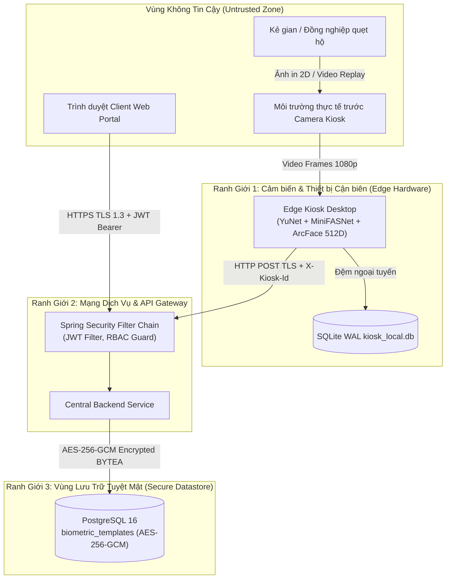

# STRIDE-A Threat Model: Enterprise Face Attendance System (FAS)

> **Document type:** Canonical Artifact Contract  
> **Artifact:** STRIDE-A Threat Model  
> **Primary Owner Skill:** `security-and-hardening`  
> **Canonical Destination Path:** `docs/security/threat-model-fas.md`  
> **Status:** Approved  
> **Last updated:** 2026-11-08  
> **Tuân thủ pháp lý:** Luật Bảo vệ dữ liệu cá nhân 2025 (Luật số 91/2025/QH15) & Nghị định 356/2025/NĐ-CP  

---

- **Hệ thống**: Enterprise Face Attendance System (FAS)
- **Phương pháp luận**: STRIDE-A (Spoofing, Tampering, Repudiation, Information Disclosure, Denial of Service, Elevation of Privilege, AI / Biometric-Specific)
- **Phạm vi kiểm thử**: Edge Kiosk (`app/kiosk-app`), Central Backend (`app/backend-service`), Web Portal (`app/web-portal`), Database (`PostgreSQL 16`), CSDL đệm (`SQLite WAL`).

---

## 1. System Scope & Data Flow Diagram (DFD) (Required)

### Trust Boundaries & Critical Assets
- **Trust Boundary 1 (Camera & Edge UI)**: Biên giới giữa môi trường vật lý trước camera và tiến trình Edge AI trên Kiosk. Tài sản cần bảo vệ: tính xác thực thực thể sống của người đứng trước camera.
- **Trust Boundary 2 (Network Ingress)**: Biên giới giữa Kiosk / Web Portal và API Backend. Tài sản cần bảo vệ: token phiên JWT, header bí mật `X-Kiosk-Id`, hợp đồng dữ liệu REST.
- **Trust Boundary 3 (Database Storage)**: Biên giới giữa máy chủ ứng dụng và CSDL PostgreSQL. Tài sản tuyệt mật: $3\times 512$ floats vector khuôn mặt, bảng lương công, nhật ký kiểm toán.

---

## 2. STRIDE-A Threat Analysis & Mitigations (Required)

| ID | Danh Mục (STRIDE-A) | Kịch Bản Tấn Công & Véc-tơ Đe Dọa | Mức Rủi Ro | Biện Pháp Phòng Vệ Kỹ Thuật Cụ Thể | Trạng Thái |
| :--- | :--- | :--- | :---: | :--- | :---: |
| `TM-001` | **Spoofing (Giả mạo Sinh trắc)** | Dùng ảnh chụp chân dung in màu A4 hoặc mở video smartphone/tablet giơ trước camera Kiosk để quẹt thẻ hộ. | **Rất Cao (High)** | Tích hợp mạng nơ-ron chống giả mạo **MiniFASNet** chạy song song với YuNet; đánh giá điểm sống $S_{\text{liveness}} \ge 0.85$ trên 2 vùng crop; phát hiện viền màn hình, phản chiếu và moiré pattern. Chặn thành công $\ge 98\%$. | **Mitigated** |
| `TM-002` | **Spoofing (Giả mạo Trạm Kiosk)** | Kẻ xấu can thiệp mạng nội bộ, giả mạo trạm Kiosk gửi bản ghi điểm danh rởm trực tiếp vào API Backend. | **Cao (High)** | Bắt buộc xác thực song song: Header định danh `X-Kiosk-Id` kết hợp mã ký bí mật `Kiosk-Secret-Key`; thẩm định IP nội bộ trong danh sách whitelist trạm. | **Mitigated** |
| `TM-003` | **Tampering (Sửa CSDL Cục bộ)** | Sửa đổi tệp `kiosk_local.db` để chèn thêm giờ điểm danh ảo khi trạm Kiosk đang mất kết nối mạng. | **Cao (High)** | Phân quyền NTFS/Linux hạn chế tuyệt đối quyền truy cập thư mục CSDL của Kiosk chỉ cho tài khoản dịch vụ; tính toán mã băm SHA-256 kiểm toán cho từng bản ghi ngoại tuyến. | **Mitigated** |
| `TM-004` | **Repudiation (Chối bỏ Trách nhiệm)** | Nhân viên đi muộn chối bỏ việc đã nhờ người khác bấm mã PIN hộ tại trạm Kiosk. | **Trung bình (Med)** | Ghi nhận chi tiết Audit Trail: Phương thức xác thực (`FACE` hay `PIN`), Kiosk ID, địa chỉ IP trạm, dấu thời gian máy chủ; đối chiếu camera an ninh vật lý nếu có tranh chấp. | **Mitigated** |
| `TM-005` | **Information Disclosure (Lộ Vector Khuôn mặt)** | Kẻ tấn công trích xuất bản sao lưu PostgreSQL, đảo ngược vector ArcFace 512D để tái tạo lại ảnh mặt nhân viên. | **Rất Cao (High)** | Áp dụng chính sách **Zero-Photo-Upload** (không lưu ảnh thô); mã hóa độc lập 100% vector bằng **AES-256-GCM** với IV 12 bytes ngẫu nhiên và Authentication Tag 16 bytes. Khóa master quản lý qua biến môi trường OS, không nằm trong CSDL. | **Mitigated** |
| `TM-006` | **Denial of Service (Làm nghẽn Trạm Kiosk)** | Một nhân viên đứng liên tục trước camera làm kích hoạt hàng trăm request điểm danh dồn dập trong 1 phút. | **Trung bình (Med)** | Kích hoạt cơ chế **Device Cooldown 120 giây** ngay tại máy trạng thái Kiosk Oval HUD; bổ sung bộ đệm Caffeine Cache Cooldown 120s tại tầng Backend để loại trừ request trùng lặp. | **Mitigated** |
| `TM-007` | **Elevation of Privilege (Vượt quyền Web)** | Nhân viên đổi `id` trên URL để xem bảng công của Giám đốc hoặc tự phê duyệt đơn giải trình công của mình. | **Rất Cao (High)** | Kiểm soát phân quyền nghiêm ngặt với Spring Security `@PreAuthorize("hasRole('HR_MANAGER')")` kết hợp kiểm tra quyền sở hữu bản ghi `record.employeeId == currentUserId`. | **Mitigated** |
| `TM-008` | **AI / Biometric Bias & Quality Degradation** | Nhân viên đăng ký khuôn mặt trong điều kiện thiếu sáng hoặc mờ nét khiến tỷ lệ nhận diện sai lệch. | **Cao (High)** | Bộ lọc kiểm định chất lượng tự động trước khi trích xuất vector: Độ nét Laplace Variance $\ge 30.0$, kích thước khuôn mặt tối thiểu $120\times 120\text{ px}$, góc nghiêng phải thỏa mãn ngưỡng Euler quy định. | **Mitigated** |
| `TM-009` | **Injection (CWE-1236 Formula Injection)** | Nhân viên đặt tên có chứa ký tự `=CMD|' /C ...'!A0` để khi HR xuất file Excel chấm công thì máy tính HR bị thực thi mã độc. | **Cao (High)** | Bọc khử độc tự động tầng Export: Mọi ô dữ liệu bắt đầu bằng các ký tự nguy hiểm (`=`, `+`, `-`, `@`, `\t`, `\r`) được tiền tố thêm dấu nháy đơn `'` an toàn trước khi ghi vào workbook Apache POI. | **Mitigated** |
| `TM-010` | **Compliance (Luật Bảo vệ Dữ liệu Cá nhân 2025)** | Giữ lại dữ liệu sinh trắc học của nhân viên đã nghỉ việc quá thời hạn pháp luật cho phép. | **Rất Cao (High)** | Thiết lập tác vụ ngầm định kỳ hàng ngày quét và **Hard Delete 100% vector khuôn mặt** sau đúng 20 ngày kể từ ngày nhân viên thôi việc; thực thi quyền rút Consent trong vòng 7 ngày. | **Mitigated** |

---

## 3. Security Requirements for Implementation (Required)

1. **Authentication & Token Lifecycle**:
   - Access Token JWT thời hạn 60 phút, ký bằng thuật toán HMAC-SHA256 hoặc RS256.
   - Refresh Token thời hạn 7 ngày, lưu trữ trong HTTP-Only Secure Cookie, kích hoạt cơ chế xoay vòng (Refresh Token Rotation).
2. **Secrets & Key Management**:
   - Khóa master mã hóa AES-256-GCM (`APP_ENCRYPTION_SECRET`) có độ dài đúng 256 bits (32 bytes), được cung cấp qua Docker Environment Variable hoặc Vault bí mật, tuyệt đối cấm commit vào git repo.
3. **Input Validation**:
   - 100% request payload phải được thẩm định qua Jakarta Bean Validation (`@NotNull`, `@Size`, `@Pattern`) tại tầng Controller theo hợp đồng [`contracts/openapi.yaml`](../../contracts/openapi.yaml).

