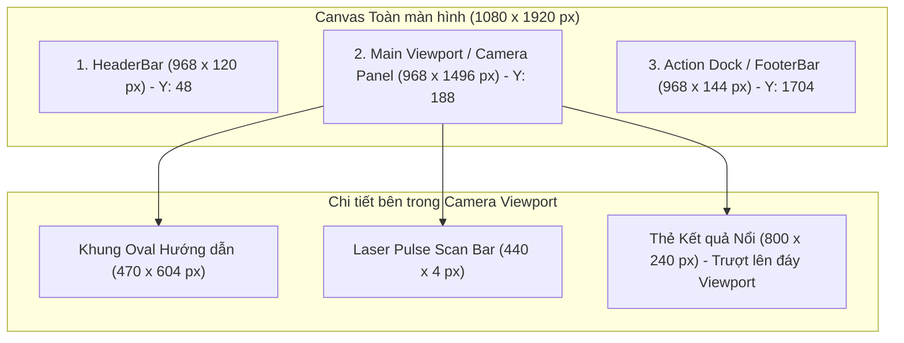

# UI/UX DESIGN — Thiết kế Chi tiết Giao diện Phân hệ Kiosk

## 1. Hệ thống Design Tokens & Định lượng Giao diện (Design Tokens)

### 1.1. Bảng Mã Màu Chuẩn (Color Tokens)

Toàn bộ giao diện trạm Kiosk áp dụng phong cách **Dark Theme Sang trọng (Modern Dark Glassmorphism)** kết hợp màu nhấn có độ tương phản cao:

| Tên Token Màu | Mã Màu Hex / RGBA | Vai trò & Mục đích Ứng dụng |
| :--- | :--- | :--- |
| `color_bg_canvas` | `#0B0F17` | Nền canvas toàn màn hình trạm Kiosk (Deep Dark Slate). |
| `color_surface_panel` | `#111827` | Nền các vùng panel camera và container chính. |
| `color_surface_glass` | `rgba(30, 41, 59, 0.85)` | Nền thẻ kết quả và modal với hiệu ứng kính mờ `backdrop-filter: blur(16px)`. |
| `color_border_subtle` | `rgba(255, 255, 255, 0.10)` | Đường viền mảnh $1\text{ px}$ ngăn cách các vùng giao diện. |
| `color_text_primary` | `#F8FAFC` | Màu văn bản chính, tiêu đề, họ tên nhân viên (Trắng tinh khiết). |
| `color_text_secondary` | `#94A3B8` | Màu văn bản phụ, chú thích, mã nhân viên, phòng ban. |
| `oval_standby` | `#64748B` | Màu viền khung Oval ở trạng thái chờ (Slate Gray). |
| `oval_aligning` | `#F59E0B` | Màu viền khung Oval khi đang căn chỉnh góc nhìn (Amber Orange). |
| `oval_success` | `#10B981` | Màu viền khung Oval khi nhận diện thành công (Emerald Green). |
| `oval_rejected` | `#EF4444` | Màu viền khung Oval khi từ chối / cảnh báo giả mạo (Rose Red). |
| `laser_pulse_scan` | `rgba(16, 185, 129, 0.65)` | Dải màu laser xanh ngọc phát sáng quét dọc khuôn mặt. |

### 1.2. Thang Typography Chuẩn (Typography Tokens)
* Phông chữ cơ sở: **Inter** (hoặc Roboto làm fallback hệ thống).
* Tiêu đề màn hình / Giờ kỹ thuật số: $36\text{ px}$ (Bold / Monospace).
* Họ tên nhân viên trên thẻ kết quả: $28\text{ px}$ (Semi-Bold).
* Tiêu đề Modal / Nút bấm chính: $22\text{ px}$ (Medium).
* Văn bản nội dung / Hướng dẫn: $16\text{ px}$ (Regular).
* Chú thích phụ / Ngày tháng: $14\text{ px}$ (Regular).

---

## 2. Công thức Tỷ lệ Co giãn Động (Dynamic Proportional Scaling)

Để hỗ trợ đa dạng chủng loại màn hình cảm ứng vật lý đặt tại các trạm Kiosk (từ $720 \times 1280\text{ px}$ HD, $1080 \times 1920\text{ px}$ Full HD đến $2160 \times 3840\text{ px}$ 4K Portrait):
* **Độ phân giải vector gốc thiết kế (Figma Baseline)**: $W_0 = 1080\text{ px}$, $H_0 = 1920\text{ px}$ (Tỷ lệ 9:16).
* **Hệ số co giãn tỷ lệ (Scale Factor $S$)**:
  $$S = \min\left(\frac{W_{\text{actual}}}{1080}, \frac{H_{\text{actual}}}{1920}\right)$$
* **Quy tắc tính toán tọa độ và kích thước trong QML**:
  * Bất kỳ kích thước nào ($width$, $height$, $radius$, $fontSize$, $spacing$) đều được nhân với $S$:
    $$\text{Dimension} = \text{Dimension}_{\text{base}} \times S$$
  * Toàn bộ khung hiển thị chính được căn giữa màn hình vật lý với lề bù $X_{\text{offset}} = (W_{\text{actual}} - 1080 \times S) / 2$ và $Y_{\text{offset}} = (H_{\text{actual}} - 1920 \times S) / 2$.

---

## 3. Thiết kế Thông số Hình học Vector Chi tiết (Figma-Extracted Geometry)

Toàn bộ bố cục màn hình chính trạm Kiosk được phân chia theo chiều dọc thành 3 phân vùng chính lọt lòng trong lưới biên an toàn ($X_{\text{margin}} = 56\text{ px}$):

### 3.1. Phân vùng 1: Thanh Tiêu đề `HeaderBar`
* **Vị trí & Kích thước**: Tọa độ $(X = 56\text{ px}, Y = 48\text{ px})$, Kích thước $968 \times 120\text{ px}$, Bo góc $16\text{ px}$.
* **Thành phần con**:
  * **Cụm Thương hiệu (Bên trái)**:
    * Logo Icon: $48 \times 48\text{ px}$.
    * Tên hệ thống: "FAS KIOSK" (Font $24\text{ px}$, Semi-Bold, `#F8FAFC`).
  * **Đồng hồ Kỹ thuật số Thời gian thực (Chính giữa)**:
    * Giờ phút giây: `HH:mm:ss` (Font $36\text{ px}$, Bold Monospace, `#F8FAFC`).
    * Ngày tháng: `Thứ X, DD/MM/YYYY` (Font $16\text{ px}$, `#94A3B8`).
  * **Huy hiệu Trạng thái Trạm (Bên phải)**:
    * Kích thước: $160 \times 48\text{ px}$, Bo tròn $24\text{ px}$, Nền `rgba(255, 255, 255, 0.05)`.
    * Đèn trạng thái tròn đường kính $12\text{ px}$: Xanh lá `#10B981` (Online) hoặc Vàng hổ phách `#F59E0B` (Offline Queue).
    * Nhãn văn bản: Mã trạm `KIOSK-HN-01`.

---

### 3.2. Phân vùng 2: Khung nhìn Camera Chính `PortraitCameraPanel`
* **Vị trí & Kích thước**: Tọa độ $(X = 56\text{ px}, Y = 188\text{ px})$, Kích thước $968 \times 1496\text{ px}$, Bo góc $24\text{ px}$, Tràn viền luồng video camera tỷ lệ 9:16.
* **Khung Oval Hướng dẫn Căn mặt**:
  * **Hình học**: Hình elip vector có Chiều rộng $470\text{ px}$, Chiều cao $604\text{ px}$, Tọa độ tâm $(X = 484\text{ px}, Y = 748\text{ px})$ so với Camera Panel.
  * **Đặc tả nét vẽ viền**:
    * Độ dày đường viền: $3\text{ px}$ (Trạng thái Chờ), $4\text{ px}$ (Căn chỉnh), $5\text{ px}$ (Thành công / Từ chối).
    * Bán kính trục ngang: $r_x = 235\text{ px}$; Bán kính trục dọc: $r_y = 302\text{ px}$.
  * **Hiệu ứng Quét Sóng Laser Pulse Scan**:
    * Thanh laser kích thước $440 \times 4\text{ px}$, dải màu gradient xuyên tâm `#10B981` phát sáng độ mờ $12\text{ px}$.
    * Quét tịnh tiến dọc từ đỉnh Oval ($Y = 446\text{ px}$) xuống đáy Oval ($Y = 1050\text{ px}$) trong chu kỳ $1.2\text{ s}$ khi đạt trạng thái nhận diện.
* **Thẻ Kết quả Nổi `ResultCard` (Popup Slide-up)**:
  * **Vị trí**: Nằm ở đáy Camera Viewport, căn giữa theo trục hoành $(X = 84\text{ px}, Y = 1200\text{ px})$.
  * **Kích thước**: $800 \times 240\text{ px}$, Bo góc $20\text{ px}$, Viền kính $1\text{ px solid rgba(255,255,255,0.15)}$.
  * **Bố cục bên trong**:
    * Avatar / Icon nhân viên: Kích thước $100 \times 100\text{ px}$, bo tròn hoàn hảo $50\text{ px}$, viền xanh $3\text{ px}$.
    * Họ và tên: Font $28\text{ px}$, Bold, Màu `#F8FAFC`.
    * Mã nhân viên & Phòng ban: Font $16\text{ px}$, Màu `#94A3B8`.
    * Thời điểm quẹt: `08:29:45` (Font $22\text{ px}$, Bold, `#10B981`).
    * Huy hiệu trạng thái: Kích thước $120 \times 36\text{ px}$, bo góc $8\text{ px}$, nền xanh ngọc `rgba(16, 185, 129, 0.2)` với chữ "Đúng giờ" (hoặc nền hổ phách "Đi muộn").
  * **Hành vi Hoạt họa**: Trượt từ dưới lên (Spring Animation $400\text{ ms}$), cố định $2.5\text{ s}$, sau đó trượt mờ xuống dưới đáy ($300\text{ ms}$).

---

### 3.3. Phân vùng 3: Thanh Nút Bấm Tương tác `ActionDock`
* **Vị trí & Kích thước**: Tọa độ $(X = 56\text{ px}, Y = 1704\text{ px})$, Kích thước $968 \times 144\text{ px}$, Căn đều các nút cảm ứng lớn.
* **Chi tiết Các Nút Bấm Cảm ứng**:
  * **Nút F2 — "Xác thực Mã PIN"**:
    * Kích thước: $468 \times 96\text{ px}$, Bo góc $16\text{ px}$.
    * Nền: `#1E293B`, Viền $1\text{ px solid rgba(255,255,255,0.1)}$.
    * Icon bàn phím số $32 \times 32\text{ px}$ + Nhãn chữ "Nhập mã PIN (F2)" (Font $20\text{ px}$, Medium).
  * **Nút F3 — "Đăng ký Khuôn mặt"**:
    * Kích thước: $468 \times 96\text{ px}$, Bo góc $16\text{ px}$.
    * Nền: `#1E293B`, Viền $1\text{ px solid rgba(255,255,255,0.1)}$.
    * Icon khuôn mặt $32 \times 32\text{ px}$ + Nhãn chữ "Đăng ký mặt (F3)" (Font $20\text{ px}$, Medium).
  * **Phản hồi Chạm (Touch State)**: Khi người dùng chạm ngón tay, nút hạ tỷ lệ co $0.98$, nền sáng lên `#334155` trong $150\text{ ms}$.

---

## 4. Thiết kế Chi tiết 3 Hộp thoại Lớp Phủ (Modals & Dialogs Geometry)

Khi modal kích hoạt, một lớp phủ bán trong suốt (Backdrop Overlay) màu `#000000` với độ mờ $65\%$ kèm hiệu ứng `blur(12px)` sẽ phủ kín toàn bộ màn hình Kiosk.

### 4.1. Hộp thoại Bàn phím Số ảo `PinPadModal`
* **Kích thước & Vị trí**: $720 \times 880\text{ px}$, Căn chính giữa màn hình $(X = 180\text{ px}, Y = 520\text{ px})$, Bo góc $24\text{ px}$, Nền `#1E293B`.
* **Cấu trúc Bên trong**:
  * Tiêu đề: "Nhập Mã PIN Cá Nhân" (Font $24\text{ px}$, Bold, Căn giữa).
  * Hàng chỉ báo 6 chấm tròn PIN: Mỗi chấm tròn đường kính $18\text{ px}$, khoảng cách $20\text{ px}$. Trạng thái rỗng viền xám `#475569`, đã nhập chuyển sang xanh ngọc rực sáng `#10B981`.
  * Lưới Bàn phím Cảm ứng $3 \times 4$:
    * Gồm 12 phím bấm tròn kích thước đường kính $88 \times 88\text{ px}$.
    * Các phím số từ $1$ đến $9$ (Hàng 1-3).
    * Hàng 4: Phím "Xóa lùi" ($\leftarrow$), Phím số $0$, Phím "Hủy" $(\times)$.
    * Phông chữ số trong phím: Font $32\text{ px}$, Bold.

### 4.2. Hộp thoại Đăng ký Mẫu In-Viewport `EnrollmentModal`
* **Kích thước & Vị trí**: $800 \times 960\text{ px}$, Căn chính giữa màn hình $(X = 140\text{ px}, Y = 480\text{ px})$, Bo góc $24\text{ px}$, Nền `#1E293B`.
* **Quy trình 3 Bước Đặc thù**:
  * **Bước 1**: Nhập OTP 6 số xác thực. Ô nhập mã lớn font $40\text{ px}$, nút bấm "Xác nhận OTP".
  * **Bước 2 (Chụp mẫu In-Viewport)**: Modal chuyển thuộc tính `opacity: 0.0` và `visible: false` để nhường toàn bộ màn hình cho luồng camera chính. Khung Oval chính đổi sang màu hổ phách kèm dòng chữ: "Kiosk đang chụp mẫu 3 góc nhìn... Giữ yên khuôn mặt". Một thanh tiến trình hình viên thuốc $300 \times 32\text{ px}$ gắn ở đỉnh camera hiển thị bước thu mẫu $1/3 \rightarrow 2/3 \rightarrow 3/3$.
  * **Bước 3**: Khi hoàn tất nạp 3 ảnh, modal tự động hiện lại (`opacity: 1.0`) với hình ảnh chân dung đã duyệt, thông báo "Kích hoạt khuôn mặt thành công!" và nút "Đóng".

### 4.3. Hộp thoại Trợ giúp & Hướng dẫn `HelpModal`
* **Kích thước & Vị trí**: $800 \times 960\text{ px}$, Căn chính giữa màn hình, Bo góc $24\text{ px}$, Nền `#1E293B`.
* **Nội dung Trực quan**:
  * Minh họa 3 hình ảnh tư thế đúng (Đứng thẳng, khoảng cách $0.8\text{ m}$, không che mắt/mũi).
  * Minh họa các lỗi phổ biến (Quá gần, quá xa, ngược sáng mạnh).
  * Thông tin đường dây nóng IT Support & Nút "Tôi đã hiểu".
