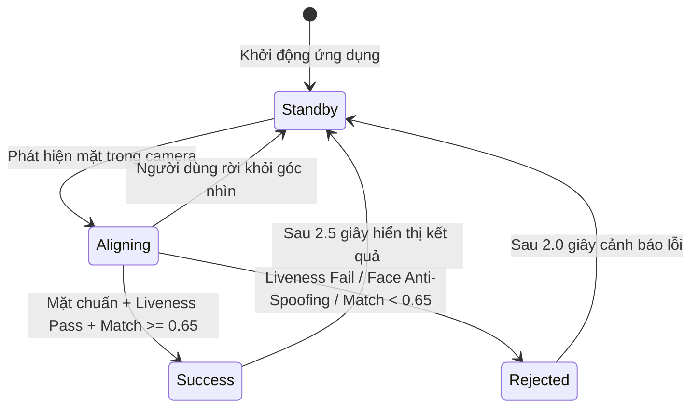

# UI/UX SPECS — Đặc tả Giao diện & Trải nghiệm Phân hệ Kiosk

## 1. Hành trình Trải nghiệm Người dùng (User Journeys & Tasks)

### `UI-KSK-001` — Hành trình Điểm danh Khuôn mặt Siêu tốc (Fast Face Attendance)
* **Đối tượng**: Cán bộ nhân viên chấm công hàng ngày tại cổng ra vào văn phòng.
* **Thời lượng mục tiêu**: $\le 1.0\text{ s}$ từ khi bước vào tầm ngắm đến khi nhận thông báo thành công.
* **Luồng tương tác**:
  1. Người dùng bước tới trước trạm Kiosk ở khoảng cách $0.6 - 1.2\text{ m}$.
  2. Người dùng nhìn thẳng vào khung Oval ở trung tâm màn hình.
  3. Khung Oval chuyển từ viền Xám (Chờ) sang Vàng (Căn chỉnh) nếu vị trí chưa chuẩn, hoặc trực tiếp sang Xanh lá kèm quét sóng Pulse Scan khi đạt chuẩn góc nhìn và độ sắc nét.
  4. Trạm Kiosk phát âm thanh "Tít" ngắn ($100\text{ ms}, 880\text{ Hz}$).
  5. Thẻ kết quả nổi (Result Card) trượt lên hiển thị: Họ tên, Mã nhân viên, Ảnh nhận diện, Giờ chấm công và huy hiệu "Đúng giờ".
  6. Thẻ tự động ẩn sau $2.5\text{ s}$; màn hình trở về trạng thái chờ sẵn sàng đón lượt quẹt tiếp theo.

---

### `UI-KSK-002` — Hành trình Điểm danh Bằng Mã PIN Dự phòng (PIN Backup Punch)
* **Đối tượng**: Nhân viên gặp sự cố y tế (băng bó vết thương mặt), ánh sáng môi trường quá bất lợi hoặc hệ thống camera gặp trục trặc kỹ thuật.
* **Luồng tương tác**:
  1. Người dùng nhấn nút cảm ứng "Nhập mã PIN (F2)" trên Dock điều khiển (hoặc nhấn phím F2).
  2. Hộp thoại PIN Pad Modal mở ra ở trung tâm màn hình, làm mờ hậu cảnh ($16\text{ px}$ blur).
  3. Người dùng chạm các nút số lớn ($88 \times 88\text{ px}$) để nhập 6 chữ số cá nhân. Mỗi lần chạm phát phản hồi đổi màu nút và hiển thị chấm tròn bảo mật.
  4. Sau khi nhập đủ 6 số, hệ thống tự động kiểm tra mã hash PIN trong CSDL SQLite cục bộ:
     * *Đúng*: Khung modal đóng lại, phát tiếng "Tít" thành công, thẻ kết quả nổi xuất hiện $2.5\text{ s}$.
     * *Sai*: Hiển thị dòng chữ cảnh báo đỏ "Mã PIN không chính xác (Còn lại X lần thử)", rung lắc modal nhẹ trong $300\text{ ms}$. Khóa chức năng PIN trong $15\text{ phút}$ nếu nhập sai quá 5 lần liên tiếp.

---

### `UI-KSK-003` — Hành trình Tự Kích hoạt & Đăng ký Khuôn mặt In-Viewport (3-Step Enrollment)
* **Đối tượng**: Nhân viên mới gia nhập công ty hoặc nhân viên cần cập nhật lại diện mạo.
* **Luồng tương tác**:
  1. Người dùng nhấn nút "Đăng ký khuôn mặt (F3)" trên trạm Kiosk.
  2. **Bước 1 (Xác thực OTP)**: Modal hiển thị ô nhập mã OTP 6 số do HR hoặc Cổng thông tin Web cung cấp. Người dùng nhập mã $\rightarrow$ Kiosk gọi `POST /api/v1/kiosk/verify-otp`.
  3. **Bước 2 (Thu thập Mẫu In-Viewport)**: Modal đăng ký tạm thời **tự động ẩn hoàn toàn (Opacity = 0)** để nhường trọn vẹn không gian hiển thị cho camera chính và khung Oval lớn.
     * Màn hình hiển thị hướng dẫn: "Vui lòng giữ thẳng mặt, Kiosk đang chụp 3 ảnh chất lượng cao".
     * Thanh tiến trình hiển thị $1/3 \rightarrow 2/3 \rightarrow 3/3$.
     * Khung hình chỉ được chụp khi đạt đồng thời các tiêu chuẩn: Độ phân giải mặt $\ge 112\times 112\text{ px}$, góc nghiêng $\le 15^\circ$, độ mờ nét Laplacian $\ge 100$, không nhắm mắt.
  4. **Bước 3 (Xác nhận & Hoàn tất)**: Modal tự động hiện lại; hiển thị thông báo "Đăng ký thành công!", ảnh chân dung đã lưu và nút "Hoàn tất". Kiosk tự nạp vector mới vào RAM ngay lập tức.

---

## 2. Máy Trạng thái Khung Oval (Oval State Machine & Feedback)

Khung Oval là tâm điểm thị giác định hướng hành vi của người dùng tại Kiosk, sở hữu 4 trạng thái tương tác độc lập:

| Mã Trạng thái | Tên Trạng thái | Màu Viền & Độ Dày | Hiệu ứng Hoạt họa (Animation) | Chỉ báo Văn bản (Badge Banner) | Phản hồi Âm thanh |
| :--- | :--- | :--- | :--- | :--- | :--- |
| `UI-KSK-004` | **Chờ (Standby)** | `#64748B` (Xám Slate) Nét đứt $3\text{ px}$ | Xoay nhẹ hoặc tĩnh lặng tiết kiệm năng lượng | "Vui lòng nhìn thẳng vào khung oval" | Không phát âm thanh |
| `UI-KSK-005` | **Căn chỉnh (Aligning)** | `#F59E0B` (Vàng Hổ phách) Nét liền $4\text{ px}$ | Đường viền sáng mạch lạc, thở nhẹ (Glow breathing) | Thay đổi linh hoạt theo lỗi tư thế: • "Đến gần hơn một chút" • "Lùi ra xa một chút" • "Nghiêng đầu thẳng lại" • "Vui lòng bỏ khẩu trang/kính râm" | Không phát âm thanh |
| `UI-KSK-006` | **Thành công (Success)** | `#10B981` (Xanh Emerald) Nét liền $5\text{ px}$ | **Pulse Scan**: Tia sáng laser xanh quét dọc từ trên xuống dưới khung Oval | "Nhận diện thành công!" kèm tên nhân viên | Phát tiếng "Tít" trong trẻo $880\text{ Hz}$ ($100\text{ ms}$) |
| `UI-KSK-007` | **Từ chối (Rejected)** | `#EF4444` (Đỏ Cảnh báo) Nét liền $5\text{ px}$ | **Shake Animation**: Khung Oval rung lắc nhẹ theo trục hoành trong $300\text{ ms}$ | "Ảnh không hợp lệ / Giả mạo" hoặc "Không tìm thấy hồ sơ nhân viên" | Phát 2 tiếng "Bíp - Bíp" trầm $300\text{ Hz}$ |

---

## 3. Quy chuẩn Khả năng Tiếp cận & Trải nghiệm Cảm ứng (Accessibility & Touch Standards)

1. **Kích thước Điểm Chạm (Hit Target)**:
   * Toàn bộ các nút bấm cảm ứng trên màn hình chính và trong modal có kích thước vật lý tối thiểu $\ge 48 \times 48\text{ px}$, khuyến nghị $88 \times 88\text{ px}$ đối với phím số PIN Pad.
   * Khoảng cách tối thiểu giữa hai điểm chạm lân cận: $\ge 16\text{ px}$ nhằm triệt tiêu hiện tượng chạm nhầm.
2. **Độ tương phản Thị giác (Visual Contrast)**:
   * Tỷ lệ tương phản chữ trên nền đạt chuẩn WCAG 2.1 AA tối thiểu $4.5:1$ đối với văn bản thông thường và $3:1$ đối với văn bản kích thước lớn ($\ge 24\text{ px}$).
3. **Phím tắt Phần cứng (Hardware Hotkeys)**:
   * Kiosk hỗ trợ đồng thời màn hình cảm ứng và bàn phím vật lý/bàn phím số gắn ngoài:
     * Phím `F2`: Mở/Đóng hộp thoại PIN Pad.
     * Phím `F3`: Mở/Đóng hộp thoại Đăng ký Khuôn mặt.
     * Phím `Esc`: Đóng toàn bộ các modal đang hiển thị, quay về màn hình camera chính.
