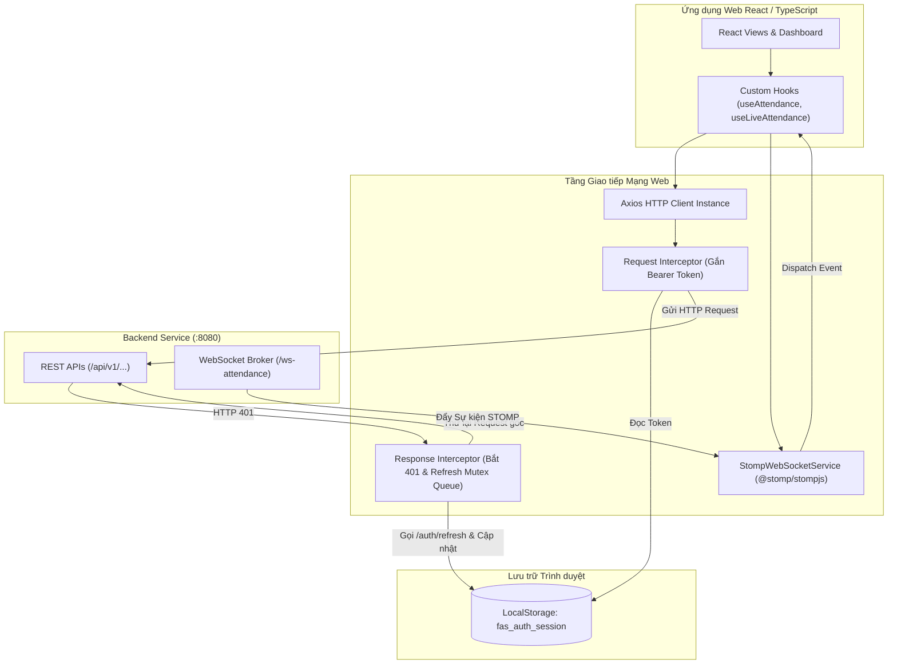

# API DESIGN — Thiết kế Giao diện Truyền thông Phân hệ Web Portal


## 1. Kiến trúc Máy trạm Mạng Web Portal (Network Clients Architecture)



| ID | Name | Definition | Realizes | Uses | Decisions | Status |
| :--- | :--- | :--- | :--- | :--- | :---: | :---: |
| `APD-WEB-001` | ApiClient | Đóng gói thư viện `axios` với baseURL `VITE_API_BASE_URL`, timeout $10.0\text{ s}$; cấu hình bộ chặn Request Interceptor tự động gán Bearer Token. | `API-WEB-001` đến `API-WEB-006` | `ARC-003` | `DD-SYS-001` | Accepted |
| `APD-WEB-002` | TokenRefreshInterceptor | Bộ chặn Response Interceptor bắt mã HTTP 401, tạm hoãn các request song song vào Promise Queue, gọi `POST /auth/refresh` bằng Refresh Token; sau khi có token mới giải phóng hàng đợi và retry requests. | `API-WEB-002` | `ARC-003` | `DD-SYS-001` | Accepted |
| `APD-WEB-003` | StompWebSocketService | Quản lý kết nối STOMP over WebSocket (SockJS fallback) tới `/ws-attendance`, tự động kết nối lại khi mất mạng (Exponential Backoff); cung cấp các hàm subscribe/unsubscribe an toàn. | `API-WEB-007`, `API-WEB-008` | `ARC-003` | `DD-SYS-004` | Accepted |
| `APD-WEB-004` | AdminEmployeeService | Bọc các giao diện quản lý hồ sơ nhân sự (`/admin/employees`): tạo/sửa/vô hiệu hóa và cấp lại mật khẩu tạm; chuẩn hoá lỗi 409 về từng trường và không cache mật khẩu tạm. | `API-WEB-009`, `API-WEB-010` | `ARC-003` | `DD-SYS-001` | Accepted |
| `APD-WEB-005` | ShiftAdminService | Bọc giao diện quản lý ca và phân ca (`/admin/shifts`, `/admin/employee-shifts`); diễn giải lỗi 409 chồng lấn thành dữ liệu gợi ý khoảng trống cho UI. | `API-WEB-011` | `ARC-003` | `DD-SYS-001` | Accepted |
| `APD-WEB-006` | CredentialService | Bọc giao diện đổi mật khẩu, thiết lập PIN và đặt lại PIN; phát tín hiệu toàn cục khi gặp HTTP 403 `PASSWORD_CHANGE_REQUIRED` để chặn điều hướng. | `API-WEB-012` | `ARC-003` | `DD-SYS-001` | Accepted |
| `APD-WEB-007` | PayrollPeriodService | Bọc giao diện kỳ công (`/admin/payroll-periods`): liệt kê, chốt và mở lại; invalidate cache kỳ công sau mỗi thay đổi trạng thái. | `API-WEB-013` | `ARC-003` | `DD-SYS-004` | Accepted |
| `APD-WEB-008` | DataSubjectService | Bọc giao diện rút Consent và yêu cầu dữ liệu cá nhân (`/employee/consent/withdraw`, `/employee/data-requests`, `/dpo/data-requests`); phân quyền hiển thị theo role. | `API-WEB-014` | `ARC-003` | `DD-SYS-003` | Accepted |
| `APD-WEB-009` | LogoutService | Bọc `POST /auth/logout`, xoá storage sau khi API trả 204 và phát sự kiện đăng xuất để đồng bộ đa tab. | `API-WEB-015` | `ARC-003` | `DD-SYS-003` | Accepted |
| `APD-WEB-010` | NotificationService | Bọc giao diện thông báo (`/notifications`): lấy danh sách, đếm chưa đọc và đánh dấu đã đọc; cập nhật lạc quan (optimistic) khi đánh dấu. | `API-WEB-016` | `ARC-003` | `DD-SYS-004` | Accepted |
| `APD-WEB-011` | ComplianceAdminService | Bọc giao diện tra cứu audit, quản lý trạm Kiosk và dữ liệu tuân thủ (`/admin/audit-logs`, `/admin/kiosks/**`, `/dpo/**`); chỉ đọc với role `DPO`. | `API-WEB-017` | `ARC-003` | `DD-SYS-001` | Accepted |
| `APD-WEB-012` | ReportExportService | Bọc giao diện kết xuất báo cáo (`/admin/reports/export`) và trả về blob tải xuống kèm tên tệp theo kỳ được chọn. | `API-WEB-018` | `ARC-003` | `DD-SYS-001` | Accepted |

---

## 2. Hợp đồng Chi tiết Từng Endpoint REST (Field-by-Field Contracts)

### 2.1. `POST /api/v1/auth/login` — Xác thực Đăng nhập
* **Mục đích**: Tiếp nhận email/mật khẩu, cấp cặp token xác thực và thông tin người dùng.
* **Request Payload Schema (JSON)**:
  | Tên Trường | Kiểu Dữ liệu | Bắt buộc | Ràng buộc Giá trị | Mô tả Chi tiết |
  | :--- | :--- | :---: | :--- | :--- |
  | `email` | `string` | Có | Định dạng email chuẩn | Email doanh nghiệp (`dung.nv@company.com`). |
  | `password` | `string` | Có | Độ dài $\ge 8$ ký tự | Mật khẩu tài khoản văn bản rõ. |

  *Ví dụ Request Payload:*
  ```json
  {
    "email": "dung.nv@company.com",
    "password": "Password@123"
  }
  ```

* **Response Payload (200 OK)**:
  ```json
  {
    "success": true,
    "code": "AUTH_SUCCESS",
    "message": "Đăng nhập thành công",
    "data": {
      "accessToken": "eyJhbGciOiJIUzI1NiIsInR5cCI6IkpXVCJ9...",
      "refreshToken": "d8f4c2e1-9b7a-4c3d-8e5f-1a2b3c4d5e6f",
      "tokenType": "Bearer",
      "expiresIn": 3600,
      "user": {
        "id": 1042,
        "employeeCode": "NV-1042",
        "fullName": "Ngô Văn Dũng",
        "email": "dung.nv@company.com",
        "role": "EMPLOYEE",
        "status": "PENDING_CONSENT",
        "department": "Phòng Kỹ thuật",
        "hasBiometric": false,
        "hasPin": false
      }
    },
    "timestamp": "2026-10-03T08:30:00.120+07:00"
  }
  ```

* **Xử lý Điều hướng Client sau Đăng nhập**:
  * Nếu `user.status === 'PENDING_CONSENT'`: Tự động kích hoạt Modal Ký cam kết dữ liệu sinh trắc học.
  * Nếu `user.role === 'HR_MANAGER' || user.role === 'ADMIN'`: Điều hướng tới Dashboard Quản trị (`/admin/dashboard`).
  * Nếu `user.role === 'EMPLOYEE'`: Điều hướng tới Trang Cá nhân Nhân viên (`/employee/profile`).

---

### 2.2. `POST /api/v1/auth/refresh` — Làm mới Access Token
* **Request Payload Schema (JSON)**:
  ```json
  {
    "refreshToken": "d8f4c2e1-9b7a-4c3d-8e5f-1a2b3c4d5e6f"
  }
  ```
* **Response Payload (200 OK)**:
  ```json
  {
    "success": true,
    "code": "TOKEN_REFRESHED",
    "message": "Cấp phát token mới thành công",
    "data": {
      "accessToken": "eyJhbGciOiJIUzI1NiIsInR5cCI6IkpXVCJ9...",
      "refreshToken": "f1e2d3c4-b5a6-7890-1234-56789abcdef0",
      "tokenType": "Bearer",
      "expiresIn": 3600
    },
    "timestamp": "2026-10-03T09:30:00.050+07:00"
  }
  ```

---

### 2.3. `POST /api/v1/employee/consent` — Ký Cam kết Sinh trắc & Nhận OTP
* **Headers**: `Authorization: Bearer <accessToken>`
* **Request Payload**:
  ```json
  {
    "agreed": true,
    "consentTimestamp": "2026-10-03T08:32:15.000+07:00"
  }
  ```
* **Response Payload (200 OK)**:
  ```json
  {
    "success": true,
    "code": "CONSENT_ACCEPTED",
    "message": "Tiếp nhận cam kết thành công. Vui lòng đến trạm Kiosk để quét mặt.",
    "data": {
      "otp": "839201",
      "qrCodeData": "otp:839201;emp:NV-1042;exp:2026-10-05T08:32:15.000+07:00",
      "expiresAt": "2026-10-05T08:32:15.000+07:00",
      "kioskLocations": [
        "Sảnh Lễ tân Tầng 1 - KIOSK-HN-01",
        "Khu vực Căn tin Tầng 3 - KIOSK-HN-02"
      ]
    },
    "timestamp": "2026-10-03T08:32:15.150+07:00"
  }
  ```

---

### 2.4. `GET /api/v1/admin/attendance` — Tra cứu Lịch sử Điểm danh Toàn công ty
* **Query Params**: `page=0&size=20&fromDate=2026-10-01&toDate=2026-10-03&status=ON_TIME`
* **Response Payload (200 OK)**:
  ```json
  {
    "success": true,
    "code": "ATTENDANCE_QUERY_SUCCESS",
    "message": "Truy vấn danh sách điểm danh thành công",
    "data": {
      "content": [
        {
          "recordId": 98231,
          "employeeId": 1042,
          "employeeCode": "NV-1042",
          "fullName": "Ngô Văn Dũng",
          "department": "Phòng Kỹ thuật",
          "punchTimestamp": "2026-10-03T08:29:45.120+07:00",
          "punchType": "CHECK_IN",
          "verificationMethod": "VERIFICATION_FACE",
          "status": "ON_TIME",
          "lateMinutes": 0,
          "kioskId": "KIOSK-HN-01"
        }
      ],
      "page": 0,
      "size": 20,
      "totalElements": 1,
      "totalPages": 1,
      "first": true,
      "last": true
    },
    "timestamp": "2026-10-03T09:00:00.080+07:00"
  }
  ```

---

### 2.5. `GET /api/v1/employee/attendance` — Bảng Công Cá nhân Nhân viên
* **Query Params**: `month=10&year=2026`
* **Response Payload (200 OK)**:
  ```json
  {
    "success": true,
    "code": "PERSONAL_ATTENDANCE_FETCHED",
    "message": "Lấy bảng công cá nhân thành công",
    "data": {
      "month": 10,
      "year": 2026,
      "totalWorkDays": 3,
      "totalOnTimeDays": 3,
      "totalLateDays": 0,
      "records": [
        {
          "date": "2026-10-03",
          "checkInTime": "08:29:45",
          "checkOutTime": "17:35:10",
          "status": "ON_TIME",
          "workHours": 8.0,
          "lateMinutes": 0
        }
      ]
    },
    "timestamp": "2026-10-03T09:05:00.030+07:00"
  }
  ```

---

### 2.6. `GET /api/v1/admin/employees` — Danh mục Hồ sơ Nhân sự
* **Query Params**: `page=0&size=20&department=Phòng Kỹ thuật`
* **Response Payload (200 OK)**:
  ```json
  {
    "success": true,
    "code": "EMPLOYEE_LIST_FETCHED",
    "message": "Lấy danh sách nhân viên thành công",
    "data": {
      "content": [
        {
          "id": 1042,
          "employeeCode": "NV-1042",
          "fullName": "Ngô Văn Dũng",
          "email": "dung.nv@company.com",
          "department": "Phòng Kỹ thuật",
          "role": "EMPLOYEE",
          "status": "ACTIVE",
          "hasBiometric": true,
          "hasPin": true,
          "createdAt": "2026-09-15T09:00:00+07:00"
        }
      ],
      "page": 0,
      "size": 20,
      "totalElements": 1,
      "totalPages": 1
    },
    "timestamp": "2026-10-03T09:10:00.050+07:00"
  }
  ```

---

## 3. Thiết kế Cơ chế Token Refresh Chống Race Condition

Khi người dùng mở một trang Dashboard phức tạp gồm 4 component cùng lúc thực hiện gọi API:
* Cả 4 requests đều nhận phản hồi HTTP 401 nếu Access Token vừa hết hạn.
* Để tránh việc trình duyệt bắn ra 4 requests `/auth/refresh` song song gây vô hiệu hóa Refresh Token (do cơ chế xoay vòng Refresh Token Rotation):

```typescript
let isRefreshing = false;
let failedQueue: Array<{
  resolve: (token: string) => void;
  reject: (error: unknown) => void;
}> = [];

const processQueue = (error: unknown, token: string | null = null) => {
  failedQueue.forEach((prom) => {
    if (error) {
      prom.reject(error);
    } else {
      prom.resolve(token!);
    }
  });
  failedQueue = [];
};

// Trong Axios Response Interceptor:
axiosInstance.interceptors.response.use(
  (response) => response,
  async (error) => {
    const originalRequest = error.config;
    if (error.response?.status === 401 && !originalRequest._retry) {
      if (isRefreshing) {
        // Nếu đang có 1 request refresh chạy, đẩy request hiện tại vào hàng đợi chờ
        return new Promise((resolve, reject) => {
          failedQueue.push({ resolve, reject });
        }).then((token) => {
          originalRequest.headers.Authorization = `Bearer ${token}`;
          return axiosInstance(originalRequest);
        });
      }

      originalRequest._retry = true;
      isRefreshing = true;

      try {
        const { refreshToken } = getStoredAuthSession();
        const res = await axios.post('/api/v1/auth/refresh', { refreshToken });
        const newAccessToken = res.data.data.accessToken;
        
        updateStoredAccessToken(newAccessToken, res.data.data.refreshToken);
        processQueue(null, newAccessToken);

        originalRequest.headers.Authorization = `Bearer ${newAccessToken}`;
        return axiosInstance(originalRequest);
      } catch (refreshErr) {
        processQueue(refreshErr, null);
        clearAuthSessionAndRedirectLogin();
        return Promise.reject(refreshErr);
      } finally {
        isRefreshing = false;
      }
    }
    return Promise.reject(error);
  }
);
```

---

## 4. Thiết kế Kênh WebSocket STOMP & Custom React Hooks

### 4.1. Hợp đồng Thông điệp STOMP (STOMP Events Contract)

#### Topic `/topic/live-attendance` — Đẩy Kết quả Chấm công:
```json
{
  "eventType": "ATTENDANCE_PUNCHED",
  "recordId": 98231,
  "employeeId": 1042,
  "employeeCode": "NV-1042",
  "fullName": "Ngô Văn Dũng",
  "department": "Phòng Kỹ thuật",
  "punchTimestamp": "2026-10-03T08:29:45.120+07:00",
  "punchType": "CHECK_IN",
  "verificationMethod": "VERIFICATION_FACE",
  "status": "ON_TIME",
  "lateMinutes": 0,
  "kioskId": "KIOSK-HN-01"
}
```

#### Topic `/topic/enrollment/{otp}` — Thông báo Hoàn tất Kích hoạt:
```json
{
  "status": "ENROLLMENT_SUCCESS",
  "otp": "839201",
  "employeeId": 1042,
  "message": "Khuôn mặt đã được quét và kích hoạt thành công trên trạm KIOSK-HN-01",
  "activatedAt": "2026-10-03T08:41:05.320+07:00"
}
```

### 4.2. Thiết kế Custom Hook `useLiveAttendance`
```typescript
export function useLiveAttendance() {
  const [latestEvents, setLatestEvents] = useState<AttendanceRecord[]>([]);

  useEffect(() => {
    const subscription = stompClientService.subscribe('/topic/live-attendance', (message) => {
      const event: AttendanceRecord = JSON.parse(message.body);
      
      // Chèn lên đầu danh sách hiển thị
      setLatestEvents((prev) => [event, ...prev.slice(0, 49)]);

      // Cập nhật Cache TanStack Query
      handleLiveAttendanceEvent(event);
    });

    return () => {
      subscription.unsubscribe();
    };
  }, []);

  return { latestEvents };
}
```
