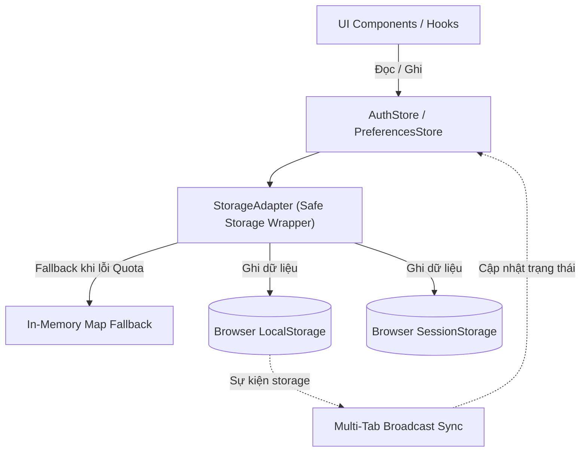

# DATA DESIGN — Thiết kế Lược đồ Trạng thái & Lưu trữ Client Web Portal


## 1. Mô hình Kiểu Dữ liệu Client (TypeScript Data Contracts)

### 1.1. Kiểu Dữ liệu Phiên Đăng nhập & Người dùng
```typescript
export type UserRole = 'HR_MANAGER' | 'EMPLOYEE' | 'ADMIN';
export type UserStatus = 'PENDING_CONSENT' | 'ACTIVE' | 'INACTIVE';

export interface UserProfile {
  readonly id: number;
  readonly employeeCode: string;
  readonly fullName: string;
  readonly email: string;
  readonly role: UserRole;
  readonly status: UserStatus;
  readonly department: string;
  readonly hasBiometric: boolean;
  readonly hasPin: boolean;
}

export interface AuthSession {
  accessToken: string;
  refreshToken: string;
  tokenType: 'Bearer';
  expiresAt: number; // Unix timestamp in milliseconds
  user: UserProfile;
}
```

### 1.2. Kiểu Dữ liệu Điểm danh & Bộ lọc
```typescript
export type VerificationMethod = 'VERIFICATION_FACE' | 'VERIFICATION_PIN';
export type PunchType = 'CHECK_IN' | 'CHECK_OUT';
export type AttendanceStatus = 'ON_TIME' | 'LATE' | 'EARLY_LEAVE';

export interface AttendanceRecord {
  readonly recordId: number;
  readonly employeeId: number;
  readonly employeeCode: string;
  readonly fullName: string;
  readonly department: string;
  readonly punchTimestamp: string; // ISO-8601
  readonly punchType: PunchType;
  readonly verificationMethod: VerificationMethod;
  readonly status: AttendanceStatus;
  readonly lateMinutes: number;
  readonly kioskId: string;
}

export interface AttendanceQueryParams {
  page: number;
  size: number;
  fromDate?: string; // YYYY-MM-DD
  toDate?: string;   // YYYY-MM-DD
  department?: string;
  status?: AttendanceStatus;
  keyword?: string;
}

export interface PaginatedResult<T> {
  content: T[];
  page: number;
  size: number;
  totalElements: number;
  totalPages: number;
  first: boolean;
  last: boolean;
}
```

---

## 2. Kiến trúc Bộ Điều hợp Lưu trữ An toàn (`StorageAdapter`)



| ID | Name | Definition | Uses | Realizes | Decisions | Status |
| :--- | :--- | :--- | :--- | :--- | :---: | :---: |
| `DTD-WEB-001` | SafeLocalStorage | Đóng gói `window.localStorage` với JSON parse/serialize tự động; tiêm prefix định danh `fas_` và tự động fallback sang `MemoryStore` khi gặp lỗi Quota hoặc Private Browsing. | `DATA-WEB-001`, `DATA-WEB-002` | `ARC-003` | `DD-SYS-003` | Accepted |
| `DTD-WEB-002` | MultiTabSync | Cơ chế lắng nghe `window.addEventListener('storage', ...)` để tự động đồng bộ đăng xuất hoặc cập nhật phiên trên mọi tab đang mở khi có 1 tab logout. | `DTD-WEB-001` | `ARC-003` | `DD-SYS-003` | Accepted |
| `DTD-WEB-003` | SafeSessionStorage | Đóng gói `window.sessionStorage` quản lý phiên tạm thời cho quy trình Ký cam kết & hiển thị OTP; tự động hủy khi đóng tab. | `DATA-WEB-003` | `ARC-003` | `DD-SYS-003` | Accepted |

---

## 3. Thiết kế Bộ nhớ Đệm Truy vấn (TanStack Query Cache Architecture)

### 3.1. Factory Tạo Khóa Truy vấn (Query Keys Factory)
Nhằm đảm bảo tính nhất quán và loại bỏ xung đột cache, toàn bộ các truy vấn được định danh qua Factory tập trung:

```typescript
export const attendanceKeys = {
  all: ['attendance'] as const,
  live: () => [...attendanceKeys.all, 'live'] as const,
  history: (params: AttendanceQueryParams) => [...attendanceKeys.all, 'history', params] as const,
  personal: (month: number, year: number) => [...attendanceKeys.all, 'personal', { month, year }] as const,
  stats: (date: string) => [...attendanceKeys.all, 'stats', date] as const,
};

export const employeeKeys = {
  all: ['employees'] as const,
  list: (params: Record<string, unknown>) => [...employeeKeys.all, 'list', params] as const,
  detail: (id: number) => [...employeeKeys.all, 'detail', id] as const,
};
```

### 3.2. Cơ chế Đồng bộ Cache Thời gian thực từ STOMP (Realtime Cache Invalidation)
Khi nhận bản tin WebSocket STOMP từ máy chủ, Web Portal không cần gọi lại toàn bộ API lịch sử mà thực hiện chèn dữ liệu trực tiếp vào bộ đệm (Optimistic / Realtime Cache Prepend):

```typescript
// Khi nhận frame STOMP từ topic /topic/live-attendance:
function handleLiveAttendanceEvent(newRecord: AttendanceRecord) {
  // 1. Chèn bản ghi mới lên đầu danh sách Live Table (giữ tối đa 50 bản ghi mới nhất)
  queryClient.setQueryData<AttendanceRecord[]>(attendanceKeys.live(), (oldData = []) => {
    return [newRecord, ...oldData.slice(0, 49)];
  });

  // 2. Tăng bộ đếm KPI trên Dashboard (Đã đến +1, Đúng giờ / Muộn +1)
  queryClient.setQueryData<DashboardKpiDto>(attendanceKeys.stats(today), (oldStats) => {
    if (!oldStats) return oldStats;
    return {
      ...oldStats,
      presentCount: oldStats.presentCount + 1,
      onTimeCount: newRecord.status === 'ON_TIME' ? oldStats.onTimeCount + 1 : oldStats.onTimeCount,
      lateCount: newRecord.status === 'LATE' ? oldStats.lateCount + 1 : oldStats.lateCount,
    };
  });

  // 3. Đánh dấu danh sách lịch sử có thể đã cũ (Stale) để tự động refetch khi người dùng bấm sang trang tra cứu
  queryClient.invalidateQueries({ queryKey: attendanceKeys.history });
}
```
