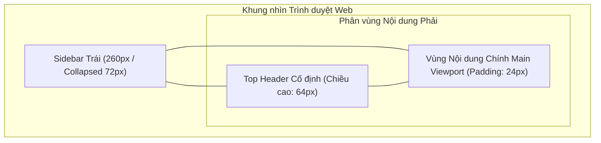

# UI/UX DESIGN — Thiết kế Chi tiết Giao diện Phân hệ Web Portal


## 1. Hệ thống Design Tokens & Visual Language (Tailwind Tokens)

### 1.1. Bảng Màu Chuẩn Doanh nghiệp (Tailwind Color Tokens)
Toàn bộ Cổng Web Portal sử dụng bảng màu **Indigo Clean SaaS** hiện đại, mang lại cảm giác tin cậy và chuyên nghiệp cho khối quản trị nhân sự:

| Tên Token Màu | Mã Màu Hex | Lớp Tailwind CSS Tương ứng | Vai trò Áp dụng trong Giao diện |
| :--- | :--- | :--- | :--- |
| `color_brand_primary` | `#4F46E5` | `indigo-600` | Màu thương hiệu chính, nút tác vụ chính, icon active. |
| `color_brand_hover` | `#4338CA` | `indigo-700` | Trạng thái hover của nút bấm chính. |
| `color_brand_light` | `#EEF2FF` | `indigo-50` | Nền menu mục đang chọn, badge thương hiệu nhẹ. |
| `color_bg_app` | `#F8FAFC` | `slate-50` | Nền toàn bộ ứng dụng Web (Canvas Background). |
| `color_surface_card` | `#FFFFFF` | `white` | Nền các thẻ card dữ liệu, bảng, hộp thoại modal. |
| `color_border_subtle` | `#E2E8F0` | `slate-200` | Đường kẻ bảng, viền thẻ card, đường phân cách header. |
| `color_text_primary` | `#0F172A` | `slate-900` | Tiêu đề chính, nội dung bảng, con số thống kê lớn. |
| `color_text_secondary` | `#64748B` | `slate-500` | Chú thích phụ, nhãn cột bảng, mốc thời gian. |
| `color_status_success` | `#10B981` | `emerald-500` | Trạng thái "Đúng giờ", kết nối WebSocket trực tiếp. |
| `color_status_warning` | `#F59E0B` | `amber-500` | Trạng thái "Đi muộn", cảnh báo mạng chập chờn. |
| `color_status_danger` | `#EF4444` | `rose-500` | Trạng thái "Chưa đến", "Vắng mặt", cảnh báo lỗi. |

### 1.2. Thang Typography & Spacing
* Phông chữ cơ sở: **Inter** (Google Fonts) hỗ trợ chữ số dạng Tabular Monospace cho bảng biểu.
* Tiêu đề Trang (`h1`): Font $30\text{ px}$ (`text-3xl`), Bold, `text-slate-900`.
* Tiêu đề Khu vực / Thẻ (`h2`): Font $20\text{ px}$ (`text-xl`), Semi-Bold.
* Tiêu đề Cột Bảng (`th`): Font $12\text{ px}$ (`text-xs`), Medium, Uppercase, `text-slate-500`.
* Nội dung Dòng Bảng (`td`): Font $14\text{ px}$ (`text-sm`), Regular, `text-slate-800`.
* Bán kính bo góc: Thẻ card bo `rounded-xl` ($12\text{ px}$), Nút bấm bo `rounded-lg` ($8\text{ px}$).

---

## 2. Kiến trúc Bố cục Khung nhìn Quản trị (Admin Shell Layout)



### 2.1. Thanh Điều hướng Bên trái (`Sidebar`)
* **Chiều rộng**: $260\text{ px}$ ở chế độ mở rộng; $72\text{ px}$ ở chế độ thu gọn.
* **Cấu trúc**:
  * Đỉnh Sidebar: Logo FAS kèm nhãn phiên bản `v2.0-Prod`.
  * Thân Sidebar: Danh mục mục menu chia theo nhóm vai trò:
    * Nhóm Quản trị (Dành cho HR): *Bảng điều khiển Live*, *Lịch sử điểm danh*, *Hồ sơ nhân sự*, *Báo cáo tổng hợp*.
    * Nhóm Cá nhân (Dành cho Nhân viên): *Bảng công của tôi*, *Hồ sơ & Đăng ký sinh trắc*.
  * Đáy Sidebar: Nút bấm thu gọn/mở rộng thanh bên và nút Đăng xuất.

### 2.2. Thanh Tiêu đề Trên cùng (`TopHeader`)
* **Chiều cao**: $64\text{ px}$, Nền trắng, Viền đáy `1px solid #E2E8F0`, Cố định ở đỉnh màn hình (`sticky top-0 z-30`).
* **Thành phần**:
  * Bên trái: Đường dẫn phân cấp vị trí hiện tại (Breadcrumbs).
  * Ở giữa: Chỉ báo kết nối WebSocket trực tiếp (`● Đang kết nối Kiosk Live`).
  * Bên phải: Chuông thông báo sự kiện, Bộ chọn ngôn ngữ, Menu Dropdown thông tin tài khoản người dùng kèm Avatar.

---

## 3. Thiết kế Chi tiết Các Thành phần Giao diện Trọng yếu

| ID Thành phần | Tên Thành phần | Đặc tả Bố cục & Hành vi Trực quan | Realizes |
| :--- | :--- | :--- | :---: |
| `UXD-WEB-001` | Khung Bố cục Quản trị (Admin Shell) | Cấu trúc Sidebar 260px + TopHeader 64px + Content responsive; hỗ trợ thu gọn sidebar mượt mà với chuyển động CSS $200\text{ ms}$. | `UI-WEB-001` |
| `UXD-WEB-002` | Hộp thoại Cam kết & Hiển thị OTP | Modal chia 2 giai đoạn: Giai đoạn 1 khóa nút Submit đến khi cuộn hết văn bản; Giai đoạn 2 hiển thị mã OTP 6 số font $48\text{ px}$ + mã QR $200\times 200\text{ px}$ + tự động kích hoạt Confetti khi nhận STOMP event. | `UI-WEB-002` |
| `UXD-WEB-003` | Lưới 4 Thẻ Chỉ số KPI | Hàng 4 thẻ card bo góc $12\text{ px}$, chứa icon chuyên biệt, con số font $32\text{ px}$ bold và tỷ lệ phần trăm thay đổi so với hôm trước. | `UI-WEB-003` |
| `UXD-WEB-004` | Bảng Dữ liệu Trực tiếp (Live Table) | Bảng chấm công thời gian thực với tiêu đề dính (Sticky Header). Dòng mới chèn vào đầu bảng tự động kích hoạt hiệu ứng chớp sáng nền xanh ngọc (`emerald-50`) trong $1.5\text{ s}$. | `UI-WEB-003` |
| `UXD-WEB-005` | Khung Lịch biểu Cá nhân (Calendar Grid) | Lưới 7 cột theo các thứ trong tuần; mỗi ô ngày hiển thị giờ vào/ra và huy hiệu màu tương ứng; nhấp chuột để mở Drawer chi tiết bên phải. | `UI-WEB-005` |

---

## 4. Đặc tả Chi tiết Hộp thoại Ký Cam kết & Kích hoạt Sinh trắc (`ConsentModal`)

```text
┌────────────────────────────────────────────────────────────────────────┐
│  Cam kết Thu thập & Xử lý Dữ liệu Sinh trắc học (Nghị định 13/2023)  [X]│
├────────────────────────────────────────────────────────────────────────┤
│ ┌────────────────────────────────────────────────────────────────────┐ │
│ │ 1. Mục đích thu thập: Hệ thống sử dụng vector đặc trưng khuôn mặt..│ │
│ │ 2. Cam kết bảo mật: Không lưu trữ hình ảnh gốc; vector được mã hóa.│ │
│ │ 3. Quyền của chủ thể dữ liệu: Quý khách có quyền yêu cầu xóa bỏ... │ │
│ │ (Vui lòng cuộn xuống dưới cùng để xác nhận)                        │ │
│ └────────────────────────────────────────────────────────────────────┘ │
│                                                                        │
│ [X] Tôi đã đọc kỹ, hiểu rõ và hoàn toàn đồng ý với các điều khoản trên. │
│                                                                        │
│                          [ Hủy bỏ ]   [ Tôi đồng ý và Ký cam kết ]     │
└────────────────────────────────────────────────────────────────────────┘
                                    │
                                    ▼ (Sau khi ký thành công)
┌────────────────────────────────────────────────────────────────────────┐
│  Mã OTP Kích hoạt tại Trạm Kiosk                                     [X]│
├────────────────────────────────────────────────────────────────────────┤
│                        Mã OTP Kích hoạt của bạn:                       │
│                                                                        │
│                          ┌─────────────────┐                           │
│                          │  8 3 9   2 0 1  │  [ Sao chép ]             │
│                          └─────────────────┘                           │
│                                                                        │
│                     ┌───────────────────────────┐                      │
│                     │                           │                      │
│                     │      [ QR Code 200px ]    │                      │
│                     │                           │                      │
│                     └───────────────────────────┘                      │
│                                                                        │
│  * Thời hạn hiệu lực: 48 giờ (Hết hạn lúc: 08:32 ngày 05/10/2026)      │
│  * Hướng dẫn: Đến trạm Kiosk tại sảnh lễ tân, bấm F3 và nhập mã này.   │
│  * Kênh trực tuyến: Đang đợi tín hiệu quét mặt từ Kiosk...             │
└────────────────────────────────────────────────────────────────────────┘
```

---

## 5. Quy chuẩn Thích ứng Đa Màn hình (Responsive Breakpoints)

| Breakpoint | Kích thước Màn hình | Hành vi Biến đổi Bố cục |
| :--- | :--- | :--- |
| **Desktop Rộng (XL)** | $\ge 1440\text{ px}$ | Lưới 4 thẻ KPI xếp ngang hàng $1 \times 4$; bảng dữ liệu hiển thị trọn vẹn toàn bộ 8 cột. |
| **Laptop / Desktop (LG)** | $1024 - 1439\text{ px}$ | Lưới 4 thẻ KPI xếp $1 \times 4$; bảng dữ liệu hiển thị tốt; các cột phụ tự co kích thước. |
| **Máy tính bảng (MD)** | $768 - 1023\text{ px}$ | Sidebar tự động thu gọn về dạng biểu tượng ($72\text{ px}$); lưới thẻ KPI chuyển thành $2 \times 2$. |
| **Điện thoại Di động (SM)** | $< 768\text{ px}$ | Sidebar ẩn hoàn toàn, mở qua nút Hamburger Drawer trượt từ cạnh trái; bảng hỗ trợ thanh cuộn ngang độc lập. |
