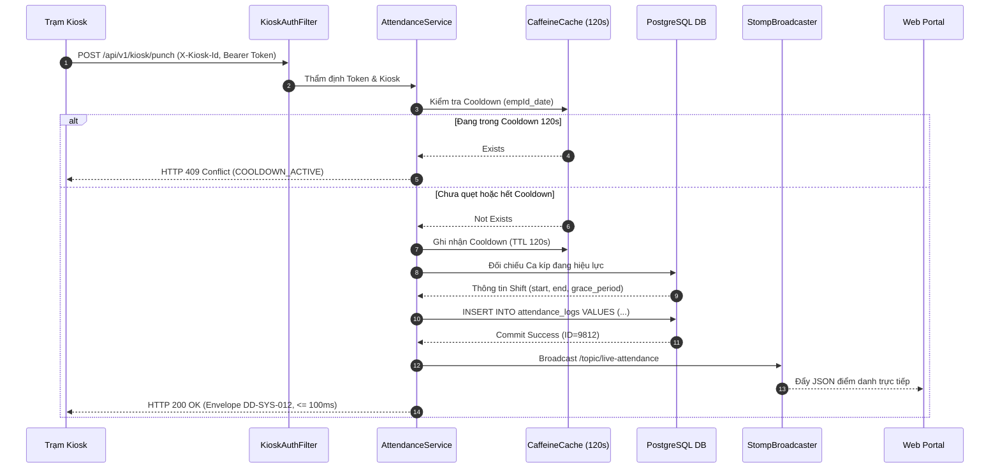

# FR/NFR SPECS & DESIGN — Đặc tả Yêu cầu & Thiết kế Kỹ thuật Phân hệ Backend

Tài liệu hợp nhất đặc tả yêu cầu chức năng (`FR-BE-`), phi chức năng (`NFR-BE-`) và giải pháp kỹ thuật (`SOL-BE-`) của phân hệ Backend theo chuẩn SDLC v3.0 ([sdlc-docs.md](../../../sdlc-docs.md) §7.2).

---

## 1. Yêu cầu Chức năng (Functional Requirements)

| ID | Statement | Category | Priority | Basis | Acceptance | Status |
| :--- | :--- | :--- | :---: | :--- | :--- | :---: |
| `FR-BE-001` | Xác thực đăng nhập người dùng và cấp phát JWT token có thời hạn kèm phân quyền RBAC (`ADMIN`, `HR_MANAGER`, `EMPLOYEE`, `DPO`). | Auth / Security | Must | `SRS-005`, `SRS-006`, `ACT-001`, `ACT-002`, `ACT-004` | Đăng nhập thành công trả về cặp Access Token (1h) & Refresh Token (7 ngày); mã hóa mật khẩu BCrypt ($cost = 12$); chặn truy cập trái quyền trả về HTTP 403 Forbidden; role `DPO` chỉ được truy cập các giao diện tra cứu tuân thủ ở chế độ chỉ đọc. | Approved |
| `FR-BE-002` | Tiếp nhận và xử lý bản ghi điểm danh thời gian thực từ trạm Kiosk, đối chiếu ca đang hiệu lực từ lịch phân ca để ghi nhận trạng thái đi làm/đi muộn/về sớm và áp dụng cooldown 120s phía máy chủ. | Core Attendance | Must | `FR-SYS-005`, `FR-SYS-012`, `FR-SYS-018` | Phản hồi trong $\le 100\text{ ms}$; tra cứu ca đang hiệu lực của nhân viên từ `employee_shifts` và tính `late_minutes` theo thời gian ân hạn của ca; nhân viên **chưa được phân ca** nhận trạng thái `ANOMALOUS`; chặn quẹt lặp cùng nhân viên trong 120s qua bộ nhớ đệm. | Approved |
| `FR-BE-003` | Tiếp nhận gói lô đồng bộ bù ngoại tuyến từ Kiosk, thực hiện ghi nhận không trùng lặp và bảo toàn mốc giờ thực tế. | Offline Sync | Must | `FR-SYS-006` | Hỗ trợ gói lô tối đa 50 bản ghi; trả về danh sách ID đã lưu thành công; loại bỏ trùng lặp qua ràng buộc khóa tự nhiên `(user_id, punch_timestamp, punch_type)`. | Approved |
| `FR-BE-004` | Cung cấp API tải toàn bộ danh mục vector sinh trắc học ArcFace phục vụ trạm Kiosk nạp vào bộ nhớ RAM. | Biometric Distribution | Must | `FR-SYS-003`, `FR-SYS-014` | Trả về danh sách nhân viên đang kích hoạt (`ACTIVE`) kèm vector 512D đã giải mã; xác thực qua header bí mật `X-Kiosk-Id` và Kiosk Secret Token. | Approved |
| `FR-BE-005` | Khởi tạo phiên đăng ký khuôn mặt mới, sinh mã OTP 6 số ngẫu nhiên có hiệu lực 48 giờ sau khi nhân viên ký cam kết Informed Consent. | Enrollment Lifecycle | Must | `FR-SYS-007`, `FR-SYS-008` | Chỉ sinh OTP khi bản ghi `consent_signed_at` hợp lệ; lưu vết OTP mã hóa BCrypt; vô hiệu hóa mã cũ khi sinh mã mới; hết hạn sau 48 giờ; **không** sinh OTP khi Consent đã bị rút (`FR-BE-022`). | Approved |
| `FR-BE-006` | Xác thực mã OTP và tiếp nhận vector 512D từ Kiosk, mã hóa bằng AES-256-GCM trước khi lưu trữ vào CSDL PostgreSQL. | Crypto / Biometric | Must | `FR-SYS-008`, `FR-SYS-010` | Khóa mã hóa quản lý tách biệt qua biến môi trường; vector thô không bao giờ lưu đĩa; kích hoạt trạng thái nhân sự thành `ACTIVE` sau khi nạp mẫu. | Approved |
| `FR-BE-007` | Phát sóng sự kiện thời gian thực qua WebSocket STOMP tới Kiosk (cập nhật gallery) và Web Portal (bảng chấm công trực tiếp). | Realtime Messaging | Must | `FR-SYS-013`, `FR-SYS-014` | Bản tin đẩy tới subscriber trong vòng $\le 50\text{ ms}$; hỗ trợ topic `/topic/kiosk-gallery` và `/topic/live-attendance`. | Approved |
| `FR-BE-008` | Cung cấp các báo cáo tổng hợp chấm công, kết xuất dữ liệu định dạng Excel chống Formula Injection qua giao diện chuyên trách và tra cứu lịch sử chỉnh sửa giờ công từ nhật ký kiểm toán. | Reporting / Audit | Must | `FR-SYS-016`, `API-SYS-011`, `SRS-007`, `SRS-010` | Kết xuất bảng công tháng cho 1,000 nhân sự trong $\le 3\text{ giây}$ qua endpoint chuyên trách; tự động escape ký tự nguy hiểm (`=`, `+`, `-`, `@`); mọi thao tác sửa đổi giờ công của HR đều truy vết được từ `audit_logs` kèm giá trị trước và sau. | Approved |
| `FR-BE-009` | Thực thi tác vụ quét định kỳ hàng ngày tiêu hủy vĩnh viễn dữ liệu sinh trắc học của nhân viên đã thôi việc quá 20 ngày theo Luật 91/2025/QH15. | Data Retention | Must | `FR-SYS-011`, `SRS-003`, `DATA-SYS-013` | Cron job chạy định kỳ 01:00 hàng ngày; xóa cứng (`HARD DELETE`) các bản ghi `biometric_templates` có nhân viên liên kết ở trạng thái `TERMINATED` quá 20 ngày. | Approved |
| `FR-BE-010` | Quản lý vòng đời hồ sơ nhân sự: khởi tạo hồ sơ kèm tài khoản đăng nhập, cập nhật thông tin hồ sơ và vô hiệu hóa nhân sự khi chấm dứt hợp đồng. | HR Management | Must | `API-SYS-008`, `FR-SYS-017` | Tạo hồ sơ trả về mã nhân viên và mật khẩu tạm hiển thị đúng một lần; từ chối khi trùng `employee_code` hoặc `email`; cập nhật được họ tên, email, phòng ban, vai trò; vô hiệu hóa đặt `status = TERMINATED` kèm `terminated_date` và ghi một bản ghi `audit_logs`. | Approved |
| `FR-BE-011` | Quản lý vòng đời mật khẩu: sinh mật khẩu tạm khi khởi tạo tài khoản và cho phép nhân viên tự đổi mật khẩu bất kỳ lúc nào — **không** bắt buộc, **không** chặn nghiệp vụ. | Auth / Security | Must | `FR-SYS-017`, `API-SYS-021`, `SRS-005` | Mật khẩu tạm sinh ngẫu nhiên, băm BCrypt trước khi lưu và không thể truy xuất lại sau khi trả về; tài khoản dùng mật khẩu tạm gọi được mọi endpoint nghiệp vụ (không tồn tại mã lỗi `PASSWORD_CHANGE_REQUIRED` và không có cờ buộc đổi trong lược đồ); mật khẩu mới tối thiểu 8 ký tự và khác mật khẩu hiện tại; mọi refresh token của tài khoản bị thu hồi ngay sau khi đổi mật khẩu (`FR-BE-020`). | Approved |
| `FR-BE-012` | Quản lý mã PIN dự phòng: cho phép nhân viên tự thiết lập/đổi mã PIN 6 số và thẩm định mã PIN tập trung tại máy chủ trước khi ghi nhận điểm danh. | Auth / Security | Must | `FR-SYS-004`, `FR-SYS-017`, `API-SYS-022`, `API-SYS-023`, `DATA-SYS-012` | PIN lưu dưới dạng băm một chiều; thiết lập lần đầu yêu cầu nhập lại PIN xác nhận; đổi PIN yêu cầu PIN hiện tại; xác thực PIN đúng trả về định danh nhân viên, PIN sai trả 401 `PIN_INVALID`, sai 5 lần liên tiếp trả 423 `PIN_LOCKED` trong 15 phút. | Approved |
| `FR-BE-013` | Quản lý danh mục ca làm việc và phân ca nhân sự theo khoảng ngày hiệu lực, bao gồm kiểm tra chồng lấn và cung cấp ca đang hiệu lực cho luồng chấm công. | HR Management | Must | `FR-SYS-018`, `API-SYS-024`, `API-SYS-025`, `DATA-SYS-017` | Tạo/sửa/vô hiệu hóa ca với mã duy nhất, giờ bắt đầu nhỏ hơn giờ kết thúc và ân hạn 0-60 phút; phân ca trả HTTP 201 và từ chối HTTP 409 khi chồng khoảng hiệu lực của cùng nhân viên; vô hiệu hóa ca đang được phân trả HTTP 409 kèm hướng dẫn xử lý; lịch phân ca tra cứu được theo nhân viên và khoảng ngày. | Approved |
| `FR-BE-014` | Cho phép nhân viên nộp đơn giải trình công cho một lượt chấm cụ thể và theo dõi trạng thái các đơn của chính mình. | HR Management | Must | `FR-SYS-016`, `API-SYS-010`, `ACT-001` | Đơn chỉ được nộp cho bản ghi điểm danh thuộc chính người gửi; trạng thái khởi tạo `PENDING`; chỉ nộp được cho bản ghi trong vòng 30 ngày gần nhất; nhân viên chỉ nhận được đơn của mình. | Approved |
| `FR-BE-015` | Cho phép HR duyệt hoặc từ chối đơn giải trình công; khi duyệt, điều chỉnh bản ghi điểm danh tương ứng trong cùng một giao dịch và ghi nhật ký kiểm toán. | HR Management | Must | `FR-SYS-016`, `API-SYS-010`, `NFR-BE-005` | Duyệt đơn cập nhật `punch_time`/`status` của bản ghi liên quan và ghi một bản ghi `audit_logs` chứa giá trị trước và sau; từ chối bắt buộc kèm lý do; đơn đã `APPROVED`/`REJECTED` không đổi được trạng thái; từ chối (HTTP 409) khi bản ghi công thuộc kỳ đã chốt (`FR-BE-021`); yêu cầu role `HR_MANAGER`/`ADMIN`. | Approved |
| `FR-BE-016` | Cung cấp khả năng tra cứu chỉ đọc phục vụ kiểm toán và tuân thủ dữ liệu cá nhân: nhật ký kiểm toán cho Quản trị viên, dữ liệu Consent và lịch trình tiêu hủy sinh trắc cho Cán bộ Bảo vệ Dữ liệu. | Reporting / Audit | Must | `FR-SYS-019`, `API-SYS-026`, `API-SYS-027`, `SRS-010` | Tra cứu `audit_logs` lọc theo khoảng thời gian, tác nhân và loại hành vi, có phân trang; role `DPO` chỉ đọc được Consent và lịch trình tiêu hủy, nhận HTTP 403 ở mọi endpoint ghi; không tồn tại API sửa hoặc xoá `audit_logs`. | Approved |
| `FR-BE-017` | Quản lý vòng đời trạm Kiosk: đăng ký trạm kèm Secret Token hiển thị một lần, đổi token, vô hiệu hóa trạm và cung cấp trạng thái kết nối của từng trạm. | Device Management | Must | `FR-SYS-020`, `API-SYS-028`, `DATA-SYS-019`, `ACT-003` | Secret Token chỉ trả về một lần khi đăng ký hoặc đổi và lưu dạng băm một chiều; trạm `INACTIVE` nhận HTTP 401 ở mọi giao diện Kiosk; đổi token vô hiệu hóa token cũ ngay lập tức; trả về `last_ping_at`; yêu cầu role `ADMIN`. | Approved |
| `FR-BE-018` | Khởi tạo an toàn cho lần triển khai đầu tiên (Bootstrap): tạo tài khoản quản trị đầu tiên qua cấu hình bootstrap có kiểm soát, dùng được ngay bằng mật khẩu tạm và không tồn tại mật khẩu mặc định trong mã nguồn hay kịch bản migration. | Security / Operations | Must | `FR-SYS-021`, `SRS-005`, `SRS-006` | Lần chạy đầu trên CSDL trống tạo đúng một tài khoản `ADMIN` dùng được ngay bằng mật khẩu tạm; gọi lại bootstrap không tạo thêm tài khoản (idempotent); không có mật khẩu mặc định trong mã nguồn, `application.yml` hay kịch bản Flyway. | Approved |
| `FR-BE-019` | Hỗ trợ khôi phục thông tin xác thực: HR/ADMIN cấp lại mật khẩu tạm mới và nhân viên tự đặt lại mã PIN sau khi xác thực bằng mật khẩu của chính mình. | Security / Support | Must | `FR-SYS-022`, `API-SYS-029`, `FR-BE-011`, `FR-BE-012` | Mật khẩu tạm cũ hết hiệu lực ngay và mọi refresh token của tài khoản bị thu hồi; mật khẩu tạm mới chỉ hiển thị một lần; đặt lại PIN yêu cầu mật khẩu hiện tại đúng và vô hiệu hóa PIN cũ; mọi thao tác ghi audit. | Approved |
| `FR-BE-020` | Quản lý vòng đời phiên làm việc: đăng xuất, lưu refresh token dạng băm một chiều và thu hồi token theo tài khoản khi đổi mật khẩu, cấp lại mật khẩu hoặc tài khoản bị vô hiệu hóa. | Auth / Security | Must | `FR-SYS-023`, `API-SYS-030`, `SRS-006`, `DATA-SYS-022` | Đăng xuất trả HTTP 204 và refresh token hiện tại không dùng lại được; refresh token đã thu hồi trả HTTP 401; tài khoản `TERMINATED`/`SUSPENDED` không dùng được cả access token còn hạn; thời hạn access 1 giờ và refresh 7 ngày đọc từ một cấu hình duy nhất. | Approved |
| `FR-BE-021` | Cho phép HR chốt kỳ công theo tháng và từ chối mọi điều chỉnh công hoặc đơn giải trình thuộc kỳ đã chốt. | HR Management | Must | `FR-SYS-024`, `API-SYS-031`, `DATA-SYS-021`, `FR-BE-015` | Chốt kỳ ghi nhận người chốt và mốc thời gian; nộp/duyệt đơn hoặc điều chỉnh công thuộc kỳ `LOCKED` trả HTTP 409; ADMIN mở lại kèm lý do và ghi audit; trạng thái chốt trả về trong báo cáo và bản kết xuất. | Approved |
| `FR-BE-022` | Cho phép nhân viên rút lại Informed Consent và gửi yêu cầu về dữ liệu cá nhân; khi Consent bị rút, điểm danh bằng khuôn mặt bị vô hiệu hóa và dữ liệu sinh trắc bị tiêu hủy trong 7 ngày. | Compliance | Must | `FR-SYS-025`, `API-SYS-032`, `DATA-SYS-023`, `FR-BE-005` | Rút Consent ghi vết bất biến (thời điểm, IP) và đặt hạn tiêu hủy 7 ngày; nhân viên đã rút Consent không còn trong danh mục gallery cấp cho Kiosk và không sinh được OTP mới; yêu cầu truy cập/chỉnh sửa dữ liệu cá nhân được ghi nhận, phản hồi trạng thái và DPO tra cứu được. | Approved |
| `FR-BE-023` | Quản lý vòng đời quyền quản trị: gán/thu hồi role `HR_MANAGER`/`DPO`/`ADMIN`, ghi audit mọi thay đổi và chặn hạ cấp tài khoản ADMIN đang hoạt động cuối cùng. | Security / Governance | Must | `FR-SYS-026`, `API-SYS-033`, `SRS-006` | Gán/thu hồi role trả HTTP 200 kèm audit giá trị trước/sau; thu hồi hoặc hạ cấp ADMIN cuối cùng trả HTTP 409 và không thay đổi dữ liệu; vô hiệu hóa nhân sự thu hồi role trong cùng giao dịch. | Approved |
| `FR-BE-024` | Sinh và phục vụ thông báo trong ứng dụng cho đúng tác nhân theo các sự kiện vòng đời. | Notification | Should | `FR-SYS-027`, `API-SYS-034`, `DATA-SYS-023` | Thông báo được sinh cho các sự kiện: tài khoản được tạo, phiên bị thu hồi, PIN bị khóa, đơn giải trình được xử lý, Consent bị rút và kỳ công đã chốt; người dùng chỉ thấy thông báo của mình và đánh dấu đã đọc được; không gửi email/SMS trong phạm vi MVP. | Approved |
| `FR-BE-025` | Cung cấp giao diện tự phục vụ để nhân viên tra cứu lịch sử chấm công của chính mình theo tháng. | Self-service | Must | `FR-SYS-028`, `API-SYS-035`, `DATA-SYS-004` | Chỉ trả bản ghi thuộc người đang đăng nhập; lọc theo tháng và phân trang; kèm trạng thái công và số phút đi muộn; nhân viên khác không truy cập được dữ liệu này. | Approved |

---

## 2. Yêu cầu Phi chức năng (Non-functional Requirements)

| ID | Statement | Category | Priority | Basis | Acceptance | Status |
| :--- | :--- | :--- | :---: | :--- | :--- | :---: |
| `NFR-BE-001` | Thời gian phản hồi trung bình của API tiếp nhận điểm danh đạt $\le 100\text{ ms}$ ở bách phân vị $95\%$ (p95). | Performance | Must | `NFR-SYS-001`, `NFR-SYS-003` | Đo kiểm dưới tải đồng thời 50 kết nối Kiosk; sử dụng HikariCP connection pool tối ưu; thời gian ghi nhận điểm danh hoàn tất trong $\le 100\text{ ms}$. | Approved |
| `NFR-BE-002` | Năng lực chịu tải của hệ thống máy chủ đạt tối thiểu $500\text{ req/giây}$ (RPS) trên cấu hình 2 vCPU và 4 GB RAM. | Throughput | Must | `NFR-SYS-004` | Tỷ lệ lỗi HTTP 5xx $< 0.01\%$ khi kiểm thử ngập tải (Stress Testing); mức chiếm dụng CPU $\le 75\%$. | Approved |
| `NFR-BE-003` | 100% dữ liệu vector sinh trắc học và thông tin định danh cá nhân được mã hóa ở trạng thái nghỉ (Encryption-at-Rest). | Security / Privacy | Must | `NFR-SYS-007`, `SRS-001` | Tuân thủ Luật Bảo vệ dữ liệu cá nhân; áp dụng thuật toán AES-256-GCM với IV ngẫu nhiên 12-byte và khóa Master tách biệt. | Approved |
| `NFR-BE-004` | Đảm bảo tính khả dụng của dịch vụ máy chủ đạt $\ge 99.9\%$ thời gian trong tháng (Downtime $\le 43.8\text{ phút/tháng}$). | Availability | Must | `NFR-SYS-008`, `SRS-009` | Thiết kế Stateless kiến trúc, sẵn sàng triển khai cân bằng tải đa phiên bản; endpoint `/actuator/health` phản hồi `UP` liên tục. | Approved |
| `NFR-BE-005` | Toàn bộ các thao tác chỉnh sửa dữ liệu nhạy cảm được ghi nhật ký bất biến (Immutable Audit Trail). | Compliance | Must | `SRS-010`, `NFR-SYS-008` | Nhật ký lưu lại ID người sửa, IP, mốc giờ ISO-8601, giá trị trước và sau khi thay đổi; bảng `audit_logs` chỉ cho phép append-only. | Approved |

---

## 3. Danh mục Thành phần Kỹ thuật & Giải pháp (`SOL-BE-`)

| ID | Name | Definition | Uses | Realizes | Decisions | Status |
| :--- | :--- | :--- | :--- | :--- | :---: | :---: |
| `SOL-BE-001` | Bộ Lọc Bảo mật & Xác thực JWT | Quản lý chuỗi lọc Security, phân tích Header `Authorization: Bearer <token>`, trích xuất Claims người dùng và gán SecurityContext đa vai trò (`ADMIN`, `HR_MANAGER`, `EMPLOYEE`, `DPO`). | `STK-011` | `FR-BE-001` | `DD-SYS-001`, `DD-BE-001` | Accepted |
| `SOL-BE-002` | Dịch vụ Xử lý Điểm danh Cốt lõi | Tiếp nhận bản ghi từ Kiosk, thẩm định ca làm việc, tính toán trạng thái (On-time, Late, Early Leave) và lưu bản ghi vào CSDL PostgreSQL. | `STK-011`, `STK-013` | `FR-BE-002`, `NFR-BE-001` | `DD-SYS-007` | Accepted |
| `SOL-BE-003` | Dịch vụ Đồng bộ Bù Ngoại tuyến | Xử lý giao dịch hàng loạt (Batch Processing) cho gói tối đa 50 bản ghi, sử dụng `UPSERT` / `ON CONFLICT DO NOTHING` chống trùng lặp dữ liệu. | `STK-013` | `FR-BE-003` | `DD-SYS-002` | Accepted |
| `SOL-BE-004` | Dịch vụ Mã hóa Sinh trắc học | Đóng gói thuật toán AES-256-GCM với IV ngẫu nhiên 12-byte; mã hóa trước khi ghi và giải mã khi Kiosk tải danh mục vector 512D. | `STK-010` | `FR-BE-004`, `FR-BE-006`, `NFR-BE-003` | `DD-SYS-003`, `DD-BE-004` | Accepted |
| `SOL-BE-005` | Quản lý Vòng đời Đăng ký OTP | Sinh mã ngẫu nhiên 6 số, băm BCrypt lưu CSDL với hạn 48h; đối soát khi Kiosk gửi yêu cầu và phát sự kiện hoàn tất kích hoạt nhân sự. | `STK-011` | `FR-BE-005`, `FR-BE-006` | `DD-SYS-003`, `DD-BE-001` | Accepted |
| `SOL-BE-006` | Bộ Phát sóng Sự kiện STOMP | Tích hợp `SimpMessagingTemplate`, phát thông điệp tới topic tương ứng khi có điểm danh mới (`/topic/live-attendance`) hoặc cập nhật gallery (`/topic/kiosk-gallery`). | `STK-012` | `FR-BE-007` | `DD-SYS-004`, `DD-BE-011` | Accepted |
| `SOL-BE-007` | Hệ thống Ghi vết Kiểm toán Bất biến | Spring AOP Interceptor tự động bắt các sự kiện thay đổi dữ liệu bảng nhạy cảm, lưu vào bảng `audit_logs` với đầy đủ ngữ cảnh người thao tác. | `STK-011`, `STK-013` | `FR-BE-008`, `NFR-BE-005` | `DD-BE-002` | Accepted |
| `SOL-BE-008` | Tác vụ Tiêu hủy Dữ liệu Định kỳ | Spring `@Scheduled(cron = "0 0 1 * * ?")` quét CSDL và tiêu hủy vĩnh viễn (Hard Delete) toàn bộ bản ghi `biometric_templates` của nhân viên đã thôi việc quá 20 ngày. | `STK-011`, `STK-013` | `FR-BE-009` | `DD-SYS-003` | Accepted |
| `SOL-BE-009` | Bộ Kiểm soát Cooldown 120s Máy chủ | Cơ chế đệm bộ nhớ trong (In-Memory Cache) với TTL 120s khóa `empId_punchDate`, chặn ngay lượt quẹt lặp lại từ cùng một nhân viên trước khi truy vấn CSDL. | `STK-013` | `FR-BE-002`, `NFR-BE-001` | `DD-SYS-006`, `DD-BE-003` | Accepted |
| `SOL-BE-010` | Cấu hình Connection Pool HikariCP | Cấu hình HikariCP tối ưu cho 50 trạm Kiosk đồng thời: `maximum-pool-size=20`, `connection-timeout=5000ms`, `leak-detection-threshold=2000ms`. | `STK-013` | `NFR-BE-001`, `NFR-BE-002` | `DD-SYS-001` | Accepted |
| `SOL-BE-011` | Khả năng Kháng lỗi & Giám sát Sức khỏe | Thiết kế kiến trúc Stateless không lưu trạng thái phiên trên máy chủ, tích hợp Spring Boot Actuator endpoint `/actuator/health` phục vụ giám sát và tự phục hồi kết nối CSDL. | `STK-011` | `NFR-BE-004` | `DD-SYS-001` | Accepted |
| `SOL-BE-012` | Luồng Xử lý Điểm danh Thời gian thực | Tiếp nhận punch từ Kiosk $\rightarrow$ Kiểm tra xác thực `X-Kiosk-Id` $\rightarrow$ Thẩm định Cooldown 120s $\rightarrow$ Tính toán ca kíp $\rightarrow$ Lưu PostgreSQL $\rightarrow$ Phát sóng STOMP $\rightarrow$ Phản hồi HTTP 200 $\le 100\text{ ms}$. | `SOL-BE-002`, `SOL-BE-006`, `SOL-BE-009` | `FR-BE-002`, `NFR-BE-001` | `DD-SYS-004`, `DD-SYS-006` | Accepted |
| `SOL-BE-013` | Luồng Vòng đời Đăng ký Mẫu Khuôn mặt OTP | Nhân viên ký Consent trên Web $\rightarrow$ Backend sinh mã OTP 6 số (hạn 48h) $\rightarrow$ Kiosk xác minh OTP $\rightarrow$ Backend nhận vector 512D $\rightarrow$ Mã hóa AES-256-GCM $\rightarrow$ Lưu PostgreSQL $\rightarrow$ Kích hoạt `ACTIVE` $\rightarrow$ Broadcast gallery. | `SOL-BE-004`, `SOL-BE-005`, `SOL-BE-006` | `FR-BE-005`, `FR-BE-006` | `DD-SYS-003`, `DD-SYS-004` | Accepted |
| `SOL-BE-014` | Dịch vụ Quản lý Hồ sơ Nhân sự & Tài khoản | Khởi tạo hồ sơ nhân sự kèm tài khoản: chuẩn hóa `employee_code`/`email`, sinh mật khẩu tạm ngẫu nhiên (băm BCrypt, trả về đúng một lần); cập nhật họ tên/email/phòng ban/vai trò; vô hiệu hóa nhân sự bằng `status = TERMINATED` + `terminated_date`; mọi thay đổi phát sinh một bản ghi `audit_logs`. | `STK-011`, `STK-013` | `FR-BE-010`, `FR-BE-011` | `DD-BE-013`, `DD-BE-002` | Accepted |
| `SOL-BE-015` | Bộ Chặn Nghiệp vụ Buộc đổi Mật khẩu | **Deprecated** theo CR: yêu cầu buộc đổi mật khẩu ở lần đăng nhập đầu tiên đã bị rút, nên không còn bộ chặn nghiệp vụ nào dựa trên cờ `must_change_password`. | `STK-011` | `FR-BE-011` | `DD-BE-014`, `DD-SYS-001` | Deprecated |
| `SOL-BE-016` | Dịch vụ Mã PIN Dự phòng & Thẩm định PIN | Nhân viên thiết lập PIN 6 số (nhập lại để xác nhận) hoặc đổi PIN (yêu cầu PIN hiện tại), lưu băm một chiều vào `users.pin_hash`; Kiosk gọi Backend thẩm định PIN: đúng trả định danh nhân viên, sai trả 401 `PIN_INVALID`, sai 5 lần liên tiếp đặt `pin_locked_until = NOW() + 15m` và trả 423 `PIN_LOCKED`; không có bản ghi điểm danh nào được tạo khi thẩm định thất bại. | `STK-011`, `STK-013` | `FR-BE-012` | `DD-BE-015`, `DD-SYS-012` | Accepted |
| `SOL-BE-017` | Dịch vụ Quản lý Ca kíp & Phân ca | Quản lý danh mục ca (mã duy nhất, giờ bắt đầu/kết thúc, ân hạn 0-60 phút, cờ kích hoạt) và phân ca theo khoảng hiệu lực; kiểm tra chồng lấn trong giao dịch có khóa theo `user_id`; cung cấp ca đang hiệu lực cho luồng chấm công và trả `ANOMALOUS` khi nhân viên chưa được phân ca. | `STK-011`, `STK-012` | `FR-BE-013`, `DATA-BE-017` | `DD-BE-017`, `DD-SYS-018` | Accepted |
| `SOL-BE-018` | Dịch vụ Xử lý Đơn Giải trình Công | Nhân viên nộp đơn cho một bản ghi điểm danh thuộc chính mình (trong 30 ngày gần nhất, trạng thái `PENDING`); HR duyệt hoặc từ chối; khi duyệt, điều chỉnh `attendance_logs` trong cùng giao dịch với việc đổi trạng thái đơn và ghi `audit_logs` giá trị trước/sau. | `STK-011` | `FR-BE-014`, `FR-BE-015`, `DATA-BE-018` | `DD-BE-018`, `DD-SYS-021` | Accepted |
| `SOL-BE-019` | Dịch vụ Tra cứu Kiểm toán & Tuân thủ | Truy vấn chỉ đọc `audit_logs` (ADMIN) và dữ liệu Consent/lịch trình tiêu hủy (DPO) với chỉ mục tra cứu; không tồn tại nhánh ghi/sửa/xoá trên `audit_logs`; role `DPO` chỉ được cấp quyền đọc. | `STK-011` | `FR-BE-016`, `DATA-BE-020` | `DD-BE-019`, `DD-SYS-019` | Accepted |
| `SOL-BE-020` | Dịch vụ Quản lý Trạm Kiosk | Đăng ký trạm kèm sinh Secret Token hiển thị một lần và lưu băm một chiều, đổi token (vô hiệu hóa token cũ ngay), vô hiệu hóa trạm và cập nhật `last_ping_at` mỗi lượt xác thực hợp lệ; trạm `INACTIVE` bị từ chối ở mọi giao diện Kiosk. | `STK-011`, `STK-012` | `FR-BE-017`, `DATA-BE-019` | `DD-BE-020`, `DD-SYS-020` | Accepted |
| `SOL-BE-021` | Bộ Khởi tạo Hệ thống & Bootstrap | Tạo tài khoản `ADMIN` đầu tiên trên CSDL trống từ cấu hình bootstrap (biến môi trường hoặc CLI một lần), dùng được ngay bằng mật khẩu tạm; cơ chế idempotent và tự vô hiệu hóa sau khi hoàn tất. | `STK-011` | `FR-BE-018`, `SRS-005` | `DD-BE-021`, `DD-SYS-022` | Accepted |
| `SOL-BE-022` | Dịch vụ Khôi phục Thông tin Xác thực | Cấp lại mật khẩu tạm mới cho nhân sự (vô hiệu hóa mật khẩu tạm cũ, thu hồi toàn bộ phiên, ghi audit) và cho phép nhân viên đặt lại PIN sau khi xác thực bằng mật khẩu hiện tại. | `STK-011` | `FR-BE-019`, `FR-BE-011`, `FR-BE-012` | `DD-BE-022`, `DD-SYS-023` | Accepted |
| `SOL-BE-023` | Dịch vụ Quản lý Phiên & Thu hồi Token | Lưu refresh token dạng băm một chiều kèm hạn dùng và ngữ cảnh đăng nhập; xử lý đăng xuất, thu hồi toàn bộ token theo tài khoản khi đổi/cấp lại mật khẩu hoặc tài khoản bị vô hiệu hóa; từ chối access token của tài khoản không còn hoạt động. | `STK-011`, `STK-012` | `FR-BE-020`, `DATA-BE-022`, `SRS-006` | `DD-BE-023`, `DD-SYS-026` | Accepted |
| `SOL-BE-024` | Dịch vụ Chốt Kỳ công & Khoá Điều chỉnh | Quản lý kỳ công theo tháng với trạng thái `OPEN`/`LOCKED`; cung cấp kiểm tra kỳ đã chốt cho mọi đường nộp/duyệt đơn và điều chỉnh công; cho phép ADMIN mở lại kèm lý do và ghi audit. | `STK-011`, `STK-012` | `FR-BE-021`, `DATA-BE-021`, `FR-BE-015` | `DD-BE-024`, `DD-SYS-024` | Accepted |
| `SOL-BE-025` | Dịch vụ Rút Consent & Yêu cầu Dữ liệu Cá nhân | Ghi vết rút Informed Consent bất biến, loại nhân sự khỏi danh mục gallery cấp cho Kiosk, chặn sinh OTP mới và đặt hạn tiêu hủy dữ liệu sinh trắc 7 ngày; tiếp nhận, cập nhật trạng thái và phản hồi yêu cầu truy cập/chỉnh sửa dữ liệu cá nhân. | `STK-011` | `FR-BE-022`, `DATA-BE-023`, `DATA-BE-024`, `FR-BE-005` | `DD-BE-025`, `DD-SYS-025` | Accepted |
| `SOL-BE-026` | Dịch vụ Vòng đời Quyền Quản trị | Gán và thu hồi role `HR_MANAGER`/`DPO`/`ADMIN` kèm audit giá trị trước/sau; chặn thu hồi hoặc hạ cấp tài khoản `ADMIN` đang hoạt động cuối cùng bằng kiểm tra đếm trong cùng giao dịch; thu hồi role khi vô hiệu hóa nhân sự. | `STK-011` | `FR-BE-023`, `SRS-006` | `DD-BE-026`, `DD-SYS-019` | Accepted |
| `SOL-BE-027` | Dịch vụ Thông báo Trong ứng dụng | Sinh thông báo theo sự kiện vòng đời và phục vụ truy vấn/đánh dấu đã đọc cho đúng người nhận; không dùng email/SMS trong phạm vi MVP. | `STK-011`, `STK-017` | `FR-BE-024`, `DATA-BE-023` | `DD-SYS-025`, `DD-BE-025` | Accepted |
| `SOL-BE-028` | Dịch vụ Tra cứu Lịch sử Công Tự phục vụ | Truy vấn lịch sử chấm công của chính nhân viên đang đăng nhập theo tháng kèm trạng thái công và số phút đi muộn; chỉ trả dữ liệu thuộc người gọi và không cho truy cập chéo người dùng. | `STK-011` | `FR-BE-025`, `DATA-BE-004` | `DD-BE-019`, `DD-SYS-019` | Accepted |

---

## 4. Luồng Xử lý Nghiệp vụ & Biểu đồ Tuần tự (Behavioral Workflows)

### 4.1. Biểu đồ Tuần tự Xử lý Điểm danh Thời gian thực (`SOL-BE-012`)

### 4.2. Luồng Vòng đời Đăng ký Mẫu Khuôn mặt OTP (`SOL-BE-013`)

1. **Nhân viên ký thỏa thuận số**: Tại Web Portal, nhân viên đồng ý Informed Consent $\rightarrow$ Backend tạo bản ghi `enrollment_sessions` với `consent_signed_at`, IP máy, sinh mã OTP 6 số ngẫu nhiên băm BCrypt (`expires_at = created_at + 48h`).
2. **Xác thực OTP tại Kiosk**: Nhân viên nhập OTP trên màn hình Kiosk $\rightarrow$ Kiosk gọi `POST /api/v1/kiosk/verify-otp` $\rightarrow$ Backend kiểm tra tính hợp lệ và thời hạn.
3. **Thu nhận và Nạp mẫu**: Kiosk trích xuất vector 512D chuẩn hóa $L_2$ gửi kèm mã OTP qua `POST /api/v1/kiosk/enroll-face`.
4. **Mã hóa và Lưu trữ**: Backend sinh IV 12 bytes ngẫu nhiên, mã hóa vector bằng AES-256-GCM, lưu `biometric_templates` dạng `BYTEA`, cập nhật hồ sơ `users.status = 'ACTIVE'`, đánh dấu `is_used = true` cho OTP.
5. **Đồng bộ Tức thời**: Backend phát bản tin STOMP `ADD_VECTOR` tới `/topic/kiosk-gallery` để các trạm Kiosk nạp nóng vào RAM qua Atomic Pointer Swap.

### 4.3. Tác vụ Tiêu hủy Dữ liệu Sinh trắc 20 Ngày (`SOL-BE-008`)

1. **Chu kỳ chạy**: Cron job chạy định kỳ 01:00 hàng ngày trên tiến trình Backend.
2. **Lọc hồ sơ thôi việc**: Quét các bản ghi `users` có `status = 'TERMINATED'` và `terminated_date <= CURRENT_DATE - 20 days`.
3. **Thực thi Xóa cứng (Hard Delete)**: Xóa vĩnh viễn các hàng tương ứng trong bảng `biometric_templates` (không giữ lại bản sao hay backup vector).
4. **Ghi vết Kiểm toán**: Ghi một bản ghi vào bảng `audit_logs` với `action = 'DELETE_BIOMETRIC_DATA'`, `entity_type = 'biometric_templates'`, `actor_id = NULL` (Hệ thống) để phục vụ kiểm toán tuân thủ pháp lý.

---

## 5. Giả định & Ranh giới Phạm vi (Scope Boundaries)

* **Nguồn Chuẩn Giờ Mạng (NTP)**: Toàn bộ mốc thời gian điểm danh và tính toán đi muộn/về sớm của Backend dựa trên nguồn chuẩn giờ hệ điều hành đồng bộ NTP (`EXT-003`) với sai lệch $\le 50\text{ ms}$; múi giờ hệ thống mặc định là UTC+7 (Asia/Ho_Chi_Minh).
* **Giới hạn Gói Lô Đồng bộ**: Backend giới hạn tối đa 50 bản ghi cho mỗi payload `/api/v1/kiosk/sync-batch` để đảm bảo thời gian xử lý giao dịch JDBC và bộ nhớ JVM Heap không bị nghẽn trong các đợt đồng bộ dồn toa.
* **Cấu hình Vận hành Tách biệt**: Việc cấu hình tham số vận hành (biến môi trường, `application.yml`) và sao lưu CSDL (`pg_dump`/`pg_restore`) thuộc phạm vi tầng vận hành (`system-docs/plans/deploy-plan.md`), không cung cấp giao diện REST công khai.
* **Tra cứu Kiểm toán Không Sinh Vết Mới**: Các thao tác tra cứu `audit_logs` và Consent của `ADMIN`/`DPO` là chỉ đọc và không tạo thêm bản ghi kiểm toán, tránh khuếch đại dung lượng nhật ký.
