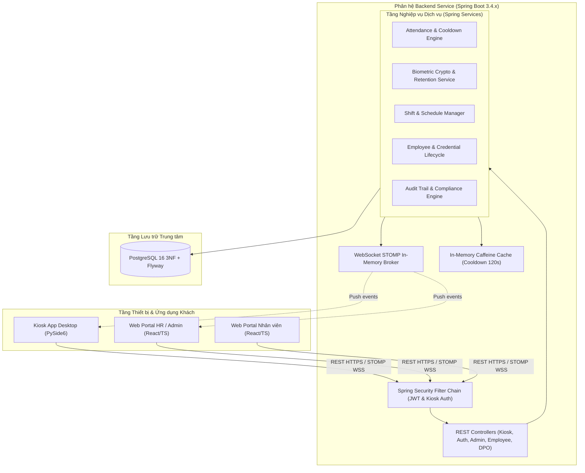

# SUBSYSTEM SPEC — Phân hệ Dịch vụ Trung tâm Backend (`backend-service`)

Tài liệu đặc tả kiến trúc lõi, bối cảnh vận hành và các quyết định kỹ thuật then chốt (`DD-BE-`) của phân hệ Backend theo chuẩn SDLC v3.0 ([sdlc-docs.md](../../../sdlc-docs.md) §7.1).

---

## 1. Bối cảnh & Ranh giới Kỹ thuật (Subsystem Context & Scope)

Phân hệ **Backend Service** (`backend-service`) đóng vai trò là "bộ não" trung tâm và hạt nhân điều phối của toàn bộ Hệ thống Điểm danh Khuôn mặt:
* **Nền tảng Công nghệ**: Java 21 LTS, Spring Boot 3.4.x, PostgreSQL 16, Caffeine Cache, WebSocket STOMP.
* **Giao tiếp Biên (Edge Integration)**: Cung cấp REST API hiệu năng cao tiếp nhận giao dịch điểm danh và đồng bộ ngoại tuyến từ trạm Kiosk (`kiosk-app`); phát sóng cập nhật danh mục vector tức thời qua STOMP.
* **Cung cấp Dịch vụ Nghiệp vụ (Web Portal Services)**: Cung cấp API quản lý nhân sự, phân ca, duyệt đơn giải trình, chốt kỳ công, báo cáo kiểm toán cho quản trị viên/HR và giao diện tự phục vụ cho nhân viên (`web-portal`).
* **Bảo vệ Dữ liệu & Tuân thủ Pháp lý (Compliance & Data Protection)**: Mã hóa tĩnh dữ liệu sinh trắc học AES-256-GCM, quản lý vòng đời Informed Consent, tự động quét tiêu hủy vector sau 20 ngày nghỉ việc theo Luật Bảo vệ Dữ liệu Cá nhân (Nghị định 13/2023/NĐ-CP và Luật 91/2025/QH15).

---

## 2. Kiến trúc Tầng Phân hệ (Layered Architecture)

1. **Security & Interception Layer**:
   - `JwtAuthenticationFilter`: Phân tích token Bearer, giải mã Claims, nạp `SecurityContext` cho người dùng Web.
   - `KioskAuthenticationFilter`: Thẩm định tiêu đề `X-Kiosk-Id` và Secret Token băm một chiều của trạm Kiosk.
   - `StompChannelInterceptor`: Thẩm định quyền kết nối và đăng ký lắng nghe từng Topic thời gian thực.
2. **Web / Controller Layer**:
   - Chuẩn hóa định dạng Envelope dữ liệu trả về theo `DD-SYS-012`.
   - Bắt và chuyển đổi ngoại lệ toàn cục qua `@RestControllerAdvice` theo RFC 7807 `ProblemDetails`.
3. **Business Service Layer**:
   - Quản lý giao dịch nguyên tử `@Transactional`.
   - Kiểm soát Cooldown quẹt thẻ 120s bằng bộ nhớ đệm Caffeine.
   - Mã hóa và giải mã vector sinh trắc học AES-256-GCM với IV ngẫu nhiên 12 bytes.
4. **Data Persistence Layer**:
   - Quản lý phiên bản cấu trúc CSDL bằng công cụ Flyway (`V1__initial_schema.sql` đến `V5__drop_must_change_password.sql`).
   - Kết nối CSDL thông qua HikariCP Connection Pool tối ưu cho tải đồng thời.
5. **Scheduled Jobs Layer**:
   - Quét định kỳ hàng ngày lúc 01:00 tiêu hủy dữ liệu sinh trắc học của nhân viên nghỉ việc quá 20 ngày.
   - Quét dọn các phiên OTP quá hạn 48 giờ.

---

## 3. Quyết định Kỹ thuật Phân hệ Backend (`DD-BE-`)

| ID | Decision | Rationale | Alternatives | Consequences | Basis | Status |
| :--- | :--- | :--- | :--- | :--- | :---: | :---: |
| `DD-BE-001` | Băm mật khẩu người dùng và mã OTP bằng BCrypt ($cost = 12$). | BCrypt tự động sinh muối (salt) và có độ phức tạp tính toán cao, chống lại hiệu quả các cuộc tấn công tra cứu bảng cầu vồng (Rainbow Table) và vét cạn (Brute-force). | SHA-256 thuần, Argon2id, PBKDF2 | Tăng tải CPU khi xác thực OTP hoặc đăng nhập nhưng bảo vệ tối đa an toàn mật khẩu. | `FR-BE-001`, `FR-BE-005` | Accepted |
| `DD-BE-002` | Áp dụng Spring AOP Interceptor cho việc ghi vết kiểm toán thay vì ghi log thủ công tại Service. | Tách biệt hoàn toàn mối quan tâm (Separation of Concerns), ngăn ngừa việc quên ghi log khi phát triển tính năng mới và tập trung hóa cấu trúc dữ liệu audit. | Ghi log thủ công trong từng Service, Sử dụng Hibernate Envers | Cần cấu hình Pointcut chuẩn xác để không bắt nhầm các phương thức đọc query dữ liệu thông thường. | `FR-BE-008`, `NFR-BE-005` | Accepted |
| `DD-BE-003` | Kiểm soát Cooldown 120s tầng máy chủ bằng Caffeine Cache in-memory. | Giảm $95\%$ áp lực truy vấn kiểm tra trùng lặp xuống CSDL PostgreSQL trong giờ cao điểm điểm danh đầu ca, đảm bảo độ trễ phản hồi API luôn $\le 100\text{ ms}$. | Truy vấn SELECT trực tiếp PostgreSQL, Dùng Redis cache ngoài | Dữ liệu cooldown lưu trong RAM máy chủ đơn cụm; khi restart máy chủ bộ đệm sẽ được làm mới. | `FR-BE-002`, `NFR-BE-001` | Accepted |
| `DD-BE-004` | Mã hóa vector sinh trắc học ArcFace bằng AES-256-GCM với IV 12-byte ngẫu nhiên. | Chuẩn mã hóa có xác thực (Authenticated Encryption) bảo vệ tính bí mật và toàn vẹn dữ liệu sinh trắc học; IV sinh mới mỗi lần ghi ngăn chặn suy đoán mã hóa lặp. | AES-CBC với HMAC riêng, RSA bất đối xứng | Phải lưu trữ riêng cột IV (12 bytes) và Auth Tag (16 bytes) đi kèm chuỗi ciphertext BYTEA trong PostgreSQL. | `FR-BE-006`, `NFR-BE-003` | Accepted |
| `DD-BE-005` | Chuẩn hóa 3NF và ràng buộc duy nhất tự nhiên `(user_id, punch_timestamp, punch_type)` cho bảng `attendance_logs`. | Đảm bảo tính toàn vẹn dữ liệu ở cấp CSDL, hỗ trợ cơ chế Idempotency chống ghi trùng lặp khi trạm Kiosk gửi bù gói lô ngoại tuyến. | Khóa chính UUID không ràng buộc duy nhất, Kiểm tra SELECT trước khi INSERT | Giao dịch INSERT trùng lặp sẽ phát sinh lỗi vi phạm khóa duy nhất; luồng đồng bộ áp dụng `ON CONFLICT DO NOTHING`. | `DATA-BE-009`, `FR-BE-003` | Accepted |
| `DD-BE-006` | Sử dụng Flyway Migration quản lý phiên bản schema thay cho auto DDL của Hibernate. | Kiểm soát 100% các câu lệnh DDL thực thi trên Production, ngăn ngừa rủi ro tự động drop/alter cột làm mất dữ liệu nhạy cảm. | Hibernate `hbm2ddl.auto = update`, Dùng Liquibase | Mọi thay đổi cấu trúc bảng bắt buộc phải tạo file script migration `V*__*.sql` mới và kiểm thử kỹ lưỡng. | `DATA-BE-001`, `STK-013` | Accepted |
| `DD-BE-007` | Lưu trữ vector sinh trắc dạng `BYTEA` (AES-256-GCM ciphertext + IV) thay vì pgvector trên CSDL PostgreSQL. | Đáp ứng tuyệt đối yêu cầu bảo vệ dữ liệu ở trạng thái tĩnh (Encryption-at-Rest) theo Luật 91/2025/QH15; việc so khớp khuôn mặt 1:N được phân tán thực thi tại RAM Kiosk. | Dùng extension pgvector lưu vector thô, Lưu dạng chuỗi Base64 | Không thể truy vấn vector tương đồng trực tiếp bằng SQL trên CSDL, nhưng tối ưu chi phí và bảo mật tuyệt đối. | `DATA-BE-015`, `NFR-BE-003` | Accepted |
| `DD-BE-008` | Thiết kế Append-Only cho bảng `audit_logs` với cấu trúc JSONB cho `before_state` và `after_state`. | Bảo toàn tính bất biến của lịch sử kiểm toán phục vụ thanh tra, đồng thời linh hoạt lưu trữ biến động dữ liệu đa thực thể mà không cần can thiệp schema. | Tạo bảng lịch sử riêng biệt cho từng thực thể, Lưu text JSON phẳng | Chiếm dụng thêm dung lượng lưu trữ CSDL cho các trường JSONB; cần thiết lập chỉ mục GIN nếu cần tìm kiếm sâu trong JSON. | `DATA-BE-008`, `DATA-BE-014` | Accepted |
| `DD-BE-009` | Chuẩn hóa mô hình báo lỗi theo chuẩn RFC 7807 ProblemDetails. | Đem lại cấu trúc lỗi máy đọc được (Machine-readable) đồng nhất cho mọi client Web và Kiosk, hỗ trợ chi tiết các trường vi phạm validation. | Tự định nghĩa cấu trúc JSON báo lỗi tự do (thiếu tính chuẩn hóa). | Mọi Controller Advice phải map thống nhất về class `ProblemDetail` của Spring Boot; client dễ dàng bóc tách mã lỗi `code` và danh sách vi phạm `invalidParams`. | `API-BE-016`, `STK-011` | Accepted |
| `DD-BE-010` | Sử dụng tiêu đề tùy biến `X-Kiosk-Id` kết hợp Secret Bearer Token cho máy trạm Kiosk. | Định danh rõ ràng phần cứng máy trạm phát sinh giao dịch, cho phép vô hiệu hóa tức thời từng trạm Kiosk riêng biệt khi có rủi ro lộ khóa. | Dùng chung 1 tài khoản JWT Service Account cho toàn bộ Kiosk (không cô lập được trạm bị thỏa hiệp). | Mỗi máy trạm Kiosk khi lắp đặt phải được cấp phát cặp `kioskId` và Secret Token riêng; Backend lọc và xác thực ngay tại tầng Security Filter. | `API-BE-003`, `API-BE-015` | Accepted |
| `DD-BE-011` | Cấu hình kênh STOMP chia tách tiền tố `/topic` (Public broadcast) và `/user` (Private unicast). | Tối ưu lưu lượng truyền thông thời gian thực: chỉ phát sóng dữ liệu chung tới subscriber liên quan, dữ liệu phiên OTP được cô lập cho người dùng đích. | Dùng một topic chung duy nhất đẩy toàn bộ sự kiện cho client tự lọc (rò rỉ bảo mật OTP). | Cần cấu hình `ChannelInterceptor` thẩm định quyền subscribe từng topic; đảm bảo Kiosk chỉ nhận thông điệp gallery và Web nhận sự kiện attendance. | `API-BE-012`, `API-BE-013`, `API-BE-014` | Accepted |
| `DD-BE-012` | Giới hạn kích thước gói lô đồng bộ bù ngoại tuyến tối đa 50 bản ghi/request. | Ngăn chặn hiện tượng nghẽn luồng kết nối và khóa bảng CSDL kéo dài khi hàng loạt trạm Kiosk đồng loạt gửi bù dữ liệu sau sự cố mất mạng diện rộng. | Gửi từng bản ghi đơn lẻ nối tiếp hoặc gửi một gói không giới hạn. | Phía trạm Kiosk phải phân trang hàng đợi SQLite ngoại tuyến thành các lô 50 bản ghi; Backend xử lý batch insert có `ON CONFLICT DO NOTHING` trong $\le 50\text{ ms}$. | `API-BE-004`, `NFR-BE-001` | Accepted |
| `DD-BE-013` | Cấp mật khẩu ban đầu bằng mật khẩu tạm do hệ thống sinh; nhân viên được phép đổi mật khẩu bất kỳ lúc nào nhưng **không** bị bắt buộc. | Backend là nơi duy nhất sinh và băm mật khẩu nên HR không phải nghĩ/ghi nhớ mật khẩu của nhân viên; không cần hạ tầng gửi thư điện tử; nhân viên vào hệ thống dùng được ngay, không phát sinh bước chặn bắt buộc. | HR tự nhập mật khẩu ban đầu; gửi email kèm liên kết đặt mật khẩu; buộc đổi mật khẩu ở lần đăng nhập đầu (đã bị loại). | Cờ `must_change_password` đã được gỡ khỏi lược đồ ở `V5__drop_must_change_password.sql` và `SOL-BE-015` chuyển `Deprecated`; mật khẩu tạm chỉ hiển thị một lần nên HR phải bàn giao ngay. | `FR-BE-011`, `API-BE-017`, `API-BE-020` | Accepted |
| `DD-BE-014` | Chặn nghiệp vụ bằng bộ lọc sau xác thực JWT thay vì xử lý trong từng controller. | Bảo đảm không endpoint nghiệp vụ nào bị bỏ sót khi bổ sung sau này; tách biệt mối quan tâm giữa xác thực và vòng đời thông tin xác thực. | Kiểm tra thủ công trong từng controller; chặn ngay trong chuỗi Spring Security Filter. | Cần danh sách trắng endpoint (đổi mật khẩu, refresh token) và khi thêm endpoint mới phải cân nhắc danh sách này. | `FR-BE-011`, `API-BE-020`, `API-SYS-021` | Accepted |
| `DD-BE-015` | Thẩm định mã PIN tại máy chủ, giữ nguyên băm PIN trong Backend và phân biệt lỗi sai PIN với lỗi khóa brute-force. | Băm PIN không bao giờ rời máy chủ; trạm Kiosk chỉ nhận kết quả thẩm định; tách mã lỗi `PIN_INVALID` (401) và `PIN_LOCKED` (423) giúp Kiosk hiển thị đúng thông điệp và đếm ngược khóa 15 phút. | Thẩm định cục bộ tại Kiosk bằng băm PIN tải kèm Gallery; gộp chung một mã lỗi cho mọi trường hợp thất bại. | Luồng điểm danh bằng PIN bắt buộc có kết nối mạng tới Backend; mọi hành vi thẩm định PIN tập trung một nơi để kiểm thử. | `FR-BE-012`, `API-BE-022`, `DATA-SYS-012` | Accepted |
| `DD-BE-016` | Ánh xạ HTTP status riêng cho vòng đời thông tin xác thực: 401 `PIN_INVALID`, 423 `PIN_LOCKED`. | Client Kiosk và Web cần phân biệt "sai PIN" và "PIN đang bị khóa" để hiển thị đúng thông báo và đếm ngược thời gian khóa, thay vì gộp chung một lỗi 401/400. | Gộp mọi thất bại xác thực vào 401 `AUTH_INVALID_CREDENTIALS`. | Bổ sung hai mã lỗi vào từ điển; mã 423 `PIN_LOCKED` kèm thời điểm mở khóa trong `invalidParams`/`message`. | `API-BE-022`, `API-SYS-021` | Accepted |
| `DD-BE-017` | Kiểm tra chồng lấn lịch phân ca ở tầng dịch vụ trong giao dịch có khóa theo `user_id`, không dựa vào ràng buộc loại trừ của PostgreSQL. | Đồng bộ với `DD-SYS-018`; PostgreSQL cần extension `btree_gist` cho `EXCLUDE USING gist` trên khoảng ngày, không chạy được trên profile kiểm thử H2; kiểm tra nghiệp vụ cho thông điệp 409 rõ ràng và kiểm thử được ở mọi môi trường. | Chỉ dùng `EXCLUDE USING gist` (phụ thuộc extension); không kiểm tra (cho phép dữ liệu công sai lệch). | Cần khóa theo `user_id` để tránh hai yêu cầu phân ca đồng thời cùng vượt qua kiểm tra; bổ sung chỉ mục `(user_id, effective_from, effective_to)` và ca kiểm thử âm. | `FR-BE-013`, `DATA-BE-017`, `DD-SYS-018` | Accepted |
| `DD-BE-018` | Duyệt đơn giải trình cập nhật bản ghi điểm danh trong cùng giao dịch với việc đổi trạng thái đơn và ghi `audit_logs`; nhân viên chỉ nộp được cho bản ghi của chính mình trong 30 ngày gần nhất. | Tránh trạng thái nửa vời (đơn đã duyệt nhưng bảng công chưa điều chỉnh); giới hạn 30 ngày ngăn việc sửa dữ liệu công đã chốt/kết xuất báo cáo; vết kiểm toán luôn khớp dữ liệu. | Cập nhật bảng công bằng tác vụ nền; cho phép nộp đơn vô thời hạn. | Cần khoá bản ghi điểm danh khi duyệt để tránh hai đơn cùng sửa một bản ghi; đơn đã `APPROVED`/`REJECTED` không đổi trạng thái lần nữa. | `FR-BE-014`, `FR-BE-015`, `API-BE-029`, `DD-SYS-021` | Accepted |
| `DD-BE-019` | Tra cứu `audit_logs` và dữ liệu tuân thủ qua API chỉ đọc; role `DPO` tách khỏi `ADMIN`; không tồn tại repository cập nhật/xoá cho `audit_logs`. | Giữ nguyên tính bất biến của nhật ký (`NFR-BE-005`) trong khi vẫn đáp ứng quyền hạn của `ACT-003`/`ACT-004`; đặc quyền tối thiểu cho dữ liệu cá nhân. | Cho `ADMIN` làm mọi tra cứu; đọc trực tiếp CSDL bằng công cụ ngoài. | Cần bổ sung role `DPO` vào RBAC và danh sách trắng endpoint chỉ đọc; cần ca kiểm thử âm cho role không đủ quyền. | `FR-BE-016`, `API-BE-030`, `API-BE-031`, `DD-SYS-019` | Accepted |
| `DD-BE-020` | Secret Token trạm Kiosk sinh một lần và băm một chiều; đổi token vô hiệu hóa token cũ ngay lập tức; vô hiệu hóa trạm thay vì xoá bản ghi. | Đồng bộ với `DD-SYS-020`; bảo toàn tham chiếu `attendance_logs.kiosk_id`; tránh lưu plaintext token; cho phép thu hồi tức thì khi trạm mất thiết bị. | Lưu token plaintext; xoá bản ghi trạm. | Token chỉ hiển thị một lần buộc quy trình bàn giao phải lưu tạm an toàn; bộ lọc xác thực Kiosk phải kiểm tra trạng thái hoạt động của trạm. | `FR-BE-017`, `API-BE-032`, `API-BE-033`, `DD-SYS-020` | Accepted |
| `DD-BE-021` | Bootstrap đọc thông tin tài khoản quản trị đầu tiên từ biến môi trường khi khởi động và tự vô hiệu hóa sau khi tạo thành công, thay vì seed sẵn trong migration. | Đồng bộ với `DD-SYS-022`; giữ yêu cầu "không mật khẩu mặc định" của `SRS-005` mà vẫn có đường triển khai trên CSDL trống; tách bạch dữ liệu khởi tạo khỏi lược đồ. | Seed `admin/admin` trong Flyway; yêu cầu DBA tạo tài khoản bằng SQL tay. | Cần biến môi trường bắt buộc ở lần chạy đầu và quy trình vận hành bàn giao mật khẩu tạm; bootstrap phải idempotent để an toàn khi restart. | `FR-BE-018`, `SRS-005`, `DD-SYS-022` | Accepted |
| `DD-BE-022` | Cấp lại mật khẩu tạm thu hồi mật khẩu tạm cũ và toàn bộ refresh token của tài khoản; đặt lại PIN yêu cầu xác thực bằng mật khẩu hiện tại. | Đồng bộ với `DD-SYS-023`; bảo đảm "mất mật khẩu" không trở thành mất quyền truy cập vĩnh viễn mà vẫn giữ kiểm soát danh tính; không cần hạ tầng email/SMS. | Cho phép nhân viên tự đặt lại mật khẩu không cần HR; giữ nguyên phiên cũ sau khi cấp lại mật khẩu. | Cần giao diện HR cấp lại mật khẩu và giao diện nhân viên đặt lại PIN; mọi thao tác phải ghi audit và sinh thông báo. | `FR-BE-019`, `API-BE-036`, `API-BE-037`, `DD-SYS-023` | Accepted |
| `DD-BE-023` | Refresh token lưu dạng băm một chiều trong bảng phiên kèm hạn dùng; thu hồi theo tài khoản; mỗi yêu cầu kiểm tra trạng thái tài khoản chứ không chỉ chữ ký token. | Đồng bộ với `DD-SYS-026`; cần thu hồi tức thì khi nhân viên thôi việc đột xuất hoặc đổi mật khẩu, điều mà JWT thuần không làm được; kiểm tra trạng thái tài khoản bịt khoảng trễ của access token 1 giờ. | JWT thuần không trạng thái; token phiên 8 giờ không refresh. | Cần thêm thực thể phiên và chỉ mục theo tài khoản; mọi luồng đổi/cấp lại mật khẩu và vô hiệu hóa nhân sự phải gọi thu hồi; chi phí thêm một truy vấn trạng thái tài khoản mỗi yêu cầu được bù bằng cache. | `FR-BE-020`, `API-BE-038`, `DATA-BE-022`, `DD-SYS-026` | Accepted |
| `DD-BE-024` | Kiểm tra kỳ công đã chốt ở tầng dịch vụ, dùng chung cho cả nộp đơn, duyệt đơn và điều chỉnh công; kỳ công là thực thể riêng theo tháng. | Đồng bộ với `DD-SYS-024`; một điểm kiểm tra duy nhất tránh bỏ sót đường điều chỉnh; khoá theo kỳ phù hợp nghiệp vụ lương/tháng. | Kiểm tra rải rác trong từng controller; chặn theo mốc thời gian từng bản ghi. | Mọi luồng điều chỉnh công phải đi qua bộ kiểm tra này; mở lại kỳ phải ghi audit kèm lý do; cần ca kiểm thử cho kỳ `LOCKED`. | `FR-BE-021`, `API-BE-039`, `DATA-BE-021`, `DD-SYS-024` | Accepted |
| `DD-BE-025` | Rút Consent loại nhân sự khỏi gallery Kiosk và chặn sinh OTP ngay lập tức, nhưng tiêu hủy dữ liệu sinh trắc theo hạn 7 ngày; mọi chuyển trạng thái yêu cầu dữ liệu cá nhân sinh thông báo. | Đồng bộ với `DD-SYS-025`; dừng ngay việc xử lý sinh trắc (không còn cơ sở pháp lý) trong khi vẫn giữ cửa sổ đối soát khiếu nại; thông báo giúp nhân viên biết yêu cầu đã được tiếp nhận. | Tiêu hủy tức thời trong cùng giao dịch; giữ tới 20 ngày như luồng thôi việc. | Cần thực thể vết rút Consent + yêu cầu dữ liệu cá nhân; luồng điểm danh của nhân sự đã rút Consent chỉ còn PIN; cần ca kiểm thử cho gallery và OTP. | `FR-BE-022`, `API-BE-041`, `API-BE-042`, `DATA-BE-023`, `DATA-BE-024` | Accepted |
| `DD-BE-026` | Chặn hạ cấp hoặc thu hồi role của tài khoản `ADMIN` đang hoạt động cuối cùng bằng phép đếm trong cùng giao dịch với thao tác cập nhật role. | Đồng bộ với `SOL-SYS-029`; tránh khoá cứng hệ thống do mất hết quyền quản trị; phép đếm trong cùng giao dịch ngăn hai yêu cầu đồng thời cùng hạ cấp hai ADMIN cuối. | Kiểm tra ở tầng ứng dụng không khoá; cấm hoàn toàn việc thu hồi role ADMIN. | Cần khoá hoặc `SELECT ... FOR UPDATE` khi đếm ADMIN; mọi thay đổi role phải ghi audit giá trị trước/sau; cần ca kiểm thử hai yêu cầu đồng thời. | `FR-BE-023`, `API-BE-043`, `SRS-006` | Accepted |
