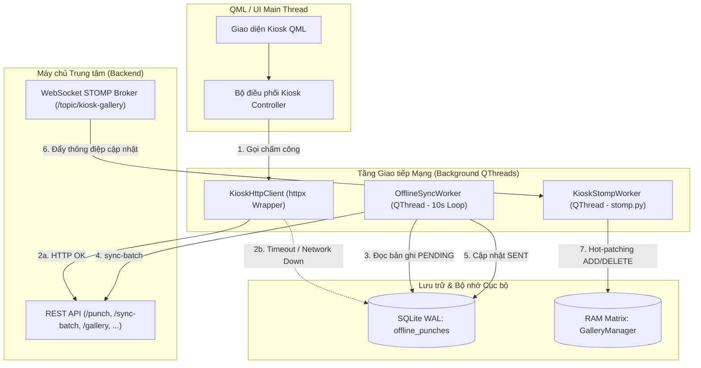
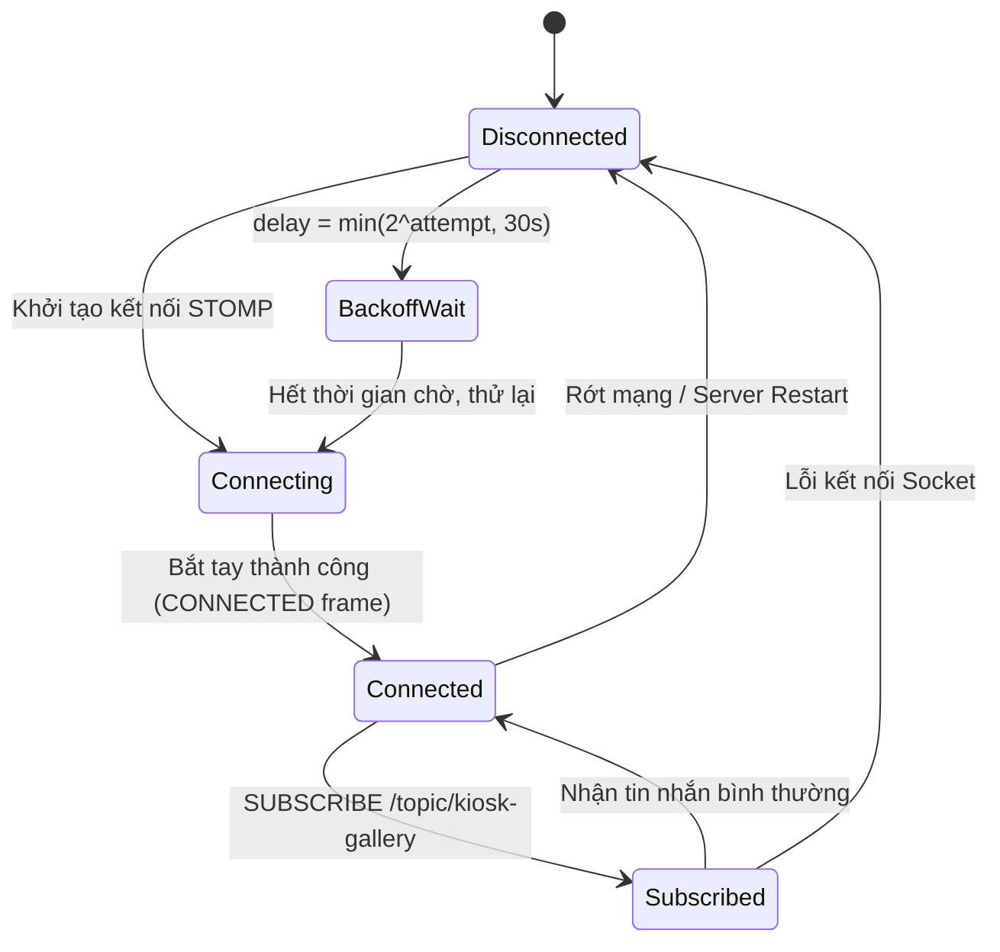
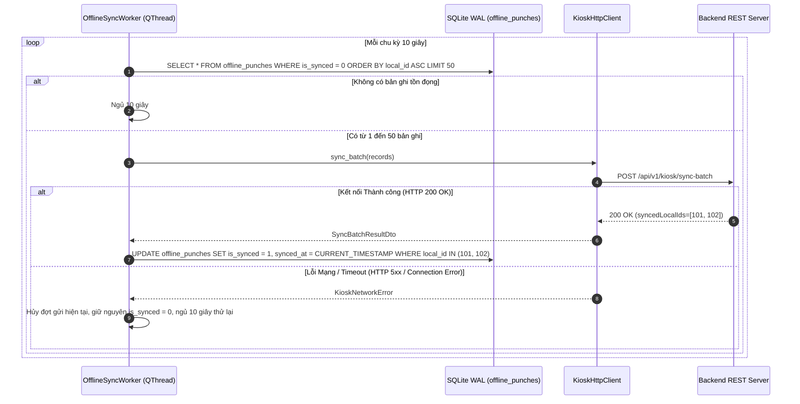

# API SPECS & DESIGN — Đặc tả Giao diện & Thiết kế Mạng Phân hệ Kiosk

Tài liệu hợp nhất toàn bộ đặc tả giao diện (`API-KSK-`) và thiết kế chi tiết kết nối mạng (`APD-KSK-`) của máy trạm Kiosk với phân hệ Backend theo chuẩn SDLC v3.0 ([sdlc-docs.md](../../../sdlc-docs.md) §7.2).

---

## 1. Kiến trúc Máy trạm Mạng Kiosk (Network Clients Architecture)

Máy trạm Kiosk tương tác với Backend qua 2 kênh truyền thông chính:
1. **Kênh Đồng bộ / Bán đồng bộ RESTful qua TLS 1.3**: Thực hiện xác thực, gửi giao dịch chấm công, đồng bộ gói lô ngoại tuyến, kiểm tra mã PIN/OTP và gửi nhịp tim định kỳ.
2. **Kênh Thời gian thực WebSocket STOMP**: Lắng nghe các biến động danh mục nhân sự và nạp nóng đặc trưng khuôn mặt (Hot-patching RAM Matrix).



### Danh mục Thành phần Thiết kế Giao tiếp Mạng

| ID | Name | Definition | Uses | Realizes | Decisions | Status |
| :--- | :--- | :--- | :--- | :--- | :---: | :---: |
| `APD-KSK-001` | `KioskHttpClient` REST Client Wrapper | Thực hiện các lệnh gọi REST API đồng bộ/bất đồng bộ với timeout 3.0s; tự động tiêm Header xác thực (`X-Kiosk-Id`, Bearer Token); ánh xạ mã lỗi HTTP sang domain exceptions. | `STK-007` | `API-KSK-001`, `API-KSK-002`, `API-KSK-003`, `API-KSK-004`, `API-KSK-005`, `API-KSK-007`, `API-KSK-008` | `DD-SYS-001` | Accepted |
| `APD-KSK-002` | `KioskStompWorker` Real-time Receiver | Luồng nền `QThread` duy trì kết nối WebSocket STOMP tới Backend qua `stomp.py`, lắng nghe `/topic/kiosk-gallery`; tự động kết nối lại và phát tín hiệu nạp nóng vector. | `STK-008`, `STK-003` | `API-KSK-006` | `DD-SYS-001` | Accepted |
| `APD-KSK-003` | `OfflineSyncWorker` Batch Uploader | Luồng nền `QThread` quét hàng đợi SQLite `offline_punches` mỗi 10s, gom tối đa 50 bản ghi gửi `sync-batch` và cập nhật trạng thái đã gửi thành công. | `STK-005`, `STK-003` | `API-KSK-002` | `DD-SYS-005` | Accepted |
| `APD-KSK-004` | REST API Field-by-Field Contracts & Error Mapping | Quy chuẩn định dạng JSON, validation tham số và ánh xạ mã lỗi HTTP ProblemDetails cho toàn bộ các endpoint của trạm Kiosk. | `STK-007` | `API-KSK-001`, `API-KSK-007` | `DD-SYS-001` | Accepted |

---

## 2. Đặc tả Giao diện Tiêu thụ (Consumed Interfaces Specifications)

| ID | Statement | Category | Priority | Basis (Backend Contract) | Acceptance | Status |
| :--- | :--- | :--- | :---: | :--- | :--- | :---: |
| `API-KSK-001` | Tiêu thụ giao diện `POST /api/v1/kiosk/punch`: Gửi sự kiện điểm danh trực tuyến ngay sau khi xác thực thành công. | REST | Must | `API-BE-003`, `FR-SYS-005`, `ARC-005` | Header `X-Kiosk-Id`, timeout 3.0s, Backend phản hồi $\le 100\text{ ms}$; khi lỗi mạng tự động chuyển ghi SQLite WAL. | Approved |
| `API-KSK-002` | Tiêu thụ giao diện `POST /api/v1/kiosk/sync-batch`: Đẩy gói lô tối đa 50 bản ghi điểm danh ngoại tuyến khi mạng phục hồi. | REST | Must | `API-BE-004`, `FR-SYS-006`, `ARC-005` | Phản hồi $\le 2000\text{ ms}$; nhận danh sách ID đã lưu; cập nhật `is_synced = 1` trong SQLite cục bộ; chống trùng bằng khóa `(kioskId, localId)`. | Approved |
| `API-KSK-003` | Tiêu thụ giao diện `GET /api/v1/kiosk/gallery`: Tải toàn bộ danh mục vector 512D của nhân sự `ACTIVE` khi Kiosk khởi động. | REST | Must | `API-BE-005`, `FR-SYS-003`, `ARC-005` | Phản hồi $\le 3000\text{ ms}$; hỗ trợ nén `gzip` qua TLS 1.3; nạp đủ $N$ vector vào RAM; fallback nạp từ `local_gallery_cache` nếu mất mạng. | Approved |
| `API-KSK-004` | Tiêu thụ giao diện `POST /api/v1/kiosk/verify-otp`: Xác thực mã OTP 6 số nhân viên nhập tại Kiosk để mở khóa quét mặt và nhận `sessionToken`. | REST | Must | `API-BE-006`, `FR-SYS-008`, `ARC-005` | Phản hồi $\le 1000\text{ ms}$; nhận `sessionToken` và thông tin nhân viên khi OTP hợp lệ; hiển thị thông báo lỗi khi OTP sai/hết hạn. | Approved |
| `API-KSK-005` | Tiêu thụ giao diện `POST /api/v1/kiosk/enroll-face`: Gửi vector đặc trưng 512D chuẩn hóa L2 kèm `sessionToken` và mã OTP để lưu CSDL và kích hoạt hồ sơ. | REST | Must | `API-BE-007`, `FR-SYS-009`, `ARC-005` | Phản hồi $\le 1500\text{ ms}$; nhận xác nhận HTTP 200; tự hủy OTP (burn-after-use); cập nhật tức thì vector mới vào Gallery RAM Kiosk. | Approved |
| `API-KSK-006` | Lắng nghe kênh STOMP Topic `/topic/kiosk-gallery`: Đón nhận thông điệp nạp nóng vector mới hoặc xóa nhân sự thôi việc. | WebSocket | Must | `Backend-STOMP-4.2`, `FR-SYS-014`, `ARC-006` | Cập nhật ma trận RAM tức thời qua Atomic Swap mà không làm giật khung hình camera; tự kết nối lại khi đứt mạng. | Approved |
| `API-KSK-007` | Tiêu thụ giao diện `POST /api/v1/kiosk/verify-pin`: Xác thực mã PIN 6 số của nhân viên qua Backend trước khi ghi nhận điểm danh. | REST | Must | `API-BE-022`, `FR-SYS-004`, `ARC-001` | Phản hồi $\le 1000\text{ ms}$; trả HTTP 200 kèm danh tính nếu PIN đúng; trả 401 nếu sai kèm lượt thử; trả 423 kèm `lockedUntil` nếu sai quá 5 lần. | Approved |
| `API-KSK-008` | Tiêu thụ giao diện `GET /api/v1/kiosk/health`: Kiểm tra kết nối mạng và sẵn sàng phục vụ của Backend (Public / permitAll). | REST | Must | `API-BE-045`, `FR-SYS-020`, `ARC-012` | Phản hồi $\le 200\text{ ms}$; trả về `{"status": "UP"}` xác nhận kết nối máy chủ sẵn sàng; chuyển chế độ ngoại tuyến nếu mất kết nối. | Approved |

---

## 3. Hợp đồng Chi tiết Từng Endpoint REST (Field-by-Field Contracts)

### 3.1. `API-KSK-001` — `POST /api/v1/kiosk/punch`

* **Mục đích**: Gửi giao dịch chấm công trực tuyến tức thời từ Kiosk lên Backend.
* **Client Handler**: `KioskHttpClient.send_punch(employee_id, method, score=None) -> PunchResultDto`
* **Request Headers**:
  ```http
  Content-Type: application/json; charset=UTF-8
  X-Kiosk-Id: KIOSK-HN-01
  Authorization: Bearer {kiosk_token}
  ```
* **Request Payload Schema (JSON)**:
  | Tên Trường | Kiểu Dữ liệu | Bắt buộc | Ràng buộc Giá trị | Mô tả Chi tiết |
  | :--- | :--- | :---: | :--- | :--- |
  | `employeeId` | `int64` | Có | $> 0$ | Mã ID nhân viên định danh từ kết quả so khớp Gallery RAM. |
  | `punchTimestamp` | `string` | Có | ISO-8601 kèm offset | Mốc thời gian quét từ đồng hồ hệ thống Kiosk (`YYYY-MM-DDTHH:mm:ss.sss+07:00`). |
  | `verificationMethod` | `string` | Có | `VERIFICATION_FACE` \| `VERIFICATION_PIN` | Hình thức chấm công thực tế đã thực hiện tại Kiosk. |
  | `confidenceScore` | `float` | Không | $0.0 \le score \le 1.0$ | Điểm cosine tương đồng đối với khuôn mặt; `null` đối với mã PIN. |
  | `kioskId` | `string` | Có | Khớp cấu hình trạm | Mã định danh phần cứng của Kiosk (`KIOSK-HN-01`). |

  *Ví dụ Request Payload:*
  ```json
  {
    "employeeId": 1042,
    "punchTimestamp": "2026-10-06T08:30:15.123+07:00",
    "verificationMethod": "VERIFICATION_FACE",
    "confidenceScore": 0.882,
    "kioskId": "KIOSK-HN-01"
  }
  ```

* **Phản hồi 200 OK (Chuẩn hóa Envelope `DD-SYS-012`)**:
  ```json
  {
    "success": true,
    "code": "OK",
    "message": "Punch recorded successfully",
    "data": {
      "recordId": 9812,
      "employeeCode": "NV-1042",
      "fullName": "Ngô Văn Dũng",
      "punchType": "CHECK_IN",
      "status": "ON_TIME",
      "lateMinutes": 0,
      "department": "Phòng Kỹ thuật"
    },
    "timestamp": "2026-10-06T08:30:15.350Z"
  }
  ```

* **Xử lý Biên & Ngoại lệ tại Kiosk**:
  * **Lỗi `409 Conflict` (hoặc `429 Too Many Requests`) (`COOLDOWN_ACTIVE`)**: Quét lặp trong 120s; Response trả `{"success": false, "code": "COOLDOWN_ACTIVE", "message": "Cooldown window active", "timestamp": "..."}`; Kiosk hiển thị "Đã ghi nhận", không ghi offline.
  * **Lỗi Mạng (`httpx.TimeoutException`, `httpx.ConnectError`, HTTP 5xx)**:
    1. Kích hoạt ngoại lệ nội bộ `KioskNetworkFallback`.
    2. Chuyển đổi payload thành bản ghi SQLite: `INSERT INTO offline_punches (employee_id, punch_timestamp, verification_method, confidence_score, status) VALUES (...)`.
    3. Hiển thị thông báo: "Điểm danh ngoại tuyến thành công - Dữ liệu sẽ tự động đồng bộ khi có mạng".

---

### 3.2. `API-KSK-002` — `POST /api/v1/kiosk/sync-batch`

* **Mục đích**: Đẩy gói lô tối đa 50 bản ghi điểm danh ngoại tuyến khi kết nối mạng phục hồi.
* **Client Handler**: `OfflineSyncWorker.sync_batch(records) -> SyncBatchResultDto`
* **Khóa chống trùng lặp (Idempotency Key)**: Bộ đôi `(kioskId, localId)` (`D13`). Backend áp dụng quy tắc `ON CONFLICT DO NOTHING` trên `(kiosk_id, local_id)` đảm bảo gửi lại không bao giờ sinh duplicate punch.
* **Request Payload Schema (JSON)**:
  | Tên Trường | Kiểu Dữ liệu | Bắt buộc | Ràng buộc Giá trị | Mô tả Chi tiết |
  | :--- | :--- | :---: | :--- | :--- |
  | `kioskId` | `string` | Có | Không rỗng | Mã trạm Kiosk thực hiện đồng bộ. |
  | `batchSize` | `int` | Có | $1 \le batchSize \le 50$ | Số lượng phần tử trong mảng `records`. |
  | `records` | `array[object]` | Có | Độ dài bằng `batchSize` | Danh sách các bản ghi điểm danh ngoại tuyến. |

  *Cấu trúc từng phần tử trong `records`:*
  | Trường con | Kiểu | Mô tả |
  | :--- | :--- | :--- |
  | `localId` | `int64` | Khóa chính tự tăng `local_id` trong bảng SQLite `offline_punches` (hoặc `localQueueId`). |
  | `employeeId` | `int64` | ID nhân viên đã chấm công lúc ngoại tuyến. |
  | `punchTimestamp` | `string` | Chuỗi ISO-8601 thời điểm quẹt ngoại tuyến thực tế. |
  | `verificationMethod` | `string` | `VERIFICATION_FACE` hoặc `VERIFICATION_PIN`. |
  | `confidenceScore` | `float` | Điểm cosine matching lúc ngoại tuyến hoặc `null`. |
  | `kioskId` | `string` | Mã định danh trạm Kiosk. |

  *Ví dụ Request Payload:*
  ```json
  {
    "kioskId": "KIOSK-HN-01",
    "batchSize": 2,
    "records": [
      {
        "localId": 101,
        "employeeId": 1042,
        "punchTimestamp": "2026-10-06T07:55:00.000+07:00",
        "verificationMethod": "VERIFICATION_FACE",
        "confidenceScore": 0.891,
        "kioskId": "KIOSK-HN-01"
      },
      {
        "localId": 102,
        "employeeId": 1045,
        "punchTimestamp": "2026-10-06T07:58:12.000+07:00",
        "verificationMethod": "VERIFICATION_PIN",
        "confidenceScore": null,
        "kioskId": "KIOSK-HN-01"
      }
    ]
  }
  ```

* **Phản hồi 200 OK (Chuẩn hóa Envelope `DD-SYS-012`)**:
  ```json
  {
    "success": true,
    "code": "OK",
    "message": "Batch synced successfully",
    "data": {
      "syncedCount": 2,
      "syncedLocalIds": [101, 102]
    },
    "timestamp": "2026-10-06T08:05:00.120Z"
  }
  ```

* **Hành vi Xử lý Client sau phản hồi**:
  ```sql
  UPDATE offline_punches 
  SET is_synced = 1, synced_at = CURRENT_TIMESTAMP 
  WHERE local_id IN (101, 102);
  ```

---

### 3.3. `API-KSK-003` — `GET /api/v1/kiosk/gallery`

* **Mục đích**: Tải toàn bộ danh mục vector 512D của nhân sự `ACTIVE` khi Kiosk khởi động.
* **Client Handler**: `KioskHttpClient.fetch_gallery() -> GalleryPayloadDto`
* **Bảo mật & Nén kênh truyền**: Toàn bộ dữ liệu truyền qua TLS 1.3; hỗ trợ tiêu đề `Accept-Encoding: gzip` và Backend nén `Content-Encoding: gzip` để giảm dung lượng mạng từ ~10MB xuống ~2MB cho 1,000 nhân sự.
* **Phản hồi 200 OK (Chuẩn hóa Envelope `DD-SYS-012`)**:
  ```json
  {
    "success": true,
    "code": "OK",
    "message": "Gallery retrieved successfully",
    "data": {
      "version": 12,
      "totalCount": 1000,
      "employees": [
        {
          "employeeId": 1042,
          "employeeCode": "NV-1042",
          "fullName": "Ngô Văn Dũng",
          "department": "Phòng Kỹ thuật",
          "vector": [0.0234, -0.0152, 0.0891, "... /* Mảng 512 số thực float32 (2048 bytes) */"]
        }
      ]
    },
    "timestamp": "2026-10-06T07:00:00.000Z"
  }
  ```
* **Xử lý Dữ liệu tại Kiosk**:
  * Chuyển đổi danh sách `employees` thành mảng NumPy 2 chiều $\mathbf{M} \in \mathbb{R}^{N \times 512}$ và nạp vào `GalleryManager`.
  * Ghi đồng thời vào bảng SQLite `local_gallery_cache` (`DATA-KSK-007`).
  * Nếu lỗi mạng hoặc timeout 3.0s, Kiosk nạp dữ liệu từ bảng SQLite `local_gallery_cache`.

---

### 3.4. `API-KSK-004` — `POST /api/v1/kiosk/verify-otp`

* **Mục đích**: Xác thực mã Onboarding OTP 6 số nhân viên nhập tại màn hình đăng ký khuôn mặt để nhận `sessionToken` mở khóa phiên quét mặt.
* **Client Handler**: `KioskHttpClient.verify_otp(otp: str) -> OtpVerificationResultDto`
* **Request Headers**:
  ```http
  Content-Type: application/json; charset=UTF-8
  X-Kiosk-Id: KIOSK-HN-01
  Authorization: Bearer {kiosk_token}
  ```
* **Request Payload**:
  ```json
  {
    "otp": "123456",
    "kioskId": "KIOSK-HN-01"
  }
  ```
* **Phản hồi 200 OK (Chuẩn hóa Envelope `DD-SYS-012`)**:
  ```json
  {
    "success": true,
    "code": "OTP_VERIFIED",
    "message": "Xác thực mã OTP thành công",
    "data": {
      "sessionToken": "7baea8fe110b4a53a010be94f392b424",
      "employeeId": 1042,
      "employeeCode": "NV-1042",
      "fullName": "Ngô Văn Dũng",
      "department": "Phòng Kỹ thuật"
    },
    "timestamp": "2026-10-18T08:30:15.123+07:00"
  }
  ```
* **Phản hồi Lỗi (RFC 7807 Envelope)**:
  ```json
  {
    "success": false,
    "code": "OTP_INVALID",
    "message": "Mã OTP không đúng hoặc không tồn tại",
    "data": null,
    "timestamp": "2026-10-18T08:30:15.123+07:00"
  }
  ```

---

### 3.5. `API-KSK-005` — `POST /api/v1/kiosk/enroll-face`

* **Mục đích**: Gửi vector khuôn mặt 512D mới trích xuất từ 3 ảnh chụp camera chính kèm mã OTP và `sessionToken` để mã hóa lưu trữ CSDL và kích hoạt tài khoản `ACTIVE`.
* **Client Handler**: `KioskHttpClient.enroll_face(otp, session_token, vector512) -> EnrollResultDto`
* **Cơ chế Hủy OTP & Xác thực Phiên**: Mã OTP chỉ được sử dụng đúng 1 lần; `sessionToken` được thẩm định hiệu lực trong vòng 15 phút. Vector 512D bắt buộc phải được chuẩn hóa độ dài Euclid $L_2 = 1.0 \pm 10^{-4}$ (kiểm định qua annotation `@L2Normalized`).
* **Request Headers**:
  ```http
  Content-Type: application/json; charset=UTF-8
  X-Kiosk-Id: KIOSK-HN-01
  Authorization: Bearer {kiosk_token}
  ```
* **Request Payload**:
  ```json
  {
    "otp": "123456",
    "sessionToken": "7baea8fe110b4a53a010be94f392b424",
    "vector512": [0.0234, -0.0152, 0.0891, "... /* Mảng đủ 512 số thực float32 chuẩn hóa L2 */"],
    "kioskId": "KIOSK-HN-01"
  }
  ```
* **Phản hồi 200 OK (Chuẩn hóa Envelope `DD-SYS-012`)**:
  ```json
  {
    "success": true,
    "code": "FACE_ENROLLED",
    "message": "Đăng ký khuôn mặt thành công",
    "data": {
      "employeeId": 1042,
      "templateId": 2,
      "status": "ACTIVE",
      "activatedAt": "2026-10-18T08:32:00.000+07:00"
    },
    "timestamp": "2026-10-18T08:32:00.123+07:00"
  }
  ```
* **Xử lý Kiosk**: Nạp tức thì vector mới vào `GalleryMatrix` và cập nhật `local_gallery_cache`.

---

### 3.6. `API-KSK-006` — STOMP Topic `/topic/kiosk-gallery`

* **Mục đích**: Nhận thông điệp đồng bộ vector từ Backend thời gian thực khi có nhân sự mới đăng ký hoặc thôi việc.
* **Endpoint Kết nối**: `ws://backend-host:8080/ws-attendance`
* **Topic Lắng nghe**: `/topic/kiosk-gallery`
* **Thư viện Client**: `stomp.py` chạy trong `KioskStompWorker` (`APD-KSK-002`).

#### Cấu trúc Thông điệp STOMP (JSON Message):
* **Sự kiện Thêm mới / Cập nhật Vector (`ADD_VECTOR` / `ADD`)**:
  ```json
  {
    "action": "ADD",
    "employeeId": 1042,
    "employeeCode": "NV-1042",
    "fullName": "Ngô Văn Dũng",
    "department": "Phòng Kỹ thuật",
    "vector": [0.0412, -0.0521, 0.0189, "...đủ 512 số float32..."],
    "updatedAt": "2026-10-06T08:41:05.320Z"
  }
  ```
* **Sự kiện Xóa / Thu hồi Vector (`DELETE_VECTOR` / `DELETE`)**:
  ```json
  {
    "action": "DELETE",
    "employeeId": 1042,
    "reason": "EMPLOYEE_TERMINATED",
    "updatedAt": "2026-10-06T09:00:00.000Z"
  }
  ```

#### Thuật toán Nạp Nóng Không Khóa Stream (Hot-Patching Routine):
1. Nhận Frame STOMP MESSAGE từ topic `/topic/kiosk-gallery`.
2. Parse JSON payload $\rightarrow$ Kiểm tra trường `action`.
3. Nếu `action == "ADD"`:
   - Chuẩn hóa vector $v = \frac{\text{vector}}{\|\text{vector}\|_2}$.
   - Kiểm tra nếu `employeeId` đã tồn tại trong Gallery metadata: Cập nhật hàng tương ứng trong GalleryMatrix $\mathbf{M}[\text{row}, :] = v$.
   - Nếu chưa tồn tại: Ghép hàng mới $\mathbf{M}_{\text{new}} = \begin{bmatrix} \mathbf{M} \\ v \end{bmatrix}$, cập nhật danh sách metadata nhân viên.
4. Nếu `action == "DELETE"`:
   - Tìm chỉ số dòng `row_idx` chứa `employeeId`.
   - Xóa dòng khỏi ma trận: $\mathbf{M}_{\text{new}} = \text{np.delete}(\mathbf{M}, \text{row\_idx}, \text{axis}=0)$.
   - Xóa `employeeId` khỏi danh sách metadata.
5. Thực thi hoán đổi con trỏ ma trận trong 1 phép gán nguyên tử (Atomic Pointer Swap `DD-KSK-003`) để Camera Inference Thread không bị khóa hay giật khung hình.

#### Chiến lược Tự động Kết nối Lại (Reconnection Strategy):


---

### 3.7. `API-KSK-007` — `POST /api/v1/kiosk/verify-pin`

* **Mục đích**: Xác thực mã PIN 6 số của nhân viên qua Backend khi điểm danh bằng bàn phím số ảo (hoặc nhân sự đã rút Consent).
* **Client Handler**: `KioskHttpClient.verify_pin(employee_code, pin) -> PinVerificationResultDto`
* **Request Headers**:
  ```http
  Content-Type: application/json; charset=UTF-8
  X-Kiosk-Id: KIOSK-HN-01
  Authorization: Bearer {kiosk_token}
  ```
* **Request Payload**:
  ```json
  {
    "employeeCode": "NV-1042",
    "pin": "123456"
  }
  ```
* **Response 200 OK (Xác thực PIN đúng — Envelope `DD-SYS-012`)**:
  ```json
  {
    "success": true,
    "code": "PIN_VERIFIED",
    "message": "Mã PIN chính xác",
    "data": {
      "employeeId": 1042,
      "employeeCode": "NV-1042",
      "fullName": "Ngô Văn Dũng",
      "department": "Phòng Kỹ thuật"
    },
    "timestamp": "2026-10-18T08:30:15.123+07:00"
  }
  ```
  $\rightarrow$ Kiosk ghi nhận giao dịch điểm danh với `verificationMethod = "VERIFICATION_PIN"`.
* **Response 401 Unauthorized (Sai mã PIN — Envelope `DD-SYS-012`)**:
  ```json
  {
    "success": false,
    "code": "PIN_INVALID",
    "message": "Mã PIN không chính xác",
    "data": {
      "remainingAttempts": 2
    },
    "timestamp": "2026-10-18T08:30:15.123+07:00"
  }
  ```
  $\rightarrow$ Kiosk hiển thị thông báo "Mã PIN không chính xác, còn 2 lần thử" và rung nhẹ bàn phím số.
* **Response 423 Locked (Bị khóa do sai 5 lần — Envelope `DD-SYS-012`)**:
  ```json
  {
    "success": false,
    "code": "PIN_LOCKED",
    "message": "Tài khoản tạm thời bị khóa do nhập sai PIN quá 5 lần",
    "data": {
      "lockedUntil": "2026-10-18T08:45:15.123+07:00"
    },
    "timestamp": "2026-10-18T08:30:15.123+07:00"
  }
  ```
  $\rightarrow$ Kiosk khóa bàn phím số, đếm ngược thời gian mở khóa theo `lockedUntil`.

---

### 3.8. `API-KSK-008` — `GET /api/v1/kiosk/health`

* **Mục đích**: Kiểm tra tình trạng kết nối mạng và tính sẵn sàng phục vụ của Backend cho trạm Kiosk (Public / permitAll).
* **Headers**: Không yêu cầu (công khai).
* **Response 200 OK (Envelope `DD-SYS-012`)**:
  ```json
  {
    "success": true,
    "code": "HEALTHY",
    "message": "Kiosk attendance service is operational",
    "data": {
      "status": "UP",
      "service": "backend-service"
    },
    "timestamp": "2026-10-18T08:30:00.000+07:00"
  }
  ```
* **Xử lý Biên**: Phản hồi $\le 200\text{ ms}$. Nếu Kiosk không thể kết nối tới Backend, Kiosk ghi nhận trạng thái chuyển sang ngoại tuyến, kích hoạt cơ chế lưu trữ điểm danh cục bộ vào SQLite WAL (`offline_punches`).

---

## 4. Thiết kế Luồng Đồng bộ Bù Ngoại tuyến (`OfflineSyncWorker`)

`OfflineSyncWorker` chạy trên một luồng nền `QThread` độc lập để bảo đảm việc gửi dữ liệu bù không gây ảnh hưởng đến luồng giao diện QML hoặc luồng xử lý thị giác AI.



---

## 5. Bảng Ánh xạ Mã lỗi HTTP sang Domain Exception Kiosk

| Mã HTTP | Mã phản hồi (`code`) | Ngoại lệ Kiosk (`Python Exception`) | Hành vi Xử lý của Kiosk |
| :--- | :--- | :--- | :--- |
| `400 Bad Request` | `OTP_INVALID` / `PARAM_INVALID` | `KioskValidationError` | Hiển thị thông báo nhập liệu không hợp lệ. |
| `401 Unauthorized` | `PIN_INVALID` / `AUTH_FAILED` | `KioskAuthenticationError` | Rung nhẹ bàn phím, hiển thị số lượt thử còn lại. |
| `403 Forbidden` | `DEVICE_UNAUTHORIZED` | `KioskSecurityException` | Chuyển Kiosk sang trạng thái `LOCKED`, yêu cầu Admin can thiệp. |
| `404 Not Found` | `EMPLOYEE_NOT_FOUND` | `KioskNotFoundException` | Thông báo hồ sơ nhân viên không tồn tại trong hệ thống. |
| `409 Conflict` | `COOLDOWN_ACTIVE` | `KioskCooldownException` | Hiển thị thông báo "Đã ghi nhận", không ghi đè vào SQLite. |
| `423 Locked` | `PIN_LOCKED` | `KioskAccountLockedException` | Khóa bàn phím PIN, hiển thị đồng hồ đếm ngược. |
| `5xx / Timeout` | `SERVICE_UNAVAILABLE` | `KioskNetworkFallback` | Tự động ghi nhận điểm danh vào SQLite WAL `offline_punches`. |
