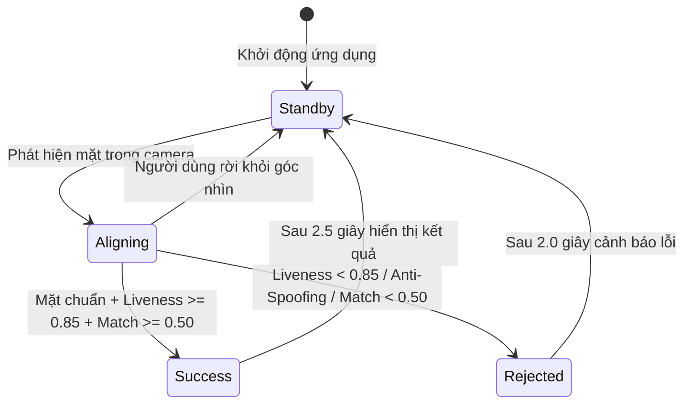
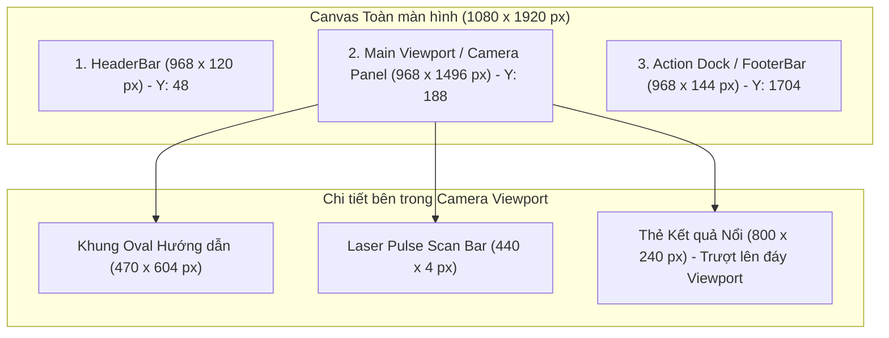

# UI/UX SPECS & DESIGN — Đặc tả Giao diện & Thiết kế Trải nghiệm Phân hệ Kiosk

Tài liệu hợp nhất đặc tả hành trình trải nghiệm người dùng (`UI-KSK-`) và thiết kế kỹ thuật giao diện QML (`UXD-KSK-`) của máy trạm Kiosk theo chuẩn SDLC v3.0 ([sdlc-docs.md](../../../sdlc-docs.md) §7.2).

---

## 1. Kiến trúc Thành phần Giao diện (UI/UX Elements Architecture)

Giao diện Kiosk được xây dựng trên nền tảng **Qt Quick / QML (PySide6)**, tối ưu cho màn hình cảm ứng đặt dọc (Portrait Mode) với tỷ lệ chuẩn 9:16.

| ID | Name | Definition | Uses | Realizes | Decisions | Status |
| :--- | :--- | :--- | :--- | :--- | :---: | :---: |
| `UXD-KSK-001` | Oval Guide & Dynamic State Machine Component | Thành phần `OvalGuide.qml` vẽ elip vector $470 \times 604\text{ px}$ với 4 trạng thái thị giác (Standby, Aligning, Success, Rejected) và hiệu ứng Pulse Scan laser quét dọc. | `STK-003` | `UI-KSK-001`, `UI-KSK-004`, `UI-KSK-005`, `UI-KSK-006`, `UI-KSK-007` | `DD-SYS-004` | Accepted |
| `UXD-KSK-002` | Result Card Overlay Component | Thành phần `ResultCard.qml` nổi kính mờ Glassmorphism $2.5\text{ s}$ hiển thị ảnh avatar, họ tên, mã NV, phòng ban và huy hiệu đúng giờ/đi muộn. | `STK-003` | `UI-KSK-001` | `DD-SYS-004` | Accepted |
| `UXD-KSK-003` | Backup PIN Pad Touch Dialog Component | Thành phần `PinPadDialog.qml` bàn phím số ảo cảm ứng phím lớn $88\times 88\text{ px}$, nền mờ 16px, đếm ngược khóa 15 phút và phím tắt F2. | `STK-003` | `UI-KSK-002`, `UI-KSK-008`, `UI-KSK-009` | `DD-SYS-006` | Accepted |
| `UXD-KSK-004` | In-Viewport 3-Step Enrollment Dialog | Thành phần `EnrollmentDialog.qml` hỗ trợ quy trình 3 bước tự ẩn nhường trọn camera chính ở Bước 2 và phím tắt F3. | `STK-003` | `UI-KSK-003`, `UI-KSK-009` | `DD-SYS-007` | Accepted |
| `UXD-KSK-005` | Dynamic Proportional Scaling Engine & Design Tokens | Động cơ co giãn tỷ lệ động $S = \min(W/1080, H/1920)$, bảng màu Dark Glassmorphism, phông chữ Inter đạt chuẩn WCAG 2.2 AA. | `STK-003` | `UI-KSK-008` | `DD-SYS-004` | Accepted |

---

## 2. Đặc tả Hành trình Người dùng (User Journeys Specs)

| ID | Statement | Category | Priority | Basis | Acceptance | Status |
| :--- | :--- | :--- | :---: | :--- | :--- | :---: |
| `UI-KSK-001` | Hành trình Điểm danh Khuôn mặt Siêu tốc: Người dùng đứng trước Kiosk ($0.6 - 1.2\text{ m}$), nhìn vào Oval, nhận diện thành công $\le 1.0\text{ s}$ (gồm chu kỳ AI $\le 350\text{ ms}$ theo `NFR-KSK-001` cộng render animation) và thẻ kết quả hiển thị $2.5\text{ s}$. | Journey | Must | `FR-SYS-001`, `FR-SYS-005`, `NFR-SYS-003`, `ARC-001`, `ACT-001` | Nhận diện và hiển thị kết quả thành công trong vòng $\le 1.0\text{ s}$ end-to-end; thẻ kết quả tự ẩn sau $2.5\text{ s}$; kích hoạt cooldown 120s. | Approved |
| `UI-KSK-002` | Hành trình Điểm danh Bằng Mã PIN Dự phòng: Chạm nút PIN trên màn hình (hoặc phím F2), mở hộp thoại PIN Pad làm mờ hậu cảnh 16px gồm ô nhập Mã nhân viên (`employeeCode`) và bàn phím số ảo phím bấm lớn $88\times 88\text{ px}$ để nhập mã PIN 6 số; khóa 15p sau 5 lần sai. Với nhân sự đã rút Consent, Oval hướng dẫn chuyển sang nhập PIN. | Journey | Must | `FR-SYS-004`, `FR-SYS-017`, `ARC-001`, `ACT-001` | Nhập đúng Mã nhân viên và mã PIN 6 số (gửi request khớp `API-KSK-007`) điểm danh thành công; nhập sai 5 lần tự động khóa 15 phút kèm đếm ngược `lockedUntil`; hiển thị thông báo hướng dẫn riêng cho nhân sự đã rút Consent. | Approved |
| `UI-KSK-003` | Hành trình Tự Kích hoạt & Đăng ký Khuôn mặt In-Viewport 3 Bước: Bước 1 nhập OTP $\rightarrow$ Bước 2 modal tự ẩn để lộ camera chính chụp 3 ảnh $\rightarrow$ Bước 3 xác nhận hoàn tất. | Journey | Must | `FR-SYS-008`, `FR-SYS-009`, `ARC-001`, `ACT-001` | Popup tự ẩn ở Bước 2 để lộ trọn vẹn camera chính; chụp 3 ảnh chuẩn $S_{\text{liveness}} \ge 0.90$ và hiện lại popup xác nhận ở Bước 3. | Approved |

---

## 3. Máy Trạng thái Khung Oval (Oval State Machine & Visual Feedback)

### Xử lý Ngoại lệ Giao diện (Exception UX)
* **Camera mất tín hiệu**: Màn hình hiển thị lớp phủ mờ cảnh báo "Đang kết nối lại camera..." kèm biểu tượng xoay; tự phục hồi trong $\le 3\text{ s}$ (`NFR-KSK-005`).
* **Lỗi mạng khi điểm danh PIN**: Hiển thị thông báo "Không có kết nối tới máy chủ, vui lòng liên hệ nhân sự" và giữ nguyên giao diện không làm gián đoạn ứng dụng.
* **Đứng quá 5s chưa hoàn thành nhận diện**: Hiển thị gợi ý chuyển sang dùng bàn phím số ảo nhập PIN.

### Đặc tả Chi tiết Trạng thái Thị giác Khung Oval

| ID | Statement | Category | Priority | Basis | Acceptance | Status |
| :--- | :--- | :--- | :---: | :--- | :--- | :---: |
| `UI-KSK-004` | Trạng thái Chờ (Standby): Khung Oval hiển thị viền nét đứt 3px màu xám Slate `#64748B`, thông báo "Vui lòng nhìn thẳng vào khung oval", không phát âm thanh. | VisualState | Must | `FR-SYS-001`, `FR-KSK-001`, `ARC-001` | Hiển thị viền xám tĩnh lặng khi không có người; tiết kiệm CPU và tài nguyên GPU. | Approved |
| `UI-KSK-005` | Trạng thái Căn chỉnh (Aligning): Khung Oval hiển thị viền nét liền 4px màu vàng Hổ phách `#F59E0B`, glow breathing, hiển thị thông báo hướng dẫn tư thế (cự ly, góc nghiêng). | VisualState | Must | `FR-SYS-001`, `FR-KSK-001`, `ARC-001` | Đổi viền vàng khi phát hiện mặt nhưng chưa đạt góc nghiêng hoặc cự ly; hiện thông báo hướng dẫn tư thế. | Approved |
| `UI-KSK-006` | Trạng thái Thành công (Success): Khung Oval hiển thị viền nét liền 5px màu xanh Emerald `#10B981`, hiệu ứng Pulse Scan laser quét dọc, phát âm thanh "Tít" 880Hz 100ms. | VisualState | Must | `FR-SYS-001`, `FR-SYS-003`, `FR-KSK-001`, `ARC-001` | Đổi viền xanh, kích hoạt tia laser quét dọc và phát âm thanh xác nhận khi nhận diện đúng. | Approved |
| `UI-KSK-007` | Trạng thái Từ chối (Rejected): Khung Oval hiển thị viền nét liền 5px màu đỏ Rose `#EF4444`, hiệu ứng rung lắc 300ms, phát âm thanh cảnh báo trầm "Bíp - Bíp" 300Hz. | VisualState | Must | `FR-SYS-002`, `FR-KSK-002`, `ARC-001` | Đổi viền đỏ, rung lắc nhẹ 300ms và phát cảnh báo âm thanh khi phát hiện giả mạo hoặc không khớp. | Approved |

---

## 4. Khả năng Tiếp cận & Phím tắt Phần cứng (Accessibility & Hotkeys)

| ID | Statement | Category | Priority | Basis | Acceptance | Status |
| :--- | :--- | :--- | :---: | :--- | :--- | :---: |
| `UI-KSK-008` | Quy chuẩn Điểm Chạm Cảm ứng & Độ Tương phản WCAG 2.2 AA: Kích thước nút bấm tối thiểu $\ge 48\times 48\text{ px}$ (phím PIN $88\times 88\text{ px}$, vượt ngưỡng $24\times 24\text{ px}$ của tiêu chí 2.5.8 Target Size), khoảng cách $\ge 16\text{ px}$, tương phản màu sắc $\ge 4.5:1$, chỉ báo Focus rõ ràng (2.4.7/2.4.11) và xác thực không đòi hỏi ghi nhớ nhận thức phức tạp (3.3.8). | Accessibility | Must | `NFR-SYS-010`, `ACT-001` | Toàn bộ thành phần cảm ứng đạt kích thước tối thiểu, phông chữ dễ đọc ở cự ly 1m; đạt chuẩn tiếp cận WCAG 2.2 AA cho người dùng. | Approved |
| `UI-KSK-009` | Hỗ trợ Phím tắt Phần cứng & Tương tác Bổ trợ: Phím F2 mở/đóng PIN Pad, phím F3 mở/đóng Đăng ký khuôn mặt, phím Esc đóng toàn bộ modal quay về camera chính; hỗ trợ người vận hành (`ACT-003`) và trạm có bàn phím vật lý song song với nút chạm cảm ứng cho nhân viên (`ACT-001`). Khi Kiosk ở trạng thái `LOCKED`, phím F2/F3/ESC bị vô hiệu hóa hoàn toàn. | Interaction | Must | `FR-SYS-004`, `FR-SYS-009`, `ACT-001`, `ACT-003`, `FR-KSK-012` | Nhấn F2/F3/Esc trên bàn phím vật lý kích hoạt hoặc đóng modal tương ứng tức thời; vô hiệu hóa khi LOCKED. | Approved |

---

## 5. Hệ thống Design Tokens & Định lượng Giao diện (Design Tokens)

### 5.1. Bảng Mã Màu Chuẩn (Color Tokens)

Áp dụng phong cách **Dark Theme Hiện đại (Modern Dark Glassmorphism)** kết hợp màu nhấn tương phản cao:

| Tên Token Màu | Mã Màu Hex / RGBA | Vai trò & Mục đích Ứng dụng |
| :--- | :--- | :--- |
| `color_bg_canvas` | `#0B0F17` | Nền canvas toàn màn hình trạm Kiosk (Deep Dark Slate). |
| `color_surface_panel` | `#111827` | Nền các vùng panel camera và container chính. |
| `color_surface_glass` | `rgba(30, 41, 59, 0.85)` | Nền thẻ kết quả và modal với hiệu ứng kính mờ `backdrop-filter: blur(16px)`. |
| `color_border_subtle` | `rgba(255, 255, 255, 0.10)` | Đường viền mảnh $1\text{ px}$ ngăn cách các vùng giao diện. |
| `color_text_primary` | `#F8FAFC` | Màu văn bản chính, tiêu đề, họ tên nhân viên (Trắng tinh khiết). |
| `color_text_secondary` | `#94A3B8` | Màu văn bản phụ, chú thích, mã nhân viên, phòng ban. |
| `oval_standby` | `#64748B` | Màu viền khung Oval ở trạng thái chờ (Slate Gray). |
| `oval_aligning` | `#F59E0B` | Màu viền khung Oval khi đang căn chỉnh góc nhìn (Amber Orange). |
| `oval_success` | `#10B981` | Màu viền khung Oval khi nhận diện thành công (Emerald Green). |
| `oval_rejected` | `#EF4444` | Màu viền khung Oval khi từ chối / cảnh báo giả mạo (Rose Red). |
| `laser_pulse_scan` | `rgba(16, 185, 129, 0.65)` | Dải màu laser xanh ngọc phát sáng quét dọc khuôn mặt. |

### 5.2. Thang Typography Chuẩn (Typography Tokens)
* **Phông chữ cơ sở**: `Inter` (fallback `Roboto`).
* **Tiêu đề màn hình / Giờ kỹ thuật số**: $36\text{ px}$ (Bold / Monospace).
* **Họ tên nhân viên trên thẻ kết quả**: $28\text{ px}$ (Semi-Bold).
* **Tiêu đề Modal / Nút bấm chính**: $22\text{ px}$ (Medium).
* **Văn bản nội dung / Hướng dẫn**: $16\text{ px}$ (Regular).
* **Chú thích phụ / Ngày tháng**: $14\text{ px}$ (Regular).

---

## 6. Công thức Tỷ lệ Co giãn Động (Dynamic Proportional Scaling Engine)

Hỗ trợ đa dạng chủng loại màn hình cảm ứng đặt dọc (từ $720 \times 1280\text{ px}$ HD, $1080 \times 1920\text{ px}$ FHD đến $2160 \times 3840\text{ px}$ 4K Portrait):
* **Độ phân giải vector chuẩn (Baseline Canvas)**: $W_0 = 1080\text{ px}$, $H_0 = 1920\text{ px}$ (Tỷ lệ 9:16).
* **Hệ số co giãn tỷ lệ (Scale Factor $S$)**:
  $$S = \min\left(\frac{W_{\text{actual}}}{1080}, \frac{H_{\text{actual}}}{1920}\right)$$
* **Quy tắc tính toán tọa độ và kích thước trong QML**:
  * Mọi thuộc tính hình học ($width$, $height$, $radius$, $fontSize$, $spacing$) đều được nhân với $S$:
    $$\text{Dimension} = \text{Dimension}_{\text{base}} \times S$$
  * Toàn bộ khung hiển thị chính được căn giữa màn hình vật lý với lề bù $X_{\text{offset}} = (W_{\text{actual}} - 1080 \times S) / 2$ và $Y_{\text{offset}} = (H_{\text{actual}} - 1920 \times S) / 2$.

---

## 7. Thiết kế Bố cục Hình học Chi tiết (Geometry Layout)

Toàn bộ bố cục màn hình chính trạm Kiosk được phân chia theo chiều dọc thành 3 phân vùng chính lọt lòng trong lưới biên an toàn ($X_{\text{margin}} = 56\text{ px}$):

### 7.1. Phân vùng 1: Thanh Tiêu đề `HeaderBar`
* **Vị trí & Kích thước**: Tọa độ $(X = 56\text{ px}, Y = 48\text{ px})$, Kích thước $968 \times 120\text{ px}$, Bo góc $16\text{ px}$.
* **Thành phần con**:
  * **Cụm Thương hiệu (Bên trái)**: Logo Icon $48 \times 48\text{ px}$, nhãn hệ thống "FAS KIOSK" (Font $24\text{ px}$, Semi-Bold, `#F8FAFC`).
  * **Đồng hồ Kỹ thuật số (Chính giữa)**: Giờ phút giây `HH:mm:ss` (Font $36\text{ px}$, Bold Monospace, `#F8FAFC`); ngày tháng `Thứ X, DD/MM/YYYY` (Font $16\text{ px}$, `#94A3B8`).
  * **Huy hiệu Trạng thái Trạm (Bên phải)**: Kích thước $160 \times 48\text{ px}$, Bo tròn $24\text{ px}$. Đèn tròn $\varnothing 12\text{ px}$: Xanh lá `#10B981` (Online) hoặc Vàng `#F59E0B` (Offline Queue). Nhãn mã trạm `KIOSK-HN-01`.

### 7.2. Phân vùng 2: Khung nhìn Camera Chính `PortraitCameraPanel`
* **Vị trí & Kích thước**: Tọa độ $(X = 56\text{ px}, Y = 188\text{ px})$, Kích thước $968 \times 1496\text{ px}$, Bo góc $24\text{ px}$, tràn viền luồng video tỷ lệ 9:16.
* **Khung Oval Hướng dẫn Căn mặt**:
  * Hình elip vector: Rộng $470\text{ px}$, Cao $604\text{ px}$, Tâm $(X = 484\text{ px}, Y = 748\text{ px})$ so với Camera Panel. Bán kính $r_x = 235\text{ px}$, $r_y = 302\text{ px}$.
  * Độ dày viền: $3\text{ px}$ (Chờ), $4\text{ px}$ (Căn chỉnh), $5\text{ px}$ (Thành công / Từ chối).
  * Hiệu ứng Laser Pulse Scan: Thanh laser $440 \times 4\text{ px}$, gradient `#10B981` phát sáng $12\text{ px}$, quét từ đỉnh ($Y = 446$) xuống đáy ($Y = 1050$) trong chu kỳ $1.2\text{ s}$.
* **Thẻ Kết quả Nổi `ResultCard` (Popup Slide-up)**:
  * Nằm ở đáy Viewport, căn giữa $(X = 84\text{ px}, Y = 1200\text{ px})$. Kích thước $800 \times 240\text{ px}$, Bo góc $20\text{ px}$, viền kính `1px solid rgba(255,255,255,0.15)`.
  * Avatar: $100 \times 100\text{ px}$, bo tròn hoàn hảo $\varnothing 50\text{ px}$, viền xanh $3\text{ px}$.
  * Họ tên: Font $28\text{ px}$ Bold; Mã NV & Phòng ban: Font $16\text{ px}$; Giờ quẹt: Font $22\text{ px}$ Bold `#10B981`.
  * Huy hiệu trạng thái: $120 \times 36\text{ px}$, bo góc $8\text{ px}$, nền xanh ngọc "Đúng giờ" (hoặc hổ phách "Đi muộn").
  * Hiệu ứng: Trượt lên (Spring $400\text{ ms}$), dừng hiển thị $2.5\text{ s}$, trượt mờ xuống ($300\text{ ms}$).

### 7.3. Phân vùng 3: Thanh Nút Bấm Tương tác `ActionDock`
* **Vị trí & Kích thước**: Tọa độ $(X = 56\text{ px}, Y = 1704\text{ px})$, Kích thước $968 \times 144\text{ px}$.
* **Nút F2 — "Xác thực Mã PIN"**: $468 \times 96\text{ px}$, Bo góc $16\text{ px}$, Nền `#1E293B`, icon $32 \times 32\text{ px}$, font $20\text{ px}$ Medium.
* **Nút F3 — "Đăng ký Khuôn mặt"**: $468 \times 96\text{ px}$, Bo góc $16\text{ px}$, Nền `#1E293B`, icon $32 \times 32\text{ px}$, font $20\text{ px}$ Medium.
* **Phản hồi Chạm (Touch Feedback)**: Co tỷ lệ $0.98$, nền sáng lên `#334155` trong $150\text{ ms}$.

---

## 8. Thiết kế Chi tiết 3 Hộp thoại Lớp Phủ (Modals & Dialogs)

Khi hộp thoại kích hoạt, lớp phủ bán trong suốt Backdrop Overlay `#000000` độ mờ $65\%$ kèm hiệu ứng `blur(12px)` sẽ phủ kín toàn bộ màn hình.

### 8.1. Hộp thoại Bàn phím Số ảo `PinPadModal`
* **Kích thước & Vị trí**: $720 \times 880\text{ px}$, Căn giữa $(X = 180\text{ px}, Y = 520\text{ px})$, Bo góc $24\text{ px}$, Nền `#1E293B`.
* **Cấu trúc**:
  * Tiêu đề: "Nhập Mã PIN Cá Nhân" (Font $24\text{ px}$, Bold).
  * Hàng chỉ báo 6 chấm tròn PIN: Mỗi chấm $\varnothing 18\text{ px}$, khoảng cách $20\text{ px}$. Rỗng: viền `#475569`; đã nhập: xanh `#10B981`.
  * Lưới phím cảm ứng $3 \times 4$: Gồm 12 phím tròn $\varnothing 88\text{ px}$ (vượt chuẩn WCAG 2.2 AA). Các phím 1-9 (hàng 1-3); hàng 4 gồm phím Xóa lùi ($\leftarrow$), phím số 0, phím Hủy ($\times$). Phông số $32\text{ px}$ Bold.

### 8.2. Hộp thoại Đăng ký Khuôn mặt In-Viewport `EnrollmentModal`
* **Kích thước & Vị trí**: $800 \times 960\text{ px}$, Căn giữa $(X = 140\text{ px}, Y = 480\text{ px})$, Bo góc $24\text{ px}$, Nền `#1E293B`.
* **Quy trình 3 Bước In-Viewport**:
  * **Bước 1**: Nhập OTP 6 số xác thực. Ô nhập mã lớn font $40\text{ px}$, nút "Xác nhận OTP".
  * **Bước 2 (Chụp mẫu In-Viewport)**: Modal chuyển `opacity: 0.0` và `visible: false` để nhường toàn bộ màn hình cho luồng camera chính. Khung Oval chuyển màu hổ phách: "Kiosk đang chụp mẫu 3 góc nhìn... Giữ yên khuôn mặt". Thanh tiến trình $300 \times 32\text{ px}$ hiển thị bước thu mẫu $1/3 \rightarrow 2/3 \rightarrow 3/3$.
  * **Bước 3**: Khi hoàn tất nạp 3 ảnh, modal tự động hiện lại (`opacity: 1.0`) với hình ảnh chân dung đã duyệt, thông báo "Kích hoạt khuôn mặt thành công!" và nút "Đóng".

### 8.3. Hộp thoại Trợ giúp & Hướng dẫn `HelpModal`
* **Kích thước & Vị trí**: $800 \times 960\text{ px}$, Căn giữa màn hình, Bo góc $24\text{ px}$, Nền `#1E293B`.
* **Nội dung Trực quan**:
  * Minh họa 3 hình ảnh tư thế đúng (Đứng thẳng, cự ly $0.8\text{ m}$, không che mắt/mũi).
  * Minh họa các lỗi phổ biến (Quá gần, quá xa, ngược sáng mạnh).
  * Thông tin đường dây nóng IT Support & Nút "Tôi đã hiểu".
