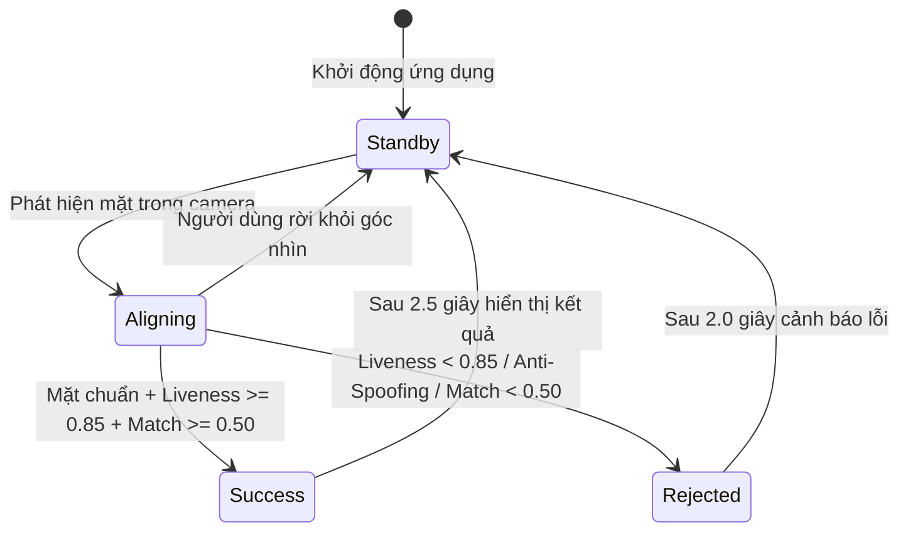

# UI/UX SPECS — Đặc tả Giao diện & Trải nghiệm Phân hệ Kiosk

Đặc tả các hành trình trải nghiệm người dùng (`UI-KSK-`), máy trạng thái chỉ báo thị giác khung Oval, quy chuẩn kích thước điểm chạm cảm ứng, phím tắt phần cứng và chỉ báo trạng thái hệ thống cho máy trạm Kiosk theo chuẩn SDLC v3.0 ([sdlc-docs.md](../../../sdlc-docs.md) §7.2).

---

## 1. User Journeys & Interaction Specs (Đặc tả Hành trình Người dùng)

| ID | Statement | Category | Priority | Basis | Acceptance | Status |
| :--- | :--- | :--- | :---: | :--- | :--- | :---: |
| `UI-KSK-001` | Hành trình Điểm danh Khuôn mặt Siêu tốc: Người dùng đứng trước Kiosk ($0.6 - 1.2\text{ m}$), nhìn vào Oval, nhận diện thành công $\le 1.0\text{ s}$ và thẻ kết quả hiển thị $2.5\text{ s}$. | Journey | Must | `FR-SYS-001`, `FR-SYS-005`, `NFR-SYS-003`, `ARC-001`, `ACT-001` | Nhận diện và hiển thị kết quả thành công trong vòng $\le 1.0\text{ s}$; thẻ kết quả tự ẩn sau $2.5\text{ s}$; kích hoạt cooldown 120s. | Approved |
| `UI-KSK-002` | Hành trình Điểm danh Bằng Mã PIN Dự phòng: Chạm nút PIN (hoặc phím F2), mở hộp thoại PIN Pad làm mờ hậu cảnh 16px, nút bấm lớn $88\times 88\text{ px}$, khóa 15p sau 5 lần sai. | Journey | Must | `FR-SYS-004`, `FR-SYS-017`, `ARC-001`, `ACT-001` | Nhập đúng PIN 6 số điểm danh thành công; nhập sai 5 lần tự động khóa 15 phút kèm đếm ngược `lockedUntil`; phương thức duy nhất cho nhân sự đã rút Consent. | Approved |
| `UI-KSK-003` | Hành trình Tự Kích hoạt & Đăng ký Khuôn mặt In-Viewport 3 Bước: Bước 1 nhập OTP $\rightarrow$ Bước 2 modal tự ẩn để lộ camera chính chụp 3 ảnh $\rightarrow$ Bước 3 xác nhận hoàn tất. | Journey | Must | `FR-SYS-008`, `FR-SYS-009`, `ARC-001`, `ACT-001` | Popup tự ẩn ở Bước 2 để lộ trọn vẹn camera chính; chụp 3 ảnh chuẩn $S_{\text{liveness}} \ge 0.85$ và hiện lại popup xác nhận ở Bước 3. | Approved |

---

## 2. Oval State Machine & Visual Feedback (Máy Trạng thái Khung Oval)

| ID | Statement | Category | Priority | Basis | Acceptance | Status |
| :--- | :--- | :--- | :---: | :--- | :--- | :---: |
| `UI-KSK-004` | Trạng thái Chờ (Standby): Khung Oval hiển thị viền nét đứt 3px màu xám Slate `#64748B`, thông báo "Vui lòng nhìn thẳng vào khung oval", không phát âm thanh. | VisualState | Must | `FR-SYS-001`, `FR-KSK-001`, `ARC-001` | Hiển thị viền xám tĩnh lặng khi không có người; tiết kiệm CPU và tài nguyên GPU. | Approved |
| `UI-KSK-005` | Trạng thái Căn chỉnh (Aligning): Khung Oval hiển thị viền nét liền 4px màu vàng Hổ phách `#F59E0B`, glow breathing, hiển thị thông báo hướng dẫn tư thế (cự ly, góc nghiêng). | VisualState | Must | `FR-SYS-001`, `FR-KSK-001`, `ARC-001` | Đổi viền vàng khi phát hiện mặt nhưng chưa đạt góc nghiêng hoặc cự ly; hiện thông báo hướng dẫn tư thế. | Approved |
| `UI-KSK-006` | Trạng thái Thành công (Success): Khung Oval hiển thị viền nét liền 5px màu xanh Emerald `#10B981`, hiệu ứng Pulse Scan laser quét dọc, phát âm thanh "Tít" 880Hz 100ms. | VisualState | Must | `FR-SYS-001`, `FR-SYS-003`, `FR-KSK-001`, `ARC-001` | Đổi viền xanh, kích hoạt tia laser quét dọc và phát âm thanh xác nhận khi nhận diện đúng. | Approved |
| `UI-KSK-007` | Trạng thái Từ chối (Rejected): Khung Oval hiển thị viền nét liền 5px màu đỏ Rose `#EF4444`, hiệu ứng rung lắc 300ms, phát âm thanh cảnh báo trầm "Bíp - Bíp" 300Hz. | VisualState | Must | `FR-SYS-002`, `FR-KSK-002`, `ARC-001` | Đổi viền đỏ, rung lắc nhẹ 300ms và phát cảnh báo âm thanh khi phát hiện giả mạo hoặc không khớp. | Approved |

---

## 3. Accessibility & Hardware Hotkeys (Khả năng Tiếp cận & Phím tắt)

| ID | Statement | Category | Priority | Basis | Acceptance | Status |
| :--- | :--- | :--- | :---: | :--- | :--- | :---: |
| `UI-KSK-008` | Quy chuẩn Điểm Chạm Cảm ứng & Độ Tương phản: Kích thước nút bấm tối thiểu $\ge 48\times 48\text{ px}$ (phím PIN $88\times 88\text{ px}$), khoảng cách $\ge 16\text{ px}$, tương phản WCAG 2.1 AA $\ge 4.5:1$. | Accessibility | Must | `NFR-SYS-010`, `ACT-001` | Toàn bộ thành phần cảm ứng đạt kích thước tối thiểu, phông chữ dễ đọc ở cự ly 1m; đạt chuẩn tiếp cận cho người dùng. | Approved |
| `UI-KSK-009` | Hỗ trợ Phím tắt Phần cứng: Phím F2 mở/đóng PIN Pad, phím F3 mở/đóng Đăng ký khuôn mặt, phím Esc đóng toàn bộ modal quay về camera chính. | Interaction | Must | `FR-SYS-004`, `FR-SYS-009`, `ACT-001` | Nhấn F2/F3/Esc trên bàn phím vật lý kích hoạt hoặc đóng modal tương ứng tức thời. | Approved |

