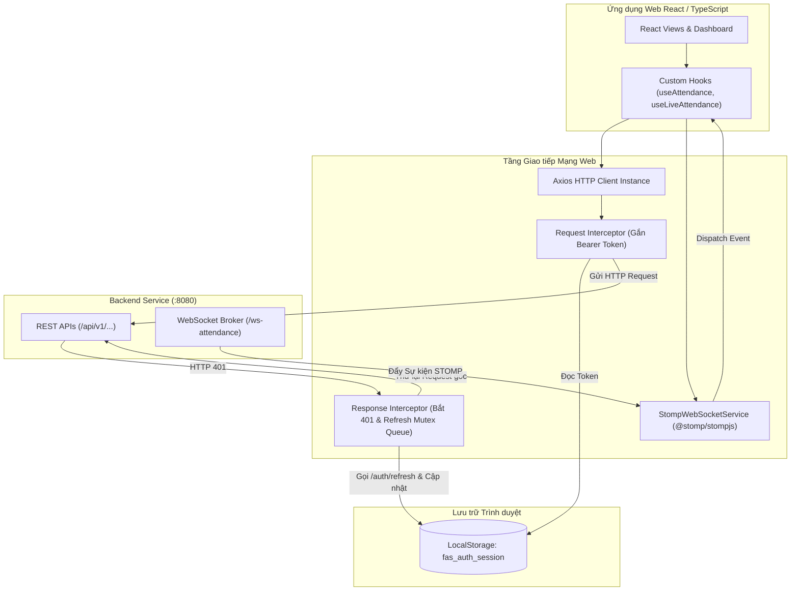

# ĐẶC TẢ & THIẾT KẾ GIAO DIỆN TRUYỀN THÔNG PHÂN HỆ CỔNG WEB QUẢN TRỊ & NGƯỜI DÙNG (`web-portal`)

## 1. Danh mục Giao diện Truyền thông Phân hệ Web Portal (`API-WEB-`)

| ID | Phát biểu Giao diện (Statement) | Phân loại | Mức Ưu tiên | Nguồn Tham chiếu | Tiêu chí Nghiệm thu (Acceptance Criteria) | Trạng thái |
| :--- | :--- | :--- | :--- | :---: | :--- | :---: |
| `API-WEB-001` | Giao diện REST xác thực đăng nhập qua `POST /api/v1/auth/login`. | REST | Must | `API-BE-001`, `SRS-001`, `ARC-003` | Nhận Access/Refresh Token và thông tin user (hỗ trợ các vai trò HR_MANAGER, EMPLOYEE, ADMIN, DPO); SLA $\le 500\text{ ms}$. | Approved |
| `API-WEB-002` | Giao diện REST làm mới access token qua `POST /api/v1/auth/refresh`. | REST | Must | `API-BE-002`, `SRS-001`, `ARC-003` | Đổi Refresh Token lấy Access Token mới trong suốt; SLA $\le 300\text{ ms}$. | Approved |
| `API-WEB-003` | Giao diện REST ký cam kết sinh trắc qua `POST /api/v1/employee/consent`. | REST | Must | `API-BE-010`, `SRS-001`, `ARC-003` | Nhận mã OTP 6 số kích hoạt tại Kiosk; SLA $\le 500\text{ ms}$. | Approved |
| `API-WEB-004` | Giao diện REST tra cứu điểm danh toàn công ty qua `GET /api/v1/admin/attendance`. | REST | Must | `API-BE-008`, `SRS-003`, `ARC-003` | Phân trang, lọc theo ngày/phòng ban/trạng thái; SLA $\le 800\text{ ms}$. | Approved |
| `API-WEB-005` | Giao diện REST tra cứu điểm danh cá nhân qua `GET /api/v1/employee/attendance`. | REST | Should | `API-BE-009`, `SRS-003`, `ARC-003` | Trả về tổng kết tháng và chi tiết các lượt quẹt; SLA $\le 500\text{ ms}$. | Approved |
| `API-WEB-006` | Giao diện REST tra cứu danh mục nhân sự qua `GET /api/v1/admin/employees`. | REST | Must | `API-BE-011`, `SRS-003`, `ARC-003` | Phân trang danh sách nhân sự và trạng thái sinh trắc; SLA $\le 800\text{ ms}$. | Approved |
| `API-WEB-007` | Kênh WebSocket STOMP nhận điểm danh trực tiếp qua topic `/topic/live-attendance`. | WebSocket | Must | `Backend-STOMP-4.1`, `SRS-003`, `ARC-003` | Nhận event và chèn dòng lên đầu Live Table tức thời. | Approved |
| `API-WEB-008` | Kênh WebSocket STOMP nhận thông báo kích hoạt qua topic `/topic/enrollment/{otp}`. | WebSocket | Must | `Backend-STOMP-4.1`, `SRS-001`, `ARC-003` | Tự đóng modal OTP và chuyển trạng thái ACTIVE khi quét xong tại Kiosk. | Approved |
| `API-WEB-009` | Giao diện REST quản lý hồ sơ nhân sự qua `POST /api/v1/admin/employees`, `PATCH /api/v1/admin/employees/{id}` và `PATCH /api/v1/admin/employees/{id}/status`. | REST | Must | `API-BE-017`, `API-BE-018`, `API-BE-019` | Tạo hồ sơ nhận HTTP 201 kèm `temporaryPassword` hiển thị một lần (response DTO phẳng); trùng mã/email trả 409; SLA $\le 800\text{ ms}$. | Approved |
| `API-WEB-010` | Giao diện REST cấp lại mật khẩu tạm qua `POST /api/v1/admin/employees/{id}/credentials/reset`. | REST | Must | `API-BE-036`, `FR-SYS-022` | Nhận mật khẩu tạm mới hiển thị một lần; thông báo phiên cũ đã bị thu hồi; SLA $\le 800\text{ ms}$. | Approved |
| `API-WEB-011` | Giao diện REST quản lý ca và phân ca qua `/api/v1/admin/shifts` và `/api/v1/admin/employee-shifts`. | REST | Must | `API-BE-023`, `API-BE-024`, `API-BE-025` | Tạo/sửa ca và phân ca theo khoảng ngày; lỗi chồng lấn trả 409 kèm khoảng trống gợi ý; SLA $\le 800\text{ ms}$. | Approved |
| `API-WEB-012` | Giao diện REST đổi mật khẩu và quản lý PIN qua `POST /api/v1/auth/change-password`, `POST /api/v1/employee/pin`, `POST /api/v1/employee/pin/reset`. | REST | Must | `API-BE-020`, `API-BE-021`, `API-BE-037` | Đổi mật khẩu thành công trả 200 (thông báo thu hồi phiên cũ); thiết lập/đặt lại PIN trả trạng thái `hasPin`; SLA $\le 500\text{ ms}$. | Approved |
| `API-WEB-013` | Giao diện REST chốt và mở lại kỳ công qua `/api/v1/admin/payroll-periods`. | REST | Must | `API-BE-039`, `API-BE-040`, `FR-SYS-024` | Trả danh sách kỳ kèm trạng thái `OPEN`/`LOCKED`; chốt/mở lại trả 200; SLA $\le 800\text{ ms}$. | Approved |
| `API-WEB-014` | Giao diện REST rút Consent và yêu cầu dữ liệu cá nhân qua `POST /api/v1/employee/consent/withdraw`, `/api/v1/employee/data-requests` và `/api/v1/dpo/data-requests`. | REST | Must | `API-BE-041`, `API-BE-042`, `FR-SYS-025` | Nhận hạn tiêu huỷ dữ liệu sinh trắc sau khi rút; theo dõi yêu cầu dữ liệu; role DPO xử lý được; SLA $\le 800\text{ ms}$. | Approved |
| `API-WEB-015` | Giao diện REST đăng xuất và thu hồi phiên qua `POST /api/v1/auth/logout`. | REST | Must | `API-BE-038`, `FR-SYS-023` | Trả 204 và refresh token không dùng lại được; client xoá storage và đồng bộ đa tab. | Approved |
| `API-WEB-016` | Giao diện REST thông báo trong ứng dụng qua `GET /api/v1/notifications` và `PATCH /api/v1/notifications/{id}/read`. | REST | Should | `API-BE-044`, `FR-SYS-027` | Trả danh sách thông báo kèm số chưa đọc; đánh dấu đã đọc trả 200; SLA $\le 500\text{ ms}$. | Approved |
| `API-WEB-017` | Giao diện REST tra cứu kiểm toán và quản lý trạm Kiosk qua `/api/v1/admin/audit-logs`, `/api/v1/admin/kiosks/**` và `/api/v1/dpo/**`. | REST | Must | `API-BE-030`, `API-BE-032`, `API-BE-033` | ADMIN tra cứu audit log và quản lý trạm; Secret Token chỉ hiển thị một lần; role DPO chỉ đọc; SLA $\le 800\text{ ms}$. | Approved |
| `API-WEB-018` | Giao diện REST kết xuất báo cáo bảng công qua `GET /api/v1/admin/reports/export`. | REST | Must | `API-BE-035`, `FR-WEB-006` | Nhận file `.xlsx` an toàn (đã escape công thức) và tải xuống trong $\le 3\text{ giây}$ cho 1,000 nhân sự. | Approved |
| `API-WEB-019` | Giao diện REST tra cứu thông tin người dùng và trạng thái sinh trắc qua `GET /api/v1/auth/me`. | REST | Must | `API-BE-046`, `FR-WEB-001` | Đồng bộ phiên, hiển thị TopHeader và hỗ trợ Consent Guard với các cờ `hasBiometric`, `hasPin`; SLA $\le 300\text{ ms}$. | Approved |
| `API-WEB-020` | Giao diện REST tra cứu thống kê KPI điểm danh thời gian thực qua `GET /api/v1/admin/attendance/stats`. | REST | Must | `API-BE-047`, `DATA-WEB-004` | Cung cấp 5 chỉ số KPI (`totalEmployees`, `presentCount`, `onTimeCount`, `lateCount`, `absentCount`) cho Admin Dashboard; SLA $\le 400\text{ ms}$. | Approved |
| `API-WEB-021` | Giao diện REST điều chỉnh bản ghi điểm danh thủ công qua `PATCH /api/v1/admin/attendance/{id}`. | REST | Must | `API-BE-048`, `FR-SYS-010` | HR/Admin điều chỉnh giờ công/trạng thái kèm lý do giải trình; SLA $\le 500\text{ ms}$. | Approved |

---

## 2. Kiến trúc Máy trạm Mạng Web Portal (Network Clients Architecture)



---

## 3. Danh mục Thiết kế Module & Dịch vụ Mạng (`APD-WEB-`)

| ID | Tên Thiết kế Module | Định nghĩa Trách nhiệm Kỹ thuật | Hiện thực hóa (`Realizes`) | Sử dụng (`Uses`) | Quyết định (`Decisions`) | Trạng thái |
| :--- | :--- | :--- | :--- | :--- | :---: | :---: |
| `APD-WEB-001` | ApiClient | Đóng gói thư viện `axios` với baseURL `VITE_API_BASE_URL`, timeout $10.0\text{ s}$; cấu hình bộ chặn Request Interceptor tự động gán Bearer Token. | `API-WEB-001`, `API-WEB-002`, `API-WEB-003`, `API-WEB-004`, `API-WEB-005`, `API-WEB-006` | `ARC-003` | `DD-WEB-008` | Accepted |
| `APD-WEB-002` | TokenRefreshInterceptor | Bộ chặn Response Interceptor bắt mã HTTP 401, tạm hoãn các request song song vào Promise Queue, gọi `POST /auth/refresh` bằng Refresh Token; sau khi có token mới giải phóng hàng đợi và retry requests. | `API-WEB-002` | `ARC-003` | `DD-WEB-009` | Accepted |
| `APD-WEB-003` | StompWebSocketService | Quản lý kết nối STOMP over WebSocket (SockJS fallback) tới `/ws-attendance`, tự động kết nối lại khi mất mạng (Exponential Backoff); cung cấp các hàm subscribe/unsubscribe an toàn. | `API-WEB-007`, `API-WEB-008` | `ARC-003` | `DD-WEB-010` | Accepted |
| `APD-WEB-004` | AdminEmployeeService | Bọc các giao diện quản lý hồ sơ nhân sự (`/admin/employees`): tạo/sửa/vô hiệu hóa và cấp lại mật khẩu tạm; chuẩn hoá lỗi 409 về từng trường và không cache mật khẩu tạm. | `API-WEB-009`, `API-WEB-010` | `ARC-003` | `DD-WEB-018` | Accepted |
| `APD-WEB-005` | ShiftAdminService | Bọc giao diện quản lý ca và phân ca (`/admin/shifts`, `/admin/employee-shifts`); diễn giải lỗi 409 chồng lấn thành dữ liệu gợi ý khoảng trống cho UI. | `API-WEB-011` | `ARC-003` | `DD-WEB-001` | Accepted |
| `APD-WEB-006` | CredentialService | Bọc giao diện đổi mật khẩu (tự nguyện), thiết lập PIN và đặt lại PIN; không có cơ chế chặn điều hướng theo trạng thái mật khẩu. | `API-WEB-012` | `ARC-003` | `DD-WEB-018` | Accepted |
| `APD-WEB-007` | PayrollPeriodService | Bọc giao diện kỳ công (`/admin/payroll-periods`): liệt kê, chốt và mở lại; invalidate cache kỳ công sau mỗi thay đổi trạng thái. | `API-WEB-013` | `ARC-003` | `DD-WEB-006` | Accepted |
| `APD-WEB-008` | DataSubjectService | Bọc giao diện rút Consent và yêu cầu dữ liệu cá nhân (`/employee/consent/withdraw`, `/employee/data-requests`, `/dpo/data-requests`); phân quyền hiển thị theo role. | `API-WEB-014` | `ARC-003` | `DD-WEB-015` | Accepted |
| `APD-WEB-009` | LogoutService | Bọc `POST /auth/logout`, xoá storage sau khi API trả 204 và phát sự kiện đăng xuất để đồng bộ đa tab. | `API-WEB-015` | `ARC-003` | `DD-WEB-004` | Accepted |
| `APD-WEB-010` | NotificationService | Bọc giao diện thông báo (`/notifications`): lấy danh sách, đếm chưa đọc và đánh dấu đã đọc; cập nhật lạc quan (optimistic) khi đánh dấu. | `API-WEB-016` | `ARC-003` | `DD-WEB-020` | Accepted |
| `APD-WEB-011` | ComplianceAdminService | Bọc giao diện tra cứu audit, quản lý trạm Kiosk và dữ liệu tuân thủ (`/admin/audit-logs`, `/admin/kiosks/**`, `/dpo/**`); chỉ đọc với role `DPO`. | `API-WEB-017` | `ARC-003` | `DD-WEB-019` | Accepted |
| `APD-WEB-012` | ReportExportService | Bọc giao diện kết xuất báo cáo (`/admin/reports/export`) và trả về blob tải xuống kèm tên tệp theo kỳ được chọn. | `API-WEB-018` | `ARC-003` | `DD-WEB-017` | Accepted |
| `APD-WEB-013` | AttendanceAdminService | Bọc giao diện thống kê KPI điểm danh (`/admin/attendance/stats`) và điều chỉnh giờ công thủ công (`/admin/attendance/{id}`); tự động làm mới bộ nhớ cache của TanStack Query khi có điều chỉnh. | `API-WEB-020`, `API-WEB-021` | `ARC-003` | `DD-WEB-007` | Accepted |

---

## 4. Hợp đồng Chi tiết Từng Endpoint REST (Field-by-Field Contracts)

### 4.1. `POST /api/v1/auth/login` — Xác thực Đăng nhập
* **Mục đích**: Tiếp nhận email/mật khẩu, cấp cặp token xác thực và thông tin người dùng.
* **Request Schema**:
  ```json
  {
    "email": "dung.nv@company.com",
    "password": "Password@123"
  }
  ```
* **Response Payload (200 OK)**:
  ```json
  {
    "success": true,
    "code": "AUTH_SUCCESS",
    "message": "Đăng nhập thành công",
    "data": {
      "accessToken": "eyJhbGciOiJIUzI1NiIsInR5cCI6IkpXVCJ9...",
      "refreshToken": "d8f4c2e1-9b7a-4c3d-8e5f-1a2b3c4d5e6f",
      "tokenType": "Bearer",
      "expiresIn": 3600,
      "user": {
        "id": 1042,
        "employeeCode": "NV-1042",
        "fullName": "Ngô Văn Dũng",
        "email": "dung.nv@company.com",
        "role": "EMPLOYEE",
        "status": "PENDING_CONSENT",
        "department": "Phòng Kỹ thuật",
        "hasBiometric": false,
        "hasPin": false
      }
    },
    "timestamp": "2026-10-03T08:30:00.120+07:00"
  }
  ```

---

### 4.2. `POST /api/v1/auth/refresh` — Làm mới Access Token
* **Request Schema**:
  ```json
  {
    "refreshToken": "d8f4c2e1-9b7a-4c3d-8e5f-1a2b3c4d5e6f"
  }
  ```
* **Response Payload (200 OK)**:
  ```json
  {
    "success": true,
    "code": "TOKEN_REFRESHED",
    "message": "Cấp phát token mới thành công",
    "data": {
      "accessToken": "eyJhbGciOiJIUzI1NiIsInR5cCI6IkpXVCJ9...",
      "refreshToken": "f1e2d3c4-b5a6-7890-1234-56789abcdef0",
      "tokenType": "Bearer",
      "expiresIn": 3600
    },
    "timestamp": "2026-10-03T09:30:00.050+07:00"
  }
  ```

---

### 4.3. `POST /api/v1/employee/consent` — Ký Cam kết Sinh trắc & Cấp Mã OTP
* **Headers**: `Authorization: Bearer <accessToken>`
* **Request Schema**:
  ```json
  {
    "agreed": true,
    "consentTimestamp": "2026-10-03T08:32:15.000+07:00"
  }
  ```
* **Response Payload (200 OK)**:
  ```json
  {
    "success": true,
    "code": "CONSENT_ACCEPTED",
    "message": "Tiếp nhận cam kết thành công. Vui lòng đến trạm Kiosk để quét mặt.",
    "data": {
      "otp": "839201",
      "expiresAt": "2026-10-05T08:32:15.000+07:00",
      "kioskLocations": [
        "Sảnh Lễ tân Tầng 1 - KIOSK-HN-01",
        "Khu vực Căn tin Tầng 3 - KIOSK-HN-02"
      ]
    },
    "timestamp": "2026-10-03T08:32:15.150+07:00"
  }
  ```

---

### 4.4. `GET /api/v1/admin/attendance` — Tra cứu Lịch sử Điểm danh Toàn công ty
* **Query Params**: `page=0&size=20&fromDate=2026-10-01&toDate=2026-10-03&status=ON_TIME`
* **Response Payload (200 OK)**:
  ```json
  {
    "success": true,
    "code": "ATTENDANCE_QUERY_SUCCESS",
    "message": "Truy vấn danh sách điểm danh thành công",
    "data": {
      "content": [
        {
          "recordId": 98231,
          "employeeId": 1042,
          "employeeCode": "NV-1042",
          "fullName": "Ngô Văn Dũng",
          "department": "Phòng Kỹ thuật",
          "punchTimestamp": "2026-10-03T08:29:45.120+07:00",
          "punchType": "CHECK_IN",
          "verificationMethod": "VERIFICATION_FACE",
          "status": "ON_TIME",
          "lateMinutes": 0,
          "kioskId": "KIOSK-HN-01"
        }
      ],
      "page": 0,
      "size": 20,
      "totalElements": 1,
      "totalPages": 1,
      "first": true,
      "last": true
    },
    "timestamp": "2026-10-03T09:00:00.080+07:00"
  }
  ```

---

### 4.5. `GET /api/v1/auth/me` — Đồng bộ Trạng thái Hồ sơ & Bảo mật Người dùng
* **Mục đích**: Tiếp nhận Access Token từ LocalStorage để xác nhận phiên còn hiệu lực và lấy thông tin tài khoản mới nhất (kèm cờ `hasBiometric`, `hasPin`) dùng cho Header và Điều hướng Consent Guard.
* **Headers**: `Authorization: Bearer <accessToken>`
* **Response Payload (200 OK)**:
  ```json
  {
    "success": true,
    "code": "PROFILE_FETCHED",
    "message": "Lấy thông tin tài khoản thành công",
    "data": {
      "id": 1042,
      "employeeCode": "NV-1042",
      "fullName": "Ngô Văn Dũng",
      "email": "dung.nv@company.com",
      "role": "EMPLOYEE",
      "status": "ACTIVE",
      "department": "Phòng Kỹ thuật",
      "hasBiometric": true,
      "hasPin": true
    },
    "timestamp": "2026-10-18T08:00:00.000+07:00"
  }
  ```

---

### 4.6. `GET /api/v1/admin/attendance/stats` — Thống kê KPI Điểm danh Toàn công ty
* **Mục đích**: Lấy số liệu KPI thực tế (tổng nhân viên, số người có mặt, đúng giờ, đi muộn, vắng mặt) phục vụ 4 thẻ chỉ số trên Admin Dashboard.
* **Headers**: `Authorization: Bearer <accessToken>`
* **Query Params**: `date=2026-10-18` (tuỳ chọn)
* **Response Payload (200 OK)**:
  ```json
  {
    "success": true,
    "code": "ATTENDANCE_STATS_FETCHED",
    "message": "Lấy thống kê điểm danh thành công",
    "data": {
      "totalEmployees": 128,
      "presentCount": 115,
      "onTimeCount": 108,
      "lateCount": 7,
      "absentCount": 13
    },
    "timestamp": "2026-10-18T08:30:00.000+07:00"
  }
  ```

---

### 4.7. `PATCH /api/v1/admin/attendance/{id}` — Điều chỉnh Giờ công Thủ công
* **Mục đích**: Hỗ trợ HR/Admin chỉnh sửa thời gian hoặc trạng thái của một lượt điểm danh cụ thể (kèm lý do điều chỉnh bắt buộc).
* **Headers**: `Authorization: Bearer <accessToken>`
* **Path Params**: `id` (mã bản ghi điểm danh)
* **Request Schema**:
  ```json
  {
    "punchTimestamp": "2026-10-18T08:15:00.000+07:00",
    "status": "ON_TIME",
    "lateMinutes": 0,
    "reason": "Điều chỉnh do nhân viên giải trình sự cố kẹt xe có xác nhận từ quản lý trực tiếp"
  }
  ```
* **Response Payload (200 OK)**:
  ```json
  {
    "success": true,
    "code": "ATTENDANCE_ADJUSTED",
    "message": "Điều chỉnh bản ghi điểm danh thành công",
    "data": {
      "recordId": 98231,
      "employeeId": 1042,
      "employeeCode": "NV-1042",
      "fullName": "Ngô Văn Dũng",
      "department": "Phòng Kỹ thuật",
      "punchTimestamp": "2026-10-18T08:15:00.000+07:00",
      "punchType": "CHECK_IN",
      "verificationMethod": "MANUAL_ADJUSTMENT",
      "status": "ON_TIME",
      "lateMinutes": 0,
      "kioskId": "ADMIN_WEB"
    },
    "timestamp": "2026-10-18T09:10:00.000+07:00"
  }
  ```

---

## 5. Thiết kế Bộ Chặn Token Refresh Chống Race Condition (`APD-WEB-002`)

```typescript
let isRefreshing = false;
let failedQueue: Array<{
  resolve: (token: string) => void;
  reject: (error: unknown) => void;
}> = [];

const processQueue = (error: unknown, token: string | null = null) => {
  failedQueue.forEach((prom) => {
    if (error) {
      prom.reject(error);
    } else {
      prom.resolve(token!);
    }
  });
  failedQueue = [];
};

// Cấu hình trong Axios Response Interceptor
axiosInstance.interceptors.response.use(
  (response) => response,
  async (error) => {
    const originalRequest = error.config;
    if (error.response?.status === 401 && !originalRequest._retry) {
      if (isRefreshing) {
        // Đẩy request song song vào hàng đợi chờ token mới
        return new Promise<string>((resolve, reject) => {
          failedQueue.push({ resolve, reject });
        }).then((token) => {
          originalRequest.headers.Authorization = `Bearer ${token}`;
          return axiosInstance(originalRequest);
        });
      }

      originalRequest._retry = true;
      isRefreshing = true;

      try {
        const { refreshToken } = getStoredAuthSession();
        const res = await axios.post('/api/v1/auth/refresh', { refreshToken });
        const newAccessToken = res.data.data.accessToken;
        
        updateStoredAccessToken(newAccessToken, res.data.data.refreshToken);
        processQueue(null, newAccessToken);

        originalRequest.headers.Authorization = `Bearer ${newAccessToken}`;
        return axiosInstance(originalRequest);
      } catch (refreshErr) {
        processQueue(refreshErr, null);
        clearAuthSessionAndRedirectLogin();
        return Promise.reject(refreshErr);
      } finally {
        isRefreshing = false;
      }
    }
    return Promise.reject(error);
  }
);
```

---

## 6. Thiết kế Kênh WebSocket STOMP & Custom Hook `useLiveAttendance`

### 6.1. Hợp đồng Thông điệp STOMP (Payload Format)

#### Topic `/topic/live-attendance` — Đẩy Kết quả Chấm công:
```json
{
  "eventType": "ATTENDANCE_PUNCHED",
  "recordId": 98231,
  "employeeId": 1042,
  "employeeCode": "NV-1042",
  "fullName": "Ngô Văn Dũng",
  "department": "Phòng Kỹ thuật",
  "punchTimestamp": "2026-10-03T08:29:45.120+07:00",
  "punchType": "CHECK_IN",
  "verificationMethod": "VERIFICATION_FACE",
  "status": "ON_TIME",
  "lateMinutes": 0,
  "kioskId": "KIOSK-HN-01"
}
```

#### Topic `/topic/enrollment/{otp}` — Thông báo Hoàn tất Kích hoạt:
```json
{
  "status": "ENROLLMENT_SUCCESS",
  "otp": "839201",
  "employeeId": 1042,
  "message": "Khuôn mặt đã được quét và kích hoạt thành công trên trạm KIOSK-HN-01",
  "activatedAt": "2026-10-03T08:41:05.320+07:00"
}
```

### 6.2. Triển khai Hook `useLiveAttendance`
```typescript
import { useState, useEffect } from 'react';
import { useQueryClient } from '@tanstack/react-query';
import { stompClientService } from '../services/stompClientService';
import { handleLiveAttendanceEvent } from '../services/cacheManager';
import { AttendanceRecord } from '../types/attendance';

export function useLiveAttendance() {
  const queryClient = useQueryClient();
  const [latestEvents, setLatestEvents] = useState<AttendanceRecord[]>([]);

  useEffect(() => {
    const subscription = stompClientService.subscribe(
      '/topic/live-attendance',
      (message) => {
        const event: AttendanceRecord = JSON.parse(message.body);
        
        // 1. Chèn lên đầu danh sách hiển thị cục bộ
        setLatestEvents((prev) => [event, ...prev.slice(0, 49)]);

        // 2. Cập nhật TanStack Query Cache
        handleLiveAttendanceEvent(event, queryClient);
      }
    );

    return () => {
      subscription.unsubscribe();
    };
  }, [queryClient]);

  return { latestEvents };
}
```
