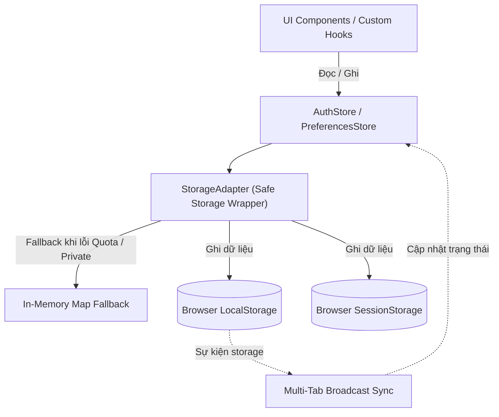

# ĐẶC TẢ & THIẾT KẾ DỮ LIỆU CỤC BỘ PHÂN HỆ CỔNG WEB QUẢN TRỊ & NGƯỜI DÙNG (`web-portal`)

## 1. Danh mục Thực thể Lưu trữ Phía Client (Client Storage Entities `DATA-WEB-`)

| ID | Phát biểu Thực thể Lưu trữ (Statement) | Phân loại | Mức Ưu tiên | Nguồn Tham chiếu | Tiêu chí Nghiệm thu (Acceptance Criteria) | Trạng thái |
| :--- | :--- | :--- | :---: | :---: | :--- | :---: |
| `DATA-WEB-001` | Quản lý phiên xác thực `auth_session` trong Browser `LocalStorage` bao gồm cặp token, mốc hết hạn và hồ sơ người dùng. | Storage | Must | `SRS-001`, `ARC-003` | Token & user info lưu an toàn, tự xóa khi logout hoặc vô hiệu hóa; fallback RAM khi lỗi Quota. | Approved |
| `DATA-WEB-002` | Quản lý tùy chọn giao diện `ui_preferences` trong Browser `LocalStorage` bao gồm trạng thái sidebar và kích thước trang. | Storage | Should | `SRS-003` | Trạng thái thu gọn menu và bộ lọc bảng lưu bền vững qua các phiên làm việc của người dùng. | Approved |
| `DATA-WEB-003` | Quản lý trạng thái ký cam kết tạm `consent_flow` trong Browser `SessionStorage` bao gồm điều khoản, OTP và mã QR. | Storage | Must | `SRS-001`, `ARC-003` | Dữ liệu phiên ký cam kết tự động xóa ngay khi đóng tab hoặc kích hoạt xong tại trạm Kiosk. | Approved |
| `DATA-WEB-004` | Quản lý bộ nhớ đệm truy vấn `query_cache` qua In-Memory TanStack Query với chính sách staleTime và invalidation linh hoạt. | Cache | Must | `SRS-003`, `ARC-003` | Dữ liệu live staleTime $0\text{ ms}$, cache tự động cập nhật khi có STOMP event chèn vào mảng. | Approved |
| `DATA-WEB-005` | Quản lý trạng thái thông báo `notification_state` trong bộ nhớ đệm truy vấn: danh sách thông báo theo người dùng, số chưa đọc và trạng thái đã đọc. | Cache | Should | `FR-SYS-027`, `API-SYS-034` | Số chưa đọc cập nhật tức thời khi đánh dấu đã đọc; dữ liệu được phân tách theo người dùng và xoá khi đăng xuất. | Approved |
| `DATA-WEB-006` | Quản lý trạng thái kỳ công `payroll_period_state` phía client: kỳ đang chọn, trạng thái `OPEN`/`LOCKED` và cờ vô hiệu hoá điều chỉnh. | Cache | Must | `FR-SYS-024`, `API-SYS-031` | Cờ khoá điều chỉnh lan toả tới mọi màn hình nghiệp vụ ngay khi kỳ được chốt; không lưu trạng thái này vào LocalStorage để tránh dữ liệu cũ. | Approved |
| `DATA-WEB-007` | Quản lý trạng thái danh mục trạm Kiosk `kiosk_registry_state` trong bộ nhớ RAM: danh sách trạm, trạng thái hoạt động, `last_ping_at` và Secret Token hiển thị một lần. | Storage | Must | `FR-SYS-020`, `API-SYS-028` | Secret Token **không** bao giờ được ghi vào LocalStorage/SessionStorage và bị xoá khỏi RAM khi rời màn hình hoặc tải lại trang. | Approved |

---

## 2. Đặc tả Chi tiết Cấu trúc Thực thể Lưu trữ (Entity Structures)

### 2.1. `DATA-WEB-001` — Cấu trúc Lưu trữ `auth_session`
* **Khóa lưu trữ trong LocalStorage**: `fas_auth_session`
* **Kiểu dữ liệu**: Chuỗi JSON mã hóa UTF-8.
* **Cấu trúc các trường**:
  | Tên Trường | Kiểu Dữ liệu | Bắt buộc | Mô tả & Ví dụ |
  | :--- | :--- | :---: | :--- |
  | `accessToken` | `string` | Có | Chuỗi JWT hợp lệ cấp quyền gọi API (`eyJhbGci...`). |
  | `refreshToken` | `string` | Có | Chuỗi UUID Refresh Token (`d8f4c2e1-9b7a-4c3d-8e5f-1a2b3c4d5e6f`). |
  | `tokenType` | `string` | Có | Cố định là `Bearer`. |
  | `expiresAt` | `number` | Có | Mốc Unix Timestamp (milliseconds) thời điểm hết hạn access token. |
  | `user` | `object` | Có | Thông tin định danh: `id` (`int64`), `employeeCode` (`string`), `fullName` (`string`), `email` (`string`), `role` (`HR_MANAGER` \| `EMPLOYEE` \| `ADMIN`), `status` (`PENDING_CONSENT` \| `ACTIVE` \| `INACTIVE`), `department` (`string`). |

---

### 2.2. `DATA-WEB-002` — Cấu trúc Lưu trữ `ui_preferences`
* **Khóa lưu trữ trong LocalStorage**: `fas_ui_prefs`
* **Cấu trúc các trường**:
  * `sidebarCollapsed` (`boolean`, mặc định `false`): Thu gọn/mở rộng menu trái ($260\text{ px} \leftrightarrow 72\text{ px}$).
  * `defaultPageSize` (`number`, mặc định `20`): Số dòng hiển thị mặc định trên bảng biểu ($20, 50, 100$).
  * `soundNotification` (`boolean`, mặc định `true`): Bật/tắt âm báo khi có lượt quẹt mới trên Live Table.

---

### 2.3. `DATA-WEB-003` — Cấu trúc Lưu trữ `consent_flow`
* **Khóa lưu trữ trong SessionStorage**: `fas_consent_session`
* **Cấu trúc các trường**:
  * `consentSigned` (`boolean`): Đã bấm xác nhận đồng ý điều khoản.
  * `otp` (`string`): Mã OTP 6 chữ số (`839201`).
  * `qrCodeData` (`string`): Chuỗi dữ liệu QR Code để hiển thị (`otp:839201;emp:NV-1042;exp:...`).
  * `expiresAt` (`string`): Thời điểm ISO-8601 hết hạn của mã OTP (48 giờ sau khi ký).
  * `kioskTargetHint` (`string`): Gợi ý vị trí trạm Kiosk đặt tại văn phòng.

---

## 3. Mô hình Kiểu Dữ liệu Client (TypeScript Data Contracts)

```typescript
// 1. Phân quyền và Trạng thái Người dùng
export type UserRole = 'HR_MANAGER' | 'EMPLOYEE' | 'ADMIN' | 'DPO';
export type UserStatus = 'PENDING_CONSENT' | 'ACTIVE' | 'INACTIVE';

export interface UserProfile {
  readonly id: number;
  readonly employeeCode: string;
  readonly fullName: string;
  readonly email: string;
  readonly role: UserRole;
  readonly status: UserStatus;
  readonly department: string;
  readonly hasBiometric: boolean;
  readonly hasPin: boolean;
  readonly createdAt: string;
}

export interface AuthSession {
  accessToken: string;
  refreshToken: string;
  tokenType: 'Bearer';
  expiresAt: number; // Unix timestamp in milliseconds
  user: UserProfile;
}

// 2. Điểm danh và Truy vấn
export type VerificationMethod = 'VERIFICATION_FACE' | 'VERIFICATION_PIN';
export type PunchType = 'CHECK_IN' | 'CHECK_OUT';
export type AttendanceStatus = 'ON_TIME' | 'LATE' | 'EARLY_LEAVE';

export interface AttendanceRecord {
  readonly recordId: number;
  readonly employeeId: number;
  readonly employeeCode: string;
  readonly fullName: string;
  readonly department: string;
  readonly punchTimestamp: string; // ISO-8601
  readonly punchType: PunchType;
  readonly verificationMethod: VerificationMethod;
  readonly status: AttendanceStatus;
  readonly lateMinutes: number;
  readonly kioskId: string;
}

export interface AttendanceQueryParams {
  page: number;
  size: number;
  fromDate?: string; // YYYY-MM-DD
  toDate?: string;   // YYYY-MM-DD
  department?: string;
  status?: AttendanceStatus;
  keyword?: string;
}

export interface PaginatedResult<T> {
  content: T[];
  page: number;
  size: number;
  totalElements: number;
  totalPages: number;
  first: boolean;
  last: boolean;
}

// 3. Thông báo và Kỳ công
export interface NotificationItem {
  readonly id: number;
  readonly eventType: string;
  readonly title: string;
  readonly message: string;
  readonly isRead: boolean;
  readonly createdAt: string;
}

export interface PayrollPeriod {
  readonly id: number;
  readonly periodCode: string; // YYYY-MM
  readonly status: 'OPEN' | 'LOCKED';
  readonly lockedAt?: string;
  readonly lockedBy?: string;
}
```

---

## 4. Kiến trúc Bộ Điều hợp Lưu trữ An toàn (`StorageAdapter` & `DTD-WEB-`)



| ID | Tên Thiết kế / Bộ điều hợp | Định nghĩa Trách nhiệm Kỹ thuật | Hiện thực hóa (`Realizes`) | Sử dụng (`Uses`) | Quyết định (`Decisions`) | Trạng thái |
| :--- | :--- | :--- | :--- | :--- | :---: | :---: |
| `DTD-WEB-001` | SafeLocalStorage | Đóng gói `window.localStorage` với JSON parse/serialize tự động; tiêm prefix định danh `fas_` và tự động fallback sang `MemoryStore` khi gặp lỗi Quota hoặc Private Browsing. | `DATA-WEB-001`, `DATA-WEB-002` | `ARC-003` | `DD-WEB-003` | Accepted |
| `DTD-WEB-002` | MultiTabSync | Cơ chế lắng nghe `window.addEventListener('storage', ...)` để tự động đồng bộ đăng xuất hoặc cập nhật phiên trên mọi tab đang mở khi có 1 tab logout. | `DTD-WEB-001` | `ARC-003` | `DD-WEB-004` | Accepted |
| `DTD-WEB-003` | SafeSessionStorage | Đóng gói `window.sessionStorage` quản lý phiên tạm thời cho quy trình Ký cam kết & hiển thị OTP; tự động hủy khi đóng tab. | `DATA-WEB-003` | `ARC-003` | `DD-WEB-005` | Accepted |
| `DTD-WEB-004` | NotificationStateStore | Lưu trạng thái thông báo trong bộ nhớ đệm truy vấn (TanStack Query) phân tách theo `userId`; xoá toàn bộ khi đăng xuất; cập nhật lạc quan số chưa đọc. | `DATA-WEB-005` | `ARC-003` | `DD-WEB-020` | Accepted |
| `DTD-WEB-005` | PayrollPeriodStore | Lưu kỳ công đang chọn và cờ khoá điều chỉnh trong bộ nhớ đệm truy vấn (không ghi LocalStorage); cung cấp selector dùng chung để vô hiệu hoá nút điều chỉnh. | `DATA-WEB-006` | `ARC-003` | `DD-WEB-006` | Accepted |
| `DTD-WEB-006` | KioskRegistryMemoryStore | Lưu danh mục trạm Kiosk và Secret Token **chỉ trong RAM** (React state), tự xoá khi unmount hoặc tải lại trang; không đi qua `SafeLocalStorage`/`SafeSessionStorage`. | `DATA-WEB-007` | `ARC-003` | `DD-WEB-019` | Accepted |

---

## 5. Thiết kế Bộ nhớ Đệm Truy vấn (TanStack Query Cache Architecture)

### 5.1. Factory Tạo Khóa Truy vấn (Query Keys Factory)
Nhằm đảm bảo tính nhất quán và loại bỏ xung đột cache, toàn bộ các truy vấn được định danh qua Factory tập trung:

```typescript
export const attendanceKeys = {
  all: ['attendance'] as const,
  live: () => [...attendanceKeys.all, 'live'] as const,
  history: (params: AttendanceQueryParams) => [...attendanceKeys.all, 'history', params] as const,
  personal: (month: number, year: number) => [...attendanceKeys.all, 'personal', { month, year }] as const,
  stats: (date: string) => [...attendanceKeys.all, 'stats', date] as const,
};

export const employeeKeys = {
  all: ['employees'] as const,
  list: (params: Record<string, unknown>) => [...employeeKeys.all, 'list', params] as const,
  detail: (id: number) => [...employeeKeys.all, 'detail', id] as const,
};

export const notificationKeys = {
  all: ['notifications'] as const,
  unreadCount: () => [...notificationKeys.all, 'unread-count'] as const,
  list: () => [...notificationKeys.all, 'list'] as const,
};
```

### 5.2. Chính sách Hết hạn & Rác Bộ đệm (Cache Policies)

| Query Key | Phạm vi Dữ liệu | `staleTime` | `gcTime` (Garbage Collection) | Quy tắc Làm mới (Refetch / Invalidation) |
| :--- | :--- | :---: | :---: | :--- |
| `['attendance', 'live']` | Danh sách quẹt thẻ trực tiếp trên Dashboard | $0\text{ ms}$ (Luôn mới) | $5\text{ phút}$ | Cập nhật cục bộ tức thời khi nhận frame STOMP `/topic/live-attendance`. |
| `['attendance', 'history', params]` | Bảng tra cứu lịch sử chấm công HR | $60\text{ s}$ | $10\text{ phút}$ | Tự động invalidate khi chuyển trang hoặc thay đổi bộ lọc ngày/phòng ban. |
| `['attendance', 'personal', month, year]` | Bảng công cá nhân của nhân viên | $120\text{ s}$ | $15\text{ phút}$ | Invalidate khi nhận thông báo nạp thẻ thành công hoặc đổi tháng. |
| `['employees', params]` | Danh mục nhân sự và trạng thái kích hoạt | $300\text{ s}$ | $30\text{ phút}$ | Invalidate khi tạo mới, cập nhật nhân viên hoặc kích hoạt sinh trắc. |
| `['notifications']` | Danh sách thông báo & số lượng chưa đọc | $30\text{ s}$ | $10\text{ phút}$ | Cập nhật lạc quan khi bấm đọc; xóa sạch khi đăng xuất. |

### 5.3. Cơ chế Đồng bộ Cache Thời gian thực từ STOMP (Realtime Cache Invalidation)
Khi nhận bản tin WebSocket STOMP từ máy chủ, Web Portal không cần gọi lại toàn bộ API lịch sử mà thực hiện chèn dữ liệu trực tiếp vào bộ đệm (Optimistic / Realtime Cache Prepend):

```typescript
// Khi nhận frame STOMP từ topic /topic/live-attendance:
export function handleLiveAttendanceEvent(newRecord: AttendanceRecord, queryClient: QueryClient) {
  const today = new Date().toISOString().split('T')[0];

  // 1. Chèn bản ghi mới lên đầu danh sách Live Table (giữ tối đa 50 bản ghi mới nhất)
  queryClient.setQueryData<AttendanceRecord[]>(attendanceKeys.live(), (oldData = []) => {
    return [newRecord, ...oldData.slice(0, 49)];
  });

  // 2. Tăng bộ đếm KPI trên Dashboard (Đã đến +1, Đúng giờ / Muộn +1)
  queryClient.setQueryData<{ presentCount: number; onTimeCount: number; lateCount: number }>(
    attendanceKeys.stats(today),
    (oldStats) => {
      if (!oldStats) return oldStats;
      return {
        ...oldStats,
        presentCount: oldStats.presentCount + 1,
        onTimeCount: newRecord.status === 'ON_TIME' ? oldStats.onTimeCount + 1 : oldStats.onTimeCount,
        lateCount: newRecord.status === 'LATE' ? oldStats.lateCount + 1 : oldStats.lateCount,
      };
    }
  );

  // 3. Đánh dấu danh sách lịch sử đã cũ (Stale) để tự động refetch khi HR bấm sang trang tra cứu
  queryClient.invalidateQueries({ queryKey: attendanceKeys.all });
}
```
