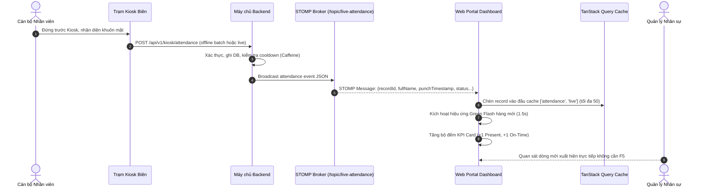
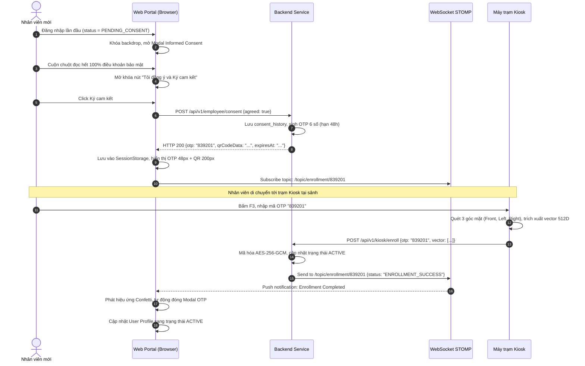
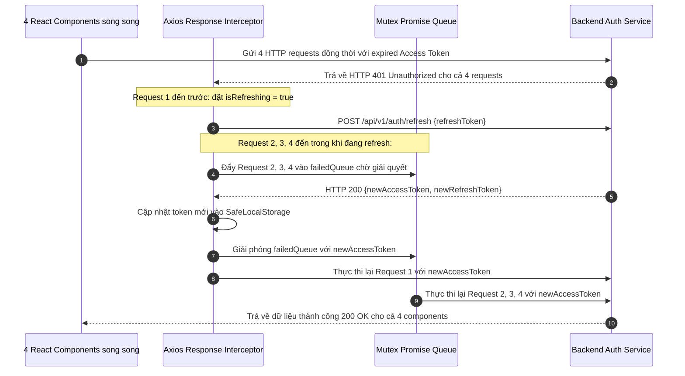

# YÊU CẦU NGHIỆP VỤ & THIẾT KẾ GIẢI PHÁP PHÂN HỆ CỔNG WEB QUẢN TRỊ & NGƯỜI DÙNG (`web-portal`)

## 1. Yêu cầu Chức năng Phân hệ Web Portal (Functional Requirements `FR-WEB-`)

Toàn bộ 14 yêu cầu chức năng của Cổng Web Quản trị & Người dùng được quy định trong bảng dưới đây:

| ID | Phát biểu Yêu cầu Nghiệp vụ (Statement) | Nhóm Phân loại | Mức Ưu tiên | Nguồn Tham chiếu | Tiêu chí Nghiệm thu (Acceptance Criteria) | Trạng thái |
| :--- | :--- | :--- | :---: | :---: | :--- | :---: |
| `FR-WEB-001` | Cung cấp giao diện đăng nhập bảo mật hỗ trợ lưu trữ token tự động và chuyển hướng theo vai trò (HR/ADMIN vs Nhân viên). | Auth / Routing | Must | `FR-SYS-007` | Đăng nhập phân quyền chính xác; lưu Access Token trong bộ nhớ và tự động gia hạn token khi hết hạn; điều hướng đúng trang đích. | Approved |
| `FR-WEB-002` | Cung cấp luồng ký cam kết Informed Consent điện tử và hiển thị mã kích hoạt OTP 6 số kèm mã QR Code cho nhân viên. | Enrollment / Privacy | Must | `FR-SYS-008` | Hiển thị đầy đủ điều khoản bảo vệ dữ liệu sinh trắc học; nút ký chỉ mở khi cuộn hết $100\%$ văn bản; sinh OTP hạn 48h sau khi ký. | Approved |
| `FR-WEB-003` | Cung cấp bảng điều khiển theo dõi chấm công thời gian thực cho HR nhận dữ liệu đẩy từ WebSocket STOMP. | Dashboard / Live | Must | `FR-SYS-014` | Cập nhật dòng mới tức thì khi có nhân viên quẹt thẻ tại Kiosk mà không cần F5 tải lại; hiệu ứng chớp sáng nổi bật trong $1.5\text{ s}$. | Approved |
| `FR-WEB-004` | Cho phép nhân sự tra cứu bảng chấm công cá nhân, xem chi tiết giờ vào/ra và số phút đi trễ theo tháng. | Employee Portal | Must | `FR-SYS-010` | Hiển thị lịch biểu trực quan dạng Calendar Grid; phân biệt ngày đúng giờ, đi muộn, nghỉ phép bằng màu sắc; xem chi tiết qua Drawer. | Approved |
| `FR-WEB-005` | Cung cấp công cụ quản lý hồ sơ nhân viên, trạng thái kích hoạt khuôn mặt và phân ca làm việc cho HR. | HR Management | Must | `FR-SYS-010` | Thêm, sửa, vô hiệu hóa nhân sự; xem trạng thái kích hoạt khuôn mặt (`ACTIVE` / `PENDING`); tìm kiếm và phân trang linh hoạt. | Approved |
| `FR-WEB-006` | Cho phép HR kết xuất báo cáo tổng hợp chấm công toàn công ty ra định dạng tệp Excel (.xlsx) và PDF. | Export / Report | Must | `FR-SYS-016`, `API-SYS-011`, `FR-BE-008` | Tải xuống file hoàn chỉnh trong vòng $\le 3\text{ giây}$ cho 1,000 nhân viên; file `.xlsx` nhận từ Backend đã escape ký tự công thức nguy hiểm (`=`, `+`, `-`, `@`). | Approved |
| `FR-WEB-007` | Cung cấp màn hình quản lý vòng đời hồ sơ nhân sự: tạo hồ sơ kèm mật khẩu tạm hiển thị một lần, cập nhật hồ sơ, vô hiệu hóa nhân sự và cấp lại mật khẩu tạm khi nhân viên quên. | HR Management | Must | `FR-SYS-017`, `FR-SYS-022`, `API-SYS-008` | Mật khẩu tạm hiển thị đúng một lần kèm nút sao chép và cảnh báo không xem lại được; sửa hồ sơ và vô hiệu hóa yêu cầu xác nhận hai bước; cấp lại mật khẩu tạm thông báo rõ phiên cũ đã bị thu hồi. | Approved |
| `FR-WEB-008` | Cung cấp màn hình quản lý danh mục ca làm việc và phân ca cho nhân sự theo khoảng ngày hiệu lực. | HR Management | Must | `FR-SYS-018`, `API-SYS-024`, `API-SYS-025` | Tạo/sửa/vô hiệu hóa ca; phân ca theo khoảng ngày; khi chồng lấn hiển thị lỗi 409 kèm khoảng trống gần nhất gợi ý cho HR. | Approved |
| `FR-WEB-009` | Cung cấp luồng đổi mật khẩu **tự nguyện** (mở từ menu người dùng) và luồng thiết lập/đặt lại mã PIN dự phòng. | Auth / Security | Must | `FR-SYS-017`, `FR-SYS-022` | Không tồn tại luồng chặn điều hướng: người dùng vào được mọi màn hình ngay sau khi đăng nhập kể cả khi còn dùng mật khẩu tạm; đổi mật khẩu thành công thông báo đã thu hồi các phiên cũ; thiết lập PIN yêu cầu nhập lại; đặt lại PIN yêu cầu mật khẩu hiện tại. | Approved |
| `FR-WEB-010` | Cung cấp màn hình chốt kỳ công theo tháng và phản ánh trạng thái khoá điều chỉnh trên toàn bộ giao diện nghiệp vụ. | HR Management | Must | `FR-SYS-024`, `API-SYS-031` | Chốt kỳ yêu cầu xác nhận; kỳ đã chốt hiển thị nhãn "Đã chốt" và vô hiệu hóa nút duyệt đơn/điều chỉnh công; ADMIN mở lại bắt buộc nhập lý do. | Approved |
| `FR-WEB-011` | Cung cấp luồng rút lại Informed Consent và gửi, theo dõi yêu cầu về dữ liệu cá nhân. | Compliance | Must | `FR-SYS-025`, `API-SYS-032` | Trước khi rút hiển thị cảnh báo hệ quả (điểm danh chỉ còn PIN, dữ liệu sinh trắc tiêu huỷ trong 7 ngày) và yêu cầu xác nhận hai bước; yêu cầu truy cập/chỉnh sửa dữ liệu cá nhân hiển thị được trạng thái xử lý. | Approved |
| `FR-WEB-012` | Cung cấp luồng đăng xuất thu hồi refresh token và xử lý phiên hết hạn trên toàn bộ tab. | Auth / Security | Must | `FR-SYS-023`, `API-SYS-030` | Đăng xuất gọi API thu hồi token trước khi xoá storage và đồng bộ sang các tab khác; khi refresh token thất bại tự chuyển về trang đăng nhập kèm thông báo lý do. | Approved |
| `FR-WEB-013` | Cung cấp trung tâm thông báo trong ứng dụng theo các sự kiện vòng đời. | Notification | Should | `FR-SYS-027`, `API-SYS-034` | Biểu tượng chuông hiển thị số chưa đọc; danh sách phân loại theo sự kiện (tài khoản được tạo, phiên bị thu hồi, PIN bị khoá, đơn được xử lý, Consent bị rút, kỳ công đã chốt); đánh dấu đã đọc tức thời; không có kênh email/SMS. | Approved |
| `FR-WEB-014` | Cung cấp màn hình quản lý trạm Kiosk và màn hình tra cứu kiểm toán/tuân thủ ở chế độ chỉ đọc cho ADMIN và DPO. | Admin / Compliance | Must | `FR-SYS-019`, `FR-SYS-020`, `API-SYS-026`, `API-SYS-028` | ADMIN đăng ký trạm và nhận Secret Token hiển thị một lần; xem `last_ping_at` kèm cảnh báo khi trạm không ping quá 5 phút; ADMIN tra cứu được audit log; role `DPO` chỉ thấy màn hình tuân thủ và không có thao tác ghi. | Approved |

---

## 2. Yêu cầu Phi chức năng Phân hệ Web Portal (Non-Functional Requirements `NFR-WEB-`)

| ID | Phát biểu Tiêu chuẩn Chất lượng (Statement) | Nhóm Tiêu chuẩn | Mức Ưu tiên | Nguồn Tham chiếu | Tiêu chí Nghiệm thu (Acceptance Criteria) | Trạng thái |
| :--- | :--- | :--- | :---: | :---: | :--- | :---: |
| `NFR-WEB-001` | Thời gian tải trang ban đầu (First Contentful Paint) đạt $\le 1.5\text{ giây}$ trên đường truyền băng thông tiêu chuẩn. | Performance | Must | `NFR-SYS-001` | Áp dụng kỹ thuật tách mã (Code Splitting), lazy loading cho các trang quản trị; điểm Lighthouse Performance $\ge 90$. | Approved |
| `NFR-WEB-002` | Giao diện tương thích hoàn hảo (Responsive Design) trên mọi kích thước màn hình máy tính để bàn và máy tính bảng. | Usability | Must | `NFR-SYS-003` | Hiển thị mượt mà từ độ phân giải $1024\times 768\text{ px}$ đến $4\text{K}$; không xuất hiện thanh cuộn ngang ngoài ý muốn. | Approved |
| `NFR-WEB-003` | Tự động kết nối lại WebSocket STOMP với chiến lược Exponential Backoff khi bị ngắt kết nối mạng. | Reliability | Must | `NFR-SYS-006` | Thử kết nối lại tự động; hiển thị thông báo trạng thái mạng trực quan cho người dùng; khôi phục subscription không rò rỉ RAM. | Approved |
| `NFR-WEB-004` | Bảo mật tuyệt đối phiên làm việc, chống tấn công XSS và không lưu trữ thông tin nhạy cảm trong LocalStorage. | Security | Must | `NFR-SYS-007` | Tuân thủ chính sách Content Security Policy (CSP); xóa sạch token khi đăng xuất; Secret Token trạm Kiosk chỉ giữ trong RAM. | Approved |

---

## 3. Thiết kế Thành phần Kỹ thuật & Giải pháp Thực thi (Solutions `SOL-WEB-`)

| ID | Tên Giải pháp / Thành phần | Định nghĩa Trách nhiệm Kỹ thuật | Sử dụng (`Uses`) | Hiện thực hóa (`Realizes`) | Quyết định (`Decisions`) | Trạng thái |
| :--- | :--- | :--- | :--- | :--- | :---: | :---: |
| `SOL-WEB-001` | AuthSessionManager | Quản lý trạng thái xác thực qua Zustand Auth Store, bộ điều hướng React Router phân luồng theo Role và lưu trữ an toàn qua `SafeLocalStorage`. | `STK-016` | `FR-WEB-001` | `DD-WEB-001`, `DD-WEB-002` | Accepted |
| `SOL-WEB-002` | ConsentModule | Hiển thị điều khoản pháp lý, khóa nút ký khi chưa cuộn hết $100\%$ văn bản, gọi API sinh OTP và lắng nghe WebSocket đóng Modal. | `STK-016`, `STK-017` | `FR-WEB-002` | `DD-WEB-015`, `DD-WEB-016` | Accepted |
| `SOL-WEB-003` | StompEventListener | Tích hợp thư viện `@stomp/stompjs` kết nối WebSocket, đăng ký topic `/topic/live-attendance` và `/topic/enrollment/{otp}` kèm Exponential Backoff. | `STK-015` | `FR-WEB-003`, `NFR-WEB-003` | `DD-WEB-010` | Accepted |
| `SOL-WEB-004` | LiveDashboardController | Hiển thị bảng dữ liệu nhân sự điểm danh theo thời gian thực với hiệu ứng Green Flash ($1.5\text{ s}$) và cập nhật tức thời 4 thẻ chỉ số KPI. | `STK-016`, `STK-017` | `FR-WEB-003`, `FR-WEB-005` | `DD-WEB-007`, `DD-WEB-014` | Accepted |
| `SOL-WEB-005` | ReportExportEngine | Sử dụng thư viện phía máy trạm (`exceljs` / `jspdf`) tạo file báo cáo xuất dữ liệu tức thì từ dữ liệu bảng, escape ký tự formula injection. | `STK-015` | `FR-WEB-006` | `DD-WEB-017` | Accepted |
| `SOL-WEB-006` | AccountLifecycleModule | Quản lý form tạo/sửa/vô hiệu hóa hồ sơ nhân sự, hiển thị mật khẩu tạm đúng một lần kèm cảnh báo, luồng cấp lại mật khẩu tạm và thiết lập/đặt lại PIN. | `STK-016`, `STK-017` | `FR-WEB-007`, `FR-WEB-009` | `DD-WEB-018` | Accepted |
| `SOL-WEB-007` | ShiftAssignmentModule | Màn hình CRUD ca và phân ca theo khoảng ngày, kiểm tra chồng lấn phía client trước khi gọi API và diễn giải lỗi 409 thành gợi ý khoảng trống. | `STK-016` | `FR-WEB-008` | `DD-WEB-001` | Accepted |
| `SOL-WEB-008` | PayrollLockModule | Màn hình chốt/mở lại kỳ công và cơ chế lan toả cờ khoá điều chỉnh tới mọi giao diện nghiệp vụ qua bộ nhớ đệm truy vấn TanStack Query. | `STK-016`, `STK-017` | `FR-WEB-010` | `DD-WEB-006` | Accepted |
| `SOL-WEB-009` | ConsentWithdrawalModule | Luồng rút Informed Consent có cảnh báo hệ quả (chỉ điểm danh qua PIN, tiêu hủy sau 7 ngày) và xác nhận hai bước, cùng màn hình gửi/theo dõi yêu cầu dữ liệu. | `STK-016` | `FR-WEB-011` | `DD-WEB-015` | Accepted |
| `SOL-WEB-010` | SessionLifecycleModule | Xử lý đăng xuất (gọi API thu hồi token trước khi xoá storage), đồng bộ đăng xuất đa tab qua sự kiện storage và điều hướng khi refresh token thất bại. | `STK-016` | `FR-WEB-012` | `DD-WEB-004`, `DD-WEB-009` | Accepted |
| `SOL-WEB-011` | NotificationCenterModule | Trung tâm thông báo trong ứng dụng: badge số chưa đọc, danh sách theo sự kiện vòng đời và đánh dấu đã đọc tức thời (optimistic update). | `STK-016`, `STK-017` | `FR-WEB-013` | `DD-WEB-020` | Accepted |
| `SOL-WEB-012` | AdminComplianceModule | Màn hình quản lý trạm Kiosk (Secret Token chỉ lưu trong RAM, cảnh báo ping $>5\text{ phút}$) và màn hình tra cứu kiểm toán/tuân thủ chỉ đọc cho `ADMIN`/`DPO`. | `STK-016` | `FR-WEB-014` | `DD-WEB-019` | Accepted |

---

## 4. Sơ đồ Luồng Tương tác Nghiệp vụ Chi tiết (Interaction Sequence Diagrams)

### 4.1. Luồng Cập nhật Điểm danh Thời gian thực (Real-time Live Attendance Flow)

---

### 4.2. Luồng Ký Cam kết Sinh trắc & Nạp Khuôn mặt tại Kiosk (Informed Consent & Activation Flow)

---

### 4.3. Luồng Token Refresh Chống Race Condition (Mutex Promise Queue Flow)

