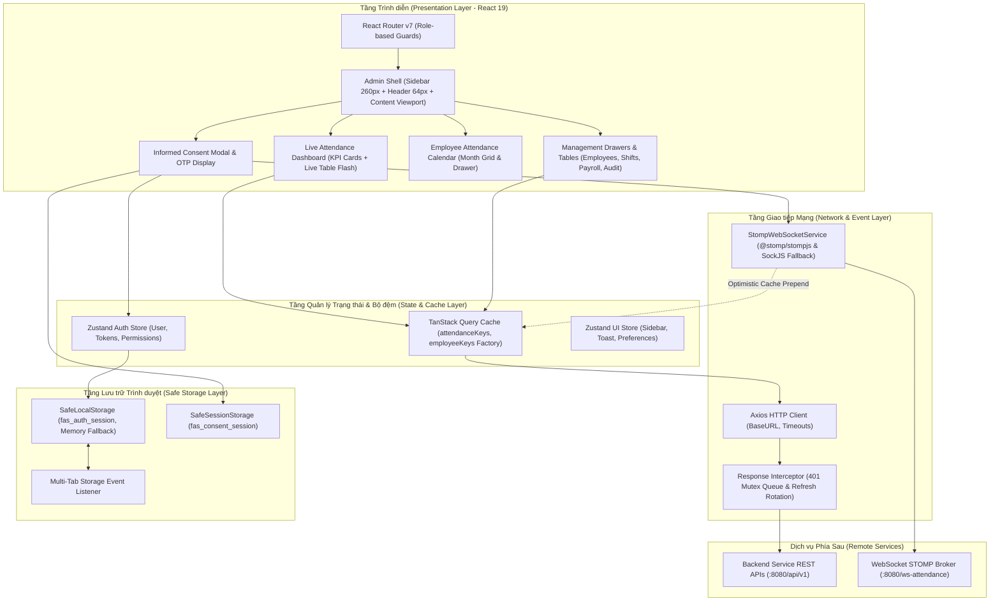
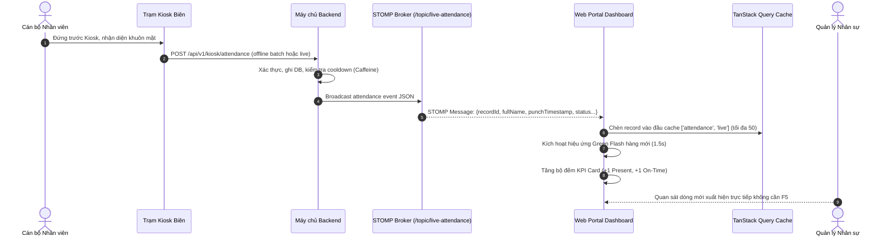
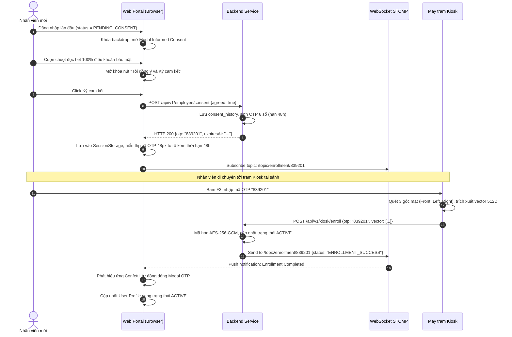
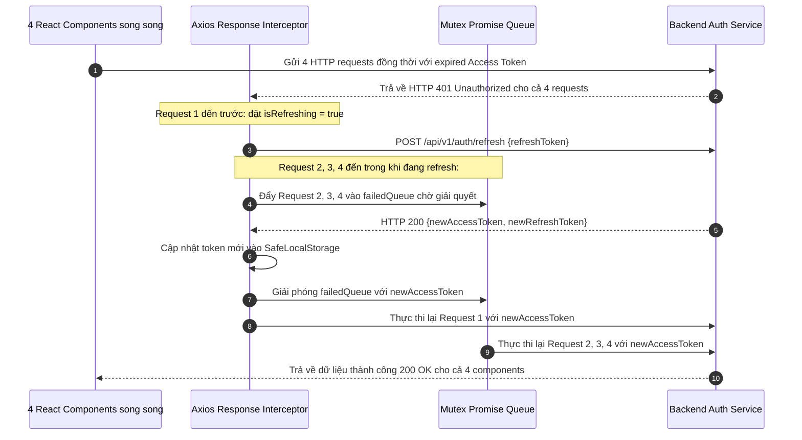

# WEB PORTAL SPEC CORE — Đặc tả Toàn diện Phân hệ Cổng Web Quản trị & Người dùng (`web-portal`)

Tài liệu này là **Spec Core của Phân hệ Cổng Web** (`web-portal`) theo chuẩn SDLC v3.x ([sdlc-docs.md](../../../sdlc-docs.md) §7.2). Tài liệu hợp nhất toàn diện:
1. Giới thiệu phân hệ, phạm vi trách nhiệm kỹ thuật kép (Dual-role) và các ranh giới kết nối.
2. Danh mục 14 Yêu cầu Chức năng Phân hệ Web Portal (`FR-WEB-001` đến `FR-WEB-014`).
3. Danh mục 4 Yêu cầu Phi chức năng Phân hệ Web Portal đo lường được (`NFR-WEB-001` đến `NFR-WEB-004`).
4. Kiến trúc nội bộ, mô hình phân lớp component, danh mục 12 giải pháp kỹ thuật (`SOL-WEB-001` đến `SOL-WEB-012`) và các sơ đồ tuần tự tương tác thời gian thực.
5. Danh mục 20 Quyết định Kỹ thuật Phân hệ Web Portal (`DD-WEB-001` đến `DD-WEB-020`).
6. Ma trận truy vết và nguồn tham chiếu upstream.

---

## 1. Giới thiệu Phân hệ & Phạm vi Trách nhiệm Kỹ thuật

Phân hệ **Cổng Web Quản trị & Người dùng** (`web-portal`) là ứng dụng web hiện đại (Single Page Application - SPA) được phát triển bằng ngôn ngữ TypeScript trên nền tảng React 19 và bộ đóng gói Vite 8. Phân hệ đóng vai trò là không gian làm việc số tập trung phục vụ các nhóm đối tượng chính trong doanh nghiệp:
1. **Quản lý Nhân sự (HR Manager) / Quản trị viên (ADMIN)**: Giám sát chấm công trực tiếp theo thời gian thực từ các trạm Kiosk, quản lý hồ sơ nhân viên, phân ca làm việc, chốt kỳ công, tra cứu nhật ký kiểm toán và xuất báo cáo bảng công định kỳ.
2. **Cán bộ Nhân viên Doanh nghiệp (Employee)**: Tra cứu bảng công cá nhân, theo dõi lịch sử vào/ra, thực hiện quy trình ký cam kết pháp lý Informed Consent (Nghị định 13/2023/NĐ-CP) và nhận mã OTP kích hoạt 6 số để xác thực tại trạm Kiosk.
3. **Cán bộ Bảo vệ Dữ liệu Cá nhân (Data Protection Officer - DPO)**: Giám sát tuân thủ Nghị định 13/2023/NĐ-CP, tra cứu nhật ký kiểm toán (Audit Logs) bất biến và theo dõi tiến độ xử lý các yêu cầu của chủ thể dữ liệu (Data Subject Requests - DSR) ở chế độ chỉ đọc.

### Ranh giới Trách nhiệm Kỹ thuật (Technical Scope):
* **Cổng Thông tin Phân quyền Đa Vai trò (Role Guards & RBAC)**: Phân quyền điều hướng tự động dựa trên JWT Claims (`HR_MANAGER`, `EMPLOYEE`, `ADMIN`, `DPO`), bảo vệ các tuyến đường (Protected Routes) và ngăn chặn truy cập trái phép.
* **Quản lý Trạng thái & Lưu trữ Client (Data Facet)**: Lưu trữ phiên an toàn qua LocalStorage Safe Adapter (`fas_auth_session`), cô lập luồng ký cam kết tạm trong SessionStorage (`fas_consent_session`), đồng bộ phiên đa tab qua sự kiện `storage` và tối ưu hóa bộ nhớ đệm truy vấn qua TanStack Query.
* **Giao tiếp Hai chiều (API Facet)**: Kết nối RESTful API qua Axios Client tích hợp bộ chặn tự động làm mới Token (Mutex Refresh Queue) chống Race Condition khi gặp HTTP 401, đồng thời duy trì kết nối WebSocket STOMP nhận thông điệp chấm công trực tiếp và trạng thái nạp khuôn mặt.
* **Trải nghiệm Người dùng Hiện đại (UI/UX Facet)**: Thiết kế dựa trên hệ thống Design Tokens Tailwind CSS phong cách **Indigo Clean SaaS**, bố cục Admin Shell co giãn linh hoạt (Responsive từ mobile đến desktop 4K), bảng Live Table chớp sáng theo thời gian thực và trải nghiệm ký cam kết pháp lý đạt chuẩn bảo vệ dữ liệu cá nhân.

---

---

## 2. Requirements (Yêu cầu Kỹ thuật Phân hệ Web Portal)

### 2.1. Yêu cầu Chức năng Phân hệ Web Portal (Functional Requirements `FR-WEB-`)

Toàn bộ 14 yêu cầu chức năng của Cổng Web Quản trị & Người dùng được quy định trong bảng dưới đây:

| ID | Phát biểu Yêu cầu Nghiệp vụ (Statement) | Nhóm Phân loại | Mức Ưu tiên | Nguồn Tham chiếu | Tiêu chí Nghiệm thu (Acceptance Criteria) | Trạng thái |
| :--- | :--- | :--- | :---: | :---: | :--- | :---: |
| `FR-WEB-001` | Cung cấp giao diện đăng nhập bảo mật hỗ trợ lưu trữ token tự động và chuyển hướng theo vai trò (HR/ADMIN vs Nhân viên vs DPO). | Auth / Routing | Must | `FR-SYS-007` | Đăng nhập phân quyền chính xác; lưu Access Token trong bộ nhớ và tự động gia hạn token khi hết hạn; điều hướng đúng trang đích. | Approved |
| `FR-WEB-002` | Cung cấp luồng ký cam kết Informed Consent điện tử và hiển thị mã kích hoạt OTP 6 số cho nhân viên. | Enrollment / Privacy | Must | `FR-SYS-008` | Hiển thị đầy đủ điều khoản bảo vệ dữ liệu sinh trắc học; nút ký chỉ mở khi cuộn hết $100\%$ văn bản; sinh mã OTP 6 số hạn 48h sau khi ký kèm hướng dẫn kích hoạt tại Kiosk. | Approved |
| `FR-WEB-003` | Cung cấp bảng điều khiển theo dõi chấm công thời gian thực cho HR nhận dữ liệu đẩy từ WebSocket STOMP. | Dashboard / Live | Must | `FR-SYS-014` | Cập nhật dòng mới tức thì khi có nhân viên quẹt thẻ tại Kiosk mà không cần F5 tải lại; hiệu ứng chớp sáng nổi bật trong $1.5\text{ s}$. | Approved |
| `FR-WEB-004` | Cho phép nhân sự tra cứu bảng chấm công cá nhân, xem chi tiết giờ vào/ra và số phút đi trễ theo tháng. | Employee Portal | Must | `FR-SYS-010` | Hiển thị lịch biểu trực quan dạng Calendar Grid; phân biệt ngày đúng giờ, đi muộn, nghỉ phép bằng màu sắc; xem chi tiết qua Drawer. | Approved |
| `FR-WEB-005` | Cung cấp công cụ tra cứu, quản lý dữ liệu điểm danh và điều chỉnh bản ghi chấm công thủ công có kiểm toán cho HR. | HR Management | Must | `FR-SYS-010` | Tra cứu lịch sử điểm danh đa tiêu chí; xem trạng thái kích hoạt khuôn mặt; cho phép HR/Admin điều chỉnh giờ quẹt/trạng thái chấm công kèm lý do giải trình khi kỳ công chưa chốt (`API-WEB-021`). | Approved |
| `FR-WEB-006` | Cho phép HR kết xuất báo cáo tổng hợp chấm công toàn công ty ra định dạng tệp Excel (.xlsx) và PDF. | Export / Report | Must | `FR-SYS-016`, `FR-BE-008` | Tải xuống file hoàn chỉnh trong vòng $\le 3\text{ giây}$ cho 1,000 nhân viên; file `.xlsx` nhận từ Backend đã escape ký tự công thức nguy hiểm (`=`, `+`, `-`, `@`). | Approved |
| `FR-WEB-007` | Cung cấp màn hình quản lý vòng đời hồ sơ nhân sự: tạo hồ sơ kèm mật khẩu tạm hiển thị một lần, cập nhật hồ sơ, vô hiệu hóa nhân sự và cấp lại mật khẩu tạm khi nhân viên quên. | HR Management | Must | `FR-SYS-017`, `FR-SYS-022` | Mật khẩu tạm hiển thị đúng một lần kèm nút sao chép và cảnh báo không xem lại được; sửa hồ sơ và vô hiệu hóa yêu cầu xác nhận hai bước; cấp lại mật khẩu tạm thông báo rõ phiên cũ đã bị thu hồi. | Approved |
| `FR-WEB-008` | Cung cấp màn hình quản lý danh mục ca làm việc và phân ca cho nhân sự theo khoảng ngày hiệu lực. | HR Management | Must | `FR-SYS-018` | Tạo/sửa/vô hiệu hóa ca; phân ca theo khoảng ngày; khi chồng lấn hiển thị lỗi 409 kèm khoảng trống gần nhất gợi ý cho HR. | Approved |
| `FR-WEB-009` | Cung cấp luồng đổi mật khẩu **tự nguyện** (mở từ menu người dùng) và luồng thiết lập/đặt lại mã PIN dự phòng. | Auth / Security | Must | `FR-SYS-017`, `FR-SYS-022` | Không tồn tại luồng chặn điều hướng: người dùng vào được mọi màn hình ngay sau khi đăng nhập kể cả khi còn dùng mật khẩu tạm; đổi mật khẩu thành công thông báo đã thu hồi các phiên cũ; thiết lập PIN yêu cầu nhập lại; đặt lại PIN yêu cầu mật khẩu hiện tại. | Approved |
| `FR-WEB-010` | Cung cấp màn hình chốt kỳ công theo tháng và phản ánh trạng thái khoá điều chỉnh trên toàn bộ giao diện nghiệp vụ. | HR Management | Must | `FR-SYS-024` | Chốt kỳ yêu cầu xác nhận; kỳ đã chốt hiển thị nhãn "Đã chốt" và vô hiệu hóa nút duyệt đơn/điều chỉnh công; ADMIN mở lại bắt buộc nhập lý do. | Approved |
| `FR-WEB-011` | Cung cấp luồng rút lại Informed Consent và gửi, theo dõi yêu cầu về dữ liệu cá nhân. | Compliance | Must | `FR-SYS-025` | Trước khi rút hiển thị cảnh báo hệ quả (điểm danh chỉ còn PIN, dữ liệu sinh trắc tiêu huỷ trong 7 ngày) và yêu cầu xác nhận hai bước; yêu cầu truy cập/chỉnh sửa dữ liệu cá nhân hiển thị được trạng thái xử lý. | Approved |
| `FR-WEB-012` | Cung cấp luồng đăng xuất thu hồi refresh token và xử lý phiên hết hạn trên toàn bộ tab. | Auth / Security | Must | `FR-SYS-023` | Đăng xuất gọi API thu hồi token trước khi xoá storage và đồng bộ sang các tab khác; khi refresh token thất bại tự chuyển về trang đăng nhập kèm thông báo lý do. | Approved |
| `FR-WEB-013` | Cung cấp trung tâm thông báo trong ứng dụng theo các sự kiện vòng đời. | Notification | Should | `FR-SYS-027` | Biểu tượng chuông hiển thị số chưa đọc; danh sách phân loại theo sự kiện (tài khoản được tạo, phiên bị thu hồi, PIN bị khoá, đơn được xử lý, Consent bị rút, kỳ công đã chốt); đánh dấu đã đọc tức thời; không có kênh email/SMS. | Approved |
| `FR-WEB-014` | Cung cấp màn hình quản lý trạm Kiosk và màn hình tra cứu kiểm toán/tuân thủ ở chế độ chỉ đọc cho ADMIN và DPO. | Admin / Compliance | Must | `FR-SYS-019`, `FR-SYS-020` | ADMIN đăng ký trạm và nhận Secret Token hiển thị một lần; xem `last_ping_at` kèm cảnh báo khi trạm không ping quá 5 phút; ADMIN tra cứu được audit log; role `DPO` chỉ thấy màn hình tuân thủ và không có thao tác ghi. | Approved |

---

---

### 2.2. Yêu cầu Phi chức năng Phân hệ Web Portal (Non-Functional Requirements `NFR-WEB-`)

| ID | Phát biểu Tiêu chuẩn Chất lượng (Statement) | Nhóm Tiêu chuẩn | Mức Ưu tiên | Nguồn Tham chiếu | Tiêu chí Nghiệm thu (Acceptance Criteria) | Trạng thái |
| :--- | :--- | :--- | :---: | :---: | :--- | :---: |
| `NFR-WEB-001` | Thời gian tải trang ban đầu (First Contentful Paint) đạt $\le 1.5\text{ giây}$ trên đường truyền băng thông tiêu chuẩn. | Performance | Must | `NFR-SYS-001` | Áp dụng kỹ thuật tách mã (Code Splitting), lazy loading cho các trang quản trị; điểm Lighthouse Performance $\ge 90$. | Approved |
| `NFR-WEB-002` | Giao diện tương thích hoàn hảo (Responsive Design) trên mọi kích thước màn hình máy tính để bàn và máy tính bảng. | Usability | Must | `NFR-SYS-003` | Hiển thị mượt mà từ độ phân giải $1024\times 768\text{ px}$ đến $4\text{K}$; không xuất hiện thanh cuộn ngang ngoài ý muốn. | Approved |
| `NFR-WEB-003` | Tự động kết nối lại WebSocket STOMP với chiến lược Exponential Backoff khi bị ngắt kết nối mạng. | Reliability | Must | `NFR-SYS-006` | Thử kết nối lại tự động; hiển thị thông báo trạng thái mạng trực quan cho người dùng; khôi phục subscription không rò rỉ RAM. | Approved |
| `NFR-WEB-004` | Bảo mật tuyệt đối phiên làm việc, chống tấn công XSS và không lưu trữ thông tin nhạy cảm trong LocalStorage. | Security | Must | `NFR-SYS-007` | Tuân thủ chính sách Content Security Policy (CSP); xóa sạch token khi đăng xuất; Secret Token trạm Kiosk chỉ giữ trong RAM. | Approved |

---

---

## 3. Architecture & Internal Design (Kiến trúc Nội bộ & Giải pháp Kỹ thuật)

### 3.1. Kiến trúc Nội bộ & Mô hình Phân lớp (Architecture & Component Hierarchy)

Cấu trúc phân lớp của ứng dụng Web Portal được thiết kế theo nguyên tắc phân tách trách nhiệm (Separation of Concerns), đảm bảo tính module hóa và dễ bảo trì:

---

---

### 3.2. Thiết kế Thành phần Kỹ thuật & Giải pháp Thực thi (Solutions `SOL-WEB-`)

| ID | Tên Giải pháp / Thành phần | Định nghĩa Trách nhiệm Kỹ thuật | Sử dụng (`Uses`) | Hiện thực hóa (`Realizes`) | Quyết định (`Decisions`) | Trạng thái |
| :--- | :--- | :--- | :--- | :--- | :---: | :---: |
| `SOL-WEB-001` | AuthSessionManager | Quản lý trạng thái xác thực qua Zustand Auth Store, bộ điều hướng React Router phân luồng theo Role và lưu trữ an toàn qua `SafeLocalStorage`. | `STK-016` | `FR-WEB-001`, `NFR-WEB-004` | `DD-WEB-001`, `DD-WEB-002` | Accepted |
| `SOL-WEB-002` | ConsentModule | Hiển thị điều khoản pháp lý, khóa nút ký khi chưa cuộn hết $100\%$ văn bản, gọi API sinh OTP và lắng nghe WebSocket đóng Modal. | `STK-016`, `STK-017` | `FR-WEB-002` | `DD-WEB-015`, `DD-WEB-016` | Accepted |
| `SOL-WEB-003` | StompEventListener | Tích hợp thư viện `@stomp/stompjs` kết nối WebSocket, đăng ký topic `/topic/live-attendance` và `/topic/enrollment/{otp}` kèm Exponential Backoff. | `STK-015` | `FR-WEB-003`, `NFR-WEB-003` | `DD-WEB-010` | Accepted |
| `SOL-WEB-004` | LiveDashboardController | Hiển thị bảng dữ liệu nhân sự điểm danh theo thời gian thực với hiệu ứng Green Flash ($1.5\text{ s}$), cập nhật tức thời 5 thẻ chỉ số KPI (`totalEmployees`, `presentCount`, `onTimeCount`, `lateCount`, `absentCount`), hỗ trợ thao tác điều chỉnh giờ công thủ công (`API-WEB-021`) và làm mới cache TanStack Query. | `STK-016`, `STK-017` | `FR-WEB-003`, `FR-WEB-005` | `DD-WEB-007`, `DD-WEB-014` | Accepted |
| `SOL-WEB-005` | ReportExportEngine | Sử dụng thư viện phía máy trạm (`exceljs` / `jspdf`) tạo file báo cáo xuất dữ liệu tức thì từ dữ liệu bảng, escape ký tự formula injection. | `STK-015` | `FR-WEB-004`, `FR-WEB-006`, `UI-WEB-004` | `DD-WEB-017` | Accepted |
| `SOL-WEB-006` | AccountLifecycleModule | Quản lý form tạo/sửa/vô hiệu hóa hồ sơ nhân sự, hiển thị mật khẩu tạm đúng một lần kèm cảnh báo, luồng cấp lại mật khẩu tạm và thiết lập/đặt lại PIN. | `STK-016`, `STK-017` | `FR-WEB-007`, `FR-WEB-009` | `DD-WEB-018` | Accepted |
| `SOL-WEB-007` | ShiftAssignmentModule | Màn hình CRUD ca và phân ca theo khoảng ngày, kiểm tra chồng lấn phía client trước khi gọi API và diễn giải lỗi 409 thành gợi ý khoảng trống. | `STK-016` | `FR-WEB-008` | `DD-WEB-001` | Accepted |
| `SOL-WEB-008` | PayrollLockModule | Màn hình chốt/mở lại kỳ công và cơ chế lan toả cờ khoá điều chỉnh tới mọi giao diện nghiệp vụ qua bộ nhớ đệm truy vấn TanStack Query. | `STK-016`, `STK-017` | `FR-WEB-010` | `DD-WEB-006` | Accepted |
| `SOL-WEB-009` | ConsentWithdrawalModule | Luồng rút Informed Consent có cảnh báo hệ quả (chỉ điểm danh qua PIN, tiêu hủy sau 7 ngày) và xác nhận hai bước, cùng màn hình gửi/theo dõi yêu cầu dữ liệu. | `STK-016` | `FR-WEB-011` | `DD-WEB-015` | Accepted |
| `SOL-WEB-010` | SessionLifecycleModule | Xử lý đăng xuất (gọi API thu hồi token trước khi xoá storage), đồng bộ đăng xuất đa tab qua sự kiện storage và điều hướng khi refresh token thất bại. | `STK-016` | `FR-WEB-012` | `DD-WEB-004`, `DD-WEB-009` | Accepted |
| `SOL-WEB-011` | NotificationCenterModule | Trung tâm thông báo trong ứng dụng: badge số chưa đọc, danh sách theo sự kiện vòng đời và đánh dấu đã đọc tức thời (optimistic update). | `STK-016`, `STK-017` | `FR-WEB-013` | `DD-WEB-020` | Accepted |
| `SOL-WEB-012` | AdminComplianceModule | Cung cấp 2 không gian quản trị độc lập gồm: Màn hình quản lý trạm Kiosk (`/admin/kiosks` - Secret Token chỉ lưu trong RAM, cảnh báo ping $>5\text{ phút}$) và Màn hình nhật ký kiểm toán / tuân thủ DPO (`/admin/audit-logs` - tra cứu chỉ đọc cho `ADMIN` và `DPO`, không có thao tác ghi). | `STK-016` | `FR-WEB-014` | `DD-WEB-019` | Accepted |
| `SOL-WEB-013` | CodeSplittingOptimizer | Tối ưu hóa hiệu năng tải trang FCP $\le 1.5\text{ s}$ bằng Vite code splitting, lazy loading các route quản trị và prefetching tài nguyên trọng yếu. | `STK-015` | `NFR-WEB-001` | `DD-WEB-001` | Accepted |
| `SOL-WEB-014` | ResponsiveViewportAdapter | Bố cục co giãn tương thích từ $1024\times 768\text{ px}$ đến 4K qua Tailwind responsive breakpoint utilities, sidebar trượt và viewport scaling. | `STK-015`, `STK-016` | `NFR-WEB-002` | `DD-WEB-013` | Accepted |

---

---

### 3.3. Sơ đồ Luồng Tương tác Nghiệp vụ Chi tiết (Interaction Sequence Diagrams)

### 4.1. Luồng Cập nhật Điểm danh Thời gian thực (Real-time Live Attendance Flow)

---

### 4.2. Luồng Ký Cam kết Sinh trắc & Nạp Khuôn mặt tại Kiosk (Informed Consent & Activation Flow)

---

### 4.3. Luồng Token Refresh Chống Race Condition (Mutex Promise Queue Flow)

---

## 4. Danh mục Quyết định Thiết kế Kỹ thuật (Technical Decisions `DD-WEB-`)

Toàn bộ các quyết định kiến trúc và kỹ thuật của Phân hệ Cổng Web Portal được chuẩn hóa trong bảng dưới đây:

| ID | Quyết định Kỹ thuật (Decision) | Lý do & Phân tích Đánh đổi (Rationale) | Giải pháp Thay thế (Alternatives) | Hệ quả & Ràng buộc (Consequences) | Nguồn tham chiếu (Basis) | Trạng thái |
| :--- | :--- | :--- | :--- | :--- | :---: | :---: |
| `DD-WEB-001` | Xây dựng Web Portal dưới dạng SPA bằng React 19, TypeScript và Vite 8. | Hiệu năng render tối ưu, kiểu dữ liệu an toàn thời gian biên dịch, tốc độ khởi động và HMR cực nhanh của Vite. | Next.js SSR, Vue 3 SPA | Cần xử lý client-side routing và SEO không phải là ưu tiên chính của cổng nội bộ doanh nghiệp. | `ARC-003`, `STK-015`, `STK-016` | Approved |
| `DD-WEB-002` | Phân quyền điều hướng Dual-Role (HR/ADMIN vs EMPLOYEE) qua React Router v7 & Role Guard. | Tách bạch hoàn toàn không gian làm việc số của quản lý nhân sự và nhân viên thông thường, bảo vệ các endpoint UI theo JWT claims. | Tạo 2 ứng dụng web riêng biệt | Giảm chi phí vận hành và hạ tầng deploy, quản lý chung một phiên đăng nhập và domain. | `ARC-003`, `FR-SYS-007` | Approved |
| `DD-WEB-003` | Sử dụng SafeLocalStorage bọc ngoài `window.localStorage` kèm In-Memory Fallback. | Tránh lỗi ứng dụng bị crash khi người dùng mở web ở chế độ ẩn danh (Private Browsing) hoặc khi bộ nhớ quota bị đầy. | Truy cập trực tiếp `localStorage` | Cần module wrapper quản lý serialize/deserialize JSON an toàn và tiền tố `fas_`. | `ARC-003`, `DD-SYS-003` | Approved |
| `DD-WEB-004` | Đồng bộ trạng thái phiên đa tab qua sự kiện `window.addEventListener('storage')`. | Khi người dùng đăng xuất trên một tab, toàn bộ các tab khác đang mở lập tức xóa token và chuyển hướng về `/login`, ngăn chặn rò rỉ phiên. | BroadcastChannel API, Polling | Không phụ thuộc vào service worker, hoạt động đồng nhất trên mọi trình duyệt hiện đại. | `ARC-003`, `FR-SYS-023` | Approved |
| `DD-WEB-005` | Cô lập dữ liệu luồng ký cam kết tạm thời trong `SessionStorage` (`fas_consent_session`). | Dữ liệu mã OTP và mã cam kết tự động bị tiêu hủy ngay khi đóng tab hoặc tải lại trình duyệt, tuân thủ an toàn dữ liệu. | Lưu trong LocalStorage, Redux Persist | Người dùng đóng tab sẽ phải ký lại hoặc yêu cầu sinh lại OTP nếu chưa kích hoạt tại Kiosk. | `ARC-003`, `DD-SYS-003` | Approved |
| `DD-WEB-006` | Quản lý bộ đệm truy vấn qua TanStack Query với Query Key Factory tập trung. | Loại bỏ hoàn toàn xung đột cache key giữa các trang; cấu hình `staleTime` linh hoạt ($0\text{ ms}$ cho Live, $60\text{ s}$ cho Lịch sử, $300\text{ s}$ cho Nhân sự). | Redux Toolkit Query, SWR | Tối ưu hóa số lượng network request gửi lên Backend; tái sử dụng dữ liệu mượt mà. | `ARC-003`, `DD-SYS-004` | Approved |
| `DD-WEB-007` | Đồng bộ Cache thời gian thực từ STOMP qua cơ chế Optimistic Prepend (tối đa 50 bản ghi). | Khi nhận bản tin `/topic/live-attendance`, chèn trực tiếp vào đầu cache mảng mà không cần refetch toàn bộ danh sách lịch sử qua HTTP GET. | Polling API định kỳ mỗi 2s, Invalidate Query | Tiết kiệm băng thông máy chủ, thời gian phản hồi giao diện tức thì ($< 100\text{ ms}$). | `ARC-003`, `DD-SYS-004` | Approved |
| `DD-WEB-008` | Đóng gói Axios HTTP Client với Request Interceptor tự động gán Bearer Token. | Tập trung hóa cấu hình BaseURL (`VITE_API_BASE_URL`), timeout chuẩn ($10.0\text{ s}$ cho truy vấn, $5.0\text{ s}$ cho xác thực) và tự gắn JWT token. | Native Fetch API | Đảm bảo tính nhất quán trong xử lý lỗi, chuyển đổi JSON và quản lý hàng đợi interceptors. | `ARC-003`, `DD-SYS-001` | Approved |
| `DD-WEB-009` | Cơ chế Mutex Promise Queue trong Response Interceptor khi gặp HTTP 401 Token Expired. | Ngăn chặn hiện tượng giông bão refresh token (Race Condition) khi 4-5 request song song cùng nhận 401; chỉ phát đúng 1 request `/auth/refresh`. | Bỏ qua refresh tự động, Logout ngay | Giữ phiên làm việc liên tục trong suốt cho người dùng; bảo vệ cơ chế Refresh Token Rotation phía Backend. | `ARC-003`, `DD-SYS-001` | Approved |
| `DD-WEB-010` | Sử dụng `@stomp/stompjs` với SockJS Fallback và tự động kết nối lại theo Exponential Backoff. | Đảm bảo kết nối WebSocket thời gian thực bền bỉ; tự động khôi phục kênh truyền khi mạng chập chờn mà không cần người dùng can thiệp. | Native WebSocket, Server-Sent Events | Khả năng tương thích cao ngay cả phía sau các proxy doanh nghiệp chặn WebSocket thuần. | `ARC-003`, `DD-SYS-004` | Approved |
| `DD-WEB-011` | Tự động đóng Modal OTP và phát hiệu ứng Confetti khi nhận frame STOMP `/topic/enrollment/{otp}`. | Đem lại trải nghiệm người dùng liền mạch: nhân viên quét mặt tại Kiosk, màn hình máy tính cá nhân tự động cập nhật sang trạng thái `ACTIVE`. | Bắt người dùng bấm nút "Tôi đã quét xong", Polling trạng thái | Tăng độ hài lòng của nhân viên, xác nhận tức thì kết quả nạp sinh trắc học thành công. | `ARC-003`, `FR-SYS-008` | Approved |
| `DD-WEB-012` | Áp dụng hệ thống Design Tokens Indigo Clean SaaS trên Tailwind CSS 4 và phông chữ Inter. | Giao diện hiện đại, sạch sẽ, chuyên nghiệp, phông chữ dạng Tabular Monospace giúp các con số trên bảng biểu thẳng hàng tuyệt đối. | Bootstrap, Material UI, Tailwind mặc định | Giao diện có nhận diện thương hiệu nhất quán, tải nhẹ, không thừa mã CSS không sử dụng. | `ARC-003`, `STK-017` | Approved |
| `DD-WEB-013` | Bố cục Admin Shell co giãn: Sidebar 260px (thu gọn 72px) + Header 64px dính đỉnh + Drawer di động. | Tối ưu hóa không gian hiển thị cho các bảng dữ liệu dày đặc; hỗ trợ trải nghiệm từ màn hình di động nhỏ ($< 768\text{ px}$) đến màn hình 4K. | Bố cục cố định không co giãn | Cho phép HR tùy biến thu gọn sidebar để xem trọn vẹn 8-10 cột dữ liệu bảng chấm công. | `ARC-003`, `UXD-WEB-001` | Approved |
| `DD-WEB-014` | Hiệu ứng thị giác Green Flash (1.5s) trên Live Table và tăng bộ đếm thẻ KPI Dashboard. | Giúp người quản trị nhân sự nhận biết tức thì lượt quẹt mới xuất hiện mà không bị phân tâm hay bỏ sót sự kiện. | Chớp nháy toàn bảng, Chuông âm thanh lớn | Trực quan, tinh tế, không gây khó chịu cho người dùng khi có nhiều nhân viên chấm công liên tục. | `ARC-003`, `UXD-WEB-004` | Approved |
| `DD-WEB-015` | Quy trình ký cam kết pháp lý Informed Consent 2 bước có khóa cuộn văn bản 100%. | Đáp ứng nghiêm ngặt Nghị định 13/2023/NĐ-CP: chỉ mở khóa nút "Ký cam kết" khi người dùng đã cuộn hết văn bản điều khoản thu thập dữ liệu. | Cho phép bấm ký ngay không cần đọc | Bảo vệ quyền lợi pháp lý cho doanh nghiệp, đảm bảo sự đồng thuận minh bạch của chủ thể dữ liệu. | `ARC-003`, `DD-SYS-003` | Approved |
| `DD-WEB-016` | Hiển thị mã OTP 6 số kích thước lớn 48px Bold kèm bộ đếm ngược thời hạn 48 giờ. | Cho phép nhân viên dễ dàng ghi nhớ, sao chép để nhập trực tiếp tại trạm Kiosk; loại bỏ mã QR không tương thích với phần cứng Kiosk tránh gây nhầm lẫn. | Hiển thị mã QR giả lập, Chỉ gửi mã qua email | Tập trung tối đa vào mã OTP 6 số trực quan, rõ ràng; hỗ trợ người dùng thao tác nhanh nhất trên bàn phím số cảm ứng của Kiosk. | `ARC-003`, `UXD-WEB-002` | Approved |
| `DD-WEB-017` | Kết xuất báo cáo bảng công phía Client qua `exceljs` và `jspdf` có phòng chống Formula Injection. | Giảm tải xử lý tài nguyên cho Backend Server; tự động làm sạch các ký tự nguy hiểm (`=`, `+`, `-`, `@`) trong nội dung file Excel tải về. | Render file tại máy chủ Java Backend | Tốc độ xuất báo cáo tức thời ($\le 3\text{ giây}$ cho 1,000 bản ghi), loại trừ rủi ro bảo mật tệp văn phòng. | `ARC-003`, `FR-SYS-016` | Approved |
| `DD-WEB-018` | Hộp thoại mật khẩu tạm hiển thị duy nhất một lần và quy trình đổi mật khẩu tự nguyện. | Bảo vệ thông tin xác thực ban đầu; không chặn điều hướng người dùng; cho phép nhân viên tự do đổi mật khẩu khi có nhu cầu. | Bắt buộc đổi mật khẩu ngay khi đăng nhập | Tránh làm gián đoạn trải nghiệm người dùng; tuân thủ quyết định gỡ bỏ cờ chặn `must_change_password`. | `ARC-003`, `FR-SYS-017` | Approved |
| `DD-WEB-019` | Lưu trữ Secret Token của trạm Kiosk duy nhất trong RAM (React State), không ghi Storage. | Tránh nguy cơ rò rỉ mã bí mật của trạm Kiosk qua công cụ kiểm tra trình duyệt hoặc mã độc XSS; cảnh báo trạm Kiosk mất ping $> 5\text{ phút}$. | Lưu vào LocalStorage | Đảm bảo an toàn tuyệt đối cho phân hệ máy trạm tại biên; token biến mất ngay khi rời màn hình hoặc F5. | `ARC-003`, `FR-SYS-020` | Approved |
| `DD-WEB-020` | Trung tâm thông báo trong ứng dụng cập nhật lạc quan (Optimistic Update) và phân tách theo User. | Badge số lượng thông báo chưa đọc cập nhật ngay lập tức khi click; dữ liệu thông báo được xóa sạch khỏi cache khi người dùng đăng xuất. | Refetch lại danh sách sau mỗi click | Giao diện phản hồi tức thì, mượt mà; không để lộ thông báo của người dùng trước đó. | `ARC-003`, `FR-SYS-027` | Approved |

---

---

## 5. Ma trận Truy vết & Nguồn Tham chiếu Upstream (Traceability Matrix)

| Quyết định / Thành phần | Mã Kiến trúc Hệ thống | Nguồn Tham chiếu Yêu cầu Hệ thống | Tài liệu Triển khai Kế tiếp |
| :--- | :---: | :---: | :--- |
| `DD-WEB-001`, `DD-WEB-002` | `ARC-003`, `DD-SYS-001` | `FR-SYS-007`, `NFR-SYS-001` | `plans/build-plan.md` (`BLD-WEB-012`) |
| `DD-WEB-003`, `DD-WEB-004`, `DD-WEB-005` | `ARC-003`, `DD-SYS-003` | `FR-SYS-008`, `FR-SYS-023` | `specs/data.md`, `plans/build-plan.md` (`BLD-WEB-002`) |
| `DD-WEB-006`, `DD-WEB-007` | `ARC-003`, `DD-SYS-004` | `FR-SYS-014`, `NFR-SYS-003` | `specs/data.md`, `plans/build-plan.md` (`BLD-WEB-003`) |
| `DD-WEB-008`, `DD-WEB-009`, `DD-WEB-010` | `ARC-003`, `DD-SYS-001`, `DD-SYS-004` | `FR-SYS-023`, `NFR-SYS-006` | `specs/api.md`, `plans/build-plan.md` (`BLD-WEB-009..011`) |
| `DD-WEB-011`, `DD-WEB-015`, `DD-WEB-016` | `ARC-003`, `DD-SYS-003` | `FR-SYS-008`, `NFR-SYS-007` | `specs/ui-ux.md`, `plans/build-plan.md` (`BLD-WEB-007`) |
| `DD-WEB-012`, `DD-WEB-013`, `DD-WEB-014` | `ARC-003`, `DD-SYS-004` | `FR-SYS-014`, `NFR-SYS-002` | `specs/ui-ux.md`, `plans/build-plan.md` (`BLD-WEB-004..006`) |
| `DD-WEB-017`..`DD-WEB-020` | `ARC-003`, `DD-SYS-001..004` | `FR-SYS-016..027` | `specs/api.md`, `specs/ui-ux.md`, `plans/build-plan.md` (`BLD-WEB-018..024`) |
