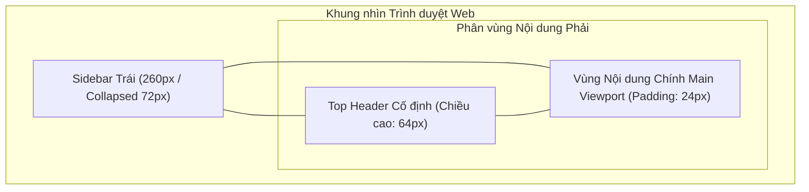

# ĐẶC TẢ & THIẾT KẾ GIAO DIỆN & TRẢI NGHIỆM NGƯỜI DÙNG PHÂN HỆ CỔNG WEB QUẢN TRỊ & NGƯỜI DÙNG (`web-portal`)

## 1. Danh mục Yêu cầu Giao diện & Trải nghiệm Người dùng (`UI-WEB-`)

| ID | Phát biểu Yêu cầu Trải nghiệm (Statement) | Nhóm Tác vụ | Mức Ưu tiên | Nguồn Tham chiếu | Tiêu chí Nghiệm thu (Acceptance Criteria) | Trạng thái |
| :--- | :--- | :--- | :---: | :---: | :--- | :---: |
| `UI-WEB-001` | Giao diện đăng nhập và điều hướng phân quyền theo Role (`HR_MANAGER`, `EMPLOYEE`, `ADMIN`, `DPO`). | Auth / Routing | Must | `SRS-003`, `ARC-003` | Điều hướng chuẩn xác theo vai trò; hiển thị spinner nạp dữ liệu trên nút đăng nhập; chia đôi màn hình thẩm mỹ cao. | Approved |
| `UI-WEB-002` | Quy trình ký cam kết điện tử Informed Consent và hiển thị mã OTP 6 số kích hoạt kèm QR Code. | Consent / OTP | Must | `SRS-001`, `SRS-003` | Khóa backdrop; cuộn hết $100\%$ văn bản mới cho ký; tự đóng modal và nổ Confetti khi quét mặt thành công tại Kiosk. | Approved |
| `UI-WEB-003` | Bảng điều khiển giám sát chấm công trực tiếp cho HR nhận dữ liệu qua STOMP WebSocket. | Dashboard / Live | Must | `SRS-003`, `ARC-003` | Thẻ KPI tự nhảy số; hàng mới chèn lên đầu bảng có hiệu ứng đổi màu nổi bật (Green Flash) trong $1.5\text{ s}$. | Approved |
| `UI-WEB-004` | Tra cứu lịch sử điểm danh đa tiêu chí và hỗ trợ kết xuất báo cáo Excel (.xlsx) / PDF. | History / Report | Should | `SRS-003` | Bộ lọc đa chiều; phân trang mượt mà; xuất file chuẩn định dạng và phòng chống formula injection. | Approved |
| `UI-WEB-005` | Bảng công và lịch chấm công cá nhân theo tháng cho nhân viên. | Employee Portal | Should | `SRS-003` | Giao diện lịch 7 cột trực quan; tô màu theo trạng thái; nhấp chuột xem Drawer chi tiết ngày tức thời. | Approved |
| `UI-WEB-006` | Màn hình quản lý hồ sơ nhân sự: danh sách có lọc, form tạo/sửa, xác nhận vô hiệu hóa và hộp thoại hiển thị mật khẩu tạm một lần. | HR Management | Must | `FR-SYS-017`, `API-SYS-008` | Mật khẩu tạm hiển thị trong hộp thoại có nút sao chép và cảnh báo đóng là không xem lại được; trường trùng mã/email báo lỗi ngay tại ô nhập. | Approved |
| `UI-WEB-007` | Màn hình quản lý ca làm việc và phân ca theo khoảng ngày, có xem trước lịch phân ca theo tuần. | HR Management | Must | `FR-SYS-018` | Tạo/sửa ca và phân ca ngay trên lịch; khi chồng lấn hiển thị cảnh báo kèm khoảng trống gợi ý. | Approved |
| `UI-WEB-008` | Màn hình đổi mật khẩu **tự nguyện** (không chặn điều hướng) và màn hình thiết lập/đặt lại mã PIN dự phòng. | Auth / Security | Must | `FR-SYS-017`, `FR-SYS-022` | Người dùng vào được mọi màn hình ngay sau đăng nhập; PIN nhập bằng lưới số ảo, có bước nhập lại khi thiết lập. | Approved |
| `UI-WEB-009` | Màn hình chốt kỳ công theo tháng kèm nhãn trạng thái và hộp thoại mở lại yêu cầu lý do. | HR Management | Must | `FR-SYS-024` | Kỳ đã chốt hiển thị nhãn "Đã chốt"; các nút duyệt đơn/điều chỉnh công bị vô hiệu hóa kèm tooltip giải thích. | Approved |
| `UI-WEB-010` | Màn hình rút Informed Consent (cảnh báo hệ quả, xác nhận hai bước) và màn hình yêu cầu dữ liệu cá nhân. | Compliance | Must | `FR-SYS-025` | Cảnh báo nêu rõ điểm danh chỉ còn PIN và dữ liệu sinh trắc tiêu huỷ trong 7 ngày; danh sách yêu cầu hiển thị trạng thái xử lý. | Approved |
| `UI-WEB-011` | Trung tâm thông báo trong ứng dụng: biểu tượng chuông kèm badge số chưa đọc và danh sách phân loại theo sự kiện. | Notification | Should | `FR-SYS-027` | Badge cập nhật tức thời; đánh dấu đã đọc không cần tải lại trang; thông báo liên kết tới đối tượng liên quan. | Approved |
| `UI-WEB-012` | Màn hình quản lý trạm Kiosk và màn hình tra cứu kiểm toán/tuân thủ ở chế độ chỉ đọc. | Admin / Compliance | Must | `FR-SYS-019`, `FR-SYS-020` | Secret Token hiển thị một lần trong hộp thoại và **không** lưu lại; trạm không ping quá 5 phút có cảnh báo; role `DPO` không thấy thao tác ghi. | Approved |

---

## 2. Hệ thống Design Tokens & Visual Language (Tailwind Tokens)

### 2.1. Bảng Màu Chuẩn Doanh nghiệp (Tailwind Color Tokens)
Toàn bộ Cổng Web Portal sử dụng bảng màu **Indigo Clean SaaS** hiện đại, mang lại cảm giác tin cậy và chuyên nghiệp cho khối quản trị nhân sự:

| Tên Token Màu | Mã Màu Hex | Lớp Tailwind CSS Tương ứng | Vai trò Áp dụng trong Giao diện |
| :--- | :--- | :--- | :--- |
| `color_brand_primary` | `#4F46E5` | `indigo-600` | Màu thương hiệu chính, nút tác vụ chính, icon active. |
| `color_brand_hover` | `#4338CA` | `indigo-700` | Trạng thái hover của nút bấm chính. |
| `color_brand_light` | `#EEF2FF` | `indigo-50` | Nền menu mục đang chọn, badge thương hiệu nhẹ. |
| `color_bg_app` | `#F8FAFC` | `slate-50` | Nền toàn bộ ứng dụng Web (Canvas Background). |
| `color_surface_card` | `#FFFFFF` | `white` | Nền các thẻ card dữ liệu, bảng, hộp thoại modal. |
| `color_border_subtle` | `#E2E8F0` | `slate-200` | Đường kẻ bảng, viền thẻ card, đường phân cách header. |
| `color_text_primary` | `#0F172A` | `slate-900` | Tiêu đề chính, nội dung bảng, con số thống kê lớn. |
| `color_text_secondary` | `#64748B` | `slate-500` | Chú thích phụ, nhãn cột bảng, mốc thời gian. |
| `color_status_success` | `#10B981` | `emerald-500` | Trạng thái "Đúng giờ", kết nối WebSocket trực tiếp. |
| `color_status_warning` | `#F59E0B` | `amber-500` | Trạng thái "Đi muộn", cảnh báo mạng chập chờn. |
| `color_status_danger` | `#EF4444` | `rose-500` | Trạng thái "Chưa đến", "Vắng mặt", cảnh báo lỗi. |

### 2.2. Thang Typography & Spacing
* Phông chữ cơ sở: **Inter** (Google Fonts) hỗ trợ chữ số dạng Tabular Monospace cho bảng biểu.
* Tiêu đề Trang (`h1`): Font $30\text{ px}$ (`text-3xl`), Bold, `text-slate-900`.
* Tiêu đề Khu vực / Thẻ (`h2`): Font $20\text{ px}$ (`text-xl`), Semi-Bold.
* Tiêu đề Cột Bảng (`th`): Font $12\text{ px}$ (`text-xs`), Medium, Uppercase, `text-slate-500`.
* Nội dung Dòng Bảng (`td`): Font $14\text{ px}$ (`text-sm`), Regular, `text-slate-800`.
* Bán kính bo góc: Thẻ card bo `rounded-xl` ($12\text{ px}$), Nút bấm bo `rounded-lg` ($8\text{ px}$).

---

## 3. Kiến trúc Bố cục Khung nhìn Quản trị (Admin Shell Layout `UXD-WEB-001`)



### 3.1. Thanh Điều hướng Bên trái (`Sidebar`)
* **Chiều rộng**: $260\text{ px}$ ở chế độ mở rộng; $72\text{ px}$ ở chế độ thu gọn.
* **Cấu trúc**:
  * Đỉnh Sidebar: Logo FAS kèm nhãn phiên bản `v2.0-Prod`.
  * Thân Sidebar: Danh mục menu phân theo vai trò:
    * Nhóm Quản trị (HR/ADMIN): *Bảng điều khiển Live*, *Lịch sử điểm danh*, *Hồ sơ nhân sự*, *Ca & Phân ca*, *Chốt kỳ công*, *Báo cáo tổng hợp*, *Quản lý Kiosk*, *Nhật ký kiểm toán*.
    * Nhóm Cá nhân (Nhân viên): *Bảng công của tôi*, *Đăng ký sinh trắc & OTP*, *Yêu cầu dữ liệu cá nhân*.
  * Đáy Sidebar: Nút bấm thu gọn/mở rộng thanh bên và nút Đăng xuất.

### 3.2. Thanh Tiêu đề Trên cùng (`TopHeader`)
* **Chiều cao**: $64\text{ px}$, Nền trắng, Viền đáy `1px solid #E2E8F0`, Cố định ở đỉnh màn hình (`sticky top-0 z-30`).
* **Thành phần**:
  * Bên trái: Breadcrumbs đường dẫn trang hiện tại.
  * Ở giữa: Chỉ báo trạng thái kết nối STOMP (`● Đang kết nối Kiosk Live`).
  * Bên phải: Chuông thông báo sự kiện (kèm badge chưa đọc), Menu Dropdown tài khoản và Avatar.

---

## 4. Danh mục Thiết kế Thành phần & Màn hình Trọng yếu (`UXD-WEB-`)

| ID | Tên Thành phần Giao diện | Định nghĩa Trách nhiệm Kỹ thuật | Hiện thực hóa (`Realizes`) | Sử dụng (`Uses`) | Quyết định (`Decisions`) | Trạng thái |
| :--- | :--- | :--- | :--- | :--- | :---: | :---: |
| `UXD-WEB-001` | Admin Shell Layout | Cấu trúc Sidebar 260px (thu gọn 72px) + TopHeader 64px + Content responsive; hỗ trợ thu gọn sidebar mượt mà với chuyển động CSS 200ms. | `UI-WEB-001` | `ARC-003` | `DD-WEB-013` | Accepted |
| `UXD-WEB-002` | Hộp thoại Cam kết & Hiển thị OTP | Modal chia 2 giai đoạn: Giai đoạn 1 khóa nút Submit đến khi cuộn hết văn bản; Giai đoạn 2 hiển thị mã OTP 6 số font 48px + mã QR 200x200px + tự động đóng khi nhận STOMP event. | `UI-WEB-002` | `ARC-003` | `DD-WEB-015`, `DD-WEB-016` | Accepted |
| `UXD-WEB-003` | Lưới 4 Thẻ Chỉ số KPI | Hàng 4 thẻ card bo góc 12px, chứa icon chuyên biệt, con số font 32px bold và tỷ lệ phần trăm thay đổi so với hôm trước. | `UI-WEB-003` | `ARC-003` | `DD-WEB-014` | Accepted |
| `UXD-WEB-004` | Bảng Dữ liệu Trực tiếp (Live Table) | Bảng chấm công thời gian thực với tiêu đề dính (Sticky Header). Dòng mới chèn vào đầu bảng tự động kích hoạt hiệu ứng chớp sáng nền xanh ngọc (`emerald-50`) trong 1.5s. | `UI-WEB-003` | `ARC-003` | `DD-WEB-014` | Accepted |
| `UXD-WEB-005` | Khung Lịch biểu Cá nhân (Calendar Grid) | Lưới 7 cột theo các thứ trong tuần; mỗi ô ngày hiển thị giờ vào/ra và huy hiệu màu tương ứng; nhấp chuột để mở Drawer chi tiết bên phải. | `UI-WEB-005` | `ARC-003` | `DD-WEB-002` | Accepted |
| `UXD-WEB-006` | Bố cục Màn hình Quản trị Danh mục (Nhân sự, Ca, Kỳ công) | Bố cục dạng bảng dữ liệu có cột hành động dính bên phải, Drawer form nhập liệu thay vì modal toàn màn hình, và vùng cảnh báo nghiệp vụ (trùng mã, chồng ca, kỳ đã chốt) hiển thị ngay trên đầu bảng. | `UI-WEB-006`, `UI-WEB-007`, `UI-WEB-009` | `ARC-003` | `DD-WEB-018` | Accepted |
| `UXD-WEB-007` | Bố cục Trung tâm Thông báo & Màn hình Tuân thủ Chỉ đọc | Panel trượt bên phải cho thông báo (nhóm theo ngày, badge chưa đọc), bố cục tra cứu chỉ đọc có bộ lọc thời gian cùng dấu hiệu "chỉ đọc" rõ ràng cho role `DPO`, và bố cục màn hình rút Consent với khối cảnh báo hệ quả cùng bước xác nhận hai lần. | `UI-WEB-011`, `UI-WEB-012`, `UI-WEB-010` | `ARC-003` | `DD-WEB-019`, `DD-WEB-020` | Accepted |
| `UXD-WEB-008` | Luồng Đổi Mật khẩu (Tự nguyện) | Màn hình đổi mật khẩu mở từ menu người dùng, hiển thị chỉ số độ mạnh mật khẩu và cảnh báo các phiên cũ sẽ bị thu hồi sau khi đổi thành công; không chặn điều hướng. | `UI-WEB-008` | `ARC-003` | `DD-WEB-018` | Accepted |

---

## 5. Đặc tả Chi tiết Hộp thoại Ký Cam kết & Kích hoạt Sinh trắc (`ConsentModal`)

```text
┌────────────────────────────────────────────────────────────────────────┐
│  Cam kết Thu thập & Xử lý Dữ liệu Sinh trắc học (Nghị định 13/2023)  [X]│
├────────────────────────────────────────────────────────────────────────┤
│ ┌────────────────────────────────────────────────────────────────────┐ │
│ │ 1. Mục đích thu thập: Hệ thống sử dụng vector đặc trưng khuôn mặt..│ │
│ │ 2. Cam kết bảo mật: Không lưu trữ hình ảnh gốc; vector được mã hóa.│ │
│ │ 3. Quyền của chủ thể dữ liệu: Quý khách có quyền yêu cầu xóa bỏ... │ │
│ │ (Vui lòng cuộn xuống dưới cùng để xác nhận)                        │ │
│ └────────────────────────────────────────────────────────────────────┘ │
│                                                                        │
│ [X] Tôi đã đọc kỹ, hiểu rõ và hoàn toàn đồng ý với các điều khoản trên. │
│                                                                        │
│                          [ Hủy bỏ ]   [ Tôi đồng ý và Ký cam kết ]     │
└────────────────────────────────────────────────────────────────────────┘
                                    │
                                    ▼ (Sau khi ký thành công)
┌────────────────────────────────────────────────────────────────────────┐
│  Mã OTP Kích hoạt tại Trạm Kiosk                                     [X]│
├────────────────────────────────────────────────────────────────────────┤
│                        Mã OTP Kích hoạt của bạn:                       │
│                                                                        │
│                          ┌─────────────────┐                           │
│                          │  8 3 9   2 0 1  │  [ Sao chép ]             │
│                          └─────────────────┘                           │
│                                                                        │
│                     ┌───────────────────────────┐                      │
│                     │                           │                      │
│                     │      [ QR Code 200px ]    │                      │
│                     │                           │                      │
│                     └───────────────────────────┘                      │
│                                                                        │
│  * Thời hạn hiệu lực: 48 giờ (Hết hạn lúc: 08:32 ngày 05/10/2026)      │
│  * Hướng dẫn: Đến trạm Kiosk tại sảnh lễ tân, bấm F3 và nhập mã này.   │
│  * Kênh trực tuyến: Đang đợi tín hiệu quét mặt từ Kiosk...             │
└────────────────────────────────────────────────────────────────────────┘
```

---

## 6. Quy chuẩn Thích ứng Đa Màn hình (Responsive Breakpoints)

| Breakpoint | Kích thước Màn hình | Hành vi Biến đổi Bố cục |
| :--- | :--- | :--- |
| **Desktop Rộng (XL)** | $\ge 1440\text{ px}$ | Lưới 4 thẻ KPI xếp ngang hàng $1 \times 4$; bảng dữ liệu hiển thị trọn vẹn toàn bộ 8 cột. |
| **Laptop / Desktop (LG)** | $1024 - 1439\text{ px}$ | Lưới 4 thẻ KPI xếp $1 \times 4$; bảng dữ liệu hiển thị tốt; các cột phụ tự co kích thước. |
| **Máy tính bảng (MD)** | $768 - 1023\text{ px}$ | Sidebar tự động thu gọn về dạng biểu tượng ($72\text{ px}$); lưới thẻ KPI chuyển thành $2 \times 2$. |
| **Điện thoại Di động (SM)** | $< 768\text{ px}$ | Sidebar ẩn hoàn toàn, mở qua nút Hamburger Drawer trượt từ cạnh trái; bảng hỗ trợ thanh cuộn ngang độc lập. |
