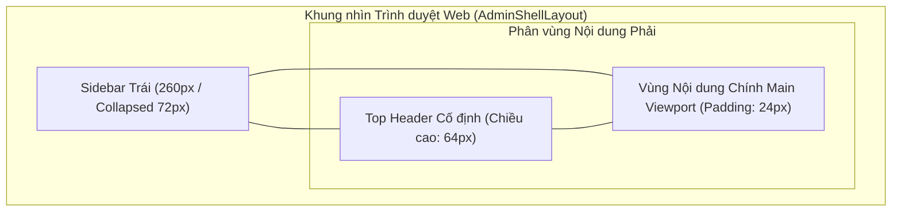
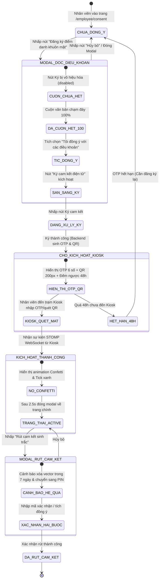
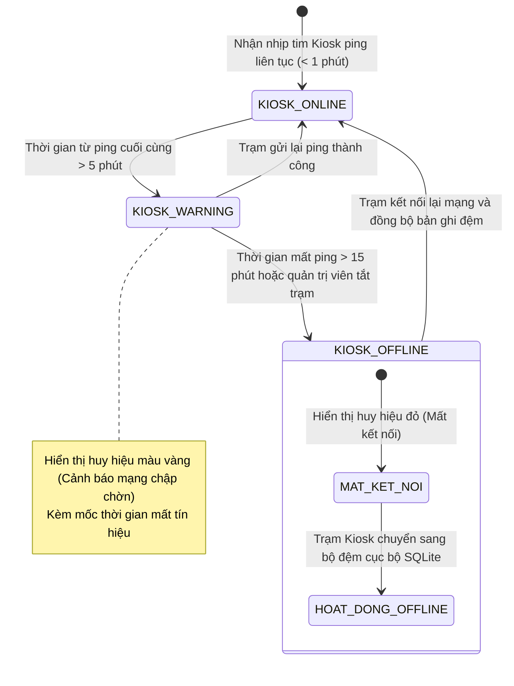
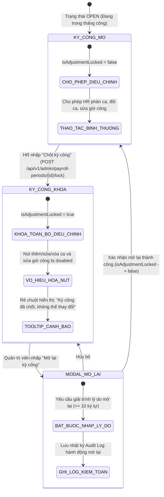

# ĐẶC TẢ & THIẾT KẾ GIAO DIỆN & TRẢI NGHIỆM NGƯỜI DÙNG PHÂN HỆ CỔNG WEB QUẢN TRỊ & NGƯỜI DÙNG (`web-portal`)

## 1. Danh mục Yêu cầu Giao diện & Trải nghiệm Người dùng (`UI-WEB-`)

| ID | Phát biểu Yêu cầu Trải nghiệm (Statement) | Nhóm Tác vụ | Mức Ưu tiên | Nguồn Tham chiếu | Tiêu chí Nghiệm thu (Acceptance Criteria) | Trạng thái |
| :--- | :--- | :--- | :---: | :---: | :--- | :---: |
| `UI-WEB-001` | Giao diện đăng nhập và điều hướng phân quyền theo Role (`HR_MANAGER`, `EMPLOYEE`, `ADMIN`, `DPO`), bao gồm cả điều hướng bắt buộc đổi mật khẩu lần đầu. | Auth / Routing | Must | `SRS-003`, `ARC-003` | Điều hướng chuẩn xác theo vai trò; hiển thị spinner nạp dữ liệu trên nút đăng nhập; chia đôi màn hình thẩm mỹ cao; tự động chuyển sang `/force-change-password` nếu tài khoản yêu cầu đổi mật khẩu lần đầu. | Approved |
| `UI-WEB-002` | Quy trình ký cam kết điện tử Informed Consent và hiển thị mã OTP 6 số kích hoạt kèm QR Code. | Consent / OTP | Must | `SRS-001`, `SRS-003` | Khóa backdrop; cuộn hết $100\%$ văn bản mới cho ký; tự đóng modal và nổ Confetti khi quét mặt thành công tại Kiosk qua kênh STOMP. | Approved |
| `UI-WEB-003` | Bảng điều khiển giám sát chấm công trực tiếp cho HR nhận dữ liệu qua STOMP WebSocket. | Dashboard / Live | Must | `SRS-003`, `ARC-003` | Thẻ KPI tự nhảy số; hàng mới chèn lên đầu bảng có hiệu ứng đổi màu nổi bật (Green Flash) trong $1.5\text{ s}$; công tắc bật/tắt live stream mượt mà. | Approved |
| `UI-WEB-004` | Tra cứu lịch sử điểm danh đa tiêu chí, hỗ trợ điều chỉnh chấm công thủ công và kết xuất báo cáo Excel (.xlsx) / PDF. | History / Report | Should | `SRS-003`, `API-BE-048` | Bộ lọc đa chiều; phân trang mượt mà; hỗ trợ hộp thoại điều chỉnh giờ công/trạng thái kèm lý do giải trình; xuất file chuẩn định dạng và phòng chống formula injection. | Approved |
| `UI-WEB-005` | Bảng công và lịch chấm công cá nhân theo tháng cho nhân viên. | Employee Portal | Should | `SRS-003` | Giao diện lịch 7 cột trực quan; tô màu theo trạng thái; nhấp chuột xem Drawer chi tiết ngày tức thời hiển thị đầy đủ mốc giờ, phương thức và trạm quẹt. | Approved |
| `UI-WEB-006` | Màn hình quản lý hồ sơ nhân sự: danh sách có lọc, form tạo/sửa dạng Drawer, xác nhận vô hiệu hóa và hộp thoại hiển thị mật khẩu tạm một lần. | HR Management | Must | `FR-SYS-017` | Mật khẩu tạm hiển thị trong hộp thoại có nút sao chép và cảnh báo đóng là không xem lại được; trường trùng mã/email báo lỗi ngay tại ô nhập; form trượt Drawer không che khuất ngữ cảnh. | Approved |
| `UI-WEB-007` | Màn hình quản lý ca làm việc và phân ca theo khoảng ngày, có xem trước lịch phân ca theo tuần. | HR Management | Must | `FR-SYS-018` | Tạo/sửa ca và phân ca ngay trên lịch; khi chồng lấn hiển thị cảnh báo kèm khoảng trống gợi ý; tự động vô hiệu hóa thao tác khi kỳ công bị khóa (`isAdjustmentLocked`). | Approved |
| `UI-WEB-008` | Màn hình đổi mật khẩu **tự nguyện** (không chặn điều hướng) và màn hình thiết lập/đặt lại mã PIN dự phòng. | Auth / Security | Must | `FR-SYS-017`, `FR-SYS-022` | Người dùng vào được mọi màn hình ngay sau đăng nhập; PIN nhập bằng lưới số ảo, có bước nhập lại khi thiết lập; thanh đo độ mạnh mật khẩu hiển thị trực quan. | Approved |
| `UI-WEB-009` | Màn hình chốt kỳ công theo tháng kèm nhãn trạng thái và hộp thoại mở lại yêu cầu lý do. | HR Management | Must | `FR-SYS-024` | Kỳ đã chốt hiển thị nhãn "Đã chốt"; các nút duyệt đơn/điều chỉnh công bị vô hiệu hóa kèm tooltip giải thích; hộp thoại mở lại bắt buộc nhập lý do tối thiểu 10 ký tự. | Approved |
| `UI-WEB-010` | Màn hình rút Informed Consent (cảnh báo hệ quả, xác nhận hai bước) và màn hình yêu cầu dữ liệu cá nhân (tiếp cận và đính chính). | Compliance | Must | `FR-SYS-025` | Tách biệt 2 view độc lập (`/employee/consent` và `/employee/data-requests`); cảnh báo nêu rõ điểm danh chỉ còn PIN và dữ liệu sinh trắc tiêu huỷ trong 7 ngày; danh sách yêu cầu hiển thị trạng thái xử lý rõ ràng. | Approved |
| `UI-WEB-011` | Trung tâm thông báo trong ứng dụng: biểu tượng chuông kèm badge số chưa đọc và danh sách phân loại theo sự kiện. | Notification | Should | `FR-SYS-027` | Badge cập nhật tức thời; mở dạng ngăn kéo (Drawer) bên phải; đánh dấu đã đọc không cần tải lại trang; thông báo liên kết trực tiếp tới đối tượng liên quan. | Approved |
| `UI-WEB-012` | Màn hình quản lý trạm Kiosk và màn hình tra cứu kiểm toán/tuân thủ ở chế độ chỉ đọc. | Admin / Compliance | Must | `FR-SYS-019`, `FR-SYS-020` | Tách biệt 2 view độc lập (`/admin/kiosks` và `/admin/audit-logs`); Secret Token hiển thị một lần trong RAM của hộp thoại và **không** lưu lại; trạm không ping quá 5 phút có nhãn cảnh báo; role `DPO` chỉ xem nhật ký kiểm toán, không thấy thao tác ghi. | Approved |

---

## 1.2. Ma trận Phân loại & Toàn bộ Danh mục Màn hình Hệ thống (Screen Inventory & Route/RBAC Matrix)

Nhằm đảm bảo đồng bộ $100\%$ giữa hồ sơ đặc tả và cấu trúc mã nguồn thực tế tại `app/web-portal/src/routes/AppRoutes.tsx`, hệ thống bao gồm **14 Màn hình (Views)** và **9 Thành phần Hộp thoại/Ngăn kéo Bổ trợ (Modals & Drawers)** được phân nhóm chặt chẽ theo vai trò người dùng (RBAC):

| STT | Mã Màn hình | Tên Màn hình / Thành phần | Đường dẫn Route | Phân quyền RBAC | Yêu cầu Giao diện | Thành phần Source Code | Trách nhiệm Nghiệp vụ Chính |
| :---: | :--- | :--- | :--- | :--- | :---: | :--- | :--- |
| **A** | **Nhóm Xác thực & Điều hướng Chung** | | | | | | |
| 1 | `SCR-WEB-01` | Đăng nhập Hệ thống (Login) | `/login` | Public (Chưa đăng nhập) | `UI-WEB-001` | `LoginView.tsx` | Split-Screen Brand & Form đăng nhập, ghi nhớ phiên, điều hướng theo Role (Figma `3:23918`). |
| 2 | `SCR-WEB-02` | Đổi Mật khẩu Bắt buộc | `/force-change-password` | Protected (Mọi Role) | `UI-WEB-001`, `UI-WEB-008` | `ForceChangePasswordView.tsx` | Chặn điều hướng; buộc đổi mật khẩu khi đăng nhập lần đầu hoặc khi quản trị viên reset. |
| 3 | `SCR-WEB-03` | Cảnh báo Không có Quyền (403) | `/unauthorized` | Protected (Mọi Role) | `UI-WEB-001` | `UnauthorizedView.tsx` | Cảnh báo vi phạm truy cập RBAC; nút điều hướng quay về trang chủ theo vai trò. |
| 4 | `SCR-WEB-04` | Trang Không tồn tại (404) | `*` (Mọi URL không khớp) | Mọi người dùng | `UI-WEB-001` | `NotFoundView.tsx` | Thông báo liên kết hỏng; hướng dẫn người dùng trở lại trang chủ hợp lệ. |
| **B** | **Phân hệ Quản trị & Nhân sự (Admin & HR Portal)** | | | | | | |
| 5 | `SCR-WEB-05` | Giám sát Điểm danh Trực tiếp | `/admin/dashboard` | `HR_MANAGER`, `ADMIN`, `DPO` | `UI-WEB-003` | `AdminDashboardView.tsx` | 4 thẻ KPI thời gian thực, bảng LiveTable hiệu ứng Green Flash 1.5s, nhận STOMP (Figma `3:24853`). |
| 6 | `SCR-WEB-06` | Lịch sử Điểm danh & Báo cáo | `/admin/attendance`, `/admin/reports` | `HR_MANAGER`, `ADMIN`, `DPO` (chỉ đọc) | `UI-WEB-004` | `AdminAttendanceView.tsx` | Tra cứu đa tiêu chí, công tắc Live Stream, điều chỉnh điểm danh (`API-WEB-021`), mở modal xuất báo cáo. |
| 7 | `SCR-WEB-07` | Quản lý Hồ sơ Nhân sự | `/admin/employees` | `HR_MANAGER`, `ADMIN` | `UI-WEB-006` | `EmployeeManagementView.tsx` | Danh sách nhân viên, lọc phòng ban, kích hoạt/vô hiệu hóa, mở Drawer thêm/sửa, xem mật khẩu tạm. |
| 8 | `SCR-WEB-08` | Quản lý Ca Làm việc & Phân ca | `/admin/shifts` | `HR_MANAGER`, `ADMIN` | `UI-WEB-007` | `AdminShiftManagementView.tsx` | Tạo/sửa ca, phân ca theo khoảng ngày, xem lịch tuần `WeeklyShiftScheduleView`, tự khóa khi kỳ chốt. |
| 9 | `SCR-WEB-09` | Quản lý Kỳ công & Khóa Điều chỉnh | `/admin/payroll-periods` | `HR_MANAGER`, `ADMIN` | `UI-WEB-009` | `AdminPayrollPeriodView.tsx` | Chốt kỳ công theo tháng, modal nhập lý do mở lại kỳ công, lan tỏa cờ `isAdjustmentLocked`. |
| 10 | `SCR-WEB-10` | Giám sát & Quản lý Trạm Kiosk | `/admin/kiosks` | `ADMIN`, `HR_MANAGER` | `UI-WEB-012` | `AdminKioskManagementView.tsx` | Giám sát trạng thái trạm (Online, Warning >5m, Offline), cấp token một lần qua `KioskRegistrationModal`. |
| 11 | `SCR-WEB-11` | Nhật ký Kiểm toán & Báo cáo Tuân thủ | `/admin/audit-logs` | `ADMIN`, `DPO` | `UI-WEB-012` | `AdminAuditLogView.tsx` | Nhật ký kiểm toán hệ thống và nhật ký đồng thuận NĐ 13/2023; chỉ đọc đối với vai trò `DPO`. |
| **C** | **Phân hệ Cá nhân Nhân viên (Employee Self-Service Portal)** | | | | | | |
| 12 | `SCR-WEB-12` | Bảng công & Lịch Cá nhân Tháng | `/employee/dashboard` | `EMPLOYEE` | `UI-WEB-005` | `EmployeeDashboardView.tsx` | Khung lịch 7 cột `PersonalAttendanceCalendar`, màu theo trạng thái, mở Drawer xem chi tiết ngày. |
| 13 | `SCR-WEB-13` | Đăng ký Sinh trắc & Kích hoạt Kiosk | `/employee/consent` | `EMPLOYEE` | `UI-WEB-002`, `UI-WEB-010` | `EmployeeConsentView.tsx` | Ký cam kết Informed Consent NĐ 13/2023, OTP 6 số + QR code, STOMP auto-finish, nút rút cam kết. |
| 14 | `SCR-WEB-14` | Yêu cầu Dữ liệu Cá nhân Chủ thể | `/employee/data-requests` | `EMPLOYEE` | `UI-WEB-010` | `EmployeeDataRequestsView.tsx` | Tạo yêu cầu tiếp cận (ACCESS) hoặc đính chính (CORRECTION) dữ liệu cá nhân theo NĐ 13/2023; theo dõi trạng thái. |
| **D** | **Thành phần Hộp thoại & Ngăn kéo Bổ trợ (Modals & Drawers)** | | | | | | |
| 15 | `MOD-WEB-01` | Hộp thoại Đổi Mật khẩu Tự nguyện | Popup toàn cục (TopHeader) | Mọi người dùng đã đăng nhập | `UI-WEB-008` | `ChangePasswordModal.tsx` | Đổi mật khẩu chủ động, thanh đo độ mạnh mật khẩu, cảnh báo thu hồi phiên cũ, không chặn điều hướng. |
| 16 | `MOD-WEB-02` | Hộp thoại Quản lý Mã PIN Dự phòng | Popup toàn cục (TopHeader) | `EMPLOYEE` | `UI-WEB-008` | `PinManagementModal.tsx` | Bàn phím số ảo, thiết lập/đặt lại mã PIN dự phòng 6 chữ số, xác nhận 2 lần. |
| 17 | `MOD-WEB-03` | Ngăn kéo Trung tâm Thông báo | Drawer trượt phải (TopHeader) | Mọi người dùng đã đăng nhập | `UI-WEB-011` | `NotificationDrawer.tsx` | Chuông badge số chưa đọc, danh sách phân loại sự kiện (điểm danh, phân ca, phê duyệt), đánh dấu đã đọc. |
| 18 | `MOD-WEB-04` | Hộp thoại Mật khẩu Tạm Một lần | Popup trang Nhân sự | `HR_MANAGER`, `ADMIN` | `UI-WEB-006` | `TemporaryPasswordModal.tsx` | Hiển thị mật khẩu tạm sau khi tạo nhân viên; nút copy; cảnh báo đóng là không xem lại được. |
| 19 | `MOD-WEB-05` | Hộp thoại Đăng ký Kiosk & Secret Token | Popup trang Kiosk | `ADMIN` | `UI-WEB-012` | `KioskRegistrationModal.tsx` | Đăng ký trạm hoặc rotate secret; secret token chỉ hiển thị 1 lần trong RAM, có cảnh báo bảo mật. |
| 20 | `MOD-WEB-06` | Hộp thoại Xuất Báo cáo Bảng công | Popup trang Attendance | `HR_MANAGER`, `ADMIN` | `UI-WEB-004` | `ExportReportModal.tsx` | Cấu hình xuất Excel/PDF, phạm vi phòng ban/thời gian, phòng chống Formula Injection. |
| 21 | `MOD-WEB-07` | Ngăn kéo Chi tiết Ngày Chấm công | Drawer trượt phải trang Bảng công | `EMPLOYEE` | `UI-WEB-005` | `AttendanceDayDetailDrawer.tsx` | Chi tiết các lượt quẹt thẻ trong ngày (giờ vào/ra, kiosk, PIN/mặt, trạng thái). |
| 22 | `MOD-WEB-08` | Ngăn kéo Form Nhập liệu Hồ sơ Nhân sự | Drawer trượt phải trang Nhân sự | `HR_MANAGER`, `ADMIN` | `UI-WEB-006` | `EmployeeDrawer.tsx` | Form tạo mới / chỉnh sửa nhân viên (mã, họ tên, email, phòng ban, vai trò, chức vụ). |
| 23 | `MOD-WEB-09` | Hộp thoại Rút Cam kết Informed Consent | Popup trang Consent | `EMPLOYEE` | `UI-WEB-010` | `ConsentWithdrawalModal.tsx` | Cảnh báo hệ quả (chỉ điểm danh bằng PIN, hủy vector trong 7 ngày), xác nhận 2 bước. |

---

## 2. Hệ thống Design Tokens & Visual Language (Chuẩn Figma & Tailwind)

### 2.1. Bảng Màu Chuẩn Doanh nghiệp (Figma & Tailwind Color Tokens)
Toàn bộ Cổng Web Portal hiện thực hóa chính xác bảng màu trích xuất từ file thiết kế Figma `cjujVstyrnFOPulVcNfAXX` kết hợp phong cách **Indigo Clean SaaS** hiện đại:

| Tên Token Màu | Mã Màu Hex | Lớp Tailwind CSS Tương ứng | Vai trò Áp dụng trong Giao diện Figma |
| :--- | :--- | :--- | :--- |
| `color_brand_dark_navy` | `#102D53` | `slate-950` / custom | Nền không gian thương hiệu màn hình Đăng nhập (Figma `3:23919`). |
| `color_brand_navy_card` | `#1E3A5F` | custom | Card bề mặt bên trong vùng thương hiệu Navy tối. |
| `color_brand_light_blue` | `#80B4FF` | `blue-300` | Text phụ và icon nhấn trên nền thương hiệu Dark Navy. |
| `color_brand_primary` | `#4F46E5` | `indigo-600` | Màu thương hiệu chính, nút tác vụ chính, icon active. |
| `color_brand_hover` | `#4338CA` | `indigo-700` | Trạng thái hover của nút bấm chính. |
| `color_brand_light` | `#EEF2FF` | `indigo-50` | Nền menu mục đang chọn, badge thương hiệu nhẹ. |
| `color_bg_app` | `#F3F6FA` | `slate-100` / custom | Nền canvas toàn bộ ứng dụng Web theo chuẩn Figma canvas. |
| `color_surface_card` | `#FFFFFF` | `white` | Nền các thẻ card dữ liệu, bảng, hộp thoại modal. |
| `color_border_subtle` | `#E2E8F0` | `slate-200` | Đường kẻ bảng, viền thẻ card, đường phân cách header. |
| `color_text_primary` | `#0F172A` | `slate-900` | Tiêu đề chính, nội dung bảng, con số thống kê lớn. |
| `color_text_secondary` | `#64748B` | `slate-500` | Chú thích phụ, nhãn cột bảng, mốc thời gian. |
| `color_status_success` | `#10B981` | `emerald-500` | Trạng thái "Đúng giờ", kết nối WebSocket trực tiếp (`#ECFDF5`). |
| `color_status_warning` | `#F59E0B` | `amber-500` | Trạng thái "Đi muộn", trạm Kiosk ping quá 5 phút (`#FFFBEB`). |
| `color_status_danger` | `#EF4444` | `rose-500` | Trạng thái "Chưa đến", "Vắng mặt", cảnh báo lỗi (`#FEF2F2`). |

### 2.2. Thang Typography & Spacing
* Phông chữ cơ sở: **Inter** (Google Fonts) hỗ trợ chữ số dạng Tabular Monospace (`font-variant-numeric: tabular-nums`) cho bảng biểu.
* Tiêu đề Trang (`h1`): Font $30\text{ px}$ (`text-3xl`), Bold, `text-slate-900`.
* Tiêu đề Khu vực / Thẻ (`h2`): Font $20\text{ px}$ (`text-xl`), Semi-Bold.
* Tiêu đề Cột Bảng (`th`): Font $12\text{ px}$ (`text-xs`), Medium, Uppercase, `text-slate-500`.
* Nội dung Dòng Bảng (`td`): Font $14\text{ px}$ (`text-sm`), Regular, `text-slate-800`.
* Bán kính bo góc: Thẻ card bo `rounded-xl` ($12\text{ px}$), Nút bấm & Input bo `rounded-lg` ($8\text{ px}$).

---

### 2.3. Bảng Ánh xạ Khung Giao diện Figma (Figma Frame Mapping Matrix)
Toàn bộ giao diện thi công bám sát các Frame chuẩn từ file thiết kế [FAS Figma Project (cjujVstyrnFOPulVcNfAXX)](https://www.figma.com/design/cjujVstyrnFOPulVcNfAXX/Untitled?node-id=0-1):

| Node ID | Tên Khung Figma | Kích thước | Liên kết Đặc tả | Thành phần & Trách nhiệm Giao diện |
| :---: | :--- | :---: | :---: | :--- |
| `3:23918` | `FAS · Đăng nhập` | $1440\times 1000$ | `UI-WEB-001`, `UXD-WEB-001` | Split-Screen: Cột trái Brand Space $650\text{ px}$ (`#102D53`), Cột phải Form Đăng nhập $790\text{ px}$ (`#FFFFFF`). |
| `3:23971` | `FAS · Cam kết chưa đọc hết` | $1440\times 1000$ | `UI-WEB-002`, `UXD-WEB-002` | Modal Cam kết Informed Consent: Khóa nút ký khi chưa cuộn đến đáy văn bản ($100\%$). |
| `3:24074` | `FAS · Cam kết sẵn sàng ký` | $1440\times 1000$ | `UI-WEB-002`, `UXD-WEB-002` | Mở khóa nút "Xác nhận & Ký cam kết điện tử" sau khi cuộn hết văn bản điều khoản pháp lý. |
| `3:24178` | `FAS · Chờ kích hoạt tại Kiosk` | $1440\times 1000$ | `UI-WEB-002`, `UXD-WEB-002` | Hộp OTP 6 số kích thước lớn ($44\text{ px}$ bold), QR Code $200\times 200\text{ px}$ và đếm ngược 48h. |
| `3:24578` | `FAS · Kích hoạt thành công` | $1440\times 1200$ | `UI-WEB-002`, `UXD-WEB-002` | Tự động chuyển cảnh thành công khi nhận thông điệp STOMP quét mặt xong tại Kiosk. |
| `3:24853` | `FAS · Giám sát chấm công trực tiếp` | $1440\times 1160$ | `UI-WEB-003`, `UXD-WEB-003`, `UXD-WEB-004` | Dashboard HR: 4 Thẻ KPI thời gian thực + Bảng Live Table có hiệu ứng Green Flash $1.5\text{ s}$. |
| `3:25062` | `FAS · Lịch sử và báo cáo` | $1440\times 1240$ | `UI-WEB-004` | Bộ lọc đa chiều, phân trang bảng công và thanh tác vụ xuất báo cáo. |
| `3:25329` | `FAS · Xem trước báo cáo chấm công` | $1440\times 1320$ | `UI-WEB-004` | Modal xem trước bố cục dữ liệu xuất Excel/PDF trước khi tải về. |
| `3:25513` | `FAS · Bảng công cá nhân tháng 9` | $1440\times 1100$ | `UI-WEB-005`, `UXD-WEB-005` | Employee Portal: Calendar Grid 7 cột theo tháng, ô ngày tô màu theo trạng thái. |
| `3:25772` | `FAS · Chi tiết ngày 15 tháng 9` | $1440\times 1100$ | `UI-WEB-005`, `UXD-WEB-005` | Drawer trượt từ bên phải ($420\text{ px}$) hiển thị chi tiết các lượt quẹt thẻ trong ngày. |
| `3:26077` | `FAS · Tham chiếu phản hồi & hành vi` | $1440\times 1842$ | `UXD-WEB-007` | Hướng dẫn trạng thái tương tác: loading spinner, toast, empty state, badges. |

---

## 3. Kiến trúc Bố cục Khung nhìn Quản trị & Điều hướng (Admin Shell Layout `UXD-WEB-001`)



### 3.1. Thanh Điều hướng Bên trái (`Sidebar`)
* **Chiều rộng**: $260\text{ px}$ ở chế độ mở rộng; $72\text{ px}$ ở chế độ thu gọn.
* **Cấu trúc**:
  * Đỉnh Sidebar: Logo FAS kèm nhãn phiên bản `v2.0-Prod`.
  * Thân Sidebar: Danh mục menu phân theo vai trò:
    * Nhóm Quản trị (HR/ADMIN): *Bảng điều khiển Live*, *Lịch sử điểm danh*, *Hồ sơ nhân sự*, *Ca & Phân ca*, *Chốt kỳ công*, *Báo cáo tổng hợp*, *Quản lý Kiosk*, *Nhật ký kiểm toán*.
    * Nhóm Cá nhân (Nhân viên): *Bảng công của tôi*, *Đăng ký sinh trắc & OTP*, *Yêu cầu dữ liệu cá nhân*.
  * Đáy Sidebar: Nút bấm thu gọn/mở rộng thanh bên và nút Đăng xuất.

### 3.2. Thanh Tiêu đề Trên cùng (`TopHeader`)
* **Chiều cao**: $64\text{ px}$, Nền trắng, Viền đáy `1px solid #E2E8F0`, Cố định ở đỉnh màn hình (`sticky top-0 z-30`).
* **Thành phần**:
  * Bên trái: Breadcrumbs đường dẫn trang hiện tại.
  * Ở giữa: Chỉ báo trạng thái kết nối STOMP (`● Đang kết nối Kiosk Live`).
  * Bên phải: Chuông thông báo sự kiện (kèm badge chưa đọc mở `NotificationDrawer`), Menu Dropdown tài khoản (Avatar, nút đổi mật khẩu mở `ChangePasswordModal`, nút đổi PIN mở `PinManagementModal`, Đăng xuất).

### 3.3. Sơ đồ Điều hướng Người dùng Đa Vai trò & Quản lý Phiên (Dual-Role Auth & Route Navigation Flow)

```mermaid
graph TD
    Start([Truy cập Hệ thống]) --> CheckAuth{Đã Đăng nhập?}
    
    CheckAuth -- Chưa --> LoginView["Màn hình Đăng nhập (/login)"]
    LoginView --> DoLogin[Gửi thông tin xác thực]
    DoLogin --> ValidateCred{Thông tin đúng?}
    ValidateCred -- Sai --> ShowLoginErr[Báo lỗi tại Form]
    ValidateCred -- Đúng --> CheckForceChange{Yêu cầu đổi mật khẩu lần đầu?}
    
    CheckForceChange -- Có --> ForceChangeView["Màn hình Đổi Mật khẩu Bắt buộc (/force-change-password)"]
    ForceChangeView --> SubmitNewPass[Nhập mật khẩu mới]
    SubmitNewPass --> CheckForceChange
    
    CheckForceChange -- Không --> RoleRouter{Kiểm tra Vai trò (RBAC)}
    
    CheckAuth -- Rồi --> CheckForceChange
    
    RoleRouter -- "HR_MANAGER / ADMIN" --> AdminDashboard["Bảng điều khiển Quản trị (/admin/dashboard)"]
    RoleRouter -- "EMPLOYEE" --> EmpDashboard["Bảng công Cá nhân (/employee/dashboard)"]
    RoleRouter -- "DPO" --> AuditView["Nhật ký Kiểm toán (/admin/audit-logs)"]
    
    AdminDashboard --> AdminSubRoutes["/admin/employees, /admin/shifts, /admin/attendance, /admin/payroll-periods, /admin/kiosks"]
    EmpDashboard --> EmpSubRoutes["/employee/consent, /employee/data-requests"]
    
    AdminSubRoutes -. Truy cập trái quyền .-> UnauthorizedView["Màn hình 403 (/unauthorized)"]
    EmpSubRoutes -. Truy cập trái quyền .-> UnauthorizedView
```

---

## 4. Danh mục Thiết kế Thành phần & Màn hình Trọng yếu (`UXD-WEB-`)

| ID | Tên Thành phần Giao diện | Định nghĩa Trách nhiệm Kỹ thuật | Hiện thực hóa (`Realizes`) | Sử dụng (`Uses`) | Quyết định (`Decisions`) | Trạng thái |
| :--- | :--- | :--- | :--- | :--- | :---: | :---: |
| `UXD-WEB-001` | Admin Shell Layout | Cấu trúc Sidebar 260px (thu gọn 72px) + TopHeader 64px + Content responsive; hỗ trợ thu gọn sidebar mượt mà với chuyển động CSS 200ms. | `UI-WEB-001`, `NFR-WEB-002` | `ARC-003` | `DD-WEB-013` | Accepted |
| `UXD-WEB-002` | Hộp thoại Cam kết & Hiển thị OTP | Modal chia 2 giai đoạn: Giai đoạn 1 khóa nút Submit đến khi cuộn hết văn bản; Giai đoạn 2 hiển thị mã OTP 6 số font 48px + mã QR 200x200px + tự động đóng khi nhận STOMP event. | `UI-WEB-002` | `ARC-003` | `DD-WEB-015`, `DD-WEB-016` | Accepted |
| `UXD-WEB-003` | Lưới 4 Thẻ Chỉ số KPI | Hàng 4 thẻ card bo góc 12px, chứa icon chuyên biệt, con số font 32px bold và tỷ lệ phần trăm thay đổi so với hôm trước. | `UI-WEB-003` | `ARC-003` | `DD-WEB-014` | Accepted |
| `UXD-WEB-004` | Bảng Dữ liệu Trực tiếp (Live Table) | Bảng chấm công thời gian thực với tiêu đề dính (Sticky Header). Dòng mới chèn vào đầu bảng tự động kích hoạt hiệu ứng chớp sáng nền xanh ngọc (`emerald-50`) trong 1.5s; hỗ trợ điều chỉnh chấm công thủ công (`API-WEB-021`). | `UI-WEB-003`, `UI-WEB-004` | `ARC-003` | `DD-WEB-014`, `DD-WEB-007` | Accepted |
| `UXD-WEB-005` | Khung Lịch biểu Cá nhân (Calendar Grid) | Lưới 7 cột theo các thứ trong tuần; mỗi ô ngày hiển thị giờ vào/ra và huy hiệu màu tương ứng; nhấp chuột để mở Drawer chi tiết bên phải. | `UI-WEB-004`, `UI-WEB-005` | `ARC-003` | `DD-WEB-002` | Accepted |
| `UXD-WEB-006` | Bố cục Màn hình Quản trị Danh mục (Nhân sự, Ca, Kỳ công) | Bố cục dạng bảng dữ liệu có cột hành động dính bên phải, Drawer form nhập liệu thay vì modal toàn màn hình, và vùng cảnh báo nghiệp vụ (trùng mã, chồng ca, kỳ đã chốt) hiển thị ngay trên đầu bảng. | `UI-WEB-006`, `UI-WEB-007`, `UI-WEB-009` | `ARC-003` | `DD-WEB-018` | Accepted |
| `UXD-WEB-007` | Bố cục Trung tâm Thông báo & Màn hình Tuân thủ Chỉ đọc | Panel trượt bên phải cho thông báo (nhóm theo ngày, badge chưa đọc), bố cục tra cứu chỉ đọc có bộ lọc thời gian cùng dấu hiệu "chỉ đọc" rõ ràng cho role `DPO`, và bố cục màn hình rút Consent với khối cảnh báo hệ quả cùng bước xác nhận hai lần. | `UI-WEB-011`, `UI-WEB-012`, `UI-WEB-010` | `ARC-003` | `DD-WEB-019`, `DD-WEB-020` | Accepted |
| `UXD-WEB-008` | Luồng Đổi Mật khẩu (Tự nguyện & Bắt buộc) | Modal đổi mật khẩu mở từ menu người dùng (tự nguyện) hoặc View toàn màn hình khi đăng nhập lần đầu (bắt buộc), hiển thị chỉ số độ mạnh mật khẩu và cảnh báo các phiên cũ sẽ bị thu hồi sau khi đổi thành công. | `UI-WEB-001`, `UI-WEB-008` | `ARC-003` | `DD-WEB-018` | Accepted |

---

## 5. Máy trạng thái Giao diện & Trải nghiệm Người dùng (UI/UX State Machines)

### 5.1. Máy trạng thái Vòng đời Cam kết Informed Consent & Hiển thị OTP/QR (`stateDiagram-v2`)



### 5.2. Máy trạng thái Giám sát Sức khỏe Trạm Kiosk (`stateDiagram-v2`)



### 5.3. Máy trạng thái Khóa Kỳ công & Lan tỏa Điều chỉnh (`stateDiagram-v2`)



---

## 6. Đặc tả Chi tiết Màn hình & Wireframe ASCII

### 6.1. Màn hình Đăng nhập (FAS · Đăng nhập — Figma `3:23918`)

```text
┌──────────────────────────────────────┬────────────────────────────────────────────┐
│  CỘT TRÁI: KHÔNG GIAN THƯƠNG HIỆU    │  CỘT PHẢI: KHU VỰC ĐĂNG NHẬP               │
│  (Width: 650px, Background: #102D53) │  (Width: 790px, Background: #FFFFFF)       │
├──────────────────────────────────────┼────────────────────────────────────────────┤
│                                      │                                            │
│  [Logo FAS 35x35px] FAS              │           Đăng nhập tài khoản              │
│                                      │           Chào mừng quay trở lại FAS       │
│  Hệ thống Điểm danh Khuôn mặt        │                                            │
│  Doanh nghiệp Chuẩn xác & An toàn    │       ┌─────────────────────────────┐      │
│                                      │       │ Email doanh nghiệp          │      │
│  • Nhận diện trực tiếp < 100ms       │       │ [ admin@fas.com           ] │      │
│  • Tuân thủ Nghị định 13/2023        │       └─────────────────────────────┘      │
│  • Không lưu ảnh thô trên máy trạm   │                                            │
│                                      │       ┌─────────────────────────────┐      │
│  [Card] Cam kết bảo vệ dữ liệu       │       │ Mật khẩu                    │      │
│  Dữ liệu cá nhân được tôn trọng      │       │ [ ••••••••••••         (👁) ] │      │
│  và bảo vệ nghiêm ngặt.              │       └─────────────────────────────┘      │
│                                      │                                            │
│  FAS · Không gian làm việc của bạn   │       [X] Ghi nhớ đăng nhập   Quên mật khẩu?│
│                                      │                                            │
│                                      │       ┌─────────────────────────────┐      │
│                                      │       │   [ Đăng nhập hệ thống ]    │      │
│                                      │       └─────────────────────────────┘      │
└──────────────────────────────────────┴────────────────────────────────────────────┘
```

* **Cột trái (Brand Space — $650\text{ px}$)**:
  * Nền: `#102D53`, Padding: $64\text{ px}$, Khoảng cách giữa các khối (`itemSpacing`): $36\text{ px}$.
  * Badge logo: Nền trắng $12.5\%$ bo góc $8\text{ px}$, icon `scan-face` ($21\times 21\text{ px}$), chữ `FAS` màu trắng font Inter $24\text{ px}$ bold.
  * Khối cam kết dưới đáy: Icon `lock-keyhole` màu `#A7C9F6`, text "Dữ liệu cá nhân được tôn trọng và bảo vệ." (font 12px, màu `#B5C8E1`), nhãn phụ "FAS · Không gian làm việc của bạn" (font 11px, màu `#809DBF`).
* **Cột phải (Auth Form — $790\text{ px}$)**:
  * Nền: `#FFFFFF`, Container form căn giữa (max-width: $440\text{ px}$).
  * Input: Chiều cao $44\text{ px}$, viền `#E2E8F0`, bo góc $8\text{ px}$, focus outline `#4F46E5`.
  * Nút bấm: Màu thương hiệu `#4F46E5` (hover `#4338CA`), chiều cao $46\text{ px}$, bo góc $8\text{ px}$, chữ trắng bold $15\text{ px}$, tích hợp spinner khi đang gửi yêu cầu xác thực.

---

### 6.2. Màn hình Đổi Mật khẩu Bắt buộc (`ForceChangePasswordView` - `/force-change-password`)

```text
┌────────────────────────────────────────────────────────────────────────┐
│                        THIẾT LẬP MẬT KHẨU MỚI                          │
│        (Yêu cầu bảo mật: Đổi mật khẩu trong lần đăng nhập đầu tiên)    │
├────────────────────────────────────────────────────────────────────────┤
│                                                                        │
│   ┌────────────────────────────────────────────────────────────────┐   │
│   │ Mật khẩu hiện tại (hoặc mật khẩu tạm):                         │   │
│   │ [ ••••••••••••••••••••••••••••••••••••••••••••••••••••  (👁) ] │   │
│   └────────────────────────────────────────────────────────────────┘   │
│                                                                        │
│   ┌────────────────────────────────────────────────────────────────┐   │
│   │ Mật khẩu mới:                                                  │   │
│   │ [ ••••••••••••••••••••••••••••••••••••••••••••••••••••  (👁) ] │   │
│   └────────────────────────────────────────────────────────────────┘   │
│   [████████████████░░░░░░░░] Độ mạnh: Khá (Tối thiểu 8 ký tự, có số)   │
│                                                                        │
│   ┌────────────────────────────────────────────────────────────────┐   │
│   │ Nhập lại mật khẩu mới:                                         │   │
│   │ [ ••••••••••••••••••••••••••••••••••••••••••••••••••••  (👁) ] │   │
│   └────────────────────────────────────────────────────────────────┘   │
│                                                                        │
│   * Lưu ý: Sau khi đổi thành công, mọi phiên đăng nhập cũ sẽ bị hủy.   │
│                                                                        │
│                 [ Đăng xuất ]         [ Cập nhật mật khẩu ]            │
└────────────────────────────────────────────────────────────────────────┘
```

* **Đặc tính tương tác**:
  * Chặn hoàn toàn thanh điều hướng Sidebar và Header (không hiển thị AdminShellLayout).
  * Chỉ cho phép 2 thao tác: Cập nhật mật khẩu mới hoặc Đăng xuất.
  * Hiển thị chỉ báo độ mạnh mật khẩu (Yếu/Trung bình/Khá/Mạnh).

---

### 6.3. Hộp thoại Ký Cam kết & Kích hoạt Sinh trắc (`ConsentModal`)

```text
┌────────────────────────────────────────────────────────────────────────┐
│  Cam kết Thu thập & Xử lý Dữ liệu Sinh trắc học (Nghị định 13/2023)  [X]│
├────────────────────────────────────────────────────────────────────────┤
│ ┌────────────────────────────────────────────────────────────────────┐ │
│ │ 1. Mục đích thu thập: Hệ thống sử dụng vector đặc trưng khuôn mặt..│ │
│ │ 2. Cam kết bảo mật: Không lưu trữ hình ảnh gốc; vector được mã hóa.│ │
│ │ 3. Quyền của chủ thể dữ liệu: Quý khách có quyền yêu cầu xóa bỏ... │ │
│ │ (Vui lòng cuộn xuống dưới cùng để xác nhận)                        │ │
│ └────────────────────────────────────────────────────────────────────┘ │
│                                                                        │
│ [X] Tôi đã đọc kỹ, hiểu rõ và hoàn toàn đồng ý với các điều khoản trên. │
│                                                                        │
│                          [ Hủy bỏ ]   [ Tôi đồng ý và Ký cam kết ]     │
└────────────────────────────────────────────────────────────────────────┘
                                    │
                                    ▼ (Sau khi ký thành công)
┌────────────────────────────────────────────────────────────────────────┐
│  Mã OTP Kích hoạt tại Trạm Kiosk                                     [X]│
├────────────────────────────────────────────────────────────────────────┤
│                        Mã OTP Kích hoạt của bạn:                       │
│                                                                        │
│                          ┌─────────────────┐                           │
│                          │  8 3 9   2 0 1  │  [ Sao chép ]             │
│                          └─────────────────┘                           │
│                                                                        │
│                     ┌───────────────────────────┐                      │
│                     │                           │                      │
│                     │      [ QR Code 200px ]    │                      │
│                     │                           │                      │
│                     └───────────────────────────┘                      │
│                                                                        │
│  * Thời hạn hiệu lực: 48 giờ (Hết hạn lúc: 08:32 ngày 05/10/2026)      │
│  * Hướng dẫn: Đến trạm Kiosk tại sảnh lễ tân, bấm F3 và nhập mã này.   │
│  * Kênh trực tuyến: Đang đợi tín hiệu quét mặt từ Kiosk...             │
└────────────────────────────────────────────────────────────────────────┘
```

---

### 6.4. Bảng Điều khiển Giám sát Trực tiếp (`AdminDashboardView` — Figma `3:24853`)

```text
┌────────────────────────────────────────────────────────────────────────────────────────┐
│ Bảng Điều khiển Giám sát Chấm công Trực tiếp             ● Kiosk WebSocket: Trực tuyến │
├────────────────────────────┬───────────────────────────┬───────────────────────────────┤
│ Tổng quân số ca hôm nay    │ Điểm danh đúng giờ        │ Điểm danh muộn / Về sớm       │
│ 142 / 150 (94.7%)          │ 134 lượt                  │ 8 lượt                        │
├────────────────────────────┴───────────────────────────┴───────────────────────────────┤
│ BẢNG CHẤM CÔNG TRỰC TIẾP (LIVE STREAM)                       [ Tạm dừng nhận Live ]    │
├─────────┬──────────────────────┬─────────────┬───────────┬──────────────┬──────────────┤
│ MÃ NV   │ HỌ VÀ TÊN            │ THỜI GIAN   │ PHƯƠNG THỨ│ TRẠM KIOSK   │ TRẠNG THÁI   │
├─────────┼──────────────────────┼─────────────┼───────────┼──────────────┼──────────────┤
│ NV0042  │ Lê Hoài Nam (Mới)    │ 08:02:14    │ Khuôn mặt │ Kiosk Sảnh A │ Đúng giờ (❇) │ <- Green Flash 1.5s
│ NV0018  │ Trần Thị Mai         │ 08:01:45    │ Khuôn mặt │ Kiosk Sảnh B │ Đúng giờ     │
│ NV0105  │ Đỗ Văn Tuấn          │ 08:00:12    │ Mã PIN    │ Kiosk Sảnh A │ Đúng giờ     │
└─────────┴──────────────────────┴─────────────┴───────────┴──────────────┴──────────────┘
```

---

### 6.5. Lịch biểu Cá nhân & Drawer Chi tiết (`EmployeeDashboardView` — Figma `3:25513` & `3:25772`)

* **Lưới Tháng Calendar Grid (`3:25513`)**:
  * Bố cục 7 cột (Thứ Hai $\rightarrow$ Chủ Nhật), tiêu đề cột in hoa xám nhạt (`text-xs font-semibold text-slate-500`).
  * Mỗi ô ngày: Kích thước linh hoạt, viền `#E2E8F0`, số ngày góc trên bên trái, bên dưới chứa huy hiệu giờ:
    * Giờ vào (`CHECK_IN`): Màu xanh ngọc `#059669` trên nền `#ECFDF5`.
    * Giờ ra (`CHECK_OUT`): Màu tím đậm `#4338CA` trên nền `#EEF2FF`.
    * Ngày đi muộn: Thêm chấm cảnh báo màu cam `#F59E0B`.
* **Drawer Chi tiết Ngày (`3:25772`)**:
  * Chiều rộng: $420\text{ px}$, trượt từ cạnh phải với hiệu ứng chuyển động $250\text{ ms}$ Ease-Out.
  * Nội dung: Tiêu đề ngày tháng, tổng số giờ làm việc thực tế, danh sách chi tiết các lượt quẹt thẻ (giờ chính xác đến giây, phương thức Khuôn mặt/PIN, mã trạm Kiosk và trạng thái thẩm định).

---

### 6.6. Màn hình Quản lý Trạm Kiosk & Hộp thoại Cấp Secret Token (`AdminKioskManagementView` + `KioskRegistrationModal`)

```text
┌────────────────────────────────────────────────────────────────────────────────────────┐
│ Danh sách Trạm Kiosk Điểm danh                              [ + Đăng ký Trạm Kiosk Mới]│
├────────────┬──────────────────┬─────────────┬──────────────┬──────────────┬────────────┤
│ MÃ TRẠM    │ TÊN TRẠM KIOSK   │ VỊ TRÍ ĐẶT  │ PING CUỐI    │ TRẠNG THÁI   │ TÁC VỤ     │
├────────────┼──────────────────┼─────────────┼──────────────┼──────────────┼────────────┤
│ KIOSK-01   │ Trạm Sảnh Chính  │ Tầng 1 - A  │ 12 giây trước│ ● Online     │ [Xoay Token]│
│ KIOSK-02   │ Trạm Cửa Sau B   │ Tầng 1 - B  │ 6 phút trước │ ⚠ Warning    │ [Xoay Token]│
│ KIOSK-03   │ Trạm Nhà Ăn      │ Tầng 2 - C  │ 2 ngày trước │ ○ Offline    │ [Xoay Token]│
└────────────┴──────────────────┴─────────────┴──────────────┴──────────────┴────────────┘
                                    │
                                    ▼ (Hộp thoại KioskRegistrationModal)
┌────────────────────────────────────────────────────────────────────────┐
│  Secret Token của Trạm Kiosk (Hiển thị Duy nhất Một lần)             [X]│
├────────────────────────────────────────────────────────────────────────┤
│  Mã trạm: KIOSK-01 (Trạm Sảnh Chính)                                   │
│                                                                        │
│  ┌──────────────────────────────────────────────────────────────────┐  │
│  │ sec_live_98a7fbc2301984dca88921bfe490123...          [ Sao chép ]│  │
│  └──────────────────────────────────────────────────────────────────┘  │
│                                                                        │
│  ⚠ CẢNH BÁO AN TOÀN QUAN TRỌNG:                                        │
│  Token này được lưu trong bộ nhớ tạm (RAM) của trình duyệt và sẽ KHÔNG  │
│  thể xem lại sau khi đóng hộp thoại này. Hãy sao chép và cấu hình ngay  │
│  vào file cấu hình môi trường của trạm Kiosk tương ứng.                │
│                                                                        │
│                                               [ Tôi đã lưu mã Token ]  │
└────────────────────────────────────────────────────────────────────────┘
```

---

### 6.7. Màn hình Chốt Kỳ công & Khóa Điều chỉnh (`AdminPayrollPeriodView`)

```text
┌────────────────────────────────────────────────────────────────────────────────────────┐
│ Quản lý Kỳ Công Chấm công Theo Tháng                                  [ + Tạo Kỳ Mới ] │
├────────────┬─────────────┬──────────────┬──────────────┬──────────────┬────────────────┤
│ KỲ CÔNG    │ TỪ NGÀY     │ ĐẾN NGÀY     │ TỔNG CÔNG    │ TRẠNG THÁI   │ TÁC VỤ         │
├────────────┼─────────────┼──────────────┼──────────────┼──────────────┼────────────────┤
│ Tháng 10   │ 01/10/2026  │ 31/10/2026   │ 3,420 giờ    │ 🟢 Đang mở   │ [ Chốt kỳ ]    │
│ Tháng 09   │ 01/09/2026  │ 30/09/2026   │ 4,120 giờ    │ 🔒 Đã chốt   │ [ Mở lại kỳ ]  │
└────────────┴─────────────┴──────────────┴──────────────┴──────────────┴────────────────┘
                                    │
                                    ▼ (Khi nhấp "Mở lại kỳ công đã chốt")
┌────────────────────────────────────────────────────────────────────────┐
│  Mở lại Kỳ Công Đã Chốt (Yêu cầu Giải trình Kiểm toán)               [X]│
├────────────────────────────────────────────────────────────────────────┤
│  Kỳ công: Tháng 09/2026 (01/09/2026 - 30/09/2026)                      │
│                                                                        │
│  Lý do mở lại (Bắt buộc tối thiểu 10 ký tự):                           │
│  ┌──────────────────────────────────────────────────────────────────┐  │
│  │ Điều chỉnh bổ sung 2 lượt quẹt thẻ bị thiếu của phòng Kinh doanh │  │
│  │ do sự cố trạm mạng Kiosk ngày 28/09.                             │  │
│  └──────────────────────────────────────────────────────────────────┘  │
│                                                                        │
│  * Lưu ý: Mọi thao tác mở lại kỳ công sẽ được ghi vào Nhật ký Kiểm toán│
│                                                                        │
│                                [ Hủy bỏ ]   [ Xác nhận Mở lại Kỳ ]     │
└────────────────────────────────────────────────────────────────────────┘
```

---

### 6.8. Màn hình Yêu cầu Dữ liệu Cá nhân Chủ thể (`EmployeeDataRequestsView`)

```text
┌────────────────────────────────────────────────────────────────────────────────────────┐
│ Yêu cầu Quyền Chủ thể Dữ liệu Cá nhân (Nghị định 13/2023)       [ + Tạo Yêu cầu Mới ]  │
├────────────┬──────────────┬────────────────────────────────┬──────────────┬────────────┤
│ MÃ YÊU CẦU │ LOẠI QUYỀN   │ NỘI DUNG GIẢI TRÌNH            │ NGÀY TẠO     │ TRẠNG THÁI │
├────────────┼──────────────┼────────────────────────────────┼──────────────┼────────────┤
│ DSR-0012   │ Tiếp cận     │ Trích xuất toàn bộ dữ liệu log │ 12/10/2026   │ Đã xử lý   │
│ DSR-0019   │ Đính chính   │ Sửa sai sót mốc giờ ngày 14/10 │ 16/10/2026   │ Chờ duyệt  │
└────────────┴──────────────┴────────────────────────────────┴──────────────┴────────────┘
```

---

### 6.9. Ngăn kéo Trung tâm Thông báo (`NotificationDrawer`) & Hộp thoại Quản lý Mã PIN (`PinManagementModal`)

```text
┌──────────────────────────────────────┐     ┌────────────────────────────────────────┐
│ Thông báo Hệ thống (3 chưa đọc)   [X]│     │ Thiết lập Mã PIN Điểm danh Dự phòng [X]│
├──────────────────────────────────────┤     ├────────────────────────────────────────┤
│ Hôm nay                              │     │ Nhập mã PIN 6 chữ số:                  │
│ • [Điểm danh] Chấm công thành công   │     │                                        │
│   Lúc 08:02 tại Kiosk Sảnh A.        │     │              [ • • • • • • ]           │
│                                      │     │                                        │
│ • [Phân ca] Đã có lịch phân ca tuần  │     │ Bàn phím số ảo:                        │
│   Tuần 42 đã được phê duyệt.         │     │         ┌───┬───┬───┐                  │
│                                      │     │         │ 1 │ 2 │ 3 │                  │
│ Hôm qua                              │     │         ├───┼───┼───┤                  │
│ • [Hệ thống] Trạm Kiosk 02 khôi phục │     │         │ 4 │ 5 │ 6 │                  │
│   Kết nối mạng đã ổn định trở lại.   │     │         ├───┼───┼───┤                  │
│                                      │     │         │ 7 │ 8 │ 9 │                  │
│ [ Đánh dấu tất cả là đã đọc ]        │     │         ├───┼───┼───┤                  │
└──────────────────────────────────────┘     │         │ C │ 0 │ ⌫ │                  │
                                             │         └───┴───┴───┘                  │
                                             │                                        │
                                             │      [ Hủy bỏ ]   [ Lưu mã PIN ]       │
                                             └────────────────────────────────────────┘
```

---

## 7. Quy chuẩn Thích ứng Đa Màn hình (Responsive Breakpoints)

| Breakpoint | Kích thước Màn hình | Hành vi Biến đổi Bố cục |
| :--- | :--- | :--- |
| **Desktop Rộng (XL)** | $\ge 1440\text{ px}$ | Lưới 4 thẻ KPI xếp ngang hàng $1 \times 4$; bảng dữ liệu hiển thị trọn vẹn toàn bộ 8 cột. |
| **Laptop / Desktop (LG)** | $1024 - 1439\text{ px}$ | Lưới 4 thẻ KPI xếp $1 \times 4$; bảng dữ liệu hiển thị tốt; các cột phụ tự co kích thước. |
| **Máy tính bảng (MD)** | $768 - 1023\text{ px}$ | Sidebar tự động thu gọn về dạng biểu tượng ($72\text{ px}$); lưới thẻ KPI chuyển thành $2 \times 2$. |
| **Điện thoại Di động (SM)** | $< 768\text{ px}$ | Sidebar ẩn hoàn toàn, mở qua nút Hamburger Drawer trượt từ cạnh trái; bảng hỗ trợ thanh cuộn ngang độc lập. |
