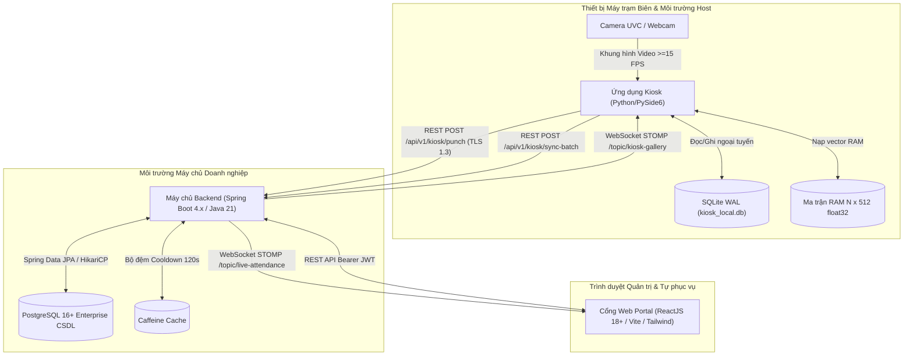

# DDS — Thiết kế Chi tiết & Kiến trúc Hệ thống (Detailed Design Specification)

Thiết kế kiến trúc kỹ thuật toàn diện, cấu trúc phân tầng (`ARC-SYS-`), các thuộc tính thiết kế xuyên suốt và các quyết định kỹ thuật cấp hệ thống (`DD-SYS-`) của Hệ thống Chấm công bằng Nhận diện Khuôn mặt (FAS).

---

## 1. System Architecture (Kiến trúc Tổng thể & Ranh giới Phân hệ)

### 1.1. Cấu trúc Phân tầng (3-Tier Distributed Architecture)

| ID | Name | Definition | Uses | Realizes | Decisions | Status |
| :--- | :--- | :--- | :--- | :--- | :--- | :--- |
| `ARC-001` | Tầng Biên: Trạm Kiosk Desktop (`kiosk-app`) | Thu nhận luồng camera video, thực thi pipeline AI cục bộ, so khớp ma trận RAM, bàn phím số PIN và hàng đợi ngoại tuyến SQLite WAL. | `STK-001`, `STK-002`, `STK-003`, `STK-004`, `STK-008`, `STK-009` | `FR-SYS-001`, `FR-SYS-002`, `FR-SYS-003`, `FR-SYS-004`, `FR-SYS-006` | `DD-SYS-001`, `DD-SYS-002` | Accepted |
| `ARC-002` | Tầng Trung tâm: Dịch vụ Máy chủ (`backend-service`) | Quản lý ca kíp, tính toán giờ công, bộ đệm Cooldown 120s, mã hóa AES-256-GCM, phát sóng STOMP và cron job tiêu hủy sau 20 ngày. | `STK-010`, `STK-011`, `STK-012`, `STK-013`, `STK-014`, `STK-015` | `FR-SYS-005`, `FR-SYS-010`, `FR-SYS-011`, `FR-SYS-012`, `FR-SYS-013`, `FR-SYS-014` | `DD-SYS-003`, `DD-SYS-004` | Accepted |
| `ARC-003` | Tầng Trình diễn: Cổng Web Quản trị (`web-portal`) | Giao diện Live Monitoring Dashboard thời gian thực, quản lý nhân viên, phân ca, phê duyệt giải trình, ký Consent và xuất báo cáo an toàn. | `STK-016`, `STK-017`, `STK-018`, `STK-019` | `FR-SYS-007`, `FR-SYS-008`, `FR-SYS-015`, `FR-SYS-016` | `DD-SYS-004` | Accepted |
| `ARC-004` | Tầng Dữ liệu Bền vững (PostgreSQL Enterprise DB) | Quản lý bền vững toàn bộ dữ liệu quan hệ ACID chuẩn 3NF: nhân sự, ca kíp, bảng công và vector mã hóa BYTEA. | `STK-012` | `DATA-SYS-001`, `DATA-SYS-002`, `DATA-SYS-003`, `DATA-SYS-004`, `DATA-SYS-005`, `DATA-SYS-006`, `DATA-SYS-007`, `DATA-SYS-008` | `DD-SYS-003` | Accepted |

### 1.2. Topology Triển khai Hệ thống

---

## 2. End-to-End System Behavior (Luồng Tương tác Toàn trình Xuyên Phân hệ)

### 2.1. Luồng Điểm danh Thời gian thực Chuẩn (Live Attendance Flow)
1. Cảm biến camera thu nhận khung hình $\rightarrow$ Kiosk AI phát hiện mặt, kiểm tra liveness đạt chuẩn $S_{\text{liveness}} \ge 0.85$.
2. Kiosk trích xuất vector 512D $\rightarrow$ Nhân ma trận RAM Cosine Similarity $\ge 0.50$ $\rightarrow$ Xác định nhân viên khớp.
3. Kiosk kiểm tra mốc thời gian Cooldown tại biên $\ge 120\text{ s}$ $\rightarrow$ Viền chuyển Xanh lá, phát tiếng "Tít".
4. Kiosk gửi request `POST /api/v1/kiosk/punch` (JSON) đính kèm token trạm lên Backend.
5. Backend tiếp nhận, đối chiếu ca làm việc, tính toán đi muộn/về sớm và ghi bản ghi vào PostgreSQL.
6. Backend phát thông điệp sự kiện tới topic `/topic/live-attendance` qua WebSocket STOMP.
7. Cổng Web Portal nhận bản tin, cập nhật thẻ sĩ số và chèn dòng mới vào bảng Live Dashboard trong vòng $\le 200\text{ ms}$.

### 2.2. Luồng Điểm danh Ngoại tuyến & Đồng bộ Bù (Offline Resiliency Flow)
1. Kiosk nhận diện thành công nhân viên nhưng gửi API lên Backend bị lỗi mạng / timeout.
2. Kiosk chuyển sang trạng thái ngoại tuyến, hiển thị biểu tượng mất mạng trên màn hình.
3. Kiosk ghi đệm bản ghi điểm danh vào bảng `offline_punches` trong SQLite WAL với timestamp thực tế.
4. Kiosk phát thông báo "Điểm danh ngoại tuyến thành công" cho nhân viên (không làm gián đoạn luồng di chuyển).
5. Luồng ngầm định kỳ 10 giây ping kiểm tra kết nối mạng.
6. Khi mạng phục hồi, Kiosk gom lô tối đa 50 bản ghi (`status = 'PENDING'`) gửi `POST /api/v1/kiosk/sync-batch` lên Backend.
7. Backend ghi nhận lô bản ghi vào PostgreSQL với mốc giờ gốc, trả về 200 OK. Kiosk cập nhật `status = 'SENT'`.

### 2.3. Luồng Tự Đăng ký Sinh trắc học & Nạp nóng Vector (Onboarding & Gallery Sync Flow)
1. Nhân viên đăng nhập Web Portal $\rightarrow$ Ký xác nhận số thỏa thuận Informed Consent theo Luật 2025.
2. Backend lưu nhật ký Consent, sinh mã OTP 6 số (hạn 48h) hiển thị trên màn hình Web của nhân viên.
3. Nhân viên ra trạm Kiosk $\rightarrow$ Nhập mã OTP $\rightarrow$ Hộp thoại tự ẩn để dùng camera chính $\rightarrow$ Chụp 3 ảnh đạt chuẩn.
4. Kiosk trích xuất vector 512D $\rightarrow$ Gửi `POST /api/v1/kiosk/enroll-face` kèm mã OTP lên Backend.
5. Backend mã hóa vector bằng AES-256-GCM, lưu vào PostgreSQL, kích hoạt tài khoản `ACTIVE`.
6. Backend phát thông điệp nạp vector mới tới topic `/topic/kiosk-gallery`. Toàn bộ các trạm Kiosk nhận tin và nạp vector vào RAM tức thời.

### 2.4. Luồng Tiêu hủy Dữ liệu theo Luật 2025 (Compliance Erasure Flow)
1. HR chuyển trạng thái nhân viên thành `TERMINATED` trên Web Portal $\rightarrow$ Backend ghi nhận `terminated_date = CurrentDate`.
2. Backend phát sóng lệnh xóa vector tới `/topic/kiosk-gallery` $\rightarrow$ Toàn bộ trạm Kiosk loại bỏ vector khỏi RAM ngay lập tức.
3. Định kỳ 01:00 hàng ngày, cron job quét CSDL tìm nhân viên nghỉ việc quá 20 ngày.
4. Tiến trình thực hiện lệnh Hard Delete xóa sạch vector trong bảng `biometric_templates` và ghi log kiểm toán.

---

## 3. System Design Decisions (Quyết định Thiết kế Cấp Hệ thống)

| ID | Decision | Rationale | Alternatives | Consequences | Basis | Status |
| :--- | :--- | :--- | :--- | :--- | :---: | :---: |
| `DD-SYS-001` | Thực thi suy luận AI hoàn toàn tại biên trên CPU với tập lệnh AVX2, không phụ thuộc GPU. | Đạt độ trễ $\le 350\text{ ms}$, tiết kiệm 95% băng thông mạng và tận dụng PC sẵn có. | Suy luận đám mây Cloud API, Trang bị GPU rời chuyên dụng | Cần tinh chỉnh mô hình gọn nhẹ và kiểm soát tài nguyên CPU/RAM. | `PD-002`, `INF-006` | Accepted |
| `DD-SYS-002` | Áp dụng cơ chế lưu trữ cục bộ SQLite chế độ Write-Ahead Logging (WAL) tại trạm Kiosk. | Đảm bảo $\text{RPO} = 0$ khi mất điện đột ngột và hỗ trợ đọc/ghi đồng thời non-blocking. | Bộ nhớ RAM thuần túy, File JSON cục bộ | Cần quản lý dọn dẹp và cơ chế checkpoint WAL định kỳ. | `PD-004`, `INF-011` | Accepted |
| `DD-SYS-003` | Mã hóa đối xứng AES-256-GCM ở trạng thái tĩnh cho toàn bộ vector mẫu 512D với Master Key độc lập trong biến môi trường. | Bảo đảm tính bí mật và toàn vẹn dữ liệu sinh trắc học theo Luật 91/2025/QH15. | Lưu vector plaintext, Mã hóa mức CSDL pgcrypto | Tăng tải CPU khi giải mã nạp gallery; cần bảo mật Master Key. | `PD-005`, `INF-009` | Accepted |
| `DD-SYS-004` | Sử dụng giao thức WebSocket STOMP làm kênh truyền thông đẩy thời gian thực hai chiều giữa Backend, Web Portal và Kiosk. | Đẩy dữ liệu tức thì $\le 200\text{ ms}$, tối ưu băng thông và tài nguyên so với polling. | HTTP Polling định kỳ, SSE (Server-Sent Events) | Cần quản lý vòng đời socket và xử lý mất kết nối tự động. | `PD-006`, `INF-003` | Accepted |
