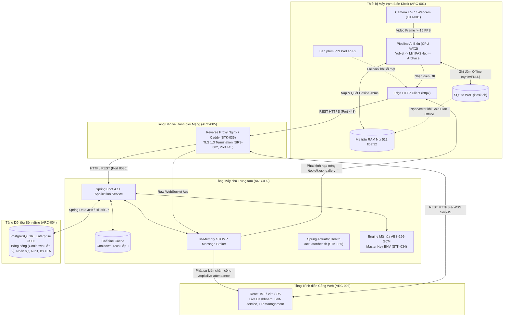

# SYSTEM SPEC CORE — Đặc tả Yêu cầu & Kiến trúc Toàn diện Hệ thống

Tài liệu này là **Spec Core cấp Hệ thống** của dự án Face Attendance System (FAS) theo chuẩn SDLC v3.x ([sdlc-docs.md](../../sdlc-docs.md) §7.1). Tài liệu hợp nhất toàn diện:
1. Ngữ cảnh tương tác hệ thống, sổ đăng ký tác nhân người dùng (ACT-), thiết bị/dịch vụ ngoại vi (EXT-), và khung phân tích yêu cầu theo vòng đời tác nhân (Actor Lifecycle Framework).
2. Toàn bộ danh mục yêu cầu kỹ thuật hệ thống:
   - Yêu cầu kỹ thuật xuyên suốt (SRS-001 đến SRS-010).
   - Yêu cầu chức năng hệ thống (FR-SYS-001 đến FR-SYS-028).
   - Yêu cầu phi chức năng đo lường được (NFR-SYS-001 đến NFR-SYS-010).
3. Kiến trúc phân rã phân hệ, topology mạng, cơ chế bảo mật và luồng tương tác toàn trình (ARC-001 đến ARC-018).
4. Danh mục giải pháp kỹ thuật và cơ chế chất lượng cấp hệ thống (SOL-SYS-001 đến SOL-SYS-031).
5. Danh mục quyết định thiết kế kiến trúc hệ thống (DD-SYS-001 đến DD-SYS-028).
6. Giả định và các vấn đề đã chốt (Assumptions & Open Issues).

---

## 1. System Context (Ngữ cảnh Vận hành Toàn Hệ thống)

Hệ thống Chấm công bằng Nhận diện Khuôn mặt (FAS) vận hành theo mô hình phân tán gồm 3 phân hệ độc lập:
* **Phân hệ Kiosk Cận biên (`kiosk-app`)**: Thiết bị trạm tự phục vụ thu nhận video trực tiếp từ camera, thực thi toàn bộ pipeline AI biên (phát hiện mặt YuNet, kiểm tra liveness MiniFASNet, trích xuất vector 512D ArcFace) và so khớp ma trận RAM $N \times 512$ cục bộ, lưu đệm ngoại tuyến SQLite WAL ($\text{RPO} = 0$).
* **Phân hệ Máy chủ Doanh nghiệp (`backend-service`)**: Máy chủ trung tâm tiếp nhận giao dịch điểm danh, quản lý ca kíp và phân ca, thực thi bộ đệm Cooldown 120s hai lớp (Caffeine RAM + PostgreSQL DB), mã hóa AES-256-GCM bảo vệ vector tĩnh và phát sóng sự kiện thời gian thực qua WebSocket STOMP.
* **Phân hệ Cổng Web Quản trị & Tự phục vụ (`web-portal`)**: Ứng dụng web SPA cung cấp Live Monitoring Dashboard thời gian thực, quản lý nhân sự, duyệt đơn giải trình công và hỗ trợ nhân viên tự phục vụ ký cam kết Informed Consent điện tử.

---

### 1.1. Actors (Sổ Đăng ký Tác nhân Người dùng Toàn Hệ thống)

| ID | Tác nhân (Actor Name) | Vai trò & Mục đích Tương tác trong Hệ thống | Quyền hạn Hệ thống |
| :--- | :--- | :--- | :--- |
| `ACT-001` | Nhân viên (Employee) | Điểm danh hàng ngày qua khuôn mặt/mã PIN tại trạm Kiosk; tự đăng ký mẫu mặt qua OTP; ký cam kết Informed Consent điện tử và gửi đơn giải trình công trên Cổng Web. | Role `EMPLOYEE` |
| `ACT-002` | Chuyên viên Nhân sự (HR Specialist) | Quản lý danh sách nhân sự, cấu hình ca kíp làm việc, theo dõi sĩ số trực tiếp đầu giờ trên Live Dashboard, duyệt đơn giải trình công và kết xuất báo cáo bảng công. | Role `HR_MANAGER` |
| `ACT-003` | Quản trị viên Hệ thống (System Admin) | Cấu hình tham số vận hành, giám sát nhật ký audit log, quản lý tài khoản người dùng, giám sát kết nối mạng giữa Kiosk và Backend, sao lưu/phục hồi CSDL. | Role `ADMIN` |
| `ACT-004` | Cán bộ Bảo vệ Dữ liệu (DPO) | Kiểm soát việc thực thi chính sách bảo vệ dữ liệu cá nhân theo Luật 91/2025/QH15, kiểm tra chữ ký thỏa thuận Consent, giám sát lịch trình tiêu hủy dữ liệu sinh trắc 20 ngày khi thôi việc và 7 ngày khi rút đồng thuận (`FR-SYS-025`). | Role `DPO` (chỉ đọc) |

---

### 1.2. External Systems & Devices (Hệ thống & Thiết bị Ngoại vi)

| ID | Tên Hệ thống / Thiết bị | Loại Giao tiếp | Giao thức / Ranh giới | Vai trò Kỹ thuật |
| :--- | :--- | :--- | :--- | :--- |
| `EXT-001` | Camera Quang học UVC / Webcam | Thiết bị phần cứng USB | DirectShow / Media Foundation | Cung cấp luồng khung hình video liên tục $\ge 15\text{ FPS}$ độ phân giải HD/Full HD. |
| `EXT-002` | CSDL PostgreSQL 16 LTS Doanh nghiệp | Dịch vụ CSDL trung tâm | TCP/IP (Port 5432, JPA/HikariCP)| Lưu trữ bền vững dữ liệu nhân sự, ca kíp, bảng công và vector mã hóa BYTEA. |
| `EXT-003` | Nguồn Chuẩn Giờ Mạng (NTP Server) | Dịch vụ mạng hệ thống | NTP (UDP Port 123) | Đồng bộ mốc thời gian chuẩn giữa các trạm Kiosk và máy chủ Backend (sai lệch $\le 50\text{ ms}$). |

---

---

### 1.3. Khung Phân tích Yêu cầu theo Vòng đời Tác nhân (Actor Lifecycle Analysis Framework)

Kỹ thuật phân tích yêu cầu theo vòng đời tác nhân (Actor Lifecycle-Driven Requirements Engineering) đặt con người và vai trò tương tác làm trung tâm, theo dõi hành trình nghiệp vụ từ điểm tiếp xúc đầu tiên (tiếp nhận/khởi tạo) qua quá trình vận hành thường nhật, xử lý ngoại lệ, cho đến điểm kết thúc (chấm dứt/tiêu hủy).

#### 1.3.1. Vòng đời Tác nhân Nhân viên (`ACT-001` — Employee Lifecycle)

1. **Giai đoạn Tiếp nhận & Kích hoạt Danh tính (Onboarding & Activation)**:
   * Nhân viên nhận mật khẩu tạm do hệ thống sinh, đăng nhập Cổng Web lần đầu mà không bị ép buộc đổi mật khẩu (`FR-SYS-017`).
   * Nhân viên đọc và ký cam kết thỏa thuận Informed Consent điện tử về thu thập dữ liệu sinh trắc học (`FR-SYS-007`).
   * Sau khi ký Consent, nhân viên nhận mã Onboarding OTP 6 chữ số có thời hạn 48 giờ (`FR-SYS-008`).
   * Nhân viên mang mã OTP ra trạm Kiosk thực hiện quy trình tự nạp mẫu khuôn mặt 3 bước đạt chuẩn (độ nét, góc nghiêng, liveness) (`FR-SYS-009`).
   * Nhân viên tự thiết lập mã PIN dự phòng cá nhân 6 số trên Web Portal để làm kênh xác thực thay thế (`FR-SYS-017`).
2. **Giai đoạn Vận hành Điểm danh Thường nhật (Daily Attendance)**:
   * Khi bước vào trạm Kiosk, camera tự động phát hiện khuôn mặt thời gian thực qua YuNet (`FR-SYS-001`).
   * Bộ lọc MiniFASNet kiểm tra thực thể sống thụ động (Passive Liveness) để chặn đứng ảnh in và video giả mạo (`FR-SYS-002`).
   * Bộ trích xuất ArcFace sinh vector 512D và so khớp Cosine 1:N tức thì với ma trận RAM tại biên (`FR-SYS-003`).
   * Trong trường hợp khuôn mặt bị tổn thương, ánh sáng bất lợi, hoặc sai lệch nhân khẩu học (NIST IR 8271), nhân viên sử dụng bàn phím ảo PIN dự phòng (`FR-SYS-004`).
   * Hệ thống áp dụng cơ chế Cooldown 120 giây chống quẹt trùng lặp vô ý (`FR-SYS-005`).
   * Khi mạng nội bộ gặp sự cố, trạm Kiosk tự động đệm dữ liệu vào SQLite WAL và đồng bộ bù khi kết nối phục hồi (`FR-SYS-006`).
3. **Giai đoạn Tự phục vụ, Đối soát & Xử lý Ngoại lệ (Self-Service & Exception Handling)**:
   * Nhân viên tự tra cứu lịch sử chấm công cá nhân theo tháng trên Web Portal (`FR-SYS-028`).
   * Khi có sai sót chấm công (quên quẹt, đi công tác), nhân viên gửi đơn giải trình công trực tuyến kèm lý do chính đáng (`FR-SYS-016`).
   * Khi quên thông tin xác thực, nhân viên được cấp lại mật khẩu tạm hoặc tự đặt lại mã PIN dự phòng sau khi xác thực mật khẩu (`FR-SYS-022`).
   * Nhân viên nhận thông báo trong ứng dụng về tình trạng tài khoản, đơn giải trình và trạng thái công (`FR-SYS-027`).
4. **Giai đoạn Rút Quyền & Chấm dứt Tương tác (Consent Revocation & Offboarding)**:
   * Nhân viên có quyền rút lại Informed Consent bất kỳ lúc nào; khi rút, tính năng điểm danh khuôn mặt bị vô hiệu hóa ngay và chuyển hoàn toàn sang mã PIN (`FR-SYS-025`).
   * Dữ liệu sinh trắc học của nhân viên rút Consent bị kích hoạt tiêu hủy vĩnh viễn trong vòng 7 ngày (`FR-SYS-025`).
   * Mọi phiên làm việc bị thu hồi tức thì khi nhân viên đổi mật khẩu hoặc thôi việc (`FR-SYS-023`).

---

#### 1.3.2. Vòng đời Tác nhân Chuyên viên Nhân sự (`ACT-002` — HR Specialist Lifecycle)

1. **Giai đoạn Thiết lập & Cấu hình Chính sách (Policy & Workforce Setup)**:
   * HR khởi tạo hồ sơ nhân sự mới, bàn giao mật khẩu tạm hiển thị duy nhất một lần cho nhân viên (`FR-SYS-017`).
   * Cấu hình danh mục ca làm việc (ca chuẩn, ca gãy, thời gian ân hạn 15 phút, mốc đi muộn/về sớm) (`FR-SYS-012`, `FR-SYS-018`).
   * Phân ca làm việc linh hoạt cho nhân sự theo khoảng thời gian hiệu lực, ngăn chặn triệt để chồng lấn ca (`FR-SYS-018`).
2. **Giai đoạn Giám sát Vận hành Ca trực Thời gian thực (Live Monitoring & Operations)**:
   * Theo dõi sĩ số trực tiếp đầu giờ trên màn hình Live Monitoring Dashboard qua kênh WebSocket STOMP (`FR-SYS-013`, `FR-SYS-015`).
   * Nắm bắt tức thì danh sách nhân sự đi làm đúng giờ, đi muộn, về sớm hoặc quẹt công bất thường (`FR-SYS-012`, `FR-SYS-015`).
   * Quản lý phân phối đồng bộ dữ liệu vector mẫu nhân viên mới ra toàn bộ mạng lưới Kiosk biên (`FR-SYS-014`).
3. **Giai đoạn Đối soát, Xử lý Giải trình & Chốt kỳ Công (Reconciliation & Period Close)**:
   * Tiếp nhận, đối chiếu minh chứng và xét duyệt hoặc từ chối các đơn giải trình công của nhân viên (`FR-SYS-016`).
   * Xử lý các bản ghi chấm công bất thường (`ANOMALOUS`) do nhân sự chưa được phân ca trước đó (`FR-SYS-018`).
   * Thực hiện thủ tục chốt bảng công kỳ tháng, khóa cứng mọi khả năng chỉnh sửa dữ liệu công sau khi đã chốt (`FR-SYS-024`).
   * Kết xuất báo cáo bảng công định dạng file Excel (.xlsx) an toàn, tự động vô hiệu hóa mã độc Formula Injection (`FR-SYS-016`).

---

#### 1.3.3. Vòng đời Tác nhân Quản trị viên Hệ thống (`ACT-003` — System Admin Lifecycle)

1. **Giai đoạn Khởi tạo Hạ tầng & Cấp phát (Bootstrap & Provisioning)**:
   * Khởi tạo an toàn tài khoản quản trị đầu tiên (Bootstrap) trên CSDL trống qua biến môi trường/CLI, không dùng mật khẩu mặc định cố định (`FR-SYS-021`).
   * Đăng ký trạm Kiosk biên mới vào hệ thống, sinh Secret Token hiển thị duy nhất một lần để xác thực kết nối máy trạm (`FR-SYS-020`).
2. **Giai đoạn Quản trị An ninh, Phiên & Phân quyền (Security Governance & Operations)**:
   * Quản lý phân quyền RBAC: gán và thu hồi các role `HR_MANAGER`, `DPO`, `ADMIN`, đồng thời bảo vệ tài khoản quản trị hoạt động cuối cùng (`FR-SYS-026`).
   * Quản lý vòng đời phiên làm việc, giám sát và thu hồi tức thì refresh token khi có dấu hiệu lộ lọt hoặc thay đổi thông tin xác thực (`FR-SYS-023`).
   * Cấp lại mật khẩu tạm thời khi nhân sự quên mật khẩu đăng nhập (`FR-SYS-022`).
   * Giám sát trạng thái kết nối nhịp tim (ping), phát hiện trạm Kiosk ngoại tuyến (`FR-SYS-020`) và giám sát endpoint sức khỏe dịch vụ Backend `/actuator/health` (`SRS-009`, `NFR-SYS-008`).
3. **Giai đoạn Kiểm toán, Bảo trì & Phục hồi Sự cố (Audit & Incident Response)**:
   * Tra cứu nhật ký kiểm toán hệ thống (`audit_logs`) chi tiết phục vụ điều tra sự cố kỹ thuật và truy vết hành vi người dùng (`FR-SYS-019`).
   * Mở khóa kỳ công đã chốt khi có yêu cầu đặc biệt từ ban giám đốc, ghi nhận lý do và vết kiểm toán đầy đủ (`FR-SYS-024`).

---

#### 1.3.4. Vòng đời Tác nhân Cán bộ Bảo vệ Dữ liệu (`ACT-004` — DPO Compliance Lifecycle)

1. **Giai đoạn Giám sát Tuân thủ & Hồ sơ Đồng thuận (Consent Governance)**:
   * Tra cứu, kiểm tra danh mục chữ ký thỏa thuận Informed Consent điện tử của toàn bộ nhân sự trong tổ chức (`FR-SYS-019`).
   * Xác minh tính hợp pháp của việc thu thập và sử dụng dữ liệu sinh trắc học theo Luật Bảo vệ dữ liệu cá nhân số 91/2025/QH15 (`FR-SYS-007`, `FR-SYS-019`).
2. **Giai đoạn Thực thi Quyền của Chủ thể Dữ liệu (Data Subject Rights)**:
   * Tiếp nhận, giám sát việc xử lý các yêu cầu rút lại Informed Consent từ nhân viên (`FR-SYS-025`).
   * Phối hợp phản hồi các yêu cầu tiếp cận, tra cứu hoặc đính chính dữ liệu cá nhân của người lao động trong ứng dụng (`FR-SYS-025`).
3. **Giai đoạn Kiểm toán Mã hóa & Giám sát Tiêu hủy Dữ liệu (Destruction Auditing)**:
   * Giám sát việc thực thi mã hóa đối xứng AES-256-GCM bảo vệ vector tĩnh tại CSDL PostgreSQL (`FR-SYS-010`, `NFR-SYS-007`).
   * Kiểm tra định kỳ tác vụ tự động tiêu hủy vĩnh viễn (Hard Delete) mẫu vector sinh trắc học sau đúng 20 ngày kể từ ngày chấm dứt hợp đồng lao động theo Điều 18 & 19 Luật số 91/2025/QH15 (`FR-SYS-011`).
   * Giám sát việc tiêu hủy triệt để dữ liệu sinh trắc học trong vòng 7 ngày đối với các trường hợp rút thỏa thuận Consent (`FR-SYS-025`).

---

#### 1.3.5. Ma trận Ánh xạ Vòng đời Tác nhân sang Yêu cầu Kỹ thuật

| Giai đoạn Vòng đời | Tác nhân Chính | Mục tiêu Tác nhân (Actor Goal) | Danh mục Yêu cầu Đáp ứng |
| :--- | :--- | :--- | :--- |
| **Tiếp nhận & Kích hoạt** | `ACT-001` Nhân viên | Đăng nhập tài khoản ban đầu, ký cam kết bảo vệ dữ liệu, nhận OTP và tự nạp khuôn mặt tại Kiosk | `FR-SYS-007`, `FR-SYS-008`, `FR-SYS-009`, `FR-SYS-017` |
| **Điểm danh Thường nhật** | `ACT-001` Nhân viên | Điểm danh khuôn mặt nhanh chóng, chính xác; dùng mã PIN dự phòng khi sự cố; chống quẹt trùng | `FR-SYS-001`, `FR-SYS-002`, `FR-SYS-003`, `FR-SYS-004`, `FR-SYS-005`, `FR-SYS-006` |
| **Tự phục vụ & Ngoại lệ** | `ACT-001` Nhân viên | Tra cứu lịch sử công tháng, gửi đơn giải trình khi quên quẹt, đổi mật khẩu/đặt lại PIN, nhận thông báo | `FR-SYS-016`, `FR-SYS-022`, `FR-SYS-027`, `FR-SYS-028` |
| **Rút quyền & Thôi việc** | `ACT-001` Nhân viên | Rút Informed Consent, yêu cầu bảo vệ quyền riêng tư và chuyển sang điểm danh PIN hoàn toàn | `FR-SYS-023`, `FR-SYS-025` |
| **Thiết lập Chính sách** | `ACT-002` Nhân sự | Khởi tạo hồ sơ nhân sự, cấu hình ca kíp, thời gian ân hạn và phân ca làm việc không chồng lấn | `FR-SYS-012`, `FR-SYS-017`, `FR-SYS-018` |
| **Giám sát Ca trực** | `ACT-002` Nhân sự | Theo dõi sĩ số trực tiếp đầu giờ trên Dashboard, phát hiện đi muộn/về sớm, đồng bộ vector Kiosk | `FR-SYS-013`, `FR-SYS-014`, `FR-SYS-015` |
| **Đối soát & Chốt kỳ** | `ACT-002` Nhân sự | Xét duyệt đơn giải trình công, chốt bảng công tháng, kết xuất báo cáo Excel chống Formula Injection | `FR-SYS-016`, `FR-SYS-024` |
| **Khởi tạo & Cấp phát** | `ACT-003` Quản trị viên | Bootstrap an toàn tài khoản quản trị đầu tiên, đăng ký trạm Kiosk và cấp Secret Token hiển thị 1 lần | `FR-SYS-020`, `FR-SYS-021` |
| **Quản trị An ninh** | `ACT-003` Quản trị viên | Phân quyền RBAC, thu hồi phiên làm việc tức thì, cấp lại mật khẩu tạm, giám sát nhịp tim trạm Kiosk | `FR-SYS-020`, `FR-SYS-022`, `FR-SYS-023`, `FR-SYS-026` |
| **Kiểm toán & Bảo trì** | `ACT-003` Quản trị viên | Tra cứu nhật ký kiểm toán hệ thống bất biến, mở khóa kỳ công khi có yêu cầu hợp lệ | `FR-SYS-019`, `FR-SYS-024` |
| **Giám sát Hồ sơ Consent**| `ACT-004` Cán bộ DPO | Kiểm tra hồ sơ chữ ký Informed Consent, đối soát tuân thủ Luật Bảo vệ dữ liệu cá nhân 2025 | `FR-SYS-007`, `FR-SYS-019` |
| **Quyền Chủ thể Dữ liệu** | `ACT-004` Cán bộ DPO | Tiếp nhận và thực thi yêu cầu rút Consent, yêu cầu trích xuất/chỉnh sửa dữ liệu cá nhân của nhân sự | `FR-SYS-025` |
| **Kiểm toán Tiêu hủy** | `ACT-004` Cán bộ DPO | Kiểm tra việc mã hóa vector AES-256-GCM, giám sát lịch trình tiêu hủy 20 ngày thôi việc và 7 ngày rút consent | `FR-SYS-010`, `FR-SYS-011`, `FR-SYS-025` |

---

---

## 2. Requirements (Yêu cầu Kỹ thuật Toàn Hệ thống)

### 2.1. Cross-cutting Requirements (Yêu cầu Xuyên suốt Toàn Hệ thống)

| ID | Statement | Category | Priority | Basis | Acceptance | Status |
| :--- | :--- | :--- | :---: | :---: | :--- | :---: |
| `SRS-001` | Toàn bộ vector đặc trưng sinh trắc học lưu trữ ở trạng thái tĩnh phải được mã hóa chuẩn đối xứng AES-256-GCM với khóa Master Key nạp độc lập từ biến môi trường của hệ thống. | Security | Must | `PD-005` | 100% vector trong bảng `biometric_templates` là ciphertext dạng BYTEA kèm IV 12 bytes và Auth Tag 16 bytes; không giải mã được nếu thiếu khóa môi trường (`STK-034`). Tại trạm Kiosk biên, dữ liệu vector đã giải mã chỉ được lưu trong bộ nhớ RAM không phân trang (locked memory buffer) trong suốt phiên vận hành và được bảo vệ bằng các chính sách gia cố an ninh hệ điều hành (OS hardening) và an toàn vật lý của thiết bị trạm (`PD-005`). | Approved |
| `SRS-002` | Mọi luồng truyền thông mạng giữa Kiosk, Web Portal và Backend bắt buộc phải được mã hóa kênh truyền bằng TLS 1.3 (HTTPS) và Secure WebSocket (WSS) trên môi trường vận hành chính thức. | Security | Must | `PD-001` | Toàn bộ gói tin REST API và STOMP được mã hóa trên đường truyền thông qua Reverse Proxy (`STK-036`); từ chối kết nối không an toàn trên production; cho phép cấu hình fallback HTTP/WS cục bộ ở môi trường phát triển. | Approved |
| `SRS-003` | Hệ thống phải tự động tiêu hủy vĩnh viễn (Hard Delete) mẫu dữ liệu sinh trắc học của nhân viên đã thôi việc sau đúng 20 ngày kể từ ngày chấm dứt hợp đồng lao động theo Điều 18 & 19 Luật số 91/2025/QH15. | Compliance | Must | `PD-005` | Tác vụ ngầm định kỳ hàng ngày quét và xóa sạch bản ghi trong `biometric_templates` có `terminated_date <= CurrentDate - 20 days`; ghi nhật ký kiểm toán. | Approved |
| `SRS-004` | Tuyệt đối không lưu trữ ảnh chụp thô kích thước đầy đủ của nhân viên trên ổ đĩa trạm Kiosk hay máy chủ trung tâm (Zero Raw Image Retention). | Privacy | Must | `PD-005` | Khung hình camera chỉ tồn tại tạm thời trong RAM trong chu kỳ suy luận ($< 1\text{ giây}$) và lập tức được giải phóng bộ nhớ; không có file ảnh nào được ghi đĩa. | Approved |
| `SRS-005` | Mật khẩu tài khoản và mã PIN dự phòng cá nhân phải được băm một chiều bằng thuật toán an toàn chống dò vét GPU (Argon2id hoặc BCrypt), cấm lưu văn bản rõ; cơ chế xác thực mã PIN phải áp dụng khóa tạm thời (Lockout) per-account tối thiểu 15 phút sau 5 lần nhập sai liên tiếp trên toàn hệ thống kết hợp khóa per-device tại bàn phím Kiosk để ngăn chặn tấn công vét cạn. | Security | Must | `PD-001`, `PD-008` | Cột `pin_hash` trong CSDL lưu trữ hash an toàn (BCrypt với cost factor $\ge 10$ hoặc Argon2id); xác thực không lưu cache plaintext; Backend khóa per-account 15 phút sau 5 lần nhập sai mã PIN của cùng tài khoản trên bất kỳ trạm nào; Kiosk khóa bàn phím PIN cục bộ 15 phút và phát còi/cảnh báo giao diện. | Approved |
| `SRS-006` | Hệ thống phải thực thi kiểm soát truy cập dựa trên vai trò (RBAC) thông qua mã thông báo JWT; đối với phiên làm việc web/API, sử dụng access token ngắn hạn (1 giờ) kèm refresh token an toàn (7 ngày) dạng băm một chiều hỗ trợ thu hồi tức thì. | Security | Must | `PD-001` | Mọi API quản trị đều yêu cầu header `Authorization: Bearer <JWT>`; từ chối truy cập 403 Forbidden nếu không đủ quyền hạn; đổi mật khẩu, cấp lại mật khẩu hoặc vô hiệu hóa tài khoản lập tức thu hồi toàn bộ refresh token tương ứng. | Approved |
| `SRS-007` | Khi xuất dữ liệu bảng công ra file Excel/CSV, hệ thống phải tự động vô hiệu hóa mã độc chèn công thức (Anti-Formula Injection / CWE-1236). | Security | Should | `INF-003` | Tự động chèn dấu nháy đơn (`'`) trước các ô dữ liệu văn bản bắt đầu bằng các ký tự `=`, `+`, `-`, `@`. | Approved |
| `SRS-008` | Hệ thống phải duy trì khả năng vận hành độc lập tại biên (Offline-first resilient) cho phương thức nhận diện khuôn mặt chính yếu, đảm bảo không thất thoát dữ liệu ($\text{RPO} = 0$) khi mất kết nối mạng. | Reliability | Must | `PD-004` | Trạm Kiosk tiếp tục nhận diện khuôn mặt bình thường khi mất mạng, ghi đệm vào SQLite WAL và tự động gửi bù đủ 100% số bản ghi khi mạng phục hồi; kênh PIN dự phòng (`SRS-005`) yêu cầu Backend trực tuyến để bảo vệ hash PIN không lưu đĩa tại trạm biên; trong tình huống sự cố kép (mất mạng VÀ lỗi sinh trắc), nhân viên sử dụng quy trình nộp đơn giải trình công trực tuyến sau khi kết nối phục hồi (`FR-SYS-016`). | Approved |
| `SRS-009` | Hệ thống phải đảm bảo hoạt động liên tục với độ sẵn sàng dịch vụ tối thiểu 99.9% trong giờ làm việc hành chính. | Availability | Must | `PD-001`, `INF-011` | Backend cung cấp endpoint giám sát sức khỏe `/actuator/health` (`STK-035`) phản hồi HTTP 200 trong $\le 200\text{ ms}$; Kiosk có vòng lặp tự phục hồi kết nối camera mỗi $\le 2\text{ giây}$; tổng thời gian gián đoạn dịch vụ tích lũy không vượt quá $\le 15.8\text{ phút/tháng}$ theo `NFR-SYS-008`. | Approved |
| `SRS-010` | Toàn bộ các sự kiện điểm danh, đăng ký khuôn mặt, duyệt giải trình và xóa dữ liệu phải được ghi nhật ký kiểm toán (Audit Trail) không thể chỉnh sửa. | Auditing | Must | `INF-009` | Lưu trữ bản ghi trong bảng `audit_logs` có đầy đủ mốc thời gian, IP, tác nhân và hành vi nghiệp vụ. | Approved |

---

---

### 2.2. Functional Requirements (Yêu cầu Chức năng)

| ID | Statement | Category | Priority | Basis | Acceptance | Status |
| :--- | :--- | :--- | :---: | :---: | :--- | :---: |
| `FR-SYS-001` | Hệ thống phải thu nhận luồng video liên tục từ camera quang học và phát hiện khuôn mặt thời gian thực bằng mô hình nhẹ YuNet. | Vision / Kiosk | Must | `PD-002`, `ACT-001` | Tốc độ xử lý luồng video $\ge 15\text{ FPS}$ (khuyến nghị $\ge 24\text{ FPS}$); phát hiện khuôn mặt kích thước $\ge 120\times 120\text{ px}$; trả về tọa độ bounding box và 5 điểm mốc giải phẫu khuôn mặt trong $\le 20\text{ ms}$ trên CPU. | Approved |
| `FR-SYS-002` | Hệ thống phải kiểm tra thực thể sống thụ động (Passive Liveness) bằng mô hình MiniFASNet để loại bỏ ảnh in 2D và video phát lại. | Vision / Security | Must | `PD-003`, `INF-008`, `ACT-001` | Điểm số liveness $S_{\text{liveness}} \ge 0.85$; tuân thủ chuẩn ISO/IEC 30107-3 với sai số chấp nhận tấn công $\text{APCER} \le 2.0\%$ (chặn $\ge 98\%$ các cuộc tấn công Presentation Attack ảnh in và màn hình) và sai số từ chối người thật $\text{BPCER} \le 5.0\%$; thời gian suy luận $\le 30\text{ ms}$ trên CPU. | Approved |
| `FR-SYS-003` | Hệ thống phải trích xuất vector đặc trưng 512 chiều chuẩn hóa L2 Norm qua ArcFace và so khớp Cosine 1:N với ma trận RAM tại trạm Kiosk. | Vision / Identity | Must | `PD-002`, `INF-007`, `ACT-001` | Ngưỡng Cosine Similarity $\ge 0.50$; thời gian so khớp ma trận 1,000 nhân sự $< 2\text{ ms}$; đáp ứng đầy đủ tiêu chí chất lượng độ chính xác sinh trắc học định lượng tại `NFR-SYS-004`. | Approved |
| `FR-SYS-004` | Hệ thống phải cung cấp bàn phím số ảo PIN dự phòng trên màn hình cảm ứng để nhân viên điểm danh khi gặp sự cố sinh trắc học hoặc đã rút Informed Consent; mã PIN được thẩm định tập trung tại máy chủ Backend khi có kết nối mạng. | Fallback / UX | Should | `PD-008`, `INF-012`, `ACT-001` | Nhập mã PIN 6 số cá nhân; gọi thẩm định tập trung phía máy chủ Backend và ghi nhận điểm danh `VERIFICATION_PIN`; Backend áp dụng khóa tạm thời (Lockout) per-account tối thiểu 15 phút sau 5 lần nhập sai liên tiếp trên bất kỳ trạm nào kết hợp khóa per-device tại bàn phím Kiosk; khi mất mạng đồng thời với lỗi sinh trắc học, nhân viên nộp đơn giải trình công bổ sung (`FR-SYS-016`). | Approved |
| `FR-SYS-005` | Hệ thống phải áp dụng cơ chế Cooldown chống quét trùng lặp trong khoảng thời gian 120 giây cho cùng một nhân viên. | Business Rule | Should | `INF-001`, `ACT-001` | Kiểm soát đa tầng: trạm Kiosk kiểm tra bộ đệm RAM cục bộ để chặn quẹt trùng tức thì tại biên kể cả khi ngoại tuyến; Backend kiểm tra ràng buộc mốc giờ trong CSDL để chặn quẹt trùng luân chuyển giữa nhiều trạm; giao diện hiển thị thông báo "Bạn đã chấm công, vui lòng không quẹt lại". | Approved |
| `FR-SYS-006` | Hệ thống phải lưu trữ đệm các lượt quẹt vào CSDL cục bộ SQLite chế độ WAL khi mất mạng và tự động đồng bộ bù khi có mạng lại. | Resiliency | Must | `PD-004`, `INF-011`, `ACT-001` | Bản ghi điểm danh ngoại tuyến được bảo toàn an toàn trong SQLite cục bộ; khi kết nối mạng phục hồi, background worker tự động gửi bù theo lô tối đa 50 bản ghi/request về Backend thành công 100% không trùng lặp; thỏa mãn cam kết chất lượng $\text{RPO} = 0$ tại `NFR-SYS-006` và chính sách bền bỉ `SRS-008`. | Approved |
| `FR-SYS-007` | Hệ thống phải cung cấp quy trình ký văn bản thỏa thuận Informed Consent điện tử trước khi cho phép thu thập và kích hoạt dữ liệu khuôn mặt. | Compliance | Must | `PD-005`, `ACT-001`, `ACT-004` | Nhân viên tích chọn đồng ý điều khoản theo Luật 91/2025/QH15 trên Web Portal; lưu vết mốc thời gian, IP và User-Agent vào bảng `consent_audit_logs`; chỉ cho phép sinh OTP Onboarding khi đã có Consent hợp lệ. | Approved |
| `FR-SYS-008` | Hệ thống phải sinh mã kích hoạt Onboarding OTP 6 chữ số có hiệu lực giới hạn 48 giờ để nhân viên mang ra trạm Kiosk tự nạp khuôn mặt. | Enrollment | Must | `PD-007`, `FR-SYS-007`, `ACT-001` | Mã OTP gồm 6 chữ số ngẫu nhiên; mã băm một chiều bằng HMAC-SHA-256 kèm pepper bảo mật hoặc Argon2id/BCrypt lưu trong bảng `enrollment_otps`; tự hủy sau 48 giờ hoặc ngay sau khi nạp mặt thành công theo `PD-007`; giới hạn tối đa 5 lần xác thực sai cho mỗi mã OTP. | Approved |
| `FR-SYS-009` | Hệ thống phải thực hiện quy trình tự nạp mẫu khuôn mặt 3 bước trực tiếp trên camera Kiosk: kiểm chuẩn ảnh, chụp liên tiếp 3 ảnh đạt chuẩn và nạp vector. | Enrollment / UX | Must | `PD-007`, `FR-SYS-008`, `ACT-001` | Bước 1 xác minh OTP 6 số; Bước 2 tự động chụp 3 ảnh chuẩn (Laplacian độ nét $\ge 30$, điểm sống $S_{\text{liveness}} \ge 0.90$ với Safety Margin $+5\%$ so với ngưỡng vận hành $0.85$, góc nghiêng pose $\le 15^\circ$); Bước 3 nạp nóng vector vào RAM Kiosk và đồng bộ mã hóa về Backend. | Approved |
| `FR-SYS-010` | Hệ thống phải mã hóa đối xứng AES-256-GCM ở trạng thái tĩnh cho toàn bộ vector đặc trưng khuôn mặt trước khi lưu vào CSDL PostgreSQL. | Security | Must | `PD-005`, `SRS-001`, `ACT-004` | Thực thi chính sách bảo mật `SRS-001` và chất lượng `NFR-SYS-007`; 100% bản ghi vector trong CSDL có dạng BYTEA kèm IV 12 bytes và Auth Tag 16 bytes; giải mã thành công qua khóa Master Key (`STK-034`) nạp độc lập từ biến môi trường. | Approved |
| `FR-SYS-011` | Hệ thống phải tự động tiêu hủy vĩnh viễn (Hard Delete) toàn bộ dữ liệu sinh trắc học của nhân viên đã thôi việc sau đúng 20 ngày theo Điều 18 & 19 Luật số 91/2025/QH15. | Compliance | Must | `PD-005`, `SRS-003`, `ACT-004` | Cron job chạy định kỳ 01:00 hàng ngày; quét và xóa sạch bản ghi trong `biometric_templates` của nhân viên có `terminated_date <= CurrentDate - 20 days` tuân thủ chính sách `SRS-003`; ghi nhật ký kiểm toán bất biến. | Approved |
| `FR-SYS-012` | Hệ thống phải quản lý ca làm việc linh hoạt, hỗ trợ thời gian ân hạn 15 phút và tự động phân loại đi muộn / về sớm. | Business Rule | Must | `ACT-002`, `FR-SYS-018` | Tự động tính số phút đi muộn (nếu check-in sau giờ bắt đầu ca + thời gian ân hạn cấu hình 0-60 phút, mặc định 15 phút) và về sớm; gán nhãn trạng thái chính xác `ON_TIME`, `LATE`, `EARLY_LEAVE` trong bảng công. | Approved |
| `FR-SYS-013` | Hệ thống phải phát sóng sự kiện điểm danh thời gian thực tức thì từ Backend lên Cổng Web qua kênh WebSocket STOMP. | Realtime | Must | `PD-006`, `ACT-002` | Đẩy thông điệp JSON tới topic `/topic/live-attendance`; Web Portal nhận và hiển thị lên Live Dashboard trong vòng $\le 200\text{ ms}$ kể từ khi Backend xử lý xong (gồm $\le 50\text{ ms}$ truyền STOMP và $\le 150\text{ ms}$ render giao diện theo `NFR-SYS-003`). | Approved |
| `FR-SYS-014` | Hệ thống phải đồng bộ danh mục vector khuôn mặt mẫu hai chiều giữa Backend và mạng lưới các trạm Kiosk qua WebSocket STOMP. | Realtime Sync | Must | `PD-006`, `ACT-002`, `ACT-003` | Khi có nhân viên mới hoàn tất đăng ký mẫu hoặc bị thôi việc/rút consent, Backend đẩy thông báo tới `/topic/kiosk-gallery`; các trạm Kiosk cập nhật nóng RAM trong $\le 500\text{ ms}$ mà không cần khởi động lại ứng dụng. | Approved |
| `FR-SYS-015` | Hệ thống phải cung cấp màn hình Live Monitoring Dashboard hiển thị sĩ số trực quan, biểu đồ tỷ lệ đúng giờ và nhật ký quẹt thẻ thời gian thực. | Web UX | Must | `ACT-002`, `FR-SYS-013` | Tự động cập nhật không cần reload trang; hiển thị ảnh avatar, họ tên, phòng ban, giờ chấm công, trạng thái đúng giờ/đi muộn với độ trễ cập nhật $< 200\text{ ms}$. | Approved |
| `FR-SYS-016` | Hệ thống phải hỗ trợ gửi/duyệt đơn giải trình công trực tuyến và kết xuất báo cáo Excel bảng công có cơ chế chống Formula Injection. | HR Management | Must | `ACT-001`, `ACT-002`, `INF-003`, `SRS-007` | Nhân viên nộp đơn giải trình trong vòng 30 ngày kèm lý do; HR duyệt/từ chối; xuất file Excel (.xlsx) tự động vô hiệu hóa ký tự chèn công thức macro (`=`, `+`, `-`, `@`) bằng dấu nháy đơn (`'`). | Approved |
| `FR-SYS-017` | Hệ thống phải quản lý vòng đời thông tin xác thực của tài khoản nhân sự: khởi tạo mật khẩu tạm do hệ thống sinh khi HR tạo hồ sơ, cho phép nhân viên tự đổi mật khẩu bất kỳ lúc nào (không bắt buộc), cho phép nhân viên tự thiết lập/đổi mã PIN dự phòng 6 số (băm một chiều) và xác thực mã PIN ở phía máy chủ trước khi ghi nhận điểm danh. | HR Management / Security | Must | `ACT-001`, `ACT-002`, `ACT-003`, `FR-SYS-004`, `SRS-005` | HR tạo hồ sơ nhận mật khẩu tạm hiển thị đúng một lần; nhân viên đăng nhập bằng mật khẩu tạm dùng được ngay mọi chức năng; chức năng đổi mật khẩu luôn khả dụng tự nguyện; nhân viên tự đặt mã PIN 6 số (lưu băm an toàn); Backend thẩm định mã PIN tập trung; khóa per-account 15 phút sau 5 lần nhập sai liên tiếp; áp dụng giới hạn tần suất (Rate Limiting) $\le 5\text{ requests/phút}$ trên endpoint xác thực. | Approved |
| `FR-SYS-018` | Hệ thống phải quản lý danh mục ca làm việc và phân ca cho nhân sự: HR tạo/sửa/vô hiệu hóa ca (mã ca, giờ bắt đầu/kết thúc, thời gian ân hạn), phân ca theo khoảng ngày hiệu lực và không cho phép hai phân ca chồng lấn thời gian của cùng một nhân viên. | HR Management | Must | `ACT-002`, `FR-SYS-012` | HR tạo được ca thường và ca gãy; phân ca theo `effective_from`/`effective_to`; từ chối (HTTP 409) khi khoảng hiệu lực chồng lấn của cùng nhân viên; ca đang hiệu lực tự động áp dụng khi tính công; bản ghi chấm công của nhân viên chưa được phân ca gán nhãn `ANOMALOUS` để HR xử lý. | Approved |
| `FR-SYS-019` | Hệ thống phải cung cấp khả năng tra cứu chỉ đọc phục vụ kiểm toán và tuân thủ dữ liệu cá nhân: tra cứu nhật ký kiểm toán (`audit_logs`) cho Quản trị viên, tra cứu chữ ký Informed Consent và lịch trình tiêu hủy dữ liệu sinh trắc cho Cán bộ Bảo vệ Dữ liệu. | Compliance / Auditing | Must | `ACT-003`, `ACT-004`, `SRS-010`, `PD-005` | ADMIN tra cứu được audit log theo khoảng thời gian, tác nhân và loại hành vi; role `DPO` chỉ đọc được dữ liệu Consent và lịch trình tiêu hủy, nhận HTTP 403 ở mọi endpoint ghi; không tồn tại giao diện sửa hoặc xóa `audit_logs`. | Approved |
| `FR-SYS-020` | Hệ thống phải quản lý vòng đời trạm Kiosk: đăng ký trạm mới kèm cấp Secret Token hiển thị một lần, đổi token, vô hiệu hóa trạm và giám sát mốc ping gần nhất của từng trạm. | Device Management | Must | `ACT-003`, `SRS-009` | Secret Token chỉ hiển thị một lần và lưu dạng băm một chiều tại Backend; trạm Kiosk lưu trữ token trong tệp cấu hình bảo vệ bằng Windows NTFS ACL và DPAPI; trạm bị vô hiệu hóa nhận HTTP 401 ở mọi giao diện Kiosk; ADMIN xem được danh sách trạm kèm `last_ping_at` và trạng thái kết nối. | Approved |
| `FR-SYS-021` | Hệ thống phải có cơ chế khởi tạo an toàn cho lần triển khai đầu tiên: tạo tài khoản quản trị đầu tiên với mật khẩu tạm (đổi được bất kỳ lúc nào, không bắt buộc), không tồn tại mật khẩu mặc định cố định trong mã nguồn hay kịch bản migration, và cơ chế khởi tạo tự vô hiệu hóa sau khi hoàn tất. | Security / Operations | Must | `ACT-003`, `SRS-005`, `SRS-006` | Lần chạy đầu trên CSDL trống tạo đúng một tài khoản `ADMIN` qua biến môi trường hoặc CLI có kiểm soát; mật khẩu tạm có độ phức tạp cao (tối thiểu 12 ký tự, gồm chữ hoa, chữ thường, số, ký tự đặc biệt); dùng được ngay; gọi lại không tạo thêm tài khoản (idempotent); không có mật khẩu mặc định trong mã nguồn hay script migration. | Approved |
| `FR-SYS-022` | Hệ thống phải hỗ trợ khôi phục thông tin xác thực: cấp lại mật khẩu tạm khi nhân viên quên mật khẩu và cho phép nhân viên đặt lại mã PIN dự phòng khi quên, không phụ thuộc kênh email/SMS. | Security / Support | Must | `ACT-001`, `ACT-002`, `ACT-003`, `FR-SYS-017`, `SRS-005` | HR/ADMIN cấp lại mật khẩu tạm mới hiển thị một lần; mật khẩu cũ hết hiệu lực ngay và mọi phiên cũ bị thu hồi; nhân viên tự đặt lại PIN sau khi xác thực mật khẩu của chính mình thành công; áp dụng rate limit $\le 5\text{ lần/phút}$ cho thao tác khôi phục. | Approved |
| `FR-SYS-023` | Hệ thống phải quản lý vòng đời phiên làm việc: cho phép đăng xuất và thu hồi tức thì refresh token khi đổi mật khẩu, cấp lại mật khẩu hoặc tài khoản bị vô hiệu hóa. | Security | Must | `ACT-001`, `ACT-002`, `ACT-003`, `SRS-006`, `FR-SYS-017` | Đăng xuất vô hiệu hóa refresh token hiện tại; đổi mật khẩu, cấp lại mật khẩu và chuyển trạng thái `TERMINATED`/`SUSPENDED` lập tức thu hồi 100% refresh token của tài khoản; access token còn hạn bị từ chối khi tài khoản không còn hoạt động; thời hạn access 1h và refresh 7d cấu hình tập trung. | Approved |
| `FR-SYS-024` | Hệ thống phải cho phép HR chốt bảng công theo kỳ tháng và khóa mọi điều chỉnh công thuộc kỳ đã chốt. | HR Management | Must | `ACT-002`, `FR-SYS-016` | Chốt kỳ ghi nhận người chốt và mốc thời gian; sau khi chốt, hệ thống từ chối nộp/duyệt đơn giải trình và mọi điều chỉnh công thuộc kỳ đó (HTTP 409); ADMIN mở lại được kèm lý do và ghi audit; trạng thái chốt hiển thị trên báo cáo và file kết xuất. | Approved |
| `FR-SYS-025` | Hệ thống phải cho phép nhân viên rút lại Informed Consent và thực hiện quyền của chủ thể dữ liệu cá nhân (truy cập, chỉnh sửa) thông qua Cán bộ Bảo vệ Dữ liệu. | Compliance | Must | `ACT-001`, `ACT-004`, `FR-SYS-007`, `SRS-003` | Nhân viên rút Consent trực tuyến; hệ thống ghi vết thời điểm/IP, vô hiệu hóa điểm danh khuôn mặt (chuyển sang phương thức PIN dự phòng) và tiêu hủy dữ liệu sinh trắc trong vòng 7 ngày theo `PD-005`; nhân viên gửi được yêu cầu truy cập/chỉnh sửa dữ liệu cá nhân; DPO tra cứu được hồ sơ rút Consent. | Approved |
| `FR-SYS-026` | Hệ thống phải quản lý vòng đời quyền quản trị: gán và thu hồi role `HR_MANAGER`/`DPO`/`ADMIN`, ghi audit mọi thay đổi và bảo vệ tài khoản quản trị cuối cùng. | Security / Governance | Must | `ACT-002`, `ACT-003`, `ACT-004`, `SRS-006` | ADMIN gán/thu hồi role cho tài khoản khác và mọi thay đổi được ghi audit kèm giá trị trước/sau; từ chối thu hồi hoặc hạ cấp tài khoản `ADMIN` đang hoạt động cuối cùng (HTTP 409); vô hiệu hóa nhân sự thu hồi role trong cùng thao tác. | Approved |
| `FR-SYS-027` | Hệ thống phải thông báo trong ứng dụng cho đúng tác nhân theo các sự kiện vòng đời: tài khoản được tạo, phiên bị thu hồi, PIN bị khóa, đơn giải trình được xử lý, Consent bị rút và kỳ công đã chốt. | UX / Notification | Should | `ACT-001`, `ACT-002`, `ACT-004` | Thông báo hiển thị trong ứng dụng cho đúng người nhận kèm mốc thời gian và tham chiếu tới đối tượng liên quan; đánh dấu được trạng thái đã đọc; không gửi email/SMS trong phạm vi MVP. | Approved |
| `FR-SYS-028` | Hệ thống phải cho phép nhân viên tự tra cứu lịch sử chấm công của chính mình theo tháng. | Self-service | Must | `ACT-001` | Chỉ trả về dữ liệu của người đang đăng nhập; hỗ trợ tra cứu theo tháng và phân trang; hiển thị trạng thái (`ON_TIME`, `LATE`, `EARLY_LEAVE`, `ANOMALOUS`) kèm số phút đi muộn. | Approved |

---

---

### 2.3. Non-functional Requirements (Yêu cầu Phi chức năng)

| ID | Statement | Category | Priority | Basis | Acceptance | Status |
| :--- | :--- | :--- | :---: | :---: | :--- | :---: |
| `NFR-SYS-001` | Tổng thời gian chu kỳ tính toán nhận diện toàn trình tại trạm Kiosk (Phát hiện + Liveness + Trích xuất 512D + So khớp RAM) phải đạt $\le 350\text{ ms}$ trên CPU thuần Intel Core i5 / AMD Ryzen 5 phổ thông. | Performance | Must | `INF-006`, `PD-002` | Thời gian chu kỳ tính toán thuần từ khung hình video cuối cùng được chấp nhận đến khi hiển thị kết quả (YuNet $\le 20\text{ ms}$, MiniFASNet $\le 30\text{ ms}$, ArcFace $\le 50\text{ ms}$, Cosine 1:1,000 $\le 2\text{ ms}$, ghi SQLite WAL $\le 20\text{ ms}$) đạt p95 $\le 350\text{ ms}$; định nghĩa này loại trừ thời gian nhân viên căn chỉnh giữ khuôn mặt ổn định trước camera (0.5 - 1.0 giây). | Approved |
| `NFR-SYS-002` | Giao diện Kiosk phải duy trì tốc độ hiển thị luồng video từ camera đạt $\ge 15\text{ FPS}$ (khuyến nghị $\ge 24\text{ FPS}$) liên tục, không giật lag màn hình. | Performance | Must | `INF-006` | Luồng hiển thị PySide6/QML tách biệt đa luồng bất đồng bộ (Worker Thread) với luồng suy luận AI; không bị rớt khung hình hiển thị khi tải nhận diện cao. | Approved |
| `NFR-SYS-003` | Tổng thời gian từ khi khuôn mặt được trạm Kiosk nhận diện thành công đến khi sự kiện chấm công hiển thị trên Web Dashboard phải đạt $\le 1.2\text{ giây}$ (p95). | Performance | Must | `PD-001`, `PD-006` | Chuỗi pipeline phân tán: Kiosk ghi SQLite & gửi REST POST $\le 300\text{ ms} \rightarrow$ Backend tiếp nhận & xử lý $\le 100\text{ ms} \rightarrow$ WebSocket STOMP Broadcast $\le 50\text{ ms} \rightarrow$ Web render $\le 150\text{ ms}$; tổng thời gian face-to-dashboard $\le 1.2\text{ s}$ trên mạng LAN. | Approved |
| `NFR-SYS-004` | Độ chính xác nhận diện sinh trắc học khuôn mặt 1:N phải đạt chuẩn ISO/IEC 19795-1 với tỷ lệ bỏ sót nhận diện sai $\text{FNIR} \le 5.0\%$ tại tỷ lệ chấp nhận sai $\text{FPIR} \le 0.1\%$. | Biometric Accuracy | Must | `INF-007`, `PD-002` | Kiểm thử trên tập dữ liệu chuẩn 1,000 nhân viên với ngưỡng Cosine Similarity $\ge 0.50$ trong điều kiện độ rọi $\ge 150\text{ lux}$; tương đương tỷ lệ chấp nhận sai của cặp độc lập $\text{FAR} \le 10^{-6} = 0.0001\%$ trên mỗi lượt so khớp với $N = 1,000$. | Approved |
| `NFR-SYS-005` | Khả năng phòng chống tấn công giả mạo (PAD) phải đạt tỷ lệ sai số tấn công thành công $\text{APCER} \le 2.0\%$ và tỷ lệ từ chối người thật $\text{BPCER} \le 5.0\%$ theo chuẩn ISO/IEC 30107-3. | Biometric PAD | Must | `INF-008`, `PD-003` | Bộ lọc MiniFASNet từ chối $\ge 98\%$ các mẫu tấn công Presentation Attack (ảnh in màu giấy A4, ảnh màn hình smartphone, video phát lại tablet) tại ngưỡng hoạt động $S_{\text{liveness}} \ge 0.85$. | Approved |
| `NFR-SYS-006` | Hệ thống cam kết không thất thoát bất kỳ bản ghi điểm danh nào ($\text{RPO} = 0$) trong tình huống mất kết nối mạng hoặc cúp điện đột ngột. | Reliability | Must | `INF-011`, `PD-004`, `SRS-008` | CSDL cục bộ SQLite chế độ WAL với `PRAGMA synchronous=FULL`; 100% bản ghi ngoại tuyến được gửi bù nguyên vẹn lên máy chủ Backend khi mạng phục hồi mà không bị trùng lặp. | Approved |
| `NFR-SYS-007` | Toàn bộ vector sinh trắc học 512D lưu trữ phải được mã hóa chuẩn FIPS AES-256-GCM; không lưu ảnh thô trên bất kỳ thiết bị đĩa nào. | Security | Must | `SRS-001`, `PD-005` | Master Key (`STK-034`) nạp độc lập từ biến môi trường; 100% vector trong CSDL có IV 12 bytes và Auth Tag 16 bytes; không có file ảnh camera nào được ghi đĩa; bộ nhớ RAM giải mã tại Kiosk được cô lập và bảo vệ bằng chính sách OS hardening và an toàn vật lý trạm biên. | Approved |
| `NFR-SYS-008` | Độ sẵn sàng dịch vụ (High Availability) của máy chủ Backend phải đạt tối thiểu $99.9\%$ trong giờ làm việc hành chính (07:00 - 19:00). | Availability | Must | `SRS-009`, `STK-035` | Endpoint `/actuator/health` (`STK-035`) phản hồi HTTP 200 trong $\le 200\text{ ms}$; tổng thời gian gián đoạn dịch vụ tích lũy không vượt quá $\le 15.8\text{ phút/tháng}$ (tương ứng 0.1% của 264 giờ hành chính trong tháng); năng lực phục vụ đồng thời tối thiểu 50 trạm Kiosk trong khung giờ cao điểm đầu ca (50-100 RPS ổn định với p99 $\le 200\text{ ms}$); Kiosk tự động thử lại kết nối camera và mạng mỗi 3 giây. | Approved |
| `NFR-SYS-009` | Ứng dụng Kiosk phải vận hành bền bỉ liên tục 8 giờ làm việc với độ biến thiên dung lượng RAM tiêu thụ không vượt quá $10\%$ (Zero Memory Leak). | Reliability | Must | `PD-002`, `INF-006` | Bộ nhớ đệm khung hình video OpenCV/NumPy và đối tượng QImage được giải phóng triệt để ngay sau mỗi chu kỳ suy luận; tiến trình Kiosk giữ mức RAM ổn định $< 800\text{ MB}$; kiểm chứng bằng công cụ profiling bộ nhớ qua kịch bản chạy thử nghiệm 8 giờ liên tục với 2,000 lượt nhận diện. | Approved |
| `NFR-SYS-010` | Giao diện Web Portal phải tuân thủ chuẩn Web Content Accessibility Guidelines (WCAG 2.2 Level AA) và thiết kế Responsive đa kích thước màn hình. | Usability | Should | `INF-003` | Hỗ trợ hiển thị tối ưu trên màn hình desktop, laptop và tablet với tỷ lệ tương phản màu chữ $\ge 4.5:1$; kiểm chứng tự động bằng công cụ kiểm tra trợ năng trên toàn bộ các trang Cổng Web đạt điểm số $\ge 90/100$ và 0 lỗi nghiêm trọng; hỗ trợ thao tác qua bàn phím và chế độ Dark/Light mode. | Approved |

---

---

## 3. Architecture & Design (Kiến trúc & Thiết kế Toàn diện Hệ thống)

### 3.1. Subsystem Architecture (Ranh giới & Trách nhiệm các Phân hệ)

| ID | Name | Definition | Uses | Realizes | Decisions | Status |
| :--- | :--- | :--- | :--- | :--- | :--- | :---: |
| `ARC-001` | Tầng Biên: Trạm Kiosk Desktop (`kiosk-app`) | Phân hệ máy trạm biên vận hành độc lập: thu nhận luồng video camera, thực thi pipeline AI cục bộ trên CPU AVX2 (YuNet $\rightarrow$ MiniFASNet $\rightarrow$ ArcFace), so khớp ma trận RAM $N \times 512$ `float32`, hỗ trợ bàn phím số PIN Pad ảo dự phòng, nạp mẫu khuôn mặt 3 bước trực tiếp tại camera, duy trì bảng bộ đệm vector mã hóa `local_gallery_cache` và hàng đợi ngoại tuyến SQLite WAL chế độ `synchronous = FULL`. | `STK-001`, `STK-002`, `STK-003`, `STK-004`, `STK-006`, `STK-008`, `STK-009`, `STK-030` | `FR-SYS-001`, `FR-SYS-002`, `FR-SYS-003`, `FR-SYS-004`, `FR-SYS-006`, `FR-SYS-009`, `NFR-SYS-001`, `NFR-SYS-002`, `NFR-SYS-004`, `NFR-SYS-005`, `NFR-SYS-009` | `DD-SYS-001`, `DD-SYS-002`, `DD-SYS-005`, `DD-SYS-006`, `DD-SYS-011`, `DD-SYS-027` | Accepted |
| `ARC-002` | Tầng Trung tâm: Dịch vụ Máy chủ (`backend-service`) | Phân hệ dịch vụ doanh nghiệp: quản lý danh mục nhân sự, ca kíp và phân ca, tính toán trạng thái công, thực thi bộ đệm Cooldown 120s hai lớp (RAM Caffeine + DB fallback), mã hóa AES-256-GCM vector mẫu, điều phối sự kiện đẩy WebSocket STOMP, xác thực JWT RBAC, xử lý đơn giải trình công, thẩm định PIN dự phòng trực tuyến, nạp mẫu và tác vụ nền tiêu hủy dữ liệu theo Luật 2025. | `STK-010`, `STK-011`, `STK-012`, `STK-013`, `STK-014`, `STK-015`, `STK-034`, `STK-035`, `STK-036` | `FR-SYS-005`, `FR-SYS-009`, `FR-SYS-010`, `FR-SYS-011`, `FR-SYS-012`, `FR-SYS-013`, `FR-SYS-014`, `FR-SYS-017`, `FR-SYS-018`, `FR-SYS-019`, `FR-SYS-020`, `FR-SYS-021`, `FR-SYS-022`, `FR-SYS-023`, `FR-SYS-024`, `FR-SYS-025`, `FR-SYS-026`, `FR-SYS-027`, `FR-SYS-028`, `NFR-SYS-008` | `DD-SYS-003`, `DD-SYS-004`, `DD-SYS-006`, `DD-SYS-007`, `DD-SYS-012`, `DD-SYS-013`, `DD-SYS-014`, `DD-SYS-017`, `DD-SYS-018`, `DD-SYS-019`, `DD-SYS-020`, `DD-SYS-021`, `DD-SYS-022`, `DD-SYS-023`, `DD-SYS-024`, `DD-SYS-025`, `DD-SYS-026`, `DD-SYS-027`, `DD-SYS-028` | Accepted |
| `ARC-003` | Tầng Trình diễn: Cổng Web Quản trị & Tự phục vụ (`web-portal`) | Phân hệ ứng dụng web giao diện đơn trang (SPA): cung cấp Live Monitoring Dashboard thời gian thực, quản lý hồ sơ nhân sự và phân ca, duyệt đơn giải trình công, ký Informed Consent điện tử kèm sinh OTP nạp mẫu, tra cứu lịch sử chấm công cá nhân, theo dõi kiểm toán tuân thủ cho DPO và xuất báo cáo an toàn. | `STK-016`, `STK-017`, `STK-018`, `STK-019`, `STK-031`, `STK-032`, `STK-033` | `FR-SYS-007`, `FR-SYS-008`, `FR-SYS-015`, `FR-SYS-016`, `NFR-SYS-010` | `DD-SYS-004`, `DD-SYS-008`, `DD-SYS-009`, `DD-SYS-010`, `DD-SYS-011` | Accepted |
| `ARC-004` | Tầng Lưu trữ Dữ liệu Bền vững (PostgreSQL Enterprise DB) | Phân hệ lưu trữ quan hệ tập trung chuẩn 3NF với giao dịch ACID: quản lý bền vững thông tin nhân sự, ca kíp, bảng công, phiên làm việc, nhật ký kiểm toán bất biến và các vector đặc trưng 512D lưu dạng BYTEA mã hóa. | `STK-012`, `STK-013` | `SRS-003`, `SRS-007`, `SRS-010`, `FR-SYS-010`, `FR-SYS-026` | `DD-SYS-003`, `DD-SYS-015`, `DD-SYS-016` | Accepted |

---

### 3.2. Cross-cutting Design Frameworks (Thiết kế Khung Xuyên suốt Hệ thống)

| ID | Name | Definition | Uses | Realizes | Decisions | Status |
| :--- | :--- | :--- | :--- | :--- | :--- | :---: |
| `ARC-005` | Khung Bảo mật Kênh truyền & Quản lý Khóa (Security & Key Management) | Thực thi TLS 1.3 cho toàn bộ kết nối REST API và Secure WebSocket (WSS) thông qua Reverse Proxy (`STK-036`) trên môi trường sản xuất; quản lý Master Key độc lập nạp từ biến môi trường (`STK-034`) cho mã hóa AES-256-GCM đối xứng bảo vệ vector sinh trắc tĩnh kèm quy trình xoay vòng khóa không gián đoạn dịch vụ. | `STK-014`, `STK-034`, `STK-036` | `SRS-001`, `SRS-002`, `NFR-SYS-007` | `DD-SYS-003`, `DD-SYS-016`, `DD-SYS-028` | Accepted |
| `ARC-006` | Khung Nhật ký Kiểm toán Bất biến (Immutable Audit Trail) | Tự động ghi vết toàn bộ hành vi nhạy cảm (ký Consent, duyệt giải trình, nạp mẫu, đổi/cấp mật khẩu, xóa dữ liệu 20 ngày) vào bảng `audit_logs` có đầy đủ mốc thời gian, IP, tác nhân và trạng thái trước/sau; cung cấp API tra cứu chỉ đọc cho `ADMIN` và `DPO`. | `STK-011`, `STK-012` | `SRS-004`, `SRS-010`, `FR-SYS-026` | `DD-SYS-019`, `DD-SYS-021` | Accepted |
| `ARC-007` | Khung Bền bỉ Ngoại tuyến & Đồng bộ Tự động (Offline Resilience & Self-Sync Engine) | Duy trì vận hành điểm danh nhận diện khuôn mặt ngoại tuyến 100% tại trạm Kiosk qua hàng đợi SQLite WAL (`PRAGMA synchronous = FULL`, $\text{RPO} = 0$); bảng `local_gallery_cache` hỗ trợ khởi động nguội không cần mạng; worker ngầm tự phát hiện phục hồi mạng và gửi bù theo lô tối đa 50 bản ghi với cơ chế giải quyết xung đột `ON CONFLICT DO NOTHING`. | `STK-009`, `STK-030` | `SRS-008`, `FR-SYS-006`, `NFR-SYS-006` | `DD-SYS-002`, `DD-SYS-013` | Accepted |
| `ARC-012` | Khung Giám sát Sức khỏe & Quan sát Dịch vụ (Observability & Health Monitoring) | Cung cấp endpoint giám sát sức khỏe `/actuator/health` (`STK-035`) phản hồi HTTP 200 trong $\le 200\text{ ms}$; Kiosk tích hợp vòng lặp watchdog tự phục hồi kết nối camera mỗi $\le 2\text{ giây}$; cam kết độ sẵn sàng $\ge 99.9\%$ trong giờ hành chính ($\le 15.8\text{ phút/tháng}$ gián đoạn). | `STK-001`, `STK-011`, `STK-035` | `SRS-009`, `NFR-SYS-008` | `DD-SYS-001`, `DD-SYS-014` | Accepted |
| `ARC-013` | Khung Kiểm soát Xác thực & Chống Brute-force (Authentication & Rate Limiting Framework) | Thực thi kiểm soát truy cập dựa trên vai trò (RBAC) thông qua cặp JWT Access Token (1 giờ) / Refresh Token (7 ngày) dạng băm; khóa tạm thời (Lockout) 15 phút đa tầng (server-side per-account + local per-device) sau 5 lần nhập sai mã PIN hoặc mật khẩu; áp dụng Rate Limiting $\le 5\text{ req/min}$ trên các endpoint xác thực nhạy cảm. | `STK-003`, `STK-011`, `STK-015` | `SRS-005`, `SRS-006`, `FR-SYS-017`, `FR-SYS-022` | `DD-SYS-020`, `DD-SYS-026` | Accepted |
| `ARC-015` | Khung Ghi nhật ký Vận hành & Quản lý Cấu hình (Operational Logging & Configuration Framework) | Chuẩn hóa ghi log có cấu trúc dạng JSON với Correlation ID (`X-Request-Id`), tự động làm sạch dữ liệu định danh cá nhân PII (masking họ tên, email; tuyệt đối không log vector/PIN/token), cơ chế quay vòng log 14 ngày (tối đa 500MB); kiểm chuẩn chặt chẽ biến môi trường cấu hình `.env` / `@ConfigurationProperties` ngay khi khởi động và từ chối chạy nếu thiếu tham số bắt buộc. | `STK-001`, `STK-010`, `STK-011`, `STK-034` | `NFR-SYS-008`, `NFR-SYS-009` | `DD-SYS-020`, `DD-SYS-028` | Accepted |
| `ARC-016` | Khung Xử lý Lỗi & Khả năng Chịu lỗi (Error Handling, Retry & Circuit Breaker) | Chuẩn hóa cấu trúc phản hồi lỗi theo Taxonomy thống nhất (`DOMAIN_REASON_CODE`); client Kiosk thực thi timeout 3.0s, thử lại theo hàm mũ (Exponential Backoff 1s, 2s, 4s, tối đa 30s) và chuyển đổi trạng thái Circuit Breaker để bảo vệ giao diện người dùng không bị phong tỏa khi Backend quá tải. | `STK-011`, `STK-030`, `STK-031` | `NFR-SYS-001`, `NFR-SYS-006` | `DD-SYS-012`, `DD-SYS-013` | Accepted |

---

### 3.3. System Deployment Topology (Sơ đồ Kiến trúc & Phân bổ Ranh giới)

---

---

### 3.4. End-to-End System Behavior (Luồng Tương tác Toàn trình Xuyên Phân hệ)

| ID | Name | Definition | Uses | Realizes | Decisions | Status |
| :--- | :--- | :--- | :--- | :--- | :--- | :---: |
| `ARC-008` | Luồng Điểm danh Thời gian thực Chuẩn (Happy Path Face Attendance Flow) | Camera bắt khung hình $\rightarrow$ YuNet định vị mặt $\rightarrow$ MiniFASNet kiểm tra liveness $S \ge 0.85$ $\rightarrow$ ArcFace trích xuất vector 512D $\rightarrow$ Nhân ma trận Cosine RAM $\ge 0.50$ $\rightarrow$ Kiểm tra Cooldown 120s tại Kiosk RAM $\rightarrow$ Gửi REST `POST /api/v1/kiosks/{id}/punches` $\rightarrow$ Backend kiểm tra Cooldown lớp 1 (Caffeine) & lớp 2 (DB fallback) $\rightarrow$ Lưu CSDL PostgreSQL $\rightarrow$ STOMP phát sóng `/topic/live-attendance` $\rightarrow$ Web Dashboard cập nhật dòng mới với hiệu ứng thị giác trong tổng thời gian $\le 1.2\text{ s}$. | `ARC-001`, `ARC-002`, `ARC-003` | `FR-SYS-001`, `FR-SYS-002`, `FR-SYS-003`, `FR-SYS-005`, `FR-SYS-013`, `NFR-SYS-001`, `NFR-SYS-003` | `DD-SYS-001`, `DD-SYS-004`, `DD-SYS-005`, `DD-SYS-006` | Accepted |
| `ARC-009` | Luồng Điểm danh Ngoại tuyến & Đồng bộ Bù (Offline Resilient Attendance & Sync Flow) | Kiosk nhận diện khuôn mặt thành công khi mất mạng hoặc Backend timeout $\ge 3.0\text{ s}$ $\rightarrow$ Ghi đệm bản ghi điểm danh vào SQLite WAL với `PRAGMA synchronous = FULL` $\rightarrow$ Hiển thị thông báo chấm công ngoại tuyến thành công $\rightarrow$ Worker chạy ngầm ping kiểm tra kết nối định kỳ mỗi $\le 2\text{ s}$ $\rightarrow$ Khi mạng phục hồi, tự động gom lô tối đa 50 bản ghi gửi `POST /api/v1/kiosks/{id}/sync-batch` với exponential backoff $\rightarrow$ Backend xử lý ghi nhận với mốc giờ gốc và giải quyết xung đột $\rightarrow$ Đánh dấu đã đồng bộ tại Kiosk. | `ARC-001`, `ARC-002` | `FR-SYS-006`, `NFR-SYS-006`, `SRS-008` | `DD-SYS-002`, `DD-SYS-013` | Accepted |
| `ARC-010` | Luồng Tự Đăng ký & Nạp nóng Vector Mẫu (Self-service Consent, Enrollment & Hot-reload Flow) | Nhân viên đọc và ký văn bản Informed Consent điện tử trên Web Portal $\rightarrow$ Backend ghi log kiểm toán và sinh mã OTP 48h dạng băm HMAC-SHA-256 kèm mã QR hiển thị trên màn hình Web $\rightarrow$ Nhân viên đến Kiosk nhập chuỗi 6 số OTP trên bàn phím ảo $\rightarrow$ Modal OTP tự ẩn để lộ trọn camera chính $\rightarrow$ Chụp 3 ảnh chân dung đạt chuẩn độ nét Laplacian $\ge 30$, góc nghiêng pose $\le 15^\circ$ và liveness $S \ge 0.90$ (Safety Margin +5%) $\rightarrow$ Trích xuất vector 512D gửi Backend $\rightarrow$ Backend mã hóa AES-256-GCM lưu PostgreSQL $\rightarrow$ Phát sự kiện STOMP `/topic/kiosk-gallery` $\rightarrow$ Toàn bộ Kiosk nạp nóng vector vào RAM và ghi đệm vào `local_gallery_cache`. | `ARC-001`, `ARC-002`, `ARC-003` | `FR-SYS-007`, `FR-SYS-008`, `FR-SYS-009`, `FR-SYS-014` | `DD-SYS-003`, `DD-SYS-004`, `DD-SYS-011`, `DD-SYS-027` | Accepted |
| `ARC-011` | Luồng Tiêu hủy Dữ liệu Tuân thủ Pháp luật 2025 (Automated Biometric Data Destruction Flow) | Khi nhân viên chuyển trạng thái thôi việc `TERMINATED` $\rightarrow$ Backend phát sự kiện STOMP lập tức gỡ bỏ vector khỏi RAM toàn bộ Kiosk và xóa khỏi `local_gallery_cache` $\rightarrow$ Tác vụ nền (cronjob) chạy lúc 01:00 hàng ngày quét các hồ sơ thôi việc quá 20 ngày hoặc hồ sơ rút Consent quá 7 ngày $\rightarrow$ Thực hiện xóa vĩnh viễn (Hard Delete) vector mẫu khỏi PostgreSQL $\rightarrow$ Ghi nhận bản ghi kiểm toán tuân thủ bất biến vào `audit_logs`. | `ARC-002`, `ARC-004` | `FR-SYS-011`, `SRS-003` | `DD-SYS-003`, `DD-SYS-025` | Accepted |
| `ARC-014` | Luồng Điểm danh Dự phòng qua Mã PIN & Giải trình Công (PIN Fallback & Excuse Handling Flow) | Khi nhận diện khuôn mặt thất bại do điều kiện ánh sáng hoặc chấn thương/thay đổi diện mạo $\rightarrow$ Nhân viên mở bàn phím số ảo PIN Pad trên Kiosk (phím F2) $\rightarrow$ Nhập mã PIN 6 số $\rightarrow$ Kiosk gửi yêu cầu xác thực trực tuyến `POST /api/v1/kiosks/{id}/verify-pin` lên Backend $\rightarrow$ Nếu hợp lệ Backend phản hồi danh tính và ghi nhận công $\rightarrow$ Nếu sai quá 5 lần kích hoạt Lockout 15 phút per-account và per-device; trong tình huống sự cố kép (đồng thời mất mạng VÀ lỗi sinh trắc), nhân viên nộp đơn giải trình công bổ sung (`FR-SYS-016`) trên Web Portal sau khi kết nối mạng phục hồi. | `ARC-001`, `ARC-002`, `ARC-003` | `FR-SYS-004`, `FR-SYS-016`, `FR-SYS-017`, `SRS-005` | `DD-SYS-017`, `DD-SYS-021` | Accepted |
| `ARC-017` | Luồng Chốt Kỳ công & Mở lại Có Kiểm toán (Payroll Period Close & Reopen Flow) | Quản lý HR rà soát bảng công tháng $\rightarrow$ Gửi yêu cầu `POST /api/v1/admin/payroll-periods/{period}/lock` $\rightarrow$ Backend kiểm tra điều kiện và chuyển trạng thái kỳ công sang `LOCKED` $\rightarrow$ Chặn toàn bộ hành vi sửa đổi dữ liệu công hoặc duyệt đơn giải trình thuộc kỳ $\rightarrow$ Khi có sai sót chính đáng, tài khoản `ADMIN` gửi yêu cầu mở khóa kèm lý do giải trình bắt buộc $\rightarrow$ Backend mở khóa `OPEN` và ghi nhận toàn văn lý do vào `audit_logs`. | `ARC-002`, `ARC-003`, `ARC-004` | `FR-SYS-024`, `SRS-010` | `DD-SYS-024` | Accepted |
| `ARC-018` | Luồng Tự phục vụ Tra cứu Lịch sử & Nộp Đơn Giải trình (Employee Self-Service History & Excuse Flow) | Nhân viên đăng nhập Web Portal $\rightarrow$ Truy vấn lịch sử chấm công cá nhân theo tháng (`GET /api/v1/employee/attendance`) $\rightarrow$ Xem chi tiết các lượt vào/ra, trạng thái đúng giờ, đi muộn hoặc bất thường $\rightarrow$ Khi phát hiện lượt chấm thiếu hoặc có sự cố, gửi đơn giải trình trực tuyến (`POST /api/v1/employee/excuse-requests`) trong vòng 30 ngày $\rightarrow$ Đơn chuyển sang trạng thái chờ duyệt `PENDING` và hiển thị trên giao diện của HR. | `ARC-002`, `ARC-003` | `FR-SYS-016`, `FR-SYS-028` | `DD-SYS-019`, `DD-SYS-021` | Accepted |

---

---

### 3.5. Solution Design Elements (Thành phần Giải pháp Kỹ thuật & Cơ chế Chất lượng)

#### 3.5.1. Solution Components (Thành phần Kỹ thuật Giải pháp)

| ID | Name | Definition | Uses | Realizes | Decisions | Status |
| :--- | :--- | :--- | :--- | :--- | :--- | :--- |
| `SOL-SYS-001` | Bộ Thu nhận Luồng Video Độ trễ thấp | Khởi tạo kết nối camera quang học UVC với driver DirectShow, thu nhận mảng khung hình NumPy liên tục $\ge 15\text{ FPS}$. | `STK-001`, `STK-003` | `FR-SYS-001`, `NFR-SYS-002` | `DD-SYS-001` | Accepted |
| `SOL-SYS-002` | Bộ Phát hiện & Kiểm chuẩn Góc Euler | Nạp mô hình ONNX YuNet, định vị khuôn mặt $\ge 120\times 120\text{ px}$, đo 5 điểm mốc và kiểm tra góc quay Yaw, Pitch, Roll $\le 15^\circ$. | `STK-004`, `STK-005` | `FR-SYS-001`, `NFR-SYS-004` | `DD-SYS-001` | Accepted |
| `SOL-SYS-003` | Cổng Căn chỉnh Oval & Độ Ổn định Thời gian | Tính toán độ lệch tâm ($\le 120\text{ px}$), tỷ lệ diện tích ($25\% - 75\%$), độ sắc nét Laplacian ($\ge 30$) và duy trì ổn định liên tục $0.5 - 1.0\text{ s}$. | `STK-001`, `STK-003` | `FR-SYS-001` | `DD-SYS-005` | Accepted |
| `SOL-SYS-004` | Cổng Lọc Thực thể sống Thụ động (PAD Gate) | Crop vùng mặt mở rộng tỷ lệ 1.5x, đưa qua mô hình MiniFASNet tính điểm $S_{\text{liveness}} \ge 0.85$ để chặn ảnh in 2D và video. | `STK-004`, `STK-006` | `FR-SYS-002`, `NFR-SYS-005` | `DD-SYS-003`, `DD-SYS-027` | Accepted |
| `SOL-SYS-005` | Bộ Trích xuất Vector Đặc trưng 512D | Căn chỉnh hình học Affine 5 điểm mốc về chuẩn $112\times 112\text{ px}$, chạy ArcFace MobileFaceNet sinh vector 512D chuẩn hóa L2 Norm. | `STK-004`, `STK-007` | `FR-SYS-003` | `DD-SYS-001` | Accepted |
| `SOL-SYS-006` | Bộ So khớp Danh mục Ma trận RAM | Duy trì ma trận $\mathbf{M} \in \mathbb{R}^{N \times 512}$ `float32`, tính tích vô hướng Cosine $\vec{s} = \vec{u} \cdot \mathbf{M}^T$ qua NumPy trong thời gian $< 2\text{ ms}$. | `STK-008` | `FR-SYS-003`, `NFR-SYS-001` | `DD-SYS-001` | Accepted |
| `SOL-SYS-007` | Bộ Kiểm soát Cooldown Hai lớp (Dual-layer) | Lớp 1 tại biên (Kiosk RAM đếm lùi 120s); Lớp 2 tại máy chủ (Caffeine Cache với TTL 120s khóa `empId_punchDate`). | `STK-008`, `STK-013` | `FR-SYS-005` | `DD-SYS-006` | Accepted |
| `SOL-SYS-008` | Bộ Quản lý Hàng đợi Bền vững SQLite WAL | Mở kết nối `kiosk_local.db` chế độ WAL với `PRAGMA synchronous=FULL`, thực thi `enqueue_punch()`, `fetch_unsynced_batch()`, `mark_synced()` không nghẽn. | `STK-009` | `FR-SYS-006`, `NFR-SYS-006` | `DD-SYS-002` | Accepted |
| `SOL-SYS-009` | Bộ Mã hóa Sinh trắc học AES-256-GCM | Sử dụng thư viện bảo mật mã hóa vector 512D (2048 bytes gốc) thành ciphertext kèm IV ngẫu nhiên 12 bytes và Auth Tag 16 bytes. | `STK-015` | `FR-SYS-010`, `SRS-001` | `DD-SYS-003`, `DD-SYS-016` | Accepted |
| `SOL-SYS-010` | Tác vụ Tiêu hủy Dữ liệu Định kỳ 20 ngày | Lên lịch Spring `@Scheduled(cron = "0 0 1 * * ?")` quét CSDL xóa sạch bản ghi `biometric_templates` của nhân viên thôi việc quá 20 ngày. | `STK-010`, `STK-011` | `FR-SYS-011`, `SRS-003` | `DD-SYS-003` | Accepted |
| `SOL-SYS-011` | Bộ Tính toán Ca kíp & Thời gian Ân hạn | Đối soát mốc giờ chấm công với cấu hình `shifts`, cộng 15 phút ân hạn (`grace_period_minutes`) để phân loại `ON_TIME / LATE`. | `STK-011` | `FR-SYS-012` | `DD-SYS-007` | Accepted |
| `SOL-SYS-012` | Bộ Điều phối Sự kiện Đẩy WebSocket STOMP | Tích hợp Spring WebSocket Message Broker, đóng gói và phát tán thông điệp JSON tới các topic `/topic/live-attendance` và `/topic/kiosk-gallery`. | `STK-014` | `FR-SYS-013`, `FR-SYS-014` | `DD-SYS-004`, `DD-SYS-014` | Accepted |
| `SOL-SYS-013` | Bộ Xuất Báo cáo Excel Chống Formula Injection | Sử dụng Apache POI sinh file `.xlsx`, tự động kiểm tra và chèn ký tự `'` trước các chuỗi bắt đầu bằng `=`, `+`, `-`, `@`. | `STK-011` | `FR-SYS-016`, `SRS-007` | `DD-SYS-008` | Accepted |
| `SOL-SYS-019` | Bộ Quản lý Vòng đời Thông tin Xác thực Tài khoản | Sinh mật khẩu tạm ngẫu nhiên khi HR khởi tạo hồ sơ nhân sự, cho phép nhân viên tự đổi mật khẩu bất kỳ lúc nào (không bắt buộc, không chặn nghiệp vụ), băm một chiều mã PIN dự phòng và xác thực PIN phía máy chủ kèm khóa 15 phút sau 5 lần nhập sai. | `STK-011`, `STK-015` | `FR-SYS-017`, `SRS-005` | `DD-SYS-017` | Accepted |
| `SOL-SYS-020` | Bộ Quản lý Ca kíp & Phân ca Nhân sự | Quản lý danh mục ca (tạo/sửa/vô hiệu hóa, ân hạn 0-60 phút), phân ca theo khoảng hiệu lực, kiểm tra chồng lấn khoảng trước khi ghi, và cung cấp ca đang hiệu lực cho bộ tính công khi chấm công; nhân viên chưa được phân ca nhận trạng thái `ANOMALOUS`. | `STK-011`, `STK-012` | `FR-SYS-018`, `FR-SYS-012` | `DD-SYS-018`, `DD-SYS-007` | Accepted |
| `SOL-SYS-021` | Bộ Tra cứu Kiểm toán & Tuân thủ Dữ liệu | Cung cấp truy vấn chỉ đọc trên `audit_logs` (lọc theo thời gian, tác nhân, loại hành vi) và trên dữ liệu Consent/lịch trình tiêu hủy sinh trắc; phân quyền `ADMIN` cho nhật ký kiểm toán và role `DPO` chỉ đọc cho dữ liệu tuân thủ. | `STK-011` | `FR-SYS-019`, `SRS-010` | `DD-SYS-019` | Accepted |
| `SOL-SYS-022` | Bộ Quản lý Trạm Kiosk | Đăng ký trạm kèm sinh Secret Token hiển thị một lần, băm một chiều trước khi lưu, đổi token, vô hiệu hóa trạm và cập nhật `last_ping_at` theo mỗi lượt xác thực hợp lệ. | `STK-011`, `STK-012` | `FR-SYS-020`, `SRS-009` | `DD-SYS-020` | Accepted |
| `SOL-SYS-023` | Bộ Xử lý Đơn Giải trình Công | Tiếp nhận đơn giải trình kèm bản ghi điểm danh liên quan, kiểm tra quyền sở hữu của người nộp, chuyển HR duyệt/từ chối và khi duyệt thì điều chỉnh bản ghi công trong cùng giao dịch kèm nhật ký kiểm toán. | `STK-011` | `FR-SYS-016`, `FR-SYS-012` | `DD-SYS-021` | Accepted |
| `SOL-SYS-024` | Bộ Khởi tạo Hệ thống An toàn | Tạo tài khoản quản trị đầu tiên trên CSDL trống qua cấu hình bootstrap có kiểm soát (biến môi trường hoặc CLI), dùng được ngay bằng mật khẩu tạm (đổi được bất kỳ lúc nào) và tự vô hiệu hóa sau khi hoàn tất; không có mật khẩu mặc định trong mã nguồn. | `STK-011` | `FR-SYS-021`, `SRS-005` | `DD-SYS-022` | Accepted |
| `SOL-SYS-025` | Bộ Khôi phục Thông tin Xác thực | Cấp lại mật khẩu tạm mới khi nhân viên quên mật khẩu (thu hồi mật khẩu tạm cũ, thu hồi mọi phiên) và cho phép nhân viên tự đặt lại PIN sau khi xác thực bằng mật khẩu của chính mình. | `STK-011` | `FR-SYS-022`, `FR-SYS-017`, `SRS-005` | `DD-SYS-023` | Accepted |
| `SOL-SYS-026` | Bộ Quản lý Vòng đời Phiên & Thu hồi Quyền truy cập | Lưu refresh token dạng băm một chiều kèm hạn dùng; xử lý đăng xuất, thu hồi toàn bộ token khi đổi/cấp lại mật khẩu hoặc khi tài khoản bị `TERMINATED`/`SUSPENDED`; từ chối access token của tài khoản không còn hoạt động. | `STK-011`, `STK-012` | `FR-SYS-023`, `SRS-006` | `DD-SYS-026` | Accepted |
| `SOL-SYS-027` | Bộ Chốt Kỳ công & Khoá Điều chỉnh | Quản lý kỳ công theo tháng với trạng thái `OPEN`/`LOCKED`; từ chối nộp/duyệt đơn và mọi điều chỉnh công thuộc kỳ đã chốt; cho phép ADMIN mở lại kèm lý do và ghi audit. | `STK-011`, `STK-012` | `FR-SYS-024`, `FR-SYS-016` | `DD-SYS-024` | Accepted |
| `SOL-SYS-028` | Bộ Rút Đồng thuận & Quyền Chủ thể Dữ liệu | Ghi vết rút Informed Consent bất biến, vô hiệu hóa điểm danh bằng khuôn mặt (chuyển sang PIN) và kích hoạt tiêu hủy dữ liệu sinh trắc trong 7 ngày; tiếp nhận và phản hồi yêu cầu truy cập/chỉnh sửa dữ liệu cá nhân qua DPO. | `STK-011` | `FR-SYS-025`, `FR-SYS-007`, `SRS-003` | `DD-SYS-025` | Accepted |
| `SOL-SYS-029` | Bộ Quản lý Vòng đời Quyền Quản trị | Gán và thu hồi role `HR_MANAGER`/`DPO`/`ADMIN` kèm audit giá trị trước/sau; chặn thu hồi hoặc hạ cấp tài khoản `ADMIN` đang hoạt động cuối cùng; thu hồi role trong cùng thao tác vô hiệu hóa nhân sự. | `STK-011` | `FR-SYS-026`, `SRS-006` | `DD-SYS-019` | Accepted |
| `SOL-SYS-030` | Bộ Thông báo Trong ứng dụng | Sinh thông báo theo sự kiện vòng đời (tài khoản được tạo, phiên bị thu hồi, PIN bị khóa, đơn giải trình được xử lý, Consent bị rút, kỳ công đã chốt) và gửi tới đúng tác nhân qua kênh trong ứng dụng; không dùng email/SMS trong phạm vi MVP. | `STK-011`, `STK-017` | `FR-SYS-027` | `DD-SYS-025` | Accepted |
| `SOL-SYS-031` | Bộ Tra cứu Lịch sử Công Tự phục vụ | Truy vấn lịch sử chấm công của chính nhân viên đang đăng nhập theo tháng, kèm trạng thái công và số phút đi muộn; chỉ trả dữ liệu thuộc người gọi. | `STK-011` | `FR-SYS-028` | `DD-SYS-019` | Accepted |

---

#### 3.5.2. Quality & Resilience Mechanisms (Cơ chế Đảm bảo Chất lượng)

| ID | Name | Definition | Uses | Realizes | Decisions | Status |
| :--- | :--- | :--- | :--- | :--- | :--- | :--- |
| `SOL-SYS-014` | Cơ chế Miễn nhiễm Rò rỉ Bộ nhớ (Zero Memory Leak) | Giải phóng mảng khung hình `np.ndarray` và ma trận điểm ảnh trung gian ngay sau mỗi chu kỳ suy luận; duy trì RAM ứng dụng Kiosk $\le 600\text{ MB}$ sau 10,000 khung hình. | `STK-001`, `STK-008` | `NFR-SYS-009` | `DD-SYS-001` | Accepted |
| `SOL-SYS-015` | Cơ chế Tách biệt Luồng Giao diện (GUI Thread Isolation) | Đẩy toàn bộ tác vụ đọc camera, suy luận ONNX, đọc/ghi SQLite và gọi HTTP/STOMP sang worker `QThread` độc lập; đảm bảo luồng giao diện QML render $\ge 30\text{ FPS}$ không giật lag. | `STK-001`, `STK-002` | `NFR-SYS-002` | `DD-SYS-001` | Accepted |
| `SOL-SYS-016` | Cơ chế Tự Phục hồi Camera Ngoại vi (Camera Auto-Reconnect) | Phát hiện mất tín hiệu video liên tiếp 10 frames hoặc camera bị ngắt kết nối; kích hoạt vòng lặp kết nối lại mỗi 3 giây mà không làm sập tiến trình Kiosk. | `STK-001`, `STK-003` | `NFR-SYS-008` | `DD-SYS-001` | Accepted |

---

#### 3.5.3. Behavior & Processing Flows (Luồng Xử lý Nghiệp vụ & Trạng thái)

| ID | Name | Definition | Uses | Realizes | Decisions | Status |
| :--- | :--- | :--- | :--- | :--- | :--- | :--- |
| `SOL-SYS-017` | Luồng Điều phối Pipeline AI Biên Tuần tự | Thu nhận frame $\rightarrow$ YuNet phát hiện & kiểm tra góc $\le 15^\circ$ $\rightarrow$ Căn chỉnh Oval $0.5 - 1.0\text{ s}$ $\rightarrow$ MiniFASNet $S_{\text{liveness}} \ge 0.85$ $\rightarrow$ ArcFace 512D $\rightarrow$ Cosine Matcher $\ge 0.50$ trong $\le 350\text{ ms}$. | `SOL-SYS-001`, `SOL-SYS-002`, `SOL-SYS-003`, `SOL-SYS-004`, `SOL-SYS-005`, `SOL-SYS-006` | `FR-SYS-001`, `FR-SYS-002`, `FR-SYS-003`, `NFR-SYS-001` | `DD-SYS-001`, `DD-SYS-005` | Accepted |
| `SOL-SYS-018` | Luồng Kiểm soát Quét Trùng Hai Lớp (Dual Cooldown) | Khi nhận diện thành công: Lớp 1 kiểm tra mảng bộ nhớ Kiosk $\ge 120\text{ s}$; Lớp 2 gửi Backend kiểm tra Caffeine Cache (TTL 120s khóa `empId_punchDate`), từ chối nếu vi phạm. | `SOL-SYS-007` | `FR-SYS-005` | `DD-SYS-006` | Accepted |

---

---

## 4. System Design Decisions (Quyết định Thiết kế Cấp Hệ thống)

| ID | Decision | Rationale | Alternatives | Consequences | Basis | Status |
| :--- | :--- | :--- | :--- | :--- | :---: | :---: |
| `DD-SYS-001` | Thực thi suy luận AI hoàn toàn tại biên trên CPU với tập lệnh AVX2, không phụ thuộc card đồ họa GPU. | Đạt độ trễ chu kỳ $\le 350\text{ ms}$, tiết kiệm 95% băng thông mạng và tận dụng PC văn phòng sẵn có với chi phí phần cứng bổ sung 0 VNĐ. | Suy luận đám mây Cloud API, Trang bị card GPU rời chuyên dụng | Cần tinh chỉnh mô hình gọn nhẹ (YuNet, MiniFASNet, ArcFace MobileFaceNet) và kiểm soát tài nguyên CPU/RAM chặt chẽ. | `PD-002`, `INF-006` | Accepted |
| `DD-SYS-002` | Áp dụng cơ chế lưu trữ cục bộ SQLite chế độ Write-Ahead Logging (WAL) với cấu hình `PRAGMA synchronous = FULL` tại trạm Kiosk. | Bảo đảm cam kết không thất thoát dữ liệu ($\text{RPO} = 0$) ngay cả khi xảy ra cúp điện đột ngột hoặc sập hệ điều hành; độ trễ ghi đĩa (5–15ms) nằm trọn trong ngân sách chu kỳ $\le 350\text{ ms}$; bảng `local_gallery_cache` hỗ trợ Kiosk khởi động nguội ngoại tuyến. | Cấu hình `synchronous = NORMAL` (nguy cơ mất bản ghi khi mất điện đột ngột), Lưu bộ nhớ RAM thuần túy | Yêu cầu quản lý tiến trình checkpoint dọn dẹp file WAL định kỳ để giữ kích thước file SQLite $< 50\text{ MB}$. | `PD-004`, `INF-011`, `NFR-SYS-006` | Accepted |
| `DD-SYS-003` | Mã hóa đối xứng AES-256-GCM ở trạng thái tĩnh cho toàn bộ vector mẫu 512D với Master Key độc lập nạp từ biến môi trường. | Bảo đảm tính bí mật và toàn vẹn dữ liệu sinh trắc học theo Luật 91/2025/QH15 và tiêu chuẩn mật mã học hiện đại NIST SP 800-38D. | Lưu vector plaintext thô, Dùng mã hóa mức CSDL PostgreSQL pgcrypto | Tăng tải CPU khi giải mã nạp danh mục gallery; yêu cầu quy trình bảo mật nghiêm ngặt đối với biến môi trường chứa Master Key. | `PD-005`, `INF-009` | Accepted |
| `DD-SYS-004` | Sử dụng giao thức WebSocket STOMP làm kênh truyền thông đẩy thời gian thực hai chiều giữa Backend, Web Portal và Kiosk. | Đẩy dữ liệu tức thì $\le 200\text{ ms}$, tối ưu băng thông mạng và tài nguyên máy chủ so với cơ chế HTTP Polling định kỳ. | HTTP Polling định kỳ, Server-Sent Events (SSE) một chiều | Cần quản lý vòng đời socket, cơ chế nhịp tim (Heartbeat) và xử lý tự động kết nối lại khi đứt kết nối mạng. | `PD-006`, `INF-003` | Accepted |
| `DD-SYS-005` | Thiết lập thời gian giữ ổn định khuôn mặt trong khung Oval từ 0.5s đến 1.0s liên tục trước khi kích hoạt so khớp. | Chống rung lắc khung hình, loại trừ các đối tượng vô tình đi ngang qua vùng quan sát camera và bảo đảm chất lượng ảnh crop tối ưu. | Chụp tức thì ngay khung hình đầu tiên, Yêu cầu đứng yên quá 2.0s | Cần phản hồi thị giác trực quan qua tiến trình viền Oval để người dùng hiểu và phối hợp định vị khuôn mặt. | `NFR-SYS-001`, `INF-006` | Accepted |
| `DD-SYS-006` | Áp dụng cơ chế kiểm soát chống quét lặp Cooldown 120s hai lớp: Kiosk RAM đếm lùi (Lớp 1) và Backend Caffeine Cache kèm đối soát CSDL (Lớp 2). | Chống quẹt trùng lặp hiệu quả ngay cả khi mất mạng nội bộ tại Kiosk hoặc khi Backend vừa khởi động lại (nếu Cache rỗng, Backend tự động đối soát mốc giờ chấm gần nhất từ bảng `attendance_records` trong CSDL). | Chỉ kiểm tra tại Backend, Chỉ kiểm tra tại Kiosk | Giữ trạng thái Cooldown trong bộ nhớ 120s; từ chối quẹt lặp tức thì $\le 1\text{ ms}$; không bao giờ bị bypass khi khởi động lại dịch vụ. | `FR-SYS-005`, `NFR-SYS-003` | Accepted |
| `DD-SYS-007` | Cấu hình thời gian ân hạn ca kíp mặc định là 15 phút. | Phù hợp văn hóa làm việc doanh nghiệp và giải tỏa áp lực ùn tắc cục bộ tại sảnh ra vào trong giờ cao điểm đầu ca. | Không có ân hạn (chấm trễ 1 phút tính Late), Ân hạn kéo dài 30 phút | Hệ thống tính toán số phút đi muộn `lateMinutes` sau khi đã trừ đi 15 phút ân hạn cho các bản ghi vi phạm. | `FR-SYS-012`, `INF-001` | Accepted |
| `DD-SYS-008` | Tự động kiểm tra và chèn ký tự escape `'` trước các ô dữ liệu văn bản bắt đầu bằng `=`, `+`, `-`, `@` khi xuất file báo cáo. | Vô hiệu hóa triệt để nguy cơ tấn công chèn mã độc thực thi công thức Excel (Anti-Formula Injection / CWE-1236). | Xuất văn bản thô không khử khuẩn, Chặn người dùng nhập ký tự đặc biệt | Bảo vệ an toàn máy tính nhân sự và kế toán khi mở file báo cáo chấm công bằng Microsoft Excel hoặc LibreOffice. | `FR-SYS-013`, `SRS-007` | Accepted |
| `DD-SYS-009` | Áp dụng phong cách giao diện Dark Modern UI kết hợp hiệu ứng kính mờ Glassmorphism cho Kiosk và Web Portal. | Mang lại trải nghiệm thị giác hiện đại, giảm mỏi mắt cho người vận hành và tiết kiệm năng lượng màn hình trạm Kiosk. | Giao diện Light Theme cổ điển, Thiết kế phẳng Flat Design truyền thống | Yêu cầu tối ưu hóa render đồ họa phần cứng OpenGL/QML để duy trì độ mượt mà $\ge 30\text{ FPS}$ trên phần cứng máy trạm. | `NFR-SYS-010`, `INF-003` | Accepted |
| `DD-SYS-010` | Quy định màu Vàng hổ phách (`#F59E0B`) cho thông điệp điều hướng và viền Oval ở trạng thái căn chỉnh trung gian. | Giúp người dùng phân biệt rõ ràng giữa trạng thái đang căn chỉnh với trạng thái thành công (Xanh ngọc `#10B981`) và từ chối (Đỏ `#EF4444`). | Sử dụng màu Xanh dương, Sử dụng màu Trắng nét liền | Tăng độ trực quan sinh động theo chuẩn máy trạng thái 4 màu viền Oval (`Standby`, `Aligning`, `Success`, `Rejected`). | `NFR-SYS-010`, `INF-003` | Accepted |
| `DD-SYS-011` | Thiết kế quy trình đăng ký khuôn mặt tự động ẩn modal OTP ở Bước 2 để nhường trọn khung nhìn camera chính. | Tránh che khuất tầm nhìn camera và hướng dẫn nhân viên căn chỉnh khuôn mặt chính xác vào khung Oval chuẩn; hiển thị thông báo lỗi ngay trên camera nếu OTP sai hoặc ảnh không đạt. | Mở cửa sổ popup riêng biệt, Thu nhỏ khung hình camera vào trong modal | Nhân viên tập trung hoàn toàn vào khung Oval chính khi chụp 3 ảnh chân dung đạt chuẩn góc Euler. | `FR-SYS-009`, `NFR-SYS-010` | Accepted |
| `DD-SYS-012` | Đóng gói toàn bộ phản hồi API theo chuẩn khung thống nhất `{success, code, message, data, timestamp}` với Taxonomy mã lỗi chuẩn hóa. | Đồng nhất việc bóc tách dữ liệu và xử lý bắt lỗi tập trung tại các client Kiosk và Web Portal; mã lỗi chuẩn (`DOMAIN_REASON_CODE`) ánh xạ chính xác sang HTTP Status (400, 401, 403, 409, 423, 500); mốc giờ chuẩn ISO 8601 UTC. | Trả về payload thô không bọc, Phản hồi cấu trúc khác nhau theo từng module | Toàn bộ các REST Controller và Exception Handler phía Backend phải tuân thủ nghiêm ngặt định dạng envelope chuẩn. | `SRS-006`, `PD-001` | Accepted |
| `DD-SYS-013` | Giới hạn kích thước gói đồng bộ tối đa 50 bản ghi cho mỗi yêu cầu `sync-batch`. | Tránh quá tải payload JSON, tràn bộ nhớ Heap và nghẽn băng thông HTTP khi trạm Kiosk ngoại tuyến dài ngày phục hồi mạng. | Gửi từng bản ghi đơn lẻ, Gửi toàn bộ 1 gói duy nhất không giới hạn | Worker Kiosk phải phân đoạn hàng đợi SQLite thành nhiều đợt gửi tuần tự theo lô cho đến khi hết bản ghi chờ gửi. | `FR-SYS-006`, `NFR-SYS-006` | Accepted |
| `DD-SYS-014` | Áp dụng WebSocket STOMP Broker chạy trực tiếp trong tiến trình Spring Boot (In-memory Simple Broker) cho quy mô MVP. | Tiết kiệm chi phí vận hành và tài nguyên phần cứng, không phát sinh chi phí cài đặt message broker ngoài; thời gian container tự phục hồi $< 10\text{ s}$ và client tự động kết nối lại đảm bảo thỏa mãn SLA 99.9% ($\le 15.8\text{ phút/tháng}$). | Cài đặt cụm RabbitMQ/ActiveMQ rời, Dùng Redis Pub/Sub | Phiên kết nối realtime tạm ngắt trong giây lát khi máy chủ khởi động lại; khi mở rộng đa cụm Backend trong tương lai sẽ chuyển đổi sang Dedicated Broker theo `GAP-002`. | `PD-006`, `STK-014`, `NFR-SYS-008` | Accepted |
| `DD-SYS-015` | Lưu trữ vector đặc trưng mã hóa dưới dạng BYTEA trong PostgreSQL thay vì kiểu vector chuyên dụng (pgvector). | Toàn bộ suy luận AI và so khớp Cosine ma trận diễn ra tại biên Kiosk; Backend đóng vai trò lưu trữ và chuyển tiếp bản ghi mã hóa. | Sử dụng extension pgvector, Lưu trữ chuỗi văn bản mã hóa Base64 | Tiết kiệm chi phí cài đặt extension CSDL và tăng tốc độ đọc/ghi dữ liệu nhị phân nguyên bản. | `PD-002`, `PD-005` | Accepted |
| `DD-SYS-016` | Tách riêng Initialization Vector (IV 12 bytes) và Authentication Tag (16 bytes) thành các cột độc lập trong CSDL. | Phục vụ giải mã chuẩn xác theo đặc tả NIST SP 800-38D AES-GCM và dễ dàng kiểm toán cấu trúc an toàn độc lập. | Ghép chung IV + Tag + Ciphertext vào 1 blob nhị phân | Cấu trúc bảng CSDL rõ ràng, thuận tiện cho việc xác thực tính toàn vẹn dữ liệu trước khi giải mã. | `SRS-001`, `NFR-SYS-007` | Accepted |
| `DD-SYS-017` | Cấp mật khẩu ban đầu bằng mật khẩu tạm do hệ thống sinh; nhân viên đổi mật khẩu tự nguyện; mã PIN dự phòng xác thực trực tuyến tại Backend. | Không phát sinh hạ tầng gửi thư điện tử; HR không phải quản lý mật khẩu của nhân viên; nhân viên đăng nhập dùng được ngay. Xác thực PIN tại máy chủ giúp hash PIN không bao giờ lưu trữ trên đĩa thiết bị biên Kiosk. | HR tự nhập mật khẩu ban đầu; Bắt buộc đổi mật khẩu ở lần đầu; Xác thực PIN ngoại tuyến tại Kiosk | HR bàn giao mật khẩu tạm hiển thị 1 lần duy nhất; Kiosk gọi Backend thẩm định PIN trực tuyến trước khi ghi nhận công; tình huống sự cố kép dùng giải trình công (`FR-SYS-016`). | `FR-SYS-017`, `SRS-005` | Accepted |
| `DD-SYS-018` | Kiểm tra chồng lấn lịch phân ca ở tầng nghiệp vụ trong một giao dịch có khóa theo nhân viên. | Tránh phụ thuộc vào extension `btree_gist` của PostgreSQL (gây lỗi trên môi trường kiểm thử H2); cung cấp thông điệp lỗi nghiệp vụ rõ ràng (HTTP 409). | Chỉ dùng ràng buộc loại trừ CSDL `EXCLUDE USING gist`, Không kiểm tra chồng lấn | Cần khóa theo `user_id` khi phân ca để tránh tranh chấp dữ liệu (Race Condition) giữa hai yêu cầu đồng thời. | `FR-SYS-018`, `PD-007` | Accepted |
| `DD-SYS-019` | Tra cứu `audit_logs` và dữ liệu tuân thủ qua API chỉ đọc, với vai trò `DPO` tách biệt khỏi `ADMIN`. | Đáp ứng quyền giám sát tuân thủ của DPO mà không mở bất kỳ quyền ghi/sửa nào lên nhật ký bất biến; tuân thủ nguyên tắc đặc quyền tối thiểu (Least Privilege). | Gộp quyền DPO vào role ADMIN, Cho phép truy vấn trực tiếp CSDL bằng công cụ ngoài | Bổ sung role `DPO` vào cấu hình RBAC; bảo đảm toàn bộ API kiểm toán là chỉ đọc và ghi vết mọi lượt truy cập dữ liệu nhạy cảm. | `FR-SYS-019`, `SRS-010` | Accepted |
| `DD-SYS-020` | Secret Token trạm Kiosk sinh một lần và băm một chiều khi lưu CSDL; file cấu hình tại Kiosk bảo vệ bằng Windows NTFS ACL và DPAPI. | Bảo toàn khả năng truy vết lịch sử điểm danh theo trạm; tránh lộ token dạng plaintext trong CSDL hoặc qua lệnh xem tiến trình hệ điều hành Windows 11; bảo mật phù hợp với nền tảng máy trạm Kiosk. | Lưu token plaintext trong CSDL, Áp dụng chmod Unix 0600 trên môi trường Windows | Token chỉ hiển thị 1 lần duy nhất khi tạo trạm; trạm bị vô hiệu hóa `INACTIVE` bị từ chối truy cập ngay lập tức ở mọi API Kiosk. | `FR-SYS-020`, `SRS-006` | Accepted |
| `DD-SYS-021` | Duyệt đơn giải trình cập nhật bản ghi điểm danh trong cùng một giao dịch ACID với việc đổi trạng thái đơn và ghi `audit_logs`. | Loại trừ trạng thái mâu thuẫn (đơn đã duyệt nhưng bảng công chưa điều chỉnh) và bảo đảm dữ liệu công luôn đồng nhất với vết kiểm toán. | Cập nhật bảng công bằng tác vụ bất đồng bộ nền, Cho phép HR sửa trực tiếp bảng công không qua đơn | Khóa bản ghi điểm danh khi duyệt để tránh xung đột dữ liệu; đơn đã phê duyệt/từ chối không cho phép sửa đổi trạng thái lần hai. | `FR-SYS-016`, `SRS-010` | Accepted |
| `DD-SYS-022` | Khởi tạo tài khoản quản trị đầu tiên bằng cơ chế bootstrap có kiểm soát (biến môi trường/CLI) với độ dài mật khẩu $\ge 12$ ký tự. | CSDL trống có thể tự tạo tài khoản quản trị ban đầu mà không cần chèn tài khoản mặc định nguy hiểm (`admin/admin`) trong mã nguồn; đáp ứng yêu cầu an toàn `SRS-005`. | Seed sẵn tài khoản mặc định trong migration Flyway, Chèn tài khoản thủ công bằng câu lệnh SQL ngoài | Script khởi tạo kiểm tra tính duy nhất (Idempotent) — từ chối tạo thêm nếu tài khoản quản trị đã tồn tại trong hệ thống. | `FR-SYS-021`, `SRS-005` | Accepted |
| `DD-SYS-023` | Khôi phục thông tin xác thực do HR/ADMIN thực hiện (cấp lại mật khẩu tạm) và do chính nhân viên thực hiện (đặt lại PIN sau khi đăng nhập mật khẩu). | Không phụ thuộc vào hạ tầng gửi SMS/Email bên thứ ba; bảo đảm tính độc lập vận hành cục bộ của doanh nghiệp. | Tích hợp dịch vụ gửi SMS OTP ngoài, Cho phép đặt lại PIN không cần xác thực danh tính | Mọi thao tác cấp lại mật khẩu tạm đều tự động thu hồi toàn bộ phiên làm việc cũ và ghi vết kiểm toán đầy đủ. | `FR-SYS-022`, `SRS-005` | Accepted |
| `DD-SYS-024` | Chốt kỳ công theo tháng bằng thực thể kỳ công có trạng thái `OPEN`/`LOCKED`; kỳ đã chốt bị khóa toàn bộ sửa đổi công. | Bảo đảm tính bất biến của dữ liệu bảng công sau khi đã kết xuất phục vụ tính lương và thanh tra lao động. | Không quản lý chốt kỳ công, Khóa cứng vĩnh viễn không cho phép mở lại trong mọi tình huống | Chỉ tài khoản có vai trò `ADMIN` mới có quyền mở lại kỳ công đã khóa kèm theo lý do giải trình bắt buộc ghi vào audit log. | `FR-SYS-024`, `SRS-010` | Accepted |
| `DD-SYS-025` | Rút Consent làm vô hiệu hóa tức thì phương thức điểm danh khuôn mặt và kích hoạt lịch trình tiêu hủy dữ liệu sinh trắc trong 7 ngày. | Tuân thủ quyền của chủ thể dữ liệu theo Nghị định 356/2025/NĐ-CP và Luật 91/2025/QH15; thời hạn 7 ngày bảo đảm thời gian xử lý khiếu nại trước khi xóa vĩnh viễn. | Xóa sạch dữ liệu tức thì trong cùng giao dịch, Giữ dữ liệu sinh trắc 20 ngày như luồng thôi việc | Nhân viên sau khi rút Consent chuyển sang sử dụng phương thức mã PIN dự phòng; hệ thống gửi thông báo tự động cho nhân viên và DPO. | `FR-SYS-025`, `SRS-003` | Accepted |
| `DD-SYS-026` | Lưu Refresh Token dạng băm một chiều trong CSDL và hỗ trợ thu hồi tức thì theo tài khoản; Access Token ngắn hạn có thời hạn 1 giờ. | Cân bằng giữa bảo mật và trải nghiệm người dùng; cho phép vô hiệu hóa phiên làm việc ngay lập tức khi nhân viên thôi việc đột xuất hoặc đổi mật khẩu. | JWT thuần không trạng thái không thể thu hồi, Phiên làm việc kéo dài cố định 8 giờ không có refresh | Cần bảng lưu trữ phiên `refresh_tokens` trong PostgreSQL; mọi thao tác đăng xuất, đổi mật khẩu hoặc khóa tài khoản đều lập tức thu hồi token. | `FR-SYS-023`, `SRS-006` | Accepted |
| `DD-SYS-027` | Khóa thống nhất ngưỡng kiểm tra thực thể sống liveness: ngưỡng vận hành $S_{\text{liveness}} \ge 0.85$, luồng nạp mẫu áp dụng mức an toàn $S_{\text{liveness}} \ge 0.90$ (Safety Margin $+5\%$). | Triệt tiêu hoàn toàn rủi ro nạp mẫu khuôn mặt ở ngưỡng lỏng lẻo ($0.60$) dẫn đến việc mẫu đó bị chính hệ thống từ chối trong quá trình nhận diện hàng ngày (Enrollment/Verification Gap); bảo đảm mẫu nạp vào có chất lượng cao ngay cả khi suy giảm ánh sáng thực tế. | Dùng ngưỡng $0.60$ khi nạp mẫu để giảm thao tác, Không kiểm tra liveness khi nạp mẫu | Nhân viên đứng đúng tư thế trước khung Oval khi nạp 3 ảnh chuẩn; Kiosk hiển thị hướng dẫn trực quan để hỗ trợ đạt điểm sống $\ge 0.90$. | `FR-SYS-002`, `FR-SYS-009`, `NFR-SYS-005` | Accepted |
| `DD-SYS-028` | Thiết lập chính sách quản trị vòng đời, sao lưu và xoay vòng khóa Master Key AES-256-GCM không gây gián đoạn dịch vụ. | Bảo vệ dữ liệu sinh trắc học an toàn tuyệt đối; Master Key nạp qua biến môi trường độc lập, sao lưu trong Vault quản trị; hỗ trợ kịch bản di chuyển mã hóa lại (re-encryption migration) khi xoay vòng khóa. | Lưu khóa cứng trong file cấu hình, Không hỗ trợ quy trình xoay vòng khóa | Kịch bản xoay vòng khóa thực thi thông qua tác vụ offline có kiểm soát; mọi thay đổi biến môi trường đều kích hoạt kiểm toán bảo mật. | `SRS-001`, `NFR-SYS-007`, `PD-005` | Accepted |

---

---

## 5. Assumptions & Open Issues (Giả định & Vấn đề Chưa giải quyết)

* **Chi tiết Mô hình Token JWT (Decision 1 — ĐÃ GIẢI QUYẾT)**: Thời hạn hiệu lực chốt là access token **1 giờ** và refresh token **7 ngày** dạng băm một chiều trên máy chủ hỗ trợ thu hồi quyền tức thì theo DD-SYS-026; yêu cầu chức năng tương ứng là FR-SYS-023.
* **Ranh giới Cấu hình Cổng Dịch vụ & TLS (Decision 10 — ĐÃ GIẢI QUYẾT)**: Môi trường sản xuất cấu hình Reverse Proxy (STK-036) lắng nghe trên cổng TCP chuẩn 443 (HTTPS/WSS) và 80 (chuyển hướng HTTPS). Môi trường phát triển nội bộ mặc định Backend phục vụ trên cổng TCP 8080, CSDL PostgreSQL lắng nghe trên cổng 5432, và máy chủ phát triển Web Portal Vite phục vụ trên cổng 5173.
* **Cơ chế Đồng bộ Giờ Hệ thống (NTP Synchronization)**: Tính chính xác và giá trị pháp lý của mốc thời gian chấm công phụ thuộc vào việc các trạm Kiosk và máy chủ Backend cùng đồng bộ mốc giờ thông qua giao thức NTP (EXT-003) với sai lệch thời gian cho phép $\le 50\text{ ms}$.
* **Hiệu chuẩn Ngưỡng Cosine Matcher & Liveness (Decision 3 — ĐÃ GIẢI QUYẾT)**: Ngưỡng Cosine mặc định cấu hình là .50$ (FR-SYS-003, NFR-SYS-004). Ngưỡng kiểm tra thực thể sống liveness được khóa thống nhất: ngưỡng vận hành {\text{liveness}} \ge 0.85$ (FR-SYS-002, NFR-SYS-005), nạp mẫu {\text{liveness}} \ge 0.90$ (FR-SYS-009, DD-SYS-027) với Safety Margin $+5\%$, bảo đảm mẫu nạp vào đạt chuẩn chất lượng cao và không bị từ chối khi điểm danh.
* **Ngân sách Chu kỳ Nhận diện Chuẩn (Decision 4 — ĐÃ GIẢI QUYẾT)**: Khóa thống nhất định nghĩa ngân sách thời gian xử lý: chu kỳ pipeline tính toán biên $\le 350\text{ ms}$ (NFR-SYS-001) tính từ khung hình cuối cùng được chấp nhận đến khi hiển thị kết quả, và tổng thời gian face-to-dashboard $\le 1.2\text{ s}$ (NFR-SYS-003). Khoảng thời gian nhân viên định vị và giữ mặt ổn định trước camera (0.5 - 1.0 giây) thuộc trải nghiệm định vị người dùng (UX positioning time), tách biệt với chu kỳ tính toán suy luận.
* **Mục tiêu Độ sẵn sàng & Tải Thiết kế (Decision 8 & 9 — ĐÃ GIẢI QUYẾT)**: Backend đáp ứng tối thiểu 50 trạm Kiosk đồng thời (50–100 RPS ổn định với  \le 200\text{ ms}$ theo NFR-SYS-008). Kiến trúc in-memory STOMP broker và container auto-restart (downtime restart $< 10\text{ s}$) thỏa mãn cam kết thời gian ngừng hoạt động tích lũy $\le 15.8\text{ phút/tháng}$. Định mức 500 RPS là chỉ tiêu kiểm thử ngập tải (Stress Testing) tại Backend cấp phân hệ (NFR-BE-002).
* **Bảo vệ Khóa Master Key & Khởi động Nguội Ngoại tuyến**: Khóa Master Key (STK-034) được nạp qua biến môi trường độc lập và quản trị theo DD-SYS-028. Trạm Kiosk bảo đảm khả năng nhận diện ngoại tuyến tức thì ngay cả khi khởi động lại máy trong tình trạng đứt mạng thông qua bảng đệm vector mã hóa local_gallery_cache lưu trữ trong SQLite WAL (ARC-001, ARC-007, DD-SYS-002).
* **Kiến trúc Xác thực PIN Dự phòng & Ranh giới Ngoại tuyến (Decision 8 & PD-008 — ĐÃ GIẢI QUYẾT)**: Khung vận hành ngoại tuyến $\text{RPO} = 0$ (SRS-008, NFR-SYS-006) bảo đảm 100% cho phương thức nhận diện khuôn mặt chính yếu. Phương thức PIN dự phòng (FR-SYS-004, PD-008) bắt buộc thẩm định trực tuyến tại Backend để ngăn chặn việc lưu trữ hash PIN tại bộ nhớ đĩa trạm biên. Trong kịch bản sự cố kép hy hữu (đồng thời mất mạng VÀ lỗi sinh trắc học), nhân viên sử dụng quy trình nộp đơn giải trình công bổ sung trên Cổng Web sau khi mạng phục hồi (FR-SYS-016) hoặc HR ghi nhận thủ công.
* **Cơ chế Giảm thiểu Sai lệch Sinh trắc học theo Nhân khẩu học (NIST IR 8271 — ĐÃ GIẢI QUYẾT)**: Nhận thức rõ hiện tượng sai lệch nhận diện theo độ tuổi, giới tính và sắc thái da, hệ thống áp dụng cơ chế xác thực kép qua bàn phím số PIN dự phòng (FR-SYS-004, PD-008) để bảo đảm không có nhân viên nào bị tước quyền ghi nhận công khi xảy ra lỗi sinh trắc học, đồng thời chuẩn hóa bộ dataset kiểm thử nghiệm thu đa dạng lứa tuổi tại system-docs/plans/test-plan.md.
* **Phạm vi Trạng thái Chấm công Chuẩn**: Hệ thống chuẩn hóa 4 trạng thái chấm công duy nhất trong phạm vi phát hành: ON_TIME, LATE, EARLY_LEAVE, ANOMALOUS (FR-SYS-012, FR-SYS-018, FR-SYS-028). Nghiệp vụ tính giờ làm thêm (tăng ca / overtime) và quản lý lịch ngày lễ nằm ngoài phạm vi phát hành hiện tại và được theo dõi xử lý ở các phiên bản tiếp theo qua issue #42.
