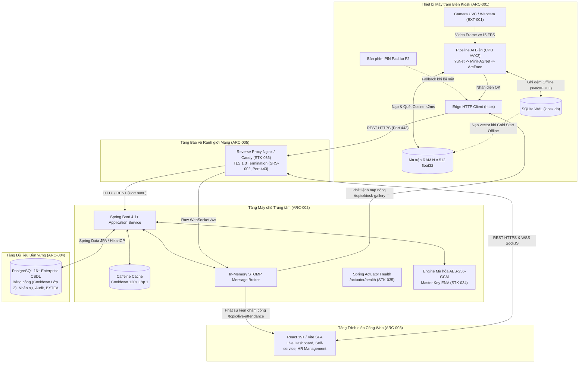

# SYSTEM SPEC CORE — Đặc tả Yêu cầu Xuyên suốt & Kiến trúc Hệ thống

Tài liệu này là **Spec Core cấp Hệ thống** của dự án Face Attendance System (FAS) theo chuẩn SDLC v3.0 ([sdlc-docs.md](../../sdlc-docs.md) §7.1). Tài liệu xác lập:
1. Ngữ cảnh tương tác hệ thống, sổ đăng ký tác nhân người dùng (`ACT-`) và thiết bị/dịch vụ ngoại vi (`EXT-`).
2. Danh mục các yêu cầu kỹ thuật xuyên suốt (`SRS-`).
3. Kiến trúc phân rã phân hệ, topology mạng, cơ chế bảo mật và luồng tương tác toàn trình (`ARC-`).
4. Danh mục quyết định thiết kế kiến trúc hệ thống (`DD-SYS-`).

---

## 1. System Context (Ngữ cảnh Vận hành Toàn Hệ thống)

Hệ thống Chấm công bằng Nhận diện Khuôn mặt (FAS) vận hành theo mô hình phân tán gồm 3 phân hệ độc lập:
* **Phân hệ Kiosk Cận biên (`kiosk-app`)**: Thiết bị trạm tự phục vụ thu nhận video trực tiếp từ camera, thực thi toàn bộ pipeline AI biên (phát hiện mặt YuNet, kiểm tra liveness MiniFASNet, trích xuất vector 512D ArcFace) và so khớp ma trận RAM $N \times 512$ cục bộ, lưu đệm ngoại tuyến SQLite WAL ($\text{RPO} = 0$).
* **Phân hệ Máy chủ Doanh nghiệp (`backend-service`)**: Máy chủ trung tâm tiếp nhận giao dịch điểm danh, quản lý ca kíp và phân ca, thực thi bộ đệm Cooldown 120s hai lớp (Caffeine RAM + PostgreSQL DB), mã hóa AES-256-GCM bảo vệ vector tĩnh và phát sóng sự kiện thời gian thực qua WebSocket STOMP.
* **Phân hệ Cổng Web Quản trị & Tự phục vụ (`web-portal`)**: Ứng dụng web SPA cung cấp Live Monitoring Dashboard thời gian thực, quản lý nhân sự, duyệt đơn giải trình công và hỗ trợ nhân viên tự phục vụ ký cam kết Informed Consent điện tử.

---

### 1.1. Actors (Sổ Đăng ký Tác nhân Người dùng Toàn Hệ thống)

| ID | Tác nhân (Actor Name) | Vai trò & Mục đích Tương tác trong Hệ thống | Quyền hạn Hệ thống |
| :--- | :--- | :--- | :--- |
| `ACT-001` | Nhân viên (Employee) | Điểm danh hàng ngày qua khuôn mặt/mã PIN tại trạm Kiosk; tự đăng ký mẫu mặt qua OTP; ký cam kết Informed Consent điện tử và gửi đơn giải trình công trên Cổng Web. | Role `EMPLOYEE` |
| `ACT-002` | Chuyên viên Nhân sự (HR Specialist) | Quản lý danh sách nhân sự, cấu hình ca kíp làm việc, theo dõi sĩ số trực tiếp đầu giờ trên Live Dashboard, duyệt đơn giải trình công và kết xuất báo cáo bảng công. | Role `HR_MANAGER` |
| `ACT-003` | Quản trị viên Hệ thống (System Admin) | Cấu hình tham số vận hành, giám sát nhật ký audit log, quản lý tài khoản người dùng, giám sát kết nối mạng giữa Kiosk và Backend, sao lưu/phục hồi CSDL. | Role `ADMIN` |
| `ACT-004` | Cán bộ Bảo vệ Dữ liệu (DPO) | Kiểm soát việc thực thi chính sách bảo vệ dữ liệu cá nhân theo Luật 91/2025/QH15, kiểm tra chữ ký thỏa thuận Consent, giám sát lịch trình tiêu hủy dữ liệu sinh trắc 20 ngày khi thôi việc và 7 ngày khi rút đồng thuận (`FR-SYS-025`). | Role `DPO` (chỉ đọc) |

---

### 1.2. External Systems & Devices (Hệ thống & Thiết bị Ngoại vi)

| ID | Tên Hệ thống / Thiết bị | Loại Giao tiếp | Giao thức / Ranh giới | Vai trò Kỹ thuật |
| :--- | :--- | :--- | :--- | :--- |
| `EXT-001` | Camera Quang học UVC / Webcam | Thiết bị phần cứng USB | DirectShow / Media Foundation | Cung cấp luồng khung hình video liên tục $\ge 15\text{ FPS}$ độ phân giải HD/Full HD. |
| `EXT-002` | CSDL PostgreSQL 16 LTS Doanh nghiệp | Dịch vụ CSDL trung tâm | TCP/IP (Port 5432, JPA/HikariCP)| Lưu trữ bền vững dữ liệu nhân sự, ca kíp, bảng công và vector mã hóa BYTEA. |
| `EXT-003` | Nguồn Chuẩn Giờ Mạng (NTP Server) | Dịch vụ mạng hệ thống | NTP (UDP Port 123) | Đồng bộ mốc thời gian chuẩn giữa các trạm Kiosk và máy chủ Backend (sai lệch $\le 50\text{ ms}$). |

---

## 2. Cross-cutting Requirements (Yêu cầu Xuyên suốt Toàn Hệ thống)

| ID | Statement | Category | Priority | Basis | Acceptance | Status |
| :--- | :--- | :--- | :---: | :---: | :--- | :---: |
| `SRS-001` | Toàn bộ vector đặc trưng sinh trắc học lưu trữ ở trạng thái tĩnh phải được mã hóa chuẩn đối xứng AES-256-GCM với khóa Master Key nạp độc lập từ biến môi trường của hệ thống. | Security | Must | `PD-005` | 100% vector trong bảng `biometric_templates` là ciphertext dạng BYTEA kèm IV 12 bytes và Auth Tag 16 bytes; không giải mã được nếu thiếu khóa môi trường (`STK-034`). Tại trạm Kiosk biên, dữ liệu vector đã giải mã chỉ được lưu trong bộ nhớ RAM không phân trang (locked memory buffer) trong suốt phiên vận hành và được bảo vệ bằng các chính sách gia cố an ninh hệ điều hành (OS hardening) và an toàn vật lý của thiết bị trạm (`PD-005`). | Approved |
| `SRS-002` | Mọi luồng truyền thông mạng giữa Kiosk, Web Portal và Backend bắt buộc phải được mã hóa kênh truyền bằng TLS 1.3 (HTTPS) và Secure WebSocket (WSS) trên môi trường vận hành chính thức. | Security | Must | `PD-001` | Toàn bộ gói tin REST API và STOMP được mã hóa trên đường truyền thông qua Reverse Proxy (`STK-036`); từ chối kết nối không an toàn trên production; cho phép cấu hình fallback HTTP/WS cục bộ ở môi trường phát triển. | Approved |
| `SRS-003` | Hệ thống phải tự động tiêu hủy vĩnh viễn (Hard Delete) mẫu dữ liệu sinh trắc học của nhân viên đã thôi việc sau đúng 20 ngày kể từ ngày chấm dứt hợp đồng lao động theo Điều 18 & 19 Luật số 91/2025/QH15. | Compliance | Must | `PD-005` | Tác vụ ngầm định kỳ hàng ngày quét và xóa sạch bản ghi trong `biometric_templates` có `terminated_date <= CurrentDate - 20 days`; ghi nhật ký kiểm toán. | Approved |
| `SRS-004` | Tuyệt đối không lưu trữ ảnh chụp thô kích thước đầy đủ của nhân viên trên ổ đĩa trạm Kiosk hay máy chủ trung tâm (Zero Raw Image Retention). | Privacy | Must | `PD-005` | Khung hình camera chỉ tồn tại tạm thời trong RAM trong chu kỳ suy luận ($< 1\text{ giây}$) và lập tức được giải phóng bộ nhớ; không có file ảnh nào được ghi đĩa. | Approved |
| `SRS-005` | Mật khẩu tài khoản và mã PIN dự phòng cá nhân phải được băm một chiều bằng thuật toán an toàn chống dò vét GPU (Argon2id hoặc BCrypt), cấm lưu văn bản rõ; cơ chế xác thực mã PIN phải áp dụng khóa tạm thời (Lockout) per-account tối thiểu 15 phút sau 5 lần nhập sai liên tiếp trên toàn hệ thống kết hợp khóa per-device tại bàn phím Kiosk để ngăn chặn tấn công vét cạn. | Security | Must | `PD-001`, `PD-008` | Cột `pin_hash` trong CSDL lưu trữ hash an toàn (BCrypt với cost factor $\ge 10$ hoặc Argon2id); xác thực không lưu cache plaintext; Backend khóa per-account 15 phút sau 5 lần nhập sai mã PIN của cùng tài khoản trên bất kỳ trạm nào; Kiosk khóa bàn phím PIN cục bộ 15 phút và phát còi/cảnh báo giao diện. | Approved |
| `SRS-006` | Hệ thống phải thực thi kiểm soát truy cập dựa trên vai trò (RBAC) thông qua mã thông báo JWT; đối với phiên làm việc web/API, sử dụng access token ngắn hạn (1 giờ) kèm refresh token an toàn (7 ngày) dạng băm một chiều hỗ trợ thu hồi tức thì. | Security | Must | `PD-001` | Mọi API quản trị đều yêu cầu header `Authorization: Bearer <JWT>`; từ chối truy cập 403 Forbidden nếu không đủ quyền hạn; đổi mật khẩu, cấp lại mật khẩu hoặc vô hiệu hóa tài khoản lập tức thu hồi toàn bộ refresh token tương ứng. | Approved |
| `SRS-007` | Khi xuất dữ liệu bảng công ra file Excel/CSV, hệ thống phải tự động vô hiệu hóa mã độc chèn công thức (Anti-Formula Injection / CWE-1236). | Security | Should | `INF-003` | Tự động chèn dấu nháy đơn (`'`) trước các ô dữ liệu văn bản bắt đầu bằng các ký tự `=`, `+`, `-`, `@`. | Approved |
| `SRS-008` | Hệ thống phải duy trì khả năng vận hành độc lập tại biên (Offline-first resilient) cho phương thức nhận diện khuôn mặt chính yếu, đảm bảo không thất thoát dữ liệu ($\text{RPO} = 0$) khi mất kết nối mạng. | Reliability | Must | `PD-004` | Trạm Kiosk tiếp tục nhận diện khuôn mặt bình thường khi mất mạng, ghi đệm vào SQLite WAL và tự động gửi bù đủ 100% số bản ghi khi mạng phục hồi; kênh PIN dự phòng (`SRS-005`) yêu cầu Backend trực tuyến để bảo vệ hash PIN không lưu đĩa tại trạm biên; trong tình huống sự cố kép (mất mạng VÀ lỗi sinh trắc), nhân viên sử dụng quy trình nộp đơn giải trình công trực tuyến sau khi kết nối phục hồi (`FR-SYS-016`). | Approved |
| `SRS-009` | Hệ thống phải đảm bảo hoạt động liên tục với độ sẵn sàng dịch vụ tối thiểu 99.9% trong giờ làm việc hành chính. | Availability | Must | `PD-001`, `INF-011` | Backend cung cấp endpoint giám sát sức khỏe `/actuator/health` (`STK-035`) phản hồi HTTP 200 trong $\le 200\text{ ms}$; Kiosk có vòng lặp tự phục hồi kết nối camera mỗi $\le 2\text{ giây}$; tổng thời gian gián đoạn dịch vụ tích lũy không vượt quá $\le 15.8\text{ phút/tháng}$ theo `NFR-SYS-008`. | Approved |
| `SRS-010` | Toàn bộ các sự kiện điểm danh, đăng ký khuôn mặt, duyệt giải trình và xóa dữ liệu phải được ghi nhật ký kiểm toán (Audit Trail) không thể chỉnh sửa. | Auditing | Must | `INF-009` | Lưu trữ bản ghi trong bảng `audit_logs` có đầy đủ mốc thời gian, IP, tác nhân và hành vi nghiệp vụ. | Approved |

---

## 3. System Structure & Architecture (Kiến trúc & Ranh giới Phân hệ)

### 3.1. Subsystem Architecture (Ranh giới & Trách nhiệm các Phân hệ)

| ID | Name | Definition | Uses | Realizes | Decisions | Status |
| :--- | :--- | :--- | :--- | :--- | :--- | :---: |
| `ARC-001` | Tầng Biên: Trạm Kiosk Desktop (`kiosk-app`) | Phân hệ máy trạm biên vận hành độc lập: thu nhận luồng video camera, thực thi pipeline AI cục bộ trên CPU AVX2 (YuNet $\rightarrow$ MiniFASNet $\rightarrow$ ArcFace), so khớp ma trận RAM $N \times 512$ `float32`, hỗ trợ bàn phím số PIN Pad ảo dự phòng, nạp mẫu khuôn mặt 3 bước trực tiếp tại camera, duy trì bảng bộ đệm vector mã hóa `local_gallery_cache` và hàng đợi ngoại tuyến SQLite WAL chế độ `synchronous = FULL`. | `STK-001`, `STK-002`, `STK-003`, `STK-004`, `STK-006`, `STK-008`, `STK-009`, `STK-030` | `FR-SYS-001`, `FR-SYS-002`, `FR-SYS-003`, `FR-SYS-004`, `FR-SYS-006`, `FR-SYS-009`, `NFR-SYS-001`, `NFR-SYS-002`, `NFR-SYS-004`, `NFR-SYS-005`, `NFR-SYS-009` | `DD-SYS-001`, `DD-SYS-002`, `DD-SYS-005`, `DD-SYS-006`, `DD-SYS-011`, `DD-SYS-027` | Accepted |
| `ARC-002` | Tầng Trung tâm: Dịch vụ Máy chủ (`backend-service`) | Phân hệ dịch vụ doanh nghiệp: quản lý danh mục nhân sự, ca kíp và phân ca, tính toán trạng thái công, thực thi bộ đệm Cooldown 120s hai lớp (RAM Caffeine + DB fallback), mã hóa AES-256-GCM vector mẫu, điều phối sự kiện đẩy WebSocket STOMP, xác thực JWT RBAC, xử lý đơn giải trình công, thẩm định PIN dự phòng trực tuyến, nạp mẫu và tác vụ nền tiêu hủy dữ liệu theo Luật 2025. | `STK-010`, `STK-011`, `STK-012`, `STK-013`, `STK-014`, `STK-015`, `STK-034`, `STK-035`, `STK-036` | `FR-SYS-005`, `FR-SYS-009`, `FR-SYS-010`, `FR-SYS-011`, `FR-SYS-012`, `FR-SYS-013`, `FR-SYS-014`, `FR-SYS-017`, `FR-SYS-018`, `FR-SYS-019`, `FR-SYS-020`, `FR-SYS-021`, `FR-SYS-022`, `FR-SYS-023`, `FR-SYS-024`, `FR-SYS-025`, `FR-SYS-026`, `FR-SYS-027`, `FR-SYS-028`, `NFR-SYS-008` | `DD-SYS-003`, `DD-SYS-004`, `DD-SYS-006`, `DD-SYS-007`, `DD-SYS-012`, `DD-SYS-013`, `DD-SYS-014`, `DD-SYS-017`, `DD-SYS-018`, `DD-SYS-019`, `DD-SYS-020`, `DD-SYS-021`, `DD-SYS-022`, `DD-SYS-023`, `DD-SYS-024`, `DD-SYS-025`, `DD-SYS-026`, `DD-SYS-027`, `DD-SYS-028` | Accepted |
| `ARC-003` | Tầng Trình diễn: Cổng Web Quản trị & Tự phục vụ (`web-portal`) | Phân hệ ứng dụng web giao diện đơn trang (SPA): cung cấp Live Monitoring Dashboard thời gian thực, quản lý hồ sơ nhân sự và phân ca, duyệt đơn giải trình công, ký Informed Consent điện tử kèm sinh OTP nạp mẫu, tra cứu lịch sử chấm công cá nhân, theo dõi kiểm toán tuân thủ cho DPO và xuất báo cáo an toàn. | `STK-016`, `STK-017`, `STK-018`, `STK-019`, `STK-031`, `STK-032`, `STK-033` | `FR-SYS-007`, `FR-SYS-008`, `FR-SYS-015`, `FR-SYS-016`, `NFR-SYS-010` | `DD-SYS-004`, `DD-SYS-008`, `DD-SYS-009`, `DD-SYS-010`, `DD-SYS-011` | Accepted |
| `ARC-004` | Tầng Lưu trữ Dữ liệu Bền vững (PostgreSQL Enterprise DB) | Phân hệ lưu trữ quan hệ tập trung chuẩn 3NF với giao dịch ACID: quản lý bền vững thông tin nhân sự, ca kíp, bảng công, phiên làm việc, nhật ký kiểm toán bất biến và các vector đặc trưng 512D lưu dạng BYTEA mã hóa. | `STK-012`, `STK-013` | `SRS-003`, `SRS-007`, `SRS-010`, `FR-SYS-010`, `FR-SYS-026` | `DD-SYS-003`, `DD-SYS-015`, `DD-SYS-016` | Accepted |

---

### 3.2. Cross-cutting Design Frameworks (Thiết kế Khung Xuyên suốt Hệ thống)

| ID | Name | Definition | Uses | Realizes | Decisions | Status |
| :--- | :--- | :--- | :--- | :--- | :--- | :---: |
| `ARC-005` | Khung Bảo mật Kênh truyền & Quản lý Khóa (Security & Key Management) | Thực thi TLS 1.3 cho toàn bộ kết nối REST API và Secure WebSocket (WSS) thông qua Reverse Proxy (`STK-036`) trên môi trường sản xuất; quản lý Master Key độc lập nạp từ biến môi trường (`STK-034`) cho mã hóa AES-256-GCM đối xứng bảo vệ vector sinh trắc tĩnh kèm quy trình xoay vòng khóa không gián đoạn dịch vụ. | `STK-014`, `STK-034`, `STK-036` | `SRS-001`, `SRS-002`, `NFR-SYS-007` | `DD-SYS-003`, `DD-SYS-016`, `DD-SYS-028` | Accepted |
| `ARC-006` | Khung Nhật ký Kiểm toán Bất biến (Immutable Audit Trail) | Tự động ghi vết toàn bộ hành vi nhạy cảm (ký Consent, duyệt giải trình, nạp mẫu, đổi/cấp mật khẩu, xóa dữ liệu 20 ngày) vào bảng `audit_logs` có đầy đủ mốc thời gian, IP, tác nhân và trạng thái trước/sau; cung cấp API tra cứu chỉ đọc cho `ADMIN` và `DPO`. | `STK-011`, `STK-012` | `SRS-004`, `SRS-010`, `FR-SYS-026` | `DD-SYS-019`, `DD-SYS-021` | Accepted |
| `ARC-007` | Khung Bền bỉ Ngoại tuyến & Đồng bộ Tự động (Offline Resilience & Self-Sync Engine) | Duy trì vận hành điểm danh nhận diện khuôn mặt ngoại tuyến 100% tại trạm Kiosk qua hàng đợi SQLite WAL (`PRAGMA synchronous = FULL`, $\text{RPO} = 0$); bảng `local_gallery_cache` hỗ trợ khởi động nguội không cần mạng; worker ngầm tự phát hiện phục hồi mạng và gửi bù theo lô tối đa 50 bản ghi với cơ chế giải quyết xung đột `ON CONFLICT DO NOTHING`. | `STK-009`, `STK-030` | `SRS-008`, `FR-SYS-006`, `NFR-SYS-006` | `DD-SYS-002`, `DD-SYS-013` | Accepted |
| `ARC-012` | Khung Giám sát Sức khỏe & Quan sát Dịch vụ (Observability & Health Monitoring) | Cung cấp endpoint giám sát sức khỏe `/actuator/health` (`STK-035`) phản hồi HTTP 200 trong $\le 200\text{ ms}$; Kiosk tích hợp vòng lặp watchdog tự phục hồi kết nối camera mỗi $\le 2\text{ giây}$; cam kết độ sẵn sàng $\ge 99.9\%$ trong giờ hành chính ($\le 15.8\text{ phút/tháng}$ gián đoạn). | `STK-001`, `STK-011`, `STK-035` | `SRS-009`, `NFR-SYS-008` | `DD-SYS-001`, `DD-SYS-014` | Accepted |
| `ARC-013` | Khung Kiểm soát Xác thực & Chống Brute-force (Authentication & Rate Limiting Framework) | Thực thi kiểm soát truy cập dựa trên vai trò (RBAC) thông qua cặp JWT Access Token (1 giờ) / Refresh Token (7 ngày) dạng băm; khóa tạm thời (Lockout) 15 phút đa tầng (server-side per-account + local per-device) sau 5 lần nhập sai mã PIN hoặc mật khẩu; áp dụng Rate Limiting $\le 5\text{ req/min}$ trên các endpoint xác thực nhạy cảm. | `STK-003`, `STK-011`, `STK-015` | `SRS-005`, `SRS-006`, `FR-SYS-017`, `FR-SYS-022` | `DD-SYS-020`, `DD-SYS-026` | Accepted |
| `ARC-015` | Khung Ghi nhật ký Vận hành & Quản lý Cấu hình (Operational Logging & Configuration Framework) | Chuẩn hóa ghi log có cấu trúc dạng JSON với Correlation ID (`X-Request-Id`), tự động làm sạch dữ liệu định danh cá nhân PII (masking họ tên, email; tuyệt đối không log vector/PIN/token), cơ chế quay vòng log 14 ngày (tối đa 500MB); kiểm chuẩn chặt chẽ biến môi trường cấu hình `.env` / `@ConfigurationProperties` ngay khi khởi động và từ chối chạy nếu thiếu tham số bắt buộc. | `STK-001`, `STK-010`, `STK-011`, `STK-034` | `NFR-SYS-008`, `NFR-SYS-009` | `DD-SYS-020`, `DD-SYS-028` | Accepted |
| `ARC-016` | Khung Xử lý Lỗi & Khả năng Chịu lỗi (Error Handling, Retry & Circuit Breaker) | Chuẩn hóa cấu trúc phản hồi lỗi theo Taxonomy thống nhất (`DOMAIN_REASON_CODE`); client Kiosk thực thi timeout 3.0s, thử lại theo hàm mũ (Exponential Backoff 1s, 2s, 4s, tối đa 30s) và chuyển đổi trạng thái Circuit Breaker để bảo vệ giao diện người dùng không bị phong tỏa khi Backend quá tải. | `STK-011`, `STK-030`, `STK-031` | `NFR-SYS-001`, `NFR-SYS-006` | `DD-SYS-012`, `DD-SYS-013` | Accepted |

---

### 3.3. System Deployment Topology (Sơ đồ Kiến trúc & Phân bổ Ranh giới)

---

## 4. End-to-End System Behavior (Luồng Tương tác Toàn trình Xuyên Phân hệ)

| ID | Name | Definition | Uses | Realizes | Decisions | Status |
| :--- | :--- | :--- | :--- | :--- | :--- | :---: |
| `ARC-008` | Luồng Điểm danh Thời gian thực Chuẩn (Happy Path Face Attendance Flow) | Camera bắt khung hình $\rightarrow$ YuNet định vị mặt $\rightarrow$ MiniFASNet kiểm tra liveness $S \ge 0.85$ $\rightarrow$ ArcFace trích xuất vector 512D $\rightarrow$ Nhân ma trận Cosine RAM $\ge 0.50$ $\rightarrow$ Kiểm tra Cooldown 120s tại Kiosk RAM $\rightarrow$ Gửi REST `POST /api/v1/kiosks/{id}/punches` $\rightarrow$ Backend kiểm tra Cooldown lớp 1 (Caffeine) & lớp 2 (DB fallback) $\rightarrow$ Lưu CSDL PostgreSQL $\rightarrow$ STOMP phát sóng `/topic/live-attendance` $\rightarrow$ Web Dashboard cập nhật dòng mới với hiệu ứng thị giác trong tổng thời gian $\le 1.2\text{ s}$. | `ARC-001`, `ARC-002`, `ARC-003` | `FR-SYS-001`, `FR-SYS-002`, `FR-SYS-003`, `FR-SYS-005`, `FR-SYS-013`, `NFR-SYS-001`, `NFR-SYS-003` | `DD-SYS-001`, `DD-SYS-004`, `DD-SYS-005`, `DD-SYS-006` | Accepted |
| `ARC-009` | Luồng Điểm danh Ngoại tuyến & Đồng bộ Bù (Offline Resilient Attendance & Sync Flow) | Kiosk nhận diện khuôn mặt thành công khi mất mạng hoặc Backend timeout $\ge 3.0\text{ s}$ $\rightarrow$ Ghi đệm bản ghi điểm danh vào SQLite WAL với `PRAGMA synchronous = FULL` $\rightarrow$ Hiển thị thông báo chấm công ngoại tuyến thành công $\rightarrow$ Worker chạy ngầm ping kiểm tra kết nối định kỳ mỗi $\le 2\text{ s}$ $\rightarrow$ Khi mạng phục hồi, tự động gom lô tối đa 50 bản ghi gửi `POST /api/v1/kiosks/{id}/sync-batch` với exponential backoff $\rightarrow$ Backend xử lý ghi nhận với mốc giờ gốc và giải quyết xung đột $\rightarrow$ Đánh dấu đã đồng bộ tại Kiosk. | `ARC-001`, `ARC-002` | `FR-SYS-006`, `NFR-SYS-006`, `SRS-008` | `DD-SYS-002`, `DD-SYS-013` | Accepted |
| `ARC-010` | Luồng Tự Đăng ký & Nạp nóng Vector Mẫu (Self-service Consent, Enrollment & Hot-reload Flow) | Nhân viên đọc và ký văn bản Informed Consent điện tử trên Web Portal $\rightarrow$ Backend ghi log kiểm toán và sinh mã OTP 48h dạng băm HMAC-SHA-256 kèm mã QR hiển thị trên màn hình Web $\rightarrow$ Nhân viên đến Kiosk nhập chuỗi 6 số OTP trên bàn phím ảo $\rightarrow$ Modal OTP tự ẩn để lộ trọn camera chính $\rightarrow$ Chụp 3 ảnh chân dung đạt chuẩn độ nét Laplacian $\ge 30$, góc nghiêng pose $\le 15^\circ$ và liveness $S \ge 0.90$ (Safety Margin +5%) $\rightarrow$ Trích xuất vector 512D gửi Backend $\rightarrow$ Backend mã hóa AES-256-GCM lưu PostgreSQL $\rightarrow$ Phát sự kiện STOMP `/topic/kiosk-gallery` $\rightarrow$ Toàn bộ Kiosk nạp nóng vector vào RAM và ghi đệm vào `local_gallery_cache`. | `ARC-001`, `ARC-002`, `ARC-003` | `FR-SYS-007`, `FR-SYS-008`, `FR-SYS-009`, `FR-SYS-014` | `DD-SYS-003`, `DD-SYS-004`, `DD-SYS-011`, `DD-SYS-027` | Accepted |
| `ARC-011` | Luồng Tiêu hủy Dữ liệu Tuân thủ Pháp luật 2025 (Automated Biometric Data Destruction Flow) | Khi nhân viên chuyển trạng thái thôi việc `TERMINATED` $\rightarrow$ Backend phát sự kiện STOMP lập tức gỡ bỏ vector khỏi RAM toàn bộ Kiosk và xóa khỏi `local_gallery_cache` $\rightarrow$ Tác vụ nền (cronjob) chạy lúc 01:00 hàng ngày quét các hồ sơ thôi việc quá 20 ngày hoặc hồ sơ rút Consent quá 7 ngày $\rightarrow$ Thực hiện xóa vĩnh viễn (Hard Delete) vector mẫu khỏi PostgreSQL $\rightarrow$ Ghi nhận bản ghi kiểm toán tuân thủ bất biến vào `audit_logs`. | `ARC-002`, `ARC-004` | `FR-SYS-011`, `SRS-003` | `DD-SYS-003`, `DD-SYS-025` | Accepted |
| `ARC-014` | Luồng Điểm danh Dự phòng qua Mã PIN & Giải trình Công (PIN Fallback & Excuse Handling Flow) | Khi nhận diện khuôn mặt thất bại do điều kiện ánh sáng hoặc chấn thương/thay đổi diện mạo $\rightarrow$ Nhân viên mở bàn phím số ảo PIN Pad trên Kiosk (phím F2) $\rightarrow$ Nhập mã PIN 6 số $\rightarrow$ Kiosk gửi yêu cầu xác thực trực tuyến `POST /api/v1/kiosks/{id}/verify-pin` lên Backend $\rightarrow$ Nếu hợp lệ Backend phản hồi danh tính và ghi nhận công $\rightarrow$ Nếu sai quá 5 lần kích hoạt Lockout 15 phút per-account và per-device; trong tình huống sự cố kép (đồng thời mất mạng VÀ lỗi sinh trắc), nhân viên nộp đơn giải trình công bổ sung (`FR-SYS-016`) trên Web Portal sau khi kết nối mạng phục hồi. | `ARC-001`, `ARC-002`, `ARC-003` | `FR-SYS-004`, `FR-SYS-016`, `FR-SYS-017`, `SRS-005` | `DD-SYS-017`, `DD-SYS-021` | Accepted |
| `ARC-017` | Luồng Chốt Kỳ công & Mở lại Có Kiểm toán (Payroll Period Close & Reopen Flow) | Quản lý HR rà soát bảng công tháng $\rightarrow$ Gửi yêu cầu `POST /api/v1/admin/payroll-periods/{period}/lock` $\rightarrow$ Backend kiểm tra điều kiện và chuyển trạng thái kỳ công sang `LOCKED` $\rightarrow$ Chặn toàn bộ hành vi sửa đổi dữ liệu công hoặc duyệt đơn giải trình thuộc kỳ $\rightarrow$ Khi có sai sót chính đáng, tài khoản `ADMIN` gửi yêu cầu mở khóa kèm lý do giải trình bắt buộc $\rightarrow$ Backend mở khóa `OPEN` và ghi nhận toàn văn lý do vào `audit_logs`. | `ARC-002`, `ARC-003`, `ARC-004` | `FR-SYS-024`, `SRS-010` | `DD-SYS-024` | Accepted |
| `ARC-018` | Luồng Tự phục vụ Tra cứu Lịch sử & Nộp Đơn Giải trình (Employee Self-Service History & Excuse Flow) | Nhân viên đăng nhập Web Portal $\rightarrow$ Truy vấn lịch sử chấm công cá nhân theo tháng (`GET /api/v1/employee/attendance`) $\rightarrow$ Xem chi tiết các lượt vào/ra, trạng thái đúng giờ, đi muộn hoặc bất thường $\rightarrow$ Khi phát hiện lượt chấm thiếu hoặc có sự cố, gửi đơn giải trình trực tuyến (`POST /api/v1/employee/excuse-requests`) trong vòng 30 ngày $\rightarrow$ Đơn chuyển sang trạng thái chờ duyệt `PENDING` và hiển thị trên giao diện của HR. | `ARC-002`, `ARC-003` | `FR-SYS-016`, `FR-SYS-028` | `DD-SYS-019`, `DD-SYS-021` | Accepted |

---

## 5. System Design Decisions (Quyết định Thiết kế Cấp Hệ thống)

| ID | Decision | Rationale | Alternatives | Consequences | Basis | Status |
| :--- | :--- | :--- | :--- | :--- | :---: | :---: |
| `DD-SYS-001` | Thực thi suy luận AI hoàn toàn tại biên trên CPU với tập lệnh AVX2, không phụ thuộc card đồ họa GPU. | Đạt độ trễ chu kỳ $\le 350\text{ ms}$, tiết kiệm 95% băng thông mạng và tận dụng PC văn phòng sẵn có với chi phí phần cứng bổ sung 0 VNĐ. | Suy luận đám mây Cloud API, Trang bị card GPU rời chuyên dụng | Cần tinh chỉnh mô hình gọn nhẹ (YuNet, MiniFASNet, ArcFace MobileFaceNet) và kiểm soát tài nguyên CPU/RAM chặt chẽ. | `PD-002`, `INF-006` | Accepted |
| `DD-SYS-002` | Áp dụng cơ chế lưu trữ cục bộ SQLite chế độ Write-Ahead Logging (WAL) với cấu hình `PRAGMA synchronous = FULL` tại trạm Kiosk. | Bảo đảm cam kết không thất thoát dữ liệu ($\text{RPO} = 0$) ngay cả khi xảy ra cúp điện đột ngột hoặc sập hệ điều hành; độ trễ ghi đĩa (5–15ms) nằm trọn trong ngân sách chu kỳ $\le 350\text{ ms}$; bảng `local_gallery_cache` hỗ trợ Kiosk khởi động nguội ngoại tuyến. | Cấu hình `synchronous = NORMAL` (nguy cơ mất bản ghi khi mất điện đột ngột), Lưu bộ nhớ RAM thuần túy | Yêu cầu quản lý tiến trình checkpoint dọn dẹp file WAL định kỳ để giữ kích thước file SQLite $< 50\text{ MB}$. | `PD-004`, `INF-011`, `NFR-SYS-006` | Accepted |
| `DD-SYS-003` | Mã hóa đối xứng AES-256-GCM ở trạng thái tĩnh cho toàn bộ vector mẫu 512D với Master Key độc lập nạp từ biến môi trường. | Bảo đảm tính bí mật và toàn vẹn dữ liệu sinh trắc học theo Luật 91/2025/QH15 và tiêu chuẩn mật mã học hiện đại NIST SP 800-38D. | Lưu vector plaintext thô, Dùng mã hóa mức CSDL PostgreSQL pgcrypto | Tăng tải CPU khi giải mã nạp danh mục gallery; yêu cầu quy trình bảo mật nghiêm ngặt đối với biến môi trường chứa Master Key. | `PD-005`, `INF-009` | Accepted |
| `DD-SYS-004` | Sử dụng giao thức WebSocket STOMP làm kênh truyền thông đẩy thời gian thực hai chiều giữa Backend, Web Portal và Kiosk. | Đẩy dữ liệu tức thì $\le 200\text{ ms}$, tối ưu băng thông mạng và tài nguyên máy chủ so với cơ chế HTTP Polling định kỳ. | HTTP Polling định kỳ, Server-Sent Events (SSE) một chiều | Cần quản lý vòng đời socket, cơ chế nhịp tim (Heartbeat) và xử lý tự động kết nối lại khi đứt kết nối mạng. | `PD-006`, `INF-003` | Accepted |
| `DD-SYS-005` | Thiết lập thời gian giữ ổn định khuôn mặt trong khung Oval từ 0.5s đến 1.0s liên tục trước khi kích hoạt so khớp. | Chống rung lắc khung hình, loại trừ các đối tượng vô tình đi ngang qua vùng quan sát camera và bảo đảm chất lượng ảnh crop tối ưu. | Chụp tức thì ngay khung hình đầu tiên, Yêu cầu đứng yên quá 2.0s | Cần phản hồi thị giác trực quan qua tiến trình viền Oval để người dùng hiểu và phối hợp định vị khuôn mặt. | `NFR-SYS-001`, `INF-006` | Accepted |
| `DD-SYS-006` | Áp dụng cơ chế kiểm soát chống quét lặp Cooldown 120s hai lớp: Kiosk RAM đếm lùi (Lớp 1) và Backend Caffeine Cache kèm đối soát CSDL (Lớp 2). | Chống quẹt trùng lặp hiệu quả ngay cả khi mất mạng nội bộ tại Kiosk hoặc khi Backend vừa khởi động lại (nếu Cache rỗng, Backend tự động đối soát mốc giờ chấm gần nhất từ bảng `attendance_records` trong CSDL). | Chỉ kiểm tra tại Backend, Chỉ kiểm tra tại Kiosk | Giữ trạng thái Cooldown trong bộ nhớ 120s; từ chối quẹt lặp tức thì $\le 1\text{ ms}$; không bao giờ bị bypass khi khởi động lại dịch vụ. | `FR-SYS-005`, `NFR-SYS-003` | Accepted |
| `DD-SYS-007` | Cấu hình thời gian ân hạn ca kíp mặc định là 15 phút. | Phù hợp văn hóa làm việc doanh nghiệp và giải tỏa áp lực ùn tắc cục bộ tại sảnh ra vào trong giờ cao điểm đầu ca. | Không có ân hạn (chấm trễ 1 phút tính Late), Ân hạn kéo dài 30 phút | Hệ thống tính toán số phút đi muộn `lateMinutes` sau khi đã trừ đi 15 phút ân hạn cho các bản ghi vi phạm. | `FR-SYS-012`, `INF-001` | Accepted |
| `DD-SYS-008` | Tự động kiểm tra và chèn ký tự escape `'` trước các ô dữ liệu văn bản bắt đầu bằng `=`, `+`, `-`, `@` khi xuất file báo cáo. | Vô hiệu hóa triệt để nguy cơ tấn công chèn mã độc thực thi công thức Excel (Anti-Formula Injection / CWE-1236). | Xuất văn bản thô không khử khuẩn, Chặn người dùng nhập ký tự đặc biệt | Bảo vệ an toàn máy tính nhân sự và kế toán khi mở file báo cáo chấm công bằng Microsoft Excel hoặc LibreOffice. | `FR-SYS-013`, `SRS-007` | Accepted |
| `DD-SYS-009` | Áp dụng phong cách giao diện Dark Modern UI kết hợp hiệu ứng kính mờ Glassmorphism cho Kiosk và Web Portal. | Mang lại trải nghiệm thị giác hiện đại, giảm mỏi mắt cho người vận hành và tiết kiệm năng lượng màn hình trạm Kiosk. | Giao diện Light Theme cổ điển, Thiết kế phẳng Flat Design truyền thống | Yêu cầu tối ưu hóa render đồ họa phần cứng OpenGL/QML để duy trì độ mượt mà $\ge 30\text{ FPS}$ trên phần cứng máy trạm. | `NFR-SYS-010`, `INF-003` | Accepted |
| `DD-SYS-010` | Quy định màu Vàng hổ phách (`#F59E0B`) cho thông điệp điều hướng và viền Oval ở trạng thái căn chỉnh trung gian. | Giúp người dùng phân biệt rõ ràng giữa trạng thái đang căn chỉnh với trạng thái thành công (Xanh ngọc `#10B981`) và từ chối (Đỏ `#EF4444`). | Sử dụng màu Xanh dương, Sử dụng màu Trắng nét liền | Tăng độ trực quan sinh động theo chuẩn máy trạng thái 4 màu viền Oval (`Standby`, `Aligning`, `Success`, `Rejected`). | `NFR-SYS-010`, `INF-003` | Accepted |
| `DD-SYS-011` | Thiết kế quy trình đăng ký khuôn mặt tự động ẩn modal OTP ở Bước 2 để nhường trọn khung nhìn camera chính. | Tránh che khuất tầm nhìn camera và hướng dẫn nhân viên căn chỉnh khuôn mặt chính xác vào khung Oval chuẩn; hiển thị thông báo lỗi ngay trên camera nếu OTP sai hoặc ảnh không đạt. | Mở cửa sổ popup riêng biệt, Thu nhỏ khung hình camera vào trong modal | Nhân viên tập trung hoàn toàn vào khung Oval chính khi chụp 3 ảnh chân dung đạt chuẩn góc Euler. | `FR-SYS-009`, `NFR-SYS-010` | Accepted |
| `DD-SYS-012` | Đóng gói toàn bộ phản hồi API theo chuẩn khung thống nhất `{success, code, message, data, timestamp}` với Taxonomy mã lỗi chuẩn hóa. | Đồng nhất việc bóc tách dữ liệu và xử lý bắt lỗi tập trung tại các client Kiosk và Web Portal; mã lỗi chuẩn (`DOMAIN_REASON_CODE`) ánh xạ chính xác sang HTTP Status (400, 401, 403, 409, 423, 500); mốc giờ chuẩn ISO 8601 UTC. | Trả về payload thô không bọc, Phản hồi cấu trúc khác nhau theo từng module | Toàn bộ các REST Controller và Exception Handler phía Backend phải tuân thủ nghiêm ngặt định dạng envelope chuẩn. | `SRS-006`, `PD-001` | Accepted |
| `DD-SYS-013` | Giới hạn kích thước gói đồng bộ tối đa 50 bản ghi cho mỗi yêu cầu `sync-batch`. | Tránh quá tải payload JSON, tràn bộ nhớ Heap và nghẽn băng thông HTTP khi trạm Kiosk ngoại tuyến dài ngày phục hồi mạng. | Gửi từng bản ghi đơn lẻ, Gửi toàn bộ 1 gói duy nhất không giới hạn | Worker Kiosk phải phân đoạn hàng đợi SQLite thành nhiều đợt gửi tuần tự theo lô cho đến khi hết bản ghi chờ gửi. | `FR-SYS-006`, `NFR-SYS-006` | Accepted |
| `DD-SYS-014` | Áp dụng WebSocket STOMP Broker chạy trực tiếp trong tiến trình Spring Boot (In-memory Simple Broker) cho quy mô MVP. | Tiết kiệm chi phí vận hành và tài nguyên phần cứng, không phát sinh chi phí cài đặt message broker ngoài; thời gian container tự phục hồi $< 10\text{ s}$ và client tự động kết nối lại đảm bảo thỏa mãn SLA 99.9% ($\le 15.8\text{ phút/tháng}$). | Cài đặt cụm RabbitMQ/ActiveMQ rời, Dùng Redis Pub/Sub | Phiên kết nối realtime tạm ngắt trong giây lát khi máy chủ khởi động lại; khi mở rộng đa cụm Backend trong tương lai sẽ chuyển đổi sang Dedicated Broker theo `GAP-002`. | `PD-006`, `STK-014`, `NFR-SYS-008` | Accepted |
| `DD-SYS-015` | Lưu trữ vector đặc trưng mã hóa dưới dạng BYTEA trong PostgreSQL thay vì kiểu vector chuyên dụng (pgvector). | Toàn bộ suy luận AI và so khớp Cosine ma trận diễn ra tại biên Kiosk; Backend đóng vai trò lưu trữ và chuyển tiếp bản ghi mã hóa. | Sử dụng extension pgvector, Lưu trữ chuỗi văn bản mã hóa Base64 | Tiết kiệm chi phí cài đặt extension CSDL và tăng tốc độ đọc/ghi dữ liệu nhị phân nguyên bản. | `PD-002`, `PD-005` | Accepted |
| `DD-SYS-016` | Tách riêng Initialization Vector (IV 12 bytes) và Authentication Tag (16 bytes) thành các cột độc lập trong CSDL. | Phục vụ giải mã chuẩn xác theo đặc tả NIST SP 800-38D AES-GCM và dễ dàng kiểm toán cấu trúc an toàn độc lập. | Ghép chung IV + Tag + Ciphertext vào 1 blob nhị phân | Cấu trúc bảng CSDL rõ ràng, thuận tiện cho việc xác thực tính toàn vẹn dữ liệu trước khi giải mã. | `SRS-001`, `NFR-SYS-007` | Accepted |
| `DD-SYS-017` | Cấp mật khẩu ban đầu bằng mật khẩu tạm do hệ thống sinh; nhân viên đổi mật khẩu tự nguyện; mã PIN dự phòng xác thực trực tuyến tại Backend. | Không phát sinh hạ tầng gửi thư điện tử; HR không phải quản lý mật khẩu của nhân viên; nhân viên đăng nhập dùng được ngay. Xác thực PIN tại máy chủ giúp hash PIN không bao giờ lưu trữ trên đĩa thiết bị biên Kiosk. | HR tự nhập mật khẩu ban đầu; Bắt buộc đổi mật khẩu ở lần đầu; Xác thực PIN ngoại tuyến tại Kiosk | HR bàn giao mật khẩu tạm hiển thị 1 lần duy nhất; Kiosk gọi Backend thẩm định PIN trực tuyến trước khi ghi nhận công; tình huống sự cố kép dùng giải trình công (`FR-SYS-016`). | `FR-SYS-017`, `SRS-005` | Accepted |
| `DD-SYS-018` | Kiểm tra chồng lấn lịch phân ca ở tầng nghiệp vụ trong một giao dịch có khóa theo nhân viên. | Tránh phụ thuộc vào extension `btree_gist` của PostgreSQL (gây lỗi trên môi trường kiểm thử H2); cung cấp thông điệp lỗi nghiệp vụ rõ ràng (HTTP 409). | Chỉ dùng ràng buộc loại trừ CSDL `EXCLUDE USING gist`, Không kiểm tra chồng lấn | Cần khóa theo `user_id` khi phân ca để tránh tranh chấp dữ liệu (Race Condition) giữa hai yêu cầu đồng thời. | `FR-SYS-018`, `PD-007` | Accepted |
| `DD-SYS-019` | Tra cứu `audit_logs` và dữ liệu tuân thủ qua API chỉ đọc, với vai trò `DPO` tách biệt khỏi `ADMIN`. | Đáp ứng quyền giám sát tuân thủ của DPO mà không mở bất kỳ quyền ghi/sửa nào lên nhật ký bất biến; tuân thủ nguyên tắc đặc quyền tối thiểu (Least Privilege). | Gộp quyền DPO vào role ADMIN, Cho phép truy vấn trực tiếp CSDL bằng công cụ ngoài | Bổ sung role `DPO` vào cấu hình RBAC; bảo đảm toàn bộ API kiểm toán là chỉ đọc và ghi vết mọi lượt truy cập dữ liệu nhạy cảm. | `FR-SYS-019`, `SRS-010` | Accepted |
| `DD-SYS-020` | Secret Token trạm Kiosk sinh một lần và băm một chiều khi lưu CSDL; file cấu hình tại Kiosk bảo vệ bằng Windows NTFS ACL và DPAPI. | Bảo toàn khả năng truy vết lịch sử điểm danh theo trạm; tránh lộ token dạng plaintext trong CSDL hoặc qua lệnh xem tiến trình hệ điều hành Windows 11; bảo mật phù hợp với nền tảng máy trạm Kiosk. | Lưu token plaintext trong CSDL, Áp dụng chmod Unix 0600 trên môi trường Windows | Token chỉ hiển thị 1 lần duy nhất khi tạo trạm; trạm bị vô hiệu hóa `INACTIVE` bị từ chối truy cập ngay lập tức ở mọi API Kiosk. | `FR-SYS-020`, `SRS-006` | Accepted |
| `DD-SYS-021` | Duyệt đơn giải trình cập nhật bản ghi điểm danh trong cùng một giao dịch ACID với việc đổi trạng thái đơn và ghi `audit_logs`. | Loại trừ trạng thái mâu thuẫn (đơn đã duyệt nhưng bảng công chưa điều chỉnh) và bảo đảm dữ liệu công luôn đồng nhất với vết kiểm toán. | Cập nhật bảng công bằng tác vụ bất đồng bộ nền, Cho phép HR sửa trực tiếp bảng công không qua đơn | Khóa bản ghi điểm danh khi duyệt để tránh xung đột dữ liệu; đơn đã phê duyệt/từ chối không cho phép sửa đổi trạng thái lần hai. | `FR-SYS-016`, `SRS-010` | Accepted |
| `DD-SYS-022` | Khởi tạo tài khoản quản trị đầu tiên bằng cơ chế bootstrap có kiểm soát (biến môi trường/CLI) với độ dài mật khẩu $\ge 12$ ký tự. | CSDL trống có thể tự tạo tài khoản quản trị ban đầu mà không cần chèn tài khoản mặc định nguy hiểm (`admin/admin`) trong mã nguồn; đáp ứng yêu cầu an toàn `SRS-005`. | Seed sẵn tài khoản mặc định trong migration Flyway, Chèn tài khoản thủ công bằng câu lệnh SQL ngoài | Script khởi tạo kiểm tra tính duy nhất (Idempotent) — từ chối tạo thêm nếu tài khoản quản trị đã tồn tại trong hệ thống. | `FR-SYS-021`, `SRS-005` | Accepted |
| `DD-SYS-023` | Khôi phục thông tin xác thực do HR/ADMIN thực hiện (cấp lại mật khẩu tạm) và do chính nhân viên thực hiện (đặt lại PIN sau khi đăng nhập mật khẩu). | Không phụ thuộc vào hạ tầng gửi SMS/Email bên thứ ba; bảo đảm tính độc lập vận hành cục bộ của doanh nghiệp. | Tích hợp dịch vụ gửi SMS OTP ngoài, Cho phép đặt lại PIN không cần xác thực danh tính | Mọi thao tác cấp lại mật khẩu tạm đều tự động thu hồi toàn bộ phiên làm việc cũ và ghi vết kiểm toán đầy đủ. | `FR-SYS-022`, `SRS-005` | Accepted |
| `DD-SYS-024` | Chốt kỳ công theo tháng bằng thực thể kỳ công có trạng thái `OPEN`/`LOCKED`; kỳ đã chốt bị khóa toàn bộ sửa đổi công. | Bảo đảm tính bất biến của dữ liệu bảng công sau khi đã kết xuất phục vụ tính lương và thanh tra lao động. | Không quản lý chốt kỳ công, Khóa cứng vĩnh viễn không cho phép mở lại trong mọi tình huống | Chỉ tài khoản có vai trò `ADMIN` mới có quyền mở lại kỳ công đã khóa kèm theo lý do giải trình bắt buộc ghi vào audit log. | `FR-SYS-024`, `SRS-010` | Accepted |
| `DD-SYS-025` | Rút Consent làm vô hiệu hóa tức thì phương thức điểm danh khuôn mặt và kích hoạt lịch trình tiêu hủy dữ liệu sinh trắc trong 7 ngày. | Tuân thủ quyền của chủ thể dữ liệu theo Nghị định 356/2025/NĐ-CP và Luật 91/2025/QH15; thời hạn 7 ngày bảo đảm thời gian xử lý khiếu nại trước khi xóa vĩnh viễn. | Xóa sạch dữ liệu tức thì trong cùng giao dịch, Giữ dữ liệu sinh trắc 20 ngày như luồng thôi việc | Nhân viên sau khi rút Consent chuyển sang sử dụng phương thức mã PIN dự phòng; hệ thống gửi thông báo tự động cho nhân viên và DPO. | `FR-SYS-025`, `SRS-003` | Accepted |
| `DD-SYS-026` | Lưu Refresh Token dạng băm một chiều trong CSDL và hỗ trợ thu hồi tức thì theo tài khoản; Access Token ngắn hạn có thời hạn 1 giờ. | Cân bằng giữa bảo mật và trải nghiệm người dùng; cho phép vô hiệu hóa phiên làm việc ngay lập tức khi nhân viên thôi việc đột xuất hoặc đổi mật khẩu. | JWT thuần không trạng thái không thể thu hồi, Phiên làm việc kéo dài cố định 8 giờ không có refresh | Cần bảng lưu trữ phiên `refresh_tokens` trong PostgreSQL; mọi thao tác đăng xuất, đổi mật khẩu hoặc khóa tài khoản đều lập tức thu hồi token. | `FR-SYS-023`, `SRS-006` | Accepted |
| `DD-SYS-027` | Khóa thống nhất ngưỡng kiểm tra thực thể sống liveness: ngưỡng vận hành $S_{\text{liveness}} \ge 0.85$, luồng nạp mẫu áp dụng mức an toàn $S_{\text{liveness}} \ge 0.90$ (Safety Margin $+5\%$). | Triệt tiêu hoàn toàn rủi ro nạp mẫu khuôn mặt ở ngưỡng lỏng lẻo ($0.60$) dẫn đến việc mẫu đó bị chính hệ thống từ chối trong quá trình nhận diện hàng ngày (Enrollment/Verification Gap); bảo đảm mẫu nạp vào có chất lượng cao ngay cả khi suy giảm ánh sáng thực tế. | Dùng ngưỡng $0.60$ khi nạp mẫu để giảm thao tác, Không kiểm tra liveness khi nạp mẫu | Nhân viên đứng đúng tư thế trước khung Oval khi nạp 3 ảnh chuẩn; Kiosk hiển thị hướng dẫn trực quan để hỗ trợ đạt điểm sống $\ge 0.90$. | `FR-SYS-002`, `FR-SYS-009`, `NFR-SYS-005` | Accepted |
| `DD-SYS-028` | Thiết lập chính sách quản trị vòng đời, sao lưu và xoay vòng khóa Master Key AES-256-GCM không gây gián đoạn dịch vụ. | Bảo vệ dữ liệu sinh trắc học an toàn tuyệt đối; Master Key nạp qua biến môi trường độc lập, sao lưu trong Vault quản trị; hỗ trợ kịch bản di chuyển mã hóa lại (re-encryption migration) khi xoay vòng khóa. | Lưu khóa cứng trong file cấu hình, Không hỗ trợ quy trình xoay vòng khóa | Kịch bản xoay vòng khóa thực thi thông qua tác vụ offline có kiểm soát; mọi thay đổi biến môi trường đều kích hoạt kiểm toán bảo mật. | `SRS-001`, `NFR-SYS-007`, `PD-005` | Accepted |

---

## 6. Assumptions & Open Issues (Giả định & Vấn đề Chưa giải quyết)

* **Chi tiết Mô hình Token JWT (Decision 1 — ĐÃ GIẢI QUYẾT)**: Thời hạn hiệu lực chốt là access token **1 giờ** và refresh token **7 ngày** dạng băm một chiều trên máy chủ hỗ trợ thu hồi quyền tức thì theo `DD-SYS-026`; yêu cầu chức năng tương ứng là `FR-SYS-023`.
* **Ranh giới Cấu hình Cổng Dịch vụ & TLS (Decision 10 — ĐÃ GIẢI QUYẾT)**: Môi trường sản xuất cấu hình Reverse Proxy (`STK-036`) lắng nghe trên cổng TCP chuẩn `443` (HTTPS/WSS) và `80` (chuyển hướng HTTPS). Môi trường phát triển nội bộ mặc định Backend phục vụ trên cổng TCP `8080`, CSDL PostgreSQL lắng nghe trên cổng `5432`, và máy chủ phát triển Web Portal Vite phục vụ trên cổng `5173`.
* **Cơ chế Đồng bộ Giờ Hệ thống (NTP Synchronization)**: Tính chính xác và giá trị pháp lý của mốc thời gian chấm công phụ thuộc vào việc các trạm Kiosk và máy chủ Backend cùng đồng bộ mốc giờ thông qua giao thức NTP (`EXT-003`) với sai lệch thời gian cho phép $\le 50\text{ ms}$.
* **Hiệu chuẩn Ngưỡng Cosine Matcher & Liveness (Decision 3 — ĐÃ GIẢI QUYẾT)**: Ngưỡng Cosine mặc định cấu hình là $0.50$ (`FR-SYS-003`, `NFR-SYS-004`). Ngưỡng kiểm tra thực thể sống liveness được khóa thống nhất: ngưỡng vận hành $S_{\text{liveness}} \ge 0.85$, nạp mẫu $S_{\text{liveness}} \ge 0.90$ theo `DD-SYS-027`.
* **Mục tiêu Độ sẵn sàng & Tải Thiết kế (Decision 8 & 9 — ĐÃ GIẢI QUYẾT)**: Backend đáp ứng tối thiểu 50 trạm Kiosk đồng thời (50–100 RPS ổn định với $p99 \le 200\text{ ms}$ theo `NFR-SYS-008`). Kiến trúc in-memory STOMP broker và container auto-restart (downtime restart $< 10\text{ s}$) thỏa mãn cam kết thời gian ngừng hoạt động tích lũy $\le 15.8\text{ phút/tháng}$.
* **Bảo vệ Khóa Master Key & Khởi động Nguội Ngoại tuyến**: Khóa Master Key (`STK-034`) được nạp qua biến môi trường độc lập và quản trị theo `DD-SYS-028`. Trạm Kiosk bảo đảm khả năng nhận diện ngoại tuyến tức thì ngay cả khi khởi động lại máy trong tình trạng đứt mạng thông qua bảng đệm vector mã hóa `local_gallery_cache` lưu trữ trong SQLite WAL (`ARC-001`, `ARC-007`, `DD-SYS-002`).
