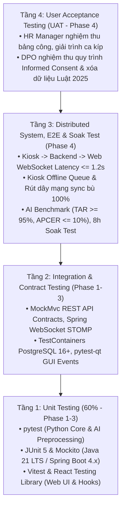

# Kế hoạch & Báo cáo Kiểm thử Toàn diện (Master Test Plan - TP)

> - **Dự án**: Hệ thống Chấm công bằng Nhận diện Khuôn mặt Đa tầng (`face-attendance-system`)
> - **Phiên bản**: 3.1 | **Ngày lập**: 2026-09-29 | **Trạng thái**: Kế hoạch Sẵn sàng (Test Ready - Gate 4)
> - **Tiêu chuẩn tham chiếu**: [README.md](../README.md) (Mục 6: Test Plan Documentation - ISO/IEC/IEEE 29119 / IEEE 829) | [SRS.md](../requirements/SRS.md) | [DDS.md](../design/DDS.md)

---

## 1. Kế hoạch Kiểm thử Tổng thể (Master Test Plan - MTP)

### 1.1. Phạm vi Kiểm thử Hệ thống Phân tán 3 Tầng (Test Scope)

* **Trong phạm vi kiểm thử (In-Scope)**:
  1. **Phân hệ Trạm Kiosk Desktop (`kiosk-app` - Python)**:
     - Đo đạc độ chính xác nhận diện sinh trắc học 1:N (TAR, FAR) và thời gian suy luận Edge AI (MiniFASNet, ArcFace 512D).
     - Kiểm thử chống giả mạo khuôn mặt theo chuẩn **ISO/IEC 30107-3** (APCER với ảnh in 2D và video replay; BPCER với người thật).
     - Kiểm thử bàn phím số ảo PIN dự phòng và cơ chế khóa 15 phút sau 5 lần sai liên tiếp.
     - **Kiểm thử khả năng chịu lỗi mất mạng (Offline Resiliency)**: Rút dây mạng, chấm công offline vào hàng đợi SQLite cục bộ, cắm lại mạng và kiểm tra tỷ lệ đồng bộ bù ($100\%$).
     - **Kiểm thử quét mặt kích hoạt tài khoản tại Kiosk**: Nhập OTP 6 số, kiểm chuẩn góc mặt/ánh sáng và trích xuất vector.
  2. **Phân hệ Máy chủ Trung tâm (`app/backend-service` - Java 21 LTS / Spring Boot 4.x)**:
     - Kiểm thử các hợp đồng RESTful API (`/api/v1/kiosk/...`, `/api/v1/employees/...`, `/api/v1/compliance/...`).
     - Kiểm thử quy trình Onboarding: Sinh mã OTP ngẫu nhiên 6 số hạn 48h sau khi ký Informed Consent điện tử.
     - Kiểm thử quy tắc nghiệp vụ: Phân định Check-in/out, Cooldown 2 phút, phân loại ca kíp đi muộn/về sớm.
     - Kiểm thử bảo mật: Xác thực Spring Security + JWT, mã hóa vector mẫu AES-256-GCM.
     - Kiểm thử tiến trình tự động `@Scheduled` xóa vĩnh viễn dữ liệu sau 20 ngày theo Luật Bảo vệ dữ liệu cá nhân 2025.
     - **Kiểm thử phát sóng sự kiện thời gian thực 2 chiều (Event-Driven Push via WebSocket STOMP)**: Bắn log chấm công lên Web Dashboard (`/topic/live-attendance`) và bắn vector mới xuống Kiosk Gallery (`/topic/kiosk-gallery`).
  3. **Phân hệ Cổng Web Quản trị & Người dùng (`web-portal` - ReactJS)**:
     - Kiểm thử hiển thị Dashboard thời gian thực khi nhận sự kiện qua WebSocket (không cần F5 tải lại trang).
     - Kiểm thử luồng Onboarding nhân viên tự phục vụ: Ký Informed Consent, nhận OTP/QR, tự động kích hoạt tài khoản.
     - Kiểm thử giao diện quản lý nhân sự, lọc bảng công theo tiêu chí, và xuất file Excel/CSV an toàn chống Formula Injection.
  4. **Kiểm thử Tích hợp Toàn trình (End-to-End Distributed Flow)**:
     - Đo đạc độ trễ toàn trình từ Kiosk $\rightarrow$ Backend $\rightarrow$ Web Dashboard ($\le 1.2\text{ giây}$ tại p95).
     - Kiểm thử tải dài ngày (Soak Test liên tục 8 giờ) đảm bảo không rò rỉ RAM trên cả 3 phân hệ.
* **Ngoài phạm vi kiểm thử (Out-of-Scope)**:
  - Tấn công bằng mặt nạ 3D silicon tinh vi hoặc cảm biến chiều sâu hồng ngoại (do phần cứng camera là RGB tiêu chuẩn).
  - Kiểm thử chịu tải phân tán quy mô lớn hàng nghìn trạm Kiosk đồng thời (vượt ngoài phạm vi SME 1–3 trạm).

---

### 1.2. Kim tự tháp Kiểm thử Phân tán (Distributed Testing Pyramid)

| Tầng kiểm thử | Công nghệ & Công cụ | Tỷ trọng | Mục tiêu kiểm chứng |
| :--- | :--- | :---: | :--- |
| **Unit Testing** | `pytest` (Python), `JUnit 5 + Mockito` (Java), `Vitest` (React) | $60\%$ | Thuật toán so khớp, mã hóa AES, logic ca kíp, render component. |
| **API & Integration Testing** | `MockMvc`, `TestContainers` (PostgreSQL), `Postman` | $20\%$ | Tính đúng đắn của hợp đồng REST API, WebSocket STOMP message. |
| **E2E & Resiliency Testing** | Automated Integration Scripts, Network Disconnect Simulation | $15\%$ | Độ trễ toàn trình $\le 1.2\text{ s}$, khả năng phục hồi khi mất mạng. |
| **User Acceptance Testing (UAT)** | Kịch bản vận hành thực tế tại quầy tiếp tân và văn phòng | $5\%$ | HR nghiệm thu bảng công, DPO nghiệm thu quy trình xóa dữ liệu. |

---

## 2. Đặc tả Bộ Ca Kiểm thử Trọng yếu (Test Case Specifications)

### 2.1. Phân hệ Thị giác AI & Trạm Kiosk (Python Kiosk Suite)

#### [TC-BIO-01] Đo lường Độ chính xác Nhận diện Khuôn mặt (`KPI-01`, `KPI-02`)
* **Truy vết**: `FR-01`, `FR-02`, `KPI-01`, `KPI-02`.
* **Tiền điều kiện**: Trạm Kiosk đã đồng bộ thư viện $N = 100$ vector nhân viên từ Backend vào RAM; ánh sáng văn phòng $300 - 500\text{ lux}$, cự ly $0.5 - 1.5\text{ m}$.
* **Dữ liệu vào**: 100 lượt thử nhân viên hợp lệ và $3.000$ lượt thử người lạ (impostor attempts).
* **Kết quả kỳ vọng**:
  - $\text{TAR} \ge 95\%$ tại mức $\text{FAR}_{1:N} \le 0.1\%$ trong điều kiện chuẩn.
  - $\text{TAR} \ge 88\%$ tại mức $\text{FAR}_{1:N} \le 0.5\%$ trong điều kiện thực tế (đeo kính, nghiêng $\le 30^\circ$).
  - Màn hình Kiosk chuyển khung viền XANH LÁ và phát âm thanh thông báo.

#### [TC-FAS-01] Kiểm thử Chống Giả mạo bằng Ảnh in & Video Replay (`KPI-03`)
* **Truy vết**: `FR-03`, `KPI-03`.
* **Dữ liệu vào**: 50 ảnh chân dung in màu chất lượng cao + 50 video replay quay khuôn mặt phát trên màn hình điện thoại/tablet.
* **Kết quả kỳ vọng**:
  - Hệ thống phát hiện và chặn thành công $\ge 90\%$ các trường hợp tấn công ($\text{APCER} \le 10\%$).
  - Người thật không bị chặn nhầm quá $2\%$ ($\text{BPCER} \le 2\%$).
  - Màn hình Kiosk hiển thị khung viền ĐỎ kèm cảnh báo `Phát hiện giả mạo`, không gửi log về Backend.

#### [TC-PIN-01] Chấm công Dự phòng bằng Bàn phím Ảo & Khóa Bảo vệ
* **Truy vết**: `FR-05`, `BR-06`.
* **Các bước thực hiện**:
  1. Bấm nút F2 mở bàn phím số ảo trên Kiosk $\rightarrow$ Nhập Mã NV và PIN đúng $\rightarrow$ Chấm công thành công.
  2. Cố tình nhập sai mã PIN 5 lần liên tiếp.
* **Kết quả kỳ vọng**: Lần thứ 6 hệ thống hiển thị thông báo "Khóa chức năng PIN trong 15 phút do nhập sai 5 lần liên tiếp".

---

### 2.2. Quy trình Đăng ký Sinh trắc học & Kích hoạt Tài khoản (Onboarding & OTP Suite)

#### [TC-ENR-01] Luồng Kích hoạt Tài khoản Toàn trình (End-to-End Onboarding Flow)
* **Truy vết**: `FR-04`, `FR-09`, `FR-15`, `UC-01`.
* **Tiền điều kiện**: HR tạo tài khoản nhân viên mới `NV102` (`biometric_status = PENDING_ENROLLMENT`).
* **Các bước thực hiện**:
  1. Nhân viên đăng nhập vào Cổng Web `web-portal` $\rightarrow$ Thấy Onboarding Banner $\rightarrow$ Bấm "Đăng ký khuôn mặt".
  2. Đọc và tích chọn "Tôi đồng ý" bản cam kết *Informed Consent* theo Luật 2025 $\rightarrow$ Bấm Xác nhận.
  3. Web hiển thị mã OTP 6 số (vd: `472918`) kèm mã QR.
  4. Nhân viên ra trạm Kiosk, bấm "Đăng ký khuôn mặt mới" $\rightarrow$ Nhập mã `472918`.
  5. Kiosk gọi API `/api/v1/kiosk/enroll/verify` xác thực mã hợp lệ $\rightarrow$ Hướng dẫn nhân viên đứng trước camera.
  6. Camera Kiosk quét mặt, kiểm tra Liveness $\ge 0.85$ và trích xuất vector ArcFace 512D.
  7. Kiosk gửi vector qua API `/api/v1/kiosk/enroll/complete` về Backend.
* **Kết quả kỳ vọng**:
  - Backend mã hóa vector bằng AES-256-GCM, cập nhật trạng thái `ACTIVE`, hủy mã OTP.
  - Kiosk nhận phản hồi thành công, nạp vector mới vào RAM Gallery Cache và thông báo "Kích hoạt thành công!".
  - Backend bắn WebSocket tới `/topic/onboarding-status/NV102` $\rightarrow$ Trình duyệt Web của nhân viên tự động đóng modal và hiển thị banner chào mừng thành công mà không cần F5.

#### [TC-ENR-02] Kiểm thử Bảo mật Mã OTP Đăng ký (Expired, Invalid & Rate-Limit)
* **Truy vết**: `FR-04`, `FR-09`, `BR-05`, `NFR-SEC-01`.
* **Các bước thực hiện**:
  1. Nhập mã OTP đã hết hạn (> 48 giờ) tại Kiosk $\rightarrow$ Kiểm tra thông báo lỗi.
  2. Nhập mã OTP ngẫu nhiên không tồn tại $\rightarrow$ Kiểm tra thông báo lỗi.
  3. Cố tình nhập sai mã OTP 5 lần liên tiếp trên Kiosk.
* **Kết quả kỳ vọng**:
  - Mã hết hạn/không tồn tại: Kiosk báo lỗi "Mã kích hoạt không hợp lệ hoặc đã hết hạn".
  - Nhập sai 5 lần: Bàn phím Kiosk tạm khóa chức năng đăng ký trong 15 phút.

---

### 2.3. Khả năng Chịu lỗi Mất mạng & Đồng bộ Ngoại tuyến (Offline Resiliency Suite)

#### [TC-NET-01] Chấm công Ngoại tuyến khi Mất Mạng & Tự Động Đồng Bộ Bù (`KPI-06`)
* **Truy vết**: `FR-06`, `NFR-REL-01`, `R-01`.
* **Các bước thực hiện**:
  1. Ngắt kết nối mạng giữa Kiosk và Backend (rút dây mạng hoặc tắt adapter).
  2. Cho 15 nhân viên lần lượt chấm công tại Kiosk bằng khuôn mặt và mã PIN.
  3. Quan sát phản hồi trên màn hình Kiosk.
  4. Cắm lại dây mạng để phục hồi kết nối.
* **Kết quả kỳ vọng**:
  - Khi mất mạng: Kiosk vẫn nhận diện đúng tên nhân viên nhờ RAM Gallery Cache; hiển thị viền VÀNG CAM: "Đã ghi nhận ngoại tuyến"; lưu 15 bản ghi vào SQLite cục bộ.
  - Khi có mạng lại: Kiosk tự động phát hiện mạng (auto-ping), gửi gói tin `POST /api/v1/kiosk/sync-offline` đồng bộ đủ 15 bản ghi lên Backend.
  - CSDL Backend ghi nhận đúng $100\%$ thời gian thực tế lúc quét tại Kiosk; tỷ lệ mất dữ liệu = $0\%$.

---

### 2.4. Phân hệ Máy chủ Trung tâm & Nghiệp vụ (Spring Boot Backend Suite)

#### [TC-ATT-01] Kiểm thử Nghiệp vụ Cooldown 2 Phút & Ca làm việc
* **Truy vết**: `FR-07`, `FR-08`, `BR-01`, `BR-04`.
* **Các bước thực hiện**:
  1. Gọi API `POST /api/v1/kiosk/punch` cho nhân viên `NV001` lúc $08:00:00$ $\rightarrow$ Nhận phản hồi thành công (Check-in, On-time).
  2. Gọi tiếp API tương tự cho `NV001` lúc $08:01:00$ (trong vòng 60s).
* **Kết quả kỳ vọng**: Backend phản hồi cảnh báo Cooldown đang kích hoạt; CSDL chỉ có duy nhất 1 bản ghi lúc $08:00:00$.

#### [TC-COMP-01] Kiểm thử Mã hóa AES-256-GCM & Scheduler Xóa Dữ liệu theo Luật 2025
* **Truy vết**: `FR-10`, `FR-11`, `NFR-SEC-02`, `NFR-SEC-03`.
* **Các bước thực hiện**:
  1. Đăng ký nhân viên mới: Kiểm tra trường `encrypted_embedding` trong CSDL $\rightarrow$ Phải là chuỗi byte đã mã hóa nhị phân kèm IV/Nonce.
  2. Chuyển trạng thái nhân viên `NV009` sang `Terminated` với ngày nghỉ việc lùi về 21 ngày trước.
  3. Kích hoạt tiến trình quét xóa ngầm của Spring Boot (`@Scheduled`).
* **Kết quả kỳ vọng**: Vector sinh trắc học của `NV009` bị xóa vĩnh viễn khỏi CSDL; ghi nhận log kiểm toán thành công.

---

### 2.5. Phân hệ Cổng Web & Trực quan Thời gian thực (ReactJS Web Suite)

#### [TC-WS-01] Kiểm thử Cập nhật Bảng điều khiển Trực tiếp qua WebSocket
* **Truy vết**: `FR-12`, `FR-14`, `KPI-04`.
* **Các bước thực hiện**:
  1. Mở trang Web Dashboard trên Google Chrome tại máy tính HR Manager.
  2. Thực hiện một lượt chấm công thành công tại trạm Kiosk.
* **Kết quả kỳ vọng**:
  - Không cần F5 tải lại trang, bảng "5 lượt chấm công gần nhất" trên Web lập tức xuất hiện bản ghi mới của nhân viên vừa chấm trong vòng **$\le 200\text{ ms}$** kể từ khi Backend xử lý xong.
  - Widget tổng sĩ số đã có mặt tự động tăng lên 1.

#### [TC-WS-02] Đồng bộ Thư viện Sinh trắc học Kiosk Tức thời qua WebSocket Push
* **Truy vết**: `FR-02`, `FR-12`, `KPI-05`.
* **Các bước thực hiện**:
  1. Nhân viên `NV103` hoàn tất đăng ký mẫu khuôn mặt mới tại Kiosk A.
  2. Kiểm tra bộ nhớ RAM Gallery Cache tại trạm Kiosk B (đặt tại cửa khác).
* **Kết quả kỳ vọng**:
  - Backend phát sóng gói tin `ADD_TEMPLATE` qua kênh WebSocket `/topic/kiosk-gallery`.
  - Trạm Kiosk B nhận sự kiện, giải mã và nạp ngay vector của `NV103` vào RAM Gallery Cache trong **$\le 1.0\text{ s}$** mà không cần khởi động lại ứng dụng.
  - Nhân viên `NV103` có thể chấm công ngay lập tức tại Kiosk B.

#### [TC-WEB-01] Kiểm thử Bộ lọc Bảng công & Xuất File Excel An toàn
* **Truy vết**: `FR-13`, `R-08`.
* **Các bước thực hiện**:
  1. Trên Web Portal, lọc bảng công theo phòng ban "Kỹ thuật" và khoảng ngày trong tuần.
  2. Bấm nút "Xuất file Excel (.xlsx)". Mở file tải về bằng Microsoft Excel.
* **Kết quả kỳ vọng**: Dữ liệu xuất chính xác $100\%$ theo bộ lọc; các ô có chứa ký tự bắt đầu bằng `=`, `+`, `-`, `@` được chèn thêm dấu nháy đơn `'` ở đầu, không bị Excel cảnh báo mã độc Formula Injection.

---

### 2.6. Kiểm thử Hiệu năng Toàn trình & Tải Dài ngày (Performance & Soak Test)

#### [TC-PERF-01] Đo đạc Độ trễ Toàn trình Phân tán (Distributed Latency `KPI-04`)
* **Truy vết**: `FR-02`, `FR-07`, `FR-12`, `NFR-PERF-01`, `KPI-04`.
* **Các bước thực hiện**: Đo thời gian từ lúc camera Kiosk nhận frame $\rightarrow$ Kiosk AI nhận diện $\rightarrow$ Gọi REST API sang Spring Boot $\rightarrow$ Lưu CSDL $\rightarrow$ Bắn WebSocket sang React Web Dashboard. Đo trên 100 lượt chấm công.
* **Kết quả kỳ vọng**: Thời gian toàn trình tại phân vị **p95 $\le 1.2\text{ giây}$** (thời gian trung bình đạt $400 - 600\text{ ms}$).

#### [TC-REL-01] Kiểm thử Tải Dài ngày (Soak Test 8h) Cả 3 Phân hệ (`KPI-06`)
* **Truy vết**: `FR-06`, `NFR-REL-01`, `KPI-06`.
* **Các bước thực hiện**: Khởi động cả 3 phân hệ (Kiosk, Spring Boot, React Web) chạy liên tục 8 giờ; mô phỏng 500 lượt chấm công phân bổ trong ca làm việc.
* **Kết quả kỳ vọng**: Cả 3 phân hệ hoạt động ổn định liên tục 8 giờ, không crash, mức tăng trưởng RAM của Kiosk và Backend đều $< 10\%$.

---

## 3. Ma trận Truy vết Kiểm thử Toàn diện (Test Traceability Matrix - TTM)

| Mã Yêu cầu SRS | Mô tả Tóm tắt | Tầng Kiểm thử | Mã Ca Kiểm thử (`TP.md`) | Kết quả Kỳ vọng |
| :--- | :--- | :---: | :---: | :--- |
| **`FR-01`** | Giao diện Kiosk & Video Preview | Component / UI | `TC-BIO-01` | Video mượt mà $\ge 15\text{ FPS}$, bounding box chuẩn. |
| **`FR-02`** | Edge AI Pipeline (MiniFASNet + ArcFace) | AI Benchmark | `TC-BIO-01`, `TC-PERF-01` | TAR $\ge 95\%$, độ trễ suy luận $\le 350\text{ ms}$. |
| **`FR-03`** | Chống Giả mạo Thụ động (FAS) | Security / AI | `TC-FAS-01` | APCER $\le 10\%$, chặn ảnh in 2D và video replay. |
| **`FR-04`** | Đăng ký Khuôn mặt qua Mã OTP tại Kiosk | Integration | `TC-ENR-01`, `TC-ENR-02` | Quét mặt thành công, chặn mã OTP sai/hết hạn. |
| **`FR-05`** | Bàn phím Ảo Chấm công Dự phòng | UI / Integration | `TC-PIN-01` | Nhập PIN dự phòng, khóa 15p sau 5 lần sai. |
| **`FR-06`** | Hàng đợi Chấm công Ngoại tuyến | Resiliency | `TC-NET-01`, `TC-REL-01` | Lưu SQLite khi mất mạng, sync bù $100\%$ khi có mạng. |
| **`FR-07`** | Ghi nhận Chấm công & Cooldown 2 Phút | API / Business | `TC-ATT-01`, `TC-PERF-01` | Chặn trùng lặp trong 120s, phản hồi $\le 100\text{ ms}$. |
| **`FR-08`** | Phân định Check-in/out & Ca kíp | Unit / Logic | `TC-ATT-01` | Phân loại chính xác on-time, đi muộn, về sớm. |
| **`FR-09`** | Sinh Mã OTP & Ký Đồng thuận Luật 2025 | Integration / Sec | `TC-ENR-01`, `TC-ENR-02` | Bắt buộc Informed Consent, OTP ngẫu nhiên hạn 48h. |
| **`FR-10`** | Mã hóa Vector AES-256-GCM | Security / Unit | `TC-COMP-01` | Dữ liệu CSDL mã hóa nhị phân, Master Key độc lập. |
| **`FR-11`** | Scheduler Xóa Dữ liệu SLA 20 Ngày | Automation / Cron | `TC-COMP-01` | Tự động xóa vĩnh viễn vector sau 20 ngày nghỉ việc. |
| **`FR-12`** | Máy chủ Phát sóng WebSocket STOMP | Integration | `TC-WS-01`, `TC-WS-02` | Bắn push real-time lên Web và xuống Kiosk Gallery. |
| **`FR-13`** | Xuất Báo cáo Chống Formula Injection | Functional / Sec | `TC-WEB-01` | Thêm prefix `'` cho các ký tự công thức Excel. |
| **`FR-14`** | Dashboard Giám sát Real-time | UI / Integration | `TC-WS-01` | Nhận sự kiện WebSocket, cập nhật trong $\le 200\text{ ms}$. |
| **`FR-15`** | Cổng Tự phục vụ & Onboarding Nhân viên | Web E2E | `TC-ENR-01` | Ký cam kết, lấy mã OTP, tự động kích hoạt tài khoản. |

---

## 4. Khung Báo cáo Thực thi Thực tế (Test Summary Report - TSR)

*(Điền số liệu đo đạc thực tế chính thức tại cột mốc nghiệm thu Phase 4)*

| Mã KPI | Tên chỉ số | Mục tiêu cam kết ([PI.md](../initiation/PI.md)) | Kết quả Đo thực tế (Phase 4) | Đánh giá (Pass/Fail) | Ghi chú kỹ thuật |
| :---: | :--- | :---: | :---: | :---: | :--- |
| **`KPI-01`** | **TAR @ FAR (Kiểm soát)** | $\text{TAR} \ge 95\% @ \text{FAR} \le 0.1\%$ | *[Sẽ điền ở Phase 4]* | *Pending* | Đo tại trạm Kiosk với 100 nhân viên, 3.000 lượt thử impostor. |
| **`KPI-02`** | **TAR @ FAR (Thực tế)** | $\text{TAR} \ge 88\% @ \text{FAR} \le 0.5\%$ | *[Sẽ điền ở Phase 4]* | *Pending* | Môi trường văn phòng thực tế, góc nghiêng $\le 30^\circ$, đeo kính. |
| **`KPI-03`** | **Chống giả mạo (FAS)** | $\text{APCER} \le 10\%$, $\text{BPCER} \le 2\%$ | *[Sẽ điền ở Phase 4]* | *Pending* | 50 ảnh in màu 2D + 50 video replay màn hình điện thoại/tablet. |
| **`KPI-04`** | **Độ trễ toàn trình E2E** | $\le 1.2\text{ s}$ tại phân vị p95 | *[Sẽ điền ở Phase 4]* | *Pending* | Kiosk AI $\rightarrow$ Spring Boot API $\rightarrow$ ReactJS WebSocket. |
| **`KPI-05`** | **Tốc độ đồng bộ Kiosk** | $\le 3.0\text{ s}$ cho 100 vector | *[Sẽ điền ở Phase 4]* | *Pending* | Đo thời gian tải gallery khi Kiosk khởi động & WebSocket push. |
| **`KPI-06`** | **Độ ổn định & Offline Sync** | Chạy 8h, sync bù $100\%$, RAM $< 10\%$| *[Sẽ điền ở Phase 4]* | *Pending* | Kịch bản rút dây mạng, chấm offline và tự động đồng bộ lại. |

---

## 5. Biên bản Nghiệm thu Người dùng (UAT Sign-off)

* **Ngày nghiệm thu thực tế**: ........................................
* **Đại diện Bộ phận Nhân sự (HR Manager)**:  
  *Ý kiến đánh giá*: ..................................................................................................................................  
  *Chữ ký*: ........................................................................
* **Đại diện Pháp chế & Bảo vệ Dữ liệu (DPO)**:  
  *Ý kiến đánh giá*: ..................................................................................................................................  
  *Chữ ký*: ........................................................................
* **Chủ nhiệm Kỹ thuật Toàn hệ thống (Full-Stack Tech Lead)**:  
  *Xác nhận hoàn thành*: .........................................................................................................................  
  *Chữ ký*: ........................................................................
