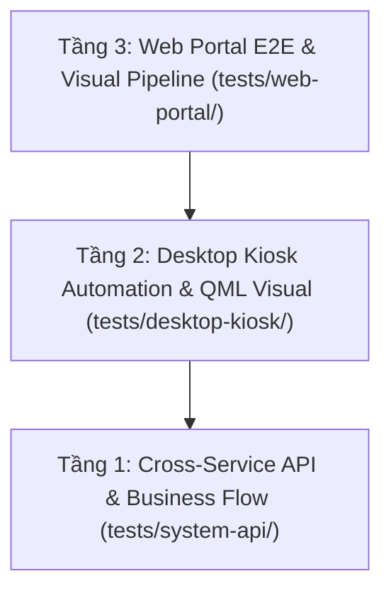

# Trung Tâm Kiểm Thử Hệ Thống & Đa Phân Hệ (`tests/`)

> **Cấp độ không gian:** Cấp 2 (Testing Hub)  
> **Không gian cha:** [`README.md`](../README.md) (Thư mục Gốc)  
> **Trách nhiệm cốt lõi:** Quản lý và điều phối toàn bộ các tầng kiểm thử cấp hệ thống độc lập với Unit Tests nội bộ của từng service: kiểm thử tích hợp API (System API), kiểm thử tự động hóa trạm Kiosk (Desktop FlaUI & Visual), và kiểm thử đầu-cuối Cổng Web (Playwright E2E).

---

## 1. Kim Tự Tháp Kiểm Thử Cấp Hệ Thống

---

## 2. Bản Đồ Cấu Trúc Các Tầng Kiểm Thử (Internal Layout)

| Thư mục kiểm thử | Ứng dụng mục tiêu | Công nghệ & Phạm vi kiểm định | Lệnh thực thi chính |
| :--- | :--- | :--- | :--- |
| [**`system-api/`**](system-api/) | Full-stack (Docker) | Kiểm thử tích hợp luồng nghiệp vụ REST API & STOMP qua container | `python tests/system-api/run_system_e2e.py` |
| [**`desktop-kiosk/`**](desktop-kiosk/) | `app/kiosk-app` | FlaUI UIA3 Windows automation, kiểm thử ma trận tỷ lệ QML, visual snapshot | `pytest tests/desktop-kiosk/visual/ -v` `python tests/desktop-kiosk/automation/run_flaui_e2e.py` |
| [**`web-portal/`**](web-portal/) | `app/web-portal` | Playwright E2E kịch bản 01-05 (Auth, Consent, Dashboard, Shift, Payroll) | `npx playwright test --config=tests/web-portal/playwright.config.ts` |
| [**`reports/`**](reports/) | Tất cả phân hệ | Kho lưu trữ báo cáo audit JSON, ảnh kết xuất visual, gallery HTML | *Chỉ lưu cục bộ, bị `.gitignore` bỏ qua 100%* |

---

## 3. Chính Sách Báo Cáo Cục Bộ (Local-Only Artifacts Policy)

* **Toàn bộ đầu ra kiểm thử** (ảnh chụp màn hình, ảnh so sánh diffs, file báo cáo HTML, tệp JSON đo kiểm) được sinh ra bên trong `tests/reports/` phục vụ việc kiểm tra trực quan tại máy developer.
* **100% tài nguyên báo cáo bị `.gitignore` bỏ qua**: Không đưa bất kỳ ảnh kết xuất nhị phân (`.png`) hay báo cáo tạm nào lên Git repository để giữ repo luôn tinh gọn và tránh xung đột code.
* **CI/CD Artifacts**: Khi chạy trên GitHub Actions, các báo cáo sẽ được tải lên dưới dạng GitHub Actions Artifacts tạm thời với hạn lưu trữ 7 ngày.
