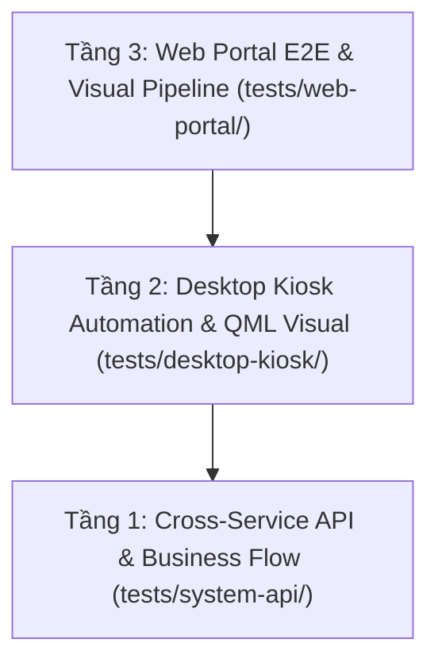

# Trung Tâm Kiểm Thử Hệ Thống & Đa Phân Hệ (`tests/`)

> **Cấp độ không gian:** Cấp 2 (Testing Hub)  
> **Không gian cha:** [`README.md`](../README.md) (Thư mục Gốc)  
> **Trách nhiệm cốt lõi:** Quản lý và điều phối toàn bộ các tầng kiểm thử cấp hệ thống độc lập với Unit Tests nội bộ của từng service: kiểm thử tích hợp API (System API), kiểm thử tự động hóa trạm Kiosk (Desktop FlaUI & Visual), và kiểm thử đầu-cuối Cổng Web (Playwright E2E).

---

## 1. Kim Tự Tháp Kiểm Thử Cấp Hệ Thống



---

## 2. Bản Đồ Điều Hướng Không Gian Kiểm Thử (Domain-to-File Index)

Hệ thống tuân thủ mô hình **Metadata 2 Cấp (Flat Two-Tier)** với cơ chế truy xuất 1-hop (Zero-Hop Indexing). Toàn bộ kịch bản và tệp điều phối kiểm thử được định vị trực tiếp dưới đây:

### 2.1. Tầng 1: System API & Integration Tests (`tests/system-api/`)

| Tệp kiểm thử | Phạm vi kiểm định | Công nghệ & Giao thức | Lệnh thực thi |
| :--- | :--- | :--- | :--- |
| [**`run_system_e2e.py`**](system-api/run_system_e2e.py) | Luồng tích hợp nghiệp vụ toàn trình (Docker container, Auth, Kiosk Punch, STOMP) | Python 3, Requests, WebSocket STOMP | `python tests/system-api/run_system_e2e.py` |
| [**`verify_contracts.py`**](system-api/verify_contracts.py) | Đối soát tính tuân thủ hợp đồng OpenAPI 3.0.3 và WebSocket STOMP 1.2 | Python 3, OpenAPI Spec Validator | `python tests/system-api/verify_contracts.py` |
| [**`test_rbac_matrix.mjs`**](system-api/test_rbac_matrix.mjs) | Ma trận phân quyền 4 vai trò (Admin, HR, DPO, Employee) trên các endpoint REST | Node.js ESM, Fetch API | `node tests/system-api/test_rbac_matrix.mjs` |
| [**`verify_operations.mjs`**](system-api/verify_operations.mjs) | Vận hành nghiệp vụ Staging: gán ca, nộp giải trình, phê duyệt, chốt bảng công | Node.js ESM, REST API Client | `node tests/system-api/verify_operations.mjs` |

### 2.2. Tầng 2: Desktop Kiosk Automation & Visual Regression (`tests/desktop-kiosk/`)

| Tệp kiểm thử | Phạm vi kiểm định | Công nghệ & Giao thức | Lệnh thực thi |
| :--- | :--- | :--- | :--- |
| [**`config.py`**](desktop-kiosk/config.py) | Cấu hình trung tâm (đường dẫn `tests/reports/kiosk-app/`, DPI baselines, ngưỡng sai khác visual) | Python 3, Pathlib | N/A (Module cấu hình) |
| [**`conftest.py`**](desktop-kiosk/conftest.py) | Pytest fixtures & hook dọn dẹp cache đảm bảo Zero Root Pollution | Pytest Hooks | N/A (Fixture tự động) |
| [**`automation/run_flaui_e2e.py`**](desktop-kiosk/automation/run_flaui_e2e.py) | Tự động hóa giao diện Windows FlaUI UIA3 cho ứng dụng PySide6/QML | Python 3, FlaUI UIA3 | `python tests/desktop-kiosk/automation/run_flaui_e2e.py` |
| [**`visual/test_scaling_matrix.py`**](desktop-kiosk/visual/test_scaling_matrix.py) | Kiểm thử ma trận tỷ lệ DPI (100%, 125%, 150%) cho layout HMI cảm ứng Kiosk | Pytest, OpenCV, PIL | `cd app/kiosk-app && pytest ../../tests/desktop-kiosk/visual/test_scaling_matrix.py -v` |
| [**`visual/test_visual_regression.py`**](desktop-kiosk/visual/test_visual_regression.py) | Kiểm thử hồi quy giao diện (Face Oval 4 trạng thái, PIN pad 72px touch targets) | Pytest, Visual Snapshot Diff | `cd app/kiosk-app && pytest ../../tests/desktop-kiosk/visual/test_visual_regression.py -v` |
| [**`visual/run_snapshot_review.py`**](desktop-kiosk/visual/run_snapshot_review.py) | Trình xuất báo cáo so sánh ảnh chụp màn hình dạng HTML Visual Gallery | Python 3, HTML Template Generator | `python tests/desktop-kiosk/visual/run_snapshot_review.py` |

### 2.3. Tầng 3: Web Portal E2E & Visual Testing (`tests/web-portal/`)

| Tệp kiểm thử | Phạm vi kiểm định | Công nghệ & Giao thức | Lệnh thực thi |
| :--- | :--- | :--- | :--- |
| [**`playwright.config.ts`**](web-portal/playwright.config.ts) | Cấu hình thống nhất dual-mode (CI Mock & Staging Live) cho desktop & mobile | Playwright Test Runner | N/A (Tệp cấu hình) |
| [**`runner-e2e.mjs`**](web-portal/runner-e2e.mjs) | Wrapper điều phối thực thi kịch bản E2E độc lập | Node.js ESM | `node tests/web-portal/runner-e2e.mjs --config tests/web-portal/playwright.config.ts` |
| [**`e2e/01-auth-rbac.spec.ts`**](web-portal/e2e/01-auth-rbac.spec.ts) | Đăng nhập 4 vai trò (Admin, HR, DPO, TechLead), điều hướng phân quyền, bảo vệ route | Playwright, TypeScript | `npx playwright test tests/web-portal/e2e/01-auth-rbac.spec.ts` |
| [**`e2e/02-privacy-consent.spec.ts`**](web-portal/e2e/02-privacy-consent.spec.ts) | Quy trình đồng thuận NĐ 13/2023, scroll-to-bottom, OTP/PIN, chính sách 20 ngày NĐ 356/2025 | Playwright, TypeScript | `npx playwright test tests/web-portal/e2e/02-privacy-consent.spec.ts` |
| [**`e2e/03-live-dashboard.spec.ts`**](web-portal/e2e/03-live-dashboard.spec.ts) | Bảng giám sát quân số thời gian thực, KPI thẻ điểm, kết nối STOMP WebSocket | Playwright, TypeScript | `npx playwright test tests/web-portal/e2e/03-live-dashboard.spec.ts` |
| [**`e2e/04-shift-operations.spec.ts`**](web-portal/e2e/04-shift-operations.spec.ts) | Quản trị danh mục ca, gán ca nhân viên, phát hiện xung đột 409, bảo vệ ca khóa | Playwright, TypeScript | `npx playwright test tests/web-portal/e2e/04-shift-operations.spec.ts` |
| [**`e2e/05-excuse-payroll.spec.ts`**](web-portal/e2e/05-excuse-payroll.spec.ts) | Duyệt đơn giải trình kèm ghi chú audit, chống trùng lặp 409, chốt/mở bảng lương có lý do | Playwright, TypeScript | `npx playwright test tests/web-portal/e2e/05-excuse-payroll.spec.ts` |
| [**`fixtures/mockApi.ts`**](web-portal/fixtures/mockApi.ts) | Giả lập toàn diện Backend REST APIs phục vụ chạy CI nhanh không cần container | TypeScript, Playwright Route Mocking | N/A (Fixture dữ liệu) |
| [**`helpers/inTestAudit.ts`**](web-portal/helpers/inTestAudit.ts) | Thu thập chỉ số kiểm toán và đo lường thời gian đáp ứng giao diện trong test | TypeScript | N/A (Helper) |
| [**`visual/visual-responsive.spec.ts`**](web-portal/visual/visual-responsive.spec.ts) | Kiểm thử tương thích responsive đa kích thước màn hình (Desktop 1920x1080, Mobile 375x812) | Playwright Visual Compare | `npx playwright test tests/web-portal/visual/visual-responsive.spec.ts` |

---

## 3. Quy Chuẩn Báo Cáo Cục Bộ (Local-Only Artifacts Policy)

Toàn bộ kết quả kiểm thử được tự động phân loại và lưu trữ theo từng phân hệ trong thư mục [**`reports/`**](reports/):

* [**`reports/system-api/`**](reports/system-api/): Kết quả kiểm tra đối soát hợp đồng OpenAPI/STOMP, log thực thi tích hợp hệ thống, báo cáo ma trận RBAC dạng JSON.
* [**`reports/kiosk-app/`**](reports/kiosk-app/): Ảnh chụp snapshot visual regression, ảnh sai khác (diff) ma trận tỷ lệ DPI, báo cáo FlaUI automation.
* [**`reports/web-portal/`**](reports/web-portal/): Báo cáo Playwright (`test-results.json`, traces, screenshots khi lỗi), báo cáo HTML kiểm định giao diện responsive.
* [**`reports/backend-service/`**](reports/backend-service/): Báo cáo kiểm định tích hợp tầng dịch vụ Java Spring Boot.

> [!IMPORTANT]
> **Chính sách Không Đưa Báo Cáo Lên Kho Mã Nguồn:**
> * Toàn bộ thư mục `tests/reports/` được loại trừ bởi `.gitignore` (ngoại trừ tệp giữ thư mục `.gitkeep`).
> * Tuyệt đối không commit tệp nhị phân (`.png`, `.webm`), bộ nhớ cache hoặc báo cáo HTML/JSON tạm thời lên Git repository.
> * Trên môi trường CI/CD (GitHub Actions), các kết quả kiểm thử sẽ được đóng gói và lưu trữ dưới dạng Artifacts với thời hạn lưu giữ 7 ngày.

---

## 4. Hướng Dẫn Thực Thi Kiểm Thử (Execution Guide)

### 4.1. Kiểm thử Tích Hợp Toàn Hệ Thống (System API)
> [!NOTE]
> Yêu cầu các container hạ tầng (`fas-postgres`, `fas-backend`, `fas-web`) đang hoạt động trước khi chạy kiểm thử thực tế.

```bash
# Kiểm thử toàn trình luồng nghiệp vụ REST & WebSocket STOMP
python tests/system-api/run_system_e2e.py

# Đối soát tính tương thích của hợp đồng OpenAPI
python tests/system-api/verify_contracts.py

# Kiểm thử ma trận phân quyền 4 vai trò (RBAC Matrix)
node tests/system-api/test_rbac_matrix.mjs

# Kiểm tra quy trình vận hành ca kíp & giải trình Staging
node tests/system-api/verify_operations.mjs
```

### 4.2. Kiểm thử Trạm Kiosk Desktop (`app/kiosk-app`)
> [!IMPORTANT]
> **Rào chắn Không Gian Thực Thi:** Tuân thủ nguyên tắc Subspace CWD Invariant để ngăn chặn ô nhiễm tệp rác `.pytest_cache` tại thư mục gốc.

```bash
# Chạy kiểm thử ma trận tỷ lệ DPI và hồi quy Visual từ không gian app/kiosk-app
cd app/kiosk-app && pytest ../../tests/desktop-kiosk/visual/ -v

# Chạy kiểm thử tự động hóa giao diện FlaUI UIA3 (yêu cầu môi trường Windows desktop)
python tests/desktop-kiosk/automation/run_flaui_e2e.py

# Xuất bộ sưu tập ảnh kiểm tra visual snapshot dạng HTML
python tests/desktop-kiosk/visual/run_snapshot_review.py
```

### 4.3. Kiểm thử Cổng Web Quản Trị (`app/web-portal`)

```bash
# Liệt kê danh sách toàn bộ 50 kịch bản kiểm thử (Desktop & Mobile Chrome)
node tests/web-portal/runner-e2e.mjs --config tests/web-portal/playwright.config.ts --list

# Chạy toàn bộ kịch bản Playwright E2E với báo cáo chuẩn hóa
npx playwright test --config=tests/web-portal/playwright.config.ts

# Chạy chế độ Mock API phục vụ CI nhanh không cần backend container
USE_MOCK=true npx playwright test --config=tests/web-portal/playwright.config.ts

# Chạy kiểm thử hồi quy trực quan Responsive
npx playwright test tests/web-portal/visual/visual-responsive.spec.ts --config=tests/web-portal/playwright.config.ts
```

---

## 5. Rào Chắn An Toàn & Chuẩn Mực Bất Biến (Quality & Security Invariants)

1. **Zero Root Pollution:** Tuyệt đối không để phát sinh tệp rác, thư mục cache (`.pytest_cache/`, `.eslintcache/`) hoặc log tạm tại thư mục gốc của repository.
2. **Zero-Photo-Upload Philosophy:** Tuyệt đối không lưu trữ hoặc truyền tải dữ liệu ảnh khuôn mặt thô qua mạng hoặc vào thư mục lưu trữ vĩnh viễn. Mọi bài kiểm thử chỉ sử dụng vector toán học 512D ArcFace.
3. **Mã Hóa Sinh Trắc Học AES-256-GCM:** Mọi mẫu sinh trắc trong cơ sở dữ liệu phải được mã hóa bằng khóa bảo mật chuyên dụng trước khi lưu trữ.
4. **Quy Tắc Xóa Dữ Liệu Sau 20 Ngày:** Xác minh định kỳ việc tự động xóa vĩnh viễn dữ liệu sinh trắc học của nhân sự thôi việc sau 20 ngày theo Nghị định 356/2025/NĐ-CP.
5. **Anti-Spoofing & Duplicate Punch Cooldown:** Bắt buộc vượt qua cổng kiểm tra liveness MiniFASNet và áp dụng bộ đệm chống quẹt đúp 120 giây trên toàn bộ trạm Kiosk và bộ nhớ đệm Backend.
