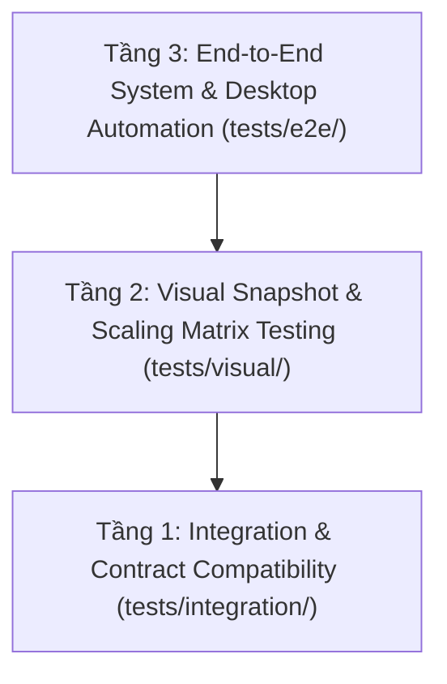

# Bộ Kiểm thử Hệ thống & Đa Dịch vụ (`tests/`)

> **Mã phân vùng:** `WORKSPACE-TESTS`  
> **Cấp độ không gian:** Parent Testing Hub  
> **Đường dẫn:** `tests/`  
> **Không gian cha:** [`README.md`](../README.md) (Thư mục Gốc)  
> **Trách nhiệm cốt lõi (Single Responsibility):** Quản lý và thực thi toàn bộ các tầng kiểm thử cấp hệ thống (System-Level), kiểm thử tự động hóa đầu-cuối (E2E), kiểm thử trực quan (Visual Regression & Scaling Matrix), và kiểm thử tích hợp hợp đồng liên dịch vụ (Cross-service Integration Tests).

---

## 1. Kim tự tháp Kiểm thử Cấp Hệ thống

Khác với các bài kiểm thử đơn vị nội bộ nằm trong từng service (`app/<service>/tests/`), thư mục `tests/` này là không gian độc lập kiểm định tính tương thích, độ ổn định và trải nghiệm người dùng trên toàn hệ thống:

---

## 2. Bản đồ Cấu trúc Nội bộ (Internal Layout)

| Thư mục / Kịch bản | Loại kiểm thử | Trách nhiệm chi tiết | Lệnh thực thi |
|:---|:---|:---|:---|
| [**`e2e/run_system_e2e_tests.py`**](e2e/run_system_e2e_tests.py) | System E2E | Luồng nghiệp vụ toàn diện từ Cổng Web $\rightarrow$ Backend $\rightarrow$ Kiosk | `python tests/e2e/run_system_e2e_tests.py` |
| [**`e2e/desktop/run_flaui_e2e.py`**](e2e/desktop/run_flaui_e2e.py) | Desktop UIA3 | Điều khiển giao diện Kiosk thật qua FlaUI CLI: giả lập phím F2, F1, Esc, Space | `python tests/e2e/desktop/run_flaui_e2e.py` |
| [**`visual/test_visual_regression.py`**](visual/test_visual_regression.py) | Visual Regression | Kiểm tra 17 màn hình chuẩn Kiosk, Zero-Leak Gate (không lộ dữ liệu demo) | `pytest tests/visual/test_visual_regression.py -v` |
| [**`visual/test_scaling_matrix.py`**](visual/test_scaling_matrix.py) | Scaling Matrix | Kiểm định tính co giãn trên 8 độ phân giải (FHD, 4K, Landscape, Ultrawide, Mobile) | `pytest tests/visual/test_scaling_matrix.py -v` |
| [**`visual/run_ui_review.py`**](visual/run_ui_review.py) | Snapshot Runner | Tự động kết xuất lại toàn bộ 17 ảnh chụp chuẩn vào `reports/screenshots/baselines/` | `python tests/visual/run_ui_review.py` |
| [**`integration/`**](integration/) | API Integration | Kiểm định tính tương thích thực tế giữa Backend REST/STOMP và các ứng dụng | `pytest tests/integration/ -v` |

---

## 3. Quy tắc Đầu ra & Chính sách Báo cáo

* **Ranh giới đầu ra**: Toàn bộ dữ liệu kết xuất từ các bài kiểm thử này (ảnh chụp màn hình, báo cáo audit JSON, kết quả đo độ phủ) **tuyệt đối không được ghi vào `docs/` hay `app/`**, mà được lưu trữ thống nhất tại:
  - Ảnh chụp giao diện chuẩn & vết E2E: [`reports/screenshots/`](../reports/screenshots/)
  - Báo cáo kiểm toán trợ năng & chất lượng selector: [`reports/audit/`](../reports/audit/)
  - Kết quả kiểm thử JUnit XML / Coverage: [`reports/test-results/`](../reports/test-results/)
* **Chính sách Git**:
  - Mã nguồn kiểm thử `tests/` được theo dõi đầy đủ trong Git.
  - Các tệp phiên kiểm thử tạm (`*.session.json`) và ảnh sai lệch (`diffs/`) được `.gitignore` tự động bỏ qua.
