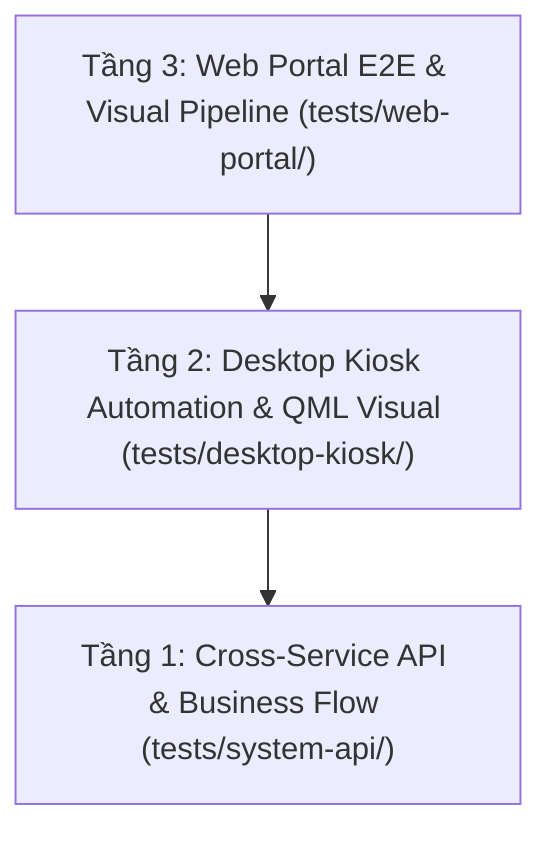

# Bộ Kiểm Thử Hệ Thống & Đa Phân Hệ (`tests/`)

> **Mã phân vùng:** `WORKSPACE-TESTS`  
> **Cấp độ không gian:** Parent Testing Hub  
> **Đường dẫn:** `tests/`  
> **Không gian cha:** [`README.md`](../README.md) (Thư mục Gốc)  
> **Trách nhiệm cốt lõi:** Quản lý và điều phối toàn bộ các tầng kiểm thử cấp hệ thống: kiểm thử tích hợp API liên dịch vụ (System API Integration), kiểm thử tự động hóa trạm Kiosk (Desktop Kiosk UIA3 & Visual), và kiểm thử đầu-cuối Cổng Web (Web Portal E2E & Visual Regression).

---

## 1. Kim Tự Tháp Kiểm Thử Cấp Hệ Thống

Khác với các bài kiểm thử đơn vị nội bộ nằm trong từng service (`app/<service>/`), thư mục `tests/` này là không gian độc lập kiểm định tính tương thích, độ ổn định và trải nghiệm người dùng trên toàn hệ thống:

---

## 2. Bản Đồ Cấu Trúc Phân Hệ (Internal Layout)

| Phân hệ / Thư mục | Ứng dụng mục tiêu | Loại kiểm thử | Lệnh thực thi chính |
|:---|:---|:---|:---|
| [**`desktop-kiosk/`**](desktop-kiosk/) | `app/kiosk-app` | FlaUI UIA3 E2E, QML Scaling Matrix, Visual Regression (17 Golden Baselines) | `pytest tests/desktop-kiosk/visual/ -v` `python tests/desktop-kiosk/automation/run_flaui_e2e.py` |
| [**`web-portal/`**](web-portal/) | `app/web-portal` | Playwright E2E Functional (01-05), Visual Regression Pipeline (67 screens & Gallery) | `cd app/web-portal && npm run test:e2e` `cd app/web-portal && npm run test:ui` |
| [**`system-api/`**](system-api/) | Full-stack (Docker) | System Integration TST-SYS-001..034 (REST API, STOMP WS, RBAC, CSDL) | `python tests/system-api/run_system_e2e.py` |
| [**`reports/`**](reports/) | Tất cả phân hệ | Kho lưu trữ báo cáo, ảnh chụp màn hình, audit JSON và HTML Gallery | *Tự động sinh ra khi chạy test (Local-Only)* |

---

## 3. Chính Sách Báo Cáo Cục Bộ (Local-Only Policy)

Tuân thủ nguyên tắc **Local-Only Artifacts**:
* **Toàn bộ đầu ra kiểm thử** (ảnh chụp màn hình, ảnh diffs, file báo cáo HTML `visual_gallery.html`, tệp JSON đo kiểm) được sinh ra bên trong `tests/reports/<platform>/` nhằm phục vụ việc kiểm tra trực quan tại máy developer.
* **100% tài nguyên báo cáo bị `.gitignore` bỏ qua**: Không đưa bất kỳ ảnh kết xuất nhị phân (`.png`) hay báo cáo tạm nào lên Git repository để giữ repo luôn tinh gọn và tránh xung đột code.
* **CI/CD Artifacts**: Khi chạy trên GitHub Actions, các báo cáo sẽ được tải lên dưới dạng GitHub Actions Artifacts tạm thời với hạn lưu trữ 7 ngày.
